# 编译与调试完全指南

- **作者**：冷静
- **日期**：2026-08-06
- **版本**：v0.0.1
- **链接**：https://github.com/lengjingzju/notes

# 目录

[TOC]

# 第1章 编译工具集概览

本章是整篇编译和调试笔记的知识基础。我们将从编译工具链的整体架构出发，介绍 GCC 编译器的四阶段工作流程（预处理→编译→汇编→链接），深入讲解 ELF 文件格式的内部结构，并通过一个完整的编译实战示例将各工具串联起来。掌握本章内容后，后续各章的 GCC 选项、链接器、二进制分析工具、GDB 调试等知识都将有清晰的上下文依托。

本章内容结构如下：


## 1.1 编译工具链全景

Linux 下的编译工具链是一个完整的生态系统，由编译器、标准库、二进制工具集和调试工具等多个相互协作的组件组成。理解这些工具之间的关系和分工，是掌握整个编译流程的基础。本节将依次介绍工具链的核心组件、binutils 工具集的分类、调试与分析工具，以及各工具之间的协作关系。

### 1.1.1 编译工具链组成

| 工具/库 | 功能 | 说明 |
|---------|------|------|
| gcc | C编译器 | GNU C编译器，编译C语言源文件 |
| g++ | C++编译器 | GNU C++编译器，等价于 `gcc -lstdc++` |
| libstdc++ | C++标准库 | GNU C++标准库实现，通过glibc调用系统调用 |
| glibc | C标准库 | GNU C库，提供标准C函数和系统调用封装 |
| binutils | 二进制工具集 | 汇编、链接、目标文件处理等工具集合 |

各组件之间的层次关系如下：

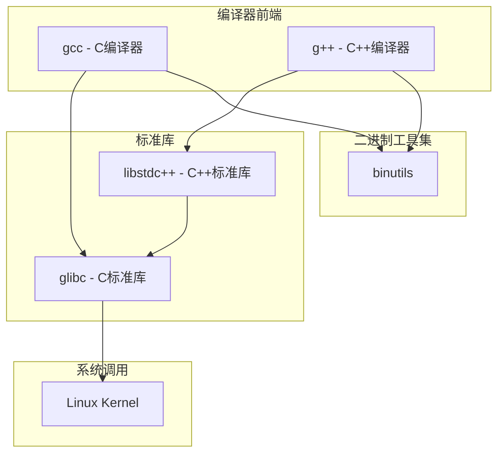

查看工具链版本信息：

```bash
# 查看gcc版本及配置信息
$ gcc --version
gcc (Ubuntu 7.5.0-3ubuntu1~18.04) 7.5.0

# 查看gcc详细配置（包含搜索路径、启用的语言等）
$ gcc -v

# 查看binutils版本
$ as --version
GNU assembler (GNU Binutils for Ubuntu) 2.30

$ ld --version
GNU ld (GNU Binutils for Ubuntu) 2.30
```

gcc 与 g++ 的区别：

| 对比项 | gcc | g++ |
|--------|-----|-----|
| 默认语言 | C | C++ |
| 源文件后缀 | `.c` | `.cpp`、`.cc`、`.cxx` ... |
| 链接库 | 不自动链接libstdc++ | 自动链接libstdc++ |
| 等价关系 | `gcc main.cpp -lstdc++` | `g++ main.cpp` |
| 预处理宏 | `__cplusplus` 未定义 | `__cplusplus` 已定义 |

### 1.1.2 二进制工具集 binutils 分类总览

binutils（Binary Utilities）是 GNU 项目提供的二进制文件处理工具集合，按用途可分为编译相关和分析相关两大类。

**编译相关工具：**

| 工具 | 功能 | 典型用途 |
|------|------|----------|
| as | 汇编器 | 将汇编代码（`.s`）转换为目标文件（`.o`） |
| ld | 链接器 | 将目标文件链接为可执行文件或库 |
| objcopy | 段编辑器 | 复制和转换目标文件格式（如ELF转raw binary） |
| ar | 静态库编辑器 | 创建和管理静态库（`.a` 文件） |
| ranlib | 符号索引工具 | 更新静态库的符号索引表（等价于 `ar -s`） |
| strip | 符号剥离工具 | 去除目标文件的符号和调试信息，减小文件体积 |

**分析相关工具：**

| 工具 | 功能 | 典型用途 |
|------|------|----------|
| objdump | 反汇编与信息查看 | 查看目标文件信息、反汇编代码 |
| readelf | ELF信息查看 | 查看ELF文件的头、节、段等结构信息 |
| elfedit | ELF编辑工具 | 编辑ELF文件头信息（OS ABI、类型等） |
| size | 段大小查看 | 查看目标文件各段（text/data/bss）的大小 |
| strings | 字符串提取 | 提取目标文件中的可打印字符串（默认长度≥4） |
| nm | 符号表查看 | 查看目标文件的符号表 |
| addr2line | 地址转行号 | 将地址转换为源文件名和行号 |
| c++filt | 符号解码 | 将C++修饰后的函数名转换为可读形式 |

### 1.1.3 调试与分析工具总览

除 binutils 外，还有以下常用的调试与分析工具：

| 工具 | 功能 | 说明 |
|------|------|------|
| gdb | GNU调试器 | 断点、单步执行、变量查看、内存检查、多线程/多进程调试 |
| gprof | 性能分析工具 | 配合 `-pg` 编译选项，分析函数调用次数和耗时 |
| file | 文件类型探测 | 探测文件类型（ELF/文本/归档等） |
| ldd | 动态库依赖查看 | 查看可执行文件或共享库依赖的动态库 |

### 1.1.4 工具链协作流程图

下图展示了从源代码到最终可执行文件，以及后续分析调试的完整工具链协作关系：

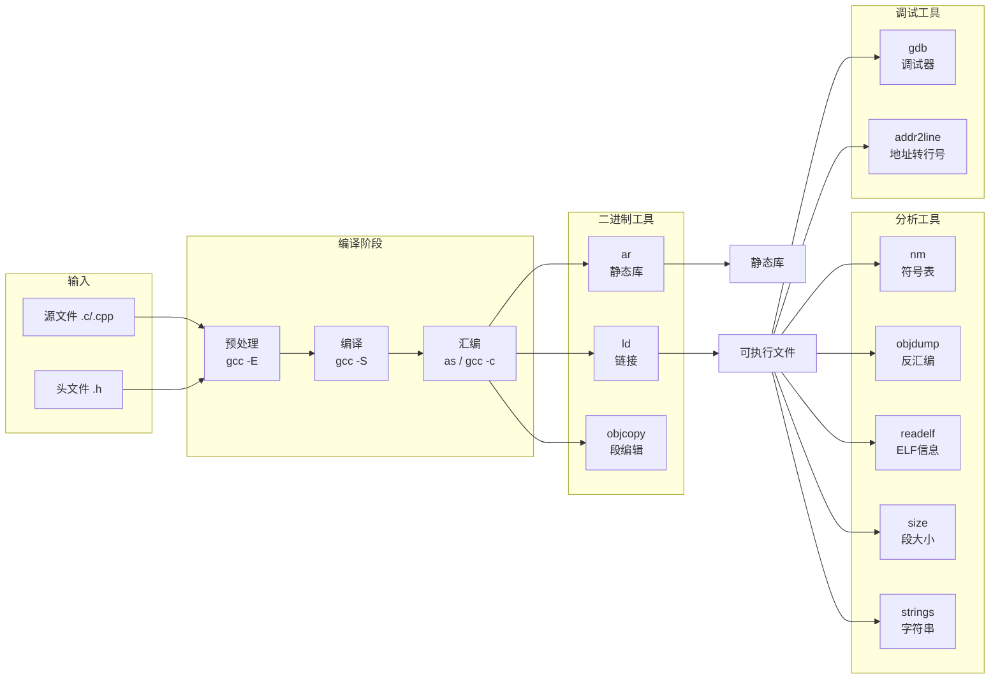

## 1.2 编译的四个阶段

GCC 在编译源文件时，依次执行四个阶段：预处理 → 编译 → 汇编 → 链接。每个阶段有明确的输入、输出和对应的工具。本节逐一讲解各阶段的工作内容、命令用法和实践示例。


### 1.2.1 预处理（Preprocessing）

```bash
gcc -E test.c -o test.i
```

预处理阶段完成以下工作：

- 处理宏定义（`#define`）：将宏展开为对应的值
- 处理文件包含（`#include`）：将头文件内容插入到源文件中
- 处理条件编译指令（`#ifdef`、`#ifndef`、`#if`、`#else`、`#endif`等）
- 去除注释
- 不会对语法进行检查
- 生成的还是C代码
- 默认不生成文件，而是直接输出到终端（需要 `-o` 指定输出文件）

**实践示例：**

```c
// test.c
#include <stdio.h>
#define MAX_NUM 1024

int main(void)
{
    int arr[MAX_NUM];
    printf("array size: %d\n", MAX_NUM);
    return 0;
}
```

```bash
$ gcc -E test.c -o test.i
$ head -20 test.i          # 查看预处理输出（前面是stdio.h展开的内容）
$ grep "MAX_NUM" test.i    # 宏已被展开，不再出现MAX_NUM
$ grep "1024" test.i       # 可以看到1024已替换
```

### 1.2.2 编译（Compilation）

```bash
gcc -S test.i -o test.s
```

编译阶段完成以下工作：

- 检查语法：此阶段会进行词法分析、语法分析、语义分析
- 将C代码转换为汇编代码
- 默认生成 `*.s` 文件
- 如果存在语法错误，在此阶段报错

**实践示例：**

```bash
$ gcc -S test.i -o test.s
$ head -30 test.s
    .file   "test.c"
    .section .rodata
.LC0:
    .string "array size: %d\n"
    .text
    .globl  main
    .type   main, @function
main:
    pushq   %rbp
    movq    %rsp, %rbp
    subq    $4112, %rsp
    ...
```

### 1.2.3 汇编（Assembly）

```bash
gcc -c test.s -o test.o
# 或直接使用as
as test.s -o test.o
```

汇编阶段完成以下工作：

- 将汇编代码转换为ELF格式的目标代码（机器码）
- 默认生成 `*.o` 文件
- 此阶段的输出是二进制文件，不可直接阅读

**实践示例：**

```bash
$ gcc -c test.s -o test.o
$ file test.o
test.o: ELF 64-bit LSB relocatable, x86-64, version 1 (SYSV), not stripped

# 查看目标文件的节信息
$ objdump -h test.o
test.o:     file format elf64-x86-64

Sections:
Idx Name          Size      VMA               LMA               File off  Algn
  0 .text         00000045  0000000000000000  0000000000000000  00000040  2**0
                  CONTENTS, ALLOC, LOAD, RELOC, READONLY, CODE
  1 .data         00000000  0000000000000000  0000000000000000  00000085  2**0
                  CONTENTS, ALLOC, LOAD, DATA
  ...
```

### 1.2.4 链接（Linking）

```bash
gcc test.o -o test
# 或直接使用ld（需要手动指定启动代码和库）
ld test.o -o test
```

链接阶段完成以下工作：

- 链接启动代码（crt1.o、crti.o、crtn.o等）
- 链接所需的库（libc、libm等）
- 解析所有符号引用（函数调用、全局变量引用）
- 生成可执行文件
- 默认生成 `a.out` 文件
- 只有在链接阶段才会检查所有函数是否已经定义，没有定义会报错"找不到函数"（undefined reference）

**实践示例：**

```bash
$ gcc test.o -o test
$ ./test
array size: 1024

# 查看链接过程的详细信息
$ gcc test.o -o test -v
# 输出中可以看到实际调用了ld，以及链接了哪些启动文件和库
```

**链接错误示例：**

```bash
# 如果myop.c中调用了pow()但没有链接数学库
$ gcc main.o myop.o -o myop
/usr/bin/ld: myop.o: in function `mypow':
myop.c:(.text+0x5c): undefined reference to `pow'
collect2: error: ld returned 1 exit status

# 解决方法：添加 -lm 链接数学库
$ gcc main.o myop.o -o myop -lm
```

### 1.2.5 四阶段对比表

| 阶段 | 输入 | 输出 | 工具 | 关键选项 | 主要工作 |
|------|------|------|------|----------|----------|
| 预处理 | `.c` | `.i` | `gcc -E` | `-E` | 宏展开、头文件包含、条件编译、去注释 |
| 编译 | `.i` | `.s` | `gcc -S` | `-S` | 语法检查、生成汇编代码 |
| 汇编 | `.s` | `.o` | `as` / `gcc -c` | `-c` | 汇编代码→ELF目标文件 |
| 链接 | `.o` | 可执行文件 | `ld` / `gcc` | （无阶段选项） | 符号解析、库链接、生成可执行文件 |

**一步到位与分步编译的对比：**

```bash
# 一步到位（gcc自动完成四个阶段）
gcc test.c -o test

# 分步编译（可以查看每个阶段的中间产物）
gcc -E test.c -o test.i    # 预处理
gcc -S test.i -o test.s    # 编译
gcc -c test.s -o test.o    # 汇编
gcc test.o -o test         # 链接

# 使用-v选项查看gcc内部实际调用了哪些工具
gcc test.c -o test -v
```

## 1.3 ELF文件格式

ELF（Executable and Linking Format）是一种对象文件的格式标准，用于定义不同类型的对象文件中都放了什么、以及以什么样的格式去放这些东西。Linux 下的可执行文件、共享库、目标文件都采用 ELF 格式。本节将从三种文件类型出发，深入剖析 ELF Header、Program Header Table、Section Header Table 的每个字段，并通过 `readelf` 命令逐一验证。

### 1.3.1 ELF三种文件类型

ELF 格式定义了三种主要的文件类型，它们在编译链接流程中扮演不同角色：

| 类型 | 说明 | 扩展名 | 生成方式 | e_type值 |
|------|------|--------|----------|----------|
| 可重定位文件（Relocatable） | 由汇编器生成的目标文件 | `.o` | `gcc -c` 或 `as` | ET_REL (1) |
| 可执行文件（Executable） | 可直接运行的应用程序 | （无固定扩展名） | `gcc` 链接阶段 | ET_EXEC (2) / ET_DYN (3) |
| 共享对象文件（Shared Object） | 动态库文件 | `.so` | `gcc -shared` | ET_DYN (3) |

三种类型的关系与转换流程：

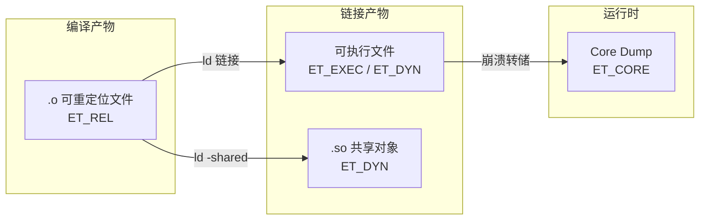

三种类型的详细对比：

| 对比项 | 可重定位文件（.o） | 可执行文件 | 共享对象文件（.so） |
|--------|-------------------|-----------|-------------------|
| 是否可直接运行 | 否 | 是 | 否（需被加载） |
| 是否含 Program Header | 否 | 是 | 是 |
| 是否含 Section Header | 是 | 是 | 是 |
| 是否含重定位信息 | 是（`.rel.*`） | 部分（`.rela.dyn`） | 是（`.rela.dyn`、`.rela.plt`） |
| 地址是否已确定 | 否（从0开始） | 是（固定或PIE） | 否（位置无关） |
| 典型用途 | 链接的中间产物 | 最终运行的程序 | 被多个程序共享的代码 |

**使用 `file` 命令验证三种类型：**

```bash
# 可重定位文件
$ file myop.o
myop.o: ELF 64-bit LSB relocatable, x86-64, version 1 (SYSV), not stripped

# 可执行文件（PIE模式下显示为 shared object）
$ file myop
myop: ELF 64-bit LSB shared object, x86-64, version 1 (SYSV), dynamically linked,
      interpreter /lib64/ld-linux-x86-64.so.2, for GNU/Linux 3.2.0, not stripped

# 共享对象文件
$ file libmyop.so
libmyop.so: ELF 64-bit LSB shared object, x86-64, version 1 (SYSV),
      dynamically linked, not stripped
```

> **易错点：** 现代 Linux 发行版默认启用 PIE（Position Independent Executable），此时可执行文件的 `e_type` 也是 `ET_DYN`，`file` 命令输出也显示为 "shared object"。区分方法是看是否有 `interpreter` 字段——有 `interpreter` 的是可执行文件，没有的是共享库。

使用 `readelf -h` 验证 `e_type` 字段：

```bash
$ readelf -h myop.o | grep Type
  Type:                              REL (Relocatable file)

$ readelf -h myop | grep Type
  Type:                              DYN (Shared object file)

$ readelf -h libmyop.so | grep Type
  Type:                              DYN (Shared object file)
```

### 1.3.2 ELF文件结构

一个 ELF 文件由以下四部分组成：

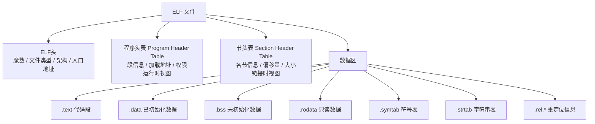

**ELF文件的两种视图：**

| 视图 | 组成 | 用途 | 使用者 |
|------|------|------|--------|
| 链接视图 | 节（Section） | 链接时，按节组织代码和数据 | 链接器（ld） |
| 执行视图 | 段（Segment） | 运行时，按段加载到内存 | 加载器（ld-linux.so） |

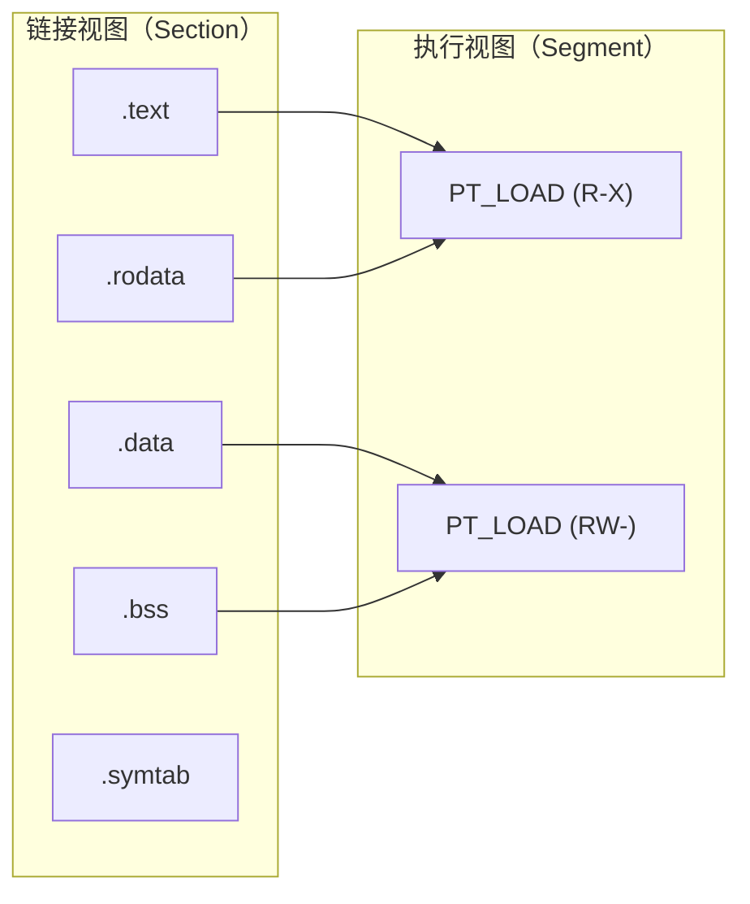

#### 1.3.2.1 ELF Header 字段详解

ELF Header 位于文件最开头，32位ELF文件头大小为52字节，64位为64字节。它描述了整个文件的基本属性。

**ELF魔数说明：** ELF文件的前4个字节固定为 `0x7f 'E' 'L' 'F'`（即十六进制 `7f 45 4c 46`），用于标识文件格式。`file` 命令正是通过检测这个魔数来判断文件是否为ELF格式。可以使用 `hexdump` 验证：

```bash
$ hexdump -C myop | head -1
00000000  7f 45 4c 46 02 01 01 00  00 00 00 00 00 00 00 00  |.ELF............|
```

使用 `readelf -h` 查看完整输出：

```bash
$ readelf -h myop
ELF Header:
  Magic:   7f 45 4c 46 02 01 01 00 00 00 00 00 00 00 00 00
  Class:                             ELF64
  Data:                              2's complement, little endian
  Version:                           1 (current)
  OS/ABI:                            UNIX - System V
  ABI Version:                       0
  Type:                              DYN (Shared object file)
  Machine:                           Advanced Micro Devices X86-64
  Version:                           0x1
  Entry point address:               0x6b0
  Start of program headers:          64 (bytes into file)
  Start of section headers:          14648 (bytes into file)
  Flags:                             0x0
  Size of this header:               64 (bytes)
  Size of program headers:           56 (bytes)
  Number of program headers:         13
  Size of section headers:           64 (bytes)
  Number of section headers:         31
  Section header string table index: 30
```

**ELF Header 字段说明表：**

| 字段 | 大小（64位） | 含义 | 典型值 |
|------|-------------|------|--------|
| e_ident[EI_MAG0~3] | 4字节 | 魔数，固定为 `0x7F 'E' 'L' 'F'`，标识ELF格式 | `7f 45 4c 46` |
| e_ident[EI_CLASS] | 1字节 | 文件类别：1=32位，2=64位 | `02`（ELF64） |
| e_ident[EI_DATA] | 1字节 | 字节序：1=小端，2=大端 | `01`（小端） |
| e_ident[EI_VERSION] | 1字节 | ELF版本号，当前固定为1 | `01` |
| e_ident[EI_OSABI] | 1字节 | 操作系统/ABI标识：0=System V，3=Linux | `00` |
| e_ident[EI_ABIVERSION] | 1字节 | ABI版本 | `00` |
| e_ident[EI_PAD] | 7字节 | 填充字节，保留未用 | `00 00 00 00 00 00 00` |
| e_type | 2字节 | 文件类型 | 见下表 |
| e_machine | 2字节 | 目标架构 | 见下表 |
| e_version | 4字节 | 版本号，固定为1 | `0x1` |
| e_entry | 8字节 | 程序入口点虚拟地址 | `0x6b0` |
| e_phoff | 8字节 | Program Header Table 在文件中的偏移 | `64`（紧跟ELF Header之后） |
| e_shoff | 8字节 | Section Header Table 在文件中的偏移 | `14648` |
| e_flags | 4字节 | 处理器相关标志 | `0x0` |
| e_ehsize | 2字节 | ELF Header 本身的大小 | `64`（64位）/ `52`（32位） |
| e_phentsize | 2字节 | 每个 Program Header 条目的大小 | `56`（64位）/ `32`（32位） |
| e_phnum | 2字节 | Program Header 条目数量 | `13` |
| e_shentsize | 2字节 | 每个 Section Header 条目的大小 | `64`（64位）/ `40`（32位） |
| e_shnum | 2字节 | Section Header 条目数量 | `31` |
| e_shstrndx | 2字节 | 节名字符串表（.shstrtab）的索引 | `30` |

**e_type 常见取值：**

| 值 | 名称 | 说明 |
|----|------|------|
| 0 | ET_NONE | 未知类型 |
| 1 | ET_REL | 可重定位文件（.o） |
| 2 | ET_EXEC | 可执行文件 |
| 3 | ET_DYN | 共享目标文件（.so）/ PIE可执行文件 |
| 4 | ET_CORE | Core dump 文件 |

**e_machine 常见取值：**

| 值 | 架构 |
|----|------|
| 0x03 | x86（i386） |
| 0x08 | MIPS |
| 0x14 | PowerPC |
| 0x15 | PowerPC 64-bit |
| 0x16 | S390/S390x |
| 0x28 | ARM（AArch32） |
| 0x2A | SuperH |
| 0x32 | IA-64 |
| 0x3E | AMD x86-64 |
| 0xB7 | AArch64（ARMv8） |
| 0xF3 | RISC-V |

#### 1.3.2.2 Program Header Table 字段详解

Program Header Table（程序头表）描述了文件在运行时如何被加载到内存。**仅可执行文件和共享库包含此表，可重定位文件（.o）没有。**

使用 `readelf -l` 查看。

**Program Header 条目字段说明表：**

| 字段 | 大小（64位） | 含义 | 说明 |
|------|-------------|------|------|
| p_type | 4字节 | 段类型 | 见下方 Segment 类型表 |
| p_flags | 4字节 | 段权限标志 | PF_X=1（可执行），PF_W=2（可写），PF_R=4（可读） |
| p_offset | 8字节 | 段在文件中的偏移 | 段数据在文件中的起始位置 |
| p_vaddr | 8字节 | 段在内存中的虚拟地址 | 运行时加载到的虚拟地址 |
| p_paddr | 8字节 | 段在内存中的物理地址 | 在物理地址有意义的系统中使用（嵌入式） |
| p_filesz | 8字节 | 段在文件中的大小 | 可能为0 |
| p_memsz | 8字节 | 段在内存中的大小 | `p_memsz > p_filesz` 时差值部分用0填充（如.bss） |
| p_align | 8字节 | 段的对齐要求 | 0或1表示无对齐要求，否则为2的幂次 |

**关键关系：** `p_vaddr % p_align == p_offset % p_align`，即虚拟地址和文件偏移在对齐上保持一致。这保证了加载器可以使用 `mmap` 高效地将文件映射到内存。

#### 1.3.2.3 Section Header Table 字段详解

Section Header Table（节头表）描述了文件中各个节的信息，是链接器进行符号解析和重定位的基础。

使用 `readelf -S` 查看。

**Section Header 条目字段说明表：**

| 字段 | 大小（64位） | 含义 | 说明 |
|------|-------------|------|------|
| sh_name | 4字节 | 节名在 `.shstrtab` 中的偏移 | 通过此偏移可找到节的名称字符串 |
| sh_type | 4字节 | 节类型 | 见下方常见节类型 |
| sh_flags | 8字节 | 节属性标志 | 见下方标志说明 |
| sh_addr | 8字节 | 节在内存中的虚拟地址 | 如果节不出现在内存中则为0 |
| sh_offset | 8字节 | 节在文件中的偏移 | 节数据在文件中的起始位置 |
| sh_size | 8字节 | 节的大小（字节） | 可能为0 |
| sh_link | 4字节 | 关联节的索引 | 含义取决于节类型（如符号表关联字符串表） |
| sh_info | 4字节 | 附加信息 | 含义取决于节类型 |
| sh_addralign | 8字节 | 节的对齐要求 | 必须为2的幂次 |
| sh_entsize | 8字节 | 节中每个条目的大小 | 仅对包含固定大小条目的节有效，否则为0 |

**sh_type 常见取值：**

| 值 | 名称 | 说明 |
|----|------|------|
| 0 | SHT_NULL | 无效节（索引0的占位节） |
| 1 | SHT_PROGBITS | 程序数据（代码、已初始化数据等） |
| 2 | SHT_SYMTAB | 符号表（完整，用于链接和调试） |
| 3 | SHT_STRTAB | 字符串表 |
| 4 | SHT_RELA | 带加数的重定位表 |
| 5 | SHT_HASH | 符号哈希表 |
| 6 | SHT_DYNAMIC | 动态链接信息 |
| 7 | SHT_NOTE | 注释信息 |
| 8 | SHT_NOBITS | 不占文件空间的节（如.bss） |
| 9 | SHT_REL | 不带加数的重定位表 |
| 11 | SHT_DYNSYM | 动态符号表（运行时使用） |

**sh_flags 常见取值：**

| 值 | 名称 | 说明 |
|----|------|------|
| 0x1 | SHF_WRITE | 可写 |
| 0x2 | SHF_ALLOC | 运行时占用内存 |
| 0x4 | SHF_EXECINSTR | 可执行（包含机器指令） |
| 0x10 | SHF_MERGE | 可合并（相同内容合并以减少体积） |
| 0x20 | SHF_STRINGS | 包含以null结尾的字符串 |
| 0x400 | SHF_TLS | 线程本地存储 |

### 1.3.3 程序段（Segment）说明

本节介绍 ELF 文件中常见的节（Section）及其属性，以及 Segment 与 Section 的映射关系。

#### 1.3.3.1 常见节及其属性

| 段名 | 内容 | 说明 | 是否占文件空间 | 是否占运行时内存 |
|------|------|------|---------------|-----------------|
| `.text` | 可执行代码 | 程序的机器指令 | 是 | 是 |
| `.data` | 已初始化的数据 | 初始化为非0的静态变量和全局变量 | 是 | 是 |
| `.bss` | 未初始化的数据 | 未初始化或初始化为0的静态变量 | 否 | 是 |
| `.rodata` | 只读数据 | 字符串常量、`const` 数据 | 是 | 是 |
| `.rel.*` | 重定位条目 | 链接时需要重定位的信息 | 是（仅.o文件） | 否 |
| `.symtab` / `.dynsym` | 符号表 | 符号信息（函数名、变量名等） | 是 | 部分 |
| `.strtab` / `.dynstr` | 字符串表 | 符号名称等字符串信息 | 是 | 部分 |

#### 1.3.3.2 各段的实际验证

使用 `readelf -S` 和 `objdump -h` 可以验证各段的存在及属性：

```bash
# 使用 readelf -S 查看节信息
$ readelf -S myop
There are 31 section headers, starting at offset 0x3938:

Section Headers:
  [Nr] Name              Type             Address           Offset
       Size              EntSize          Flags  Link  Info  Align
  [ 0]                   NULL             0000000000000000  00000000
       0000000000000000  0000000000000000           0     0     0
  [ 1] .interp           PROGBITS         0000000000000238  00000238
       000000000000001c  0000000000000000   A       0     0     1
  ...
  [10] .text             PROGBITS         00000000000007b0  000007b0
       00000000000002c2  0000000000000000  AX       0     0     16
  [11] .rodata           PROGBITS         0000000000000a80  00000a80
       0000000000000060  0000000000000000   A       0     0     8
  ...
  [18] .data             PROGBITS         0000000000201000  00001000
       0000000000000010  0000000000000000  WA       0     0     8
  [19] .bss              NOBITS           0000000000201010  00001010
       0000000000000008  0000000000000000  WA       0     0     8
```

```bash
# 使用 objdump -h 查看节信息
$ objdump -h myop
myop:     file format elf64-x86-64

Sections:
Idx Name          Size      VMA               LMA               File off  Algn
  0 .interp       0000001c  0000000000000238  0000000000000238  00000238  2**0
  ...
 10 .text         000002c2  00000000000007b0  00000000000007b0  000007b0  2**4
 11 .rodata       00000060  0000000000000a80  0000000000000a80  00000a80  2**3
  ...
 18 .data         00000010  0000000000201000  0000000000201000  00001000  2**3
 19 .bss          00000008  0000000000201010  0000000000201010  00001010  2**3
                  NOBITS   ← 注意：.bss的File off不占实际文件空间
```

**输出字段解读（objdump -h）：**

| 字段 | 含义 |
|------|------|
| Idx | 节的索引号 |
| Name | 节名称 |
| Size | 节的大小（十六进制） |
| VMA | 虚拟内存地址（运行时地址） |
| LMA | 加载内存地址（嵌入式中与VMA可能不同） |
| File off | 在文件中的偏移 |
| Algn | 对齐要求（2的幂次） |

#### 1.3.3.3 Segment 类型说明表

| p_type 值 | 名称 | 说明 |
|-----------|------|------|
| 0 | PT_NULL | 空条目，忽略 |
| 1 | PT_LOAD | 可加载段，加载器根据此段分配内存并加载 |
| 2 | PT_DYNAMIC | 动态链接信息（指向 `.dynamic` 节） |
| 3 | PT_INTERP | 指定动态链接器路径（如 `/lib64/ld-linux-x86-64.so.2`） |
| 4 | PT_NOTE | 辅助信息（如 ABI 标签、core dump 信息） |
| 6 | PT_PHDR | 程序头表本身的位置信息 |
| 7 | PT_TLS | 线程本地存储模板 |
| 0x6474e550 | PT_GNU_EH_FRAME | 异常处理帧信息 |
| 0x6474e551 | PT_GNU_STACK | 栈权限控制（是否可执行） |
| 0x6474e552 | PT_GNU_RELRO | 只读重定位（RELRO 安全特性） |

#### 1.3.3.4 Segment 与 Section 的映射关系

一个 Segment 可以包含一个或多个 Section。加载器按 Segment 为单位将文件内容映射到内存，而链接器按 Section 为单位组织数据。

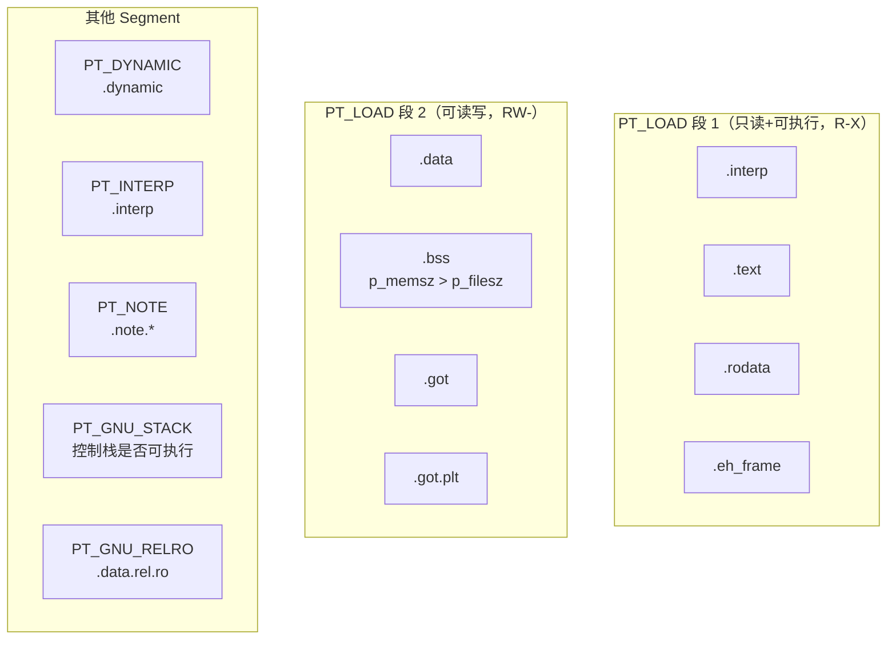

**LOAD段如何组织多个Section：**

- 加载器只关心 Segment，不关心 Section
- 多个属性相同的 Section 被合并到同一个 LOAD 段中
- 代码段（R-X）通常包含：`.interp`、`.text`、`.rodata`、`.eh_frame`
- 数据段（RW-）通常包含：`.data`、`.bss`、`.got`、`.got.plt`
- `.bss` 节的特殊性：`p_filesz < p_memsz`，差值部分在加载时填零，不占文件空间

#### 1.3.3.5 readelf -l 完整输出示例及解读

```bash
$ readelf -l myop

Elf file type is DYN (Shared object file)
Entry point 0x6b0
There are 13 program headers, starting at offset 64

Program Headers:
  Type           Offset             VirtAddr           PhysAddr
                 FileSiz            MemSiz              Flags  Align
  PHDR           0x0000000000000040 0x0000000000000040 0x0000000000000040
                 0x00000000000002d8 0x00000000000002d8  R      0x8
  INTERP         0x0000000000000318 0x0000000000000318 0x0000000000000318
                 0x000000000000001c 0x000000000000001c  R      0x1
      [Requesting program interpreter: /lib64/ld-linux-x86-64.so.2]
  LOAD           0x0000000000000000 0x0000000000000000 0x0000000000000000
                 0x0000000000000ae0 0x0000000000000ae0  R      0x1000
  LOAD           0x0000000000001000 0x0000000000201000 0x0000000000201000
                 0x0000000000000018 0x0000000000000020  RW     0x1000
  DYNAMIC        0x0000000000001010 0x0000000000201010 0x0000000000201010
                 0x00000000000001d0 0x00000000000001d0  RW     0x8
  NOTE           0x0000000000000334 0x0000000000000334 0x0000000000000334
                 0x0000000000000044 0x0000000000000044  R      0x4
  GNU_EH_FRAME   0x00000000000009d0 0x00000000000009d0 0x00000000000009d0
                 0x000000000000003c 0x000000000000003c  R      0x4
  GNU_STACK      0x0000000000000000 0x0000000000000000 0x0000000000000000
                 0x0000000000000000 0x0000000000000000  RW     0x10
  GNU_RELRO      0x0000000000001000 0x0000000000201000 0x0000000000201000
                 0x0000000000000018 0x0000000000000018  R      0x1

 Section to Segment mapping:
  Segment Sections...
   00     .interp .note.ABI-tag .note.gnu.build-id .gnu.hash .dynsym .dynstr
          .gnu.version .gnu.version_r .rela.dyn .rela.plt .init .plt .plt.got
          .text .fini .rodata .eh_frame_hdr .eh_frame
   01     .init_array .fini_array .dynamic .got .got.plt .data .bss
   02     .dynamic
   03     .note.ABI-tag .note.gnu.build-id
   04     .eh_frame_hdr
   05
   06     .init_array .fini_array .dynamic .got .got.plt
```

**输出解读：**

| 字段 | 含义 |
|------|------|
| Type | 段类型（对应 p_type） |
| Offset | 段在文件中的起始偏移（对应 p_offset） |
| VirtAddr | 段加载到的虚拟地址（对应 p_vaddr） |
| PhysAddr | 物理地址（用户态程序中通常与VirtAddr相同） |
| FileSiz | 段在文件中的大小（对应 p_filesz） |
| MemSiz | 段在内存中的大小（对应 p_memsz） |
| Flags | 权限标志：R=可读，W=可写，E=可执行 |
| Align | 对齐要求（对应 p_align） |

**关键观察：**

- 第一个 LOAD 段：`FileSiz == MemSiz == 0xae0`，说明没有 `.bss` 在此段
- 第二个 LOAD 段：`FileSiz=0x18`，`MemSiz=0x20`，差值 `0x8` 就是 `.bss` 的大小
- `Section to Segment mapping` 清晰展示了每个 Segment 包含哪些 Section
- `GNU_STACK` 的 Flags 为 `RW`（无E），说明栈不可执行（NX保护生效）

### 1.3.4 段内存管理

程序被加载到内存后，各段在虚拟地址空间中的典型布局如下（以 x86_64 为例）：

```
高地址
┌─────────────────────┐
│       Stack         │ ← 向下增长（高→低）
│  （局部变量、参数）   │
├─────────────────────┤
│        ↓            │
│                     │
│        ↑            │
├─────────────────────┤
│       Heap          │ ← 向上增长（低→高）
│   （malloc分配）     │
├─────────────────────┤
│       .bss          │ ← 未初始化全局/静态变量（运行时填零）
├─────────────────────┤
│       .data         │ ← 已初始化全局/静态变量
├─────────────────────┤
│       .rodata       │ ← 只读数据（字符串常量等）
├─────────────────────┤
│       .text         │ ← 可执行代码
├─────────────────────┤
│     ELF Header      │
└─────────────────────┘
低地址
```

**各段的内存权限：**

| 段 | 权限 | 说明 |
|----|------|------|
| `.text` | r-x | 可读、可执行，不可写（防止代码被篡改） |
| `.rodata` | r-- | 只读 |
| `.data` | rw- | 可读、可写 |
| `.bss` | rw- | 可读、可写（运行时初始化为0） |
| Stack | rw- | 可读、可写（NX保护下不可执行） |
| Heap | rw- | 可读、可写 |

**验证方法：**

```bash
# 查看运行中进程的内存映射
$ cat /proc/<pid>/maps

# 或使用 pmap
$ pmap -x <pid>
```

#### 1.3.4.1 段内存管理公式

| 公式 | 含义 |
|------|------|
| ROM size ≥ text + data | 烧录到 ROM 中的代码和数据大小 |
| RAM size ≥ data + bss | 运行时需要的内存大小 |

**各段含义（size命令视角）：**

| 段名 | 内容 | 说明 |
|------|------|------|
| text | 代码和常量 | 包含 `.text`、`.rodata` 等 |
| data | 初始化为非0的静态变量 | 有时占用空间小的初始化为0的变量也放此段 |
| bss | 未初始化或初始化为0的静态变量 | Block Started by Symbol，不占文件空间 |

#### 1.3.4.2 使用 size 命令验证

```bash
$ size myop
   text    data     bss     dec     hex filename
   2520     664       8    3192     c78 myop
```

**输出字段说明：**

| 字段 | 含义 |
|------|------|
| text | 代码段大小（字节），包含 `.text` + `.rodata` 等只读段 |
| data | 已初始化数据段大小（字节） |
| bss | 未初始化数据段大小（字节） |
| dec | 总大小（十进制）= text + data + bss |
| hex | 总大小（十六进制） |
| filename | 文件名 |

**为什么 .bss 不占文件空间但在内存中占用：**

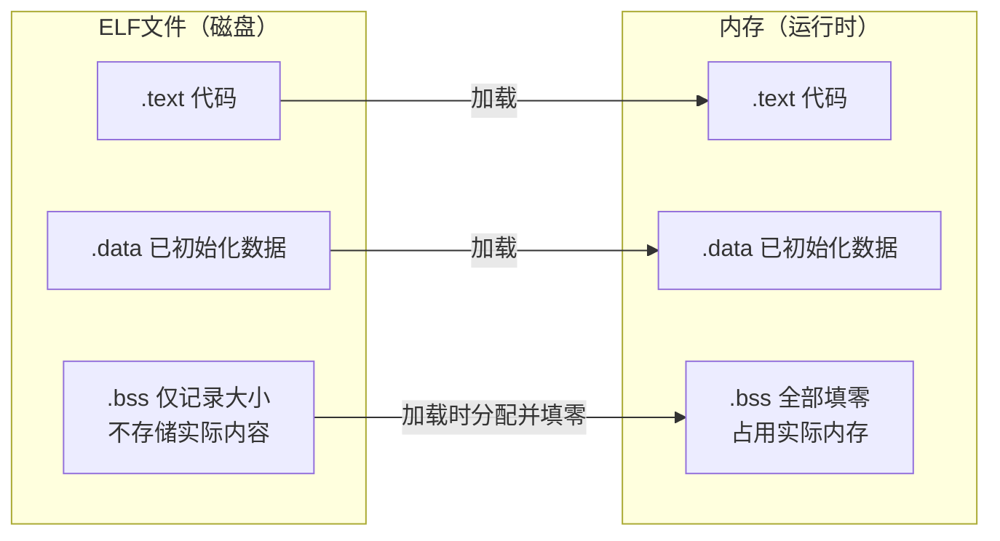

**验证文件大小与段大小的关系：**

```bash
$ ls -la myop
-rwxr-xr-x 1 user user 14648 myop

$ size myop
   text    data     bss     dec     hex filename
   2520     664       8    3192     c78 myop

# 文件大小(14648) > text+data(3184)
# 差值部分包含：ELF Header、Program Header、Section Header、
# 符号表、字符串表、动态节等元数据
# .bss(8字节) 不占文件空间，但运行时占用内存
```

## 1.4 编译实战示例

本节通过一个完整的计算器项目，演示从源代码到可执行文件的完整编译流程，包括静态库和动态库的创建与链接。Makefile 的详细语法将在专门的文档中讲解，此处仅给出简要示例。

### 1.4.1 源文件结构

```c
// myop.h
#ifndef MYOP_H
#define MYOP_H

int myadd(int a, int b);
int mysub(int a, int b);
int mymul(int a, int b);
int mydiv(int a, int b);
double mypow(double a, double b);

#endif
```

```c
// myop.c
#include <math.h>
#include "myop.h"

int myadd(int a, int b) { return a + b; }
int mysub(int a, int b) { return a - b; }
int mymul(int a, int b) { return a * b; }
int mydiv(int a, int b) { return b != 0 ? a / b : 0; }
double mypow(double a, double b) { return pow(a, b); }
```

```c
// main.c
#include <stdio.h>
#include "myop.h"

int main(int argc, char *argv[])
{
    if (argc != 3) {
        printf("Usage: %s <a> <b>\n", argv[0]);
        return 1;
    }

    int a = atoi(argv[1]);
    int b = atoi(argv[2]);

    printf("%d + %d = %d\n", a, b, myadd(a, b));
    printf("%d - %d = %d\n", a, b, mysub(a, b));
    printf("%d * %d = %d\n", a, b, mymul(a, b));
    printf("%d / %d = %d\n", a, b, mydiv(a, b));
    printf("%d ^ %d = %f\n", a, b, mypow(a, b));

    return 0;
}
```

### 1.4.2 Makefile 简要示例

```makefile
CC = gcc
CFLAGS = -Wall -g
TARGET = myop

all: $(TARGET)
	@echo "Build done."

%.o: %.c myop.h
	$(CC) $(CFLAGS) -fPIC -c $< -o $@

libmyop.so: myop.o
	$(CC) -shared -fPIC -o $@ $^ -lm

libmyop.a: myop.o
	ar r $@ $^ -c

$(TARGET): main.o libmyop.so libmyop.a
	$(CC) $(CFLAGS) -o $@ main.o -L./ -lmyop

clean:
	rm -f *.o *.so *.a $(TARGET)

.PHONY: all clean
```

### 1.4.3 编译与运行

```bash
$ make
gcc -c -fPIC -o main.o main.c
gcc -c -fPIC -o myop.o myop.c
gcc -shared -fPIC -o libmyop.so myop.o -lm
ar r libmyop.a myop.o -c
gcc -o myop main.o -L./ -lmyop
Build done.

$ ./myop 3 5
3 + 5 = 8
3 - 5 = -2
3 * 5 = 15
3 / 5 = 0
3 ^ 5 = 243.000000

# 如果使用动态库，需要设置库搜索路径
$ export LD_LIBRARY_PATH=$LD_LIBRARY_PATH:.
$ ldd myop
    linux-vdso.so.1 (0x00007ffd...)
    libmyop.so => ./libmyop.so (0x00007f...)
    libc.so.6 => /lib/x86_64-linux-gnu/libc.so.6 (0x00007f...)
    libm.so.6 => /lib/x86_64-linux-gnu/libm.so.6 (0x00007f...)
    /lib64/ld-linux-x86-64.so.2 (0x00007f...)
```

## 1.5 本章工具速查总表

本章介绍了编译工具链的全景、编译四阶段流程和 ELF 文件格式。以下是本章核心知识的速查总结。

**工具速查表：**

| 分类 | 工具 | 主要用途 |
|------|------|----------|
| 编译器 | gcc / g++ | C/C++源代码编译 |
| 汇编器 | as | 汇编代码→目标文件 |
| 链接器 | ld | 目标文件→可执行文件/库 |
| 库管理 | ar / ranlib | 创建和管理静态库 |
| 段编辑 | objcopy | 格式转换、段操作 |
| 符号剥离 | strip | 去除符号和调试信息 |
| 文件探测 | file | 探测文件类型 |
| 依赖查看 | ldd | 查看动态库依赖 |
| 反汇编 | objdump | 反汇编、查看节信息 |
| ELF分析 | readelf | 查看ELF结构信息 |
| ELF编辑 | elfedit | 编辑ELF文件头 |
| 段大小 | size | 查看text/data/bss大小 |
| 字符串 | strings | 提取可打印字符串 |
| 符号表 | nm | 查看符号表 |
| 地址转换 | addr2line | 地址→文件名:行号 |
| 符号解码 | c++filt | C++符号名解码 |
| 调试器 | gdb | 断点、单步、变量查看 |
| 性能分析 | gprof | 函数调用分析 |

**ELF 文件结构速查：**

| 组成部分 | 查看命令 | 关键信息 |
|----------|----------|----------|
| ELF Header | `readelf -h` | 文件类型、架构、入口地址 |
| Program Header | `readelf -l` | 段类型、加载地址、权限、Segment-Section映射 |
| Section Header | `readelf -S` | 各节名称、偏移、大小、类型、标志 |
| 符号表 | `readelf -s` | 函数和变量的符号信息 |
| 动态节 | `readelf -d` | 动态库依赖、SONAME、RPATH |

**编译四阶段速查：**

| 阶段 | 命令 | 输入→输出 | 核心工作 |
|------|------|-----------|----------|
| 预处理 | `gcc -E` | `.c` → `.i` | 宏展开、包含头文件、条件编译 |
| 编译 | `gcc -S` | `.i` → `.s` | 语法检查、生成汇编 |
| 汇编 | `gcc -c` / `as` | `.s` → `.o` | 生成ELF目标文件 |
| 链接 | `gcc` / `ld` | `.o` → 可执行文件 | 符号解析、库链接 |

**ELF 三种文件类型速查：**

| 类型 | e_type | 是否有Program Header | 典型文件 | 验证命令 |
|------|--------|---------------------|----------|----------|
| 可重定位 | ET_REL (1) | 否 | `.o` | `file xxx.o` |
| 可执行 | ET_EXEC (2) / ET_DYN (3) | 是 | 无固定后缀 | `file xxx` |
| 共享对象 | ET_DYN (3) | 是 | `.so` | `file libxxx.so` |

# 第2章 GCC编译选项详解

GCC（GNU Compiler Collection）作为 Linux 生态的核心编译器，提供了极为丰富的编译链接选项。合理配置这些选项，是保障代码质量、安全性和性能的关键工程手段。本章按照构建流程的逻辑，从基础选项到高级特性，系统性地介绍 GCC 的各类编译选项，涵盖基础编译控制、文件查找、依赖生成、链接、警告、优化、架构、安全增强、动态检测、静态分析和性能分析等方面。


## 2.1 基础编译选项

基础编译选项是日常使用 GCC 时最频繁接触的部分，包括宏定义、输出控制和编译阶段控制三大类。

### 2.1.1 宏定义选项

`-D` 选项用于在编译时定义预处理宏，等价于在源代码中编写 `#define` 指令。

| 选项 | 说明 | 等价代码 |
|------|------|---------|
| `-Dname` | 定义宏 `name`，默认值为 1 | `#define name 1` |
| `-Dname=value` | 定义宏 `name`，值为 `value` | `#define name value` |
| `-Dname=\"value\"` | 定义宏 `name`，值为字符串 `value` | `#define name "value"` |

实践示例：

```bash
# 定义数值宏，等价于 #define MAX_NUM 1024
gcc -DMAX_NUM=1024 test.c -o test

# 定义字符串宏，等价于 #define AUTHOR "LengJing"
gcc -DAUTHOR=\"LengJing\" test.c -o test

# 组合使用多个宏定义
gcc -DMAX_NUM=1024 -DAUTHOR=\"LengJing\" -DDEBUG test.c -o test
```

易错点：

- 字符串宏的引号需要转义：`-DAUTHOR=\"LengJing\"` 而非 `-DAUTHOR="LengJing"`（后者在 shell 中引号会被吃掉）
- 在 Makefile 中使用时，通常写成 `CFLAGS += -DAUTHOR='"LengJing"'`

### 2.1.2 输出控制选项

| 选项 | 说明 | 典型用途 |
|------|------|---------|
| `-o output` | 指定编译生成的文件名为 `output` | 所有编译场景 |
| `-v` | 显示详细编译过程（包括调用的子命令、搜索路径等） | 排查编译问题、了解工具链内部行为 |

实践示例：

```bash
# 指定输出文件名
gcc test.c -o myprogram

# 查看详细编译过程（可以看到实际调用了哪些工具、搜索了哪些路径）
gcc -v test.c -o test
```

`-v` 选项的输出包含以下关键信息：

- 编译器搜索头文件的路径顺序
- 链接器搜索库文件的路径顺序
- 实际调用的 `cc1`、`as`、`ld` 等子命令及其参数
- 链接的启动文件（crt1.o、crti.o、crtn.o）

### 2.1.3 编译阶段控制

| 选项 | 说明 | 输出 |
|------|------|------|
| `-E` | 仅执行预处理，不生成文件，输出到终端 | 预处理后的 C 代码（`.i`） |
| `-S` | 编译到汇编语言，不进行汇编和链接 | 汇编代码（`.s`） |
| `-c` | 仅编译源文件，生成目标文件，不链接 | 目标文件（`.o`） |

实践示例：

```bash
# 仅预处理（查看宏展开、头文件包含结果）
gcc -E test.c -o test.i

# 仅编译到汇编（查看生成的汇编代码）
gcc -S test.c -o test.s

# 仅编译到目标文件（不链接）
gcc -c test.c -o test.o
```

关于编译四个阶段的详细说明，参见第 1 章 1.2 节。

## 2.2 文件查找选项

文件查找选项控制 GCC 在编译和链接过程中搜索头文件和库文件的路径。正确配置这些选项是解决"找不到头文件"和"找不到库"问题的关键。

### 2.2.1 头文件查找

| 选项 | 说明 | 示例 |
|------|------|------|
| `-I<directory>` | 添加头文件搜索路径（最常用） | `-I./include -I/usr/local/include` |
| `-isystem <directory>` | 添加系统头文件目录，抑制该目录中头文件的警告 | `-isystem /usr/include` |
| `-idirafter <directory>` | 在所有 `-I` 目录之后搜索（不常用） | `-idirafter /opt/local/include` |
| `-nostdinc` | 不搜索标准系统头文件目录（交叉编译、自定义 C 库） | 需配合完整的头文件路径 |

搜索顺序：


`-I` 与 `-isystem` 的区别：

| 对比项 | `-I` | `-isystem` |
|--------|------|-----------|
| 警告处理 | 该目录中头文件产生的警告会被报告 | 该目录中头文件产生的警告会被抑制 |
| 典型用途 | 项目自身的头文件 | 第三方库头文件、系统头文件 |
| 搜索优先级 | 高于系统目录 | 低于 `-I`，高于 `-idirafter` |

实践示例：

```bash
# 基本用法
gcc -I./include -I/usr/local/include -c main.c -o main.o

# 第三方库头文件使用 -isystem 抑制警告
gcc -isystem /opt/thirdparty/include -c main.c -o main.o
```

### 2.2.2 库文件查找

| 选项 | 说明 | 示例 |
|------|------|------|
| `-L<directory>` | 添加库文件搜索路径 | `-L./lib -L/usr/local/lib` |
| `-Wl,-rpath-link=<directory>` | 链接时指定运行时库搜索路径（不写入二进制） | `-Wl,-rpath-link=./lib` |
| `-Wl,-rpath=<directory>` | 将目录嵌入可执行文件作为运行时搜索路径 | `-Wl,-rpath,'$$ORIGIN/lib'` |

三者区别对比表：

| 特性 | `-L` | `-Wl,-rpath-link` | `-Wl,-rpath` |
|------|------|-------------------|--------------|
| 作用阶段 | 链接时 | 链接时 | 运行时 |
| 目的 | 找到要链接的库 | 找到依赖库以解析符号 | 告诉动态链接器去哪找库 |
| 是否写入二进制文件 | 否 | 否 | 是（嵌入到 ELF 中） |
| 影响对象 | 直接链接的库（`-l` 指定） | 间接依赖的库 | 所有运行时需要的库 |
| 搜索顺序 | 在标准库目录之前 | 用于依赖解析 | 在 `LD_LIBRARY_PATH` 之后，系统目录之前 |
| 可传递性 | 仅影响当前链接 | 仅影响当前链接 | 影响程序和所有使用者 |
| 常用场景 | 链接非标准位置的库 | 链接复杂依赖的库 | 发布自包含的程序 |

特殊变量 `$$ORIGIN`：

`$$ORIGIN` 表示可执行文件所在目录，用于构建相对路径的运行时库搜索：

```bash
# 将库放在可执行文件同目录的 lib/ 子目录下
gcc -o program main.o -Wl,-rpath,'$$ORIGIN/lib' -L./lib -lfoo
```

### 2.2.3 交叉编译路径

| 选项 | 说明 | 示例 |
|------|------|------|
| `-B <prefix>` | 指定编译器工具路径前缀 | `-B /usr/local/bin/` |
| `--sysroot=<directory>` | 指定系统根目录（交叉编译时使用） | `--sysroot=/mnt/arm-sysroot` |

`--sysroot` 影响范围：

- 头文件搜索：在该目录下搜索 `/usr/include` 等
- 库文件搜索：在该目录下搜索 `/usr/lib` 等
- 动态链接器：在该目录下搜索 `/lib/ld-linux.so`

实践示例：

```bash
# 交叉编译时指定目标系统根目录
aarch64-linux-gnu-gcc --sysroot=/mnt/arm-sysroot -c main.c -o main.o

# -B 影响编译器前端和后端的工具查找
gcc -B /opt/toolchain/bin/ -c main.c -o main.o
```

### 2.2.4 灵活的查找配置

在构建系统中，通常通过 Makefile 变量动态构建搜索路径：

```makefile
# 基础模式
CPFLAGS += $(addprefix -I,$(addprefix $(DEP_PREFIX),/include /usr/include))

# 条件搜索模式
ifdef SEARCH_HDRS
CPFLAGS += $(addprefix -I,$(wildcard \
    $(addprefix $(DEP_PREFIX)/include/,$(SEARCH_HDRS)) \
    $(addprefix $(DEP_PREFIX)/usr/include/,$(SEARCH_HDRS)) \
))
endif

# 库路径配置
LDFLAGS += $(addprefix -L,$(addprefix $(DEP_PREFIX),/lib /usr/lib))
LDFLAGS += $(addprefix -Wl$(comma)-rpath-link=,$(addprefix $(DEP_PREFIX),/lib /usr/lib))
```

其中 `$(comma)` 在 Makefile 中表示逗号，因为 Makefile 中逗号有特殊含义。

## 2.3 自动依赖生成

自动依赖生成是构建系统的核心功能之一，它分析 `#include` 指令，生成目标文件与头文件的依赖关系，确保头文件修改后能自动触发重新编译。

### 2.3.1 依赖生成选项

| 选项 | 说明 | 是否同时编译 |
|------|------|:----------:|
| `-M` | 输出所有依赖关系（包括系统头文件） | 否，仅输出依赖 |
| `-MM` | 输出依赖关系（排除系统头文件） | 否，仅输出依赖 |
| `-MD` | 编译时同时生成依赖关系文件（包括系统头文件） | 是 |
| `-MMD` | 编译时同时生成依赖关系文件（排除系统头文件） | 是 |

`-M` 与 `-MM` 的区别：

```bash
# -M 输出包含系统头文件（如 /usr/include/stdio.h）
$ gcc -M test.c
test.o: test.c /usr/include/stdio.h /usr/include/features.h ...

# -MM 排除系统头文件（通常这是期望的行为）
$ gcc -MM test.c
test.o: test.c myheader.h
```

`-MD` 与 `-MMD` 的区别：

- `-MD` / `-MMD` 会同时进行编译和依赖生成，效率更高
- 默认生成 `.d` 文件（与 `.o` 文件同名）
- 实际工程中推荐使用 `-MMD`（排除系统头文件，避免系统头文件变化触发不必要的重编译）

### 2.3.2 依赖输出控制

| 选项 | 说明 | 典型用途 |
|------|------|---------|
| `-MT <target>` | 指定依赖规则中的目标名称 | 确保目标名称与实际的 .o 文件路径匹配 |
| `-MQ <target>` | 类似 `-MT`，但对特殊字符进行引用转义 | 目标名称包含 `$`、空格等特殊字符时 |
| `-MF <file>` | 将依赖关系输出到指定文件 | 指定 .d 文件的输出路径 |
| `-MP` | 为每个依赖的头文件生成伪目标规则 | 防止头文件删除后 make 报错 |

`-MT` 的作用详解：

默认情况下，`-M` 或 `-MM` 生成的目标是源文件对应的 `.o` 文件名（如 `source.o: ...`）。使用 `-MT` 可以指定不同的目标名称，在复杂的构建系统中特别有用：

```bash
# 默认行为：目标名为 source.o
$ gcc -MM source.c
source.o: source.c header.h

# 使用 -MT 指定不同的目标名
$ gcc -MM -MT build/output/source.o source.c
build/output/source.o: source.c header.h
```

`-MP` 的作用详解：

为每个头文件生成 `<header>:` 的空规则。当头文件被删除时，避免 make 报错"没有规则创建目标"：

```bash
# 没有 -MP 时，如果 header.h 被删除，make 会报错：
# "No rule to make target 'header.h'"

# 有 -MP 时，生成的 .d 文件包含：
# header.h:
# 即使 header.h 不存在，make 也不会报错
```

`-MQ` 与 `-MT` 的区别：

```bash
# -MT 不做转义
gcc -MM -MT '$@' test.c
# 输出：$@: test.c

# -MQ 对特殊字符进行转义
gcc -MM -MQ '$@' test.c
# 输出：$$@: test.c
```

### 2.3.3 依赖文件工作原理与 Makefile 集成

完整的依赖生成规则：

```makefile
# 自动生成依赖文件
$(OBJ_PREFIX)%.o: %.c
	$(CC) $(CFLAGS) $(CPFLAGS) -MMD -MP -MT $$@ -MF $$(patsubst %.o,%.d,$$@) -c $$< -o $$@

# 包含依赖文件（- 前缀表示文件不存在时不报错）
-include $(DEPS)
```

生成的 `.d` 文件示例：

```makefile
# build/main.d 文件内容
build/main.o: main.c myop.h /usr/include/stdio.h
myop.h:
/usr/include/stdio.h:
```

## 2.4 链接选项

链接选项控制 GCC 在链接阶段的行为，包括库的链接方式、搜索顺序、符号解析策略等。

### 2.4.1 基础库链接

| 选项 | 说明 | 示例 |
|------|------|------|
| `-l<library>` | 链接名为 `lib<library>.so` 或 `lib<library>.a` 的库 | `-lpthread -lm -ldl` |
| `-static` | 完全静态链接，生成无运行时依赖的可执行文件 | 增大文件体积，但部署简单 |
| `-shared` | 创建共享库（动态库） | `-shared -Wl,-soname,libfoo.so.1` |
| `-fPIC` | 生成位置无关代码（用于共享库） | 必须用于共享库中的所有目标文件 |

链接搜索顺序：

1. `-L` 指定的目录（按命令行顺序）
2. 环境变量 `LIBRARY_PATH`
3. 默认系统库目录（`/lib`、`/usr/lib` 等）

实践示例：

```bash
# 链接数学库和线程库
gcc -o program main.o -lm -lpthread

# 完全静态链接
gcc -static -o program main.o -lm

# 创建共享库
gcc -shared -fPIC -o libfoo.so foo.o -Wl,-soname,libfoo.so.1
```

### 2.4.2 混合静态/动态链接

| 选项 | 说明 |
|------|------|
| `-Wl,-Bstatic` | 后续的 `-l` 库使用静态链接 |
| `-Wl,-Bdynamic` | 后续的 `-l` 库使用动态链接（默认） |

实践示例：

```bash
# libfoo.a 和 libbar.a 以静态方式链接，libbaz.so 以动态方式链接
gcc -o program main.o -Wl,-Bstatic -lfoo -lbar -Wl,-Bdynamic -lbaz

# Makefile 中的组合模式
LDFLAGS += -Wl,-Bstatic $(addprefix -l,$(STATIC_LIBS)) -Wl,-Bdynamic $(addprefix -l,$(DYNAMIC_LIBS))
```

### 2.4.3 循环依赖处理

| 选项 | 说明 |
|------|------|
| `-Wl,--start-group` | 开始一个库组 |
| `-Wl,--end-group` | 结束一个库组 |

实践示例：

```bash
# 处理 liba、libb、libc 之间的循环依赖
gcc -o program main.o -Wl,--start-group -la -lb -lc -Wl,--end-group
```

**工作原理：** 链接器会反复搜索组内的库，直到解析所有符号。代价是链接时间增加，因此仅在确实存在循环依赖时使用。

### 2.4.4 按需链接与符号解析

| 选项 | 说明 | 推荐 |
|------|------|:----:|
| `-Wl,--as-needed` | 只链接实际使用的库 | ✓ 推荐 |
| `-Wl,--no-as-needed` | 链接所有指定的库（默认行为） | |
| `-Wl,--no-undefined` | 将所有未解析的符号视为链接错误 | 确保共享库完整性 |
| `-Wl,-z,defs` | 要求所有符号有定义（类似 `--no-undefined`） | |

实践示例：

```bash
# 推荐：只链接实际使用的库，减少不必要的依赖
gcc -o program main.o -Wl,--as-needed -lfoo -lbar -lbaz

# 确保共享库没有未定义符号
gcc -shared -o libfoo.so foo.o -Wl,--no-undefined
```

### 2.4.5 全量链接

| 选项 | 说明 |
|------|------|
| `-Wl,--whole-archive` | 强制包含静态库中的所有目标文件 |
| `-Wl,--no-whole-archive` | 恢复正常链接行为 |

实践示例：

```bash
# 强制链接 libfoo.a 中的所有 .o 文件（即使某些符号未被引用）
gcc -o program main.o -Wl,--whole-archive -lfoo -Wl,--no-whole-archive
```

典型应用场景：

- **注册表模式：** 库中通过构造函数（`__attribute__((constructor))`）注册回调
- **插件系统：** 需要加载库中所有模块
- **单元测试：** 需要链接所有测试用例

### 2.4.6 特定库链接

| 选项 | 说明 |
|------|------|
| `-static-libgcc` | 静态链接 GCC 运行时库 |
| `-static-libstdc++` | 静态链接 C++ 标准库 |
| `-l:filename` | 直接指定库文件名（不添加 lib 前缀和后缀） |
| `-fuse-ld=bfd` | 使用 bfd 链接器 |
| `-fuse-ld=gold` | 使用 gold 链接器 |
| `-fuse-ld=lld` | 使用 LLVM lld 链接器 |
| `-fuse-ld=mold` | 使用 mold 链接器 |

实践示例：

```bash
# 静态链接 C++ 标准库（避免目标机器缺少 libstdc++）
g++ -o program main.o -static-libstdc++

# 直接指定库文件名
gcc -o program main.o -l:libfoo.so.1.2.3

# 使用更快的链接器
gcc -o program main.o -fuse-ld=mold
```

## 2.5 警告选项

警告选项是代码质量的前置保障。合理配置警告选项，可以在编码阶段提前发现潜在问题。本节从基础警告到具体分类警告，再到警告的精细控制，系统性地介绍 GCC 的警告体系。

### 2.5.1 基础警告

| 选项 | 说明 | 建议 |
|------|------|------|
| `-Wall` | 启用一组最常用、最有用的警告 | **始终启用** |
| `-Wextra` | 启用 `-Wall` 未包含的额外警告（以前称为 `-W`） | 推荐启用 |
| `-Werror` | 将所有警告升级为编译错误 | CI/CD 中推荐 |
| `-w` | 关闭所有警告 | 不推荐，风险大 |
| `-Wfatal-errors` | 遇到第一个错误时中止编译 | 加速编译失败反馈 |
| `-fmax-errors=n` | 限制最大错误数量为 `n` | 避免错误信息过多 |

`-Werror` 的精细控制：

```bash
# 将特定警告视为错误
-Werror=return-type
-Werror=implicit-function-declaration

# 将特定警告不作为错误（即使有 -Werror）
-Wno-error=unused-variable

# 组合使用：所有警告视为错误，但未使用变量除外
-Werror -Wno-error=unused-variable
```

### 2.5.2 常用具体警告

| 选项 | 说明 | 检测的问题 |
|------|------|-----------|
| `-Wshadow` | 局部变量遮盖外层作用域的同名变量时警告 | 可能导致逻辑错误 |
| `-Wunused` | 检测未使用的变量、函数、标签等 | 代码冗余 |
| `-Wunused-variable` | 未使用的变量 | 代码冗余 |
| `-Wunused-function` | 未使用的函数 | 代码冗余 |
| `-Wunused-parameter` | 未使用的函数参数 | 接口设计问题 |
| `-Wmissing-braces` | 初始化数组或结构体时缺失大括号警告 | 初始化错误 |
| `-Wreturn-type` | 函数缺少返回类型或默认返回 int 警告 | 类型安全 |
| `-Wpointer-arith` | 对函数指针或 void 指针进行算术运算时警告 | 未定义行为 |
| `-Waddress` | 对总是真或假的地址表达式警告 | 逻辑错误 |

### 2.5.3 严格标准符合性

| 选项 | 说明 |
|------|------|
| `-Wpedantic` | 严格遵循 ISO C/C++ 标准，对 GNU 扩展发出警告 |
| `-pedantic-errors` | 将 pedantic 警告视为错误 |
| `-Wconversion` | 可能改变值的隐式类型转换警告 |
| `-Wsign-conversion` | 有符号和无符号整数之间转换警告 |
| `-Wfloat-conversion` | 浮点类型之间的隐式转换警告 |

### 2.5.4 严格内存与边界检查

| 选项 | 说明 | 单位 |
|------|------|------|
| `-Wlarger-than=<size>` | 定义超过指定大小的对象时警告 | 字节 |
| `-Wframe-larger-than=<size>` | 函数栈帧超过指定大小时警告 | 字节 |
| `-Warray-bounds` | 检测编译时可确定的数组越界访问（默认级别 1） | - |
| `-Warray-bounds=2` | 更严格的数组边界检查 | - |
| `-Wstringop-overflow` | 检测字符串操作可能导致的缓冲区溢出（默认级别 2） | - |
| `-Wstringop-overflow=4` | 最严格的字符串操作检查（可能误报） | - |
| `-Wstrict-aliasing` | 检测违反严格别名规则的内存访问 | - |

### 2.5.5 严格函数声明检查

| 选项 | 说明 | 适用语言 |
|------|------|---------|
| `-Wstrict-prototypes` | 要求函数声明有完整的原型 | C |
| `-Wmissing-prototypes` | 函数定义前没有原型声明时警告 | C |
| `-Wold-style-definition` | 使用旧式 K&R 函数定义时警告 | C |

示例：

```c
// -Wstrict-prototypes 会警告以下写法
int func();           // 警告：应写为 int func(void);

// -Wmissing-prototypes 会警告没有提前声明的函数定义
int helper(int x) { return x * 2; }  // 警告：缺少原型声明
```

### 2.5.6 堆栈溢出检查选项

堆栈溢出是嵌入式和高可靠性程序中的常见问题。GCC 提供了一组编译时警告选项，用于检测可能导致栈溢出的代码模式。这些选项在嵌入式开发、内核开发和实时系统中尤为重要。

| 选项 | 说明 | 默认值 |
|------|------|--------|
| `-Wstack-usage=<byte-size>` | 函数栈使用量可能超过指定值时警告 | `PTRDIFF_MAX`（默认不触发） |
| `-Walloc-size-larger-than=<byte-size>` | 分配函数请求的内存超过指定值时警告 | `PTRDIFF_MAX` |
| `-Walloca-larger-than=<byte-size>` | `alloca` 调用参数超过指定值或无上界时警告 | `PTRDIFF_MAX` |
| `-Wvla-larger-than=<byte-size>` | 变长数组（VLA）大小超过指定值时警告 | `PTRDIFF_MAX` |
| `-Wformat-overflow=<level>` | 检测 `sprintf` 等函数可能的缓冲区溢出 | 级别 1（由 `-Wformat` 启用） |
| `-Wstringop-overflow=<level>` | 检测字符串/内存操作函数的缓冲区溢出 | 级别 2（默认启用） |

**`-Wstack-usage` 详解：**

`-Wstack-usage` 检查函数的栈使用量（包括 `alloca`、VLA 等动态分配），是保守估计。警告信息格式根据栈使用量的确定性分为三种：

| 栈使用量类型 | 警告信息格式 | 说明 |
|-------------|-------------|------|
| 完全静态且超标 | `warning: stack usage is 1120 bytes` | 栈使用量确定 |
| 部分动态但有上界 | `warning: stack usage might be 1648 bytes` | 有界但不确定 |
| 部分动态且无上界 | `warning: stack usage might be unbounded` | 最危险，无法确定 |

实践示例：

```bash
# 限制每个函数栈使用不超过 1024 字节（嵌入式常用）
gcc -Wstack-usage=1024 -c main.c -o main.o

# 限制 alloca 调用不超过 500 字节
gcc -Walloca-larger-than=500 -c main.c -o main.o

# 限制 VLA 不超过 4096 字节
gcc -Wvla-larger-than=4096 -c main.c -o main.o

# 限制分配函数请求不超过 1MB
gcc -Walloc-size-larger-than=1048576 -c main.c -o main.o
```

`-Walloca-larger-than` 示例：

```c
void func(size_t n) {
    void *p;
    if (n <= 1000)
        p = alloca(n);   // -Walloca-larger-than=1000 不警告（有界）
    else
        p = malloc(n);
    // ...
}

void func_unbounded(size_t n) {
    void *p = alloca(n);  // -Walloca-larger-than=500 警告（无上界）
    // ...
}
```

**`-Wformat-overflow` 等级详解：**

| 等级 | 说明 | 启发式策略 |
|:----:|------|-----------|
| 1 | 保守模式，仅警告最可能溢出的调用 | 未知数值参数假设为 1，未知字符串假设为空 |
| 2 | 激进模式，警告可能溢出的调用 | 未知有符号数值假设为 `INT_MIN`，未知字符串假设为 1 字符 |

```c
void f(int a, int b) {
    char buf[13];
    sprintf(buf, "a = %i, b = %i\n", a, b);
    // 级别 1：即使 a=b=0，NUL 终止符也会越界 → 警告
    // 级别 2：若 a=INT_MIN，输出更长 → 警告（需至少 34 字节）
}
```

**`-Wstringop-overflow` 等级详解：**

| 等级 | Object Size 检查类型 | 说明 |
|:----:|:-------------------:|------|
| 1 | type-0 | 仅检查最大外层对象边界，等价于 `_FORTIFY_SOURCE` 的编译时行为 |
| 2 | type-1 | 检查已知大小的最大完整对象（**默认**） |
| 3 | type-2 | 检查最小对象或数据成员（最严格，可能误报） |
| 4 | type-3 | 检查任何数据成员，多对象时取最大者（可能误报） |

### 2.5.7 格式化字符串检查

| 选项 | 说明 |
|------|------|
| `-Wformat` | 检查 `printf`/`scanf` 等函数的格式字符串与参数类型是否匹配 |
| `-Wformat=2` | 启用 `-Wformat` 加上 `-Wformat-nonliteral`、`-Wformat-security`、`-Wformat-y2k` |
| `-Wformat-nonliteral` | 格式字符串不是字面量时警告（无法编译时检查） |
| `-Wformat-security` | 检测可能的安全问题的格式化字符串（如 `printf(user_input)`） |
| `-Wformat-y2k` | 检测可能产生 2000 年问题的 `strftime` 格式 |
| `-Wformat-truncation` | 检测 `snprintf` 等函数输出可能被截断 |
| `-Wformat-overflow` | 检测 `sprintf` 等函数可能的缓冲区溢出 |
| `-Wno-format-extra-args` | 忽略格式字符串参数过多的警告 |

示例：

```c
// -Wformat 会警告以下写法
int x = 42;
printf("%s\n", x);  // 警告：格式 %s 需要 char*，但传入了 int

// -Wformat-security 会警告以下写法
char *user_input = get_input();
printf(user_input);  // 警告：格式字符串不是字面量（安全风险）

// -Wformat-truncation 会警告以下写法
char buf[10];
snprintf(buf, sizeof(buf), "hello %s", long_string);  // 警告：输出可能被截断
```

### 2.5.8 取消与分级控制警告

禁用特定警告：

```bash
-Wno-unused-variable
-Wno-deprecated-declarations
-Wno-format-truncation
-Wno-stringop-truncation
```

警告优先级规则：

- 更具体的选项优先于更一般的选项（如 `-Wno-unused-variable` 优先于 `-Wunused`）
- 相同优先级时，最后一个选项生效
- 通过 pragma 启用的选项相当于出现在命令行末尾

### 2.5.9 代码内禁用警告

```c
#pragma GCC diagnostic push
#pragma GCC diagnostic ignored "-Wdeprecated-declarations"
// 被忽略警告的代码
deprecated_function();
#pragma GCC diagnostic pop
```

使用要点：

- `push` 和 `pop` 必须配对使用
- 作用范围仅限于 `push` 和 `pop` 之间的代码
- 适用于无法修改的第三方代码产生的警告

## 2.6 优化等级选项

优化选项控制编译器对生成代码的优化程度。选择合适的优化级别需要在性能、代码大小、编译时间和可调试性之间取得平衡。

### 2.6.1 标准优化级别

| 级别 | 说明 | 适用场景 |
|------|------|---------|
| `-O0` | 无优化（默认） | 调试阶段，保证完全可调试性 |
| `-O1` / `-O` | 基本优化 | 平衡编译时间和代码质量 |
| `-O2` | 高级优化（**推荐**） | 生产环境 |
| `-O3` | 最大优化 | 计算密集型应用 |
| `-Os` | 优化代码大小 | 嵌入式系统 |
| `-Og` | 调试友好优化 | 调试时仍需要一定性能 |
| `-Ofast` | 快速激进优化 | 忽视严格标准符合性的场景 |

各级别详细说明：

- `-O0`：禁用所有优化，最快编译速度，保留所有调试信息，不重新排列代码
- `-O1`：进行基本的、安全的优化（删除未使用代码、简化表达式等），不影响调试
- `-O2`：进行更多优化（指令调度、循环优化、函数内联等），平衡性能与代码大小
- `-O3`：激进优化（自动向量化、更积极的内联等），可能增加代码大小和编译时间
- `-Os`：在 `-O2` 基础上禁用可能增加代码大小的优化，最小化二进制大小
- `-Og`：在保持可调试性的前提下进行优化，不影响调试体验
- `-Ofast`：`-O3` 加上不严格遵守标准的优化（包含 `-ffast-math`），可能违反 IEEE 或 ISO 标准

### 2.6.2 优化级别对比表

| 级别 | 编译速度 | 代码大小 | 调试友好度 | 性能 | 适用场景 |
|------|:-------:|:-------:|:---------:|:----:|---------|
| `-O0` | 最快 | 最大 | 最好 | 最差 | 开发调试 |
| `-O1` | 快 | 较大 | 好 | 较好 | 快速原型 |
| `-O2` | 中等 | 中等 | 一般 | 好 | 生产环境 |
| `-O3` | 慢 | 较大 | 差 | 可能最好 | 计算密集 |
| `-Os` | 中等 | 最小 | 一般 | 中等 | 嵌入式 |
| `-Og` | 中等 | 中等 | 好 | 中等 | 调试+优化 |
| `-Ofast` | 慢 | 较大 | 差 | 激进 | 特殊场景 |

### 2.6.3 调试信息控制

| 选项 | 说明 |
|------|------|
| `-g` | 生成调试信息（操作系统原生格式），等价于 `-g2` |
| `-g0` | 不生成调试信息 |
| `-g1` | 最小调试信息，仅回溯栈 |
| `-g2` / `-g` | 默认级别，包含符号表、行号 |
| `-g3` | 包含宏定义等额外信息 |
| `-ggdb` | 生成 GDB 专用格式的调试信息 |
| `-ggdb0` ~ `-ggdb3` | GDB 调试信息级别 |
| `-gdwarf` | 生成 DWARF 格式调试信息 |
| `-gdwarf-version` | 指定 DWARF 版本（2/3/4/5） |

调试信息与优化的兼容性：

- GCC 允许 `-g` 与 `-O` 一起使用
- 优化后的代码可能使调试行为出人意料（变量被优化掉、代码重排等）
- 考虑使用 `-Og` 配合 `-g` 获得更好的调试体验
- 通常调试时使用 `-O0 -g -ggdb`

### 2.6.4 节区优化

| 选项 | 说明 |
|------|------|
| `-ffunction-sections` | 将每个函数放在独立的节区 |
| `-fdata-sections` | 将每个数据对象放在独立的节区 |
| `-Wl,--gc-sections` | 删除未使用的节区，减小二进制大小 |

使用示例：

```bash
gcc -ffunction-sections -fdata-sections -Wl,--gc-sections -o program program.c
```

**工作原理：** 配合使用时，链接器可以识别并删除未被引用的函数和数据，显著减小嵌入式程序的二进制大小。

**注意：** 调试版本通常不启用节区优化，因为这会影响调试体验：

```makefile
ifneq ($(ENV_BUILD_TYPE),debug)
CPFLAGS += -ffunction-sections -fdata-sections
LDFLAGS += -Wl,--gc-sections
else
LDFLAGS += -Wl,-O1
endif
```

### 2.6.5 链接器优化

| 选项 | 说明 |
|------|------|
| `-Wl,-O<level>` | 控制链接器的优化级别（0/1/2） |

级别说明：`-O0`（无优化）、`-O1`（基本优化）、`-O2`（默认）。

## 2.7 架构与指令集优化

架构与指令集选项控制 GCC 生成代码的目标平台和可利用的指令集。在交叉编译和性能优化场景中尤为重要。

### 2.7.1 目标架构指定

| 选项 | 说明 | 示例 |
|------|------|------|
| `-march=<arch>` | 指定目标 CPU 架构（决定可以使用哪些指令集） | `-march=x86-64-v3`、`-march=native` |
| `-mtune=<cpu>` | 针对特定 CPU 进行性能调优（决定如何调度和优化代码） | `-mtune=generic` |
| `-mcpu=<cpu>` | 指定 CPU 型号（ARM 架构，同时设置架构和调优） | `-mcpu=cortex-a72` |

`-march` 与 `-mtune` 的区别：

| 对比项 | `-march` | `-mtune` |
|--------|---------|---------|
| 作用 | 决定可以使用哪些指令集 | 决定如何调度和优化代码 |
| 影响 | 生成的代码可能无法在旧 CPU 上运行 | 不影响指令集选择 |
| 典型值 | `x86-64`、`armv8-a`、`native` | `generic`、`znver3`、`cortex-a72` |

### 2.7.2 字长与 ABI

| 选项 | 说明 | 适用架构 |
|------|------|---------|
| `-m32` | 生成 32 位代码 | x86-64 |
| `-m64` | 生成 64 位代码 | x86-64 |
| `-mabi=<abi>` | 指定应用程序二进制接口 | 多种架构 |
| `-mfloat-abi=<abi>` | 指定 ARM 浮点 ABI | ARM |
| `-mlong-double-128` | 使用 128 位表示 long double | x86-64 |

ARM 浮点 ABI 选项对比：

| 选项 | 说明 | 性能 | 兼容性 |
|------|------|:----:|:------:|
| `soft` | 软件模拟浮点运算 | 最慢 | 最好（无需 FPU） |
| `softfp` | 硬件浮点指令，使用软浮点 ABI | 中等 | 与 soft 兼容 |
| `hard` | 硬件浮点指令，使用硬浮点 ABI | 最快 | 需要 FPU |

### 2.7.3 x86 SIMD 指令集

| 选项 | 说明 | 向量宽度 |
|------|------|:-------:|
| `-msse`、`-msse2`、`-msse3` | 启用 SSE/SSE2/SSE3 指令集 | 128 位 |
| `-mssse3`、`-msse4`、`-msse4.1`、`-msse4.2` | 启用 SSSE3/SSE4 指令集 | 128 位 |
| `-mavx`、`-mavx2` | 启用 AVX/AVX2 指令集 | 256 位 |
| `-mavx512f`、`-mavx512bw` | 启用 AVX-512 指令集 | 512 位 |

配套宏定义：

```c
-DUSING_SSE128    // 使用 SSE 128 位向量
-DUSING_AVX256    // 使用 AVX 256 位向量
-DUSING_AVX512    // 使用 AVX-512
```

### 2.7.4 ARM 浮点与 NEON

| 选项 | 说明 |
|------|------|
| `-mfpu=<fpu>` | 指定 ARM 浮点单元 |
| `-mfpu=neon` | 启用 NEON SIMD 指令集 |
| `-DUSING_NEON` | 配套宏定义 |

## 2.8 激进优化选项

激进优化选项提供超出标准优化级别的性能提升手段，但可能带来兼容性或正确性风险，需谨慎使用。

### 2.8.1 浮点数学优化

| 选项 | 说明 | 风险 |
|------|------|------|
| `-ffast-math` | 启用一系列激进的浮点优化 | 可能违反 IEEE 标准 |
| `-funsafe-math-optimizations` | 允许违反严格标准的数学优化 | 数值精度可能降低 |
| `-fassociative-math` | 允许浮点加法和乘法重新关联 | 可能改变结果 |
| `-ffinite-math-only` | 假设没有 NaN 或无穷大 | 不处理特殊值 |

**注意：** `-ffast-math` 包含 `-fno-math-errno`、`-fassociative-math` 等多个子选项。仅在确认代码不依赖 IEEE 浮点严格语义时使用。

### 2.8.2 循环优化

| 选项 | 说明 |
|------|------|
| `-funroll-loops` | 展开循环，减少分支开销 |
| `-funroll-all-loops` | 展开所有循环 |
| `-ftree-vectorize` | 启用自动向量化 |
| `-floop-nest-optimize` | 优化嵌套循环 |
| `-ftree-loop-distribute-patterns` | 将循环转换为库函数调用（如 `memcpy`） |

### 2.8.3 链接时优化（LTO）

| 选项 | 说明 |
|------|------|
| `-flto` | 启用链接时优化，在链接阶段进行跨模块优化 |
| `-flto=<n>` | 指定 LTO 并行线程数 |
| `-fuse-linker-plugin` | 使用链接器插件改善 LTO |

LTO 工作流程：


实践示例：

```bash
# 编译和链接都需要加 -flto
gcc -flto -O2 -c file1.c -o file1.o
gcc -flto -O2 -c file2.c -o file2.o
gcc -flto -O2 -o program file1.o file2.o

# 并行 LTO（加速链接）
gcc -flto=4 -O2 -o program file1.o file2.o
```

## 2.9 安全增强选项

安全增强选项为生成的二进制文件提供多层次的安全防护，包括栈溢出保护、格式化字符串安全、地址空间随机化、控制流完整性等。在生产环境中合理组合这些选项，是防御常见攻击手段的基本措施。

### 2.9.1 栈保护（Stack Protector）

**栈保护原理（Canary 机制）：**

Stack-protector 的基本思想是在函数返回地址被压入栈后，立即将一个 canary 值（随机选择的整数）压入栈中。在函数返回之前，程序会检查 canary 值是否发生变化。如果 canary 被修改（说明发生了栈溢出），程序将调用 `__stack_chk_fail` 函数中止执行，而不是继续执行可能被攻击者篡改的返回地址。

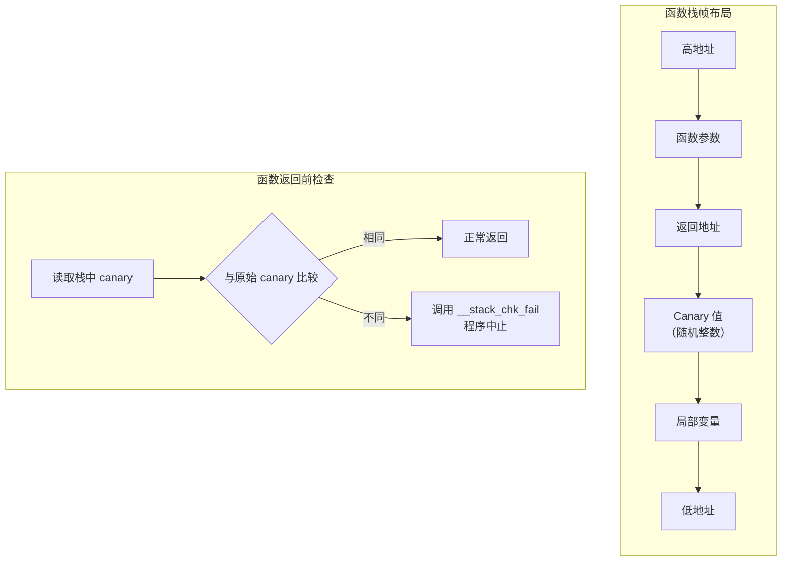

性能影响：

- 使用 stack-protector 选项编译后，会占用更大的栈空间（每个受保护函数多一个 canary 值的空间）
- 运行速度有所降低（函数入口需要获取 canary 值，出口需要校验）
- 栈溢出是在运行时检测的，不是编译时

栈保护选项：

| 选项 | 说明 | 保护范围 |
|------|------|---------|
| `-fstack-protector` | 对包含 ≥8 字节字符数组的函数插入保护 | 较小 |
| `-fstack-protector-strong` | 对包含数组、局部变量地址引用的函数插入保护 | 中等（**推荐**） |
| `-fstack-protector-all` | 对所有函数插入保护 | 最大 |
| `-fstack-clash-protection` | 防止栈冲突攻击（Stack Clash） | 补充保护 |
| `-fstack-check` | 在栈增长时插入探测点，防止跳过栈保护页 | 运行时检查 |
| `-fno-stack-protector` | 禁用栈保护 | - |

**`-fstack-protector-strong` 的保护条件**（GCC ≥ 4.9 或 Linux ≥ 3.14）：

- 函数包含任何大小的任意类型数组（即使数组定义在 struct 或 union 中）
- 函数包含局部变量地址赋给变量值

**`-fstack-protector` 的阈值调整：**

可通过 `--param=ssp-buffer-size=N` 改变默认的 8 字节阈值。例如：

```bash
# 将保护阈值改为 4 字节（更激进的保护）
gcc -fstack-protector --param=ssp-buffer-size=4 -o program program.c
```

**`-fstack-clash-protection` 详解：**

Stack Clash 是一种攻击技术，攻击者通过大量分配栈空间使栈增长"跳过"保护页（guard page），直接侵入其他内存区域（如另一个线程的栈或堆）。`-fstack-clash-protection` 通过以下机制防御：

- 编译器在每次大幅栈空间分配时，生成逐页探测代码（probe），确保每次栈增长都触及保护页
- 防止攻击者一次性跳过整个 guard page

```bash
# 启用栈冲突保护
gcc -fstack-clash-protection -o program program.c
```

**`-fstack-check` 详解：**

`-fstack-check` 在栈增长过程中插入周期性探测点，确保操作系统能够正确检测栈溢出并发送 SIGSEGV 信号。这对于多线程程序尤为重要，因为线程栈通常有固定大小限制：

- 没有 `-fstack-check` 时，线程栈溢出可能直接跳过 guard page 而不触发信号
- 有 `-fstack-check` 时，每次栈增长超过一定阈值都会探测，确保 guard page 被正确触发

```bash
# 在线程栈上启用保护探测
gcc -fstack-check -o program program.c -lpthread
```

**内核编译时开启栈保护：**

编译内核时通过 menuconfig（搜索 `STACKPROTECTOR`）开启栈保护：

```
Kernel hacking → Compiler options → Stack Protector
├── None
├── Basic stack-protector buffer overflow detection
└── Strong stack-protector buffer overflow detection  ← 推荐
```

实战示例——验证栈保护是否生效：

```c
// stack_test.c
#include <stdio.h>
#include <string.h>

void vulnerable_func(char *input) {
    char buf[64];
    strcpy(buf, input);  // 危险的字符串复制
    printf("%s\n", buf);
}

int main(void) {
    char attack[128];
    memset(attack, 'A', sizeof(attack));
    attack[127] = '\0';
    vulnerable_func(attack);  // 触发栈溢出
    return 0;
}
```

```bash
# 启用栈保护编译
$ gcc -fstack-protector-strong -g -o stack_test stack_test.c

# 运行（触发栈溢出时 canary 被覆盖，程序中止）
$ ./stack_test
*** stack smashing detected ***: terminated
Aborted (core dumped)

# 禁用栈保护编译（危险！仅用于对比演示）
$ gcc -fno-stack-protector -g -o stack_test_noprotect stack_test.c
$ ./stack_test_noprotect
Segmentation fault (core dumped)
```

### 2.9.2 格式化字符串安全

| 选项 | 说明 |
|------|------|
| `-D_FORTIFY_SOURCE=1` | 启用基本运行时缓冲区溢出检查 |
| `-D_FORTIFY_SOURCE=2` | 启用更强的运行时检查（需要 `-O2` 或更高） |
| `-Wformat` | 检查 `printf`/`scanf` 等格式化字符串 |
| `-Wformat-security` | 检测可能的安全问题的格式化字符串 |
| `-Werror=format-security` | 将格式化安全问题视为错误 |

`_FORTIFY_SOURCE` 工作原理：

- 替换某些函数调用为更安全的版本（如 `memcpy` → `__memcpy_chk`）
- 在运行时检查缓冲区边界
- 级别 2 比级别 1 更严格，但需要 `-O2` 或更高优化级别

### 2.9.3 位置无关代码

| 选项 | 说明 | 使用场景 |
|------|------|---------|
| `-fPIC` | 生成位置无关代码 | 共享库（必须） |
| `-fPIE` | 生成位置无关可执行文件 | 可执行文件（编译时） |
| `-pie` | 链接位置无关可执行文件 | 可执行文件（链接时） |

使用场景：

- **共享库：** 必须使用 `-fPIC`
- **可执行文件：** 使用 `-fPIE -pie` 以支持 ASLR（地址空间布局随机化）

### 2.9.4 链接器安全

| 选项 | 说明 |
|------|------|
| `-Wl,-z,relro` | 设置重定位表只读（部分 RELRO） |
| `-Wl,-z,now` | 在程序启动时解析所有符号（立即绑定） |
| `-Wl,-z,relro -Wl,-z,now` | 完全 RELRO |
| `-Wl,-z,noexecstack` | 标记栈不可执行 |
| `-Wl,-z,separate-code` | 强制分离代码段与数据段 |
| `-Wl,--as-needed` | 只链接实际使用的库（减少攻击面） |

RELRO 保护原理：

- 防止 GOT（全局偏移表）覆盖攻击
- 部分 RELRO：将 GOT 中已解析的条目设置为只读
- 完全 RELRO：在程序启动时解析所有符号并设置为只读

### 2.9.5 控制流完整性

| 选项 | 说明 |
|------|------|
| `-fcf-protection=none` | 禁用控制流保护 |
| `-fcf-protection=return` | 仅保护返回指令 |
| `-fcf-protection=branch` | 仅保护分支指令 |
| `-fcf-protection=full` | 完全保护（需要 CPU 支持 CET） |

### 2.9.6 安全选项组合推荐表

| 场景 | 推荐选项 |
|------|---------|
| 生产服务器 | `-fstack-protector-strong -D_FORTIFY_SOURCE=2 -fPIE -pie -Wl,-z,relro -Wl,-z,now -Wl,-z,noexecstack` |
| 嵌入式系统 | `-fstack-protector -D_FORTIFY_SOURCE=1 -Wl,-z,noexecstack` |
| 桌面应用 | `-fstack-protector-strong -D_FORTIFY_SOURCE=2 -fPIE -pie -Wl,-z,relro` |
| 调试开发 | 安全选项可适当放宽，使用 `-fno-stack-protector` |

## 2.10 动态检测选项（Sanitizer）

Sanitizer 是编译器提供的运行时检测工具，能在程序运行时自动检测各类错误。相比 Valgrind 等外部工具，Sanitizer 性能开销更小，但需要重新编译。

### 2.10.1 AddressSanitizer（ASan）

| 选项 | 说明 |
|------|------|
| `-fsanitize=address` | 启用地址消毒器，检测内存错误 |
| `-fsanitize-address-use-after-scope` | 检测作用域后使用 |

检测能力：

- 堆/栈/全局缓冲区的越界访问
- use-after-free（使用已释放的内存）
- double-free（双重释放）
- 内存泄漏（与 LSan 配合）

使用示例：

```bash
# 编译（编译和链接都需要加）
gcc -fsanitize=address -g -o program program.c

# 运行（检测到错误时自动输出详细报告）
./program
```

### 2.10.2 ThreadSanitizer（TSan）

| 选项 | 说明 |
|------|------|
| `-fsanitize=thread` | 启用线程消毒器，检测数据竞争 |

检测能力：多线程数据竞争、不正确的锁使用。

**注意：** 不能与 `-fsanitize=address` 同时使用。

### 2.10.3 UndefinedBehaviorSanitizer（UBSan）

| 选项 | 说明 |
|------|------|
| `-fsanitize=undefined` | 启用未定义行为消毒器 |
| `-fsanitize=signed-integer-overflow` | 检测有符号整数溢出 |
| `-fsanitize=float-divide-by-zero` | 检测浮点除零 |
| `-fsanitize=null` | 检测空指针解引用 |
| `-fsanitize=bounds` | 检测数组越界 |
| `-fsanitize=alignment` | 检测未对齐的内存访问 |

### 2.10.4 MemorySanitizer（MSan）

| 选项 | 说明 |
|------|------|
| `-fsanitize=memory` | 启用内存消毒器，检测未初始化内存读取 |

**注意：** 目前主要由 Clang 支持，GCC 支持有限。

### 2.10.5 LeakSanitizer（LSan）

| 选项 | 说明 |
|------|------|
| `-fsanitize=leak` | 启用内存泄漏检测器 |

使用示例：

```bash
gcc -fsanitize=leak -g -o program program.c
./program
# 程序退出时报告内存泄漏
```

### 2.10.6 检测通用选项

| 选项 | 说明 |
|------|------|
| `-fsanitize-recover=<check>` | 允许从某些检查中恢复继续运行 |
| `-fsanitize-trap=<check>` | 对某些检查使用陷阱而非报告 |
| `-fno-sanitize=<check>` | 禁用特定的消毒器检查 |

### 2.10.7 Sanitizer 对比表

| Sanitizer | 检测范围 | 性能开销 | 互斥关系 | 适用场景 |
|-----------|---------|:-------:|---------|---------|
| ASan | 内存越界、use-after-free、double-free | ~2x | 与 TSan/MSan 互斥 | 内存错误调试 |
| TSan | 数据竞争 | ~5-10x | 与 ASan/MSan 互斥 | 多线程调试 |
| UBSan | 未定义行为 | ~1.2x | 无 | 代码健壮性检查 |
| MSan | 未初始化内存读取 | ~3x | 与 ASan/TSan 互斥 | 初始化检查 |
| LSan | 内存泄漏 | 小 | 可与 ASan 共存 | 泄漏检测 |

### 2.10.8 Sanitizer 运行时环境变量

Sanitizer 的行为可以通过环境变量在运行时进行精细控制：

| 环境变量 | 对应工具 | 示例 |
|---------|---------|------|
| `ASAN_OPTIONS` | AddressSanitizer | `ASAN_OPTIONS=detect_leaks=1:halt_on_error=0` |
| `TSAN_OPTIONS` | ThreadSanitizer | `TSAN_OPTIONS=halt_on_error=0:history_size=7` |
| `UBSAN_OPTIONS` | UndefinedBehaviorSanitizer | `UBSAN_OPTIONS=halt_on_error=0:print_stacktrace=1` |
| `LSAN_OPTIONS` | LeakSanitizer | `LSAN_OPTIONS=verbosity=1:log_threads=1` |
| `MSAN_OPTIONS` | MemorySanitizer | `MSAN_OPTIONS=halt_on_error=0` |

常用 ASAN_OPTIONS 配置：

```bash
# 启用泄漏检测（默认开启）
export ASAN_OPTIONS=detect_leaks=1

# 检测到错误后继续运行（收集更多错误）
export ASAN_OPTIONS=halt_on_error=0

# 输出到文件
export ASAN_OPTIONS=log_path=asan.log

# 检测栈返回后使用
export ASAN_OPTIONS=detect_stack_use_after_return=1

# 组合配置
export ASAN_OPTIONS=detect_leaks=1:halt_on_error=0:log_path=asan.log:verbosity=1
```

查看可用选项：

```bash
# 设置 help=1 可在程序启动时显示所有可用选项
ASAN_OPTIONS=help=1 ./program
```

常用 TSAN_OPTIONS 配置：

```bash
# 检测到竞争后继续运行
export TSAN_OPTIONS=halt_on_error=0

# 增大历史缓冲区（提高检测精度，增加内存使用）
export TSAN_OPTIONS=history_size=7

# 输出到文件
export TSAN_OPTIONS=log_path=tsan.log
```

## 2.11 静态分析选项

静态分析在不运行程序的情况下检查代码中的潜在问题，是 CI/CD 流水线中的重要环节。

### 2.11.1 GCC 静态分析器（GCC 10.0+）

| 选项 | 说明 |
|------|------|
| `-fanalyzer` | 启用 GCC 内置的静态分析器 |
| `-Wanalyzer-use-after-free` | 检测使用已释放的内存 |
| `-Wanalyzer-malloc-leak` | 检测 malloc 分配的内存泄漏 |
| `-Wanalyzer-double-free` | 检测双重释放内存 |
| `-Wanalyzer-null-dereference` | 检测可能的空指针解引用 |

检测能力：内存泄漏、use-after-free、双重释放、空指针解引用、未初始化值。

要求：GCC 10.0 或更高版本。

### 2.11.2 Clang 静态分析器

| 选项 | 说明 |
|------|------|
| `--analyze` | 启用 Clang 静态分析器 |
| `-Xanalyzer <arg>` | 传递参数给 Clang 静态分析器 |

### 2.11.3 静态分析报告控制

| 选项 | 说明 |
|------|------|
| `-fanalyzer-verbose` | 生成详细的静态分析报告 |
| `-fanalyzer-fine-grained` | 进行更细粒度的分析 |

### 2.11.4 静态检查补充

| 选项 | 说明 |
|------|------|
| `-Warray-bounds=2` | 更严格的数组边界静态检查 |
| `-Wstringop-overflow=4` | 最严格的字符串操作静态检查 |
| `-Wnull-dereference` | 检测编译时可确定的空指针解引用 |

## 2.12 性能分析编译选项

性能分析编译选项为性能分析工具（如 gprof、perf）提供必要的插桩和调试信息支持。正确配置这些选项是获得准确性能分析结果的前提。

### 2.12.1 Gprof 支持

| 选项 | 说明 |
|------|------|
| `-pg` | 插入性能分析代码，生成 gmon.out |
| `-fno-omit-frame-pointer` | 保留帧指针寄存器，配合 `-pg` 效果更好 |

使用流程：

```bash
# 编译
gcc -pg -g -o program program.c

# 运行（生成 gmon.out）
./program

# 分析
gprof program gmon.out > analysis.txt
```

### 2.12.2 Perf 支持

| 选项 | 说明 |
|------|------|
| `-fno-omit-frame-pointer` | 保留帧指针，perf 需要用于调用栈回溯 |
| `-g` | 生成调试信息，perf report 需要 |

**为什么 `-fno-omit-frame-pointer` 对 perf 至关重要：**

默认情况下，`-O2` 及以上优化级别会省略帧指针（将 RBP 寄存器释放为通用寄存器），这会导致：

- `perf record -g` 无法正确回溯调用栈（基于帧指针的栈回溯失效）
- 火焰图显示不完整的调用链
- 函数调用关系丢失

解决方案对比：

| 方案 | 编译选项 | 优点 | 缺点 |
|------|---------|------|------|
| 保留帧指针 | `-fno-omit-frame-pointer` | 栈回溯准确、开销小 | 少一个通用寄存器，可能影响性能（~1-3%） |
| DWARF 回溯 | `-g`（不需要帧指针） | 不牺牲寄存器 | 需要 `-g` 编译，`perf record --call-graph dwarf` 开销较大 |

```bash
# 推荐：性能分析时的编译选项
gcc -O2 -g -fno-omit-frame-pointer -o program program.c

# 如果无法重编译，使用 DWARF 模式
perf record --call-graph dwarf ./program
```

### 2.12.3 函数仪器化

| 选项 | 说明 |
|------|------|
| `-finstrument-functions` | 在函数入口和出口插入调用 |
| `-finstrument-functions-exclude-file-list` | 排除特定文件的仪器化 |
| `-finstrument-functions-exclude-function-list` | 排除特定函数的仪器化 |

需要实现的钩子函数：

```c
void __cyg_profile_func_enter(void *func, void *caller);
void __cyg_profile_func_exit(void *func, void *caller);
```

### 2.12.4 PGO 反馈优化

| 选项 | 说明 |
|------|------|
| `-fprofile-generate` | 插入代码收集性能数据 |
| `-fprofile-use` | 使用收集的性能数据进行优化 |
| `-fprofile-correction` | 数据校正 |
| `-fauto-profile` | 使用外部性能分析数据（`.afdo` 文件） |

PGO 工作流程：


### 2.12.5 调试辅助

| 选项 | 说明 |
|------|------|
| `-fdebug-prefix-map=<old>=<new>` | 标准化调试信息中的路径，使构建可重现 |
| `-gsplit-dwarf` | 将调试信息分离到单独文件（`.dwo`），减小二进制大小 |

## 2.13 本章选项速查总表

本章系统介绍了 GCC 从基础编译到高级优化的全部选项类别。以下按类别汇总核心选项，并给出典型构建场景的推荐组合。

| 类别 | 选项 | 说明 |
|------|------|------|
| 基础 | `-E` | 仅预处理 |
| | `-S` | 到汇编 |
| | `-c` | 到目标文件 |
| | `-o <file>` | 指定输出 |
| | `-D<name>` | 定义宏 |
| | `-v` | 显示详细过程 |
| 文件查找 | `-I<dir>` | 头文件搜索路径 |
| | `-isystem <dir>` | 系统头文件路径 |
| | `-L<dir>` | 库搜索路径 |
| | `-l<lib>` | 链接库 |
| 警告 | `-Wall` | 主要警告 |
| | `-Wextra` | 额外警告 |
| | `-Werror` | 警告视为错误 |
| | `-w` | 关闭警告 |
| | `-Wstack-usage=<N>` | 栈使用量检查 |
| | `-Wformat-overflow=<N>` | 格式化溢出检查 |
| 优化 | `-O0` ~ `-O3` | 优化级别 |
| | `-Os` | 优化大小 |
| | `-Og` | 调试友好优化 |
| | `-Ofast` | 激进优化 |
| 调试 | `-g` | 调试信息 |
| | `-ggdb` | GDB 格式 |
| | `-gdwarf` | DWARF 格式 |
| 安全 | `-fstack-protector-strong` | 栈保护 |
| | `-fstack-clash-protection` | 栈冲突保护 |
| | `-fstack-check` | 栈增长探测 |
| | `-D_FORTIFY_SOURCE=2` | 强化检查 |
| | `-fPIE -pie` | 位置无关可执行 |
| | `-Wl,-z,relro,-z,now` | 完全 RELRO |
| 检测 | `-fsanitize=address` | ASan |
| | `-fsanitize=thread` | TSan |
| | `-fsanitize=undefined` | UBSan |
| | `-fsanitize=leak` | LSan |
| 静态分析 | `-fanalyzer` | GCC 静态分析器 |
| 性能 | `-pg` | gprof 支持 |
| | `-fno-omit-frame-pointer` | 保留帧指针（perf 需要） |
| | `-fprofile-generate` | PGO 生成 |
| | `-fprofile-use` | PGO 使用 |

典型构建场景选项组合速查：

| 场景 | 推荐选项组合 |
|------|-------------|
| 开发调试 | `-O0 -g -ggdb -Wall -Wextra` |
| 生产发布 | `-O2 -fstack-protector-strong -D_FORTIFY_SOURCE=2 -fPIE -pie -Wl,-z,relro -Wl,-z,now` |
| 嵌入式发布 | `-Os -ffunction-sections -fdata-sections -Wl,--gc-sections -fstack-protector -Wstack-usage=1024` |
| 内存调试 | `-O1 -g -fsanitize=address -fno-omit-frame-pointer` |
| 多线程调试 | `-O1 -g -fsanitize=thread -fPIC` |
| 性能分析 | `-O2 -g -pg -fno-omit-frame-pointer` |
| PGO 优化 | 第一阶段 `-O2 -fprofile-generate`，第二阶段 `-O2 -fprofile-use` |

# 第3章 链接与库管理工具（binutils·编译相关）

binutils 中与编译流程直接相关的工具包括汇编器 `as`、链接器 `ld`、段编辑工具 `objcopy`、静态库工具 `ar`、符号索引工具 `ranlib` 和符号剥离工具 `strip`。这些工具在构建流程中各司其职，共同完成从汇编代码到最终可执行文件或库文件的全部工作。本章将逐一介绍每个工具的基本用法、常用选项和实战示例，帮助读者掌握从目标文件生成到发布版本制作的完整工具链。

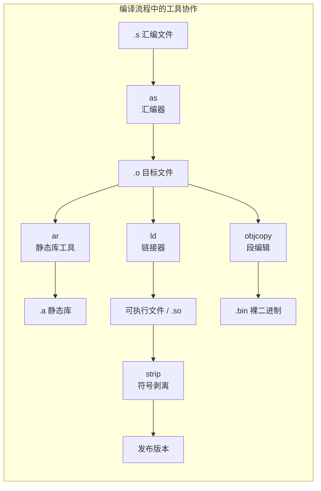

## 3.1 汇编器 as（汇编代码转目标文件）

`as` 是 GNU 汇编器（GNU Assembler），负责将汇编代码（`.s` 文件）转换为 ELF 格式的目标文件（`.o` 文件）。它是编译流程中"汇编阶段"的核心工具。

### 3.1.1 基本用法与常用选项

基本语法：

```bash
as [options] -o output.o input.s
```

常用选项：

| 选项 | 说明 | 典型用途 |
|------|------|----------|
| `-o <file>` | 指定输出文件名 | 所有汇编场景 |
| `-a` | 生成汇编列表（listing） | 调试汇编代码、查看符号地址 |
| `-D` | 包含调试信息 | 需要调试汇编代码时 |
| `-I <dir>` | 添加 `.include` 指令的搜索路径 | 汇编代码中使用了 `.include` |
| `-L` | 在符号表中保留本地符号（以 `L` 开头的标签） | 调试时需要查看本地标签 |
| `-R` | 合并数据段和文本段 | 嵌入式开发中简化段结构 |
| `-v` | 显示版本信息 | 确认工具版本 |
| `--64` / `--32` | 指定目标字长（64位/32位） | 交叉汇编或指定字长 |
| `-march=<arch>` | 指定目标架构 | 交叉汇编 |
| `-gstabs` | 生成 STABS 格式调试信息 | 旧式调试 |
| `-gdwarf-2` | 生成 DWARF2 格式调试信息 | 现代调试 |

### 3.1.2 实战示例

```bash
# 基本汇编
$ as -o test.o test.s

# 生成汇编列表（查看每条指令对应的地址）
$ as -a -o test.o test.s > test.lst
$ cat test.lst
GAS LISTING test.s
1               .file   "test.s"
2               .text
3               .globl  main
4               .type   main, @function
5 0000 55       main:
6 0001 4889E5            pushq   %rbp
7 0004 4889E5            movq    %rsp, %rbp
...

# 保留本地符号（调试用）
$ as -L -o test.o test.s

# 指定32位输出
$ as --32 -o test32.o test.s
```

### 3.1.3 输出解读（汇编列表）

| 列 | 含义 |
|----|------|
| 第1列 | 源文件行号 |
| 第2列 | 指令在段内的偏移地址（十六进制） |
| 第3列 | 机器码（十六进制） |
| 第4列 | 汇编指令原文 |

### 3.1.4 与 gcc -c 的协作关系

在日常开发中，通常不直接调用 `as`，而是通过 `gcc -c` 间接调用。`gcc -c` 内部会自动调用 `as` 完成汇编阶段：

```bash
# gcc -c 内部会调用 as
gcc -c source.s -o source.o

# 等价于
as source.s -o source.o

# 使用 -v 选项可以看到 gcc 实际调用了 as
$ gcc -c test.s -o test.o -v
...
/usr/lib/gcc/x86_64-linux-gnu/7/as -o test.o test.s
...
```

直接使用 `as` 与通过 `gcc -c` 的对比：

| 对比项 | 直接使用 as | 通过 gcc -c |
|--------|------------|-------------|
| 适用场景 | 纯汇编文件、需要精细控制 | C/C++ 源文件的汇编阶段 |
| 自动处理 | 无 | 自动传递编译选项产生的汇编指令 |
| 调试信息 | 需手动指定 `-D` 等 | 由 `-g` 选项自动传递 |
| 推荐程度 | 特殊场景 | 日常开发推荐 |

## 3.2 链接器 ld（目标文件链接为可执行文件）

`ld` 是 GNU 链接器（GNU Linker），负责将一个或多个目标文件和库链接为可执行文件、共享库或可重定位目标文件。它是编译流程中"链接阶段"的核心工具。

### 3.2.1 基本用法与常用选项

基本语法：

```bash
ld [options] -o output file1.o file2.o ...
```

常用选项：

| 选项 | 说明 | 典型用途 |
|------|------|----------|
| `-o <file>` | 指定输出文件名 | 所有链接场景 |
| `-l<name>` | 链接库 `lib<name>.a` 或 `lib<name>.so` | 链接标准库或第三方库 |
| `-L<dir>` | 添加库搜索路径 | 指定非标准路径的库 |
| `-r` | 生成可重定位的目标文件（部分链接） | 将多个 `.o` 合并为一个 `.o` |
| `-s` | 去除所有符号信息 | 减小输出文件体积 |
| `-S` | 仅去除调试符号 | 保留其他符号，去除调试信息 |
| `-T <script>` | 使用指定的链接脚本 | 嵌入式开发中控制内存布局 |
| `-u <symbol>` | 强制解析指定符号（即使未被引用） | 确保特定函数被链接 |
| `--gc-sections` | 删除未使用的节区 | 配合 `-ffunction-sections` 减小体积 |
| `--start-group` / `--end-group` | 处理循环依赖的库 | 库之间存在循环引用 |
| `--as-needed` | 只链接实际使用的库 | 减少不必要的运行时依赖 |
| `--no-undefined` | 将所有未解析的符号视为错误 | 确保共享库的完整性 |
| `-z relro` | 设置重定位表只读（部分 RELRO） | 安全加固 |
| `-z now` | 启动时解析所有符号（立即绑定） | 安全加固 |
| `-z noexecstack` | 标记栈不可执行 | 安全加固 |
| `-soname <name>` | 设置共享库的 SONAME | 创建共享库时指定版本名 |
| `-shared` | 生成共享库 | 创建 `.so` 文件 |
| `-static` | 强制静态链接 | 生成无运行时依赖的可执行文件 |
| `-Map <file>` | 生成链接映射文件 | 分析链接结果、查看符号地址 |
| `--verbose` | 显示链接过程详细信息 | 排查链接问题 |

### 3.2.2 实战示例

```bash
# 基本链接（通常不直接使用 ld，而是通过 gcc）
$ ld -o program main.o myop.o -lc -lm

# 通过 gcc 调用 ld（推荐方式）
$ gcc -o program main.o myop.o -lm

# 部分链接（将多个 .o 合并为一个 .o）
$ ld -r -o combined.o file1.o file2.o file3.o

# 生成链接映射文件（分析符号地址和段布局）
$ gcc -o program main.o -Wl,-Map=program.map
$ head -30 program.map

# 强制解析符号（确保某函数被链接进来）
$ ld -u my_init -o program main.o libfoo.a
```

### 3.2.3 易错点

| 易错点 | 说明 | 正确做法 |
|--------|------|----------|
| 缺少启动文件 | 直接使用 `ld` 时需要手动指定启动文件（`crt1.o`、`crti.o`、`crtn.o`）和库路径，否则会出现 `undefined reference to '_start'` 等错误 | 通过 `gcc` 间接调用 `ld` |
| 库顺序错误 | `-l` 和 `-L` 选项的顺序很重要：库必须出现在引用它的目标文件之后 | `gcc main.o -lmyop`（而非 `gcc -lmyop main.o`） |
| gc-sections 无效 | `--gc-sections` 需要配合编译时的 `-ffunction-sections -fdata-sections` 才能生效 | 编译和链接都加对应选项 |

### 3.2.4 链接脚本基础概念

链接脚本（Linker Script）用于控制输出文件中各段的内存布局，在嵌入式开发中尤为重要。

```bash
# 使用自定义链接脚本
ld -T linker.ld -o firmware.elf start.o main.o

# 查看默认链接脚本
ld --verbose
```

链接脚本的基本结构：

```ld
/* 简单的链接脚本示例 */
SECTIONS
{
    . = 0x08000000;              /* 起始地址（Flash） */
    .text : { *(.text) }         /* 代码段 */
    . = 0x20000000;              /* RAM 起始地址 */
    .data : { *(.data) }         /* 已初始化数据 */
    .bss  : { *(.bss) }          /* 未初始化数据 */
}
```

链接脚本核心语法要素：

| 语法要素 | 说明 | 示例 |
|----------|------|------|
| `SECTIONS` | 定义输出段的布局 | `SECTIONS { ... }` |
| `. = <addr>` | 设置位置计数器 | `. = 0x08000000;` |
| `<section> : { ... }` | 定义输出段 | `.text : { *(.text) }` |
| `*(<pattern>)` | 匹配输入段 | `*(.text .text.*)` |
| `KEEP(...)` | 防止被 `--gc-sections` 删除 | `KEEP(*(.init))` |
| `PROVIDE(...)` | 定义符号（仅当未定义时） | `PROVIDE(_end = .);` |
| `ENTRY(...)` | 指定入口点 | `ENTRY(_start)` |
| `MEMORY` | 定义内存区域 | `MEMORY { FLASH (rx) : ORIGIN = 0x08000000, LENGTH = 256K }` |

### 3.2.5 通过 gcc 调用 ld 的常用传递方式（-Wl,）

由于直接调用 `ld` 需要手动指定启动文件（`crt1.o`、`crti.o`、`crtn.o`）和库路径，实际工程中几乎总是通过 `gcc` 间接调用 `ld`。使用 `-Wl,option` 语法将选项传递给链接器。

#### 语法要点

| 语法 | 说明 |
|------|------|
| `-Wl,option` | 将 `option` 传递给链接器 |
| `-Wl,opt1,opt2` | 传递多个选项（逗号分隔） |
| `-Wl,opt1 -Wl,opt2` | 也可以分开写 |

#### 基本示例

```bash
# 使用 -Wl, 将选项传递给链接器
gcc -Wl,-z,relro -Wl,-z,now -o program main.o -L./lib -lfoo

# 多个选项用逗号分隔（等价写法）
gcc -Wl,-z,relro,-z,now -o program main.o

# 传递链接脚本
gcc -Wl,-T,linker.ld -o firmware main.o

# 生成映射文件
gcc -Wl,-Map=output.map -o program main.o

# 查看 gcc 实际传递给 ld 的参数
gcc -o program main.o -v
```

#### 常用 -Wl, 传递选项速查表

| gcc 写法 | 等价 ld 选项 | 用途 |
|----------|-------------|------|
| `-Wl,-Map=out.map` | `-Map out.map` | 生成映射文件 |
| `-Wl,--gc-sections` | `--gc-sections` | 删除未使用的段 |
| `-Wl,-z,relro` | `-z relro` | RELRO 安全加固 |
| `-Wl,-z,now` | `-z now` | 立即绑定 |
| `-Wl,-rpath,/opt/lib` | `-rpath /opt/lib` | 运行时库搜索路径 |
| `-Wl,--as-needed` | `--as-needed` | 仅链接实际使用的库 |
| `-Wl,-T,script.ld` | `-T script.ld` | 指定链接脚本 |
| `-Wl,--start-group ... -Wl,--end-group` | `--start-group ... --end-group` | 处理循环依赖 |
| `-Wl,-Bstatic` | `-Bstatic` | 后续库使用静态链接 |
| `-Wl,-Bdynamic` | `-Bdynamic` | 后续库使用动态链接（默认） |
| `-Wl,--whole-archive` | `--whole-archive` | 强制包含静态库所有目标文件 |
| `-Wl,--no-whole-archive` | `--no-whole-archive` | 恢复正常链接行为 |
| `-Wl,--no-undefined` | `--no-undefined` | 未解析符号视为错误 |
| `-Wl,-soname,libfoo.so.1` | `-soname libfoo.so.1` | 设置共享库 SONAME |
| `-Wl,-O1` | `-O1` | 链接器优化级别 |

#### -Wl, 与直接 ld 调用的对比

| 对比项 | 直接使用 ld | 通过 gcc -Wl, |
|--------|------------|---------------|
| 启动文件 | 需手动指定 crt1.o、crti.o、crtn.o | 自动处理 |
| 库路径 | 需手动指定所有 -L 路径 | 自动包含系统默认路径 |
| C 运行时初始化 | 需手动处理 | 自动处理 |
| 适用场景 | 嵌入式裸机、特殊需求 | 日常开发（推荐） |
| 灵活性 | 完全控制 | 受限于 gcc 传递的选项 |

## 3.3 段编辑工具 objcopy（格式转换与段操作）

`objcopy` 用于复制和转换目标文件的内容，是嵌入式开发中不可或缺的工具。它可以将 ELF 文件转换为裸二进制（raw binary）、提取或删除特定段、操作符号等。

### 3.3.1 基本用法与常用选项

基本语法：

```bash
objcopy [options] input [output]
```

常用选项：

| 选项 | 说明 | 典型用途 |
|------|------|----------|
| `-I <bfdname>` | 指定输入格式 | 输入非默认格式时 |
| `-O <bfdname>` | 指定输出格式 | 转换为 binary、ihex 等格式 |
| `-F <bfdname>` | 同时指定输入和输出格式 | 同格式复制 |
| `-j <section>` | 仅复制指定节区 | 提取特定段 |
| `-R <section>` | 删除指定节区 | 去除不需要的段 |
| `-S` / `--strip-all` | 去除所有符号 | 减小文件体积 |
| `-g` / `--strip-debug` | 仅去除调试符号 | 保留其他符号 |
| `-K <symbol>` | 保留指定符号（即使使用了 strip） | 保留必要符号 |
| `-N <symbol>` | 删除指定符号 | 去除特定符号 |
| `-L <symbol>` | 将符号标记为本地（local） | 隐藏符号可见性 |
| `-W <symbol>` | 将符号标记为弱符号（weak） | 允许符号被覆盖 |
| `--only-keep-debug` | 仅保留调试信息 | 生成独立的调试文件 |
| `--add-gnu-debuglink=<file>` | 添加调试信息链接 | 关联分离的调试文件 |
| `--set-section-flags <name>=<flags>` | 设置节区属性 | 修改段权限 |
| `--rename-section <old>=<new>` | 重命名节区 | 段名调整 |
| `--add-section <name>=<file>` | 添加新节区（内容来自文件） | 嵌入固件数据、版本号等 |
| `--update-section <name>=<file>` | 更新已有节区的内容 | 替换段内数据 |
| `--change-addresses <val>` | 修改所有地址 | 地址偏移调整 |
| `--gap-fill <val>` | 用指定值填充段间空隙 | 裸二进制生成 |
| `--pad-to <addr>` | 填充输出到指定地址 | 对齐要求 |

选项分类总结：

| 分类 | 选项 | 说明 |
|------|------|------|
| 格式转换 | `-O`、`-I`、`-F` | 控制输入输出格式 |
| 段选择 | `-j`、`-R` | 保留或删除指定段 |
| 符号操作 | `-S`、`-g`、`-K`、`-N`、`-L`、`-W` | 控制符号的保留/删除/属性 |
| 段操作 | `--rename-section`、`--set-section-flags`、`--add-section`、`--update-section` | 修改段的名称、属性、内容 |
| 调试信息 | `--only-keep-debug`、`--add-gnu-debuglink` | 调试信息分离方案 |
| 地址操作 | `--change-addresses`、`--gap-fill`、`--pad-to` | 地址调整与填充 |

### 3.3.2 格式转换示例（嵌入式开发最常用）

```bash
# ELF 转裸二进制（生成可烧录的 raw binary）
$ objcopy -O binary firmware.elf firmware.bin

# ELF 转 Intel HEX 格式（某些烧录工具需要）
$ objcopy -O ihex firmware.elf firmware.hex

# ELF 转 S-Record 格式
$ objcopy -O srec firmware.elf firmware.srec

# 查看支持的输出格式
$ objcopy --info | grep -i format
```

格式对比：

| 格式 | 扩展名 | 特点 | 适用场景 |
|------|--------|------|----------|
| `binary` | `.bin` | 纯机器码，无任何元数据 | 直接烧录到 Flash |
| `ihex` | `.hex` | Intel HEX 格式，含地址信息 | 某些 IDE 烧录工具 |
| `srec` | `.srec` | Motorola S-Record 格式 | 某些嵌入式工具链 |

### 3.3.3 段操作示例

```bash
# 仅复制 .text 段
$ objcopy -j .text input.elf output.o

# 删除 .comment 和 .note 段（减小文件体积）
$ objcopy -R .comment -R .note input.elf output.elf

# 去除调试符号
$ objcopy --strip-debug program program.stripped

# 去除所有符号
$ objcopy --strip-all program program.stripped
```

### 3.3.4 添加和更新段（嵌入式固件管理常用）

```bash
# 添加一个新段，将版本信息文件嵌入到 ELF 中
$ echo "v1.2.3" > version.txt
$ objcopy --add-section .version=version.txt firmware.elf firmware.elf

# 更新已有段的内容（例如替换配置数据）
$ objcopy --update-section .config=new_config.bin firmware.elf firmware.elf

# 验证添加的段
$ objdump -h firmware.elf | grep version
$ objcopy -j .version -O binary firmware.elf /dev/stdout
```

`--add-section` 与 `--update-section` 的区别：

| 对比项 | `--add-section` | `--update-section` |
|--------|----------------|-------------------|
| 操作对象 | 添加新段 | 更新已有段 |
| 段不存在时 | 创建新段 | 报错 |
| 段已存在时 | 报错 | 替换内容 |
| 典型用途 | 嵌入版本号、配置数据 | 更新固件中的配置段 |

### 3.3.5 重命名段与设置段属性

```bash
# 重命名段（将 .data 重命名为 .flashdata）
$ objcopy --rename-section .data=.flashdata input.elf output.elf

# 设置段属性（将 .data 段设为只读、可加载、代码段）
$ objcopy --set-section-flags .data=alloc,load,readonly,data input.elf output.elf
```

可用的段属性标志：

| 标志 | 说明 |
|------|------|
| `alloc` | 段在运行时分配内存 |
| `load` | 段需要加载到内存 |
| `readonly` | 段为只读 |
| `code` | 段包含可执行代码 |
| `data` | 段包含已初始化数据 |
| `rom` | 段存放在 ROM 中 |
| `share` | 段可共享 |
| `debug` | 段包含调试信息 |
| `noload` | 段不加载到内存 |
| `contents` | 段在文件中占用空间 |

### 3.3.6 符号操作示例

```bash
# 将全局符号标记为本地（隐藏符号）
$ objcopy -L internal_func input.o output.o

# 将符号标记为弱符号
$ objcopy -W optional_func input.o output.o

# 删除指定符号
$ objcopy -N unwanted_symbol input.o output.o

# 保留指定符号（配合 strip 使用）
$ objcopy --strip-all -K main -K init input.elf output.elf
```

### 3.3.7 调试信息分离（发布版本常用）

```bash
# 步骤1：生成独立的调试文件
$ objcopy --only-keep-debug program program.debug

# 步骤2：从原文件中去除调试信息
$ objcopy --strip-debug program

# 步骤3：在原文件中添加调试文件的链接
$ objcopy --add-gnu-debuglink=program.debug program

# 调试时，gdb 会自动通过 debuglink 找到 program.debug
$ gdb ./program
```

调试信息分离工作流程：


### 3.3.8 嵌入式开发完整工作流示例

```bash
# 1. 编译生成 ELF（带调试信息）
$ arm-none-eabi-gcc -g -O2 -T linker.ld -o firmware.elf start.o main.o

# 2. 生成裸二进制（用于烧录）
$ objcopy -O binary firmware.elf firmware.bin

# 3. 生成 Intel HEX（用于某些 IDE 烧录）
$ objcopy -O ihex firmware.elf firmware.hex

# 4. 查看各文件大小
$ ls -la firmware.*
-rwxr-xr-x 1 user user 52340 firmware.elf
-rw-r--r-- 1 user user 18432 firmware.bin
-rw-r--r-- 1 user user 51200 firmware.hex

# 5. 分离调试信息（发布版本）
$ objcopy --only-keep-debug firmware.elf firmware.debug
$ arm-none-eabi-strip firmware.elf
$ objcopy --add-gnu-debuglink=firmware.debug firmware.elf
```

### 3.3.9 易错点

| 易错点 | 说明 | 正确做法 |
|--------|------|----------|
| `-O binary` 丢失地址信息 | 裸二进制不含任何元数据 | 记录起始地址，烧录时手动指定 |
| `-j` 和 `-R` 不能同时用于同一节 | 逻辑冲突 | 选择其一 |
| `--add-section` 的段名规范 | 段名不能以 `.` 开头以外的字符 | 使用 `.name` 格式 |
| 格式转换后无法调试 | binary/hex 无调试信息 | 保留原始 ELF 用于调试 |

## 3.4 静态库工具 ar（创建和管理静态库）

`ar`（archiver）是 GNU 归档工具，用于创建、修改和提取静态库（`.a` 文件）。静态库本质上是一个包含多个目标文件（`.o`）的归档文件，并附带符号索引表以加速链接时的符号查找。

参考文档：[ar - GNU Binutils](https://sourceware.org/binutils/docs-2.39/binutils/ar-cmdline.html)

基本语法：

```bash
ar [options] arname [files]
```

`ar` 至少需要两个参数才能运行：执行的操作（命令）和归档名称。命令选项可以不加减号 `-`。

### 3.4.1 命令

| 命令 | 说明 | 详细行为 |
|------|------|----------|
| `-r` | 替换归档中已有的文件或加入新文件 | 如果没加 `a`/`b`/`i` 修饰，则添加到归档末尾 |
| `-s` | 向归档添加或更新索引 | 创建静态库时默认使用了此选项；既可以作命令，也可以作修饰符 |
| `-t` | 显示归档的文件列表 | 未指定文件时显示所有文件 |
| `-x` | 从归档中提取文件 | 未指定文件时提取所有文件 |
| `-d` | 从归档中删除文件 | 未指定文件时不进行任何操作 |
| `-m` | 在归档中移动文件 | 如果没加特定修饰符，则移动到归档末尾 |
| `-p` | 打印在归档中找到的文件的内容 | 使用 `v` 修饰时会先打印文件名 |
| `-q` | 将文件快速追加到归档末尾 | 不检查是否替换；有些系统实现不更新存档的符号表 |

### 3.4.2 通用修饰符

| 修饰符 | 说明 |
|--------|------|
| `-c` | 向归档中加入文件时，如果归档还不存在，不给出提示（静默创建） |
| `-s` | 向归档添加或更新索引（既可以作命令，也可以作修饰符） |
| `-S` | 不要创建符号表，加速建立大归档文件的过程 |
| `-l<name>` | 指定静态库依赖的库，依赖库名 `name` 紧跟在 `l` 后面 |
| `-v` | 显示详细信息 |
| `-V` | 显示 `ar` 的版本号 |

### 3.4.3 特定修饰符

| 修饰符 | 说明 | 修饰的命令 |
|--------|------|-----------|
| `-a <file>` | 将文件置于成员名 `file` 之后 | `r`、`m` |
| `-b <file>` / `-i <file>` | 将文件置于成员名 `file` 之前 | `r`、`m` |
| `-u` | 只替换比当前归档中内容更新的文件 | `r` |
| `-N <count>` | 归档中有同名文件时，提取或删除第 `count` 个实例 | `x`、`d` |
| `-f` | 截断归档中的文件名称（GNU 通常允许任意长度，其它系统可能要求最长 15 或 16 个字符） | `r`、`q` |
| `-P` | 提取由其它工具建立的归档时，在匹配时使用完整的路径名 | `x` |
| `-o` | 从存档中提取的文件保留原来的时间属性（未指定此修饰符，则以提取的时间作为它的时间属性） | `x` |
| `-D` | 将 0 用于时间戳和 uid/gid（默认行为） | `s` |
| `-U` | 使用实际时间戳和 uid/gid | `s` |

命令与修饰符的组合关系图：

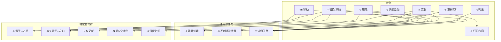

### 3.4.4 创建/查看/提取静态库示例

基本操作：

```bash
# 创建静态库（最常用：r=替换/添加, c=静默创建, s=生成索引）
$ ar rcs libmyop.a myop.o

# 创建静态库（多个目标文件）
$ ar rcs libmylib.a file1.o file2.o file3.o

# 查看静态库内容（列出包含的 .o 文件）
$ ar t libmyop.a
myop.o

# 查看静态库内容（详细模式）
$ ar tv libmyop.a
rw-r--r-- 0/0 1234 Jan 01 00:00 2024 myop.o

# 从静态库提取文件
$ ar x libmyop.a
$ ls
myop.o    # 提取出来的目标文件

# 替换静态库中的文件（更新已有的成员）
$ ar r libmyop.a myop.o

# 仅替换更新的文件（-u 修饰符）
$ ar ru libmyop.a myop.o

# 从静态库删除文件
$ ar d libmyop.a obsolete.o

# 打印归档中文件的内容（查看 .o 文件内容）
$ ar p libmyop.a myop.o > extracted.o

# 快速追加（不检查替换，不更新索引）
$ ar q libmyop.a newfile.o
```

### 3.4.5 静态库的完整构建流程

```bash
# 1. 编译目标文件（共享库需要 -fPIC，静态库不需要）
$ gcc -c -o myop.o myop.c

# 2. 创建静态库
$ ar rcs libmyop.a myop.o

# 3. 验证静态库
$ file libmyop.a
libmyop.a: current ar archive

$ nm --print-armap libmyop.a
Archive index:
myadd in myop.o
mysub in myop.o
mymul in myop.o
mydiv in myop.o
mypow in myop.o

# 4. 链接时使用静态库
$ gcc -o myop main.o -L./ -lmyop -lm
```

### 3.4.6 静态库与动态库的对比

| 对比项 | 静态库（.a） | 动态库（.so） |
|--------|-------------|--------------|
| 链接时机 | 编译时将代码复制到可执行文件 | 运行时加载 |
| 文件体积 | 可执行文件较大 | 可执行文件较小 |
| 运行时依赖 | 无 | 需要 `.so` 文件存在 |
| 更新方式 | 需要重新编译 | 替换 `.so` 即可 |
| 创建工具 | `ar` | `gcc -shared` |
| 编译选项 | 不需要 `-fPIC` | 必须 `-fPIC` |

### 3.4.7 易错点

| 易错点 | 说明 | 正确做法 |
|--------|------|----------|
| `ar r` 不更新索引 | 替换文件后索引可能过期 | 使用 `ar rs` 或之后运行 `ranlib` |
| `ar q` 不检查重复 | 可能导致同名文件重复 | 优先使用 `ar r` |
| 静态库命名规范 | 必须以 `lib` 开头，`.a` 结尾 | `libxxx.a` |
| 链接顺序 | 静态库必须放在引用它的 `.o` 文件之后 | `gcc main.o -lmyop`（而非 `gcc -lmyop main.o`） |

## 3.5 符号索引工具 ranlib（更新静态库索引）

`ranlib` 向归档文件添加或更新符号索引表。符号索引表记录了归档中每个目标文件定义的符号，链接器通过索引表快速定位符号所在的目标文件，而无需逐个扫描所有成员。

参考文档：[ranlib - GNU Binutils](https://sourceware.org/binutils/docs-2.39/binutils/ranlib.html)

### 3.5.1 用法与选项

基本语法：

```bash
ranlib [options] arname
```

选项：

| 选项 | 说明 |
|------|------|
| `-D` | 将 0 用于时间戳和 uid/gid（确定性模式，默认） |
| `-U` | 使用实际时间戳和 uid/gid |

### 3.5.2 与 ar -s 的等价关系

`ranlib` 的作用完全等价于 `ar -s`：

```bash
# 以下两条命令效果完全相同
$ ranlib libmyop.a
$ ar s libmyop.a
```

### 3.5.3 实践示例

```bash
# 创建静态库时自动生成索引（推荐方式）
$ ar rcs libmyop.a myop.o    # s 修饰符已包含索引生成

# 如果使用了 -S 选项创建（不生成索引），需要手动运行 ranlib
$ ar rcS libmyop.a myop.o    # S：不创建符号表
$ ranlib libmyop.a           # 手动生成索引

# 验证索引是否存在
$ nm --print-armap libmyop.a
Archive index:
myadd in myop.o
mysub in myop.o
...
```

### 3.5.4 何时需要单独使用 ranlib

| 场景 | 是否需要 ranlib |
|------|----------------|
| 使用 `ar rcs` 创建库 | 不需要（`s` 已包含） |
| 使用 `ar rcS` 创建库 | 需要 |
| 使用 `ar q` 快速追加文件 | 需要（`q` 不更新索引） |
| 某些旧系统上创建的归档 | 可能需要 |

## 3.6 符号剥离工具 strip（去除符号和调试信息）

`strip` 删除目标文件（程序或动态库等）中不必要的标识符及调试信息，可减小文件大小而不影响正常使用。

> ⚠️ **重要警告：** strip 后的程序很难调试（因为缺少符号和调试信息）。在生产环境中，建议保留未 strip 的版本或使用调试信息分离方案。

参考文档：[strip - GNU Binutils](https://sourceware.org/binutils/docs-2.39/binutils/strip.html)

### 3.6.1 命令与选项

基本语法：

```bash
strip [options] [objs]
```

选项详解：

| 选项 | 说明 | 典型用途 |
|------|------|----------|
| `-o <file>` | 指定输出文件（而不是默认覆盖当前文件） | 保留原始文件 |
| `-p` | 不修改时间戳 | 保持文件时间属性 |
| `-w` | 文件名可以使用通配符 | 批量处理 |
| `-s` / `--strip-all` | 删除所有符号（不加任何选项时的默认行为） | 发布版本 |
| `-g` / `-S` / `-d` / `--strip-debug` | 仅删除调试符号 | 保留符号但去除调试信息 |
| `--strip-unneeded` | 仅删除重定位后不再需要的符号 | 平衡体积和可调试性 |
| `-K <symbol>` | 保留符号（可多次使用此选项） | 保留必要符号 |
| `-N <symbol>` | 删除符号（可多次使用此选项） | 去除特定符号 |
| `-R <section>` | 删除段（可多次使用此选项） | 去除特定段 |
| `-F <bfdname>` | 指定输入输出 bfd 的格式 | 格式指定 |
| `-I <bfdname>` | 指定输入 bfd 的格式 | 输入格式指定 |
| `-O <bfdname>` | 指定输出 bfd 的格式，用 bfdname 重写它 | 输出格式指定 |
| `-v` | 显示详细信息 | 查看处理过程 |

选项按功能分类：

| 分类 | 选项 | 说明 |
|------|------|------|
| 剥离程度 | `-s`、`-g` / `-S` / `-d`、`--strip-unneeded` | 控制剥离的范围 |
| 符号控制 | `-K`、`-N` | 保留或删除特定符号 |
| 段控制 | `-R` | 删除特定段 |
| 输出控制 | `-o`、`-p`、`-w` | 控制输出行为 |
| 格式控制 | `-F`、`-I`、`-O` | 指定 BFD 格式 |
| 信息显示 | `-v` | 显示处理详情 |

### 3.6.2 剥离程度对比

| 选项 | 剥离内容 | 保留内容 | 适用场景 |
|------|----------|----------|----------|
| `strip`（默认） | 所有符号 + 调试信息 | 仅保留运行必需的重定位信息 | 最终发布 |
| `--strip-debug` | 仅调试信息（`.debug_*` 段） | 函数符号、全局变量符号 | 需要 `nm` 查看符号但不需要源码级调试 |
| `--strip-unneeded` | 重定位后不再需要的符号 | 全局符号、动态符号 | 共享库发布（保留动态链接所需符号） |

三种剥离程度的关系：

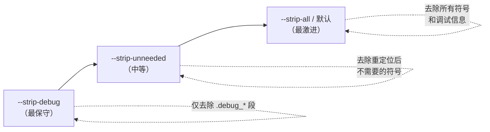

### 3.6.3 使用场景与示例

发布版本剥离（最常用）：

```bash
# 去除所有符号（默认行为，等价于 strip -s）
$ strip program
$ ls -la program
-rwxr-xr-x 1 user user 8432 Jan  1 00:00 program   # 体积明显减小

# 指定输出文件（保留原始文件用于调试）
$ strip -o program.stripped program
```

仅剥离调试符号：

```bash
# 仅去除调试信息，保留函数符号（仍可用 nm 查看符号）
$ strip --strip-debug program

# 去除不必要的符号（比 --strip-all 保守）
$ strip --strip-unneeded program
```

保留特定符号：

```bash
# 保留 main 和 init 符号，去除其他所有符号
$ strip -K main -K init program

# 验证保留效果
$ nm program | grep -E "main|init"
0000000000001139 T main
0000000000001100 T init
```

删除特定段：

```bash
# 删除 .comment 段（包含编译器版本信息）
$ strip -R .comment program
```

### 3.6.4 strip 前后对比

```bash
# strip 前
$ ls -la myop
-rwxr-xr-x 1 user user 16832 Jan  1 00:00 myop

$ nm myop | head -5
0000000000001060 T _init
0000000000001090 T myadd
00000000000010a4 T mysub
...

# strip 后
$ strip myop
$ ls -la myop
-rwxr-xr-x 1 user user 14208 Jan  1 00:00 myop   # 体积减小约 15%

$ nm myop
nm: myop: no symbols   # 符号已被去除

# 程序仍然可以正常运行
$ ./myop 3 5
3 + 5 = 8
```

### 3.6.5 调试信息分离方案（推荐用于生产环境）

将调试信息分离到独立文件，发布版本 strip 后仍可通过 debuglink 调试：

```bash
# 1. 生成独立的调试文件
$ objcopy --only-keep-debug program program.debug

# 2. strip 主程序
$ strip program

# 3. 添加 debuglink
$ objcopy --add-gnu-debuglink=program.debug program

# 4. 发布 program（体积小），保留 program.debug（用于调试）
# 调试时将 program.debug 放在 program 同目录即可
```

完整调试信息分离工作流程：

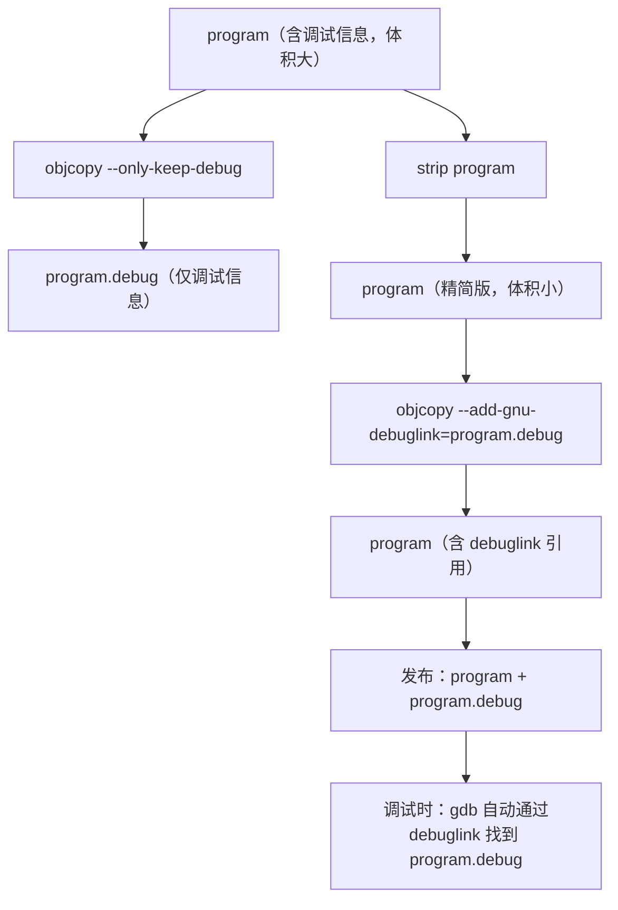

### 3.6.6 嵌入式场景：strip 后配合 addr2line 定位崩溃

在嵌入式开发中，发布固件通常会 strip 以减小体积，但仍需保留调试能力。以下是完整的实践流程：

```bash
# 1. 编译带调试信息的固件
$ arm-none-eabi-gcc -g -O2 -o firmware.elf main.o driver.o -T linker.ld

# 2. 保存带调试信息的版本（用于后续调试）
$ cp firmware.elf firmware_debug.elf

# 3. strip 发布版本
$ arm-none-eabi-strip -o firmware_release.elf firmware.elf

# 4. 当设备崩溃时，从串口/日志获取崩溃地址（如 PC = 0x08001234）

# 5. 使用保存的带调试信息版本 + addr2line 定位
$ arm-none-eabi-addr2line -af -e firmware_debug.elf 0x08001234
0x08001234
uart_send_char
/home/user/project/src/uart.c:42

# 6. 或者使用 objdump 反汇编查看上下文
$ arm-none-eabi-objdump -d -S firmware_debug.elf | grep -A5 -B5 "8001234"
```

## 3.7 本章工具对比总结

本章介绍了 binutils 中与编译流程直接相关的 6 个工具，它们覆盖了从汇编到发布的完整构建链。以下从多个维度进行总结对比。

### 3.7.1 工具功能对比总表

| 工具 | 主要功能 | 输入 | 输出 | 使用频率 |
|------|----------|------|------|----------|
| `as` | 汇编代码 → 目标文件 | `.s` | `.o` | 低（通常由 gcc 调用） |
| `ld` | 目标文件 → 可执行文件/库 | `.o`、`.a`、`.so` | 可执行文件/`.so` | 低（通常由 gcc 调用） |
| `objcopy` | 格式转换、段操作 | ELF | ELF/binary/hex | 中（嵌入式开发常用） |
| `ar` | 创建/管理静态库 | `.o` | `.a` | 高 |
| `ranlib` | 更新静态库索引 | `.a` | `.a`（含索引） | 低（通常由 `ar s` 替代） |
| `strip` | 去除符号/调试信息 | ELF | ELF（精简版） | 高（发布版本） |

### 3.7.2 编译相关工具功能速查表

| 工具 | 功能 | 典型命令 | 使用场景 | 注意事项 |
|------|------|----------|----------|----------|
| `as` | 汇编 | `as -o out.o in.s` | 纯汇编文件编译 | 日常通过 `gcc -c` 间接调用 |
| `ld` | 链接 | `ld -o prog a.o b.o -lc` | 精细控制链接过程 | 日常通过 gcc 或 `-Wl,` 间接调用 |
| `objcopy` | 格式转换 | `objcopy -O binary in.elf out.bin` | 嵌入式固件生成 | 转换后丢失调试信息 |
| `objcopy` | 段操作 | `objcopy -j .text in.elf out.o` | 提取/删除特定段 | `-j` 和 `-R` 不能同时用于同一节 |
| `objcopy` | 调试分离 | `objcopy --only-keep-debug prog prog.debug` | 生产环境调试 | 需配合 `--add-gnu-debuglink` |
| `ar` | 创建静态库 | `ar rcs libxx.a a.o b.o` | 静态库构建 | 命名规范：`lib` 前缀 + `.a` 后缀 |
| `ar` | 查看静态库 | `ar tv libxx.a` | 检查库内容 | — |
| `ar` | 提取文件 | `ar x libxx.a` | 从库中提取 `.o` | — |
| `ranlib` | 更新索引 | `ranlib libxx.a` | `ar q` 后更新索引 | 等价于 `ar s` |
| `strip` | 发布剥离 | `strip -o prog.stripped prog` | 减小发布体积 | strip 后无法源码级调试 |
| `strip` | 仅去调试 | `strip --strip-debug prog` | 保留符号的瘦身 | 仍可用 `nm` 查看符号 |

### 3.7.3 构建流程工具协作图

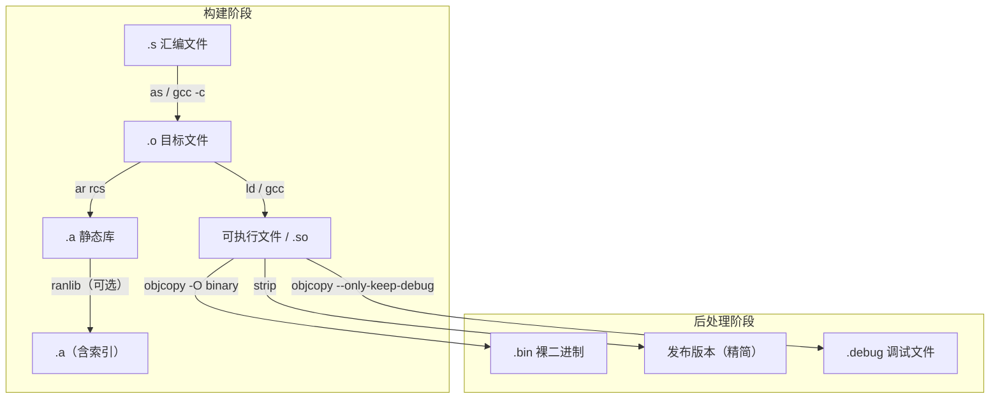

### 3.7.4 工具选择决策图

```mermaid
flowchart TD
    START["需要处理目标文件"] --> Q1{"操作类型?"}
    Q1 -->|"汇编 .s 文件"| A1["as（或 gcc -c）"]
    Q1 -->|"链接多个 .o"| A2["ld（或 gcc）"]
    Q1 -->|"创建/管理静态库"| A3["ar"]
    Q1 -->|"格式转换"| A4["objcopy -O"]
    Q1 -->|"段操作"| A5["objcopy -j/-R"]
    Q1 -->|"减小文件体积"| Q2{"需要保留符号?"}
    Q2 -->|"不需要"| A6["strip（默认）"]
    Q2 -->|"需要"| A7["strip --strip-debug"]
    Q1 -->|"更新库索引"| A8["ranlib / ar s"]
```

### 3.7.5 -Wl, 常用传递选项速查总表

| gcc 写法 | 等价 ld 选项 | 用途 | 使用频率 |
|----------|-------------|------|----------|
| `-Wl,-Map=out.map` | `-Map out.map` | 生成映射文件 | ★★★ |
| `-Wl,--gc-sections` | `--gc-sections` | 删除未使用的段 | ★★★ |
| `-Wl,-z,relro` | `-z relro` | RELRO 安全加固 | ★★★ |
| `-Wl,-z,now` | `-z now` | 立即绑定 | ★★★ |
| `-Wl,-rpath,/opt/lib` | `-rpath /opt/lib` | 运行时库搜索路径 | ★★★ |
| `-Wl,--as-needed` | `--as-needed` | 仅链接实际使用的库 | ★★☆ |
| `-Wl,-T,script.ld` | `-T script.ld` | 指定链接脚本 | ★★☆ |
| `-Wl,--start-group ... -Wl,--end-group` | `--start-group ... --end-group` | 处理循环依赖 | ★★☆ |
| `-Wl,-Bstatic` / `-Wl,-Bdynamic` | `-Bstatic` / `-Bdynamic` | 混合静态/动态链接 | ★★☆ |
| `-Wl,--whole-archive` | `--whole-archive` | 强制包含所有目标文件 | ★☆☆ |
| `-Wl,--no-undefined` | `--no-undefined` | 未解析符号视为错误 | ★☆☆ |
| `-Wl,-soname,libfoo.so.1` | `-soname libfoo.so.1` | 设置共享库 SONAME | ★☆☆ |
| `-Wl,-O1` | `-O1` | 链接器优化 | ★☆☆ |

### 3.7.6 strip 剥离程度选择指南

| 场景 | 推荐选项 | 理由 |
|------|----------|------|
| 最终发布版本（不需要调试） | `strip`（默认） | 最大程度减小体积 |
| 共享库发布 | `--strip-unneeded` | 保留动态链接所需符号 |
| 需要 nm 查看符号但不需要源码调试 | `--strip-debug` | 保留函数符号 |
| 生产环境（需要保留调试能力） | 调试信息分离方案 | 兼顾体积和可调试性 |
| 嵌入式固件发布 | strip + 保留未 strip 版本 | 配合 addr2line 定位崩溃 |

# 第4章 ELF二进制分析工具

本章介绍 binutils 工具集中用于分析 ELF 二进制文件的工具。这些工具不修改文件内容，而是帮助开发者理解目标文件、可执行文件和共享库的内部结构。掌握这些工具，能够在没有源码的情况下分析二进制行为、定位崩溃原因、排查链接问题。

```mermaid
flowchart LR
    subgraph 分析目标
        OBJ[目标文件 .o]
        EXE[可执行文件]
        SO[共享库 .so]
        AR[静态库 .a]
    end
    subgraph 分析工具
        FILE[file<br/>文件类型探测]
        LDD[ldd<br/>动态库依赖]
        OBJDUMP[objdump<br/>反汇编/节信息]
        READELF[readelf<br/>ELF结构]
        ELFEDIT[elfedit<br/>ELF头编辑]
        SIZE[size<br/>段大小]
        STRINGS[strings<br/>字符串提取]
        NM[nm<br/>符号表]
        ADDR2LINE[addr2line<br/>地址转行号]
        CXXFILT[c++filt<br/>符号解码]
    end
    OBJ --> OBJDUMP & READELF & SIZE & STRINGS & NM
    EXE --> FILE & LDD & OBJDUMP & READELF & SIZE & STRINGS & NM & ADDR2LINE
    SO --> FILE & LDD & OBJDUMP & READELF & SIZE & STRINGS & NM
    AR --> FILE & SIZE & NM
    NM --> CXXFILT
```

## 4.1 文件类型探测 file（探测文件类型）

`file` 命令通过检查文件头部的魔数（Magic Number）和结构信息来探测文件类型，是分析未知二进制文件的第一步。

### 4.1.1 基本用法

```bash
file [options] [filenames]
```

### 4.1.2 常用选项

| 选项 | 说明 |
|------|------|
| `-b` / `--brief` | 不显示文件名，仅输出类型描述 |
| `-L` / `--dereference` | 跟随符号链接 |
| `-i` / `--mime` | 输出 MIME 类型而非人类可读描述 |
| `-s` / `--special-files` | 对特殊文件（设备文件等）也进行检测 |
| `-f <file>` | 从文件中读取待检测的文件名列表 |
| `-k` / `--keep-going` | 遇到错误时继续处理后续文件 |

### 4.1.3 实战示例

```bash
$ file myop
myop: ELF 64-bit LSB shared object, x86-64, version 1 (SYSV), dynamically linked,
      interpreter /lib64/ld-linux-x86-64.so.2, for GNU/Linux 3.2.0, not stripped

$ file libmyop.so
libmyop.so: ELF 64-bit LSB shared object, x86-64, version 1 (SYSV),
            dynamically linked, not stripped

$ file libmyop.a
libmyop.a: current ar archive

$ file myop.o
myop.o: ELF 64-bit LSB relocatable, x86-64, version 1 (SYSV), not stripped
```

### 4.1.4 输出解读

| 输出字段 | 含义 | 示例值 |
|----------|------|--------|
| `ELF 64-bit` / `32-bit` | 字长 | 64-bit |
| `LSB` / `MSB` | 字节序（小端/大端） | LSB |
| `shared object` / `executable` / `relocatable` | ELF文件类型 | shared object |
| `x86-64` / `ARM` / `aarch64` | 目标架构 | x86-64 |
| `dynamically linked` / `statically linked` | 链接方式 | dynamically linked |
| `interpreter` | 动态链接器路径 | /lib64/ld-linux-x86-64.so.2 |
| `not stripped` / `stripped` | 是否包含符号信息 | not stripped |

ELF文件类型与 `file` 输出的对应关系：

| ELF类型 | file输出关键词 | 典型文件 |
|---------|---------------|---------|
| 可重定位文件（Relocatable） | `relocatable` | `.o` 文件 |
| 可执行文件（Executable） | `executable` 或 `shared object` + `interpreter` | 无扩展名的程序 |
| 共享对象文件（Shared object） | `shared object` | `.so` 文件 |
| 静态库（Archive） | `current ar archive` | `.a` 文件 |

> **注意：** 现代 Linux 发行版中，PIE（Position Independent Executable）可执行文件在 `file` 输出中也显示为 `shared object`，需要结合 `interpreter` 字段来区分真正的共享库和 PIE 可执行文件。

## 4.2 动态库依赖查看 ldd（查看动态库依赖）

`ldd` 查看可执行文件或共享库所依赖的动态库列表及其加载地址。

**工作原理：** `ldd` 的实质是通过 `ld-linux.so`（ELF 动态库装载器）来实现的。它设置环境变量后调用动态链接器，由动态链接器解析并报告所有依赖关系。

### 4.2.1 基本用法

```bash
ldd [options] [filenames]
```

### 4.2.2 常用选项

| 选项 | 说明 | 典型用途 |
|------|------|---------|
| `-v` / `--verbose` | 显示详细信息，包括符号版本信息 | 排查符号版本不匹配 |
| `-u` / `--unused` | 显示未使用的直接依赖 | 精简链接依赖 |
| `-d` / `--data-relocs` | 执行重定位并报告缺失的对象（仅ELF） | 检查数据符号是否缺失 |
| `-r` / `--function-relocs` | 执行数据对象和函数的重定位并报告缺失项 | 检查函数符号是否缺失 |
| `--version` | 显示版本信息 | — |

### 4.2.3 输出解读

输出三列含义：

| 列 | 说明 | 示例 |
|----|------|------|
| 第1列 | 程序需要依赖的库名 | `libm.so.6` |
| 第2列 | 系统提供的对应库路径（`=>` 后） | `/lib/x86_64-linux-gnu/libm.so.6` |
| 第3列 | 库在进程地址空间中的加载地址 | `(0x00007f61641f4000)` |

特殊情况说明：

| 输出形式 | 含义 |
|---------|------|
| `libxxx.so => /path/libxxx.so (0x...)` | 正常找到库 |
| `libxxx.so => not found` | 库未找到 |
| `linux-vdso.so.1 (0x...)` | 虚拟动态共享对象（内核提供，无实际文件） |
| `/lib64/ld-linux-x86-64.so.2 (0x...)` | 动态链接器本身 |

### 4.2.4 实战示例

**基本使用：**

```bash
$ ldd libmyop.so
    linux-vdso.so.1 (0x00007fff7f1ef000)
    libm.so.6 => /lib/x86_64-linux-gnu/libm.so.6 (0x00007f61641f4000)
    libc.so.6 => /lib/x86_64-linux-gnu/libc.so.6 (0x00007f6163e03000)
    /lib64/ld-linux-x86-64.so.2 (0x00007f6164794000)
```

**使用 `-v` 查看符号版本信息：**

```bash
$ ldd -v libmyop.so
    linux-vdso.so.1 (0x00007fff7f1ef000)
    libm.so.6 => /lib/x86_64-linux-gnu/libm.so.6 (0x00007f61641f4000)
    libc.so.6 => /lib/x86_64-linux-gnu/libc.so.6 (0x00007f6163e03000)
    /lib64/ld-linux-x86-64.so.2 (0x00007f6164794000)

    Version information:
    ./libmyop.so:
        libc.so.6 (GLIBC_2.2.5) => /lib/x86_64-linux-gnu/libc.so.6
        libm.so.6 (GLIBC_2.2.5) => /lib/x86_64-linux-gnu/libm.so.6
    /lib/x86_64-linux-gnu/libm.so.6:
        libc.so.6 (GLIBC_2.2.5) => /lib/x86_64-linux-gnu/libc.so.6
        ld-linux-x86-64.so.2 (GLIBC_2.2.5) => /lib64/ld-linux-x86-64.so.2
```

**使用 `-u` 查找未使用的依赖：**

```bash
$ ldd -u myop
    Unused direct dependencies:
        /lib/x86_64-linux-gnu/libm.so.6
```

> 如果链接了某个库但程序中并未调用该库的任何函数，`-u` 可以检测出来，帮助精简链接选项。

**使用 `-d` 和 `-r` 检查缺失符号：**

```bash
# -d：检查数据对象重定位
$ ldd -d myop
# 如果没有缺失，无输出

# -r：检查函数和数据对象重定位
$ ldd -r myop
# 如果存在未定义的符号，会列出：
# undefined symbol: some_function (./myop)
```

**"not found" 问题的完整排查流程：**

```bash
# 1. 发现库未找到
$ ldd myop
    linux-vdso.so.1 (0x00007ffe6379b000)
    libmyop.so => not found
    libc.so.6 => /lib/x86_64-linux-gnu/libc.so.6 (0x00007fa074eba000)
    /lib64/ld-linux-x86-64.so.2 (0x00007fa0754ad000)

# 2. 将库所在目录加入 LD_LIBRARY_PATH
$ export LD_LIBRARY_PATH=$LD_LIBRARY_PATH:.

# 3. 再次检查，问题解决
$ ldd myop
    linux-vdso.so.1 (0x00007ffdcadf7000)
    libmyop.so (0x00007f3bb16a3000)
    libc.so.6 => /lib/x86_64-linux-gnu/libc.so.6 (0x00007f3bb12b2000)
    libm.so.6 => /lib/x86_64-linux-gnu/libm.so.6 (0x00007f3bb0f14000)
    /lib64/ld-linux-x86-64.so.2 (0x00007f3bb1aa7000)
```

**"not found" 问题的分析与解决方法：**

| 原因 | 解决方法 |
|------|---------|
| 库未安装 | 安装对应的库包（`apt install` / `yum install`） |
| 库路径不在搜索范围 | 设置 `LD_LIBRARY_PATH` 或使用 `-Wl,-rpath` |
| 库版本不匹配 | 检查符号版本（`ldd -v`），安装正确版本 |
| 交叉编译的库 | 使用 `--sysroot` 或手动指定路径 |

**动态库搜索顺序：**

```mermaid
flowchart TD
    A[程序启动] --> B{ELF中有DT_RPATH?}
    B -->|是| C[搜索DT_RPATH路径]
    B -->|否| D{设置了LD_LIBRARY_PATH?}
    C --> D
    D -->|是| E[搜索LD_LIBRARY_PATH路径]
    D -->|否| F{ELF中有DT_RUNPATH?}
    E --> F
    F -->|是| G[搜索DT_RUNPATH路径]
    F -->|否| H[搜索ld.so.cache缓存]
    G --> H
    H --> I[搜索默认路径 /lib, /usr/lib]
    I --> J{找到库?}
    J -->|是| K[加载成功]
    J -->|否| L[报错 not found]
```

### 4.2.5 易错点

| 易错点 | 说明 | 正确做法 |
|--------|------|---------|
| `ldd` 会执行程序代码 | `ldd` 通过设置 `LD_TRACE_LOADED_OBJECTS` 环境变量让动态链接器运行，某些恶意程序可能利用此机制 | 对不信任的二进制文件使用 `objdump -p \| grep NEEDED` 代替 |
| `linux-vdso.so.1` 找不到文件 | 这是内核虚拟提供的，不存在于文件系统中 | 正常现象，无需处理 |
| PIE 程序显示为 shared object | 现代发行版默认为 PIE | 结合 `interpreter` 字段区分 |

## 4.3 反汇编与信息查看 objdump（反汇编和查看目标文件信息）

`objdump` 是 binutils 中最强大的分析工具之一，能够显示目标文件的各种信息，包括反汇编代码、节头、符号表等。如果是静态库，会列出库中每个目标文件的信息。

### 4.3.1 基本用法

```bash
objdump [options] [objs]
```

### 4.3.2 必要选项（至少指定一个）

| 选项 | 说明 |
|------|------|
| `-a` | 显示文件头信息（archive header） |
| `-f` | 显示文件头的摘要信息 |
| `-p` | 显示特定于文件（动态库、可执行文件）的头内容（文件头信息、程序头、动态节、版本引用） |
| `-P` | 显示特定于对象文件格式的信息（需要 XCOFF 格式，不是 ELF 格式） |
| `-h` | 显示节头的摘要信息 |
| `-x` | 显示所有头的摘要信息（比 `-h` 多显示文件头摘要、程序头、动态节、版本引用、符号表） |
| `-g` | 显示调试节（`.eh_frame` `.debug_xxx`）的信息 |
| `-e` | 类似 `-g`，但生成与 ctags 工具兼容的格式 |
| `-G` | 显示文件的 STABS 信息 |
| `-s` | 十六进制显示请求的所有部分的完整内容 |
| `-S` | 将源代码与反汇编混合显示（需要编译时带 `-g`） |
| `-d` | 反汇编显示可执行节的汇编程序内容 |
| `-D` | 反汇编显示所有节的汇编程序内容 |

### 4.3.3 常用辅助选项

| 选项 | 说明 |
|------|------|
| `-C` | 将低级符号名称解码为用户级别名称（C++ demangle） |
| `-j <section>` | 仅显示特定节的信息 |
| `-l` | 反汇编时增加显示文件名和行号 |
| `-M <style>` | 指定反汇编风格（如 `-M intel` 使用 Intel 语法） |

### 4.3.4 反汇编风格：AT&T 与 Intel 语法对比

`objdump` 默认使用 AT&T 语法，通过 `-M intel` 可切换为 Intel 语法。两种语法的主要区别如下：

| 对比项 | AT&T 语法（默认） | Intel 语法（`-M intel`） |
|--------|------------------|------------------------|
| 操作数顺序 | 源 → 目标 | 目标 → 源 |
| 寄存器前缀 | `%`（如 `%rax`） | 无（如 `rax`） |
| 立即数前缀 | `$`（如 `$0x1`） | 无（如 `1`） |
| 内存引用 | `disp(base,index,scale)` | `[base + index*scale + disp]` |
| 后缀标识 | 操作码带后缀（如 `movl`、`movq`） | 通过操作数大小区分 |
| 可读性 | 对 Linux 内核开发者更熟悉 | 对 x86 手册读者更直观 |

**同一指令的两种语法对比：**

```bash
# AT&T 语法（默认）
$ objdump -d -j .text myop | grep -A2 "<myadd>"
000000000000069a <myadd>:
 69a:   89 f8                   mov    %edi,%eax
 69c:   01 f0                   add    %esi,%eax
 69e:   c3                      retq

# Intel 语法
$ objdump -M intel -d -j .text myop | grep -A2 "<myadd>"
000000000000069a <myadd>:
 69a:   89 f8                   mov    eax,edi
 69c:   01 f0                   add    eax,esi
 69e:   c3                      ret
```

> **实践建议：** 阅读 Intel 官方手册或 Windows 调试资料时使用 `-M intel`；阅读 Linux 内核源码时使用默认 AT&T 语法。

### 4.3.5 实战示例

```bash
# 反汇编 .text 段（AT&T 语法，默认）
$ objdump -d ./program

# 使用 Intel 语法反汇编（更易读）
$ objdump -M intel -d ./program

# 源码与反汇编混合显示（需要编译时带 -g）
$ objdump -S -d program

# 查看节头信息
$ objdump -h program

# 查看所有头信息（文件头 + 程序头 + 节头 + 动态节 + 符号表）
$ objdump -x program

# 查看特定节的十六进制内容
$ objdump -s -j .rodata program

# 反汇编并显示文件名和行号
$ objdump -d -l program

# 反汇编 C++ 程序并解码符号名
$ objdump -d -C program
```

### 4.3.6 输出解读

**`objdump -h` 节头输出示例：**

```bash
$ objdump -h myop

myop:     file format elf64-x86-64

Sections:
Idx Name          Size      VMA               LMA               File off  Algn
  0 .interp       0000001c  0000000000000238  0000000000000238  00000238  2**0
  ...
 10 .text         000002c2  00000000000007b0  00000000000007b0  000007b0  2**4
 11 .rodata       00000060  0000000000000a80  0000000000000a80  00000a80  2**3
  ...
 18 .data         00000010  0000000000201000  0000000000201000  00001000  2**3
 19 .bss          00000008  0000000000201010  0000000000201010  00001010  2**3
                  NOBITS  ← 注意：.bss的File off不占实际文件空间
```

各列含义：

| 列 | 含义 |
|----|------|
| Idx | 节的索引号 |
| Name | 节名称 |
| Size | 节的大小（十六进制，字节） |
| VMA | 虚拟内存地址（运行时加载地址） |
| LMA | 加载内存地址（通常与VMA相同） |
| File off | 节在文件中的偏移 |
| Algn | 对齐要求（2的幂次） |

**`-d` 与 `-D` 的区别：**

| 选项 | 反汇编范围 | 适用场景 |
|------|-----------|---------|
| `-d` | 仅反汇编标记为可执行的节（通常是 `.text`） | 查看程序代码 |
| `-D` | 反汇编所有节（包括 `.data`、`.rodata` 等） | 查看数据段中的嵌入代码 |

**`-S` 源码混合反汇编输出示例：**

```bash
$ objdump -S -d myop | head -30
...
int myadd(int a, int b)
{
 69a:   89 f8                   mov    %edi,%eax
 69c:   01 f0                   add    %esi,%eax
    return a + b;
}
 69e:   c3                      retq
```

> 源码行与对应的汇编指令交替显示，便于理解代码与指令的对应关系。需要编译时使用 `-g` 选项。

## 4.4 ELF信息查看 readelf（查看ELF文件结构信息）

`readelf` 专门用于显示 ELF 格式文件的结构信息。与 `objdump` 不同，`readelf` 不依赖 BFD 库，因此能更准确地解析 ELF 格式的细节。

### 4.4.1 基本用法与常用选项

```bash
readelf [options] [objs]
```

| 选项 | 说明 |
|------|------|
| `-a` / `--all` | 等价于 `-h -l -S -s -r -d -V -A -I`，显示所有信息 |
| `-e` / `--headers` | 等价于 `-h -l -S`，显示所有头信息 |
| `-h` / `--file-header` | 显示 ELF 文件头信息 |
| `-l` / `--program-headers` | 显示程序头信息（仅动态库和可执行文件有） |
| `-S` / `--section-headers` | 显示节头信息 |
| `-t` | 类似 `-S`，只是显示样式不同 |
| `-s` / `--symbols` | 显示符号表信息 |
| `-d` / `--dynamic` | 显示动态节（dynamic section）信息 |
| `-V` / `--version-info` | 显示版本节信息（如果有） |
| `-A` / `--arch-specific` | 显示特定于体系结构的信息（如果有） |
| `-T` / `--silent-truncation` | 不断开输出行以适合80列 |
| `-c` / `--archive-index` | 显示静态库中的符号/文件索引 |
| `-x <num\|name>` | 十六进制显示指定节的内容 |
| `-p <num\|name>` | 显示指定节的字符串内容 |
| `-C` / `--demangle` | 将低级符号名称解码为用户级别名称 |

### 4.4.2 与 objdump 功能对比表

| 功能 | objdump | readelf | 说明 |
|------|---------|---------|------|
| 反汇编 | ✓ | ✗ | readelf 不能反汇编 |
| ELF文件头 | 部分（`-f`） | ✓（`-h`） | readelf 显示更完整 |
| 程序头 | ✓（`-p`） | ✓（`-l`） | 两者均可 |
| 节头 | ✓（`-h`） | ✓（`-S`） | 两者均可 |
| 符号表 | ✓ | ✓（`-s`） | 两者均可 |
| 动态节 | ✓（`-p`） | ✓（`-d`） | readelf 输出更清晰 |
| 依赖BFD库 | 是 | 否 | readelf 更轻量、更准确 |
| 支持非ELF格式 | 是 | 否 | objdump 通过BFD支持多种格式 |

### 4.4.3 实战示例

```bash
# 显示所有信息
$ readelf -a program

# 显示 ELF 文件头（魔数、类型、架构、入口地址等）
$ readelf -h program

# 显示程序头（段信息、加载地址、权限）
$ readelf -l program

# 显示节头（各节的偏移、大小、类型）
$ readelf -S program

# 显示符号表
$ readelf -s program

# 显示动态节（NEEDED依赖、SONAME、RPATH等）
$ readelf -d program

# 十六进制显示 .rodata 节内容
$ readelf -x .rodata program

# 显示 .comment 节的字符串
$ readelf -p .comment program
```

### 4.4.4 `-x` 和 `-p` 选项详细示例

**`-x`：十六进制显示节内容**

```bash
$ readelf -x .rodata myop

Hex dump of section '.rodata':
  0x00000a80 55736167 653a2025 73206e75 6d31206e Usage: %s num1 n
  0x00000a90 756d320a 2564202b 20256420 3d202564 um2.%d + %d = %d
  0x00000aa0 0a256420 2d202564 203d2025 640a2564 .%d - %d = %d.%d
  0x00000ab0 202a2025 64203d20 25640a25 64202f20  * %d = %d.%d /
  0x00000ac0 2564203d 2025640a 2564205e 20256420 %d = %d.%d ^ %d
  0x00000ad0 3d20256c 660a00                      = %lf..
```

输出格式说明：每行包含偏移地址、16字节的十六进制数据、对应的 ASCII 字符显示。

**`-p`：显示节的字符串内容**

```bash
$ readelf -p .comment myop

String dump of section '.comment':
  [     0]  GCC: (Ubuntu 7.5.0-3ubuntu1~18.04) 7.5.0
```

```bash
$ readelf -p .dynstr myop

String dump of section '.dynstr':
  [     1]  libm.so.6
  [     b]  libmyop.so
  [    16]  libc.so.6
  [    20]  __cxa_finalize
  [    2f]  pow
  [    33]  atoi
  [    38]  printf
  [    3f]  _ITM_deregisterTMCloneTable
```

> `-p` 适用于快速查看字符串表、注释节等文本内容，比 `-x` 更直观。

### 4.4.5 输出解读

**`readelf -h` 输出解读：**

```bash
$ readelf -h myop
ELF Header:
  Magic:   7f 45 4c 46 02 01 01 00 00 00 00 00 00 00 00 00
  Class:                             ELF64
  Data:                              2's complement, little endian
  Version:                           1 (current)
  OS/ABI:                            UNIX - System V
  ABI Version:                       0
  Type:                              DYN (Shared object file)
  Machine:                           Advanced Micro Devices X86-64
  Version:                           0x1
  Entry point address:               0x6b0
  Start of program headers:          64 (bytes into file)
  Start of section headers:          14648 (bytes into file)
  Flags:                             0x0
  Size of this header:               64 (bytes)
  Size of program headers:           56 (bytes)
  Number of program headers:         13
  Size of section headers:           64 (bytes)
  Number of section headers:         31
  Section header string table index: 30
```

**`readelf -d` 动态节输出解读：**

```bash
$ readelf -d myop

Dynamic section at offset 0x1010 contains 27 entries:
  Tag        Type                         Name/Value
 0x0000000000000001 (NEEDED)             Shared library: [libmyop.so]
 0x0000000000000001 (NEEDED)             Shared library: [libc.so.6]
 0x000000000000000c (INIT)               0x6e8
 0x000000000000000d (FINI)               0x949
 0x0000000000000019 (INIT_ARRAY)         0x201000
 0x0000000000000005 (STRTAB)             0x480
 0x0000000000000006 (SYMTAB)             0x2d0
 ...
```

| Tag | 含义 |
|-----|------|
| `NEEDED` | 依赖的共享库 |
| `INIT` / `FINI` | 初始化/终止函数地址 |
| `INIT_ARRAY` / `FINI_ARRAY` | 初始化/终止函数数组 |
| `STRTAB` | 字符串表地址 |
| `SYMTAB` | 符号表地址 |
| `SONAME` | 共享库的 SONAME |
| `RPATH` / `RUNPATH` | 库搜索路径 |

## 4.5 ELF编辑工具 elfedit（编辑ELF文件头字段）

`elfedit` 用于编辑 ELF 文件头中的特定字段。它是 binutils 中唯一的"分析相关但具有编辑能力"的工具，主要用于修改 ELF 文件的元数据信息。

### 4.5.1 基本用法

```bash
elfedit [options] elffile
```

### 4.5.2 常用选项

**输入/输出类型选项：**

| 选项 | 说明 | 可选值 |
|------|------|--------|
| `--input-osabi=<osabi>` | 指定输入文件的 OS ABI | `none`、`Linux`、`FreeBSD`、`Solaris` 等 |
| `--output-osabi=<osabi>` | 修改 ELF 文件头中的 OS ABI 字段 | 同上 |
| `--input-abiversion=<version>` | 指定输入文件的 ABI 版本 | 数字 |
| `--output-abiversion=<version>` | 修改 ELF 文件头中的 ABI 版本 | 数字 |
| `--input-type=<type>` | 指定输入文件类型 | `none`、`rel`、`exec`、`dyn`、`core` |
| `--output-type=<type>` | 修改 ELF 文件头中的类型字段 | 同上 |

**x86 特性选项：**

| 选项 | 说明 |
|------|------|
| `--enable-x86-feature=<feature>` | 启用 x86 特性标记（如 `ibt`、`shstk`） |
| `--disable-x86-feature=<feature>` | 禁用 x86 特性标记 |

**其他选项：**

| 选项 | 说明 |
|------|------|
| `--version` | 显示版本信息 |
| `--help` | 显示帮助信息 |

### 4.5.3 使用场景与示例

| 场景 | 说明 |
|------|------|
| 修改 OS ABI 标记 | 将 ELF 文件标记为特定操作系统（Linux/FreeBSD等） |
| 修改文件类型 | 在 `ET_EXEC` 和 `ET_DYN` 之间切换（PIE相关） |
| 交叉编译后处理 | 调整目标平台的 ABI 信息 |
| 启用/禁用安全特性 | 控制 CET（Control-flow Enforcement Technology）标记 |

**修改 OS ABI：**

```bash
# 查看当前 OS ABI
$ readelf -h program | grep "OS/ABI"
  OS/ABI:                            UNIX - System V

# 修改 OS ABI 为 Linux
$ elfedit --output-osabi=Linux program

# 验证修改结果
$ readelf -h program | grep "OS/ABI"
  OS/ABI:                            UNIX - GNU/Linux
```

**修改文件类型：**

```bash
# 查看当前文件类型
$ readelf -h program | grep "Type"
  Type:                              EXEC (Executable file)

# 修改为 DYN（共享对象/PIE）
$ elfedit --output-type=dyn program

# 验证修改结果
$ readelf -h program | grep "Type"
  Type:                              DYN (Shared object file)
```

**启用/禁用 x86 安全特性（CET）：**

```bash
# 启用 IBT（Indirect Branch Tracking）
$ elfedit --enable-x86-feature=ibt program

# 启用 Shadow Stack
$ elfedit --enable-x86-feature=shstk program

# 禁用某个特性
$ elfedit --disable-x86-feature=ibt program
```

### 4.5.4 注意事项

| 注意点 | 说明 |
|--------|------|
| 修改前备份 | `elfedit` 直接修改文件，无撤销功能 |
| 仅修改文件头 | 不会修改代码或数据内容 |
| 类型修改的风险 | 将 `EXEC` 改为 `DYN` 后，程序可能无法正常加载 |
| 适用场景有限 | 主要用于交叉编译后处理和特殊调试场景 |

## 4.6 段大小查看 size（查看text/data/bss段大小）

`size` 列出目标文件的各段大小和总大小，是评估二进制文件内存占用的快速工具。

### 4.6.1 基本用法

```bash
size [options] [objs]
```

**段内存管理公式：**

| 公式 | 含义 |
|------|------|
| ROM size ≥ text + data | 烧录到 ROM 中的代码和数据大小 |
| RAM size ≥ data + bss | 运行时需要的内存大小 |

**各段含义：**

| 段名 | 内容 | 说明 |
|------|------|------|
| text | 代码和常量 | 包含 `.text`、`.rodata` 等 |
| data | 初始化为非0的静态变量 | 有时占用空间小的初始化为0的变量也放此段 |
| bss | 未初始化或初始化为0的静态变量 | Block Started by Symbol，不占文件空间 |

### 4.6.2 格式选项

| 选项 | 说明 |
|------|------|
| `-A` | 以 System V 风格列出信息（按节逐一显示） |
| `-B` | 以 Berkeley 风格列出信息（默认） |
| `-t` | 同时列出多个文件时计算总大小（仅 Berkeley 风格可用） |

### 4.6.3 实战示例与输出解读

**Berkeley 风格（默认）：**

```bash
$ size myop
   text    data     bss     dec     hex filename
   2520     664       8    3192     c78 myop
```

输出字段说明：

| 字段 | 含义 | 本例中的值 | 说明 |
|------|------|-----------|------|
| text | 代码段大小（字节） | 2520 | 包含 `.text` + `.rodata` 等只读节 |
| data | 已初始化数据段大小（字节） | 664 | 包含 `.data` + `.got` 等可读写节 |
| bss | 未初始化数据段大小（字节） | 8 | 不占文件空间，运行时分配 |
| dec | 总大小（十进制）= text + data + bss | 3192 | 2520 + 664 + 8 = 3192 |
| hex | 总大小（十六进制） | c78 | 3192 的十六进制表示 |
| filename | 文件名 | myop | — |

**System V 风格：**

```bash
$ size -A myop
myop  :
section           size         addr
.interp             28          568
.note.ABI-tag       32          596
.note.gnu.build-id  36          628
.gnu.hash           56          664
.dynsym            432          720
.dynstr            214         1152
.gnu.version        36         1366
.gnu.version_r      32         1408
.rela.dyn          192         1440
.rela.plt          168         1632
.init               23         1800
.plt               128         1824
.plt.got             8         1952
.text              706         1968
.fini                9         2676
.rodata             96         2688
.eh_frame_hdr       60         2784
.eh_frame          264         2848
.init_array          8      2100600
.fini_array          8      2100608
.dynamic           512      2100616
.got               120      2101128
.data               16      2101248
.bss                 8      2101264
.comment            41            0
Total             3233
```

> System V 风格按节逐一列出，适合精确分析每个节的占用情况。`addr` 列为节的运行时虚拟地址。

**多文件合计：**

```bash
$ size -t main.o myop.o
   text    data     bss     dec     hex filename
    465       0       0     465     1d1 main.o
    305       0       0     305     131 myop.o
    770       0       0     770     302 (TOTALS)
```

> 目标文件（`.o`）中 `data` 和 `bss` 通常为 0，因为全局变量在链接后才分配最终地址。`-t` 选项在最后一行显示所有文件的合计值。

### 4.6.4 嵌入式开发中的应用

在嵌入式开发中，`size` 是评估固件是否超出 Flash/RAM 限制的关键工具：

```bash
$ arm-none-eabi-size firmware.elf
   text    data     bss     dec     hex filename
  18432     128    4096   22656    5880 firmware.elf
```

| 资源 | 计算方式 | 本例 | 限制（假设） | 余量 |
|------|---------|------|-------------|------|
| Flash（ROM） | text + data | 18432 + 128 = 18560 | 64KB (65536) | 46976 |
| RAM | data + bss | 128 + 4096 = 4224 | 8KB (8192) | 3968 |

## 4.7 字符串提取 strings（提取二进制文件中的可打印字符串）

`strings` 列出目标文件中的可打印字符串（默认长度不短于4个字符）。常用于快速查看二进制文件中嵌入的文本信息，如错误消息、路径、版本号等。

### 4.7.1 基本用法与常用选项

```bash
strings [options] [objs]
```

| 选项 | 说明 |
|------|------|
| `-a` / `-` | 扫描整个文件（默认行为） |
| `-d` | 仅列出常量段 `.rodata` 中的字符串（而非所有段） |
| `-f` | 在每个字符串之前加上文件名（适用于同时列出多个文件时） |
| `-n <min-len>` | 列出长度至少为 `min-len` 的字符串（默认为 `4`） |
| `-t <radix>` | 同时列出在文件中的偏移量。radix 取值：`o` 八进制、`d` 十进制、`x` 十六进制 |
| `-s <separator>` | 指定输出的分隔符（默认为换行符） |

### 4.7.2 实战示例

**列出所有可读字符串：**

```bash
$ strings main.o
Usage: %s num1 num2
%d + %d = %d
%d - %d = %d
%d * %d = %d
%d / %d = %d
%d ^ %d = %lf
GCC: (Ubuntu 7.5.0-3ubuntu1~18.04) 7.5.0
main.c
main
_GLOBAL_OFFSET_TABLE_
printf
atoi
myadd
mysub
mymul
mydiv
mypow
.symtab
.strtab
.shstrtab
.rela.text
.data
.bss
.rodata
.comment
.note.GNU-stack
.rela.eh_frame
```

**仅列出 `.rodata` 段中的字符串：**

```bash
$ strings -d main.o
Usage: %s num1 num2
%d + %d = %d
%d - %d = %d
%d * %d = %d
%d / %d = %d
%d ^ %d = %lf
```

**指定最小长度为10：**

```bash
$ strings -n 10 main.o
Usage: %s num1 num2
%d + %d = %d
%d - %d = %d
%d * %d = %d
%d / %d = %d
%d ^ %d = %lf
GCC: (Ubuntu 7.5.0-3ubuntu1~18.04) 7.5.0
_GLOBAL_OFFSET_TABLE_
.rela.text
.note.GNU-stack
.rela.eh_frame
```

**带偏移量输出：**

```bash
$ strings -t x main.o
  40 Usage: %s num1 num2
  58 %d + %d = %d
  68 %d - %d = %d
```

### 4.7.3 输出解读

`strings` 输出的字符串来源于 ELF 文件的不同部分：

| 字符串来源 | 示例 | 所在节 |
|-----------|------|--------|
| 代码中的字符串常量 | `Usage: %s num1 num2`、`%d + %d = %d` | `.rodata` |
| GCC 编译器版本信息 | `GCC: (Ubuntu 7.5.0-3ubuntu1~18.04) 7.5.0` | `.comment` |
| 源文件名 | `main.c` | `.strtab` |
| 函数名（符号表） | `main`、`myadd`、`mysub` | `.strtab` |
| 外部引用符号 | `printf`、`atoi` | `.strtab` |
| 节名 | `.symtab`、`.strtab`、`.rodata` | `.shstrtab` |
| 特殊符号 | `_GLOBAL_OFFSET_TABLE_` | `.strtab` |

> **实践技巧：** 使用 `-d` 选项可以过滤掉符号表和节名等"噪音"，只显示程序中真正使用的字符串常量，便于快速了解程序的功能。

### 4.7.4 典型应用场景

| 场景 | 命令 | 说明 |
|------|------|------|
| 查看程序中的错误消息 | `strings program \| grep -i error` | 快速了解程序的错误处理逻辑 |
| 查看嵌入的文件路径 | `strings program \| grep /` | 发现硬编码路径 |
| 查看库版本信息 | `strings libxxx.so \| grep -i version` | 确认库版本 |
| 分析未知二进制文件 | `strings unknown_file \| head -50` | 初步判断文件用途 |
| 查找敏感信息 | `strings program \| grep -i password` | 安全检查 |

## 4.8 符号表查看 nm（查看目标文件符号表）

`nm` 列出目标文件的符号表，是分析链接问题、查看函数和数据定义位置的核心工具。

### 4.8.1 基本用法

```bash
nm [options] [objs]
```

默认输出格式：3列——地址偏移、符号类型、符号名称。

### 4.8.2 符号类型含义表

| 符号 | 含义 | 所在段 |
|------|------|--------|
| `B` / `b` | 未初始化数据符号 | `.bss` |
| `D` / `d` | 已初始化数据符号 | `.data` |
| `R` / `r` | 只读数据符号 | `.rodata` |
| `T` / `t` | 代码符号（函数） | `.text` |
| `U` | 未定义符号（在其他文件中定义） | — |
| `W` / `w` | 弱符号（可被覆盖） | — |
| `V` / `v` | 弱对象 | — |
| `A` | 绝对符号（值不会被重定位） | — |
| `C` | 公共符号（未初始化的全局变量） | — |

> **大小写区别：** 大写字母表示全局符号（外部可见），小写字母表示局部符号（仅文件内可见）。

### 4.8.3 常用选项

| 选项 | 说明 |
|------|------|
| `-A` / `-o` | 在每个符号行之前加上文件名（适用于同时列出多个文件时） |
| `-a` | 列出所有符号（包括调试符号） |
| `-C` | 将低级符号名称解码为用户级别名称（C++ demangle） |
| `-P` | 使用 POSIX.2 风格列出信息 |
| `-S` | 在第2列增加列出符号占用空间的大小 |
| `-u` | 仅显示不在本文件定义的符号（外部符号） |
| `-U` / `--defined-only` | 仅显示在本文件定义的符号（内部符号） |
| `--size-sort` | 按符号大小排序 |
| `--print-armap` | 显示静态库索引信息 |

### 4.8.4 实战示例与输出解读

**查看动态库符号表（按大小排序）：**

```bash
$ nm -CS --size-sort libmyop.so
0000000000201028 0000000000000001 b completed.7698
00000000000006ae 0000000000000012 T mysub
00000000000006d3 0000000000000013 T mydiv
00000000000006c0 0000000000000013 T mymul
000000000000069a 0000000000000014 T myadd
00000000000006e6 000000000000002d T mypow
```

输出解读（使用 `-S` 和 `--size-sort` 时为4列）：

| 列 | 含义 | 示例 | 说明 |
|----|------|------|------|
| 第1列 | 符号地址 | `000000000000069a` | 符号在内存中的虚拟地址 |
| 第2列 | 符号大小（字节） | `0000000000000014` | 该函数/变量占用的字节数 |
| 第3列 | 符号类型 | `T` | 大写=全局，小写=局部 |
| 第4列 | 符号名称 | `myadd` | 函数名或变量名 |

> **分析技巧：** 通过 `--size-sort` 可以快速找到最大的函数，辅助代码优化。例如上例中 `mypow` 占 0x2d=45 字节，是最大的函数。

**显示静态库索引：**

```bash
$ nm --print-armap libmyop.a
Archive index:
myadd in myop.o
mysub in myop.o
mymul in myop.o
mydiv in myop.o
mypow in myop.o

myop.o:
                 U _GLOBAL_OFFSET_TABLE_
0000000000000000 T myadd
0000000000000039 T mydiv
0000000000000026 T mymul
000000000000004c T mypow
0000000000000014 T mysub
                 U pow
```

输出解读：

| 部分 | 含义 |
|------|------|
| `Archive index` | 静态库的符号索引（哪个符号在哪个 `.o` 文件中），链接器查找符号时使用此索引 |
| `U _GLOBAL_OFFSET_TABLE_` | 未定义符号，需要链接器提供 |
| `T myadd` | 在 `.text` 段定义的全局函数 |
| `U pow` | `mypow` 函数依赖外部定义的 `pow`（来自 `libm`） |

**查看未定义符号（排查链接错误）：**

```bash
$ nm -u main.o
                 U _GLOBAL_OFFSET_TABLE_
                 U atoi
                 U myadd
                 U mydiv
                 U mymul
                 U mypow
                 U printf
```

> `-u` 列出所有未定义符号，这些符号需要在链接时从其他目标文件或库中找到定义。如果出现 `undefined reference` 链接错误，可以用此命令确认缺失的符号。

**查看已定义符号：**

```bash
$ nm -U main.o
0000000000000000 T main
                 U _GLOBAL_OFFSET_TABLE_
                 U atoi
                 U printf
```

### 4.8.5 典型应用场景

| 场景 | 命令 | 说明 |
|------|------|------|
| 排查 undefined reference | `nm -u xxx.o` | 查看缺失哪些符号 |
| 确认函数是否被导出 | `nm -C libxxx.so \| grep func_name` | 检查共享库接口 |
| 查看函数大小 | `nm -CS --size-sort xxx.o` | 辅助性能优化 |
| 查看静态库包含的符号 | `nm --print-armap libxxx.a` | 确认库中有哪些函数 |
| 检查符号冲突 | `nm -g *.o \| sort -k3 \| uniq -f2 -d` | 查找重复定义的全局符号 |

## 4.9 地址转行号 addr2line（将地址转换为源文件名和行号）

`addr2line` 将内存地址转换为源文件名和行号，是定位程序崩溃位置的关键工具。

### 4.9.1 基本用法与常用选项

```bash
addr2line [options] -e binname [addrs]
```

**输入方式：**

- 命令行参数直接指定地址
- 不指定 addrs 时，可从管道获取输入
- 地址可使用 `addr+offset` 的形式

**前提条件：** 目标文件必须包含调试信息（编译时使用 `-g` 选项）。

| 选项 | 说明 |
|------|------|
| `-e <binname>` | 指定要查询的可执行文件（必须） |
| `-f` | 在文件名和行号前显示函数名 |
| `-a` | 在文件名和行号前显示地址 |
| `-C` | 将低级符号名称解码为用户级别名称（C++ demangle） |
| `-p` | 一行显示全部信息（pretty print） |

### 4.9.2 段错误定位实战示例

这是一个完整的实战案例，演示如何使用 `addr2line` 定位段错误（Segmentation Fault）的精确位置。

**测试代码：**

```c
#include <stdio.h>

int main(void)
{
    char* p = "Hello world!";
    *p = 'h';  // 写入只读数据段，触发段错误
    return 0;
}
```

**完整定位流程：**

```bash
# 步骤1：编译（必须带调试信息 -g）
$ gcc -O0 -g -ggdb main.c -static

# 步骤2：运行程序，触发段错误
$ ./a.out
段错误 (核心已转储)

# 步骤3：查看内核日志获取出错地址（关注 ip 字段）
$ dmesg | tail -2
[83208.450712] a.out[13275]: segfault at 491f44 ip 0000000000400b80
sp 00007ffecb47fd50 error 7 in a.out[400000+b6000]

# 步骤4：使用 addr2line 将 ip 地址转换为源码位置
$ addr2line -af -e a.out 0x0000000000400b80
0x0000000000400b80
main
/home/jleng/test/main.c:6

# 步骤5：使用 -p 选项一行显示全部信息
$ addr2line -fap -e a.out 0x0000000000400b80
0x0000000000400b80: main at /home/jleng/test/main.c:6
```

**dmesg 输出字段解读：**

| 字段 | 含义 | 本例中的值 |
|------|------|-----------|
| `segfault at` | 访问的非法地址 | `491f44`（字符串常量的地址） |
| `ip` | 出错时的指令指针（即出错指令的地址） | `0000000000400b80` |
| `sp` | 出错时的栈指针 | `00007ffecb47fd50` |
| `error` | 错误码（位标志） | `7`（用户态写入保护页面） |
| `in a.out[400000+b6000]` | 出错指令所在的内存区域 | 基址 `400000`，大小 `b6000` |

> **注意：** 对于动态链接的程序，如果开启了 ASLR（地址空间随机化），需要将 `ip` 减去程序的加载基址才能得到相对偏移，再使用 `addr2line` 查询。

### 4.9.3 与 coredump 配合使用

```bash
# 从 coredump 中获取崩溃地址后使用 addr2line
$ gdb -batch -ex "bt" ./program core
#0  0x0000000000400b80 in main () at main.c:6

# 或者直接从 backtrace 中提取地址批量转换
$ addr2line -fap -e program 0x400b80 0x400a50 0x400900
0x0000000000400b80: main at /home/user/src/main.c:6
0x0000000000400a50: helper_func at /home/user/src/helper.c:23
0x0000000000400900: init_module at /home/user/src/init.c:10
```

## 4.10 C++符号解码 c++filt（解码C++修饰符号名）

`c++filt` 将 C++ 编译器生成的低级符号名称（Name Mangling）解码为用户可读的函数名。

**原理：** C++ 支持函数重载，编译器必须将同名但参数不同的函数转换为唯一的符号名称。这个过程称为"名称修饰"（Name Mangling），例如 `std::ios_base::flags() const` 被编码为 `_ZNKSt8ios_base6flagsEv`。`c++filt` 执行逆向操作。

### 4.10.1 基本用法与常用选项

```bash
c++filt [options] [symbols]
```

| 选项 | 说明 |
|------|------|
| `-p` / `--no-params` | 只显示函数名，不显示参数类型（默认会显示完整签名） |
| `-n` / `--strip-underscore` | 不剥离前导下划线 |
| `-t` / `--types` | 同时解码类型名称（如 `i` → `int`，`PKc` → `char const*`） |

### 4.10.2 实战示例

**解码 C++ 符号（显示完整签名）：**

```bash
$ c++filt _ZNKSt8ios_base6flagsEv
std::ios_base::flags() const
```

**仅显示函数名（不显示参数类型）：**

```bash
$ c++filt -p _ZNKSt8ios_base6flagsEv
std::ios_base::flags
```

**使用 `-t` 解码类型名称：**

```bash
$ c++filt -t _Z3fooiPKc
foo(int, char const*)

# 单独解码类型
$ echo "i" | c++filt -t
int
$ echo "PKc" | c++filt -t
char const*
$ echo "St6vectorIiSaIiEE" | c++filt -t
std::vector<int, std::allocator<int> >
```

**批量解码（从管道输入）：**

```bash
# 将 nm 输出的 C++ 符号批量解码
$ nm -C libmyop.so
# 等价于：
$ nm libmyop.so | c++filt

# 从 objdump 输出中解码
$ objdump -d -C program
# 等价于：
$ objdump -d program | c++filt
```

**对比：有 `-C` 与无 `-C` 的输出差异：**

```bash
# 未解码的 nm 输出
$ nm libcomplex.so | grep calc
0000000000001234 T _ZN9Calculator3addEii
0000000000001280 T _ZN9Calculator3subEii
00000000000012cc T _ZNK9Calculator7getResultEv

# 使用 -C 解码后
$ nm -C libcomplex.so | grep calc
0000000000001234 T Calculator::add(int, int)
0000000000001280 T Calculator::sub(int, int)
00000000000012cc T Calculator::getResult() const
```

### 4.10.3 输出解读

C++ Name Mangling 规则（Itanium ABI，Linux 默认）：

| 编码片段 | 含义 | 示例 |
|----------|------|------|
| `_Z` | 修饰名称前缀 | `_Z` |
| `N...E` | 嵌套名称（命名空间::类::函数） | `_ZN9Calculator3addEii` |
| `K` | const 成员函数 | `_ZNKSt8ios_base6flagsEv` |
| 数字+名称 | 长度前缀的标识符 | `9Calculator` = "Calculator"（9个字符） |
| `i` | int 类型 | — |
| `c` | char 类型 | — |
| `v` | void（无参数/无返回值） | — |
| `PKc` | `const char*`（Pointer to Konst char） | — |
| `R` | 引用 | — |
| `St` | `std::` 命名空间缩写 | — |

### 4.10.4 易错点

| 易错点 | 说明 | 正确做法 |
|--------|------|---------|
| 不同编译器 mangling 规则不同 | MSVC 使用不同于 Itanium ABI 的规则 | Linux 下 `c++filt` 默认处理 Itanium ABI |
| 模板符号特别长 | 深层嵌套模板的修饰名可能超过数百字符 | 使用 `c++filt` 或 `nm -C` 解码 |
| `extern "C"` 函数不被修饰 | C 链接的函数保持原名 | 无需解码 |
| 弱符号可能解码失败 | 某些编译器生成的特殊符号无法解码 | 原样输出，不影响使用 |

## 4.11 二进制分析工具对比总结

### 4.11.1 工具功能对比总表

| 工具 | 核心功能 | 输入 | 是否修改文件 | 依赖调试信息 |
|------|---------|------|-------------|-------------|
| `file` | 探测文件类型 | 任意文件 | 否 | 否 |
| `ldd` | 查看动态库依赖 | 可执行文件/共享库 | 否 | 否 |
| `objdump` | 反汇编/查看节信息 | ELF 文件 | 否 | 部分（`-S`需要） |
| `readelf` | 查看 ELF 结构信息 | ELF 文件 | 否 | 否 |
| `elfedit` | 编辑 ELF 头字段 | ELF 文件 | **是** | 否 |
| `size` | 查看段大小 | ELF 文件 | 否 | 否 |
| `strings` | 提取可打印字符串 | 任意文件 | 否 | 否 |
| `nm` | 查看符号表 | ELF 文件 | 否 | 否 |
| `addr2line` | 地址转源码行号 | ELF 文件 + 地址 | 否 | **是（必须-g）** |
| `c++filt` | 解码 C++ 符号名 | 修饰后的符号名 | 否 | 否 |

### 4.11.2 objdump 与 readelf 功能重叠对比

| 功能 | objdump 选项 | readelf 选项 | 推荐工具 | 原因 |
|------|-------------|-------------|---------|------|
| 文件头 | `-f` | `-h` | readelf | 输出更完整 |
| 程序头 | `-p` | `-l` | readelf | 格式更清晰 |
| 节头 | `-h` | `-S` | 均可 | 输出略有差异 |
| 符号表 | `-t` | `-s` | 均可 | nm 更专业 |
| 动态节 | `-p`（含在all中） | `-d` | readelf | 专为此设计 |
| 反汇编 | `-d` / `-D` | ✗ | objdump | readelf 不支持 |
| 源码混合 | `-S` | ✗ | objdump | readelf 不支持 |
| 节内容hex | `-s -j` | `-x` | 均可 | readelf 更简洁 |
| 节字符串 | ✗ | `-p` | readelf | objdump 无此功能 |

### 4.11.3 常见场景工具选择决策图

```mermaid
flowchart TD
    A[拿到一个二进制文件] --> B{第一步：这是什么文件？}
    B --> C[file 探测类型]
    C --> D{是ELF文件？}
    D -->|否| E[strings 提取文本<br/>判断用途]
    D -->|是| F{需要什么信息？}

    F -->|动态库依赖| G[ldd]
    F -->|反汇编代码| H[objdump -d / -S]
    F -->|ELF结构细节| I[readelf]
    F -->|段大小统计| J[size]
    F -->|内嵌字符串| K[strings]
    F -->|符号表| L[nm]
    F -->|修改ELF头| M[elfedit]

    L --> N{是C++符号？}
    N -->|是| O[c++filt / nm -C]
    N -->|否| P[直接使用]

    G --> Q{发现 not found？}
    Q -->|是| R[检查 LD_LIBRARY_PATH<br/>或安装缺失库]

    H --> S{程序崩溃了？}
    S -->|是| T[dmesg 获取 ip 地址]
    T --> U[addr2line 定位源码行]
```

### 4.11.4 典型工作流速查表

| 工作场景 | 工具组合 | 命令示例 |
|---------|---------|---------|
| 分析未知二进制文件 | `file` → `strings` → `nm` | `file bin && strings bin \| head -20` |
| 排查运行时 "not found" | `ldd` → `readelf -d` | `ldd bin \| grep "not found"` |
| 排查链接错误 | `nm -u` → 确认缺失符号 | `nm -u main.o` |
| 定位段错误 | `dmesg` → `addr2line` | `addr2line -fap -e bin 0xADDR` |
| 分析 C++ 库接口 | `nm -C` 或 `c++filt` | `nm -C lib.so \| grep " T "` |
| 评估固件大小 | `size` | `size -A firmware.elf` |
| 反汇编分析 | `objdump -d` / `-S` | `objdump -S -d -l prog` |
| 查看 ELF 完整结构 | `readelf -a` | `readelf -a prog` |
| 检查 PIE/EXEC 类型 | `readelf -h` / `file` | `readelf -h prog \| grep Type` |
| 修改 ELF 元数据 | `elfedit` → `readelf -h` 验证 | `elfedit --output-type=dyn prog` |

### 4.11.5 选项速查总表

| 工具 | 最常用选项 | 说明 |
|------|-----------|------|
| `file` | 无（直接跟文件名） | `file prog` |
| `ldd` | `-v`、`-u`、`-r` | 详细/未使用/重定位检查 |
| `objdump` | `-d`、`-S`、`-h`、`-x`、`-M intel` | 反汇编/源码/节头/全部/Intel语法 |
| `readelf` | `-a`、`-h`、`-l`、`-S`、`-s`、`-d`、`-x`、`-p` | 全部/文件头/程序头/节头/符号/动态/节内容/字符串 |
| `elfedit` | `--output-type`、`--output-osabi`、`--enable-x86-feature` | 修改类型/ABI/安全特性 |
| `size` | `-A`、`-B`、`-t` | System V风格/Berkeley风格/合计 |
| `strings` | `-d`、`-n`、`-t x` | 仅rodata/最小长度/带偏移 |
| `nm` | `-C`、`-S`、`--size-sort`、`-u`、`-U` | 解码/大小/排序/未定义/已定义 |
| `addr2line` | `-f`、`-a`、`-p`、`-e` | 函数名/地址/一行显示/指定文件 |
| `c++filt` | `-p`、`-t` | 不显示参数/解码类型 |

# 第5章 GDB调试详解

GDB（GNU Debugger）是 Linux 下最强大的源代码级调试器，支持断点设置、单步执行、变量查看、内存检查、多线程/多进程调试、远程调试等核心功能。掌握 GDB 是进行嵌入式开发、系统编程和问题定位的必备技能。本章按照"启动连接→执行控制→断点观察→数据操作→堆栈分析→高级调试→实战场景"的逻辑组织，覆盖 GDB 的完整知识体系。

```mermaid
flowchart TD
    subgraph GDB核心功能
        START[启动与连接]
        EXEC[程序执行控制]
        BP[断点与观察点]
        DATA[数据查看与修改]
        STACK[堆栈分析]
        THREAD[多线程调试]
        PROC[多进程调试]
        SIG[信号处理]
        SRC[源码与反汇编]
        CUSTOM[自定义命令与脚本]
    end
    START --> EXEC
    EXEC --> BP
    BP --> DATA
    DATA --> STACK
    STACK --> THREAD
    THREAD --> PROC
    PROC --> SIG
    SIG --> SRC
    SRC --> CUSTOM
```

## 5.1 GDB启动与连接

本节介绍 GDB 的各种启动方式和连接模式，包括本地调试、附加进程、交叉调试和 Coredump 调试。选择合适的启动方式是调试的第一步。

### 5.1.1 GDB启动参数（控制调试会话初始化）

GDB 提供了丰富的启动参数，用于控制调试会话的初始化行为。使用 `gdb --help` 可查看所有启动参数的详细说明。

**常用选项：**

| 选项 | 全称 | 说明 |
|------|------|------|
| `-s <file>` | `--symbols=<file>` | 从指定文件中读取符号表 |
| `-se <file>` | | 从指定文件中读取符号表信息，并把它用在可执行文件中 |
| `-c <file>` | `--core=<file>` | 调试时 core dump 的 core 文件 |
| `-d <directory>` | `--directory=<directory>` | 加入一个源文件的搜索路径（默认搜索路径是环境变量 PATH 所定义的路径） |
| `-nx` | | 不执行 `.gdbinit` 初始化文件 |
| `-nh` | | 不执行家目录的 `.gdbinit` |
| `-p <pid>` | `--pid=<pid>` | 绑定到运行中的进程 |
| `-x <file>` | | 执行指定的命令文件 |
| `-q` | `--quiet` | 不显示欢迎信息 |
| `-batch` | | 批处理模式，执行完命令后自动退出 |
| `-ex <command>` | | 启动时执行指定 GDB 命令 |

**实践示例：**

```bash
# 加载符号表和可执行文件
$ gdb -se program

# 加载 core dump 文件进行事后调试
$ gdb -c core.12345

# 添加额外的源文件搜索路径
$ gdb -d /home/user/src -d /opt/project/src program

# 不加载 .gdbinit（排除配置干扰）
$ gdb -nx program

# 直接附加到运行中的进程
$ gdb -p 12345

# 批处理模式：启动后执行命令并退出
$ gdb -batch -ex "bt" -ex "quit" ./program core

# 启动时直接执行命令
$ gdb -ex "set args 3 5" -ex "run" ./myop
```

**`.gdbinit` 配置文件说明：**

如果存在 `.gdbinit`，GDB 就会在启动之前将其作为命令文件运行。`.gdbinit` 可能存在于以下位置：

| 位置 | 加载顺序 | 说明 |
|------|---------|------|
| 系统级（`/etc/gdb/gdbinit`） | 最先 | 系统全局配置（需编译时启用） |
| 家目录（`~/.config/gdb/gdbinit` 或 `~/.gdbinit`） | 其次 | 全局个人配置 |
| 当前目录（`./.gdbinit`） | 再次 | 项目级配置（需安全授权） |
| `-x` 选项指定的文件 | 最后 | 命令行指定 |

### 5.1.2 本地调试启动（调试本机程序）

**调试可执行程序：**

```bash
# 启动 gdb 调试可执行文件
$ gdb <program>

# 进入 gdb 后设置运行参数
(gdb) set args <arg1> <arg2> ...

# 查看运行参数
(gdb) show args

# 开始运行
(gdb) run

# 运行到 main 函数暂停（比 run 更方便）
(gdb) start
```

**实践示例（使用第 1 章的 myop 程序）：**

```bash
$ gdb ./myop
(gdb) set args 3 5
(gdb) run
Starting program: /home/user/myop 3 5
3 + 5 = 8
3 - 5 = -2
3 * 5 = 15
3 / 5 = 0
3 ^ 5 = 243.000000
[Inferior 1 (process 12345) exited normally]
```

**调试运行中的进程（3种方式）：**

| 方式 | 命令 | 示例 |
|------|------|------|
| 方式1：通过 `--pid` 参数 | `gdb --pid <pid_num>` | `sudo gdb --pid 1620` |
| 方式2：通过程序和进程号绑定 | `gdb <program> <pid_num>` | `gdb test 3095` |
| 方式3：在 GDB 中使用 `attach` | `(gdb) attach <pid_num>` | 先进入 gdb，再 attach |

```bash
# 方式1：直接通过 PID 附加
$ sudo gdb --pid 1620

# 方式2：指定程序和 PID
$ gdb test 3095

# 方式3：先启动 gdb，再 attach
$ gdb
(gdb) attach 3095
Attaching to process 3095
...

# 取消挂接（detach 后进程继续运行）
(gdb) detach

# 继续运行被调试的程序
(gdb) continue
```

**易错点：**

| 易错点 | 说明 |
|--------|------|
| attach 后程序暂停 | attach 后程序处于暂停状态，需要 `continue` 才能继续运行 |
| detach 后进程恢复 | detach 后 GDB 不再控制该进程，进程恢复正常运行 |
| 权限问题 | 调试其他用户的进程通常需要 `sudo` 权限 |
| ptrace 限制 | Ubuntu 默认 `ptrace_scope=1`，只能调试子进程，需修改为 0 |

### 5.1.3 交叉调试（远程目标板调试）

交叉调试用于在主机（Host）上调试目标板（Target）上运行的程序，是嵌入式开发的核心调试方式。

**前提条件：** 目标板文件系统中必须有 `gdbserver` 工具。gdbserver 负责与远程的 GDB 进行通讯并控制本地的应用程序执行。

```mermaid
flowchart LR
    subgraph 主机 Host
        GDB[aarch64-linux-gdb<br/>交叉调试器]
    end
    subgraph 目标板 Target
        GDBSERVER[gdbserver<br/>调试代理]
        PROGRAM[被调试程序<br/>out.elf]
    end
    GDB -->|"target remote<br/>TCP连接"| GDBSERVER
    GDBSERVER --> PROGRAM
```

**步骤1：在目标板上启动 gdbserver**

```bash
# 语法：gdbserver <host>:<port> <program> &
# <host>：主机名称或IP地址，可以省略
# <port>：网络端口号，可以是目标板上任何可用的端口号
# <program>：需要调试的程序名
# &：后台执行
$ gdbserver 192.168.110.124:2345 out.elf &

# 也可以省略 host（等待任意主机连接）
$ gdbserver :2345 out.elf &
```

**步骤2：在主机端启动交叉调试器**

```bash
$ aarch64-linux-gdb out.elf
```

**步骤3：在主机 GDB 控制台下建立与目标板的连接**

```bash
(gdb) target remote 192.168.110.125:2345
# <target>：目标板的IP地址
# <port>：gdbserver 监听的网络端口号
```

**自动化连接：** 可以将 `target remote` 命令写入 `.gdbinit` 配置文件，启动 GDB 时会自动读取：

```bash
# .gdbinit 文件内容
target remote 192.168.110.125:2345
```

**gdbserver 常用选项：**

| 选项 | 说明 | 示例 |
|------|------|------|
| `--attach` | 附加到已运行的进程 | `gdbserver :2345 --attach 1234` |
| `--multi` | 多进程模式，允许调试多个进程 | `gdbserver --multi :2345` |
| `--once` | 调试完一个程序后自动退出 | `gdbserver --once :2345 ./program` |
| `--remote-debug` | 显示远程调试协议信息 | `gdbserver --remote-debug :2345 ./program` |

### 5.1.4 Coredump调试（事后崩溃分析）

Coredump（核心转储）是程序崩溃时操作系统将进程内存映像保存到文件的机制，用于事后分析崩溃原因。

**配置 coredump：**

```bash
# 查看当前 coredump 设置
$ ulimit -a

# 关闭 coredump
$ ulimit -c 0

# 设置 coredump 大小限制（单位：KB）
$ ulimit -c <num>

# 生成 coredump 文件大小没有限制（推荐）
$ ulimit -c unlimited
```

**指定 coredump 文件存放目录：**

```bash
# 默认在程序执行的当前目录生成文件 core
# 通过 core_pattern 指定存放目录和文件名格式
$ echo "/tmp/core-%e-%p-%t" > /proc/sys/kernel/core_pattern
```

**`core_pattern` 参数含义：**

| 参数 | 含义 |
|------|------|
| `%e` | 程序文件名 |
| `%h` | 主机名 |
| `%p` | 所 dump 进程的进程 ID |
| `%u` | 所 dump 进程的实际用户 ID |
| `%g` | 所 dump 进程的实际组 ID |
| `%t` | coredump 的时间戳 |
| `%s` | 导致本次 coredump 的信号 |
| `%%` | 单个 `%` 字符 |

**注意事项：**

| 注意点 | 说明 |
|--------|------|
| 可移动磁盘 | 可能无法在可移动磁盘中生成 coredump |
| 磁盘空间 | 需要确保目标目录有足够的磁盘空间 |
| systemd 系统 | 使用 `coredumpctl` 管理（`coredumpctl list`、`coredumpctl gdb <PID>`） |
| ulimit 继承 | 子进程继承父进程的 ulimit 设置 |

**使用 GDB 加载 coredump：**

```bash
# 方式1：直接加载
$ gdb <program> core

# 方式2：进入 gdb 后加载
$ gdb <program>
(gdb) core-file core
```

**触发 coredump 的信号：**

| 信号 | 触发方式 | 默认行为 |
|------|---------|---------|
| SIGQUIT | `Ctrl-\` | 终止进程并生成 coredump |
| SIGSEGV | 段错误（访问非法内存） | 终止进程并生成 coredump |
| SIGABRT | 调用 `abort()` | 终止进程并生成 coredump |
| SIGBUS | 总线错误 | 终止进程并生成 coredump |
| SIGFPE | 算术异常（如除零） | 终止进程并生成 coredump |
| SIGILL | 非法指令 | 终止进程并生成 coredump |
| SIGTRAP | 断点/陷阱 | 终止进程并生成 coredump |

### 5.1.5 启动方式对比总结

| 调试场景 | 启动命令 | 适用条件 |
|---------|---------|---------|
| 本地调试可执行文件 | `gdb <program>` | 有可执行文件和源码 |
| 附加运行进程 | `gdb -p <pid>` 或 `gdb <program> <pid>` | 进程正在运行 |
| 调试 coredump | `gdb <program> core` | 有 core 文件 |
| 远程交叉调试 | `aarch64-linux-gdb` + `target remote` | 有 gdbserver |
| 仅加载符号表 | `gdb -s <file>` | 只需要符号信息 |
| 批处理模式 | `gdb -batch -ex "cmd"` | 自动化脚本 |

## 5.2 程序执行控制

本节介绍 GDB 中控制程序执行的核心命令，包括运行与停止、单步执行、执行到指定位置和函数调用。这些是调试过程中使用频率最高的命令。

### 5.2.1 运行与停止（run/start/continue/kill）

| 命令 | 简写 | 描述 |
|------|------|------|
| `help` | | 查看命令的帮助。例如 `help info` 查看 info 的所有命令 |
| `file` | | 指定要调试的可执行程序 |
| `load` | | 将动态库加载入内存 |
| `kill` | | 终止正在调试的可执行程序 |
| `make` | | 在不退出 gdb 的情况下运行 make 工具 |
| `shell` | | 在不退出 gdb 的情况下运行 shell 命令 |
| `run` | `r` | 开始执行程序 |
| `start` | | 运行到 main 函数暂停 |
| `continue` | `c` | 继续执行程序 |
| `quit` | `q` | 结束 gdb 调试任务，也可以 `Ctrl+D` |

**实战示例：**

```bash
# 在 GDB 中重新加载程序
(gdb) file ./new_program

# 在 GDB 中运行 make（修改代码后无需退出）
(gdb) make

# 在 GDB 中运行 shell 命令
(gdb) shell ls -la

# 终止当前调试的程序（但保留 GDB 会话）
(gdb) kill

# 重新运行
(gdb) run
```

### 5.2.2 单步执行（next/step/nexti/stepi）

| 命令 | 简写 | 描述 |
|------|------|------|
| `next` | `n` | 单步执行，不会进入函数内部（显示的代码是下一步将要执行的代码） |
| `nexti` | `ni` | 单步执行，不会进入函数内部（显示的指令是下一步将要执行的指令） |
| `step` | `s` | 单步执行，可以跟踪到函数内部 |
| `stepi` | `si` | 单步执行，可以跟踪到函数内部（指令级） |

**`next`/`step` 与 `nexti`/`stepi` 的区别：**

| 对比项 | next / step | nexti / stepi |
|--------|-------------|---------------|
| 操作粒度 | 源代码行 | 汇编指令 |
| 显示内容 | 下一步将要执行的源代码 | 下一步将要执行的机器指令 |
| 适用场景 | 常规调试 | 分析汇编级行为、优化问题 |
| 是否进入函数 | next 不进入，step 进入 | nexti 不进入，stepi 进入 |

**数字前缀：** `s`、`n`、`si`、`ni` 等指令可以加数字表示执行多少次：

```bash
(gdb) n 4      # 执行 4 步 next
(gdb) s 10     # 执行 10 步 step
(gdb) c 4      # 继续执行，遇到 4 次断点后停止
```

**易错点：**

| 易错点 | 说明 |
|--------|------|
| `next` 在循环中 | 每次只执行一行循环体，需要多次按回车，此时用 `until` 更高效 |
| `step` 进入无源码函数 | 如果函数没有调试信息，`step` 会跳过该函数 |
| 优化代码单步 | `-O2` 编译的代码行号可能跳跃，建议用 `-O0` 或 `-Og` |

### 5.2.3 执行到指定位置（until/finish/return）

| 命令 | 简写 | 描述 |
|------|------|------|
| `until` | `u` | 直到运行到比原内存地址更高的内存地址的指令处停止（常用于跳出循环） |
| `until <line>` | `u <line>` | 直到运行到当前文件 line 行处停止 |
| `finish` | `fin` | 函数执行完成返回，并打印函数返回时的堆栈地址和返回值及参数值等信息 |
| `return` | | 函数直接从当前返回 |
| `return <value>` | | 改变程序流程，直接结束当前函数，并将指定值 value 返回 |

**`until` 的典型使用场景：** 在循环体内时，`next` 每次只执行一行，需要多次按回车。`until` 可以一次性执行到循环结束：

```bash
(gdb) u        # 执行到循环结束（地址更高的位置）
(gdb) u 50     # 执行到当前文件第 50 行
```

**`finish` 与 `return` 的区别：**

| 对比项 | finish | return |
|--------|--------|--------|
| 执行方式 | 继续执行到函数自然返回 | 立即从当前位置返回 |
| 剩余代码 | 会执行完函数剩余代码 | 跳过剩余代码 |
| 返回值 | 函数实际返回值 | 可指定返回值 |
| 适用场景 | 想看到函数完整执行结果 | 想跳过函数剩余部分 |

### 5.2.4 函数调用（call/print调用函数）

| 命令 | 描述 |
|------|------|
| `call <func>` | 在当前位置执行所要运行的函数 func |
| `p <func>` | 在当前位置执行所要运行的函数 func（print 也可以调用函数） |

```bash
# 在断点处调用函数
(gdb) call printf("debug: i=%d\n", i)
(gdb) p malloc(1024)
```

**注意事项：**

| 注意点 | 说明 |
|--------|------|
| 副作用 | 调用的函数会实际执行，可能修改程序状态 |
| 返回类型 | 如果函数返回 void，使用 `call` 而非 `p` |
| 栈帧要求 | 某些函数调用需要有效的栈帧上下文 |

### 5.2.5 快捷键与运行参数

| 快捷键/命令 | 说明 |
|------------|------|
| `Ctrl+C` | 主动暂停程序运行 |
| `Ctrl+D` | 退出 gdb（同 `quit`） |
| 直接回车 | 重复上一次命令 |
| `set args <arg1> <arg2>` | 设置运行参数 |
| `show args` | 查看运行参数 |
| `cd <dir>` | 切换工作目录 |
| `set environment <var>=<val>` | 设置环境变量 |
| `show environment` | 查看所有环境变量 |

### 5.2.6 执行控制命令速查对比表

| 需求 | 命令 | 说明 |
|------|------|------|
| 开始运行 | `run` / `start` | start 停在 main 入口 |
| 继续运行 | `continue` | 运行到下一个断点 |
| 单步（不进函数） | `next` | 逐行执行 |
| 单步（进入函数） | `step` | 跟踪进入函数 |
| 跳出循环 | `until` | 执行到循环结束 |
| 执行完当前函数 | `finish` | 运行到函数返回 |
| 立即返回 | `return <val>` | 跳过剩余代码 |
| 执行 N 步 | `n N` / `s N` | 数字前缀 |
| 暂停运行中程序 | `Ctrl+C` | 发送 SIGINT |

## 5.3 断点与观察点

本节介绍 GDB 中设置和管理断点、观察点、捕捉点的方法。断点是调试的核心机制，能够在代码特定位置暂停程序执行，以便检查程序状态。

### 5.3.1 断点设置（break/tbreak）

| 命令 | 描述 | 示例 |
|------|------|------|
| `b` | 当前位置设置断点 | `b` |
| `b <line>` | 当前文件 line 行设置断点 | `b 100` |
| `b <file>:<line>` | 指定文件 line 行设置断点 | `b main.c:100` |
| `b <func>` | 指定函数 func 入口设置断点 | `b malloc` |
| `b <addr>` | 指定内存 addr 处设置断点 | `b *0x9000888a` |
| `b +<offset>` | 当前行号的后面的 offset 行设置断点 | `b +5` |
| `b -<offset>` | 当前行号的前面的 offset 行设置断点 | `b -3` |
| `b ... if <condition>` | 设置条件断点，在循环中使用非常方便 | `b 10 if i==3` |
| `tb ...` | 设置临时断点，到达后被自动删除，使用类似 break | `tb main` |

**条件断点实战：** 在循环中调试时，条件断点非常有用：

```bash
# 在第 10 行设置断点，仅当 i==3 时中断
(gdb) b 10 if i==3

# 在函数入口设置条件断点
(gdb) b myadd if a > 100

# 临时断点（到达一次后自动删除）
(gdb) tb main.c:50

# 在地址上设置断点（无源码时）
(gdb) b *0x0000000000401149
```

**条件断点支持的表达式：**

| 表达式类型 | 示例 | 说明 |
|-----------|------|------|
| 简单比较 | `i == 10` | 等于 |
| 范围判断 | `i >= 5 && i <= 10` | 逻辑与 |
| 指针判断 | `ptr != 0` | 非空 |
| 字符串比较 | `strcmp(name, "test") == 0` | 调用函数 |
| 结构体成员 | `node->val > 100` | 成员访问 |

### 5.3.2 观察点（watch/rwatch/awatch）

| 命令 | 描述 |
|------|------|
| `watch <val>` | 设置观察点，指定 val 变量的值被软件改变后程序被暂停 |
| `watch <expr>` | 设置观察点，指定 expr 表达式的值被软件改变后程序被暂停 |
| `watch *<addr>` | 设置观察点，指定 addr 内存的值被软件改变后程序被暂停 |
| `awatch <val>` | 设置观察点，指定 val 变量被读出或写入时程序被暂停 |
| `rwatch <val>` | 设置观察点，指定 val 变量被读出时程序被暂停 |
| `twatch` | 设置临时观察点 |

**观察点注意事项：**

| 注意点 | 说明 |
|--------|------|
| 作用域 | `watch` 局部变量退出局部作用域会自动删除观察点 |
| 检测限制 | GDB 无法检测一个非当前进程或硬件对表达式值的改变 |
| 硬件限制 | 硬件观察点数量有限（x86 通常 4 个），超出后使用软件观察点 |
| 性能影响 | 软件观察点性能开销极大（每步都检查），硬件观察点开销小 |

**观察点对比表：**

| 命令 | 触发条件 | 典型用途 |
|------|---------|---------|
| `watch` | 变量值被写入（改变） | 追踪谁修改了某个变量 |
| `rwatch` | 变量被读取 | 追踪谁读取了某个变量 |
| `awatch` | 变量被读取或写入 | 追踪对变量的所有访问 |

**实战示例：**

```bash
# 监控变量 counter 的修改
(gdb) watch counter
Hardware watchpoint 2: counter

# 监控内存地址的写入
(gdb) watch *(int *)0x7fffffffe000

# 监控数组元素
(gdb) watch buf[5]

# 监控表达式
(gdb) watch x + y
```

### 5.3.3 捕捉点（catch/tcatch）

| 命令 | 描述 |
|------|------|
| `catch` | 设置捕捉点，来捕捉程序运行时的一些事件，如：载入共享库（动态链接库）或是 C++ 的异常 |
| `tcatch` | 只设置一次捕捉点，当程序停住以后，捕捉点被自动删除 |

```bash
# 捕捉共享库加载事件
(gdb) catch load libfoo.so

# 捕捉 C++ 异常
(gdb) catch throw

# 捕捉系统调用
(gdb) catch syscall open

# 捕捉 fork 事件
(gdb) catch fork

# 捕捉 exec 事件
(gdb) catch exec
```

**常用捕捉事件：**

| 事件 | 命令 | 说明 |
|------|------|------|
| 共享库加载 | `catch load [libname]` | 动态库加载时中断 |
| C++ throw | `catch throw` | 抛出异常时中断 |
| C++ catch | `catch catch` | 捕获异常时中断 |
| 系统调用 | `catch syscall [name]` | 特定系统调用时中断 |
| fork | `catch fork` | 创建子进程时中断 |
| exec | `catch exec` | 执行新程序时中断 |
| 信号 | `catch signal SIGSEGV` | 收到特定信号时中断 |

### 5.3.4 断点管理（info/delete/disable/enable/ignore）

| 命令 | 描述 |
|------|------|
| `i b` | 显示所有断点和观察点 |
| `clear <line>` | 清除指定 line 行的断点或观察点 |
| `d` | 清除所有断点和观察点 |
| `d <num>` | 清除指定 num 编号的断点或观察点 |
| `dis` | 所有断点和观察点失效 |
| `dis <num>` | 指定 num 编号的断点或观察点失效，可将编号之间用空格隔开 |
| `en` | 所有断点和观察点使能 |
| `en <num>` | 指定 num 编号的断点或观察点使能，可将编号之间用空格隔开 |
| `en once <num>` | 指定 num 编号的断点或观察点暂时使能一次 |
| `ignore <num> <times>` | 指定 num 编号的断点或观察点到达后不停止 times 次 |

**实践示例：**

```bash
# 查看所有断点
(gdb) info breakpoints
Num     Type           Disp Enb Address            What
1       breakpoint     keep y   0x0000000000001139 in main at main.c:10
        breakpoint already hit 3 times
2       watchpoint     keep y                      counter

# 禁用断点 1
(gdb) disable 1

# 启用断点 1
(gdb) enable 1

# 暂时使能一次（触发后自动禁用）
(gdb) enable once 2

# 忽略断点 1 的前 5 次触发
(gdb) ignore 1 5

# 删除断点 1
(gdb) delete 1

# 删除所有断点
(gdb) delete
```

**输出解读（`info breakpoints`）：**

| 字段 | 说明 |
|------|------|
| Num | 断点编号，用于 delete/disable/enable 等操作 |
| Type | 类型：breakpoint / watchpoint / catchpoint |
| Disp |  disposition：keep（保留）/ del（触发后删除） |
| Enb | 是否启用：y / n |
| Address | 断点地址 |
| What | 断点位置描述（文件:行号 或 函数名） |
| already hit N times | 已触发次数 |

### 5.3.5 断点与观察点区别对比表

| 特性 | 断点（Breakpoint） | 观察点（Watchpoint） |
|------|-------------------|---------------------|
| 触发时机 | CPU 到某一地址**取指令**时中断 | CPU 到某一地址**读写数据**时中断 |
| 作用对象 | 代码地址（函数、行号） | 内存地址/变量 |
| 生命周期 | 持久（除非手动删除） | 局部变量退出作用域自动删除 |
| 硬件支持 | 通常由软件实现（修改指令） | 可能需要硬件调试寄存器支持 |
| 性能影响 | 较小 | 可能较大（软件实现时） |
| 操作通用性 | 所有使用于 breakpoint 的操作都适用于 watchpoint | 同左 |
| 数量限制 | 无限制 | 硬件观察点有限（x86 通常 4 个） |

## 5.4 数据查看与修改

本节介绍 GDB 中查看和修改程序数据的方法，包括内存查看、变量打印、自动显示、变量修改和类型查看。这些命令帮助开发者在程序暂停时深入理解程序状态。

### 5.4.1 内存查看（x命令）

**语法：** `x /<数量><大小类型><显示类型> <内存地址>`

**大小类型：**

| 字母 | 大小 | 说明 |
|------|------|------|
| `b` | 1 字节 | byte |
| `h` | 2 字节 | halfword |
| `w` | 4 字节 | word（默认） |
| `g` | 8 字节 | giant |

**显示类型：**

| 字母 | 格式 | 说明 |
|------|------|------|
| `o` | 八进制 | octal |
| `x` | 十六进制 | hex（默认） |
| `d` | 十进制 | decimal |
| `u` | 无符号十进制 | unsigned decimal |
| `t` | 二进制 | binary |
| `f` | 浮点数 | float |
| `a` | 地址 | address |
| `i` | 指令 | instruction |
| `c` | 字符 | char |
| `s` | 字符串 | string |
| `z` | 十六进制（左侧补零） | hex, zero padded |

**示例：**

```bash
# 以四字节为单位十六进制显示 0x90a2a7a0 开始的 64 个数据（默认大小 w）
(gdb) x /64x 0x90a2a7a0

# 以单字节为单位十六进制显示 64 个数据
(gdb) x /64bx 0x90a2a7a0

# 以八字节为单位十进制显示 10 个数据
(gdb) x /10gd 0x7fffffffe000

# 显示当前 PC 指针开始的 8 条指令
(gdb) x /8i $pc

# 以字符串形式显示
(gdb) x /s 0x4005d0

# 以字符形式显示 16 个字节
(gdb) x /16cb 0x7fffffffe000
```

**输出解读（`x /4xw $rsp`）：**

```
0x7fffffffe000: 0x00000003  0x00000005  0x00000000  0x00007fff
```

| 部分 | 含义 |
|------|------|
| `0x7fffffffe000` | 起始内存地址 |
| `0x00000003` | 该地址处的 4 字节数据（十六进制） |
| 每行 4 个 | 默认每行显示 4 个单位 |

**常用寄存器作为地址：**

| 寄存器 | 含义 | 典型用法 |
|--------|------|---------|
| `$pc` | 程序计数器 | `x /10i $pc`（查看当前指令） |
| `$sp` / `$rsp` | 栈指针 | `x /16xg $rsp`（查看栈内容） |
| `$fp` / `$rbp` | 帧指针 | `x /8xg $fp`（查看当前栈帧） |
| `$lr` / `$ra` | 返回地址 | `x /1i $lr`（查看返回指令） |

### 5.4.2 变量打印（print命令）

| 命令 | 描述 |
|------|------|
| `p <var or expr>` | 打印变量或表达式的值，如 `p a+b` |
| `p /<type> <var or expr>` | 指定格式打印，如 `p /x a+b` |
| `p *<ptr>@<len>` | 显示数组值，如 `p *buf@sizeof(buf)` |
| `p '<file>'::<var>` | 显示特定文件 file 的变量值，如 `p 'file1.c'::var1` |
| `p '<func>'::<var>` | 显示特定函数 func 的变量值，如 `p 'func1'::var1` |
| `p <var>=<value>` | 改变变量或表达式的值，如 `p i=3` |

显示格式同 `x` 命令的显示类型（o/x/d/u/t/f/a/i/c/s/z）。

**实践示例：**

```bash
# 打印变量
(gdb) p counter
$1 = 42

# 十六进制打印
(gdb) p /x counter
$2 = 0x2a

# 打印表达式
(gdb) p a + b * 2
$3 = 100

# 打印数组内容（ptr 指向数组首地址，len 为元素个数）
(gdb) p *buf@sizeof(buf)
$4 = {0, 1, 2, 3, 4, 5, 6, 7}

# 打印特定文件中的静态变量
(gdb) p 'file1.c'::static_var

# 打印特定函数中的局部变量（需要停在该函数内）
(gdb) p 'myadd'::a

# 修改变量值
(gdb) p i = 100
```

**print 输出格式说明：**

| 前缀 | 含义 |
|------|------|
| `$1` | 第 1 次 print 的结果编号，可用 `$1` 引用 |
| `$2` | 第 2 次 print 的结果编号 |
| `$$` | 上一次 print 的结果 |
| `$$2` | 倒数第 2 次 print 的结果 |

### 5.4.3 自动显示（display）

`display` 命令设置程序每次暂停后自动显示的数据及其格式，非常适合持续监控某个变量的变化。

| 命令 | 描述 |
|------|------|
| `disp <var or expr>` | 增加 display 用于显示变量或表达式的值，每当程序运行到断点处都会显示 |
| `disp /<type> <var or expr>` | 指定格式输出显示，如 `disp /c str` |
| `disp /i $pc` | 自动显示下一条汇编指令（`$pc` 表示指令地址，`/i` 表示输出格式为机器指令码） |
| `i disp` | 显示当前所有的 display |
| `undisp <num>` | 删除指定 num 编号的 display |
| `d disp <num>` | 删除指定 num 编号的 display |
| `dis disp <num>` | 指定 num 编号的 display 失效 |
| `en disp <num>` | 指定 num 编号的 display 使能 |

```bash
# 每次断点停止时自动显示变量 i 的值
(gdb) display i

# 以十六进制格式自动显示
(gdb) display /x flags

# 自动显示下一条汇编指令（单步调试汇编时非常有用）
(gdb) display /i $pc

# 查看所有 display
(gdb) info display

# 删除编号为 1 的 display
(gdb) undisplay 1
```

### 5.4.4 变量修改（set命令）

| 命令 | 描述 |
|------|------|
| `set <var>=<value>` | 改变变量或表达式的值，如 `set i=3` |
| `p <var>=<value>` | 打印并改变变量值，如 `p i=3` |

**set 与 p 修改变量的区别：**

| 对比项 | `set var=val` | `p var=val` |
|--------|---------------|-------------|
| 输出 | 不打印结果 | 打印修改后的值 |
| 用途 | 纯粹修改变量 | 修改并确认值 |
| 表达式 | 支持 | 支持 |

### 5.4.5 GDB自定义变量（convenience variables）

```bash
# 定义 GDB 调试环境中的自定义变量
# 第 1 次使用时会创建这个变量，后面再使用则直接对其赋值
(gdb) set $i=0
(gdb) set $i=$i+1
(gdb) p $i
$1 = 1

# 查看当前所设置的所有的环境变量（自定义变量）
(gdb) show convenience
$i = 1
```

**自定义变量的用途：**

| 用途 | 示例 |
|------|------|
| 计数器 | `set $count = $count + 1` |
| 保存地址 | `set $ptr = &my_struct` |
| 条件断点中使用 | `b main if $count > 10` |
| 与断点命令配合 | 在断点命令中累加计数 |

### 5.4.6 类型查看（whatis/ptype）

| 命令 | 描述 |
|------|------|
| `whatis <val>` | 显示变量 val 的数据类型 |
| `ptype <val>` | 显示变量的详细类型（包括结构体成员） |

```bash
(gdb) whatis counter
type = int

(gdb) ptype my_struct
type = struct {
    int x;
    int y;
    char name[32];
}
```

**whatis 与 ptype 的区别：**

| 对比项 | whatis | ptype |
|--------|--------|-------|
| 输出详细度 | 仅显示类型名 | 显示完整类型定义 |
| 结构体 | `type = struct my_struct` | 显示所有成员及类型 |
| 适用场景 | 快速确认类型 | 查看结构体布局 |

### 5.4.7 结构体显示（set print pretty）

```bash
# 改变 struct 显示格式为多行显示（更易读）
(gdb) set print pretty on
```

**对比效果：**

```bash
# 关闭前：
$1 = {x = 1, y = 2, name = "test", data = {1, 2, 3}}

# 开启后：
$1 = {
  x = 1,
  y = 2,
  name = "test",
  data = {1, 2, 3}
}
```

**其他打印格式设置：**

| 命令 | 说明 |
|------|------|
| `set print pretty on` | 结构体多行显示 |
| `set print array on` | 数组多行显示 |
| `set print array-indexes on` | 数组显示下标 |
| `set print elements <N>` | 设置数组/字符串最大显示元素数（0=无限） |
| `set print null-stop on` | 字符串遇到 NULL 停止显示 |
| `set print object on` | 显示 C++ 对象的实际类型 |
| `set print vtbl on` | 显示虚函数表 |

### 5.4.8 数据查看命令速查对比表

| 需求 | 命令 | 示例 |
|------|------|------|
| 查看内存 | `x /<fmt> <addr>` | `x /16xw $rsp` |
| 打印变量 | `p <var>` | `p counter` |
| 打印数组 | `p *ptr@len` | `p *buf@10` |
| 自动显示 | `display <var>` | `display i` |
| 修改变量 | `set var=val` | `set i=100` |
| 查看类型 | `whatis` / `ptype` | `ptype my_struct` |
| 自定义变量 | `set $var=val` | `set $i=0` |

## 5.5 堆栈分析

程序的"调用堆栈"是当前函数之前的所有已调用函数的列表（包括当前函数）。每个函数及其变量都被分配了一个"帧"（frame），最近调用的函数在 0 号帧中（"底部"帧）。

```mermaid
flowchart TD
    F0["#0 帧：当前函数<br/>（最近调用）"]
    F1["#1 帧：调用者"]
    F2["#2 帧：更上层调用者"]
    F3["..."]
    FN["#N 帧：main 函数<br/>（最早调用）"]
    F0 --> F1 --> F2 --> F3 --> FN
```

### 5.5.1 栈帧查看（backtrace/bt）

| 命令 | 描述 |
|------|------|
| `bt` | 打印栈帧，查看程序执行到此时函数调用层次是怎样的 |
| `bt full` | 显示详细栈帧（包含每帧的局部变量） |
| `bt <num>` | 显示前 num 层栈帧 |
| `bt -<num>` | 显示最后 num 层栈帧 |

```bash
(gdb) bt
#0  mydiv (a=3, b=0) at myop.c:16
#1  0x00000000000011a5 in main (argc=3, argv=0x7fffffffe1a8) at main.c:15

(gdb) bt full
#0  mydiv (a=3, b=0) at myop.c:16
        result = 0
#1  0x00000000000011a5 in main (argc=3, argv=0x7fffffffe1a8) at main.c:15
        a = 3
        b = 0
```

**输出解读：**

| 字段 | 说明 |
|------|------|
| `#0` | 帧编号，0 为最内层（当前函数） |
| `mydiv (a=3, b=0)` | 函数名和参数值 |
| `at myop.c:16` | 源文件和行号 |
| `0x00000000000011a5` | 函数调用地址 |

### 5.5.2 栈帧切换（frame/up/down）

| 命令 | 描述 |
|------|------|
| `f <num>` / `frame <num>` | 切换到第 num 层栈 |
| `up` | 切换到高一层栈（调用者方向） |
| `down` | 切换到低一层栈（被调用者方向） |

```bash
(gdb) bt
#0  helper (x=10) at utils.c:25
#1  0x... in process (data=0x...) at main.c:42
#2  0x... in main () at main.c:60

# 切换到第 1 帧（process 函数）
(gdb) frame 1

# 向上切换一帧（到 main）
(gdb) up

# 向下切换一帧（回到 process）
(gdb) down
```

**切换栈帧后的操作：** 切换栈帧后，`info locals`、`info args`、`p` 等命令都作用于当前帧。

### 5.5.3 栈信息查看（info stack/registers/frame）

| 命令 | 全称 | 描述 |
|------|------|------|
| `i s` | `info stack` | 查看堆栈使用情况（同 `bt`） |
| `i r` | `info registers` | 查看寄存器使用情况 |
| `i f` | `info frame` | 查看当前栈层的详细信息（函数地址、调用函数的地址、被调用函数的地址等） |

**`info frame` 输出解读：**

```bash
(gdb) info frame
Stack level 0, frame at 0x7fffffffe020:
 rip = 0x401149 in mydiv (myop.c:16); saved rip = 0x4011a5
 called by frame at 0x7fffffffe040
 source language c.
 Arglist at 0x7fffffffe010, args: a=3, b=0
 Locals at 0x7fffffffe010, Previous frame's sp is 0x7fffffffe020
 Saved registers:
  rbp at 0x7fffffffe010, rip at 0x7fffffffe018
```

| 字段 | 说明 |
|------|------|
| Stack level | 栈层级 |
| frame at | 帧地址 |
| rip | 当前指令地址 |
| saved rip | 返回地址 |
| called by frame at | 调用者帧地址 |
| Arglist | 参数列表地址 |
| Locals | 局部变量地址 |
| Saved registers | 保存的寄存器 |

### 5.5.4 函数参数与局部变量（info args/locals）

| 命令 | 描述 |
|------|------|
| `i args` | 查看当前函数的参数名及其值 |
| `i locals` | 查看当前函数中所有局部变量及其值 |
| `i catch` | 查看当前函数中的异常处理信息 |

```bash
(gdb) info args
a = 3
b = 5

(gdb) info locals
result = 8
temp = 0
```

### 5.5.5 堆栈分析命令速查表

| 需求 | 命令 | 说明 |
|------|------|------|
| 查看完整调用栈 | `bt` | 最常用 |
| 查看含局部变量的栈 | `bt full` | 信息更全 |
| 只看前 N 层 | `bt N` | 栈很深时有用 |
| 切换栈帧 | `frame N` / `up` / `down` | 查看不同层的变量 |
| 查看当前帧详情 | `info frame` | 地址、寄存器 |
| 查看函数参数 | `info args` | 当前帧的参数 |
| 查看局部变量 | `info locals` | 当前帧的局部变量 |
| 查看寄存器 | `info registers` | 所有寄存器值 |

## 5.6 多线程调试

本节介绍 GDB 中多线程程序的调试方法，包括线程查看与切换、线程断点、批量命令执行和调度锁定。多线程调试是并发编程问题排查的核心技能。

### 5.6.1 线程查看与切换（info threads/thread）

| 命令 | 描述 |
|------|------|
| `info threads` | 查看所有线程信息。GDB 会为每个线程分配一个 ID（和系统 TID 不同），编号一般从 1 开始 |
| `thread <ID>` | 切换当前调试的线程为指定 ID 的线程 |

```bash
(gdb) info threads
  Id   Target Id                                 Frame
* 1    Thread 0x7ffff7... (LWP 12345) "program" main () at main.c:10
  2    Thread 0x7ffff6... (LWP 12346) "program" worker () at worker.c:25
  3    Thread 0x7ffff5... (LWP 12347) "program" 0x00007ffff7... in pthread_cond_wait ()

# 切换到线程 2
(gdb) thread 2
```

**输出解读：**

| 字段 | 说明 |
|------|------|
| `*` | 标记当前正在调试的线程 |
| Id | GDB 内部线程编号（从 1 开始） |
| Target Id | 系统级线程标识（LWP = Light Weight Process） |
| Frame | 线程当前停止的位置 |

**注意：** `info threads` 输出中的 `*` 标记表示当前正在调试的线程。

### 5.6.2 线程断点（thread all/thread N）

```bash
# 所有线程都在文件 file 的第 line 行有断点
(gdb) b <file>:<line> thread all
(gdb) b malloc.c:128 thread all

# 仅在特定线程设置断点
(gdb) b main.c:50 thread 2
```

**线程断点与普通断点的区别：**

| 对比项 | 普通断点 | 线程断点 |
|--------|---------|---------|
| 触发线程 | 任何线程到达都触发 | 仅指定线程触发 |
| 语法 | `b main.c:50` | `b main.c:50 thread 2` |
| 适用场景 | 通用 | 只关注特定线程的行为 |

### 5.6.3 线程命令批量执行（thread apply）

| 命令 | 描述 |
|------|------|
| `thread apply <ID1> <ID2> ... <command>` | 多个线程执行 gdb 命令 command |
| `thread apply all <command>` | 所有线程执行 gdb 命令 command |

```bash
# 查看所有线程的堆栈（多线程死锁调试必备）
(gdb) thread apply all bt

# 对线程 1 和 3 执行命令
(gdb) thread apply 1 3 info locals
```

### 5.6.4 调度锁定（set scheduler-locking）

| 命令 | 说明 |
|------|------|
| `set scheduler-locking off` | 不锁定任何线程（默认值） |
| `set scheduler-locking on` | 锁定其他线程，只有当前线程执行 |
| `set scheduler-locking step` | 在 step（单步）时，只有被调试线程运行 |

**各模式对比：**

| 模式 | next / step 时 | continue 时 | 适用场景 |
|------|---------------|-------------|---------|
| `off` | 所有线程都可能运行 | 所有线程运行 | 默认，观察多线程交互 |
| `on` | 只有当前线程运行 | 只有当前线程运行 | 严格单线程调试 |
| `step` | 只有当前线程运行 | 所有线程运行 | 单步时隔离，继续时恢复 |

**实战建议：**

| 场景 | 推荐模式 |
|------|---------|
| 调试单线程逻辑 | `on` |
| 观察多线程竞争 | `off` |
| 单步跟踪特定线程 | `step` |
| 死锁分析 | `off`（需要所有线程运行到死锁状态） |

### 5.6.5 多线程调试选项

| 命令 | 说明 |
|------|------|
| `set non-stop on/off` | 在调试某一个线程时，其他线程是否运行 |
| `set pagination on/off` | 在使用 backtrace 时，在分页时是否停止 |
| `set target-async on/off` | 同步和异步。同步：gdb 在输出提示符之前等待程序报告一些线程已经终止的信息；异步：直接返回 |
| `set print thread-events on/off` | 线程创建/销毁是否提醒 |

### 5.6.6 多线程调试命令速查表

| 需求 | 命令 | 说明 |
|------|------|------|
| 查看所有线程 | `info threads` | 显示线程状态 |
| 切换线程 | `thread N` | N 为 GDB 线程 ID |
| 所有线程堆栈 | `thread apply all bt` | 死锁分析必备 |
| 线程断点 | `b <loc> thread N` | 仅特定线程触发 |
| 锁定调度 | `set scheduler-locking on` | 隔离调试 |
| 关闭线程事件提示 | `set print thread-events off` | 减少干扰 |

## 5.7 多进程调试

本节介绍 GDB 中多进程程序的调试方法，包括进程挂接、fork 跟踪、进程列表与切换和进程管理。

### 5.7.1 进程挂接（attach/detach）

| 命令 | 描述 |
|------|------|
| `attach <pid>` | 挂接进程 |
| `detach` | 取消挂接的进程 |

### 5.7.2 fork跟踪（set follow-fork-mode）

| 命令 | 说明 |
|------|------|
| `set follow-fork-mode parent` | fork 创建子进程时，调试父进程（默认） |
| `set follow-fork-mode child` | fork 创建子进程时，调试子进程 |

```bash
# 调试 fork 后的子进程
(gdb) set follow-fork-mode child
(gdb) run
```

**fork 调试模式对比：**

| 模式 | fork 后调试 | 另一个进程 | 适用场景 |
|------|-----------|-----------|---------|
| `parent` | 父进程 | 子进程继续运行 | 调试父进程逻辑 |
| `child` | 子进程 | 父进程继续运行 | 调试子进程逻辑 |

### 5.7.3 进程列表与切换（info inferiors/inferior）

| 命令 | 描述 |
|------|------|
| `info inferiors` | 查看当前正在调试的所有进程列表 |
| `inferior <ID>` | 切换到指定 ID 的进程进行调试 |

```bash
(gdb) info inferiors
  Num  Description       Executable
* 1    process 12345     ./program
  2    process 12346     ./program

(gdb) inferior 2
```

### 5.7.4 进程管理（add-inferior/remove-inferiors/clone-inferior）

| 命令 | 描述 |
|------|------|
| `add-inferior` | 添加一个新的待调试进程 |
| `remove-inferiors <ID>` | 移除指定 ID 的进程（从调试列表中移除，不终止进程） |
| `clone-inferior` | 克隆当前进程创建一个新的调试进程 |

### 5.7.5 进程内存信息（maint info sections）

| 命令 | 描述 |
|------|------|
| `maint info sections` | 显示当前进程的内存段信息 |

**注意：** 每个进程有自己的地址空间，断点和观察点是进程特定的。

### 5.7.6 多进程调试命令速查表

| 需求 | 命令 | 说明 |
|------|------|------|
| 附加进程 | `attach <pid>` | 挂接运行中进程 |
| 分离进程 | `detach` | 取消挂接 |
| fork 跟踪子进程 | `set follow-fork-mode child` | 调试子进程 |
| 查看所有进程 | `info inferiors` | 进程列表 |
| 切换进程 | `inferior N` | 切换调试目标 |
| 查看内存段 | `maint info sections` | 进程内存布局 |

## 5.8 信号处理

本节介绍 GDB 中信号的处理方式，包括向被调试程序发送信号和控制 GDB 对信号的拦截行为。

### 5.8.1 信号发送与处理（signal/handle）

| 命令 | 描述 |
|------|------|
| `signal <num>` | 发送一个信号量给被调试的程序 |
| `handle <signal> nostop` | 忽略信号处理（GDB 不拦截该信号） |

```bash
# 忽略 SIGPIPE 信号（网络编程中常用）
(gdb) handle SIGPIPE nostop

# 发送 SIGINT 信号给被调试程序
(gdb) signal 2

# 查看当前信号处理设置
(gdb) info handle
```

### 5.8.2 handle命令选项详解

**handle 命令的常用选项组合：**

| 选项 | 说明 |
|------|------|
| `nostop` | GDB 不拦截该信号，直接传递给程序 |
| `stop` | GDB 拦截该信号并暂停程序（默认） |
| `pass` / `noignore` | 将信号传递给被调试程序 |
| `nopass` / `ignore` | 不将信号传递给被调试程序 |
| `print` | 收到信号时打印信息（默认） |
| `noprint` | 收到信号时不打印信息 |

**选项组合效果对比：**

| 组合 | GDB 行为 | 程序行为 | 典型场景 |
|------|---------|---------|---------|
| `stop print pass` | 暂停并显示 | 收到信号 | 默认行为 |
| `nostop noprint pass` | 不干预 | 正常处理 | 忽略高频信号（如 SIGPIPE） |
| `stop print nopass` | 暂停并显示 | 不收到信号 | 屏蔽特定信号 |
| `nostop noprint nopass` | 完全忽略 | 不收到信号 | 彻底屏蔽 |

**实战示例：**

```bash
# 网络编程中忽略 SIGPIPE（连接断开时不中断调试）
(gdb) handle SIGPIPE nostop noprint pass

# 屏蔽 SIGCHLD（避免子进程退出干扰）
(gdb) handle SIGCHLD nostop noprint pass

# 查看 SIGSEGV 的处理设置
(gdb) info handle SIGSEGV
Signal        Stop      Print   Pass to program Description
SIGSEGV       Yes       Yes     Yes             Segmentation fault
```

### 5.8.3 常见信号与调试关系

| 信号 | 编号 | 含义 | 调试中的处理 |
|------|------|------|-------------|
| SIGINT | 2 | 中断（Ctrl+C） | 用于暂停程序 |
| SIGSEGV | 11 | 段错误 | 定位崩溃位置 |
| SIGABRT | 6 | 异常终止 | assert 失败、abort() |
| SIGPIPE | 13 | 管道断裂 | 网络编程中常忽略 |
| SIGCHLD | 17 | 子进程状态变化 | 多进程调试中常忽略 |
| SIGUSR1/2 | 10/12 | 用户自定义信号 | 可用于调试触发 |

## 5.9 源码与反汇编查看

本节介绍 GDB 中查看源代码和反汇编代码的方法，以及 TUI 窗口模式的使用。

### 5.9.1 源码列表（list命令）

| 命令 | 说明 |
|------|------|
| `list` / `l` | 部分列出源代码（当前位置附近） |
| `l <line>` | 列出指定行附近的源代码 |
| `l <func>` | 列出指定函数附近的源代码 |
| `l <file>:<line>` | 列出指定文件指定行附近的源代码 |
| `l <start>,<end>` | 列出从 start 到 end 行的源代码 |

```bash
# 列出当前位置附近的源码（默认 10 行）
(gdb) list

# 列出 main 函数附近的源码
(gdb) list main

# 列出指定文件的指定行
(gdb) list main.c:50

# 列出第 10 到第 30 行
(gdb) list 10,30

# 设置每次显示的行数
(gdb) set listsize 20
```

### 5.9.2 反汇编（disassemble命令）

| 命令 | 说明 |
|------|------|
| `disassemble` / `disas` | 反汇编当前函数 |
| `disas <func>` | 反汇编指定函数 |
| `disas <addr>` | 反汇编指定地址 |
| `disas /m <func>` | 混合源码和汇编 |
| `disas /r <func>` | 显示原始机器码 |

```bash
# 反汇编当前函数
(gdb) disas

# 反汇编指定函数
(gdb) disas myadd

# 混合源码和汇编（需要 -g 编译）
(gdb) disas /m myadd

# 反汇编指定地址范围
(gdb) disas 0x401149, 0x4011a5
```

**输出解读（disas /m）：**

```
Dump of assembler code for function myadd:
4       int myadd(int a, int b) {
   0x0000000000001129 <+0>:     push   %rbp
   0x000000000000112a <+1>:     mov    %rsp,%rbp
5           return a + b;
   0x000000000000112d <+4>:     mov    %edi,-0x4(%rbp)
   0x0000000000001130 <+7>:     mov    %esi,-0x8(%rbp)
   0x0000000000001133 <+10>:    mov    -0x4(%rbp),%eax
   0x0000000000001136 <+13>:    add    -0x8(%rbp),%eax
6       }
   0x0000000000001139 <+16>:    pop    %rbp
   0x000000000000113a <+17>:    ret
```

### 5.9.3 窗口模式（TUI）

| 命令 | 描述 |
|------|------|
| `layout` | 用于分割窗口，可以一边查看代码，一边测试 |
| `layout src` | 显示源代码窗口 |
| `layout asm` | 显示反汇编窗口 |
| `layout regs` | 显示源代码/反汇编和 CPU 寄存器窗口 |
| `layout split` | 显示源代码和反汇编窗口 |
| `Ctrl + L` | 刷新窗口 |
| `tui enable` | 启用 TUI 模式 |
| `tui disable` | 禁用 TUI 模式 |

**TUI 布局对比：**

| 布局命令 | 上半窗口 | 下半窗口 | 适用场景 |
|---------|---------|---------|---------|
| `layout src` | 源代码 | GDB 命令 | 常规源码调试 |
| `layout asm` | 反汇编 | GDB 命令 | 汇编级调试 |
| `layout split` | 源代码 | 反汇编 | 对照源码和汇编 |
| `layout regs` | 源码/汇编 | 寄存器 | 查看寄存器变化 |

**启动 TUI 的方式：**

```bash
# 方式1：启动时进入 TUI
$ gdb -tui ./program

# 方式2：在 GDB 中切换
(gdb) tui enable

# 方式3：快捷键
Ctrl+X, Ctrl+A    # 切换 TUI 模式
Ctrl+X, 1         # 单窗口
Ctrl+X, 2         # 双窗口
```

## 5.10 自定义命令与脚本

本节介绍 GDB 中自定义命令的语法和用法，以及内存导出和核心转储文件的生成。自定义命令可以显著提升重复性调试操作的效率。

### 5.10.1 define/document语法（自定义命令）

**自定义命令：**

```
define 命令名
    命令
    ...
end
```

**自定义命令说明：**

```
document 命令名
    命令说明
    ...
end
```

### 5.10.2 自定义命令示例

```bash
# 定义一个显示当前 PC 开始 8 条指令的命令
(gdb) define li
>x /8i $pc
>end

# 添加命令说明
(gdb) document li
>显示当前地址开始的 8 条指令
>end

# 使用自定义命令
(gdb) li
```

**更多自定义命令示例：**

```bash
# 定义显示当前栈帧完整信息的命令
(gdb) define fi
>info frame
>info args
>info locals
>end

# 定义显示所有线程堆栈的命令
(gdb) define allbt
>thread apply all bt
>end

# 定义带参数的命令（$arg0, $arg1...）
(gdb) define hexdump
>x /$arg0xw $arg1
>end
# 使用：hexdump 16 $rsp
```

### 5.10.3 dump内存（导出内存到文件）

```bash
# 将内存内容导出到文件
(gdb) dump memory file.log start_addr end_addr

# 示例：导出 0x1000 到 0x2000 的内存内容
(gdb) dump memory /tmp/mem_dump.bin 0x1000 0x2000

# 导出特定变量所在内存
(gdb) dump memory /tmp/var_dump.bin &my_struct &my_struct+sizeof(my_struct)
```

**dump 命令的其他形式：**

| 命令 | 说明 |
|------|------|
| `dump memory <file> <start> <end>` | 导出原始内存 |
| `dump ihex memory <file> <start> <end>` | Intel HEX 格式 |
| `dump srec memory <file> <start> <end>` | S-record 格式 |
| `dump verilog memory <file> <start> <end>` | Verilog 格式 |

### 5.10.4 generate-core-file（生成核心转储）

```bash
# 生成内核转储文件（查看调试历史、保存当前调试状态）
(gdb) generate-core-file
Saved corefile core.12345
```

**用途：**

| 场景 | 说明 |
|------|------|
| 保存调试现场 | 将当前程序状态保存为 core 文件，之后可重新加载分析 |
| 分享问题 | 将 core 文件发给同事协助分析 |
| 对比分析 | 在不同时间点生成 core 文件，对比状态变化 |

### 5.10.5 GDB Python脚本（高级自动化）

GDB 内置 Python 解释器，支持使用 Python 编写复杂的调试脚本和自定义命令。

**基本用法：**

```bash
# 在 GDB 中执行 Python 代码
(gdb) python print("Hello from Python")

# 执行 Python 脚本文件
(gdb) source my_script.py

# 多行 Python 代码
(gdb) python
>import gdb
>val = gdb.parse_and_eval("counter")
>print(f"counter = {val}")
>end
```

**Python 自定义命令示例：**

```python
# 文件：my_commands.py
import gdb

class PrintStructCmd(gdb.Command):
    """打印结构体成员及偏移"""
    def __init__(self):
        super().__init__("pstruct", gdb.COMMAND_USER)

    def invoke(self, arg, from_tty):
        val = gdb.parse_and_eval(arg)
        for field in val.type.fields():
            print(f"  offset {field.bitpos//8:3d}: {field.name} = {val[field.name]}")

PrintStructCmd()
```

```bash
# 加载并使用
(gdb) source my_commands.py
(gdb) pstruct my_struct
```

**Python API 常用类：**

| 类/函数 | 说明 |
|---------|------|
| `gdb.Command` | 自定义命令基类 |
| `gdb.Breakpoint` | Python 断点（支持 stop 回调） |
| `gdb.parse_and_eval()` | 解析并求值表达式 |
| `gdb.execute()` | 执行 GDB 命令 |
| `gdb.selected_frame()` | 获取当前栈帧 |
| `gdb.selected_inferior()` | 获取当前进程 |
| `gdb.lookup_symbol()` | 查找符号 |

### 5.10.6 命令文件（source命令）

```bash
# 将常用命令写入文件
$ cat debug_commands.gdb
b main
run
display i
display /x flags

# 在 GDB 中加载执行
(gdb) source debug_commands.gdb

# 或启动时通过 -x 加载
$ gdb -x debug_commands.gdb ./program
```

## 5.11 GDB命令速查总表

本节将 GDB 所有命令按功能分类汇总，方便快速查阅。

### 5.11.1 按功能分类汇总表

| 分类 | 命令 | 简写 | 说明 |
|------|------|------|------|
| **启动连接** | `gdb <program>` | | 启动调试 |
| | `gdb --pid <pid>` | | 调试运行进程 |
| | `gdb <program> core` | | 调试 coredump |
| | `target remote <host>:<port>` | | 远程调试 |
| **执行控制** | `run` | `r` | 开始执行 |
| | `start` | | 运行到 main |
| | `continue` | `c` | 继续执行 |
| | `next` | `n` | 单步（不进入函数） |
| | `step` | `s` | 单步（进入函数） |
| | `nexti` | `ni` | 指令级单步（不进入） |
| | `stepi` | `si` | 指令级单步（进入） |
| | `until` | `u` | 执行到指定位置 |
| | `finish` | `fin` | 执行到函数返回 |
| | `return <value>` | | 直接返回指定值 |
| | `call <func>` | | 调用函数 |
| | `quit` | `q` | 退出 |
| **断点** | `break` | `b` | 设置断点 |
| | `tbreak` | `tb` | 临时断点 |
| | `watch` | | 写观察点 |
| | `rwatch` | | 读观察点 |
| | `awatch` | | 读写观察点 |
| | `catch` | | 捕捉点 |
| | `delete` | `d` | 删除断点 |
| | `disable` | `dis` | 禁用断点 |
| | `enable` | `en` | 启用断点 |
| | `ignore <num> <times>` | | 忽略断点 |
| | `info breakpoints` | `i b` | 查看断点 |
| **数据** | `print` | `p` | 打印变量 |
| | `x /<fmt> <addr>` | | 查看内存 |
| | `display` | `disp` | 自动显示 |
| | `undisplay` | `undisp` | 删除自动显示 |
| | `set <var>=<val>` | | 设置变量 |
| | `whatis` | | 查看类型 |
| | `ptype` | | 查看详细类型 |
| **堆栈** | `backtrace` | `bt` | 查看堆栈 |
| | `bt full` | | 详细堆栈 |
| | `frame <num>` | `f <num>` | 切换栈帧 |
| | `up` / `down` | | 上/下切换帧 |
| | `info registers` | `i r` | 查看寄存器 |
| | `info frame` | `i f` | 查看帧信息 |
| | `info args` | `i args` | 查看函数参数 |
| | `info locals` | `i locals` | 查看局部变量 |
| **线程** | `info threads` | | 查看线程 |
| | `thread <ID>` | | 切换线程 |
| | `thread apply all <cmd>` | | 所有线程执行命令 |
| | `set scheduler-locking` | | 调度锁定 |
| **进程** | `info inferiors` | | 查看进程 |
| | `inferior <ID>` | | 切换进程 |
| | `attach` / `detach` | | 挂接/分离进程 |
| | `set follow-fork-mode` | | fork 跟踪 |
| **信号** | `signal <num>` | | 发送信号 |
| | `handle <sig> nostop` | | 设置信号处理 |
| **窗口** | `layout src/asm/regs/split` | | TUI 布局 |
| | `Ctrl+L` | | 刷新窗口 |
| **自定义** | `define` | | 定义命令 |
| | `document` | | 命令说明 |
| | `dump memory` | | 导出内存 |
| | `generate-core-file` | | 生成转储文件 |
| **反向调试** | `record` | | 开始记录 |
| | `reverse-step` | `rs` | 反向单步 |
| | `reverse-next` | `rn` | 反向单步（不进函数） |
| | `reverse-continue` | `rc` | 反向继续 |
| | `reverse-finish` | | 反向执行到函数入口 |

### 5.11.2 常用快捷键

| 快捷键 | 说明 |
|--------|------|
| `Ctrl+C` | 主动暂停程序运行 |
| `Ctrl+D` | 退出 GDB（同 `quit`） |
| 直接回车 | 重复上一次命令 |
| `Ctrl+L` | 刷新 TUI 窗口 |
| `Ctrl+X, Ctrl+A` | 切换 TUI 模式 |
| `Ctrl+X, 1` | TUI 单窗口 |
| `Ctrl+X, 2` | TUI 双窗口 |

## 5.12 GDB调试完整流程示例

以下是一个完整的调试会话示例，综合运用本章介绍的各类命令：

```bash
# 编译（带调试信息）
$ gcc -O0 -g -ggdb -o myop main.c myop.c -lm

# 启动调试
$ gdb ./myop

# 设置运行参数并运行到 main
(gdb) set args 3 0
(gdb) start

# 在 mydiv 函数设置断点
(gdb) b mydiv

# 继续运行
(gdb) c

# 到达断点后查看堆栈
(gdb) bt
#0  mydiv (a=3, b=0) at myop.c:16
#1  0x... in main () at main.c:15

# 查看参数和局部变量
(gdb) info args
(gdb) info locals

# 查看内存
(gdb) x /4xw $rsp

# 修改变量值（绕过除零）
(gdb) set b=1

# 继续运行
(gdb) c

# 退出
(gdb) q
```

**调试流程总结：**

```mermaid
flowchart TD
    A[编译带调试信息] --> B[启动 GDB]
    B --> C[设置参数/断点]
    C --> D[运行程序]
    D --> E{到达断点?}
    E -->|是| F[查看状态: bt/p/x]
    F --> G{找到问题?}
    G -->|否| H[单步/继续]
    H --> E
    G -->|是| I[修改/验证]
    I --> J[继续或退出]
    E -->|崩溃| K[分析崩溃: bt/info frame]
    K --> I
```

## 5.13 GDB调试实战场景

本节通过多个真实调试场景，展示如何综合运用 GDB 的各种功能解决实际开发中遇到的问题。

### 5.13.1 段错误调试（定位崩溃位置）

段错误（Segmentation Fault）是最常见的程序崩溃类型，通常由访问非法内存地址引起。GDB 可以精确定位段错误发生的位置和原因。

**方法一：直接运行复现**

```bash
$ gcc -O0 -g -ggdb -o program program.c
$ gdb ./program
(gdb) run
Starting program: /home/user/program

Program received signal SIGSEGV, Segmentation fault.
0x0000000000001149 in main () at main.c:6
6           *p = 'h';

# 查看崩溃时的堆栈
(gdb) bt
#0  0x0000000000001149 in main () at main.c:6

# 查看导致崩溃的变量
(gdb) p p
$1 = 0x402004 "Hello world!"

# 查看内存权限（只读段不可写）
(gdb) x /4xw p
0x402004:   0x6c6c6548  0x6f77206f  0x21646c72  0x00000000
```

**方法二：通过 coredump 事后分析**

```bash
# 确保 coredump 已开启
$ ulimit -c unlimited

# 运行程序触发崩溃
$ ./program
Segmentation fault (core dumped)

# 用 GDB 加载 coredump
$ gdb ./program core
(gdb) bt
#0  0x0000000000001149 in main () at main.c:6
```

**方法三：结合 addr2line（无 GDB 环境时）**

```bash
# 从 dmesg 获取出错地址
$ dmesg | tail -2
a.out[13275]: segfault at 491f44 ip 0000000000400b80 sp 00007ffecb47fd50 error 7

# 使用 addr2line 定位
$ addr2line -fap -e a.out 0x0000000000400b80
0x0000000000400b80: main at /home/user/main.c:6
```

**段错误常见原因与排查：**

| 原因 | 典型表现 | 排查方法 |
|------|---------|---------|
| 空指针解引用 | 访问地址为 0x0 或极小值 | `bt` 查看堆栈，`p` 检查指针 |
| 野指针 | 访问已释放的内存 | 结合 ASan 或 valgrind |
| 栈溢出 | 递归过深或大数组 | `bt` 查看调用深度，`info frame` |
| 写入只读段 | 修改字符串常量 | `x` 查看内存地址所在段 |
| 数组越界 | 访问超出分配范围的地址 | `p` 检查数组下标和大小 |

### 5.13.2 内存越界调试（watchpoint定位）

```bash
$ gdb ./program
(gdb) b main
(gdb) run

# 在可疑的数组操作处设置观察点
(gdb) watch buf[10]    # 假设 buf 大小为 10，监控越界写入

# 或者使用条件断点
(gdb) b loop_func if i >= ARRAY_SIZE

# 继续运行，观察何时越界
(gdb) c
Hardware watchpoint 2: buf[10]

Old value = 0
New value = 42
loop_func (i=10) at main.c:25
```

**输出解读：** 当观察点触发时，GDB 会显示旧值（Old value）和新值（New value），以及触发位置，从而精确定位越界写入的代码位置。

### 5.13.3 多线程死锁调试（thread apply all bt）

多线程死锁是并发编程中最难调试的问题之一。GDB 提供了完整的线程调试支持。

```bash
$ gdb ./program
(gdb) run

# 程序卡住后，按 Ctrl+C 中断
^C
Thread 1 "program" received signal SIGINT, Interrupt.

# 查看所有线程状态
(gdb) info threads
  Id   Target Id                                 Frame
* 1    Thread 0x7ffff7... (LWP 12345) "program" __lll_lock_wait ()
  2    Thread 0x7ffff6... (LWP 12346) "program" __lll_lock_wait ()
  3    Thread 0x7ffff5... (LWP 12347) "program" 0x... in pthread_cond_wait ()

# 查看所有线程的堆栈（死锁分析的核心命令）
(gdb) thread apply all bt

Thread 3 (Thread 0x7ffff5...):
#0  pthread_cond_wait ()
#1  worker_thread () at worker.c:45

Thread 2 (Thread 0x7ffff6...):
#0  __lll_lock_wait ()
#1  pthread_mutex_lock ()
#2  process_data () at process.c:30    ← 等待 mutex_b
#3  thread_func_b () at main.c:55

Thread 1 (Thread 0x7ffff7...):
#0  __lll_lock_wait ()
#1  pthread_mutex_lock ()
#2  process_data () at process.c:25    ← 等待 mutex_a
#3  thread_func_a () at main.c:40
```

**死锁分析要点：**

| 步骤 | 操作 | 目的 |
|------|------|------|
| 1 | `thread apply all bt` | 查看所有线程的调用栈 |
| 2 | 关注 `__lll_lock_wait` 帧 | 确认哪些线程在等锁 |
| 3 | 查看各线程等待的锁 | 找出锁的持有者 |
| 4 | 对比持有和等待关系 | 找出循环依赖 |

**死锁模式识别：**

```mermaid
flowchart LR
    T1[线程1<br/>持有 mutex_a<br/>等待 mutex_b] --> MB[mutex_b<br/>被线程2持有]
    T2[线程2<br/>持有 mutex_b<br/>等待 mutex_a] --> MA[mutex_a<br/>被线程1持有]
    MA --> T1
    MB --> T2
```

### 5.13.4 条件断点调试循环（精确定位迭代）

在循环中调试时，条件断点可以精确定位到特定迭代：

```bash
(gdb) b process_item if i == 999
(gdb) run

# 到达第 999 次迭代时自动中断
Breakpoint 1, process_item (i=999) at main.c:42

# 查看此时的变量状态
(gdb) info locals
(gdb) p data[i]

# 也可以使用 ignore 跳过前 N 次
(gdb) b process_item
(gdb) ignore 1 998    # 前 998 次不停止
(gdb) c               # 第 999 次停止
```

**条件断点 vs ignore 对比：**

| 对比项 | 条件断点 | ignore |
|--------|---------|--------|
| 语法 | `b <loc> if <cond>` | `ignore <num> <times>` |
| 灵活性 | 支持任意表达式 | 只能跳过固定次数 |
| 性能 | 每次到达都检查条件 | 无额外开销 |
| 适用场景 | 复杂条件（如特定值） | 简单跳过前 N 次 |

### 5.13.5 动态库调试（info sharedlibrary）

```bash
# 设置动态库搜索路径
(gdb) set environment LD_LIBRARY_PATH=./lib

# 在动态库函数中设置断点
(gdb) b myadd
(gdb) run

# 查看动态库加载信息
(gdb) info sharedlibrary
From        To          Syms Read   Shared Object Library
0x00007f... 0x00007f... Yes         ./libmyop.so
0x00007f... 0x00007f... Yes         /lib/x86_64-linux-gnu/libc.so.6

# 捕捉动态库加载事件
(gdb) catch load libmyop.so
(gdb) run
```

**动态库调试常见问题：**

| 问题 | 原因 | 解决方法 |
|------|------|---------|
| 断点 PENDING | 库尚未加载 | `set breakpoint pending on` |
| 找不到库 | 路径不对 | `set environment LD_LIBRARY_PATH=...` |
| 无符号 | 库被 strip | 使用未 strip 的库或分离的调试信息 |

### 5.13.6 修改程序流程调试（验证假设）

GDB 允许在调试时修改程序执行流程和变量值，用于验证假设：

```bash
# 修改变量值（绕过某个条件）
(gdb) p flag = 1

# 直接返回指定值（跳过当前函数）
(gdb) return 0

# 跳转到指定行（跳过某段代码）
(gdb) jump 50

# 调用函数验证
(gdb) call printf("debug: x=%d, y=%d\n", x, y)
```

**修改流程命令对比：**

| 命令 | 效果 | 风险 |
|------|------|------|
| `set var=val` | 修改变量值 | 低，仅影响数据 |
| `return <val>` | 立即返回 | 中，跳过清理代码 |
| `jump <line>` | 跳转到指定行 | 高，可能跳过初始化 |
| `call <func>` | 调用函数 | 中，有副作用 |

### 5.13.7 反向调试（record/reverse-step）

反向调试允许程序"倒着执行"，在发现 bug 后回溯到问题产生的源头。

```bash
# 开始记录程序执行
(gdb) record

# 正常运行到发现问题
(gdb) c
# ... 发现变量值不对 ...

# 反向单步（回退到上一条语句）
(gdb) reverse-step

# 反向单步（不进入函数）
(gdb) reverse-next

# 反向继续（回退到上一个断点）
(gdb) reverse-continue

# 反向执行到函数入口
(gdb) reverse-finish

# 停止记录
(gdb) record stop
```

**反向调试命令对比：**

| 正向命令 | 反向命令 | 说明 |
|---------|---------|------|
| `step` | `reverse-step` (rs) | 反向进入函数 |
| `next` | `reverse-next` (rn) | 反向不进入函数 |
| `continue` | `reverse-continue` (rc) | 反向到断点 |
| `finish` | `reverse-finish` | 反向到函数入口 |
| `stepi` | `reverse-stepi` | 反向指令级 |

**注意事项：**

| 注意点 | 说明 |
|--------|------|
| 性能开销 | 记录模式会显著降低执行速度 |
| 记录长度 | 默认记录 200000 条指令，可通过 `set record insn-number-max` 调整 |
| 不支持的操作 | 设备 I/O 等不可逆操作无法回退 |
| 适用场景 | 定位"变量何时被错误修改"类问题 |

## 5.14 GDB调试技巧与最佳实践

本节总结 GDB 使用中的高级技巧和最佳实践，包括配置文件、命令别名、优化代码调试注意事项和常见问题的解决方案。

### 5.14.1 .gdbinit 配置技巧（自动化调试环境）

`.gdbinit` 文件在 GDB 启动时自动执行，可以预设常用配置，提升调试效率。

**加载顺序与作用范围：**

| 位置 | 加载顺序 | 作用范围 | 安全要求 |
|------|---------|---------|---------|
| `/etc/gdb/gdbinit` | 最先 | 系统全局 | 需编译时启用 |
| `~/.config/gdb/gdbinit` 或 `~/.gdbinit` | 其次 | 用户全局 | 无限制 |
| `./.gdbinit` | 再次 | 项目级 | 需要 `set auto-load local-gdbinit` |
| `-x` 指定的文件 | 最后 | 命令行指定 | 无限制 |

**安全注意事项：**

GDB 默认不加载当前目录的 `.gdbinit`（出于安全考虑），需要设置：

```bash
# 在 ~/.gdbinit 中添加
set auto-load local-gdbinit
```

这是因为恶意的 `.gdbinit` 文件可能在用户不知情的情况下执行任意命令。如果经常在不同项目间切换，建议只信任自己创建的项目级 `.gdbinit`。

**常用配置示例（`~/.gdbinit`）：**

```bash
# ===== 打印格式设置 =====
set print pretty on              # 结构体多行显示
set print array on               # 数组多行显示
set print array-indexes on       # 显示数组下标
set print elements 200           # 最多显示 200 个元素
set print null-stop on           # 字符串遇 NULL 停止

# ===== 历史记录设置 =====
set history filename ~/.gdb_history
set history save on
set history size 10000

# ===== 自定义命令：显示当前 PC 开始的 8 条指令 =====
define li
    x /8i $pc
end
document li
    显示当前地址开始的 8 条指令
end

# ===== 自定义命令：显示当前栈帧的详细信息 =====
define fi
    info frame
    info args
    info locals
end

# ===== 自定义命令：显示寄存器 =====
define regs
    info registers
end

# ===== 自定义命令：所有线程堆栈 =====
define allbt
    thread apply all bt
end
```

**项目级 `.gdbinit` 示例（嵌入式交叉调试）：**

```bash
# 项目级 .gdbinit（放在项目根目录）
# 自动连接目标板
target remote 192.168.110.125:2345

# 设置符号文件路径
symbol-file ./build/out.elf

# 设置常用断点
b main
b error_handler
```

**配置分类建议：**

| 配置类型 | 放置位置 | 示例 |
|---------|---------|------|
| 通用格式设置 | `~/.gdbinit` | print pretty、history |
| 通用自定义命令 | `~/.gdbinit` | li、fi、regs |
| 项目特定配置 | `./.gdbinit` | target remote、项目断点 |
| 临时调试脚本 | `-x file.gdb` | 一次性调试任务 |

### 5.14.2 GDB命令别名与缩写

| 完整命令 | 缩写 | 说明 |
|---------|------|------|
| `break` | `b` | 设置断点 |
| `run` | `r` | 运行 |
| `continue` | `c` | 继续 |
| `next` | `n` | 单步（不进入函数） |
| `step` | `s` | 单步（进入函数） |
| `finish` | `fin` | 执行到函数返回 |
| `until` | `u` | 执行到指定位置 |
| `print` | `p` | 打印 |
| `display` | `disp` | 自动显示 |
| `backtrace` | `bt` | 查看堆栈 |
| `frame` | `f` | 切换栈帧 |
| `info` | `i` | 查看信息 |
| `delete` | `d` | 删除 |
| `disable` | `dis` | 禁用 |
| `enable` | `en` | 启用 |
| `quit` | `q` | 退出 |

**自定义别名（GDB 9+）：**

```bash
# 使用 alias 命令创建别名
(gdb) alias -a bb = break
(gdb) alias -a ss = set scheduler-locking

# 在 .gdbinit 中设置
alias -a bb = break
alias -a ss = set scheduler-locking
```

### 5.14.3 调试优化后代码的注意事项

使用 `-O2` 或更高优化级别编译的代码，调试时可能遇到以下问题：

| 问题 | 原因 | 解决方法 |
|------|------|---------|
| 变量显示 `<optimized out>` | 变量被优化到寄存器或被消除 | 使用 `-O0` 或 `-Og` 重新编译 |
| 代码行号跳跃 | 代码被重排或内联 | 使用 `disas` 查看实际执行顺序 |
| 断点无法设置 | 代码被优化掉 | 使用地址断点 `b *0x...` |
| 函数不可见 | 函数被内联 | 使用 `-fno-inline` 编译 |
| 参数值不正确 | 参数通过寄存器传递被复用 | 使用 `disas` 确认实际传参 |

**推荐调试编译选项：**

```bash
# 最佳调试体验
gcc -O0 -g -ggdb -o program program.c

# 需要一定性能时的调试
gcc -Og -g -ggdb -o program program.c

# 必须使用高优化级别时（如复现特定 bug）
gcc -O2 -g -ggdb -fno-omit-frame-pointer -o program program.c
```

**优化级别与调试体验对比：**

| 优化级别 | 调试体验 | 性能 | 适用场景 |
|---------|---------|------|---------|
| `-O0` | 最佳（所有变量可见） | 最慢 | 日常开发调试 |
| `-Og` | 良好（大部分变量可见） | 中等 | 需要一定性能的调试 |
| `-O1` | 一般 | 较快 | 平衡选择 |
| `-O2` | 较差（变量可能消失） | 快 | 复现优化相关 bug |
| `-O3` | 最差 | 最快 | 仅在必要时使用 |

### 5.14.4 常见调试问题与解决方案

| 问题 | 原因 | 解决方法 |
|------|------|---------|
| `(no debugging symbols found)` | 编译时未加 `-g` | 重新编译并添加 `-g -ggdb` |
| `No source file named xxx.c` | 源文件路径不匹配 | 使用 `directory` 或 `-d` 指定源文件路径 |
| 断点显示 `PENDING` | 共享库尚未加载 | 使用 `set breakpoint pending on` |
| `Cannot access memory at address` | 指针无效或程序已退出 | 检查指针值，确认程序仍在运行 |
| 观察点不触发 | 硬件观察点数量限制 | 减少观察点数量，或使用软件观察点 |
| `attach: ptrace: Operation not permitted` | 权限不足 | 使用 `sudo` 或修改 `ptrace_scope` |
| `warning: Could not load shared library symbols` | 找不到动态库 | `set solib-search-path <path>` |
| `Dwarf Error: wrong version in compilation unit header` | 调试信息版本不匹配 | 更新 GDB 或重新编译 |

**修改 ptrace 权限（Ubuntu）：**

```bash
# 临时修改
$ echo 0 | sudo tee /proc/sys/kernel/yama/ptrace_scope

# 永久修改
$ sudo vim /etc/sysctl.d/10-ptrace.conf
# 将 kernel.yama.ptrace_scope = 1 改为 0
```

### 5.14.5 GDB与其他工具配合

| 场景 | 工具组合 | 说明 |
|------|---------|------|
| 崩溃分析 | `dmesg` + `addr2line` + `gdb` | 先定位地址，再深入分析 |
| 内存问题 | valgrind / ASan + `gdb` | 先检测问题，再用 GDB 定位 |
| 性能问题 | `perf` + `gdb` | 先用 perf 找热点，再用 GDB 分析逻辑 |
| 系统调用 | `strace` + `gdb` | 先用 strace 确认系统调用行为 |
| 多线程 | `pstack` + `gdb` | 先用 pstack 快速查看栈，再用 GDB 深入 |
| 内核交互 | `ftrace` + `gdb` | 内核行为用 ftrace，用户态用 GDB |

**工具配合流程图：**

```mermaid
flowchart TD
    A[发现问题] --> B{问题类型?}
    B -->|崩溃| C[dmesg 获取地址]
    C --> D[addr2line 定位]
    D --> E[GDB 深入分析]
    B -->|内存| F[Valgrind/ASan 检测]
    F --> E
    B -->|性能| G[perf record 采样]
    G --> H[perf report 找热点]
    H --> E
    B -->|系统调用| I[strace 跟踪]
    I --> E
```

### 5.14.6 GDB实用设置速查

| 设置命令 | 说明 | 推荐值 |
|---------|------|--------|
| `set print pretty on` | 结构体美化显示 | on |
| `set print array on` | 数组美化显示 | on |
| `set print elements 0` | 不限制数组显示长度 | 0 或 200 |
| `set history save on` | 保存命令历史 | on |
| `set history size 10000` | 历史记录条数 | 10000 |
| `set pagination off` | 关闭分页（脚本模式） | 脚本时 off |
| `set confirm off` | 关闭确认提示 | 可选 |
| `set breakpoint pending on` | 允许 pending 断点 | on |
| `set follow-fork-mode child` | 跟踪子进程 | 按需 |
| `set scheduler-locking step` | 单步时锁定线程 | 多线程调试时 |

## 5.15 本章小结

GDB 是 Linux 下最核心的调试工具，掌握其核心功能对嵌入式开发和系统编程至关重要。本章覆盖了 GDB 的完整知识体系：

```mermaid
mindmap
  root((GDB调试))
    启动与连接
      本地调试
      远程交叉调试
      Coredump调试
      附加运行进程
    执行控制
      运行/停止
      单步执行
      执行到指定位置
      函数调用
    断点与观察点
      条件断点
      观察点
      捕捉点
      断点管理
    数据操作
      内存查看x
      变量打印p
      自动显示display
      变量修改set
    堆栈分析
      backtrace
      栈帧切换
      寄存器查看
    高级调试
      多线程调试
      多进程调试
      信号处理
      反向调试
      自定义命令
      Python脚本
```

**核心命令记忆口诀：**

| 类别 | 核心命令 |
|------|---------|
| 运行 | `r`（run）、`c`（continue）、`start` |
| 单步 | `n`（next）、`s`（step）、`fin`（finish）、`u`（until） |
| 断点 | `b`（break）、`watch`、`tb`（tbreak） |
| 查看 | `p`（print）、`x`、`bt`（backtrace）、`disp`（display） |
| 堆栈 | `bt`、`f`（frame）、`up`、`down` |
| 线程 | `info threads`、`thread N`、`thread apply all bt` |
| 进程 | `attach`、`detach`、`set follow-fork-mode` |
| 管理 | `d`（delete）、`dis`（disable）、`en`（enable）、`ignore` |
| 反向 | `record`、`rs`（reverse-step）、`rn`（reverse-next）、`rc`（reverse-continue） |

**GDB 调试场景速查总表：**

| 调试场景 | 核心命令组合 | 说明 |
|---------|------------|------|
| 程序崩溃 | `run` → `bt` → `p` → `x` | 运行→堆栈→变量→内存 |
| 逻辑错误 | `b` → `n`/`s` → `p` → `display` | 断点→单步→打印→监控 |
| 内存越界 | `watch` → `c` → `bt` | 观察点→继续→堆栈 |
| 死锁 | `Ctrl+C` → `thread apply all bt` | 中断→所有线程堆栈 |
| 性能相关 | `record` → `rs`/`rn` | 记录→反向调试 |
| 远程调试 | `target remote` → `b` → `c` | 连接→断点→继续 |
| 事后分析 | `gdb program core` → `bt` | 加载→堆栈 |

# 第6章 性能分析工具

性能分析是软件优化的第一步。Linux 提供了从用户态到内核态、从粗粒度到细粒度的完整性能分析工具链。本章重点介绍两大核心工具：`perf`（Linux 内核自带的性能计数器子系统）和 `gprof`（GNU 传统的函数级性能剖析工具），并回顾与性能分析配合的编译选项。

```mermaid
flowchart LR
    subgraph 性能分析工具
        PERF[perf<br/>内核性能计数器]
        GPROF[gprof<br/>函数级剖析]
        PGO[PGO<br/>反馈优化]
    end
    subgraph 分析维度
        CPU[CPU热点]
        CACHE[缓存行为]
        BRANCH[分支预测]
        SCHED[调度延迟]
        LOCK[锁竞争]
        MEM[内存分配]
    end
    PERF --> CPU & CACHE & BRANCH & SCHED & LOCK & MEM
    GPROF --> CPU
    PGO --> CPU
```

## 6.1 perf 性能分析

`perf` 是内置于 Linux 内核源码树中的性能剖析（profiling）工具，基于硬件性能计数器（PMU）和软件事件，能够以极低的开销对系统进行全栈性能分析。它位于内核源码树的 `tools/perf` 目录下，随内核版本一起发布。

### 6.1.1 perf 架构与子系统（perf 工具总览）

perf 工具集包含多个子命令，覆盖从数据采集到分析展示的完整流程：

```mermaid
flowchart TD
    PERF[perf 工具]
    subgraph 采集
        RECORD[perf record<br/>采样记录]
        STAT[perf stat<br/>计数器统计]
        TOP[perf top<br/>实时监控]
        TRACE[perf trace<br/>系统调用跟踪]
    end
    subgraph 分析
        REPORT[perf report<br/>报告分析]
        SCRIPT[perf script<br/>脚本输出]
        ANNOTATE[perf annotate<br/>源码级分析]
    end
    subgraph 子系统
        SCHED[perf sched<br/>调度分析]
        LOCK[perf lock<br/>锁分析]
        KMEM[perf kmem<br/>内存分析]
        C2C[perf c2c<br/>缓存一致性]
    end
    subgraph 动态与基准
        PROBE[perf probe<br/>动态追踪点]
        BENCH[perf bench<br/>基准测试]
    end
    PERF --> RECORD --> REPORT
    PERF --> STAT
    PERF --> TOP
    PERF --> TRACE
    PERF --> SCHED
    PERF --> LOCK
    PERF --> KMEM
    PERF --> C2C
    PERF --> PROBE
    PERF --> BENCH
    REPORT --> SCRIPT
    REPORT --> ANNOTATE
```

perf 子命令功能总表：

| 子命令 | 功能说明 | 典型场景 |
|--------|---------|---------|
| perf stat | 性能计数器统计（指令数、缓存命中率等） | 快速评估程序整体性能特征 |
| perf record | 记录性能数据到文件中 | 采集性能样本供后续分析 |
| perf report | 分析 perf record 记录的数据 | 定位热点函数 |
| perf top | 实时显示 CPU 热点函数 | 快速定位当前系统热点 |
| perf trace | 类似 strace 的系统调用跟踪 | 分析系统调用开销 |
| perf sched | 调度器分析（延迟、唤醒延迟） | 分析调度延迟问题 |
| perf kmem | 内核内存分配分析 | 分析内核内存使用 |
| perf lock | 锁竞争分析 | 定位锁瓶颈 |
| perf c2c | 缓存一致性分析（False Sharing 检测） | 多线程缓存性能问题 |
| perf bench | 内核子系统基准测试 | 性能基准对比 |
| perf probe | 动态添加追踪点（kprobes/uprobes） | 无需重编译的动态追踪 |
| perf script | 读取 perf.data 并显示追踪信息 | 生成火焰图的前置步骤 |
| perf annotate | 源码级性能分析 | 定位热点指令 |

#### 权限配置

perf 默认需要 root 权限或调整 `perf_event_paranoid` 参数：

```bash
# 查看当前权限级别
cat /proc/sys/kernel/perf_event_paranoid

# 临时放开权限（-1=无限制，0=允许访问CPU事件，1=允许用户态事件，2=仅内核态）
sudo sysctl -w kernel.perf_event_paranoid=-1

# 永久配置（/etc/sysctl.conf）
kernel.perf_event_paranoid = -1
```

`perf_event_paranoid` 权限级别说明：

| 值 | 权限说明 | 适用场景 |
|----|---------|---------|
| -1 | 无限制，所有用户可访问所有事件 | 开发/测试环境 |
| 0 | 允许访问 CPU 级别事件（不含 raw tracepoint） | 性能分析 |
| 1 | 仅允许用户态事件（默认值） | 普通用户分析自身程序 |
| 2 | 仅允许内核态事件 | 受限环境 |

### 6.1.2 perf stat（性能计数器统计）

`perf stat` 通过读取硬件性能计数器，统计程序运行期间的关键性能指标。它不采样，而是精确计数，开销极低。

#### 基本用法

```bash
perf stat [options] command [args]
```

#### 常用选项

| 选项 | 说明 | 示例 |
|------|------|------|
| -e \ | 指定要统计的事件 | `perf stat -e cycles,instructions ./program` |
| -a | 系统范围统计（所有CPU） | `perf stat -a sleep 5` |
| -p \ | 统计指定进程 | `perf stat -p 1234` |
| -r \ | 重复运行取平均值 | `perf stat -r 5 ./program` |
| -B | 显示大页统计 | `perf stat -B ./program` |
| -d | 显示详细缓存统计 | `perf stat -d ./program` |
| -x \ | 指定输出分隔符（便于脚本解析） | `perf stat -x, ./program` |

#### 常用硬件事件

| 事件名 | 说明 | 分析意义 |
|--------|------|---------|
| cycles | CPU 周期数 | 反映程序执行时间 |
| instructions | 执行的指令数 | 反映程序工作量 |
| cache-references | 缓存引用次数 | 内存访问频率 |
| cache-misses | 缓存未命中次数 | 缓存效率 |
| branches | 分支指令数 | 控制流复杂度 |
| branch-misses | 分支预测失败次数 | 分支预测效率 |
| L1-dcache-loads | L1 数据缓存加载 | L1 缓存行为 |
| L1-dcache-load-misses | L1 数据缓存加载未命中 | L1 缓存效率 |
| LLC-loads | 最后一级缓存加载 | LLC 缓存行为 |
| LLC-load-misses | 最后一级缓存加载未命中 | 内存带宽压力 |
| dTLB-loads | 数据 TLB 加载 | TLB 行为 |
| dTLB-load-misses | 数据 TLB 未命中 | 页面局部性 |
| page-faults | 缺页异常次数 | 内存分配行为 |
| context-switches | 上下文切换次数 | 调度压力 |
| cpu-migrations | CPU 迁移次数 | 亲和性问题 |

#### 实战示例与输出解读

```bash
$ perf stat ./myop 3 5

 Performance counter stats for './myop 3 5':

      1.234567 task-clock (msec)         #    0.876 CPUs utilized
             2      context-switches          #    0.002 M/sec
             0      cpu-migrations            #    0.000 K/sec
            56      page-faults               #    0.045 M/sec
     3,456,789      cycles                    #    2.800 GHz
     5,678,901      instructions              #    1.64  insn per cycle
     1,234,567      branches                  # 1000.000 M/sec
        12,345      branch-misses             #    1.00% of all branches

     0.001409234 seconds time elapsed
```

输出字段解读：

| 字段 | 说明 |
|------|------|
| task-clock (msec) | 任务占用的 CPU 时间（毫秒） |
| CPUs utilized | 实际使用的 CPU 核数（task-clock / wall-clock） |
| context-switches | 上下文切换次数，过多说明线程竞争激烈 |
| cpu-migrations | CPU 迁移次数，过多说明未绑定 CPU |
| page-faults | 缺页异常次数，反映首次内存分配 |
| cycles | CPU 周期总数 |
| instructions | 执行的指令总数 |
| insn per cycle | IPC（每周期指令数），核心性能指标 |
| branches | 分支指令总数 |
| branch-misses | 分支预测失败次数及占比 |
| seconds time elapsed | 程序实际运行时间（墙钟时间） |

#### 关键指标解读

| 指标 | 计算方式 | 健康范围 | 异常处理 |
|------|---------|---------|---------|
| IPC（Instructions Per Cycle） | instructions / cycles | >1.0 为良好 | <0.5 说明存在严重停顿（缓存未命中、分支预测失败等） |
| 缓存命中率 | 1 - cache-misses/cache-references | >95% 为良好 | <90% 需要优化数据访问模式 |
| 分支预测成功率 | 1 - branch-misses/branches | >95% 为良好 | <90% 考虑优化分支逻辑或使用 `__builtin_expect` |

#### 查看可用事件列表

```bash
# 列出所有可用事件
perf list

# 按类别过滤
perf list hw            # 硬件事件
perf list sw            # 软件事件
perf list cache         # 缓存事件
perf list tracepoint    # 追踪点事件
```

#### 实践建议

| 分析目标 | 推荐命令 |
|---------|---------|
| 快速评估程序性能 | `perf stat ./program` |
| 详细缓存分析 | `perf stat -d ./program`（显示 L1/LLC/TLB 详细数据） |
| 多次运行取平均 | `perf stat -r 10 ./program` |
| 分析运行中的服务 | `perf stat -p <PID> sleep 10` |
| 系统整体评估 | `perf stat -a sleep 10` |

### 6.1.3 perf record / perf report（采样记录与报告分析）

`perf record` 通过定时采样（默认基于 CPU 周期）记录性能数据到 `perf.data` 文件，`perf report` 对采样数据进行统计分析，找出热点函数。

#### perf record 基本用法

```bash
# 记录程序运行的性能数据
perf record [options] command [args]

# 记录运行中进程
perf record [options] -p <PID>

# 系统范围记录
perf record [options] -a
```

#### perf record 常用选项

| 选项 | 说明 | 示例 |
|------|------|------|
| -F \ | 采样频率（Hz），默认 4000 | `perf record -F 999 -g ./program` |
| -g | 记录调用图（call graph） | 生成火焰图时必须 |
| -p \ | 指定要采样的进程 | `perf record -g -p 1234` |
| -e \ | 指定采样事件 | `perf record -e cache-misses ./program` |
| -C \ | 指定 CPU | `perf record -C 0,1 -a` |
| -o \ | 指定输出文件 | `perf record -o my.data ./program` |
| -a | 系统范围采样（所有 CPU） | `perf record -a sleep 10` |
| --call-graph dwarf | 使用 DWARF 信息进行栈回溯 | 帧指针被优化掉时使用 |
| --call-graph fp | 使用帧指针进行栈回溯（默认） | 需要 `-fno-omit-frame-pointer` |
| -c \ | 每 count 个事件采样一次 | `perf record -c 100000 ./program` |

#### perf report 基本用法

```bash
# 交互式查看报告
perf report

# 指定输入文件
perf report -i perf.data

# 按调用图显示
perf report -g

# 输出为文本格式
perf report --stdio
```

#### perf report 交互键

| 键 | 说明 |
|----|------|
| Enter | 展开/折叠调用图 |
| + | 展开当前节点 |
| - | 折叠当前节点 |
| a | 反汇编当前函数（进入 annotate） |
| / | 搜索函数名 |
| q | 退出 |

#### 完整实战示例

```bash
# 1. 编译（保留帧指针和调试信息）
gcc -O2 -g -fno-omit-frame-pointer -o program program.c

# 2. 记录性能数据（采样频率99Hz，记录调用图）
perf record -F 99 -g ./program

# 3. 查看报告
perf report

# 4. 记录运行中的服务进程（采样30秒）
perf record -F 99 -g -p $(pidof myserver) -- sleep 30

# 5. 仅关注缓存未命中事件
perf record -e cache-misses -g ./program
```

#### perf report 输出示例与解读

```
# Overhead  Command   Shared Object       Symbol
# ........  ........  ..................  ..............................
    45.23%  program   program             [.] compute_hash
    23.11%  program   libc-2.31.so        [.] malloc
    12.45%  program   program             [.] process_data
     8.67%  program   [kernel.kallsyms]   [k] page_fault
     5.32%  program   program             [.] main
```

| 字段 | 说明 |
|------|------|
| Overhead | 该函数占总采样数的百分比，是定位热点的关键指标 |
| Command | 产生采样的进程名 |
| Shared Object | 函数所在的共享库或可执行文件 |
| Symbol | 函数符号名，`[.]` 表示用户态，`[k]` 表示内核态 |

### 6.1.4 perf top（实时热点监控）

`perf top` 实时显示系统中占用 CPU 最多的函数，类似于 `top` 命令，但针对的是函数级别。

#### 基本用法

```bash
perf top [options]
```

#### 常用选项

| 选项 | 说明 | 示例 |
|------|------|------|
| -p \ | 仅监控指定进程 | `perf top -p 1234` |
| -C \ | 仅监控指定 CPU | `perf top -C 0` |
| -e \ | 指定监控事件 | `perf top -e cache-misses` |
| -F \ | 采样频率 | `perf top -F 999` |
| -g | 显示调用图 | `perf top -g` |
| -K | 不显示内核函数 | `perf top -K` |
| -U | 不显示用户态函数 | `perf top -U` |

#### 交互键

| 键 | 说明 |
|----|------|
| h | 显示帮助 |
| q | 退出 |
| p | 按进程过滤 |
| d | 设置刷新间隔（秒） |
| f | 按函数名过滤 |
| Enter | 进入选中函数的 annotate 视图 |
| a | 反汇编当前函数 |
| E | 展开调用图 |

#### 实战示例

```bash
# 实时查看系统热点
perf top

# 仅查看指定进程的热点
perf top -p $(pidof nginx)

# 查看缓存未命中的热点
perf top -e cache-misses

# 查看指定CPU的热点
perf top -C 2
```

#### perf top 与 perf record + perf report 的区别

| 对比项 | perf top | perf record + perf report |
|--------|---------|--------------------------|
| 数据保存 | 不保存，实时显示 | 保存到 perf.data 文件 |
| 适用场景 | 快速查看当前热点 | 需要事后深入分析 |
| 交互性 | 实时刷新 | 静态分析 |
| 调用图 | 支持（`-g`） | 支持（`-g`） |
| 火焰图 | 不支持 | 支持（配合 perf script） |

### 6.1.5 perf trace（系统调用跟踪）

`perf trace` 跟踪系统调用，功能类似 `strace`，但开销更低（基于 eBPF/ftrace 而非 ptrace）。

#### 基本用法

```bash
# 跟踪程序的系统调用
perf trace ./program

# 跟踪运行中的进程
perf trace -p <PID>

# 系统范围跟踪
perf trace -a
```

#### 常用选项

| 选项 | 说明 | 示例 |
|------|------|------|
| -p \ | 跟踪指定进程 | `perf trace -p 1234` |
| -e \ | 过滤指定系统调用 | `perf trace -e open,read,write` |
| -s | 显示系统调用统计摘要 | `perf trace -s ./program` |
| -T | 显示时间戳 | `perf trace -T ./program` |
| -D \ | 仅显示耗时超过指定毫秒的调用 | `perf trace -D 10 ./program` |

#### 与 strace 的对比

| 特性 | perf trace | strace |
|------|-----------|--------|
| 实现机制 | eBPF/ftrace | ptrace |
| 性能开销 | 低（~2-5%） | 高（~50-100%） |
| 输出详细度 | 中等 | 高（显示参数和返回值） |
| 适用场景 | 生产环境快速诊断 | 开发环境详细调试 |

#### 实战示例

```bash
# 统计程序的系统调用分布
$ perf trace -s ./myop 3 5

 Summary of events:

 myop (12345), 5 events, 100.0%

   syscall            calls    total       min       avg       max
   --------         --------  --------  --------  --------  --------
   write                   2    0.012 ms   0.005     0.006     0.007
   read                    1    0.008 ms   0.008     0.008     0.008
   brk                     1    0.003 ms   0.003     0.003     0.003
   exit_group              1    0.001 ms   0.001     0.001     0.001
```

### 6.1.6 perf sched（调度器分析）

`perf sched` 分析内核调度器行为，包括调度延迟、唤醒延迟、迁移等。

#### 子命令

| 命令 | 说明 |
|------|------|
| perf sched record | 记录调度事件 |
| perf sched latency | 显示调度延迟（任务从唤醒到实际运行的延迟） |
| perf sched map | 显示 CPU 任务映射（时间线上各 CPU 运行的任务） |
| perf sched trace | 显示调度追踪详情 |
| perf sched script | 生成脚本输出 |
| perf sched replay | 重放调度事件 |

#### 实战示例

```bash
# 1. 记录调度事件（10秒）
perf sched record -a -- sleep 10

# 2. 查看调度延迟
perf sched latency

# 3. 查看CPU任务映射
perf sched map
```

#### perf sched latency 输出解读

```
 Task                  |  Runtime ms  |  Switches  |  Average delay ms  |  Maximum delay ms
-----------------------+--------------+------------+--------------------+------------------
 nginx:1234            |    1234.567  |     12345  |             0.234  |           12.345
 worker:5678           |     987.654  |      9876  |             0.123  |            5.678
```

| 字段 | 含义 |
|------|------|
| Runtime ms | 任务总运行时间 |
| Switches | 上下文切换次数 |
| Average delay ms | 任务从被唤醒到实际获得 CPU 的平均延迟 |
| Maximum delay ms | 最大调度延迟，用于发现偶发的调度抖动 |

#### perf sched map 输出解读

`perf sched map` 以时间线方式显示各 CPU 上运行的任务，每个字符代表一个任务，相同字符表示同一任务。可以直观看到任务在不同 CPU 之间的迁移情况。

#### 易错点

| 问题 | 原因 | 解决方法 |
|------|------|---------|
| 调度延迟数据为空 | 未使用 `-a` 全系统记录 | 确保使用 `perf sched record -a` |
| 数据量过大 | 记录时间过长 | 缩短记录时间或过滤特定进程 |
| Maximum delay 异常大 | 可能存在 CPU 被长时间占用 | 检查是否有 RT 任务或中断风暴 |

### 6.1.7 perf lock（锁竞争分析）

`perf lock` 分析锁竞争情况，帮助定位多线程程序中的锁瓶颈。

#### 基本用法

```bash
# 1. 记录锁事件
perf lock record -a -- sleep 10

# 或记录指定进程
perf lock record -p <PID> -- sleep 10

# 2. 分析锁竞争报告
perf lock report
```

#### perf lock report 输出字段

| 字段 | 说明 |
|------|------|
| Name | 锁的名称 |
| acquired | 锁被获取的次数 |
| contended | 发生竞争的次数 |
| avg wait | 平均等待时间 |
| max wait | 最大等待时间 |

#### 实战示例

```bash
# 记录多线程程序的锁事件
$ perf lock record -p $(pidof myserver) -- sleep 30

# 查看锁竞争报告
$ perf lock report

                Name   acquired  contended   avg wait (ns)   max wait (ns)
           &pool->lock    1250000      35000            1250           98000
         &cache->mutex     890000      12000             890           45000
         &queue->spin      560000       8000             650           32000
```

#### 输出解读与分析要点

| 分析指标 | 判断标准 | 优化方向 |
|---------|---------|---------|
| contended / acquired 比值 | >5% 说明竞争激烈 | 减小锁粒度或使用无锁结构 |
| avg wait 过大 | 锁持有时间过长 | 缩短临界区代码 |
| max wait 远大于 avg wait | 存在偶发的严重竞争 | 检查是否有优先级反转 |

#### 注意事项

- `perf lock` 依赖内核的 `CONFIG_LOCK_STAT` 配置选项
- 需要 root 权限运行
- 对于用户态的 pthread 锁，需要内核支持 uprobes

### 6.1.8 perf c2c（伪共享检测）

`perf c2c`（Cache-to-Cache）检测 False Sharing（伪共享）问题。当多个线程频繁修改同一缓存行中的不同变量时，会导致缓存行在多个 CPU 之间反复失效和同步，严重影响性能。

#### 基本用法

```bash
# 1. 记录缓存一致性事件
perf c2c record ./program

# 或系统范围
perf c2c record -a -- sleep 10

# 2. 生成报告
perf c2c report
```

#### False Sharing 的典型特征

- 多个线程各自修改独立的变量，但这些变量恰好位于同一缓存行（通常 64 字节）
- `perf c2c report` 会显示高 HITM（Hit Modified）率的内存地址

#### perf c2c report 输出关键字段

| 字段 | 说明 |
|------|------|
| HITM | Hit Modified，表示缓存行被其他 CPU 修改后再次访问的次数 |
| Total Load | 总加载次数 |
| Store Refs | 存储引用次数 |
| Data Offset | 数据在缓存行中的偏移 |
| Code address | 产生访问的代码地址 |
| Symbol | 对应的函数符号 |

#### 解决方法

使用 `__attribute__((aligned(64)))` 或填充（padding）将变量对齐到不同缓存行。

```c
// 存在 False Sharing 的代码
struct {
    int counter_a;  // 线程0频繁写入
    int counter_b;  // 线程1频繁写入
} shared_data;      // counter_a 和 counter_b 可能在同一缓存行

// 修复：对齐到缓存行边界
struct {
    int counter_a __attribute__((aligned(64)));  // 独占一个缓存行
    int counter_b __attribute__((aligned(64)));  // 独占另一个缓存行
} shared_data;
```

#### 实战示例

```bash
# 记录并分析
$ perf c2c record ./multithread_program
$ perf c2c report

# 查看高 HITM 率的地址
$ perf c2c report --sort=hitm
```

### 6.1.9 perf kmem（内核内存分配分析）

`perf kmem` 分析内核内存分配行为，跟踪 `kmalloc`、`kfree`、`alloc_pages` 等内核内存分配函数。

#### 基本用法

```bash
# 1. 记录内核内存分配事件
perf kmem record -- sleep 10

# 2. 查看统计信息
perf kmem stat

# 按分配大小排序
perf kmem stat --sort bytes

# 按调用者排序
perf kmem stat --sort caller
```

#### 常用选项

| 选项 | 说明 | 示例 |
|------|------|------|
| --sort \ | 排序方式（bytes/calls/frag/page/caller） | `perf kmem stat --sort bytes` |
| --line \ | 显示前 n 条记录 | `perf kmem stat --line 20` |
| --alloc | 仅统计分配 | `perf kmem stat --alloc` |
| --free | 仅统计释放 | `perf kmem stat --free` |
| --caller | 显示调用者信息 | `perf kmem stat --caller` |
| --page | 统计页面分配 | `perf kmem stat --page` |

#### perf kmem stat 输出示例

```
SUMMARY
=======
Total bytes requested: 1048576
Total bytes wasted: 0
Total bytes allocated: 1048576
Net total bytes allocated: 1048576
Total bytes freed: 0
Net total bytes freed: 0

Callsite                | Alloc Bytes | Free Bytes | Frag
------------------------+-------------+------------+------
0xffffffff81234567      |        4096 |          0 |  0.0%
0xffffffff81345678      |        2048 |          0 |  0.0%
```

#### 适用场景

| 场景 | 说明 |
|------|------|
| 内核内存泄漏 | 观察 Net total bytes 是否持续增长 |
| 内存碎片 | 查看 Frag 列，高碎片率说明分配效率低 |
| 热点分配者 | `--sort caller` 找出最频繁的分配调用点 |

### 6.1.10 perf probe（动态追踪点）

`perf probe` 动态添加追踪点（基于 kprobes/uprobes），无需重新编译内核或应用程序即可追踪特定函数或代码位置。

#### 基本用法

```bash
# 添加内核追踪点（追踪 do_sys_open 函数，记录 filename 参数）
perf probe -a 'do_sys_open filename:string'

# 添加用户空间追踪点（追踪 libc 的 malloc 函数，记录 size 参数）
perf probe -x /lib/x86_64-linux-gnu/libc.so.6 'malloc size'

# 列出已添加的追踪点
perf probe -l

# 删除追踪点
perf probe -d do_sys_open

# 删除所有追踪点
perf probe -d '*'

# 查看可探测的函数
perf probe -F
```

#### 常用选项

| 选项 | 说明 | 示例 |
|------|------|------|
| -a \ | 添加追踪点 | `perf probe -a 'do_sys_open filename:string'` |
| -d \ | 删除追踪点 | `perf probe -d do_sys_open` |
| -l | 列出所有追踪点 | `perf probe -l` |
| -F | 列出可探测的函数 | `perf probe -F` |
| -x \ | 指定用户态二进制 | `perf probe -x /lib/libc.so.6 'malloc'` |
| -L \ | 查看函数的可探测行 | `perf probe -L do_sys_open` |
| -V \ | 查看函数可用的变量 | `perf probe -V do_sys_open` |

#### 配合 perf record 使用

```bash
# 添加追踪点
perf probe -a 'do_sys_open filename:string'

# 使用该追踪点进行采样
perf record -e probe:do_sys_open -aR sleep 10

# 查看结果
perf script
```

#### 实战示例：追踪特定函数的参数

```bash
# 追踪内核 tcp_sendmsg 函数，记录 sk 和 size 参数
$ perf probe -a 'tcp_sendmsg sk size'

# 追踪用户态程序的特定函数
$ perf probe -x ./myserver 'handle_request request_id'

# 查看追踪结果
$ perf record -e probe:tcp_sendmsg -a -- sleep 5
$ perf script
```

#### 注意事项

- 内核追踪点需要 root 权限
- 用户态追踪点需要二进制文件包含调试信息（`-g` 编译）
- 追踪点使用完毕后应及时删除，避免影响系统性能

### 6.1.11 perf script / perf annotate（脚本输出与源码级分析）

#### perf script

将 `perf.data` 中的原始采样数据以文本形式输出，是生成火焰图的前置步骤。

```bash
# 输出所有采样数据
perf script > perf.data.script

# 仅输出特定字段
perf script -f comm,pid,tid,time,ip,sym,dso

# 输出调用栈
perf script -g
```

perf script 常用选项：

| 选项 | 说明 | 示例 |
|------|------|------|
| -f \ | 指定输出字段 | `perf script -f comm,pid,tid,time,ip,sym` |
| -g | 输出调用栈 | `perf script -g` |
| -i \ | 指定输入文件 | `perf script -i my.data` |
| -F \ | 同 -f（旧版本） | — |

perf script 输出示例：

```
myop 12345 [002] 12345.678901: 250000 cycles:
        400b80 compute_hash (/home/user/program)
        400a20 process_data (/home/user/program)
        400950 main (/home/user/program)
  7f1234 __libc_start_main (/lib/x86_64-linux-gnu/libc-2.31.so)
```

#### perf annotate

对指定函数进行源码级（或汇编级）性能标注，显示每条指令的采样占比。

```bash
# 在 perf report 中按 'a' 键进入
# 或直接命令行使用
perf annotate <function_name>

# 指定输入文件
perf annotate -i perf.data compute_hash
```

perf annotate 输出示例：

```
 Percent│      mov    %eax,%edx
   2.34│      add    $0x1,%edx
  45.67│      imul   %ecx,%edx    ← 热点指令
   1.23│      mov    %edx,(%rbx)
```

解读要点：`Percent` 列表示该指令被采样命中的占比。占比最高的指令即为函数内部的性能瓶颈。

### 6.1.12 perf bench（基准测试套件）

`perf bench` 提供内核子系统的基准测试套件，用于评估和对比系统性能。

#### 子命令

| 命令 | 说明 | 示例 |
|------|------|------|
| perf bench sched | 调度器基准测试 | `perf bench sched messaging` |
| perf bench mem | 内存操作基准测试 | `perf bench mem memcpy` |
| perf bench futex | futex 基准测试 | `perf bench futex wake` |
| perf bench epoll | epoll 基准测试 | `perf bench epoll wait` |

#### 实战示例

```bash
# 内存拷贝基准测试
$ perf bench mem memcpy
# Copying 1MB bytes ...
# 3.452 GB/sec

# 调度器消息传递基准测试
$ perf bench sched messaging
# Running 'sched/messaging' benchmark:
# 20 sender and receiver processes per group
# 10 groups == 400 processes run
Total time: 0.123 [sec]

# futex 唤醒基准测试
$ perf bench futex wake
# Waking 100 threads...
# 100 threads woken in 0.001234 sec
```

#### 适用场景

| 场景 | 推荐命令 |
|------|---------|
| 评估内存带宽 | `perf bench mem memcpy` |
| 评估调度器性能 | `perf bench sched messaging` |
| 评估锁唤醒性能 | `perf bench futex wake` |
| 评估 epoll 性能 | `perf bench epoll wait` |
| 对比不同内核版本 | 在两个内核上运行相同 bench 对比结果 |

### 6.1.13 火焰图生成流程

火焰图（Flame Graph）是一种直观展示函数调用栈和时间消耗的可视化工具。X 轴表示采样占比（越宽表示占用越多），Y 轴表示调用栈深度。

```mermaid
flowchart LR
    A[perf record<br/>-F 99 -g] --> B[perf script<br/>输出文本]
    B --> C[stackcollapse-perf.pl<br/>折叠调用栈]
    C --> D[flamegraph.pl<br/>生成SVG]
    D --> E[flame.svg<br/>浏览器打开]
```

#### 完整操作步骤

```bash
# 1. 记录性能数据（采样频率99Hz，记录调用图）
perf record -F 99 -g ./program

# 2. 生成脚本输出
perf script > out.perf

# 3. 下载 FlameGraph 工具
git clone https://github.com/brendangregg/FlameGraph.git

# 4. 折叠调用栈并生成火焰图
FlameGraph/stackcollapse-perf.pl out.perf | FlameGraph/flamegraph.pl > flame.svg

# 5. 用浏览器打开 flame.svg 查看
```

#### 火焰图解读要点

| 特征 | 含义 | 行动 |
|------|------|------|
| 色块越宽 | 该函数占用CPU时间越多（热点） | 优先优化 |
| 顶部宽平顶 | 该函数自身消耗大量CPU（非调用子函数） | 分析该函数内部逻辑 |
| 深层嵌套 | 调用链较深，可能存在过度抽象 | 考虑减少调用层次 |
| 颜色 | 随机分配，无特殊含义 | 不要过度解读颜色 |
| 尖塔形状 | 某个调用路径占比大 | 分析该路径是否必要 |
| 底部宽 | 该调用路径被频繁执行 | 关注整体路径 |

#### 差分火焰图（对比优化前后）

```bash
# 生成优化前的火焰图数据
perf record -F 99 -g -o before.data ./program_before
perf script -i before.data > before.perf

# 生成优化后的火焰图数据
perf record -F 99 -g -o after.data ./program_after
perf script -i after.data > after.perf

# 生成差分火焰图（红色=增加，蓝色=减少）
FlameGraph/stackcollapse-perf.pl before.perf > before.folded
FlameGraph/stackcollapse-perf.pl after.perf > after.folded
FlameGraph/difffolded.pl before.folded after.folded | FlameGraph/flamegraph.pl > diff.svg
```

## 6.2 gprof 性能剖析

`gprof`（GNU Profiler）是 GCC 自带的传统性能剖析工具，通过在编译时插入计数代码（`-pg` 选项），在程序运行时记录每个函数的调用次数和执行时间。与 perf 的采样方式不同，gprof 采用精确计数方式，每次函数调用都会被记录，因此结果完全精确（无统计误差），但代价是较大的运行时开销。

### 6.2.1 gprof 与 perf 的对比

| 特性 | gprof | perf |
|------|-------|------|
| 原理 | 编译时插桩（计数器） | 硬件采样（PMU） |
| 需要重编译 | 是（必须加 `-pg`） | 否 |
| 性能开销 | 较大（5-15%） | 极小（<1%） |
| 精度 | 精确（每次调用都记录） | 统计性（采样） |
| 内核函数 | 不支持 | 支持 |
| 多线程 | 有限支持 | 完全支持 |
| 缓存/分支分析 | 不支持 | 支持 |
| 可视化 | 文本输出 | 火焰图、hotspot |
| 适用场景 | 小型程序精确分析 | 大型程序/生产环境 |

### 6.2.2 编译与运行（基本用法）

gprof 的使用流程分为三步：编译（插入计数代码）→ 运行（生成数据文件）→ 分析（解读报告）。

```bash
# 步骤1：编译（插入性能分析代码，必须同时加 -pg 到编译和链接阶段）
gcc -pg -g -o program program.c

# 步骤2：运行程序（会在当前目录生成 gmon.out 文件）
./program

# 步骤3：确认 gmon.out 已生成
ls -la gmon.out

# 步骤4：分析
gprof program gmon.out > analysis.txt
```

#### 注意事项

| 注意点 | 说明 |
|--------|------|
| `-pg` 必须同时出现在编译和链接命令中 | 仅在编译阶段加 `-pg` 不够，链接时也需要 |
| Makefile 中的配置 | 需要在 `CFLAGS` 和 `LDFLAGS` 中都加入 `-pg` |
| 程序必须正常退出 | 调用 `exit()` 或从 `main` 返回，`gmon.out` 才会生成 |
| SIGKILL 终止 | 如果程序通过 `SIGKILL` 终止，`gmon.out` 不会生成 |
| 静态库 | 静态库也需要用 `-pg` 编译才能被 gprof 追踪 |
| 动态库 | 动态库中的函数默认不被追踪（除非库也用 `-pg` 编译） |

### 6.2.3 gprof 命令分析（常用选项）

#### 基本用法

```bash
gprof [options] program gmon.out
```

#### 常用选项速查表

| 选项 | 说明 | 典型用途 |
|------|------|---------|
| -b | 简要输出，去除冗余说明文字 | 脚本处理输出 |
| -p | 仅显示 Flat Profile | 快速查看各函数耗时 |
| -q | 仅显示 Call Graph | 分析调用关系 |
| -z | 显示未被调用的函数 | 发现死代码 |
| -Z | 不显示未被调用的函数 | 精简输出 |
| -l | 按源码行计数 | 定位热点代码行（需 `-g -pg` 编译） |
| -A | 显示所有信息 | 完整分析 |
| -n | 显示每个函数的调用者和被调用者 | 调用链分析 |
| -N | 不显示调用者和被调用者 | 精简 Call Graph |
| -J | 不显示注释 | 精简输出 |
| -w \ | 设置输出宽度 | 控制输出格式 |

#### 常用命令组合

```bash
# 基本分析
gprof program gmon.out > analysis.txt

# 简要输出（去除冗余说明）
gprof -b program gmon.out

# 仅显示 flat profile
gprof -p program gmon.out

# 仅显示 call graph
gprof -q program gmon.out

# 显示未使用的函数（发现死代码）
gprof -z program gmon.out

# 不显示未使用的函数
gprof -Z program gmon.out

# 按行计数（需要 -g -pg 编译）
gprof -l program gmon.out

# 显示所有信息
gprof -A program gmon.out
```

### 6.2.4 实战示例（完整的编译→运行→分析流程）

以下示例展示一个完整的多文件项目使用 gprof 进行性能分析的全过程。

#### 示例代码

```c
// main.c
#include <stdio.h>

extern void process_data(int n);

int main(void)
{
    process_data(1000);
    return 0;
}
```

```c
// compute.c
#include <math.h>

double compute_hash(int x)
{
    double result = 0.0;
    for (int i = 0; i < 1000; i++) {
        result += sin(x * i) * cos(x + i);
    }
    return result;
}

void process_data(int n)
{
    for (int i = 0; i < n; i++) {
        compute_hash(i);
    }
}
```

#### 完整操作流程

```bash
# 1. 编译（-pg 必须同时出现在编译和链接中）
gcc -pg -g -O2 -o program main.c compute.c -lm

# 2. 运行程序（生成 gmon.out）
./program

# 3. 确认数据文件已生成
ls -la gmon.out
# -rw-r--r-- 1 user user 736 Jan 15 10:30 gmon.out

# 4. 分析（完整输出）
gprof program gmon.out

# 5. 简要输出（推荐，去除冗余说明文字）
gprof -b program gmon.out

# 6. 仅看 Flat Profile
gprof -b -p program gmon.out

# 7. 仅看 Call Graph
gprof -b -q program gmon.out

# 8. 按行计数（定位热点代码行）
gprof -b -l program gmon.out
```

#### 多文件 Makefile 配置

```makefile
CC = gcc
CFLAGS = -pg -g -O2 -Wall
LDFLAGS = -pg -lm

SRCS = main.c compute.c
OBJS = $(SRCS:.c=.o)
TARGET = program

all: $(TARGET)

$(TARGET): $(OBJS)
	$(CC) $(OBJS) -o $@ $(LDFLAGS)

%.o: %.c
	$(CC) $(CFLAGS) -c $< -o $@

clean:
	rm -f $(OBJS) $(TARGET) gmon.out

profile: $(TARGET)
	./$(TARGET)
	gprof -b $(TARGET) gmon.out

.PHONY: all clean profile
```

### 6.2.5 输出解读

gprof 输出包含两部分：**Flat Profile**（平坦剖析）和 **Call Graph**（调用图）。

#### Flat Profile（平坦剖析）

Flat Profile 列出每个函数的执行时间统计，按耗时从高到低排序。

```
Flat profile:

Each sample counts as 0.01 seconds.
  %   cumulative   self              self     total
 time   seconds   seconds    calls  ms/call  ms/call  name
 62.50      0.05     0.05     1000     0.05     0.05  compute_hash
 25.00      0.07     0.02      100     0.20     0.70  process_data
 12.50      0.08     0.01        1    10.00    80.00  main
```

Flat Profile 字段解读：

| 字段 | 说明 |
|------|------|
| % time | 该函数占总执行时间的百分比 |
| cumulative seconds | 累计执行时间（包含本函数及之前所有函数） |
| self seconds | 该函数自身消耗的时间（不含被调用函数） |
| calls | 该函数被调用的次数 |
| self ms/call | 每次调用自身消耗的平均时间 |
| total ms/call | 每次调用消耗的总平均时间（含被调用函数） |
| name | 函数名 |

#### Call Graph（调用图）

Call Graph 展示函数之间的调用关系和时间传播。每个函数条目由三部分组成：调用者（上方缩进行）、函数本身（中间行）、被调用者（下方缩进行）。

```
Call graph (explanation follows)

granularity: each sample print covers each 0.01 seconds.

index % time    self  children    called  name
                0.01    0.07       1/1           main [2]
[1]     87.5    0.01    0.07       1         process_data [1]
                0.05    0.00    1000/1000      compute_hash [3]
-----------------------------------------------
                0.01    0.07       1/1           __libc_start_main [4]
[2]    100.0    0.01    0.07       1         main [2]
                0.01    0.07       1/1           process_data [1]
-----------------------------------------------
                0.05    0.00    1000/1000      process_data [1]
[3]     62.5    0.05    0.00    1000         compute_hash [3]
-----------------------------------------------
```

Call Graph 字段解读：

| 字段 | 说明 |
|------|------|
| index | 函数编号（对应 Call Graph 中的 `[N]`） |
| % time | 该函数及其所有子函数占总时间的百分比 |
| self | 该函数自身消耗的时间（不含子函数） |
| children | 该函数所有子函数消耗的时间总和 |
| called | 调用关系，格式为 `本次调用次数/总调用次数`，后面跟调用者名称 |
| name | 函数名 |

#### Call Graph 结构解读

以上述 `process_data [1]` 为例：

```
                0.01    0.07       1/1           main [2]        ← 调用者：main 调用了 process_data 1次
[1]     87.5    0.01    0.07       1         process_data [1]    ← 函数本身：占总时间87.5%
                0.05    0.00    1000/1000      compute_hash [3]  ← 被调用者：process_data 调用了 compute_hash 1000次
```

#### Call Graph 特殊标记说明

| 标记 | 含义 |
|------|------|
| `<spontaneous>` | 表示该函数的调用者未知（如 main 由运行时启动，无明确调用者） |
| `[N]` | 函数编号，用于交叉引用 |
| 上方缩进行 | 调用该函数的父函数（caller） |
| 下方缩进行 | 该函数调用的子函数（callee） |
| 递归调用 | 函数名后显示 `[N]` 编号与自身相同，表示递归 |
| `-` 分隔线 | 分隔不同函数的条目 |

#### 递归调用的 Call Graph 表示

当函数存在递归调用时，gprof 会在 `called` 列中显示递归信息：

```
index % time    self  children    called  name
                0.03    0.02     500/1500     factorial [3]
[3]     62.5    0.03    0.00    1500+1000    factorial [3]
                0.02    0.00    1000/1500     factorial [3]
-----------------------------------------------
```

其中 `1500+1000` 表示：1500 次来自外部调用，另有 1000 次递归调用（自身调用自身）。

#### gprof 输出分析要点

| 分析目标 | 关注内容 |
|---------|---------|
| 找到最耗时函数 | Flat Profile 中 `% time` 最高的函数 |
| 分析调用开销 | 对比 `self ms/call` 和 `total ms/call`，差值大说明子函数开销大 |
| 发现过度调用 | `calls` 列数值异常大的函数 |
| 优化调用链 | Call Graph 中 `children` 值大的函数，优化其子函数 |
| 发现死代码 | 使用 `gprof -z` 查看从未被调用的函数 |

### 6.2.6 易错点与实践建议

| 易错点 | 说明 | 正确做法 |
|--------|------|---------|
| 只在编译时加 `-pg` | 链接时也需要 `-pg` | 编译和链接都加 `-pg` |
| 程序被 kill -9 终止 | `gmon.out` 不会生成 | 确保程序正常退出 |
| 优化级别过高 | `-O3` 的内联优化会使函数"消失" | 分析时加 `-fno-inline` |
| 多线程程序 | gprof 对多线程支持有限 | 多线程场景优先使用 perf |
| 动态库函数不可见 | 默认不追踪动态库中的函数 | 静态链接或使用 perf |
| gmon.out 被覆盖 | 每次运行都会覆盖 | 分析前备份或重命名 |

## 6.3 性能分析编译配合选项回顾

性能分析工具的正确使用离不开编译选项的配合。以下是与性能分析直接相关的编译选项总结。

### 6.3.1 帧指针保留（-fno-omit-frame-pointer）

| 选项 | 说明 |
|------|------|
| -fno-omit-frame-pointer | 保留帧指针寄存器（RBP/FP），perf 和 gprof 需要用于调用栈回溯 |

默认情况下，`-O2` 及以上优化级别会省略帧指针以释放一个寄存器供通用使用。但这会导致 perf 无法正确回溯调用栈。

```bash
# 推荐：性能分析时使用
gcc -O2 -g -fno-omit-frame-pointer -o program program.c
```

> **注意：** 如果无法重新编译（如分析第三方库），可使用 `perf record --call-graph dwarf` 通过 DWARF 调试信息进行栈回溯（需要 `-g` 编译）。

### 6.3.2 调试信息（-g）

| 选项 | 说明 |
|------|------|
| -g | 生成调试信息，perf report 和 perf annotate 需要用于显示源码行号 |
| -g1 | 最小调试信息（仅回溯栈） |
| -g2 / -g | 默认级别（符号表 + 行号） |
| -g3 | 包含宏定义等额外信息 |

### 6.3.3 禁用干扰优化

| 选项 | 说明 | 影响 |
|------|------|------|
| -fno-inline | 禁用函数内联 | 使每个函数独立可见，便于分析，但严重影响性能 |
| -fno-optimize-sibling-calls | 禁用尾调用优化 | 保持调用栈完整，防止尾调用被优化为跳转 |

#### 实践建议

- 初步定位问题时使用 `-O2 -g -fno-omit-frame-pointer`（保持优化但可分析）
- 需要精确函数级分析时再加 `-fno-inline`
- 生产环境性能分析不应禁用优化（会改变程序行为）

### 6.3.4 PGO 工作流（反馈优化）

PGO（Profile-Guided Optimization，反馈优化）利用程序实际运行的性能数据指导编译器优化，通常可带来 5-15% 的性能提升。

```mermaid
flowchart LR
    A["阶段1：插桩编译<br/>gcc -fprofile-generate"] --> B["运行程序<br/>./program（收集数据）"]
    B --> C["生成 .gcda 文件<br/>（性能计数数据）"]
    C --> D["阶段2：优化编译<br/>gcc -fprofile-use"]
    D --> E["生成优化后的程序<br/>（基于真实数据优化）"]
```

#### 完整操作步骤

```bash
# 阶段1：插桩编译（生成收集性能数据的代码）
gcc -fprofile-generate -O2 -o program program.c

# 运行程序（使用真实或代表性的输入，生成 .gcda 文件）
./program input_data

# 阶段2：使用收集的数据进行优化编译
gcc -fprofile-use -O2 -o program program.c

# 如果数据不完整或有冲突，使用校正选项
gcc -fprofile-use -fprofile-correction -O2 -o program program.c
```

#### PGO 相关编译选项汇总

| 选项 | 说明 |
|------|------|
| -fprofile-generate | 插入代码收集性能数据（编译和链接都需要） |
| -fprofile-use | 使用收集的性能数据进行优化（编译和链接都需要） |
| -fprofile-correction | 数据校正（处理多线程导致的计数不一致） |
| -fauto-profile | 使用外部性能分析数据（`.afdo` 文件，来自 perf） |
| -fprofile-generate=\ | 指定 .gcda 文件输出目录 |
| -fprofile-use=\ | 指定 .gcda 文件读取目录 |

#### auto-profile 工作流（使用 perf 数据指导优化）

```bash
# 1. 使用 perf 采集数据
perf record -b ./program

# 2. 使用 create_gcov 工具转换（需要 autofdo 工具）
create_gcov --binary=./program --profile=perf.data --gcov=profile.afdo

# 3. 使用 afdo 文件优化编译
gcc -O2 -fauto-profile=profile.afdo -o program program.c
```

### 6.3.5 函数仪器化（-finstrument-functions）

| 选项 | 说明 |
|------|------|
| -finstrument-functions | 在每个函数入口和出口插入钩子调用 |
| -finstrument-functions-exclude-file-list=\ | 排除特定文件 |
| -finstrument-functions-exclude-function-list=\ | 排除特定函数 |

使用 `-finstrument-functions` 时，需要实现以下两个钩子函数：

```c
void __cyg_profile_func_enter(void *func, void *caller);
void __cyg_profile_func_exit(void *func, void *caller);
```

这两个函数会在每个被仪器化函数的入口和出口被自动调用，参数分别是当前函数地址和调用者地址。可配合 `addr2line` 将地址转换为函数名，实现自定义的性能追踪。

### 6.3.6 性能分析编译选项总结表

| 选项 | 用途 | 配合工具 |
|------|------|---------|
| -pg | 插入 gprof 计数代码 | gprof |
| -fno-omit-frame-pointer | 保留帧指针，支持栈回溯 | perf / gprof |
| -g | 生成调试信息（行号、符号） | perf report / perf annotate |
| -fno-inline | 禁用内联，使函数可见 | perf / gprof（调试阶段） |
| -fno-optimize-sibling-calls | 禁用尾调用优化，保持调用栈 | perf / gprof |
| -finstrument-functions | 函数入口/出口插桩 | 自定义追踪工具 |
| -fprofile-generate | PGO 第一阶段：收集数据 | PGO |
| -fprofile-use | PGO 第二阶段：使用数据优化 | PGO |
| -fauto-profile | 使用 perf 数据进行 PGO | autofdo |
| -fdebug-prefix-map=\=\ | 标准化调试路径 | 使性能数据可重现 |
| -gsplit-dwarf | 分离调试信息到 .dwo 文件 | 减小二进制大小 |

## 6.4 性能分析工具对比总结

本章介绍了 Linux 下两大类性能分析工具（perf 和 gprof）以及 PGO 反馈优化机制。以下从多个维度进行对比总结。

### 6.4.1 工具对比总表

| 对比维度 | perf | gprof | PGO |
|---------|------|-------|-----|
| 工具类型 | 性能分析工具 | 性能剖析工具 | 编译优化机制 |
| 工作原理 | 硬件采样（PMU） | 编译时插桩（计数器） | 编译时插桩 + 反馈优化 |
| 需要重编译 | 否（建议加 `-g -fno-omit-frame-pointer`） | 是（必须加 `-pg`） | 是（两阶段编译） |
| 性能开销 | 极小（<1%） | 较大（5-15%） | 第一阶段有开销，最终产物无开销 |
| 精度 | 统计性（采样） | 精确（每次调用都记录） | N/A（不是分析工具） |
| 分析粒度 | 函数级 + 指令级（annotate） | 函数级 + 行级（`-l`） | N/A |
| 内核函数 | 支持 | 不支持 | 不支持 |
| 多线程 | 完全支持 | 有限支持 | 支持（需 `-fprofile-correction`） |
| 缓存分析 | 支持（cache-misses 等事件） | 不支持 | 间接优化（基于热点路径） |
| 分支预测 | 支持（branch-misses） | 不支持 | 间接优化（基于分支概率） |
| 锁分析 | 支持（perf lock） | 不支持 | 不支持 |
| 调度分析 | 支持（perf sched） | 不支持 | 不支持 |
| 可视化 | 火焰图、hotspot | 文本输出 | N/A |
| 适用场景 | 生产环境、大型程序、系统级分析 | 开发环境、小型程序、精确函数分析 | 发布版本性能提升 |
| 使用难度 | 中等 | 简单 | 中等 |
| 典型性能提升 | N/A（分析工具） | N/A（分析工具） | 5-15% |

### 6.4.2 工具选择决策图

```mermaid
flowchart TD
    START[性能问题] --> Q1{问题类型?}
    Q1 -->|CPU热点定位| A1{能否重编译?}
    A1 -->|能| A2{程序规模?}
    A1 -->|不能| A3[perf record + perf report]
    A2 -->|小型/精确分析| A4[gprof -pg]
    A2 -->|大型/生产环境| A5[perf record -g + 火焰图]
    Q1 -->|缓存性能| B1[perf stat -e cache-misses]
    B1 --> B2[perf record -e cache-misses]
    Q1 -->|分支预测| C1[perf stat -e branch-misses]
    Q1 -->|调度延迟| D1[perf sched record + latency]
    Q1 -->|锁竞争| E1[perf lock record + report]
    Q1 -->|False Sharing| F1[perf c2c record + report]
    Q1 -->|整体优化| G1[PGO: -fprofile-generate → -fprofile-use]
```

### 6.4.3 性能分析工作流推荐

| 阶段 | 推荐工具 | 目的 |
|------|---------|------|
| 初步评估 | perf stat | 获取 IPC、缓存命中率等宏观指标 |
| 热点定位 | perf record + perf report | 找出 CPU 占用最高的函数 |
| 调用链分析 | perf record -g + 火焰图 | 理解热点函数的调用路径 |
| 指令级分析 | perf annotate | 定位函数内部的热点指令 |
| 精确函数分析 | gprof（小项目） | 获取精确的调用次数和耗时 |
| 缓存优化 | perf stat -d / perf record -e cache-misses | 分析缓存行为 |
| 最终优化 | PGO | 基于真实负载数据优化编译 |

### 6.4.4 perf 子命令速查总表

| 子命令 | 功能 | 典型命令 | 适用场景 |
|--------|------|---------|---------|
| perf stat | 计数器统计 | `perf stat -e cycles,instructions ./prog` | 快速评估 |
| perf record | 采样记录 | `perf record -F 99 -g ./prog` | 采集数据 |
| perf report | 报告分析 | `perf report` | 热点定位 |
| perf top | 实时监控 | `perf top -p PID` | 快速查看 |
| perf trace | 系统调用跟踪 | `perf trace -s ./prog` | 系统调用分析 |
| perf sched | 调度分析 | `perf sched latency` | 调度延迟 |
| perf lock | 锁分析 | `perf lock report` | 锁竞争 |
| perf c2c | 缓存一致性 | `perf c2c report` | False Sharing |
| perf kmem | 内核内存 | `perf kmem stat` | 内核内存分配 |
| perf probe | 动态追踪点 | `perf probe -a 'func arg'` | 动态追踪 |
| perf script | 脚本输出 | `perf script > out.perf` | 火焰图前置 |
| perf annotate | 源码级分析 | `perf annotate func` | 指令级热点 |
| perf bench | 基准测试 | `perf bench mem memcpy` | 性能基准 |

### 6.4.5 gprof 选项速查总表

| 选项 | 功能 | 典型命令 | 适用场景 |
|------|------|---------|---------|
| （无选项） | 完整输出 | `gprog prog gmon.out` | 全面分析 |
| -b | 简要输出 | `gprof -b prog gmon.out` | 脚本处理 |
| -p | 仅 Flat Profile | `gprof -p prog gmon.out` | 快速看耗时 |
| -q | 仅 Call Graph | `gprof -q prog gmon.out` | 分析调用关系 |
| -z | 显示未调用函数 | `gprof -z prog gmon.out` | 发现死代码 |
| -l | 按行计数 | `gprof -l prog gmon.out` | 定位热点行 |

### 6.4.6 本章小结

本章系统介绍了 Linux 性能分析的完整工具链。perf 作为内核级性能分析工具，覆盖了从 CPU 热点到缓存行为、从调度延迟到锁竞争的全方位分析能力；gprof 作为传统的函数级剖析工具，在小型程序的精确分析中仍有不可替代的价值；PGO 则将性能分析数据反哺到编译优化中，实现"分析→优化"的闭环。三者的配合使用，构成了从"发现问题"到"解决问题"再到"预防问题"的完整性能工程体系。

# 第7章 内存与程序正确性分析

内存错误是C/C++程序中最常见、最难调试的缺陷类型。本章介绍三类主流的内存与正确性检测方案：jhook轻量级内存调试工具（基于`LD_PRELOAD`代码注入，无需重编译，性能开销极小）、Valgrind工具套件（无需重编译，运行时动态二进制翻译插桩）和Sanitizer系列（编译时插桩，运行时检测），并给出内存泄漏检测的完整实战流程。

```mermaid
flowchart TD
    subgraph 内存调试工具全景
        JHOOK[jhook<br/>LD_PRELOAD注入<br/>~800行核心代码]
        VG[Valgrind<br/>动态二进制翻译<br/>~26000行memcheck]
        SAN[Sanitizer<br/>编译时插桩<br/>GCC/Clang内置]
    end
    subgraph 检测能力
        LEAK[内存泄漏检测]
        BOUND[内存越界检测]
        UAF[use-after-free]
        RACE[数据竞争]
        UNDEF[未定义行为]
    end
    JHOOK --> LEAK
    JHOOK --> BOUND
    VG --> LEAK
    VG --> BOUND
    VG --> UAF
    VG --> RACE
    SAN --> LEAK
    SAN --> BOUND
    SAN --> UAF
    SAN --> RACE
    SAN --> UNDEF
```

## 7.1 jhook：轻量级内存调试工具

jhook是一个高效的内存调试工具，仅用约800行核心代码就实现了Valgrind约26000行代码实现的memcheck的核心功能（内存越界分析和内存泄漏分析），无需重新编译目标程序即可完成检测。

- GitHub: https://github.com/lengjingzju/jcore
- Gitee: https://gitee.com/lengjingzju/jcore

### 7.1.1 基本原理

jhook的核心思想基于两个关键技术：

**代码注入（LD_PRELOAD）：** 利用 `LD_PRELOAD` 环境变量在程序运行前优先加载指定的动态库，该库中重新定义堆分配释放函数（`malloc`/`free`/`calloc`/`realloc`/`strdup`/`strndup`），加入调试和统计钩子。

**内存越界检测：** 分配内存时多分配一些内存（尾部校验区），在尾部内存处`memset`成校验字节（`0x55`），如果检测到尾部校验字节不对，就判定为内存有越界。

**内存泄漏检测：** 以"分配大小和函数调用栈"为锚点，分配的内存指针挂载在锚点上，从而统计指定锚点分配了多少次、释放了多少次，如果"分配减释放"的值一直在增大，则判定该位置存在内存泄漏。

```mermaid
flowchart LR
    subgraph 内存布局
        A[用户数据区<br/>size字节] --> B[尾部校验区<br/>tail_num字节<br/>填充0x55]
    end
    subgraph 泄漏检测数据结构
        C["锚点节点<br/>(size + 调用栈)"] --> D["alloc计数"]
        C --> E["free计数"]
        C --> F["diff = alloc - free"]
    end
    G[malloc调用] --> H[分配 size + tail_num]
    H --> I[记录锚点]
    I --> C
    J[free调用] --> K[查找锚点]
    K --> L[free计数+1]
```

### 7.1.2 两种实现对比

jhook根据记录统计数据的数据结构，有两个实现，两者的功能和接口完全一致，选择其中一个实现即可：

| 对比项 | libjlisthook.so | libjtreehook.so |
|--------|----------------|-----------------|
| 源文件 | jlisthook.c + jhook.c + jlist.h | jtreehook.c + jhook.c + jtree.h + jtree.c |
| 数据结构 | 单向循环链表 | 红黑树 |
| 节点内存占用 | 较小 | 较大 |
| 大量数据时记录速度 | 较慢（O(n)遍历） | 较快（O(log n)查找） |
| 输出排序 | 无特定排序 | 按分配单元大小从小到大排序 |
| 适用场景 | 分配点较少、内存敏感 | 分配点多、需要快速统计 |

### 7.1.3 编译方式

jhook使用[IMake](https://github.com/lengjingzju/cbuild-ng)构建系统，编译命令格式：

```bash
make O=obj check_cycle=10 check_tofile=n check_unwind=n check_depth=1
```

**IMake通用变量：**

| 变量 | 说明 |
|------|------|
| `O=xxx` | 指定编译输出目录 |
| `DESTDIR=xxx` | 指定安装目录 |
| `DEPDIR=xxx` | 指定依赖包的根目录 |

**jhook私有编译变量：**

| 变量 | 说明 | 默认值 |
|------|------|--------|
| `check_cycle=N` | 每N秒检测一次内存情况，会创建一个检测线程；不传入此变量时线程空转不检测 | 10 |
| `check_tofile=<y\|n>` | 输出到文件还是终端。设置为 `y` 时输出到文件 `heap_memory_info.<pid>.log` | n（输出到终端） |
| `check_unwind=<y\|n>` | 是否使用libunwind记录栈信息。设置为 `y` 时需要依赖 [libunwind](https://github.com/libunwind/libunwind) | n |
| `check_depth=N` | 记录的调用栈深度。如果 `check_unwind` 未设置为y，`check_depth` 为1时使用 `__builtin_return_address` 记录，大于1时使用 `backtrace` 记录 | 1 |

**编译示例：**

```bash
# 基本编译（每10秒检测一次，输出到终端，不记录函数名）
$ make O=obj check_cycle=10

# 输出到文件
$ make O=obj check_cycle=10 check_tofile=y

# 使用libunwind记录2层调用栈
$ make O=obj check_cycle=10 check_unwind=y check_depth=2

# 使用libunwind记录10层调用栈
$ make O=obj check_cycle=10 check_unwind=y check_depth=10

# 指定libunwind安装路径
$ make O=obj DEPDIR=<libunwind_install_root> check_cycle=10 check_unwind=y check_depth=10
```

### 7.1.4 接口说明

jhook提供以下API接口，可在GDB中通过`call`命令调用，也可在代码中直接调用：

| 接口 | 原型 | 功能说明 |
|------|------|----------|
| `jhook_init` | `int jhook_init(int tail_num)` | 初始化内存调试管理结构。`tail_num` 为尾部校验字节个数（最大256），用于检测越界；设为0表示不检测越界 |
| `jhook_uninit` | `void jhook_uninit(void)` | 反初始化内存调试管理结构 |
| `jhook_start` | `void jhook_start(void)` | 开始内存调试，开始记录内存分配信息 |
| `jhook_stop` | `void jhook_stop(void)` | 停止内存调试，清空所有内存分配信息 |
| `jhook_check_bound` | `void jhook_check_bound(void)` | 检查是否有内存越界（需要 `jhook_init` 时传入非0的 `tail_num`） |
| `jhook_check_leak` | `void jhook_check_leak(int choice)` | 检查内存使用情况，查看是否有内存泄漏 |
| `jhook_set_flag` | `void jhook_set_flag(int dup_flag, int bound_flag)` | 修改高频检测选项（每次分配时都检测，显著降低性能） |
| `jhook_set_check` | `void jhook_set_check(int check_flag, int check_count)` | 修改线程检测内存方式，每 10ms×check_count 检测一次 |
| `jhook_set_method` | `void jhook_set_method(int method)` | 修改记录栈调用的方法 |
| `jhook_set_limit` | `void jhook_set_limit(size_t min_limit, size_t max_limit)` | 修改要跟踪的内存大小范围，提升性能 |

**`jhook_check_leak`的choice参数详解：**

| choice值 | 含义 | 典型用途 |
|----------|------|----------|
| 0 | 未释放且有变化 | **内存泄漏分析首选**，看diff是否一直增加 |
| 1 | 有变化 | 观察这段时间有过alloc/free的节点 |
| 2 | 未释放 | 查看所有alloc≠free的节点 |
| 3 | 所有 | 查看所有记录节点 |
| >3 | 未释放数大于choice | 过滤严重泄漏 |
| <0 | 未释放数大于-choice且有变化 | 组合过滤 |

> **说明：** "未释放"指malloc和free不相等，"有变化"指这段时间有过alloc和free。

**`jhook_set_method`的method参数详解：**

| method值 | 记录方式 | 特点 |
|----------|----------|------|
| 0 | `__builtin_return_address` | 只记录1层栈调用，速度较快；但对C++来说1层调用都是 `new`，不好分析 |
| 1 | `backtrace` | 只记录2层调用，速度较慢；由于 `backtrace` 内部调用 `malloc`，需要临时关闭记录，可能造成记录遗漏 |

**`jhook_set_flag`参数详解：**

| 参数 | 说明 |
|------|------|
| `dup_flag` | 是否高频检测当前的ptr和记录的ptr重复（即使用了debug接口分配了内存，但没有使用对应接口释放） |
| `bound_flag` | 是否高频检测记录的内存有越界 |

### 7.1.5 输出格式解读

jhook的检测结果输出格式如下：

```
-
size  alloc  free  diff  addr
1024  1      0     1     0x7f936fd1dd04:(_IO_file_doallocate+0x94)| ...
631518 1     0     1     0x55895411d290:(yyjson_read_opts+0xb0)| ...
- total=1264174 peak=3894705 -
```

| 字段 | 含义 | 说明 |
|------|------|------|
| size | 分配内存的大小（字节） | 同一size+addr为同一锚点节点 |
| alloc | 分配次数 | 该锚点累计malloc的次数 |
| free | 释放次数 | 该锚点累计free的次数 |
| diff | 未释放数（alloc - free） | **diff持续增大表示存在泄漏** |
| addr | 调用栈地址 | 格式为 `地址:(函数名+偏移)`，多层用 `\|` 分隔 |
| total | 当前未释放内存总大小 | 所有节点的size×diff之和 |
| peak | 内存峰值 | 运行过程中未释放内存的最大值 |

**泄漏判定方法：** 多次执行`jhook_check_leak(0)`，如果某个节点的diff值一直在增大，则该节点对应的分配位置存在内存泄漏。

### 7.1.6 实战示例——直接运行检测

jhook检查可以不用GDB，直接通过`LD_PRELOAD`注入方式监测内存变化：

**示例1：基本检测（无栈信息）**

```bash
$ make O=obj check_cycle=10
$ LD_PRELOAD=obj/libjtreehook.so curl www.bing.com
-
size  alloc  free  diff  addr
12    15     1     14    0x7f88e131438f
16    1      0     1     0x7f88e13b8d1f
16    3      0     3     0x7f88e13b915a
20    1      0     1     0x7f88e13b8e45
...
1560  1      0     1     0x7f88e13b2775
- total=17485 peak=336755 -
```

**示例2：使用libunwind记录栈信息**

```bash
$ make O=obj check_cycle=10 check_unwind=y check_depth=2
$ LD_PRELOAD=obj/libjtreehook.so curl www.bing.com
-
size  alloc  free  diff  addr
12    12     0     12    0x7f4ba141038f:(__strdup+0x1f)| 0x7f4ba13a1948:(setlocale+0x268)
16    1      0     1     0x7f4ba14b4d1f:(__nss_database_lookup2+0x25f)| 0x7f4ba147627c:(sched_setaffinity+0x2a3c)
...
1560  1      0     1     0x7f4ba14ae775:(__idna_from_dns_encoding+0x925)| 0x7f4ba1477a69:(getaddrinfo+0xa19)
- total=17501 peak=336771 -
```

**示例3：检测yyjson内存泄漏（与Valgrind对比）**

```bash
# jhook检测
$ make O=obj check_cycle=10 check_unwind=y check_depth=10
$ LD_PRELOAD=/home/lengjing/data/jcore/obj/libjtreehook.so ./yyjson twitter.json 1
-
size    alloc  free  diff  addr
1024    1      0     1     0x7f936fd1dd04:(_IO_file_doallocate+0x94)| 0x7f936fd2ded0:(_IO_doallocbuf+0x50)| ...
631518  1      0     1     0x55895411d290:(yyjson_read_opts+0xb0)| 0x558954116358:(main+0xf8)| ...
631632  1      0     1     0x55895411d64e:(yyjson_read_opts+0x46e)| 0x558954116358:(main+0xf8)| ...
- total=1264174 peak=3894705 -
```

```bash
# Valgrind检测（同一程序）
$ valgrind --tool=memcheck --leak-check=full --show-leak-kinds=all ./yyjson twitter.json 1
==240599== HEAP SUMMARY:
==240599==     in use at exit: 1,263,150 bytes in 2 blocks
==240599==   total heap usage: 57 allocs, 55 frees, 7,069,897 bytes allocated
==240599==
==240599== LEAK SUMMARY:
==240599==    definitely lost: 631,632 bytes in 1 blocks
==240599==    indirectly lost: 631,518 bytes in 1 blocks
==240599==      possibly lost: 0 bytes in 0 blocks
==240599==    still reachable: 0 bytes in 0 blocks
==240599==         suppressed: 0 bytes in 0 blocks
```

**jhook与Valgrind检测结果对比：**

| 对比项 | jhook | Valgrind |
|--------|-------|----------|
| 检测到的泄漏 | 631518 + 631632 = 1264150字节 | 631632(direct) + 631518(indirect) = 1263150字节 |
| 性能开销 | 极小（<5%） | 10-30倍减速 |
| 是否需要重编译 | 否 | 否 |
| 泄漏分类 | 不区分direct/indirect | 区分definite/indirect/possible/reachable |
| 调用栈信息 | 可配置深度（1~N层） | 默认12层 |
| 适用场景 | 生产环境长期监控 | 开发环境深度分析 |

### 7.1.7 实战示例——配合GDB使用

**方式一：GDB中设置环境变量（推荐）**

```bash
$ gdb ./jini_test
(gdb) set environment LD_PRELOAD=./libjtreehook.so
(gdb) set args <xxx>
```

**方式二：通过env命令传入**

```bash
$ make O=obj check_depth=2
$ gdb --args env LD_PRELOAD=./libjtreehook.so ./jini_test
```

**使用`backtrace`记录2层调用的完整流程：**

```
(gdb) b main
Function "main" not defined.
Make breakpoint pending on future shared library load? (y or [n]) y
Breakpoint 1 (main) pending.
(gdb) r
Starting program: /usr/bin/env LD_PRELOAD=./libjtreehook.so ./jini_test
process 31255 is executing new program: /home/lengjing/data/jcore/obj/jini_test
[Thread debugging using libthread_db enabled]
Using host libthread_db library "/lib/x86_64-linux-gnu/libthread_db.so.1".

Breakpoint 1, 0x0000555555555340 in main ()
(gdb) call jhook_init(0)          # 初始化，0表示不检测越界
$1 = 0
(gdb) call jhook_start()          # 开始统计
(gdb) call jhook_set_method(1)    # 改为使用backtrace记录两层调用
(gdb) b jhook_delptr              # 在观察点设置断点
Breakpoint 2 at 0x7ffff7fc35e8: file jtreehook.c, line 426.
(gdb) c
Continuing.
...
Breakpoint 2, jhook_delptr (ptr=0x816938a99eac5200) at jtreehook.c:426
426    {
(gdb) call jhook_check_leak(0)     # 查看未释放且有变化的节点
-
size  alloc  free  diff  addr
2     1      0     1     0x555555555e82|0x55555555542e
...
8192  1      0     1     0x555555557136|0x555555556085
- total=9708 peak=9708 -
(gdb) x /x 0x555555557136         # 查看第1层栈调用的位置
0x555555557136 <jfcache_open+70>:    0x24448949
(gdb) x /x 0x555555556085         # 查看第2层栈调用的位置
0x555555556085 <jini_flush+149>:    0x48c58948
(gdb) c
Continuing.
Breakpoint 2, jhook_delptr (ptr=0x55555555d4a8) at jtreehook.c:426
(gdb) call jhook_check_leak(1)     # 选项1：查看有变化的节点
-
size  alloc  free  diff  addr
8192  1      1     0     0x555555557136|0x555555556085
- total=1516 peak=9708 -
```

**使用`__builtin_return_address`记录1层调用：**

不运行`call jhook_set_method(1)`时，默认使用`__builtin_return_address`记录1层调用：

```
(gdb) call jhook_check_leak(0)
-
size  alloc  free  diff  addr
2     2      0     2     0x555555555e82
3     1      0     1     0x555555555e82
5     2      0     2     0x555555555cce
...
8192  1      0     1     0x555555557136
- total=9708 peak=9708 -
(gdb) x /x 0x555555557136
0x555555557136 <jfcache_open+70>:    0x24448949
```

### 7.1.8 静态链接程序内存调试

静态链接程序无法使用`LD_PRELOAD`（因为没有动态链接过程），需要使用库函数替换法。链接时加上`--wrap`选项，使用自定义的`__wrap_xxxx`函数代替库函数`xxxx`：

```bash
# 链接选项
-Wl,--wrap=free -Wl,--wrap=malloc -Wl,--wrap=calloc \
-Wl,--wrap=realloc -Wl,--wrap=strdup -Wl,--wrap=strndup \
-ljtreewrap -pthread
```

> **说明：** 使用`--wrap`后，对`xxxx`的调用会被重定向到`__wrap_xxxx`；如果此时要使用真正的库函数，可以使用`__real_xxxx`。

**实战示例——静态编译LJSON内存调试：**

```bash
gcc -o ljson json.c jnum.c json_test.c -O2 \
    -ffunction-sections -fdata-sections -W -Wall \
    -L/home/lengjing/data/jcore/obj \
    -Wl,--wrap=free -Wl,--wrap=malloc -Wl,--wrap=calloc \
    -Wl,--wrap=realloc -Wl,--wrap=strdup -Wl,--wrap=strndup \
    -ljtreewrap -pthread -lm
```

### 7.1.9 实战示例——上百进程的大型服务调试

以WebRTC大型服务（上百个进程）为例，展示分阶段调试方法：

**阶段一：判定哪个进程的哪个分配大小的内存有泄漏**

```bash
# 1. 编译资源占用小的调试程序（输出到文件）
$ make O=obj check_cycle=10 check_tofile=y

# 2. 导出环境变量，以代码注入方式运行程序
$ export LD_PRELOAD=<jhook_path>/libjtreehook.so
$ ./<cmd>

# 3. 运行一段时间后，查看哪个记录文件表现内存一直在增长
$ grep -n 'total=' `ls -Sr <log_path>/heap_memory_info.*.log`

# 4. 辅助分析：对文件进行处理，看哪个节点的内存疑似泄漏
# size和addr相同是同一节点，如果diff值一直增加，表明该节点可能存在内存泄漏
$ grep -E '^[0-9]+ ' heap_memory_info.<pid>.log | nl | sort -k2n -k6 -k1n | cut -f 2-

# 5. 辅助信息：查看进程线程相关信息
$ cat /proc/<pid>/cmdline
$ top -Hp <pid>
$ ps -Tlf <pid>
```

**阶段二：得到内存泄漏节点的堆栈**

```bash
# 1. 修改调试程序源码只监测特定size的内存分配
```

```diff
- a/jtreehook.c
+++ b/jtreehook.c
@@ -745,6 +745,7 @@ void before_main(void)
     jhook_mgr_t *mgr = &s_jhook_mgr;
     if (!mgr->inited) {
         jhook_init(0);
+        jhook_set_limit(<size>, <size>);
         jhook_start();
     }
 }
```

```bash
# 2. 如果系统不带libunwind，需要先下载编译libunwind
$ autoreconf --install
$ mkdir build && cd build
$ ../configure --prefix=<libunwind_install_root>
$ make && make install

# 3. 编译记录节点调用栈的函数，调用栈层数可配
$ make O=obj DEPDIR=<libunwind_install_root> check_cycle=10 check_tofile=y check_unwind=y check_depth=10

# 4. 导出环境变量，以代码注入方式运行程序
$ export LD_LIBRARY_PATH=<libunwind.so_path>:$LD_LIBRARY_PATH
$ export LD_PRELOAD=<jhook_path>/libjtreehook.so
$ ./<cmd>

# 5. 运行一段时间后，查看记录文件的堆栈信息和内存泄漏信息
```

**C++程序的符号解混淆：**

如果是C++程序，日志中的函数名是mangled的，可以使用如下脚本处理得到真正的函数名：

```bash
#!/bin/bash
src=$1
if [ -z $src ]; then
    echo "Usage: $0 <src>"
    exit 1
fi
IFS=$'\n'
for line in $(cat $src | sed -e 's/ 0x/\n0x/g' -e 's/|//g'); do
    if [ $(echo "$line" | grep -c "^0x") -eq 1 ]; then
        prefix=$(echo "$line" | cut -d '(' -f 1)
        suffix=$(echo "$line" | cut -d '(' -f 2 | cut -d '+' -f 2 | cut -d ')' -f 1)
        oldfunc=$(echo "$line" | cut -d '(' -f 2 | cut -d '+' -f 1)
        newfunc=$(c++filt $oldfunc 2>/dev/null)
        echo "$prefix $newfunc+$suffix"
    else
        if [ $(echo "$line" | grep -c "^[0-9]") -eq 1 ]; then
            echo -e "\033[33m$line\033[0m"
        else
            echo -e "\033[32m$line\033[0m"
        fi
    fi
done
```

**实际发现的泄漏案例（WebRTC音频数据积攒来不及释放）：**

```
1640  1072685  375670  697015
  0x7f4f024de298: operator new(unsigned long)+0x18
  0x7f4eea713bb0: std::__shared_ptr<erizo::DataPacket, ...>::__shared_ptr<...>+0x30
  0x7f4eea709c4d: erizo::MediaStream::deliverAudioData_(std::shared_ptr<erizo::DataPacket>)+0x3d
  0x7f4eeb535912: owt_base::AudioFramePacketizer::onAdapterData(char*, int)+0x172
  0x7f4eeb00ec55: non-virtual thunk to rtc_adapter::AudioSendAdapterImpl::SendRtp(...)+0x15
...
1640  753557  495014  258543
  0x7f4f024de298: operator new(unsigned long)+0x18
  0x7f4eea713bb0: std::__shared_ptr<erizo::DataPacket, ...>::__shared_ptr<...>+0x30
  0x7f4eea70a25e: erizo::MediaStream::onTransportData(...)+0x4e
...
```

### 7.1.10 核心实现原理（源码分析）

**jhook.c——堆函数Hook层：**

`jhook.c`通过条件编译`JHOOK_WRAP`决定使用`LD_PRELOAD`方式还是`--wrap`方式：

```c
#ifndef JHOOK_WRAP
#define JHOOK_WRAP 0
#endif

#if JHOOK_WRAP
/* 静态链接时使用 --wrap 方式 */
#define jhook_free    __wrap_free
#define jhook_malloc  __wrap_malloc
#define jhook_calloc  __wrap_calloc
#define jhook_realloc __wrap_realloc
#define jhook_strdup  __wrap_strdup
#define jhook_strndup __wrap_strndup
#else
/* 动态链接时使用 LD_PRELOAD 方式 */
#define jhook_free    free
#define jhook_malloc  malloc
#define jhook_calloc  calloc
#define jhook_realloc realloc
#define jhook_strdup  strdup
#define jhook_strndup strndup
#endif
```

**每个Hook函数的核心逻辑：**

```c
void *jhook_malloc(size_t size)
{
    /* 多分配 tail_num 字节用于越界检测 */
    void *ptr = __libc_malloc(size + jhook_tailnum());
    if (!ptr)
        return NULL;
    /* 记录分配信息：指针、大小、调用者地址 */
    jhook_addptr(ptr, size, __builtin_return_address(0));
    return ptr;
}

void jhook_free(void *ptr)
{
    if (ptr) {
        /* 记录释放信息 */
        jhook_delptr(ptr, false);
        __libc_free(ptr);
    }
}
```

**jtreehook.c——红黑树统计层核心数据结构：**

```c
/* 数据节点：记录每个已分配的指针 */
typedef struct {
    struct jtree tree;   // 红黑树成员
    void *ptr;           // 记录分配的指针
    void *node;          // 记录jhook_node_t的指针（反向引用锚点）
} jhook_data_t;

/* 锚点节点：以"大小+调用栈"为唯一标识 */
typedef struct {
    struct jtree tree;              // 红黑树成员
    size_t size;                    // 记录分配内存的大小
    void *addrs[JHOOK_DEPTH];       // 记录堆函数的调用栈
    uint32_t alloc;                 // 记录内存分配的次数
    uint32_t free;                  // 记录内存释放的次数
    uint32_t changed;               // 记录有内存申请释放的变动
} jhook_node_t;

/* 管理器：全局管理结构 */
typedef struct {
    int inited;                     // 是否已经初始化
    int enabled;                    // 是否允许记录
    int tail_num;                   // 尾部校验字节数
    char checks[256];               // 尾部校验比较数组（填充0x55）
    struct jtree_root data_root;    // 挂载jhook_data_t的红黑树（按ptr排序）
    struct jtree_root node_root;    // 挂载jhook_node_t的红黑树（按size+addrs排序）
    size_t total_size;              // 内存总使用大小
    size_t peak_size;               // 内存峰值使用大小
    pthread_mutex_t mtx;            // 互斥锁（线程安全）
    pthread_t tid;                  // 检查线程
    ...
} jhook_mgr_t;
```

**自动初始化机制：**

当编译时`CHECK_FLAG=1`（即`check_cycle`被设置），通过GCC的`__attribute__((constructor))`和`__attribute__((destructor))`实现自动初始化和退出时检查：

```c
#if CHECK_FLAG
void before_main(void) __attribute__((constructor));
void before_main(void)
{
    jhook_mgr_t *mgr = &s_jhook_mgr;
    if (!mgr->inited) {
        jhook_init(0);
        jhook_start();
    }
}

void after_main(void) __attribute__((destructor));
void after_main(void)
{
    jhook_check_leak(2);  // 退出时打印所有未释放的节点
}
#endif
```

### 7.1.11 jhook与其他工具对比

| 对比项 | jhook | Valgrind Memcheck | ASan |
|--------|-------|-------------------|------|
| 核心代码量 | ~800行 | ~26000行 | 编译器内置 |
| 需要重编译 | 否（LD_PRELOAD） | 否 | 是 |
| 性能开销 | <5% | 10-30x | ~2x |
| 内存开销 | 极小 | ~2x | ~3x |
| 泄漏检测 | ✓ | ✓ | ✓（LSan） |
| 越界检测 | ✓（尾部校验） | ✓（全面） | ✓（全面） |
| use-after-free | ✗ | ✓ | ✓ |
| 未初始化值 | ✗ | ✓ | ✗（需MSan） |
| 多线程支持 | ✓（互斥锁保护） | ✓ | ✓ |
| 生产环境可用 | ✓ | ✗ | ✗ |
| 静态链接支持 | ✓（--wrap） | ✗ | ✓ |
| 调用栈深度 | 可配置（1~N层） | 默认12层 | 完整 |

**选择建议：**

| 场景 | 推荐工具 | 理由 |
|------|----------|------|
| 生产环境长期监控 | jhook | 性能开销<5%，可输出到文件 |
| 开发阶段深度分析 | Valgrind Memcheck | 检测最全面，无需重编译 |
| CI/CD自动化测试 | ASan | 开销小，报告精确，可集成到构建系统 |
| 无法重编译且需快速定位 | jhook | LD_PRELOAD注入，即插即用 |
| 静态链接程序 | jhook（--wrap）或ASan | Valgrind不支持静态程序 |

## 7.2 Valgrind工具套件

Valgrind是一个运行在Linux上的开源工具框架，用于调试内存错误、性能分析和线程错误检测。它通过动态二进制翻译（DBT）技术，在无需重新编译目标程序的情况下进行运行时检测。

### 7.2.1 基本用法与架构

```bash
valgrind [valgrind-options] ./program [program-args]
valgrind --tool=<toolname> [tool-options] ./program [program-args]
```

Valgrind采用插件化架构，核心框架（Valgrind core）负责动态翻译和调度，具体检测功能由不同的"工具"（tool）实现：

```mermaid
flowchart TD
    subgraph Valgrind框架
        CORE[Valgrind Core<br/>动态二进制翻译引擎]
        subgraph 工具插件
            MC[Memcheck<br/>内存错误检测]
            CG[Cachegrind<br/>缓存分析]
            CL[Callgrind<br/>调用图分析]
            HG[Helgrind<br/>线程错误检测]
            DRD[DRD<br/>线程错误检测]
            MS[Massif<br/>堆内存分析]
            LK[Lackey<br/>示例工具]
            NL[Nulgrind<br/>最小工具]
        end
        CORE --> MC
        CORE --> CG
        CORE --> CL
        CORE --> HG
        CORE --> DRD
        CORE --> MS
        CORE --> LK
        CORE --> NL
    end
```

**Valgrind通用选项：**

| 选项 | 说明 | 默认值 |
|------|------|--------|
| `--tool=<name>` | 指定使用的工具 | memcheck |
| `--log-file=<file>` | 将输出写入文件（支持`%p`替换为PID） | 标准错误 |
| `--log-fd=<num>` | 将输出写入指定文件描述符 | 2（stderr） |
| `--log-socket=<host:port>` | 将输出发送到网络socket | 无 |
| `--verbose` | 显示详细信息 | no |
| `--quiet` | 静默模式，只输出错误 | no |
| `--trace-children=<yes\|no>` | 跟踪子进程（exec后的新进程） | no |
| `--trace-children-skip=<list>` | 跳过指定子进程的跟踪 | 无 |
| `--child-silent-after-fork=<yes\|no>` | fork后子进程静默 | no |
| `--track-fds=<yes\|no>` | 跟踪文件描述符，退出时报告未关闭的fd | no |
| `--num-callers=<N>` | 显示调用栈深度 | 12 |
| `--error-exitcode=<N>` | 检测到错误时返回指定退出码（用于CI集成） | 0 |
| `--error-limit=<yes\|no>` | 限制错误报告数量（默认最多1000个） | yes |
| `--suppressions=<file>` | 使用抑制文件过滤已知误报 | 无 |
| `--gen-suppressions=<yes\|no\|all>` | 自动生成抑制规则 | no |
| `--input-fd=<num>` | 交互式输入的文件描述符 | 0（stdin） |
| `--time-stamp=<yes\|no>` | 每行输出前加时间戳 | no |
| `--xml=<yes\|no>` | 以XML格式输出（便于工具解析） | no |
| `--xml-file=<file>` | XML输出文件 | 无 |
| `--vgdb=<yes\|no\|full>` | 是否启用vgdb（GDB远程调试接口） | yes |
| `--fair-sched=<yes\|no\|try>` | 公平调度（多线程确定性执行） | no |

**通用选项实战示例：**

```bash
# 输出到文件（%p自动替换为PID，多进程场景必备）
valgrind --log-file=valgrind_%p.log ./program

# 跟踪子进程
valgrind --trace-children=yes ./parent_program

# 跟踪文件描述符泄漏
valgrind --track-fds=yes ./program

# CI集成：检测到错误返回非零退出码
valgrind --error-exitcode=1 ./program && echo "PASS" || echo "FAIL"

# 生成抑制文件
valgrind --leak-check=full --gen-suppressions=all ./program 2> suppressions.supp

# 使用抑制文件过滤已知误报
valgrind --leak-check=full --suppressions=suppressions.supp ./program

# 增加调用栈深度（默认12层可能不够）
valgrind --num-callers=30 ./program

# XML输出（供Jenkins等CI工具解析）
valgrind --xml=yes --xml-file=report.xml ./program
```

### 7.2.2 Memcheck：内存错误检测器

Memcheck是Valgrind的默认工具，也是最常用的内存错误检测器。

**检测能力：**

| 检测类型 | 说明 |
|----------|------|
| 非法读/写 | 读/写超出malloc分配的内存块、读/写已释放的内存、读/写栈外内存 |
| 使用未初始化值 | 使用未初始化的变量或从未初始化值派生的值 |
| 非法释放 | double-free、free非malloc返回的指针 |
| 分配/释放不匹配 | malloc/free与new/delete混用 |
| memcpy重叠 | src和dst指针重叠 |
| 可疑参数值 | 分配函数传入负数或异常大的size参数 |
| 内存泄漏 | 程序退出时未释放的堆内存 |

**编译建议：**

```bash
# 推荐编译选项（带调试信息，不优化）
gcc -g -O0 -o program program.c

# 运行Memcheck
valgrind --leak-check=full --show-leak-kinds=all --track-origins=yes ./program
```

> **注意：** 使用`-g`编译可以获得源码行号信息；使用`-O0`避免优化导致误报或漏报。虽然Memcheck也可以在`-O2`下工作，但可能产生额外的误报。

**Memcheck核心选项：**

| 选项 | 说明 | 默认值 |
|------|------|--------|
| `--leak-check=<no\|summary\|full>` | 泄漏检查级别 | summary |
| `--show-leak-kinds=<set>` | 显示的泄漏类型 | definite,possible |
| `--errors-for-leak-kinds=<set>` | 计为错误的泄漏类型 | definite,possible |
| `--track-origins=<yes\|no>` | 追踪未初始化值的来源 | no |
| `--leak-resolution=<low\|med\|high>` | 泄漏记录合并精度 | high |
| `--freelist-vol=<number>` | 已释放块队列大小（字节），增大可检测更晚的use-after-free | 20000000 |
| `--read-var-info=<yes\|no>` | 读取变量信息（更详细的错误描述） | no |
| `--undef-value-errors=<yes\|no>` | 是否报告未定义值错误 | yes |
| `--partial-loads-ok=<yes\|no>` | 部分加载是否允许 | yes |
| `--keep-stacktraces=<mode>` | 保留哪些栈跟踪 | alloc-and-free |
| `--malloc-fill=<hex>` | 新分配内存填充值（帮助发现未初始化使用） | 无 |
| `--free-fill=<hex>` | 释放后内存填充值（帮助发现use-after-free） | 无 |

**泄漏类型说明：**

`--show-leak-kinds`可接受的值为以下四种（逗号分隔）或`all`/`none`：

| 泄漏类型 | 含义 | 严重程度 |
|----------|------|----------|
| definite | 确定泄漏：无任何指针指向该块 | **必须修复** |
| indirect | 间接泄漏：因直接泄漏的块导致（如树结构根节点丢失） | 修复根因后自动消失 |
| possible | 可能泄漏：仅有内部指针（interior-pointer）指向该块 | 需要人工判断 |
| reachable | 仍可达：程序退出时仍有指针指向，但未释放 | 通常可接受 |

**输出示例与解读：**

```bash
$ valgrind --leak-check=full --track-origins=yes ./program
==26756== Memcheck, a memory error detector
==26756== Copyright (C) 2002-2024, and GNU GPL'd, by Julian Seward et al.
==26756== Using Valgrind-3.22.0 and LibVEX; rerun with -h for copyright info
==26756== Command: ./program
==26756==
==26756== Invalid read of size 4
==26756==    at 0x400544: main (test.c:5)
==26756==  Address 0x5204068 is 0 bytes after a block of size 40 alloc'd
==26756==    at 0x4C2AB80: malloc (vg_replace_malloc.c:299)
==26756==    by 0x400524: main (test.c:4)
==26756==
==26756== Conditional jump or move depends on uninitialised value(s)
==26756==    at 0x400550: main (test.c:7)
==26756==  Uninitialised value was created by a heap allocation
==26756==    at 0x4C2AB80: malloc (vg_replace_malloc.c:299)
==26756==    by 0x400524: main (test.c:4)
==26756==
==26756== HEAP SUMMARY:
==26756==     in use at exit: 255 bytes in 5 blocks
==26756==   total heap usage: 10 allocs, 5 frees, 1,279 bytes allocated
==26756==
==26756== 8 bytes in 1 blocks are definitely lost in loss record 1 of 3
==26756==    at 0x4C2AB80: malloc (vg_replace_malloc.c:299)
==26756==    by 0x400534: main (test.c:6)
==26756==
==26756== LEAK SUMMARY:
==26756==    definitely lost: 8 bytes in 1 blocks
==26756==    indirectly lost: 0 bytes in 0 blocks
==26756==      possibly lost: 0 bytes in 0 blocks
==26756==    still reachable: 247 bytes in 4 blocks
==26756==         suppressed: 0 bytes in 0 blocks
==26756==
==26756== ERROR SUMMARY: 3 errors from 3 contexts (suppressed: 0 from 0)
```

**输出结构解读：**

| 输出段 | 含义 |
|--------|------|
| Invalid read/write | 非法内存访问，附带地址和分配/释放位置 |
| Conditional jump...uninitialised | 使用了未初始化的值，`--track-origins=yes` 可追踪来源 |
| HEAP SUMMARY | 堆内存使用统计 |
| LEAK SUMMARY | 各类泄漏的字节数和块数汇总 |
| ERROR SUMMARY | 错误总数统计 |

**实战示例——检测堆越界：**

```c
#include <stdlib.h>

int main(void)
{
    int *arr = malloc(10 * sizeof(int));
    arr[10] = 42;      // 越界写入
    free(arr);
    arr[0] = 1;        // use-after-free
    return 0;
}
```

```bash
$ gcc -g -O0 -o test test.c
$ valgrind ./test
==12345== Invalid write of size 4
==12345==    at 0x400535: main (test.c:5)
==12345==  Address 0x5204068 is 0 bytes after a block of size 40 alloc'd
==12345==    at 0x4C2AB80: malloc (vg_replace_malloc.c:299)
==12345==    by 0x400524: main (test.c:4)
==12345==
==12345== Invalid write of size 4
==12345==    at 0x400548: main (test.c:7)
==12345==  Address 0x5204040 is 0 bytes inside a block of size 40 free'd
==12345==    at 0x4C2BDEC: free (vg_replace_malloc.c:530)
==12345==    by 0x400541: main (test.c:6)
```

### 7.2.3 Cachegrind：缓存与分支预测分析

Cachegrind模拟CPU的缓存层次结构和分支预测器行为，精确计算缓存未命中和分支预测失败次数。

```bash
valgrind --tool=cachegrind ./program
# 生成 cachegrind.out.<pid> 文件
```

**输出文件分析：**

```bash
# 使用cg_annotate查看结果
cg_annotate cachegrind.out.<pid>

# 或使用KCachegrind图形化查看
kcachegrind cachegrind.out.<pid>
```

**输出指标说明：**

| 指标 | 含义 |
|------|------|
| Ir | 指令读取（Instruction read） |
| I1mr | L1指令缓存未命中 |
| I2mr | L2/LLC指令缓存未命中 |
| Dr | 数据读取（Data read） |
| D1mr | L1数据缓存读未命中 |
| D2mr | L2/LLC数据缓存读未命中 |
| Dw | 数据写入（Data write） |
| D1mw | L1数据缓存写未命中 |
| D2mw | L2/LLC数据缓存写未命中 |
| Bc | 条件分支执行次数 |
| Bcm | 条件分支预测失败次数 |
| Bi | 间接分支执行次数 |
| Bim | 间接分支预测失败次数 |

### 7.2.4 Callgrind：调用图分析

Callgrind收集函数调用关系和执行次数信息，生成调用图。

```bash
valgrind --tool=callgrind ./program
# 生成 callgrind.out.<pid> 文件
```

**可视化分析：**

```bash
# 命令行查看
callgrind_annotate callgrind.out.<pid>

# 图形化查看（推荐）
kcachegrind callgrind.out.<pid>
```

**与Cachegrind的区别：**

| 特性 | Cachegrind | Callgrind |
|------|-----------|-----------|
| 主要用途 | 缓存和分支预测模拟 | 函数调用图和执行计数 |
| 输出粒度 | 源码行级 | 函数级 |
| 可视化 | cg_annotate / KCachegrind | callgrind_annotate / KCachegrind |
| 性能开销 | ~20-100x | ~10-50x |
| 适用场景 | 缓存优化 | 性能热点定位 |

### 7.2.5 Helgrind：线程错误检测

Helgrind检测多线程程序中的数据竞争和锁使用错误。

```bash
valgrind --tool=helgrind ./program
```

**检测能力：**

| 检测类型 | 说明 |
|----------|------|
| 数据竞争 | 两个线程无同步地访问同一内存地址 |
| 锁顺序不一致 | 不同线程以不同顺序获取多把锁（潜在死锁） |
| POSIX API误用 | pthread_mutex_unlock未持有的锁等 |

**输出示例：**

```
==12345== Possible data race during read of size 4 at 0x604038 by thread #2
==12345== Locks held: none
==12345==    at 0x400612: thread_func (race.c:8)
==12345==
==12345== This conflicts with a previous write of size 4 by thread #1
==12345== Locks held: none
==12345==    at 0x4005E8: main (race.c:15)
```

### 7.2.6 DRD：线程错误检测（另一实现）

DRD是另一个线程错误检测器，与Helgrind使用不同的算法实现。

```bash
valgrind --tool=drd ./program
```

**Helgrind与DRD对比：**

| 特性 | Helgrind | DRD |
|------|----------|-----|
| 算法 | 基于锁集（lockset） | 基于向量时钟（vector clock） |
| 误报率 | 较高（lockset算法固有限制） | 较低 |
| 检测范围 | 数据竞争、锁顺序 | 数据竞争、锁顺序、信号量 |
| 性能开销 | 较大 | 较大 |
| 适用场景 | 快速筛查 | 精确分析 |

> **实践建议：** 两个工具可以配合使用。Helgrind速度快但误报多，DRD精确但更慢。如果Helgrind报告了问题，用DRD确认是否为真实竞争。

### 7.2.7 Massif：堆内存分析

Massif分析程序的堆内存使用情况，帮助理解内存使用的时间变化趋势。

```bash
valgrind --tool=massif ./program
# 生成 massif.out.<pid> 文件

# 查看结果
ms_print massif.out.<pid>
```

**输出解读：**

`ms_print`生成ASCII图表，显示堆内存使用随时间的变化曲线，标注峰值时刻的分配调用栈。

```
KB
256.0^                                                                    #
     |                                                                    #
     |                                                                    #
     |                                                                    #
     |                                                                    #
     |          @@@@@                                                     #
     |     @@@@@ @@@@ @@@@                                                #
     |@@@@ @@@@ @@@@@ @@@@@ @@@@                                          #
     |@@@@ @@@@ @@@@@ @@@@@ @@@@@ @@@@ @@@@                               #
0    +->Gi
     0                                                                   1.5
```

**Massif选项：**

| 选项 | 说明 | 默认值 |
|------|------|--------|
| `--pages-as-heap=yes` | 以页为单位统计（包含栈） | no |
| `--depth=<N>` | 调用栈深度 | 30 |
| `--threshold=<N>` | 显示阈值（百分比） | 1.0 |
| `--peak-inaccuracy=<N>` | 峰值检测容差 | 1.0 |

### 7.2.8 Lackey与Nulgrind

| 工具 | 说明 | 用途 |
|------|------|------|
| Lackey | 示例工具，展示如何编写Valgrind工具 | 学习Valgrind工具开发 |
| Nulgrind | 最小工具，不进行任何分析 | 测量Valgrind框架本身的开销 |

### 7.2.9 Valgrind工具对比总表

| 工具 | 检测范围 | 性能开销 | 适用场景 | 是否需要重编译 |
|------|----------|----------|----------|----------------|
| Memcheck | 内存越界、use-after-free、未初始化值、泄漏 | ~10-30x | 通用内存调试 | 否（建议`-g -O0`） |
| Cachegrind | 缓存未命中、分支预测失败 | ~20-100x | 缓存性能优化 | 否 |
| Callgrind | 函数调用次数、调用关系 | ~10-50x | 性能热点分析 | 否 |
| Helgrind | 数据竞争、锁顺序错误 | ~20-100x | 多线程调试 | 否 |
| DRD | 数据竞争、锁顺序错误 | ~20-100x | 多线程调试（更精确） | 否 |
| Massif | 堆内存使用趋势 | ~10-30x | 内存优化 | 否 |
| Lackey | 无（示例） | ~5x | 工具开发学习 | 否 |
| Nulgrind | 无 | ~1x | 基线测量 | 否 |

## 7.3 Sanitizer运行时检测

Sanitizer是编译器（GCC/Clang）提供的编译时插桩检测工具，在编译时将检测代码注入目标程序，运行时进行检测。相比Valgrind，Sanitizer性能开销更小，但需要重新编译。

### 7.3.1 ASan使用与输出解读

AddressSanitizer（ASan）检测内存错误，是最常用的Sanitizer。

**编译与运行：**

```bash
# 编译（推荐加-O1以上优化和帧指针保留）
gcc -fsanitize=address -g -O1 -fno-omit-frame-pointer -o program program.c

# 运行
./program
# 检测到错误时自动输出详细报告并终止
```

**检测能力：**

| 错误类型 | 说明 |
|----------|------|
| heap-buffer-overflow | 堆缓冲区越界 |
| stack-buffer-overflow | 栈缓冲区越界 |
| global-buffer-overflow | 全局缓冲区越界 |
| heap-use-after-free | 使用已释放的堆内存 |
| stack-use-after-return | 使用已返回的栈内存 |
| stack-use-after-scope | 使用已离开作用域的栈内存 |
| double-free | 双重释放 |
| invalid-free | 释放非malloc返回的指针 |
| memory-leak | 内存泄漏（配合LSan） |

**输出示例——堆越界：**

```c
int main() {
    int *arr = malloc(10 * sizeof(int));
    arr[10] = 42;  // 越界
    free(arr);
    return 0;
}
```

```
==9901==ERROR: AddressSanitizer: heap-buffer-overflow on address 0x60700000dfb8
WRITE of size 4 at 0x60700000dfb8 thread T0
    #0 0x400556 in main test.c:3
    #1 0x7f2a1c3e576c in __libc_start_main

0x60700000dfb8 is located 0 bytes to the right of 40-byte region [0x60700000df90,0x60700000dfb8)
allocated by thread T0 here:
    #0 0x7f2a1c8ab808 in __interceptor_malloc
    #1 0x400536 in main test.c:2

SUMMARY: AddressSanitizer: heap-buffer-overflow test.c:3 in main
```

**输出结构解读：**

| 输出段 | 含义 |
|--------|------|
| 第1行 | 错误类型和地址 |
| 第2行 | 访问类型（READ/WRITE）和大小 |
| `#0` 起的调用栈 | 错误发生位置 |
| `located X bytes...` | 越界位置相对于分配块的偏移 |
| `allocated by...` | 内存分配时的调用栈 |
| `freed by...` | （use-after-free时）内存释放时的调用栈 |
| SUMMARY | 错误摘要 |

**ASan运行时选项（通过环境变量ASAN_OPTIONS控制）：**

```bash
# 常用运行时选项
export ASAN_OPTIONS=detect_leaks=1:halt_on_error=0:log_path=asan.log

# 关键选项说明
ASAN_OPTIONS=detect_leaks=1                    # 启用泄漏检测（默认开启）
ASAN_OPTIONS=halt_on_error=0                   # 检测到错误后继续运行
ASAN_OPTIONS=strict_string_checks=1            # 严格字符串检查
ASAN_OPTIONS=detect_stack_use_after_return=1   # 检测栈返回后使用
ASAN_OPTIONS=check_initialization_order=1      # 检查初始化顺序
ASAN_OPTIONS=verbosity=1                       # 详细输出
```

**编译时增强选项：**

```bash
# 检测作用域结束后使用栈变量
gcc -fsanitize=address -fsanitize-address-use-after-scope -g -o program program.c
```

### 7.3.2 TSan使用与输出解读

ThreadSanitizer（TSan）检测多线程数据竞争。

```bash
# 编译（TSan需要-fPIC，推荐-O1以上）
gcc -fsanitize=thread -g -O1 -fPIC -o program program.c -lpthread

# 运行
./program
```

**输出示例：**

```
WARNING: ThreadSanitizer: data race (pid=12345)
  Write of size 4 at 0x7b0400000000 by thread T1:
    #0 thread_func race.c:5 (program+0x4a1234)

  Previous read of size 4 at 0x7b0400000000 by main thread:
    #0 main race.c:12 (program+0x4a1300)

  Location is heap block of size 32 at 0x7b0400000000 allocated by main thread:
    #0 malloc
    #1 main race.c:10 (program+0x4a12c0)

SUMMARY: ThreadSanitizer: data race race.c:5 in thread_func
```

**TSan运行时选项：**

```bash
export TSAN_OPTIONS=halt_on_error=0:second_deadlock_stack=1:history_size=7
```

> **重要限制：** TSan不能与ASan/MSan同时使用。

### 7.3.3 UBSan使用与输出解读

UndefinedBehaviorSanitizer（UBSan）检测C/C++标准中定义的未定义行为。

```bash
gcc -fsanitize=undefined -g -o program program.c
./program
```

**检测的未定义行为类型：**

| 子选项 | 检测内容 |
|--------|----------|
| `-fsanitize=signed-integer-overflow` | 有符号整数溢出 |
| `-fsanitize=integer-divide-by-zero` | 整数除零 |
| `-fsanitize=float-divide-by-zero` | 浮点除零 |
| `-fsanitize=null` | 空指针解引用 |
| `-fsanitize=bounds` | 数组越界 |
| `-fsanitize=alignment` | 未对齐的内存访问 |
| `-fsanitize=shift` | 移位超出范围 |
| `-fsanitize=return` | 非void函数缺少return |
| `-fsanitize=unreachable` | 到达不可达代码 |
| `-fsanitize=vla-bound` | 变长数组大小为负或零 |

**输出示例：**

```
test.c:5:10: runtime error: signed integer overflow: 2147483647 + 1 cannot be represented in type 'int'
SUMMARY: UndefinedBehaviorSanitizer: undefined-behavior test.c:5:10
```

**UBSan运行时选项：**

```bash
# 默认UBSan检测到错误后继续运行（不终止）
# 如需终止，使用：
export UBSAN_OPTIONS=halt_on_error=1:print_stacktrace=1
```

### 7.3.4 MSan与LSan使用

**MemorySanitizer（MSan）：** 检测未初始化内存的读取。

```bash
# 注意：MSan目前仅Clang支持，GCC不支持
clang -fsanitize=memory -g -O1 -o program program.c
./program
```

**LeakSanitizer（LSan）：** 检测内存泄漏。

```bash
# 独立使用
gcc -fsanitize=leak -g -o program program.c

# 与ASan配合（ASan默认包含LSan）
gcc -fsanitize=address -g -o program program.c

# 程序退出时自动报告泄漏
./program
# Direct leak of 40 byte(s) in 1 object(s) allocated from:
#     #0 0x7f... in __interceptor_malloc
#     #1 0x400536 in main test.c:2
```

**LSan运行时选项：**

```bash
export LSAN_OPTIONS=verbosity=1:log_path=lsan.log
export ASAN_OPTIONS=detect_leaks=1  # ASan中启用泄漏检测
```

### 7.3.5 Sanitizer互斥关系与组合使用

```mermaid
flowchart LR
    ASan[ASan<br/>内存错误]
    TSan[TSan<br/>数据竞争]
    UBSan[UBSan<br/>未定义行为]
    MSan[MSan<br/>未初始化读]
    LSan[LSan<br/>内存泄漏]

    ASan -.-|互斥| TSan
    ASan -.-|互斥| MSan
    TSan -.-|互斥| MSan
    ASan ---|可组合| UBSan
    TSan ---|可组合| UBSan
    ASan ---|包含| LSan
```

| 组合 | 是否允许 | 编译命令 |
|------|----------|----------|
| ASan + UBSan | ✓ | `-fsanitize=address,undefined` |
| TSan + UBSan | ✓ | `-fsanitize=thread,undefined` |
| ASan + TSan | ✗ | 互斥 |
| ASan + MSan | ✗ | 互斥 |
| TSan + MSan | ✗ | 互斥 |

> **互斥原因：** ASan、TSan、MSan都需要对内存访问进行插桩，但各自的影子内存（shadow memory）布局不同，同时使用会产生冲突。UBSan检测的是运算层面的未定义行为，与内存布局无关，因此可以与任何工具组合。

### 7.3.6 Sanitizer vs Valgrind对比表

| 特性 | Sanitizer | Valgrind |
|------|-----------|----------|
| 工作原理 | 编译时插桩 | 运行时动态二进制翻译 |
| 需要重编译 | 是 | 否 |
| 性能开销 | ASan ~2x，TSan ~5-15x，UBSan ~1.2x | ~10-50x |
| 内存开销 | ASan ~3x | ~2x |
| 检测精度 | 高（编译时信息完整） | 高 |
| 多线程支持 | TSan优秀 | Helgrind/DRD |
| 可调试性 | 可直接用GDB调试 | 需配合vgdb |
| 适用平台 | Linux/macOS/Android/Windows | 主要Linux |
| 静态库兼容 | 所有库都需重编译 | 无需重编译 |
| 典型使用场景 | CI/CD持续集成、日常开发 | 发布前深度检查、无法重编译的场景 |

**选择建议：**

| 场景 | 推荐工具 |
|------|----------|
| 日常开发调试 | ASan + UBSan |
| CI/CD自动化测试 | ASan + UBSan + TSan（分别运行） |
| 多线程竞争分析 | TSan（首选）或Helgrind |
| 无法重编译的第三方库 | Valgrind Memcheck |
| 性能分析 | Callgrind / perf |
| 堆内存趋势分析 | Massif |

## 7.4 内存泄漏检测实战

本节给出使用不同工具检测内存泄漏的完整实战流程，帮助读者在实际项目中快速定位和修复泄漏问题。

### 7.4.1 Valgrind检测流程

```bash
# 1. 编译（带调试信息，关闭优化）
gcc -g -O0 -o program program.c

# 2. 运行Valgrind完整泄漏检查
valgrind --leak-check=full \
         --show-leak-kinds=all \
         --track-origins=yes \
         --verbose \
         --log-file=valgrind.log \
         ./program

# 3. 分析输出
cat valgrind.log
```

**泄漏报告分析要点：**

| 关注点 | 说明 |
|--------|------|
| definitely lost | 必须修复，指针已丢失 |
| indirectly lost | 修复直接泄漏后自动消失 |
| possibly lost | 检查是否为内部指针的合法使用 |
| still reachable | 通常为全局/静态分配，可接受 |

**抑制已知误报：**

```bash
# 生成抑制文件
valgrind --leak-check=full --gen-suppressions=all ./program 2> suppressions.supp

# 使用抑制文件
valgrind --leak-check=full --suppressions=suppressions.supp ./program
```

### 7.4.2 ASan+LSan检测流程

```bash
# 1. 编译
gcc -fsanitize=address -g -O1 -fno-omit-frame-pointer -o program program.c

# 2. 运行（程序退出时自动报告泄漏）
./program

# 3. 仅关注泄漏（关闭其他ASan检查）
ASAN_OPTIONS=detect_leaks=1 ./program

# 4. 输出到文件
ASAN_OPTIONS=log_path=asan.log ./program
```

### 7.4.3 jhook检测流程

```bash
# 1. 编译jhook（带自动检测线程）
make O=obj check_cycle=10 check_tofile=y

# 2. 以LD_PRELOAD方式运行目标程序
LD_PRELOAD=<jhook_path>/libjtreehook.so ./program

# 3. 程序退出时自动输出未释放内存信息
# 或运行过程中每10秒输出一次到 heap_memory_info.<pid>.log

# 4. 分析日志，查找diff持续增大的节点
grep -E '^[0-9]+ ' heap_memory_info.<pid>.log | nl | sort -k2n -k6 -k1n | cut -f 2-
```

### 7.4.4 结果分析与定位方法

**定位泄漏源码位置的步骤：**

1. **查看分配调用栈：** 泄漏报告会显示内存分配时的完整调用栈
2. **确认泄漏路径：** 分析从分配到泄漏的代码路径，找到指针丢失的位置
3. **修复策略：**
   - 在适当位置添加`free()`/`delete`
   - 使用智能指针（C++）
   - 确保所有错误路径都正确释放资源

**常见泄漏模式与修复：**

| 泄漏模式 | 示例 | 修复方法 |
|----------|------|----------|
| 忘记释放 | `p = malloc(...); ... return;` | 在return前添加free |
| 条件分支遗漏 | if分支释放，else分支未释放 | 统一出口释放 |
| 指针覆盖 | `p = malloc(A); p = malloc(B);` | 覆盖前先free旧指针 |
| 异常路径 | 错误时提前返回未释放 | goto cleanup模式 |
| 容器元素 | 链表/树节点未逐个释放 | 递归或遍历释放 |

### 7.4.5 内存检测工具选择决策图

```mermaid
flowchart TD
    START[发现内存问题] --> Q1{能否重新编译?}
    Q1 -->|能| Q2{问题类型?}
    Q1 -->|不能| Q3{性能要求?}
    Q3 -->|低开销/生产环境| JHOOK[jhook<br/>LD_PRELOAD注入<br/>性能开销<5%]
    Q3 -->|开发环境/深度分析| VG[使用Valgrind Memcheck]
    Q2 -->|内存越界/UAF| ASAN[ASan<br/>-fsanitize=address]
    Q2 -->|内存泄漏| LSAN[ASan+LSan<br/>或Valgrind --leak-check=full<br/>或jhook]
    Q2 -->|未初始化读取| Q4{编译器?}
    Q2 -->|数据竞争| TSAN[TSan<br/>-fsanitize=thread]
    Q2 -->|未定义行为| UBSAN[UBSan<br/>-fsanitize=undefined]
    Q4 -->|Clang| MSAN[MSan<br/>-fsanitize=memory]
    Q4 -->|GCC| VG2[Valgrind Memcheck<br/>--track-origins=yes]
```

### 7.4.6 编译选项与检测工具配合总结

| 检测目标 | 编译选项 | 运行方式 | 性能开销 |
|----------|----------|----------|----------|
| 内存越界/UAF | `-fsanitize=address -g -O1 -fno-omit-frame-pointer` | 直接运行 | ~2x |
| 内存泄漏 | `-fsanitize=address -g`（含LSan） | 直接运行，退出时报告 | ~2x |
| 数据竞争 | `-fsanitize=thread -g -O1 -fPIC` | 直接运行 | ~5-15x |
| 未定义行为 | `-fsanitize=undefined -g` | 直接运行 | ~1.2x |
| 全面内存检查 | `-g -O0`（不插桩） | `valgrind --leak-check=full ./program` | ~10-30x |
| 缓存性能 | `-g -O2` | `valgrind --tool=cachegrind ./program` | ~20-100x |
| 调用图 | `-g -O0` | `valgrind --tool=callgrind ./program` | ~10-50x |
| 堆内存趋势 | `-g -O0` | `valgrind --tool=massif ./program` | ~10-30x |
| 低开销泄漏监控 | 无需重编译 | `LD_PRELOAD=libjtreehook.so ./program` | <5% |

> **最佳实践：** 在CI/CD中同时运行ASan+UBSan和TSan（分两个构建配置），发布前用Valgrind做一次全面检查。生产环境长期运行的服务使用jhook进行低开销内存监控。开发阶段使用`-O1`而非`-O0`配合Sanitizer，可以减少因优化导致的误报，同时保持合理的运行速度。

## 7.5 本章工具对比总表

| 工具 | 类型 | 需要重编译 | 性能开销 | 泄漏检测 | 越界检测 | UAF检测 | 数据竞争 | 未初始化值 | 适用场景 |
|------|------|-----------|----------|----------|----------|---------|----------|-----------|----------|
| jhook | LD_PRELOAD注入 | 否 | <5% | ✓ | ✓（尾部校验） | ✗ | ✗ | ✗ | 生产环境长期监控 |
| Valgrind Memcheck | 动态二进制翻译 | 否 | 10-30x | ✓ | ✓ | ✓ | ✗ | ✓ | 开发环境深度分析 |
| Valgrind Helgrind/DRD | 动态二进制翻译 | 否 | 20-100x | ✗ | ✗ | ✗ | ✓ | ✗ | 多线程调试 |
| Valgrind Massif | 动态二进制翻译 | 否 | 10-30x | ✗ | ✗ | ✗ | ✗ | ✗ | 堆内存趋势 |
| ASan | 编译时插桩 | 是 | ~2x | ✓ | ✓ | ✓ | ✗ | ✗ | 日常开发/CI |
| TSan | 编译时插桩 | 是 | ~5-15x | ✗ | ✗ | ✗ | ✓ | ✗ | 多线程调试 |
| UBSan | 编译时插桩 | 是 | ~1.2x | ✗ | ✗ | ✗ | ✗ | ✗ | 代码健壮性 |
| MSan | 编译时插桩 | 是 | ~3x | ✗ | ✗ | ✗ | ✗ | ✓ | 初始化检查（仅Clang） |
| LSan | 编译时插桩 | 是 | 小 | ✓ | ✗ | ✗ | ✗ | ✗ | 泄漏检测 |

**工具选择速查：**

| 场景 | 首选工具 | 备选工具 |
|------|----------|----------|
| 生产环境内存监控 | jhook | /proc/meminfo + pmap |
| 开发阶段内存错误 | ASan | Valgrind Memcheck |
| 无法重编译的程序 | Valgrind Memcheck | jhook（LD_PRELOAD） |
| 静态链接程序 | jhook（--wrap） | ASan（编译时插桩） |
| 多线程数据竞争 | TSan | Helgrind → DRD确认 |
| 堆内存使用趋势 | Massif | jhook（total/peak） |
| 大型多进程服务 | jhook（check_tofile=y） | Valgrind（单进程） |
| CI/CD自动化 | ASan+UBSan / TSan | Valgrind（发布前） |

## 7.6 本章小结

本章系统介绍了Linux下内存与程序正确性分析的完整工具链。jhook以极低的性能开销（<5%）实现了生产环境可用的内存泄漏和越界检测；Valgrind通过动态二进制翻译提供了最全面的内存错误检测能力，无需重编译即可使用；Sanitizer系列以编译时插桩的方式在性能和精度之间取得了最佳平衡，是CI/CD自动化测试的首选。三者的配合使用，覆盖了从开发调试、持续集成到生产监控的完整生命周期。

**核心记忆要点：**

| 维度 | 要点 |
|------|------|
| 不能重编译 | 选Valgrind或jhook |
| 生产环境 | 选jhook（唯一选择） |
| 日常开发 | ASan + UBSan（开销小、报告精确） |
| 多线程竞争 | TSan（首选）或Helgrind/DRD |
| 泄漏分类最细 | Valgrind（definite/indirect/possible/reachable） |
| CI/CD集成 | ASan+UBSan 和 TSan 分两个构建配置 |

# 第8章 程序追踪工具

程序追踪是定位运行时问题的核心手段。当程序行为异常但无法通过静态分析或调试器复现时，追踪工具能够在不修改代码、不重启进程的前提下，实时观察程序与操作系统的交互行为。本章涵盖从用户态系统调用追踪到内核函数追踪的完整工具链，按照"用户态系统调用→内核追踪框架→eBPF 追踪→用户态函数追踪→工具对比选择"的逻辑组织。

```mermaid
flowchart TD
    subgraph 用户态追踪
        STRACE[strace<br/>系统调用追踪]
        LTRACE[ltrace<br/>库函数追踪]
        UFTRACE[uftrace<br/>用户函数追踪]
        PTRACE[ptrace<br/>进程跟踪接口]
        PSTACK[pstack<br/>进程栈快照]
    end

    subgraph 内核追踪框架
        FTRACE[ftrace<br/>函数追踪器]
        KPROBES[kprobes<br/>内核动态探测]
        UPROBES[uprobes<br/>用户态动态探测]
        TRACEPOINTS[tracepoints<br/>静态追踪点]
        TRACECMD[trace-cmd<br/>命令行前端]
        KERNELSHARK[kernelshark<br/>图形化界面]
    end

    subgraph eBPF追踪
        BPFTRACE[bpftrace<br/>追踪语言]
        BCC[bcc<br/>工具集合]
        LIBBPF[libbpf<br/>eBPF库]
    end

    STRACE --> PTRACE
    LTRACE --> PTRACE
    FTRACE --> TRACECMD --> KERNELSHARK
    FTRACE --> KPROBES
    FTRACE --> UPROBES
    FTRACE --> TRACEPOINTS
    KPROBES --> BPFTRACE
    UPROBES --> BPFTRACE
    TRACEPOINTS --> BPFTRACE
    BPFTRACE --> BCC
    BPFTRACE --> LIBBPF
```

## 8.1 系统调用追踪

本节介绍用户态与内核态边界上的追踪工具。系统调用是用户程序与操作系统内核交互的唯一合法途径，追踪系统调用能够揭示程序的文件操作、网络通信、进程管理等底层行为。本节包含两个互补工具：`strace` 追踪用户态→内核态边界，`ltrace` 追踪用户态→共享库边界。

### 8.1.1 strace（追踪系统调用）

`strace` 是 Linux 下最常用的系统调用追踪工具，它拦截并记录进程执行的所有系统调用及接收的信号。无需重新编译目标程序，即可观察程序与内核的交互行为，是诊断、调试和问题定位的利器。

#### 基本用法

```bash
strace [options] command [args]    # 追踪新启动的程序
strace -p <PID>                    # 追踪运行中的进程
```

#### 常用选项

| 选项 | 说明 | 典型用途 |
|------|------|---------|
| `-p <pid>` | 附加到运行中的进程 | 调试已运行的服务 |
| `-f` | 跟踪子进程（fork/vfork/clone） | 多线程/多进程程序 |
| `-ff` | 跟踪子进程并分别输出到文件 | 多线程程序分析 |
| `-e <expr>` | 过滤系统调用 | 减少输出噪音 |
| `-o <file>` | 输出到文件 | 保存追踪结果 |
| `-T` | 显示每个系统调用的耗时 | 性能瓶颈定位 |
| `-t` | 显示时间戳（秒级） | 时间关联分析 |
| `-tt` | 显示微秒级时间戳 | 精确时间分析 |
| `-ttt` | 显示自 epoch 以来的微秒时间戳 | 与其他工具时间对齐 |
| `-r` | 显示相对时间戳（相邻调用间隔） | 分析调用间隔 |
| `-c` | 统计系统调用次数和耗时 | 系统调用概览 |
| `-C` | 统计的同时也输出常规追踪 | 兼顾统计和详情 |
| `-s <strsize>` | 设置字符串最大显示长度（默认 32） | 查看完整路径/数据 |
| `-v` | 不缩写结构体输出 | 查看完整结构体信息 |
| `-y` | 显示文件描述符对应的路径 | 快速定位操作的文件 |
| `-yy` | 显示文件描述符的所有关联信息 | 网络/设备分析 |
| `-k` | 显示系统调用时的用户态堆栈 | 定位调用来源 |
| `-kk` | 显示堆栈并附带源码位置信息 | 精确定位源码行 |
| `-i` | 显示系统调用时的指令指针 | 底层分析 |
| `-n` | 显示系统调用编号 | 对照内核源码 |
| `-P <path>` | 仅追踪访问指定路径的系统调用 | 文件问题定位 |
| `-z` | 仅显示成功返回的系统调用 | 过滤错误 |
| `-Z` | 仅显示失败返回的系统调用 | 快速定位错误 |
| `-w` | 统计时使用墙钟时间 | 包含等待时间 |
| `-S <sortby>` | 统计结果排序方式 | 按时间/次数排序 |
| `-D` | 以守护进程方式运行（减少对目标进程的影响） | 追踪守护进程 |
| `-u <username>` | 以指定用户身份运行（解决 setuid 问题） | 追踪 setuid 程序 |
| `--seccomp-bpf` | 使用 seccomp-bpf 降低开销 | 生产环境低开销追踪 |
| `--syscall-limit=<n>` | 捕获指定数量系统调用后自动分离 | 限时追踪 |

#### `-e` 过滤表达式详解

`-e` 选项的格式为 `[qualifier=][!]value[,value]...`，其中 qualifier 可以是：

| 限定符 | 说明 | 示例 |
|--------|------|------|
| `trace`（默认） | 过滤系统调用类型 | `-e trace=open,close` |
| `%file` / `file` | 所有文件相关系统调用 | `-e trace=%file` |
| `%process` / `process` | 进程生命周期相关 | `-e trace=%process` |
| `%net` / `%network` | 网络相关系统调用 | `-e trace=%net` |
| `%signal` / `signal` | 信号相关系统调用 | `-e trace=%signal` |
| `%ipc` / `ipc` | IPC 相关系统调用 | `-e trace=%ipc` |
| `%desc` / `desc` | 文件描述符相关 | `-e trace=%desc` |
| `%memory` / `memory` | 内存映射相关 | `-e trace=%memory` |
| `%creds` | 用户/组标识或 capability 相关 | `-e trace=%creds` |
| `%stat` | stat 系列调用 | `-e trace=%stat` |
| `%lstat` | lstat 系列调用 | `-e trace=%lstat` |
| `%fstat` | fstat/fstatat/statx 系列 | `-e trace=%fstat` |
| `%%stat` | 所有文件状态查询（stat+lstat+fstat+statx） | `-e trace=%%stat` |
| `%statfs` | statfs/statvfs 系列 | `-e trace=%statfs` |
| `%fstatfs` | fstatfs/fstatvfs 系列 | `-e trace=%fstatfs` |
| `%%statfs` | 所有文件系统统计相关 | `-e trace=%%statfs` |
| `%clock` | 时钟相关调用 | `-e trace=%clock` |
| `%pure` | 无参数且总是成功的调用（getpid 等） | `-e trace=%pure` |
| `signal=` | 过滤信号 | `-e signal=SIGINT,SIGTERM` |
| `read=` | dump 指定 fd 的读数据 | `-e read=3,5` |
| `write=` | dump 指定 fd 的写数据 | `-e write=1,2` |
| `abbrev=` | 缩写结构体输出 | `-e abbrev=none`（等价 `-v`） |
| `verbose=` | 详细解引用结构体 | `-e verbose=open` |
| `raw=` | 以十六进制原始格式输出参数 | `-e raw=open` |
| `status=` | 按返回状态过滤 | `-e status=failed`（等价 `-Z`） |
| `trace-fds=` | 仅追踪操作指定 fd 的系统调用 | `-e trace-fds=0,1,2` |

**取反与正则：**

```bash
# 取反：追踪除 open 外的所有系统调用
strace -e trace='!open' ./program

# 正则表达式匹配（以 / 开头）
strace -e trace='/^f.*at$' ./program    # 匹配所有以 f 开头、at 结尾的系统调用

# 通配符匹配特定调用
strace -e trace='%stat' ./program       # 匹配 stat 系列
```

**`%file` 包含的系统调用（部分列举）：**

| 分类 | 包含的系统调用 |
|------|--------------|
| 打开/创建 | `open`, `openat`, `creat`, `openat2` |
| 状态查询 | `stat`, `lstat`, `fstat`, `fstatat`, `statx`, `newfstatat` |
| 文件操作 | `unlink`, `unlinkat`, `rename`, `renameat`, `link`, `symlink` |
| 权限/属性 | `chmod`, `fchmod`, `fchmodat`, `chown`, `fchown`, `utimensat` |
| 目录操作 | `mkdir`, `mkdirat`, `rmdir`, `getdents`, `getdents64` |
| 链接/路径 | `readlink`, `readlinkat`, `realpath`, `access`, `faccessat` |

#### 输出格式解读

```bash
$ strace -tt -T -e trace=open,read,write cat /etc/hostname
14:23:01.123456 open("/etc/hostname", O_RDONLY) = 3 <0.000045>
14:23:01.123567 read(3, "myhost\n", 4096) = 7 <0.000012>
14:23:01.123678 write(1, "myhost\n", 7) = 7 <0.000008>
14:23:01.123789 read(3, "", 4096) = 0 <0.000005>
14:23:01.123890 close(3) = 0 <0.000010>
```

各字段含义：

| 字段 | 说明 |
|------|------|
| `14:23:01.123456` | 微秒级时间戳（`-tt`） |
| `open(...)` | 系统调用名及参数 |
| `= 3` | 返回值（文件描述符/成功值） |
| `<0.000045>` | 系统调用耗时（`-T`） |

错误输出示例：

```
open("/foo/bar", O_RDONLY) = -1 ENOENT (No such file or directory)
```

信号输出示例：

```
sigsuspend([] <unfinished ...>
--- SIGINT {si_signo=SIGINT, si_code=SI_USER, si_pid=...} ---
+++ killed by SIGINT +++
```

多线程时的 unfinished/resumed 标记：

```
[pid 28772] select(4, [3], NULL, NULL, NULL <unfinished ...>
[pid 28779] clock_gettime(CLOCK_REALTIME, {tv_sec=1130322148, ...}) = 0
[pid 28772] <... select resumed> )      = 1 (in [3])
```

#### 实战示例

```bash
# 示例1：追踪程序的所有系统调用
$ strace ./myop 3 5

# 示例2：追踪运行中的进程
$ strace -p 1234

# 示例3：只跟踪文件操作（查看程序打开了哪些文件）
$ strace -e trace=%file ./program

# 示例4：只跟踪网络相关系统调用
$ strace -e trace=%net ./program

# 示例5：统计系统调用（找出最耗时的系统调用）
$ strace -c ./program
% time     seconds  usecs/call     calls    errors syscall
------ ----------- ----------- --------- --------- ----------------
 45.23    0.001234           3       412           read
 30.11    0.000821           2       389           write
 15.67    0.000428           1       256           open
  8.99    0.000246           1       100           close
------ ----------- ----------- --------- --------- ----------------
100.00    0.002734                  1157           total

# 示例6：跟踪并显示耗时，定位慢调用
$ strace -T -tt -e trace=read,write ./program

# 示例7：仅显示失败的调用（快速定位问题）
$ strace -Z ./program

# 示例8：跟踪多线程程序（包括所有线程）
$ strace -f -tt -o trace.log ./multi_thread_program

# 示例9：仅跟踪访问特定路径的调用
$ strace -P /etc/config ./program

# 示例10：查看文件描述符对应的路径
$ strace -y -e trace=read,write ./program

# 示例11：dump特定文件描述符的读写数据
$ strace -e write=1,2 ./program    # dump stdout和stderr的写数据

# 示例12：显示用户态调用堆栈（需要编译时带-g）
$ strace -k -e trace=open ./program

# 示例13：使用 seccomp-bpf 降低开销（需配合 -f）
$ strace -f --seccomp-bpf -e trace=%file ./program

# 示例14：限制追踪的系统调用数量
$ strace --syscall-limit=1000 ./program

# 示例15：追踪 setuid 程序（以正确权限运行）
$ sudo strace -u targetuser ./setuid_program
```

#### 易错点与注意事项

| 问题 | 原因 | 解决方法 |
|------|------|---------|
| 输出过多难以阅读 | 未使用过滤 | 使用 `-e trace=...` 过滤 |
| 性能严重下降 | strace 本身有开销 | 使用 `--seccomp-bpf` 减少开销 |
| 看不到子进程调用 | 未加 `-f` | 添加 `-f` 选项 |
| 字符串被截断 | 默认只显示 32 字符 | 使用 `-s 256` 增加长度 |
| 权限不足 | 需要 ptrace 权限 | 使用 sudo 或修改 ptrace_scope |
| setuid 程序权限丢失 | ptrace 会禁用 setuid | 使用 `-u username` 选项 |
| 脚本执行报 ENOEXEC | strace 直接执行不经 shell | 手动指定解释器：`strace /bin/sh script.sh` |
| `-ff` 与 `-c` 不兼容 | `-ff` 按进程分文件，无法聚合统计 | 使用 `strace-log-merge` 合并查看 |
| 被追踪进程变慢 | ptrace 机制导致 | 生产环境考虑 `perf trace` 替代 |

#### strace 与 perf trace 的对比

| 对比项 | strace | perf trace |
|--------|--------|-----------|
| 实现机制 | ptrace 系统调用 | perf 事件子系统（eBPF/ftrace） |
| 性能开销 | 较大（每次调用都停止进程，~50-100%） | 较小（~2-5%） |
| 输出详细度 | 非常详细（参数解码） | 较简略 |
| 适用场景 | 精确调试、问题定位 | 性能概览、低开销监控 |
| 是否需要 root | 通常需要 | 通常需要 |
| 统计功能 | `-c` 选项 | `-s` 选项 |

### 8.1.2 ltrace（追踪库函数调用）

`ltrace` 跟踪进程调用的库函数（动态链接库中的函数），是 `strace` 的补充。`strace` 关注用户态与内核态的边界，而 `ltrace` 关注用户态程序与共享库的边界。

#### 基本用法

```bash
ltrace [options] command [args]    # 追踪新启动的程序
ltrace -p <PID>                    # 追踪运行中的进程
```

#### 常用选项

| 选项 | 说明 | 典型用途 |
|------|------|---------|
| `-p <pid>` | 附加到运行中的进程 | 调试已运行的服务 |
| `-f` | 跟踪子进程 | 多进程程序 |
| `-e <expr>` | 过滤库函数 | 减少输出噪音 |
| `-o <file>` | 输出到文件 | 保存追踪结果 |
| `-T` | 显示每个调用的耗时 | 性能分析 |
| `-t` / `-tt` / `-ttt` | 显示时间戳 | 时间分析 |
| `-c` | 统计库函数调用次数和耗时 | 概览统计 |
| `-n <num>` | 缩进层级 | 美化输出 |
| `-S` | 同时显示系统调用 | 结合 strace 功能 |
| `-x <symbol>` | 跟踪外部符号 | 跟踪特定符号 |
| `-l <library>` | 仅跟踪指定库中的函数 | 缩小范围 |
| `-A <expr>` | 显示匹配表达式的参数 | 查看特定参数 |
| `-F <filename>` | 使用自定义配置文件 | 自定义输出格式 |

#### 输出格式解读

ltrace 的输出格式为：`函数名(参数列表) = 返回值`。

```bash
$ ltrace ./myop 3 5
__libc_start_main(0x401190, 3, 0x7ffd...) = 0
atoi(0x7ffd..., 0x7ffd...)               = 3
atoi(0x7ffd..., 0x7ffd...)               = 5
myadd(3, 5)                               = 8
printf("%d + %d = %d\n", 3, 5, 8)        = 10
mysub(3, 5)                               = -2
printf("%d - %d = %d\n", 3, 5, -2)       = 10
...
```

| 字段 | 说明 |
|------|------|
| `myadd(3, 5)` | 函数名及参数 |
| `= 8` | 函数返回值 |

#### 实战示例

```bash
# 示例1：基本用法
$ ltrace ./myop 3 5

# 示例2：只跟踪特定库函数
$ ltrace -e malloc,free,open ./program

# 示例3：排除某些函数（使用!取反）
$ ltrace -e '!open,close' ./program

# 示例4：统计库函数调用
$ ltrace -c ./program
% time     seconds  usecs/call     calls    function
------ ----------- ----------- --------- --------------------
 62.35    0.000512           5       100 printf
 25.12    0.000206           2       100 myadd
 12.53    0.000103           1       100 atoi
------ ----------- ----------- --------- --------------------
100.00    0.000821                   300 total

# 示例5：同时显示系统调用
$ ltrace -S ./program

# 示例6：只跟踪特定库
$ ltrace -l libm.so ./program
```

#### strace 与 ltrace 对比

| 对比项 | strace | ltrace |
|--------|--------|--------|
| 追踪层次 | 用户态 → 内核态边界 | 用户态 → 共享库边界 |
| 追踪对象 | 系统调用（open/read/write 等） | 库函数（printf/malloc 等） |
| 实现机制 | ptrace | ptrace + 动态链接拦截 |
| 典型用途 | 文件/网络/进程问题 | 库函数调用行为分析 |
| 对静态链接程序 | 有效 | 无效（无动态库调用） |

## 8.2 内核追踪框架

本节介绍 Linux 内核提供的追踪基础设施。内核追踪框架允许在不修改内核源码的情况下，观察内核函数调用、调度事件、中断延迟等内核行为，是分析系统级性能问题和内核 bug 的核心手段。本节涵盖 ftrace 核心框架、kprobes/uprobes 动态探测、tracepoints 静态追踪点、trace-cmd 命令行前端和 kernelshark 图形化工具。

### 8.2.1 ftrace（内核函数追踪器）

`ftrace` 是内建于 Linux 内核的追踪框架，依赖于内核配置宏（`Kernel Hacking → Tracers`）和 tracefs 文件系统。它不仅能追踪内核函数调用，还能追踪延迟、调度事件等，是内核调试和性能分析的基础设施。

#### ftrace 架构

```mermaid
flowchart TD
    subgraph tracefs文件系统
        CT[current_tracer<br/>选择追踪器]
        AT[available_tracers<br/>可用追踪器列表]
        TO[tracing_on<br/>开关]
        TRACE[trace<br/>静态输出]
        TP[trace_pipe<br/>流式输出]
        SFF[set_ftrace_filter<br/>函数过滤]
        SFNT[set_ftrace_notrace<br/>排除函数]
        SFP[set_ftrace_pid<br/>进程过滤]
        EVENTS[events/<br/>事件追踪]
        BSIZE[buffer_size_kb<br/>缓冲区大小]
    end

    subgraph 追踪器
        FUNC[function<br/>函数调用追踪]
        FUNCG[function_graph<br/>函数调用图]
        IRQSOFF[irqsoff<br/>中断关闭延迟]
        PREEMPT[preemptoff<br/>抢占延迟]
        WAKEUP[wakeup<br/>唤醒延迟]
        NOP[nop<br/>无追踪]
    end

    CT --> FUNC & FUNCG & IRQSOFF & PREEMPT & WAKEUP & NOP
    FUNC --> TRACE & TP
    FUNCG --> TRACE & TP
    EVENTS --> TRACE & TP
```

#### tracefs 挂载路径

```bash
# 新内核（4.1+）推荐路径
/sys/kernel/tracing/

# 旧路径（兼容）
/sys/kernel/debug/tracing/

# 挂载 tracefs（如果未自动挂载）
mount -t tracefs nodev /sys/kernel/tracing
```

#### 使用流程（5 步法）

```bash
# 步骤1：选择追踪器
echo function > /sys/kernel/tracing/current_tracer

# 步骤2：设置过滤（可选，减少数据量）
echo kfree_skb > /sys/kernel/tracing/set_ftrace_filter

# 步骤3：启用追踪
echo 1 > /sys/kernel/tracing/tracing_on

# 步骤4：查看结果
cat /sys/kernel/tracing/trace_pipe    # 流式读取（消费型）
cat /sys/kernel/tracing/trace         # 静态读取（非消费型）

# 步骤5：停止追踪并清理
echo 0 > /sys/kernel/tracing/tracing_on
echo nop > /sys/kernel/tracing/current_tracer
echo > /sys/kernel/tracing/trace
```

#### 常用追踪器

| 追踪器 | 说明 | 典型用途 |
|--------|------|---------|
| `function` | 追踪所有内核函数调用 | 函数调用链分析 |
| `function_graph` | 追踪函数调用图（含进出和耗时） | 调用层次和性能分析 |
| `irqsoff` | 追踪中断关闭的最大延迟 | 实时性分析 |
| `preemptoff` | 追踪抢占关闭的最大延迟 | 实时性分析 |
| `preemptirqsoff` | 追踪中断或抢占关闭的最大延迟 | 综合延迟分析 |
| `wakeup` | 追踪最高优先级任务的唤醒延迟 | 调度延迟分析 |
| `wakeup_rt` | 追踪 RT 任务的唤醒延迟 | 实时调度分析 |
| `wakeup_dl` | 追踪 SCHED_DEADLINE 任务的唤醒延迟 | 截止时间调度 |
| `nop` | 不追踪（清除当前追踪器） | 重置 |
| `blk` | 块设备追踪 | I/O 分析 |
| `hwlat` | 硬件延迟检测 | 硬件问题排查 |

#### trace 与 trace_pipe 的区别

| 特性 | `trace` | `trace_pipe` |
|------|---------|-------------|
| 读取方式 | 非消费型（每次读取相同内容） | 消费型（读取后数据被消费） |
| 阻塞行为 | 不阻塞 | 阻塞等待新数据 |
| 适用场景 | 停止追踪后查看完整结果 | 实时流式查看 |
| 对追踪的影响 | 打开读取时可能暂停追踪 | 不影响追踪 |
| 数据完整性 | 缓冲区满时旧数据被覆盖 | 数据一旦读取即消失 |
| 典型用法 | `cat trace` | `cat trace_pipe` 或 `while read line; do ... done < trace_pipe` |

> **实践建议：** 需要实时观察时使用 `trace_pipe`；需要保存完整追踪结果时，先停止追踪（`tracing_on=0`），再读取 `trace`。

#### function_graph 输出示例

```bash
# 设置 function_graph 追踪器
echo function_graph > /sys/kernel/tracing/current_tracer
echo 1 > /sys/kernel/tracing/tracing_on
```

输出示例：

```
# tracer: function_graph
#
# CPU   DURATION                  FUNCTION CALLS
# |     |   |                     |   |   |   |
   0)               |  sys_open() {
   0)               |    do_sys_open() {
   0)               |      getname() {
   0)   1.382 us    |        kmem_cache_alloc();
   0)   3.807 us    |      }
   0)               |      alloc_fd() {
   0)   0.668 us    |        _spin_lock();
   0)   0.570 us    |        expand_files();
   0)   0.586 us    |        _spin_unlock();
   0)   2.478 us    |      }
   0) + 14.237 us   |    }
   0) + 15.523 us   |  }
```

耗时标记含义：

| 标记 | 含义 |
|------|------|
| （无标记） | 函数耗时 < 10 μs |
| `+` | 函数耗时超过 10 μs |
| `!` | 函数耗时超过 100 μs |
| `#` | 函数耗时超过 1000 μs（1 ms） |
| `*` | 函数耗时超过 10 ms |
| `@` | 函数耗时超过 100 ms |
| `$` | 函数耗时超过 1 s |

#### 事件追踪

```bash
# 查看所有可用事件
cat /sys/kernel/tracing/available_events

# 查看事件目录结构
ls /sys/kernel/tracing/events/

# 启用调度事件
echo 1 > /sys/kernel/tracing/events/sched/enable

# 启用特定事件
echo 1 > /sys/kernel/tracing/events/sched/sched_switch/enable
echo 1 > /sys/kernel/tracing/events/sched/sched_wakeup/enable

# 启用所有中断事件
echo 1 > /sys/kernel/tracing/events/irq/enable

# 查看事件
cat /sys/kernel/tracing/trace_pipe

# 禁用所有事件
echo 0 > /sys/kernel/tracing/events/enable
```

#### 函数过滤的高级用法

```bash
# 查看可追踪的函数列表
cat /sys/kernel/tracing/available_filter_functions

# 精确匹配
echo sys_nanosleep > /sys/kernel/tracing/set_ftrace_filter

# 通配符匹配（注意使用引号防止shell展开）
echo 'hrtimer_*' > /sys/kernel/tracing/set_ftrace_filter

# 追加（使用 >>）
echo 'sched_*' >> /sys/kernel/tracing/set_ftrace_filter

# 排除特定函数
echo '*preempt*' > /sys/kernel/tracing/set_ftrace_notrace

# 按模块过滤
echo 'write*:mod:ext4' > /sys/kernel/tracing/set_ftrace_filter

# 按PID过滤
echo 1234 > /sys/kernel/tracing/set_ftrace_pid

# 清除过滤
echo > /sys/kernel/tracing/set_ftrace_filter
```

#### 过滤命令（Filter Commands）

```bash
# 函数命中时关闭追踪（调试竞态条件非常有用）
echo '__schedule_bug:traceoff' > /sys/kernel/tracing/set_ftrace_filter

# 函数命中时触发快照
echo 'native_flush_tlb_others:snapshot' > /sys/kernel/tracing/set_ftrace_filter

# 函数命中时启用/禁用事件
echo 'try_to_wake_up:enable_event:sched:sched_switch:2' > /sys/kernel/tracing/set_ftrace_filter

# 函数命中时记录堆栈
echo 'schedule:stacktrace' > /sys/kernel/tracing/set_ftrace_filter

# 移除命令（前面加!）
echo '!__schedule_bug:traceoff' > /sys/kernel/tracing/set_ftrace_filter
```

### 8.2.2 kprobes/uprobes（动态探测机制）

kprobes 是内核动态探测机制，允许在任意内核指令处插入探测点（probe），无需修改内核源码或重新编译。uprobes 是用户空间动态探测机制，类似 kprobes 但作用于用户态程序。

```mermaid
flowchart LR
    subgraph 动态探测
        KP[kprobes<br/>内核动态探测]
        UP[uprobes<br/>用户态动态探测]
    end

    subgraph 使用接口
        PP[perf probe<br/>命令行工具]
        FT[ftrace<br/>kprobe_events]
        BPF[eBPF<br/>bpftrace/bcc]
    end

    KP --> PP & FT & BPF
    UP --> PP & FT & BPF
```

#### 通过 perf probe 使用 kprobes

```bash
# 添加内核追踪点（追踪 do_sys_open 函数，捕获 filename 参数）
perf probe -a 'do_sys_open filename:string'

# 添加用户空间追踪点
perf probe -x /lib/x86_64-linux-gnu/libc.so.6 'malloc size'

# 列出已添加的追踪点
perf probe -l

# 使用 perf record 记录数据
perf record -e probe:do_sys_open -aR sleep 10

# 查看记录结果
perf script

# 删除追踪点
perf probe -d do_sys_open

# 查看可探测的函数
perf probe --funcs

# 查看函数的可探测变量
perf probe -V do_sys_open
```

#### 通过 ftrace 接口使用 kprobes

```bash
# 添加 kprobe 事件
echo 'p:my_probe do_sys_open filename=+0(%si):string' > /sys/kernel/tracing/kprobe_events

# 启用事件
echo 1 > /sys/kernel/tracing/events/kprobes/my_probe/enable

# 查看结果
cat /sys/kernel/tracing/trace_pipe

# 禁用并清理
echo 0 > /sys/kernel/tracing/events/kprobes/my_probe/enable
echo '-:my_probe' >> /sys/kernel/tracing/kprobe_events
```

#### 通过 ftrace 接口使用 uprobes

```bash
# 添加 uprobe 事件（追踪 /bin/bash 中的 readline 函数）
echo 'p:my_uprobe /bin/bash:0x<offset>' > /sys/kernel/tracing/uprobe_events

# 启用
echo 1 > /sys/kernel/tracing/events/uprobes/my_uprobe/enable

# 查看结果
cat /sys/kernel/tracing/trace_pipe
```

#### kprobes 与 uprobes 对比

| 对比项 | kprobes | uprobes |
|--------|---------|---------|
| 作用对象 | 内核函数/指令 | 用户态函数/指令 |
| 内核配置 | `CONFIG_KPROBES` | `CONFIG_UPROBES` |
| 性能开销 | 较低 | 较高（需要页表修改） |
| 使用工具 | perf probe / ftrace / bpftrace | perf probe / ftrace / bpftrace |
| 典型用途 | 内核函数参数/返回值追踪 | 用户态函数追踪（无源码时） |

### 8.2.3 tracepoints（静态追踪点）

tracepoints 是内核中的静态追踪点，由内核开发者在关键代码路径中预埋。与 kprobes 的动态探测不同，tracepoints 在编译时就已确定位置，性能开销更低。

```bash
# 查看所有可用 tracepoints
ls /sys/kernel/tracing/events/

# 常见事件分类
ls /sys/kernel/tracing/events/sched/       # 调度事件
ls /sys/kernel/tracing/events/irq/         # 中断事件
ls /sys/kernel/tracing/events/net/         # 网络事件
ls /sys/kernel/tracing/events/block/       # 块设备事件
ls /sys/kernel/tracing/events/kmem/        # 内存分配事件
ls /sys/kernel/tracing/events/syscalls/    # 系统调用事件

# 查看特定事件的格式
cat /sys/kernel/tracing/events/sched/sched_switch/format

# 启用特定事件
echo 1 > /sys/kernel/tracing/events/sched/sched_switch/enable

# 设置事件过滤条件
echo 'prev_pid == 1234' > /sys/kernel/tracing/events/sched/sched_switch/filter

# 查看所有已启用的事件
cat /sys/kernel/tracing/set_event
```

#### tracepoints 与 kprobes 对比

| 对比项 | tracepoints | kprobes |
|--------|------------|---------|
| 类型 | 静态（编译时确定） | 动态（运行时插入） |
| 位置 | 内核开发者预埋 | 任意指令地址 |
| 稳定性 | 稳定（ABI 保证） | 不稳定（函数可能变化） |
| 性能开销 | 极低（未启用时几乎为零） | 较低 |
| 灵活性 | 受限于预埋位置 | 非常灵活 |

### 8.2.4 trace-cmd（ftrace 命令行前端）

`trace-cmd` 是 ftrace 的命令行前端工具，封装了 tracefs 的复杂操作，提供更友好的使用体验。

#### 基本用法

```bash
# 记录追踪数据
trace-cmd record [options] [command]

# 查看追踪报告
trace-cmd report [options]

# 启动/停止/重启追踪
trace-cmd start [options]
trace-cmd stop
trace-cmd restart
```

#### 常用选项

| 选项 | 说明 | 示例 |
|------|------|------|
| `-p <tracer>` | 指定追踪器 | `-p function` |
| `-e <event>` | 启用事件 | `-e sched_switch` |
| `-f <filter>` | 设置函数过滤 | `-f 'kfree_skb'` |
| `-o <file>` | 指定输出文件 | `-o trace.dat` |
| `-b <size>` | 设置缓冲区大小（KB） | `-b 4096` |
| `-c <cpus>` | 指定 CPU | `-c 0,1` |
| `-P <pid>` | 追踪指定进程 | `-P 1234` |
| `-F` | 仅追踪指定进程及其子进程 | `-F -P 1234` |
| `-l <func>` | 函数过滤（同 set_ftrace_filter） | `-l 'sched_*'` |
| `-g <func>` | 函数图过滤 | `-g __do_fault` |
| `-s` | 记录后显示统计 | `trace-cmd record -s ...` |

#### 实战示例

```bash
# 示例1：记录调度事件10秒
trace-cmd record -e sched_switch -e sched_wakeup sleep 10

# 示例2：使用 function_graph 追踪器
trace-cmd record -p function_graph -l 'vfs_*' sleep 5

# 示例3：记录所有事件（数据量大，慎用）
trace-cmd record -e all sleep 5

# 示例4：查看报告
trace-cmd report

# 示例5：查看报告并过滤
trace-cmd report | grep "sched_switch"

# 示例6：导出为可读文本
trace-cmd report > trace_output.txt

# 示例7：记录特定进程
trace-cmd record -P $(pidof nginx) -e sched_switch sleep 10
```

### 8.2.5 kernelshark（ftrace 图形化查看）

`kernelshark` 是 ftrace 数据的图形化查看工具，提供时间线视图，可以直观地看到各 CPU 上的任务调度、函数调用等事件。

```bash
# 使用 trace-cmd 记录数据后，用 kernelshark 打开
trace-cmd record -e sched_switch -e sched_wakeup -e irq sleep 10
kernelshark trace.dat

# 或直接启动 kernelshark（交互式录制）
kernelshark
```

#### 主要功能

| 功能 | 说明 |
|------|------|
| 时间线视图 | 按 CPU 显示任务执行的时间线 |
| 事件过滤 | 按事件类型/进程/CPU 过滤 |
| 任务关联 | 高亮显示特定任务的所有事件 |
| 缩放平移 | 支持时间轴缩放和平移 |
| 标记 | 支持添加书签和标记 |

## 8.3 eBPF 追踪工具

eBPF（extended Berkeley Packet Filter）是 Linux 内核中的一项革命性技术，允许在内核中安全地运行沙箱程序，无需修改内核源码或加载内核模块。它已成为现代 Linux 可观测性的核心技术。本节介绍三个层次的 eBPF 工具：高级追踪语言 bpftrace、即用型工具集 bcc、底层开发库 libbpf。

```mermaid
flowchart TD
    subgraph eBPF程序类型
        TP_prog[tracepoint程序]
        KP_prog[kprobe/uprobe程序]
        PERF_prog[perf_event程序]
    end

    subgraph 用户态工具
        BPFTRACE_T[bpftrace<br/>高级追踪语言]
        BCC_T[bcc<br/>工具集合]
        LIBBPF_T[libbpf<br/>C语言库]
    end

    subgraph 内核验证
        VERIFIER[Verifier<br/>安全性验证]
        JIT[JIT编译器<br/>本地代码生成]
    end

    BPFTRACE_T --> VERIFIER
    BCC_T --> VERIFIER
    LIBBPF_T --> VERIFIER
    VERIFIER --> JIT
    JIT --> TP_prog & KP_prog & PERF_prog
```

### 8.3.1 bpftrace（eBPF 高级追踪语言）

`bpftrace` 是 eBPF 的高级追踪语言，语法类似 awk/DTrace，支持一行式命令和脚本文件两种模式。

#### 基本语法

```
probe /filter/ { action }
```

#### 常用内置变量

| 变量 | 说明 |
|------|------|
| `pid` | 进程 ID |
| `tid` | 线程 ID |
| `comm` | 进程名 |
| `uid` / `gid` | 用户/组 ID |
| `cpu` | CPU 编号 |
| `nsecs` | 纳秒时间戳 |
| `elapsed` | 已运行时间 |
| `args` | 探测点参数 |
| `retval` | 函数返回值 |
| `arg0` ~ `arg9` | 函数参数 |

#### 实战示例

```bash
# 示例1：跟踪 open 系统调用（显示进程名和文件名）
bpftrace -e 'tracepoint:syscalls:sys_enter_openat { printf("%s %s\n", comm, str(args->filename)); }'

# 示例2：统计每个进程的系统调用次数
bpftrace -e 'tracepoint:raw_syscalls:sys_enter { @[comm] = count(); }'

# 示例3：统计系统调用类型分布
bpftrace -e 'tracepoint:syscalls:sys_enter_* { @[probe] = count(); }'

# 示例4：跟踪 execve（新进程创建）
bpftrace -e 'tracepoint:syscalls:sys_enter_execve { printf("%s -> %s\n", comm, str(args->filename)); }'

# 示例5：统计 read 系统调用的字节数分布（直方图）
bpftrace -e 'tracepoint:syscalls:sys_exit_read { @bytes = hist(args->ret); }'

# 示例6：跟踪文件删除操作
bpftrace -e 'tracepoint:syscalls:sys_enter_unlinkat { printf("%s deleted %s\n", comm, str(args->pathname)); }'

# 示例7：跟踪调度延迟
bpftrace -e 'tracepoint:sched:sched_switch { @[args->next_comm] = hist(nsecs - @start[args->next_pid]); } tracepoint:sched:sched_wakeup { @start[args->pid] = nsecs; }'

# 示例8：跟踪 malloc 调用（uprobe）
bpftrace -e 'uprobe:/lib/x86_64-linux-gnu/libc.so.6:malloc { printf("malloc(%d) by %s\n", arg0, comm); }'

# 示例9：按进程统计 VFS 读操作
bpftrace -e 'kprobe:vfs_read { @bytes[comm] = sum(arg2); }'

# 示例10：跟踪网络连接（TCP connect）
bpftrace -e 'kprobe:tcp_v4_connect { printf("%s -> %s:%d\n", comm, ntop(arg1), bswap(*(uint16*)(arg1+2))); }'
```

#### bpftrace 脚本文件示例（opensnoop.bt）

```
#!/usr/bin/env bpftrace

tracepoint:syscalls:sys_enter_openat
{
    printf("%-6d %-16s %s\n", pid, comm, str(args->filename));
}
```

运行：`bpftrace opensnoop.bt`

### 8.3.2 bcc 工具集（BPF Compiler Collection）

bcc（BPF Compiler Collection）提供了一系列基于 eBPF 的即用型工具，覆盖了系统可观测性的各个方面。

#### 常用 bcc 工具

| 工具 | 功能 | 典型用途 |
|------|------|---------|
| `opensnoop` | 跟踪 open 系统调用 | 查看程序打开了哪些文件 |
| `execsnoop` | 跟踪 exec 系统调用 | 监控新进程创建 |
| `exitsnoop` | 跟踪进程退出 | 监控进程终止原因 |
| `biolatency` | 块设备 I/O 延迟直方图 | I/O 性能分析 |
| `biosnoop` | 跟踪每次块设备 I/O | I/O 详细追踪 |
| `runqlat` | 调度运行队列延迟分布 | 调度性能分析 |
| `runqlen` | 运行队列长度分布 | CPU 负载分析 |
| `profile` | CPU 采样分析（类似 perf） | CPU 热点定位 |
| `offcputime` | 阻塞时间分析 | 锁/等待问题 |
| `tcpconnect` | 跟踪 TCP 连接建立 | 网络问题 |
| `tcpaccept` | 跟踪 TCP 连接接受 | 服务端连接分析 |
| `tcpretrans` | 跟踪 TCP 重传 | 网络丢包分析 |
| `tcpdrop` | 跟踪 TCP 丢包 | 网络问题定位 |
| `filelife` | 跟踪文件生命周期 | 文件操作分析 |
| `fileslower` | 显示慢文件操作 | I/O 慢查询 |
| `vfscount` | 统计 VFS 调用 | 文件系统概览 |
| `memleak` | 内核内存泄漏检测 | 内存泄漏排查 |
| `oomkill` | 跟踪 OOM kill 事件 | 内存不足分析 |
| `softirqs` | 软中断统计 | 中断分析 |
| `hardirqs` | 硬中断统计 | 中断分析 |
| `funccount` | 统计内核函数调用次数 | 函数调用频率 |
| `funclatency` | 内核函数延迟分布 | 函数性能分析 |
| `trace` | 通用函数追踪 | 灵活追踪 |
| `argdist` | 函数参数分布 | 参数分析 |
| `stackcount` | 堆栈计数 | 调用路径分析 |
| `killsnoop` | 跟踪 kill 信号 | 信号分析 |
| `capable` | 跟踪 capability 检查 | 权限分析 |

#### 使用示例

```bash
# 跟踪所有 open 调用
opensnoop

# 跟踪新进程创建
execsnoop

# 显示 I/O 延迟分布（10秒）
biolatency 10

# CPU 采样分析（30秒，含用户态堆栈）
profile -U 30

# 显示慢于 10ms 的文件操作
fileslower 10

# 跟踪 TCP 连接
tcpconnect

# 内核内存泄漏检测
memleak

# 统计内核函数调用
funccount 'vfs_*'
```

### 8.3.3 libbpf（eBPF C 语言库）

`libbpf` 是 eBPF 的 C 语言库，用于开发自定义的 eBPF 程序。相比 bpftrace 和 bcc，libbpf 提供更底层的控制能力和更好的可移植性。

#### 开发流程

```mermaid
flowchart LR
    A[编写BPF C代码<br/>.bpf.c] --> B[clang编译<br/>生成.bpf.o]
    B --> C[bpftool生成<br/>skeleton头文件]
    C --> D[编写用户态代码<br/>加载和交互]
    D --> E[编译链接<br/>libbpf]
    E --> F[运行程序]
```

#### 典型使用场景

| 场景 | 说明 |
|------|------|
| 自定义追踪工具 | 开发特定的监控/追踪工具 |
| 网络数据处理 | XDP/TC 程序进行高性能网络处理 |
| 安全监控 | 实时安全事件检测 |
| 性能分析 | 自定义性能指标采集 |

## 8.4 用户态追踪

本节介绍作用于用户态程序的追踪工具，包括用户函数级追踪、进程跟踪底层机制和进程栈快照工具。这些工具与 8.1 节的系统调用追踪互补，能够从不同粒度观察用户程序的行为。

### 8.4.1 uftrace（用户态函数追踪）

`uftrace` 是用户态函数追踪工具，能够追踪用户程序中每个函数的调用次数、执行时间和调用关系，类似于内核的 ftrace 但作用于用户态。

#### 编译要求

```bash
# 编译时需要添加 -pg 或 -finstrument-functions 选项
gcc -pg -g -o program program.c

# 或
gcc -finstrument-functions -g -o program program.c
```

#### 基本用法

```bash
# 记录追踪数据
uftrace record ./program

# 回放追踪数据
uftrace replay

# 实时追踪（不记录）
uftrace live ./program

# 附加到运行中的进程
uftrace record -p <PID>

# 生成报告
uftrace report

# 生成函数调用图
uftrace graph
```

#### 常用选项

| 选项 | 说明 | 示例 |
|------|------|------|
| `-F <func>` | 过滤函数（仅追踪指定函数及其子函数） | `-F main` |
| `-N <func>` | 排除函数（不追踪指定函数及其子函数） | `-N __cyg_profile_*` |
| `-C <func>` | 调用者过滤（仅追踪调用指定函数的路径） | `-C myadd` |
| `-H <func>` | 隐藏函数（隐藏函数本身但不影响子树） | `-H '^std::'` |
| `-D <depth>` | 限制追踪深度 | `-D 3` |
| `-t <time>` | 过滤耗时超过阈值的函数 | `-t 1ms` |
| `-Z <size>` | 过滤小于指定字节数的函数 | `-Z 100` |
| `-T <func>` | 触发器（打印/记录等） | `-T main@read` |
| `-k` / `--kernel` | 同时追踪内核函数 | `--kernel` |
| `-K <depth>` / `--kernel-depth` | 设置内核函数最大追踪深度 | `--kernel-depth=2` |
| `--kernel-full` | 显示用户函数外调用的所有内核函数 | `--kernel-full` |
| `--kernel-only` | 仅显示内核函数（不显示用户函数） | `--kernel-only` |
| `--kernel-buffer=<size>` | 设置内核追踪缓冲区大小（默认 1408KB） | `--kernel-buffer=4096k` |
| `-f <field>` | 指定输出字段 | `-f time,duration` |
| `--flame-graph` | 生成火焰图格式输出 | `--flame-graph` |
| `-A <spec>` | 记录函数参数 | `-A main@arg1` |
| `-R <spec>` | 记录函数返回值 | `-R main@retval` |
| `-a` / `--auto-args` | 自动记录已知函数的参数和返回值 | `--auto-args` |
| `-P <func>` / `--patch` | 动态补丁指定函数（无需 -pg 编译） | `-P main` |
| `-S <script>` | 执行脚本（Python/Lua） | `-S script.py` |
| `-W <point>` | 添加观察点 | `-W cpu` |
| `--srcline` | 显示源码位置 | `--srcline` |
| `--column-view` | 按线程分列显示 | `--column-view` |
| `-L <location>` | 按源码位置过滤 | `-L main.c` |
| `--no-libcall` | 不记录库函数调用 | `--no-libcall` |
| `--match=<type>` | 模式匹配类型（regex/glob） | `--match=glob` |

#### `--kernel` 选项详解

`--kernel`（`-k`）选项使 uftrace 在追踪用户态函数的同时，也追踪内核函数。这对于分析系统调用在内核中的执行路径非常有用。

**基本行为：**

- 默认仅追踪内核入口/出口函数（即系统调用的内核侧入口和返回点）
- 使用 `--kernel-depth` 可控制内核函数的追踪深度
- 使用 `--kernel-full` 显示在用户函数之外调用的所有内核函数
- 使用 `--kernel-only` 仅显示内核函数

**使用示例：**

```bash
# 同时追踪用户函数和内核函数（需要 root 权限）
$ sudo uftrace --kernel ./program

# 限制内核追踪深度为 2
$ sudo uftrace --kernel --kernel-depth=2 ./program

# 显示所有内核函数（包括用户函数外的调用）
$ sudo uftrace --kernel --kernel-full ./program

# 仅显示内核函数
$ sudo uftrace --kernel --kernel-only ./program

# 过滤特定内核函数（使用 @kernel 修饰符）
$ sudo uftrace -k -F '.*page_fault@kernel' ./program
```

**内核函数过滤示例输出：**

```
# DURATION    TID     FUNCTION
            [14721] | main() {
   7.713 us [14721] |   __do_page_fault();
   6.600 us [14721] |   __do_page_fault();
   6.544 us [14721] |   __do_page_fault();
            [14721] |   a() {
            [14721] |     b() {
            [14721] |       c() {
   0.860 us [14721] |         getpid();
   2.346 us [14721] |       } /* c */
   2.956 us [14721] |     } /* b */
   3.340 us [14721] |   } /* a */
  79.086 us [14721] | } /* main */
```

**注意事项：**

| 要点 | 说明 |
|------|------|
| 权限要求 | 需要 root 权限 |
| 内核支持 | 需要内核启用 ftrace（`CONFIG_FUNCTION_TRACER`） |
| 性能影响 | 全内核追踪数据量大，建议配合 `--kernel-depth` 限制深度 |
| 缓冲区 | 默认内核缓冲区 1408KB，可通过 `--kernel-buffer` 调整 |
| 过滤语法 | 内核函数过滤使用 `@kernel` 修饰符：`-F 'func@kernel'` |

#### 实战示例

```bash
# 示例1：基本追踪
$ uftrace ./myop 3 5
# DURATION    TID     FUNCTION
            [12345] | main() {
            [12345] |   myadd() {
   1.234 us [12345] |   } /* myadd */
            [12345] |   mysub() {
   0.987 us [12345] |   } /* mysub */
...
  15.678 us [12345] | } /* main */

# 示例2：只显示耗时超过 1μs 的函数
$ uftrace replay -t 1us

# 示例3：生成报告（按总耗时排序）
$ uftrace report
  Total time   Self time       Calls   Function
  ==========   =========   =========   ====================
   15.678 us    2.345 us           1   main
    5.123 us    5.123 us           1   mypow
    2.456 us    2.456 us           1   myadd
...

# 示例4：生成调用图
$ uftrace graph
# Function Call Graph for 'myop'
==========
  15.678 us : main
   2.345 us : ├─myadd
   1.234 us : ├─mysub
   5.123 us : ├─mypow
...

# 示例5：过滤特定函数
$ uftrace -F myadd ./myop 3 5

# 示例6：限制追踪深度
$ uftrace -D 2 ./myop 3 5

# 示例7：记录函数参数和返回值
$ uftrace -A main@arg1 -R main@retval ./myop 3 5

# 示例8：自动记录所有已知函数的参数
$ uftrace --auto-args ./myop 3 5

# 示例9：生成火焰图格式输出
$ uftrace record ./program
$ uftrace replay --flame-graph > flame.data

# 示例10：使用触发器在函数执行时读取内存信息
$ uftrace -T 'process_data@read=proc/statm' ./program
```

#### 输出格式解读

uftrace 输出的关键字段：

| 字段 | 说明 | 控制选项 |
|------|------|---------|
| DURATION | 函数执行时间 | 默认显示 |
| TID | 线程 ID | 默认显示 |
| FUNCTION | 函数名（含缩进表示调用层次） | 默认显示 |
| TIME | 时间戳 | `-f time` |
| DELTA | 与上一条记录的时间差 | `-f delta` |
| ELAPSED | 从第一条记录开始的经过时间 | `-f elapsed` |
| ADDR | 函数地址 | `-f addr` |
| TASK | 任务名 | `-f task` |
| MODULE | 函数所在的库/可执行文件 | `-f module` |

### 8.4.2 ptrace（进程跟踪系统调用）

`ptrace` 是 Linux 提供的进程跟踪系统调用接口，是 strace、ltrace、GDB 等工具的底层实现机制。ptrace 系统调用主要是父进程用来观察和控制子进程的执行过程，是用户态调试工具的基础。

#### 基本原理

```mermaid
sequenceDiagram
    participant T as 跟踪进程(Tracer)
    participant K as 内核
    participant E as 被跟踪进程(Tracee)

    T->>K: ptrace(PTRACE_ATTACH, pid)
    K->>E: 发送SIGSTOP
    E->>K: 暂停
    T->>K: ptrace(PTRACE_SYSCALL, pid)
    K->>E: 继续执行到下一个系统调用
    E->>K: 系统调用入口暂停
    K->>T: 通知(WAITPID返回)
    T->>K: ptrace(PTRACE_GETREGS) 读取寄存器
    K->>T: 返回寄存器值
    T->>K: ptrace(PTRACE_SYSCALL) 继续
    K->>E: 执行系统调用并停在出口
    E->>K: 系统调用出口暂停
    K->>T: 通知
    T->>K: ptrace(PTRACE_DETACH)
    K->>E: 恢复正常运行
```

#### 主要操作

| 操作 | 说明 |
|------|------|
| `PTRACE_TRACEME` | 子进程请求被父进程跟踪 |
| `PTRACE_ATTACH` | 附加到运行中的进程 |
| `PTRACE_DETACH` | 分离被跟踪的进程 |
| `PTRACE_SYSCALL` | 继续执行到下一个系统调用入口/出口 |
| `PTRACE_SINGLESTEP` | 单步执行一条指令 |
| `PTRACE_CONT` | 继续执行 |
| `PTRACE_GETREGS` | 读取寄存器值 |
| `PTRACE_SETREGS` | 设置寄存器值 |
| `PTRACE_PEEKTEXT` | 读取被跟踪进程的内存 |
| `PTRACE_POKETEXT` | 写入被跟踪进程的内存 |
| `PTRACE_SETOPTIONS` | 设置跟踪选项 |

#### 权限控制

```bash
# 查看当前 ptrace 权限设置
cat /proc/sys/kernel/yama/ptrace_scope

# 值含义：
# 0 - 任意进程可以 ptrace 任意进程（经典行为）
# 1 - 只有父进程可以 ptrace 子进程（默认）
# 2 - 只有管理员可以 ptrace
# 3 - 完全禁止 ptrace

# 临时修改为允许所有（需要root）
echo 0 | sudo tee /proc/sys/kernel/yama/ptrace_scope
```

### 8.4.3 pstack（打印进程调用栈）

`pstack` 打印运行中进程的调用栈（用户态堆栈），是快速查看进程当前执行位置的工具。

#### 基本用法

```bash
pstack <PID>
```

#### 实战示例

```bash
$ pstack 12345
Thread 2 (Thread 0x7f1234567700 (LWP 12346)):
#0  0x00007f1234567890 in pthread_cond_wait@@GLIBC_2.3.2 ()
#1  0x0000000000401234 in worker_thread () at worker.c:45
#2  0x00007f1234567890 in start_thread ()
#3  0x00007f1234567890 in clone ()

Thread 1 (Thread 0x7f1234567800 (LWP 12345)):
#0  0x00007f1234567890 in __GI___poll ()
#1  0x0000000000401567 in main () at main.c:120
```

#### 使用场景

| 场景 | 说明 |
|------|------|
| 进程卡住/无响应 | 查看进程阻塞在哪个函数 |
| 死锁排查 | 多次 pstack 对比，确认是否在等待锁 |
| 性能问题 | 查看进程当前在做什么 |
| 多线程分析 | 查看所有线程的执行位置 |

#### 注意事项

- `pstack` 底层使用 ptrace，会短暂暂停目标进程
- 对于多线程程序，会显示所有线程的堆栈
- 需要目标进程未优化掉帧指针（或使用 DWARF 信息）
- 等价于 `gdb -batch -ex "thread apply all bt" -p <PID>`

## 8.5 本章工具对比总结

本章介绍了从用户态到内核态的完整程序追踪工具链。以下从多个维度进行总结对比，帮助读者根据具体问题快速选择合适的工具。

### 8.5.1 按追踪层次分类

| 层次 | 工具 | 追踪对象 | 实现机制 | 性能开销 |
|------|------|---------|---------|---------|
| 用户态系统调用 | strace | 系统调用和信号 | ptrace | 高 |
| 用户态系统调用 | perf trace | 系统调用 | perf 事件 | 中 |
| 用户态库函数 | ltrace | 动态库函数调用 | ptrace | 高 |
| 用户态函数 | uftrace | 用户程序函数 | 编译插桩 | 中 |
| 用户态栈 | pstack | 进程当前调用栈 | ptrace | 低（单次） |
| 内核函数 | ftrace | 内核函数调用 | 内核内置 | 低~中 |
| 内核动态探测 | kprobes | 任意内核指令 | 断点替换 | 低 |
| 用户态动态探测 | uprobes | 任意用户态指令 | 断点替换 | 中 |
| 内核静态追踪点 | tracepoints | 预埋追踪点 | 内核内置 | 极低 |
| eBPF 高级追踪 | bpftrace | 各类探测点 | eBPF | 低 |
| eBPF 工具集 | bcc | 各类探测点 | eBPF | 低 |

### 8.5.2 按问题类型选择工具

| 问题类型 | 推荐工具 | 说明 |
|---------|---------|------|
| 程序打开了哪些文件 | `strace -e trace=%file` / `opensnoop` | 文件访问追踪 |
| 程序执行了哪些系统调用 | `strace` / `perf trace` | 系统调用概览 |
| 系统调用耗时分析 | `strace -T -c` | 耗时统计 |
| 库函数调用行为 | `ltrace` | 用户态库函数 |
| 用户函数调用关系 | `uftrace` | 函数级追踪 |
| 内核函数调用链 | `ftrace (function/function_graph)` | 内核函数追踪 |
| 调度延迟分析 | `ftrace (wakeup_rt)` / `runqlat` | 实时性分析 |
| I/O 延迟分析 | `biolatency` / `ftrace (blk)` | 块设备 I/O |
| 网络问题 | `tcpconnect` / `tcpretrans` / `tcpdrop` | 网络追踪 |
| 内存泄漏（内核） | `memleak` / `kmemleak` | 内核内存 |
| 进程卡住/死锁 | `pstack` / `offcputime` | 阻塞分析 |
| CPU 热点 | `profile` / `perf record` | CPU 采样 |
| 中断延迟 | `ftrace (irqsoff)` | 中断关闭时间 |

### 8.5.3 追踪工具选择决策图

```mermaid
flowchart TD
    START[需要追踪程序行为] --> Q1{追踪层次?}
    Q1 -->|用户态| Q2{追踪对象?}
    Q1 -->|内核态| Q3{追踪对象?}

    Q2 -->|系统调用| A1[strace / perf trace]
    Q2 -->|库函数| A2[ltrace]
    Q2 -->|用户函数| A3[uftrace]
    Q2 -->|当前栈| A4[pstack]
    Q2 -->|动态探测| A5[uprobes / bpftrace]

    Q3 -->|内核函数| A6[ftrace function/function_graph]
    Q3 -->|特定事件| A7[tracepoints / ftrace events]
    Q3 -->|动态探测| A8[kprobes / bpftrace]
    Q3 -->|延迟分析| A9[irqsoff / preemptoff / wakeup]
    Q3 -->|综合分析| A10[bcc工具集 / bpftrace]

    A1 --> Q4{需要低开销?}
    Q4 -->|是| A11[perf trace / --seccomp-bpf]
    Q4 -->|否| A12[strace 完整追踪]
```

### 8.5.4 追踪工具安装速查

| 工具 | 安装命令（Ubuntu/Debian） | 安装命令（CentOS/RHEL） |
|------|--------------------------|------------------------|
| strace | `apt install strace` | `yum install strace` |
| ltrace | `apt install ltrace` | `yum install ltrace` |
| trace-cmd | `apt install trace-cmd` | `yum install trace-cmd` |
| kernelshark | `apt install kernelshark` | `yum install kernelshark` |
| bpftrace | `apt install bpftrace` | `yum install bpftrace` |
| bcc-tools | `apt install bcc-tools` | `yum install bcc-tools` |
| uftrace | `apt install uftrace` | 需源码编译 |
| pstack | 通常包含在 gdb 包中 | `yum install gdb` |

### 8.5.5 本章核心要点速查

| 维度 | 要点 |
|------|------|
| 追踪系统调用 | strace（详细）/ perf trace（低开销） |
| 追踪库函数 | ltrace（仅动态链接程序有效） |
| 追踪用户函数 | uftrace（需 `-pg` 编译） |
| 追踪内核函数 | ftrace（内置）/ kprobes（动态） |
| 生产环境追踪 | eBPF（bpftrace/bcc）开销最低 |
| 快速定位阻塞 | pstack（单次快照） |
| 过滤系统调用 | `strace -e trace=%file/%net/%process` 等限定符 |
| ftrace 输出 | `trace`（非消费型）vs `trace_pipe`（消费型） |
| uftrace 内核追踪 | `--kernel` 选项，配合 `--kernel-depth` 控制深度 |
| 降低 strace 开销 | `--seccomp-bpf`（需配合 `-f`） |

# 第9章 进程与资源监控工具

当系统出现性能下降、响应变慢、资源耗尽等问题时，首先需要准确观测系统当前的运行状态。Linux 提供了丰富的进程与资源监控工具，覆盖进程信息、内存使用、磁盘 I/O、CPU 负载、文件关联和 IPC 资源等各个维度。本章系统介绍这些监控工具的使用方法、输出解读和实战技巧，帮助读者快速定位系统瓶颈。

```mermaid
flowchart TD
    subgraph 进程信息
        PS[ps<br/>进程状态]
        PSTREE[pstree<br/>进程树]
        TOP[top<br/>实时进程监控]
        HTOP[htop<br/>增强版监控]
    end
    subgraph 内存监控
        MEMINFO[proc-meminfo<br/>内存详情]
        FREE[free<br/>内存概览]
        VMSTAT[vmstat<br/>虚拟内存统计]
        PMAP[pmap<br/>进程内存映射]
        SLABTOP[slabtop<br/>slab缓存]
    end
    subgraph IO监控
        IOSTAT[iostat<br/>磁盘IO统计]
        IOTOP[iotop<br/>进程IO监控]
    end
    subgraph CPU与综合
        SAR[sar<br/>系统活动报告]
        MPSTAT[mpstat<br/>CPU统计]
        PIDSTAT[pidstat<br/>进程资源统计]
        DSTAT[dstat<br/>综合资源统计]
        NMON[nmon<br/>整体性能监控]
        UPTIME[uptime<br/>负载概览]
    end
    subgraph 文件与IPC
        LSOF[lsof<br/>打开文件列表]
        FUSER[fuser<br/>文件占用进程]
        IPCS[ipcs-ipcrm<br/>IPC资源管理]
    end
```

## 9.1 进程信息查看

进程是 Linux 系统中最基本的执行单元。本节介绍查看进程状态、层次关系和资源占用的核心工具，包括 `ps`（进程快照）、`pstree`（进程树）、`top`（实时监控）和 `htop`（增强版监控）。

### 9.1.1 ps（查看进程状态）

`ps`（Process Status）是 Linux 下最基本的进程信息查看工具，能够列出当前系统中所有进程的详细信息。它支持两种语法风格：System V 格式（使用 `-` 前缀）和 BSD 格式（不使用 `-` 前缀）。

**基本用法**

```bash
ps [options]
```

**System V 格式（`ps -elf`）**

```bash
ps -elf
```

其中 `e` 表示所有模式（显示所有进程），`l` 表示长格式输出，`f` 表示详细信息。

输出示例：

```
F S UID      PID  PPID  C PRI  NI ADDR SZ WCHAN  STIME TTY      TIME CMD
0 S gdm     1343  1212  0  80   0 -  49943 -      Sep16 tty1     00:00:00 /usr/lib/ibus/ibus-engine-simple
4 S root    1354  1115  0  80   0 -  65655 -      Sep16 ?        00:00:00 gdm-session-worker [pam/gdm-password]
4 S jleng   1357     1  0  80   0 -  19241 ep_pol Sep16 ?        00:00:00 /lib/systemd/systemd --user
```

System V 格式输出字段详解：

| 字段 | 说明 |
|------|------|
| F | 程序旗标（flag）：1 = 进程可以被复制但不能被执行；4 = 进程使用超级用户权限 |
| S | 进程状态：D = 不可中断睡眠，R = 运行，S = 睡眠，T = 停止，Z = 僵死 |
| UID | 进程所属用户的 ID |
| PID | 进程 ID |
| PPID | 父进程 ID |
| C | CPU 使用的资源百分比 |
| PRI | 优先级（Priority），数值越小优先级越高 |
| NI | Nice 值，比 0 越小越不谦让（优先级越高），比 0 越大越谦让 |
| ADDR | 该进程在内存的哪个位置（ `-` 表示正在运行） |
| SZ | 占用内存大小 |
| WCHAN | 等待通道（Wait Channel）， `-` 表示正在运行 |
| STIME | 程序开始运行时间 |
| TTY | 进程的终端（ `?` 表示无终端） |
| TIME | 使用掉的 CPU 时间 |
| CMD | 程序命令 |

**BSD 格式（`ps aux`）**

```bash
ps aux
```

输出示例：

```
USER      PID %CPU %MEM    VSZ   RSS TTY      STAT START   TIME COMMAND
gdm      1343  0.0  0.0 199772  6600 tty1     Sl   Sep16   0:00 /usr/lib/ibus/ibus-engine-simple
root     1354  0.0  0.1 262620  8696 ?        Sl   Sep16   0:00 gdm-session-worker [pam/gdm-password]
jleng    1357  0.0  0.1  76964  8144 ?        Ss   Sep16   0:00 /lib/systemd/systemd --user
```

BSD 格式输出字段详解：

| 字段 | 说明 |
|------|------|
| USER | 进程所属用户 |
| PID | 进程 ID |
| %CPU | CPU 使用百分比 |
| %MEM | 占用物理内存的百分比 |
| VSZ | 占用的虚拟内存大小（KB） |
| RSS | 占用的物理内存大小（KB） |
| TTY | 进程的终端 |
| STAT | 进程状态（含修饰符） |
| START | 程序开始运行时间 |
| TIME | 使用掉的 CPU 时间 |
| COMMAND | 程序命令 |

**进程状态字符含义**

| 状态字符 | 含义 | 英文全称 |
|---------|------|---------|
| D | 不可中断睡眠（通常在等待 I/O） | uninterruptible sleep |
| R | 运行中或在运行队列中 | runnable |
| S | 可中断睡眠 | sleeping |
| T | 停止（被跟踪或被信号停止） | traced or stopped |
| Z | 僵死进程（已终止但未被父进程回收） | zombie |

**状态修饰符**

| 修饰符 | 说明 |
|--------|------|
| < | nice 值小于 0，高优先级 |
| N | nice 值大于 0，低优先级 |
| L | 进程有内存页被锁在内存中（ `vm_lock` 为真），不能通过换页换出 |
| l | 进程中的线程数量大于 1，即多线程程序 |
| s | 包含子进程（会话领导者） |
| + | 进程在前台进程组中（ `pgrp` 等于 `tpgid` ） |

**常用选项**

| 选项 | 说明 | 示例 |
|------|------|------|
| -T | 列出线程信息 | `ps -T -p <PID>` |
| -u  | 查看指定用户的进程 | `ps -u www-data` |
| -ef | 显示所有进程（System V 标准格式） | `ps -ef` |
| -eF | 显示所有进程（更详细的格式） | `ps -eF` |
| -eo  | 自定义输出字段 | `ps -eo pid,ppid,cmd,%mem,%cpu` |
| --sort= | 按指定字段排序 | `ps aux --sort=-%mem` |
| -p  | 查看指定 PID 的进程 | `ps -p 1234` |
| --ppid  | 查看指定父进程的所有子进程 | `ps --ppid 1234` |
| -C  | 按命令名查找进程 | `ps -C nginx` |
| -L | 显示线程（配合 `-p` ） | `ps -L -p 1234` |
| -ww | 不截断命令行输出 | `ps -ww -p 1234` |
| -ejH | 以树形格式显示进程关系 | `ps -ejH` |

**`ps -eo` 自定义输出格式详解**

`ps -eo` 是 `ps` 最强大的用法之一，允许用户自由选择输出字段和排列顺序。`-e` 表示选择所有进程，`-o` 后跟逗号分隔的字段列表。

常用格式说明符：

| 格式符 | 说明 | 示例值 |
|--------|------|--------|
| pid | 进程 ID | 1234 |
| ppid | 父进程 ID | 1 |
| pgid | 进程组 ID | 1234 |
| sid | 会话 ID | 1234 |
| user | 进程所属用户 | root |
| comm | 命令名（短） | nginx |
| args / cmd | 完整命令行 | /usr/sbin/nginx -g daemon off; |
| %cpu | CPU 使用率 | 2.5 |
| %mem | 内存使用率 | 1.2 |
| vsz | 虚拟内存大小（KB） | 256000 |
| rss | 常驻物理内存（KB） | 12800 |
| stat | 进程状态 | Ss |
| etime | 进程运行时长 | 02:35:12 |
| etimes | 进程运行秒数 | 9312 |
| nlwp | 线程数 | 4 |
| nice | Nice 值 | 0 |
| pri | 优先级 | 20 |
| psr | 最后运行的 CPU 编号 | 2 |
| wchan | 等待的内核函数 | ep_poll |
| lstart | 进程启动的精确时间 | Mon Jan 15 10:30:22 2024 |
| cputime | 累计 CPU 时间 | 00:01:23 |
| tty | 终端 | pts/0 |

实战示例：

```bash
# 查看所有进程的 PID、父进程、命令、内存和 CPU 使用率
$ ps -eo pid,ppid,cmd,%mem,%cpu

# 查看运行时间超过 1 小时的进程
$ ps -eo pid,etime,comm | awk '$2 ~ /-/ || $2 ~ /^[0-9]+:[0-9]+:[0-9]+/'

# 查看所有僵尸进程及其父进程
$ ps -eo pid,ppid,stat,comm | awk '$3 ~ /Z/'

# 查看每个进程的线程数
$ ps -eo pid,nlwp,comm --sort=-nlwp | head -20

# 查看进程运行在哪个 CPU 上
$ ps -eo pid,psr,comm

# 查看进程启动的精确时间
$ ps -eo pid,lstart,comm

# 组合排序：按内存使用率降序排列
$ ps -eo pid,user,%mem,%cpu,rss,vsz,comm --sort=-%mem | head -20

# 查看指定用户的进程并自定义输出
$ ps -u www-data -o pid,ppid,%cpu,%mem,etime,args

# 查看所有 D 状态（不可中断睡眠）的进程
$ ps -eo pid,stat,wchan,comm | awk '$2 ~ /D/'
```

**实战示例**

```bash
# 查找占用 CPU 最高的前 10 个进程
$ ps aux --sort=-%cpu | head -11

# 查找占用内存最高的前 10 个进程
$ ps aux --sort=-%mem | head -11

# 查看某进程的所有线程
$ ps -T -p 1234

# 查看指定用户的所有进程
$ ps -u www-data

# 以树形格式显示进程关系
$ ps -ejH

# 查找包含特定关键字的进程
$ ps aux | grep nginx

# 显示进程的完整命令行（不截断）
$ ps -ww -p 1234

# 自定义输出字段并按内存排序
$ ps -eo pid,ppid,cmd,%mem,%cpu --sort=-%mem

# 按 CPU 排序
$ ps -eo pid,ppid,cmd,%mem,%cpu --sort=-%cpu
```

**`ps -elf` 与 `ps aux` 的对比**

| 对比项 | `ps -elf` （System V） | `ps aux` （BSD） |
|--------|----------------------|-----------------|
| 语法风格 | 使用 `-` 前缀 | 不使用 `-` 前缀 |
| 内存信息 | SZ（内存大小） | VSZ + RSS + %MEM |
| CPU 信息 | C（整数百分比） | %CPU（浮点百分比） |
| 优先级 | PRI + NI | 无（需自定义格式） |
| 等待通道 | WCHAN | 无 |
| 父进程 | PPID | 无（需自定义格式） |
| 适用场景 | 关注调度信息 | 关注资源占用 |

### 9.1.2 pstree（查看进程树）

`pstree` 以树形结构显示进程之间的父子关系，直观地展示进程的层次结构。

**基本用法**

```bash
pstree [options] [PID]
```

**常用选项**

| 选项 | 说明 |
|------|------|
| -p | 显示 PID |
| -a | 显示命令行参数 |
| -u | 显示进程所属用户 |
| -n | 按 PID 排序（而非按名称） |
| -g | 显示进程组 ID |
| -s  | 显示指定进程的所有祖先进程 |
| -A | 使用 ASCII 字符画线（兼容终端） |
| -U | 使用 UTF-8 字符画线 |

**输出示例**

```
$ pstree -p
systemd(1)─┬─ModemManager(892)─┬─{ModemManager}(921)
           │                   └─{ModemManager}(922)
           ├─NetworkManager(877)─┬─{NetworkManager}(1023)
           │                     └─{NetworkManager}(1024)
           ├─sshd(901)───sshd(2345)───sshd(2380)───bash(2381)───pstree(5678)
           └─systemd(1357)─┬─dbus-daemon(1400)
                           └─gnome-shell(1553)─┬─{gnome-shell}(1580)
                                               └─{gnome-shell}(1581)
```

> **说明：** 花括号 `{}` 中的内容表示线程，而非独立进程。

**实战示例**

```bash
# 查看某进程的所有父进程（追溯进程来源）
$ pstree -s 2381
systemd───sshd───sshd───bash

# 显示进程树并包含 PID 和用户名
$ pstree -pu

# 查看某进程的子进程树
$ pstree -p 877
NetworkManager(877)─┬─{NetworkManager}(1023)
                    └─{NetworkManager}(1024)
```

### 9.1.3 top（实时进程监控）

`top` 是 Linux 下最常用的实时进程监控工具，动态显示系统整体资源使用情况和各进程的资源占用。

**基本用法**

```bash
top [options]
```

**常用选项**

| 选项 | 说明 |
|------|------|
| -H | 显示线程（等价于启动后按 H） |
| -p  | 仅查看指定进程的资源占用 |
| -u  | 仅显示指定用户的进程 |
| -d  | 设置刷新间隔（秒） |
| -n  | 刷新指定次数后退出 |
| -b | 批处理模式（用于脚本输出） |
| -c | 显示完整命令行 |

**输出逐行解读**

```
top - 10:57:48 up 18:09,  1 user,  load average: 0.00, 0.02, 0.00
Tasks: 247 total,   2 running, 208 sleeping,   0 stopped,   0 zombie
%Cpu(s):  6.1 us,  0.3 sy,  0.0 ni, 93.5 id,  0.0 wa,  0.0 hi,  0.0 si,  0.0 st
KiB Mem :  8055172 total,  4788676 free,  1260076 used,  2006420 buff/cache
KiB Swap:  2097148 total,  2097148 free,        0 used.  6443836 avail Mem

  PID USER      PR  NI    VIRT    RES    SHR S  %CPU %MEM     TIME+ COMMAND
 1553 jleng     20   0 3091024 360596 141340 S   5.3  4.5   1:28.96 gnome-shell
 1377 jleng     20   0  504932 145528  73572 S   2.3  1.8   0:45.12 Xorg
```

各行含义：

| 行 | 内容 | 说明 |
|----|------|------|
| 第 1 行 | 系统时间、运行时间、登录用户数、负载 | load average 为 1/5/15 分钟平均负载 |
| 第 2 行 | 任务统计 | total/running/sleeping/stopped/zombie |
| 第 3 行 | CPU 使用率 | 各状态占比（见下表） |
| 第 4 行 | 物理内存 | total/free/used/buff/cache |
| 第 5 行 | 交换空间 | total/free/used/avail Mem |

**CPU 使用率各字段含义：**

| 字段 | 含义 | 异常判断 |
|------|------|---------|
| us | 用户空间 CPU 时间 | 过高说明用户程序消耗大 |
| sy | 内核空间 CPU 时间 | 过高说明系统调用频繁或内核处理多 |
| ni | nice 值改变的进程占用 | 通常接近 0 |
| id | 空闲时间 | 持续低于 10% 说明 CPU 瓶颈 |
| wa | I/O 等待时间 | 过高说明存在 I/O 瓶颈 |
| hi | 硬中断处理时间 | 过高说明中断频繁 |
| si | 软中断处理时间 | 过高说明网络/定时器负载大 |
| st | 被 hypervisor 偷走的 CPU 时间 | 虚拟机环境下有意义 |

**进程列表各列含义：**

| 列 | 含义 |
|----|------|
| PID | 进程 ID |
| USER | 进程所属用户 |
| PR | 优先级 |
| NI | Nice 值 |
| VIRT | 虚拟内存使用量（KB） |
| RES | 常驻物理内存（KB） |
| SHR | 共享内存大小（KB） |
| S | 进程状态 |
| %CPU | CPU 使用百分比 |
| %MEM | 内存使用百分比 |
| TIME+ | 累计 CPU 时间 |
| COMMAND | 命令名 |

**交互键**

| 键 | 说明 |
|----|------|
| H | 切换到线程模式 |
| P | 按 CPU 使用率排序（默认） |
| M | 按内存使用排序 |
| T | 按累计时间排序 |
| i | 不显示闲置或僵死进程 |
| b | 高亮运行状态（R）的进程 |
| c | 切换显示完整命令行 |
| 1 | 切换显示每个 CPU 的使用率 |
| k | 杀死进程（输入 PID） |
| r | 修改进程 nice 值 |
| f | 选择显示列 |
| d | 修改刷新间隔 |
| W | 保存配置到 ~/.toprc |
| q | 退出 |
| 空格 | 立即刷新 |

**负载均值（Load Average）解读**

| 负载值 | 含义 |
|--------|------|
| 1 分钟负载 | 最近 1 分钟的平均运行队列长度 |
| 5 分钟负载 | 最近 5 分钟的平均运行队列长度 |
| 15 分钟负载 | 最近 15 分钟的平均运行队列长度 |

判断标准：负载值 / CPU 核心数 < 1.0 为正常；> 1.0 表示有进程在等待 CPU。

**实战示例**

```bash
# 查看指定进程的资源占用
$ top -p 1234

# 查看指定进程的所有线程
$ top -H -p 1234

# 批处理模式输出（用于脚本）
$ top -b -n 1 | head -20

# 每 5 秒刷新一次，共刷新 10 次
$ top -d 5 -n 10

# 配合 /proc 查看进程详细状态
$ cat /proc/<pid>/status
```

### 9.1.4 htop（增强版进程监控）

`htop` 是 `top` 的增强版本，提供彩色界面、鼠标支持、进程树视图等特性，交互体验更好。

**与 top 的主要区别**

| 特性 | top | htop |
|------|-----|------|
| 界面 | 单色文本 | 彩色界面 |
| 鼠标支持 | 无 | 支持 |
| 进程树视图 | 无 | 支持（F5） |
| 滚动 | 不支持 | 支持（上下翻页） |
| 杀死进程 | 需输入 PID | 直接选择（F9） |
| 安装 | 系统自带 | 需额外安装 |
| 资源占用 | 极低 | 略高 |

**常用交互键**

| 键 | 说明 |
|----|------|
| F1 | 帮助 |
| F2 | 设置（Setup） |
| F3 | 搜索进程 |
| F4 | 过滤进程 |
| F5 | 树形视图 |
| F6 | 选择排序列 |
| F9 | 杀死进程（发送信号） |
| F10 | 退出 |
| Space | 标记进程 |
| u | 按用户过滤 |
| H | 隐藏/显示用户线程 |
| K | 隐藏/显示内核线程 |
| t | 切换树形/列表视图 |
| M | 按内存排序 |
| P | 按 CPU 排序 |
| T | 按时间排序 |

**安装**

```bash
# Ubuntu/Debian
sudo apt install htop

# CentOS/RHEL
sudo yum install htop
```

## 9.2 内存监控

内存是系统最关键的资源之一。内存不足会导致 OOM（Out of Memory）、频繁换页（swap）和性能急剧下降。本节介绍从系统级到进程级的内存监控工具，帮助读者全面掌握内存使用状况。

### 9.2.1 /proc/meminfo（内存详情）

`/proc/meminfo` 是内核提供的最详细的内存信息接口，所有内存监控工具的数据都来源于此。

**内存分布关系图**

```mermaid
flowchart TD
    MEM[物理内存 MemTotal]
    USED[已使用<br/>MemTotal - MemFree - Buffers - Cached]
    FREE[空闲 MemFree<br/>完全未使用]
    BUFF[Buffer<br/>磁盘块缓冲区<br/>Blocks 元数据]
    CACHE[Cache<br/>文件数据缓存<br/>Page Cache]
    AVAIL[可用 MemAvailable<br/>≈ MemFree + 可回收的 Buffer/Cache]
    SWAP[交换空间<br/>SwapTotal / SwapFree]

    MEM --> USED
    MEM --> FREE
    MEM --> BUFF
    MEM --> CACHE
    MEM --> SWAP
    FREE --> AVAIL
    BUFF -->|可回收部分| AVAIL
    CACHE -->|可回收部分| AVAIL
```

**关键字段说明**

| 字段 | 含义 | 说明 |
|------|------|------|
| MemTotal | 总物理内存 | 系统可用的总内存 |
| MemFree | 空闲内存 | 完全未被使用的内存 |
| MemAvailable | 可用内存 | 估计可供新进程使用的内存（含可回收缓存） |
| Buffers | 缓冲区 | 磁盘块设备的元数据缓存（如目录项、inode） |
| Cached | 页面缓存 | 文件内容缓存（不含 SwapCached） |
| SwapCached | 交换缓存 | 曾被换出但仍在内存中的页面 |
| Active | 活跃内存 | 最近被访问的页面（不易回收） |
| Inactive | 非活跃内存 | 最近未被访问的页面（优先回收） |
| SwapTotal | 交换空间总量 | |
| SwapFree | 交换空间空闲量 | |
| Dirty | 脏页大小 | 等待写回磁盘的数据 |
| Slab | 内核对象缓存 | 内核数据结构的缓存（如 inode、dentry） |
| SReclaimable | 可回收 Slab | 可被回收的 Slab 部分 |
| SUnreclaim | 不可回收 Slab | 不可被回收的 Slab 部分 |
| PageTables | 页表占用 | 进程页表占用的内存 |
| HugePages_Total | 大页总数 | |
| Hugepagesize | 大页大小 | 通常 2MB |

**Buffer 与 Cache 的区别**

Buffer 和 Cache 虽然都是内核用来加速 I/O 的缓存机制，但它们的缓存对象、对应操作和回收策略有本质区别：

| 对比项 | Buffer（缓冲区） | Cache（页面缓存） |
|--------|-----------------|-----------------|
| 缓存对象 | 磁盘块设备的元数据（目录项、inode、superblock） | 文件内容数据 |
| 对应操作 | 块设备 I/O（如 `dd`、文件系统元数据操作） | 文件读写（如 `cat`、`read()`） |
| 对应内核结构 | buffer_head | page_cache（address_space） |
| 回收优先级 | 较低（元数据通常较小且频繁使用） | 较高（文件数据量大，回收收益高） |
| 典型增长场景 | 大量 `ls`、`find`、`stat` 等元数据操作 | 大量文件读写（如 `cp`、数据库查询） |
| 查看来源 | `/proc/meminfo` 的 `Buffers` 字段 | `/proc/meminfo` 的 `Cached` 字段 |
| 手动释放 | `echo 2 > /proc/sys/vm/drop_caches` | `echo 1 > /proc/sys/vm/drop_caches` |

> **实践要点：** 在大多数现代 Linux 系统中，Cache 远大于 Buffer（因为文件数据远多于元数据）。当内存紧张时，内核优先回收 Cache（页面缓存），因为其回收收益更高。

**实战示例**

```bash
# 查看内存信息
$ cat /proc/meminfo

# 查看特定字段
$ grep -E "MemTotal|MemFree|MemAvailable|Buffers|Cached|SwapTotal|SwapFree" /proc/meminfo

# 计算实际使用率
$ awk '/MemTotal/{t=$2} /MemAvailable/{a=$2} END{printf "内存使用率: %.1f%%\n", (t-a)/t*100}' /proc/meminfo
```

### 9.2.2 free（内存概览）

`free` 显示系统内存使用情况的概览，是最快速的内存检查工具。

**基本用法**

```bash
free [options]
```

**常用选项**

| 选项 | 说明 |
|------|------|
| -h | 人类可读格式（自动选择单位） |
| -m | 以 MB 为单位 |
| -g | 以 GB 为单位 |
| -s  | 每 N 秒刷新一次（持续监控） |
| -c  | 刷新指定次数后退出（配合 `-s` ） |
| -t | 显示总计行 |
| -w | 宽格式（分离 buffers 和 cache 列） |

**输出解读**

```
$ free -h
              total        used        free      shared  buff/cache   available
Mem:          7.7G        1.2G        4.6G       200M       1.9G       6.1G
Swap:         2.0G          0B        2.0G
```

| 列 | 说明 |
|----|------|
| total | 总内存 |
| used | 已使用（= total - free - buffers - cache） |
| free | 真正未使用的内存 |
| shared | 共享内存（tmpfs 等） |
| buff/cache | 缓冲区 + 缓存（可回收） |
| available | 可供应用程序使用的内存估计值 |

**关键公式**

```
available ≈ free + 可回收的 buffer/cache
used = total - free - buffers - cache
```

**易错点**

| 误解 | 正确理解 |
|------|---------|
| free 列很小就是内存不足 | 不一定，Linux 会尽量将空闲内存用作缓存 |
| buff/cache 是浪费 | 不是，它是可回收的缓存，需要时会自动释放 |
| 应该看 available 判断内存是否充足 | 正确， `available` 才是真正可用的内存 |

### 9.2.3 vmstat（虚拟内存统计）

`vmstat`（Virtual Memory Statistics）监视虚拟内存、进程、CPU 等系统整体活动，是判断系统瓶颈类型的综合工具。

**基本用法**

```bash
vmstat [options] [interval] [count]
```

**常用选项**

| 选项 | 说明 |
|------|------|
| -a | 显示活跃/非活跃内存 |
| -s | 显示内存统计摘要 |
| -d | 显示磁盘统计 |
| -t | 显示时间戳 |
| -w | 宽格式输出 |

**输出解读**

```
$ vmstat 1 3
procs -----------memory---------- ---swap-- -----io---- -system-- ------cpu-----
 r  b   swpd   free   buff  cache   si   so    bi    bo   in   cs us sy id wa st
 2  0      0 4788676 200642 1805778    0    0    12     5   85  120  6  1 93  0  0
 1  0      0 4788500 200642 1805800    0    0     0     0  156  234  3  1 96  0  0
 0  0      0 4788500 200642 1805800    0    0     0    12  142  218  2  0 98  0  0
```

各字段详解：

| 类别 | 字段 | 说明 | 异常判断 |
|------|------|------|---------|
| procs | r | 运行队列中的进程数（等待 CPU） | 持续大于 CPU 核心数说明 CPU 不足 |
| procs | b | 等待 I/O 的进程数（不可中断睡眠） | 持续大于 0 说明存在 I/O 瓶颈 |
| memory | swpd | 已使用的虚拟内存（交换区） | 大于 0 说明内存不足 |
| memory | free | 空闲内存 | |
| memory | buff | 缓冲内存 | |
| memory | cache | 缓存内存 | |
| swap | si | 每秒从交换区读入的内存量（KB） | 持续大于 0 说明内存严重不足 |
| swap | so | 每秒写入交换区的内存量（KB） | 持续大于 0 说明内存严重不足 |
| io | bi | 每秒从块设备读入的块数 | |
| io | bo | 每秒写入块设备的块数 | |
| system | in | 每秒中断数 | |
| system | cs | 每秒上下文切换数 | 过高说明进程/线程竞争严重 |
| cpu | us | 用户时间百分比 | |
| cpu | sy | 系统时间百分比 | |
| cpu | id | 空闲时间百分比 | |
| cpu | wa | I/O 等待时间百分比 | 过高说明 I/O 瓶颈 |
| cpu | st | 被偷走的时间百分比 | |

**瓶颈判断速查表**

| 现象 | 可能瓶颈 | 进一步确认工具 |
|------|---------|--------------|
| r 持续大于 CPU 核心数 | CPU 不足 | `mpstat` 、 `top` |
| b 持续大于 0 | I/O 瓶颈 | `iostat` 、 `iotop` |
| si/so 持续大于 0 | 内存不足 | `free` 、 `/proc/meminfo` |
| cs 异常高 | 锁竞争或线程过多 | `pidstat -w` 、 `perf lock` |
| wa 高 | I/O 等待 | `iostat -x` 、 `iotop` |

### 9.2.4 pmap（进程内存映射）

`pmap` 显示指定进程的内存映射信息，数据来源于 `/proc/<pid>/maps`。

**基本用法**

```bash
pmap [options] <PID>
```

**常用选项**

| 选项 | 说明 |
|------|------|
| -x | 扩展格式（显示读写执行权限） |
| -d | 设备格式（显示设备主/次号） |
| -q | 安静模式（仅显示总计） |
| -X | 显示更多详细信息 |

**输出示例**

```
$ pmap -x 1553
1553:   gnome-shell
Address           Kbytes     RSS   Dirty Mode  Mapping
000055a1b2c00000     256     256       0 r---- gnome-shell
000055a1b2c40000    1024    1024       0 r-x-- gnome-shell
000055a1b2d40000     512     512     512 rw--- gnome-shell
00007f1234000000  131072   80000   80000 rw---   [ anon ]
00007f1240000000    2048    2048    2048 rw---   [ anon ]
00007f1248000000     128     128       0 r---- libc-2.31.so
00007f1248020000    1536    1536       0 r-x-- libc-2.31.so
...
---------------- ------- ------- -------
total kB         3091024  360596  200000
```

**与 `/proc/<pid>/maps` 的关系**

```bash
# pmap 的数据来源
$ cat /proc/1553/maps

# pmap 等价于对 /proc/<pid>/maps 的格式化展示
# 更详细的内存信息（含 PSS、Private 等）
$ cat /proc/<pid>/smaps
```

**实战示例**

```bash
# 查看进程的内存映射
$ pmap -x $(pidof nginx)

# 按内存大小排序（找出最大的映射区域）
$ pmap -x <PID> | sort -k2 -n -r | head -20

# 对比两个时间点的内存映射（检测内存泄漏）
$ pmap -x <PID> > /tmp/pmap_before.txt
$ sleep 60
$ pmap -x <PID> > /tmp/pmap_after.txt
$ diff /tmp/pmap_before.txt /tmp/pmap_after.txt
```

### 9.2.5 slabtop（内核slab缓存监控）

`slabtop` 实时显示内核 slab 缓存的使用情况，数据来源于 `/proc/slabinfo`。Slab 是内核用于缓存频繁使用的小对象（如 inode、dentry、task_struct 等）的内存分配机制。

**基本用法**

```bash
slabtop [options]
```

**常用选项**

| 选项 | 说明 |
|------|------|
| -d  | 设置刷新间隔（默认 3 秒） |
| -s c | 按缓存大小排序 |
| -s o | 按对象数排序 |
| -o | 仅显示一次（非交互模式） |

**输出字段说明**

| 列 | 说明 |
|----|------|
| OBJS | 当前活跃的对象数 |
| ACTIVE | 活跃对象数 |
| OBJ SIZE | 每个对象的大小（字节） |
| SLABS | 使用的 slab 数 |
| PAGES/SLAB | 每个 slab 占用的页数 |
| ALLOC | 已分配的对象总数 |
| CACHE | 缓存名称 |

**实战示例**

```bash
# 查看 slab 缓存使用
$ slabtop

# 查看原始数据
$ cat /proc/slabinfo

# 按大小排序查看前 10 个 slab 缓存
$ slabtop -o -s c | head -12

# 监控 dentry 缓存增长（文件系统操作频繁时）
$ watch -n 2 'grep dentry_cache /proc/slabinfo'
```

## 9.3 I/O 监控

磁盘 I/O 是系统性能瓶颈的常见来源。当 CPU 等待 I/O 完成时（表现为 `%iowait` 升高），系统响应会明显变慢。本节介绍设备级和进程级的 I/O 监控工具。

### 9.3.1 iostat（磁盘I/O统计）

`iostat`（I/O Statistics）显示 CPU 使用情况和磁盘 I/O 统计信息，是判断 I/O 瓶颈的核心工具。属于 `sysstat` 包。

**基本用法**

```bash
iostat [options] [interval] [count]
```

**常用选项**

| 选项 | 说明 |
|------|------|
| -c | 仅显示 CPU 使用情况 |
| -d | 仅显示磁盘使用情况 |
| -x | 显示扩展统计信息（详细模式） |
| -k | 以 KB 为单位 |
| -m | 以 MB 为单位 |
| -p  | 仅显示指定设备 |
| -N | 显示 LVM 设备 |

**输出示例（基本模式）**

```
$ iostat
Linux 5.4.0-84-generic (jleng)   09/17/21   _x86_64_   (1 CPU)

avg-cpu:  %user   %nice %system %iowait  %steal   %idle
           0.30    0.02    0.09    0.02    0.00   99.57

Device             tps    kB_read/s    kB_wrtn/s    kB_read    kB_wrtn
loop7             0.00         0.01         0.00       1044          0
sda               1.00        21.38        10.67    1657685     827436
```

**输出示例（扩展模式 `-x`）**

```
$ iostat -x
Device  r/s  w/s  rkB/s  wkB/s  rrqm/s  wrqm/s  %rrqm  %wrqm  r_await  w_await  aqu-sz  rareq-sz  wareq-sz  svctm  %util
sda    0.63 0.38  21.60  10.73    0.30    0.27  32.05  41.76     0.46     0.69    0.00     34.41     28.38   0.64   0.06
```

**avg-cpu 各字段含义**

| 字段 | 含义 | 异常判断 |
|------|------|---------|
| %user | CPU 处在用户模式下的时间百分比 | |
| %nice | CPU 处在带 NICE 值的用户模式下的时间百分比 | |
| %system | CPU 处在系统模式下的时间百分比 | |
| %iowait | CPU 等待 I/O 完成时间的百分比 | 过高表示硬盘存在 I/O 瓶颈 |
| %steal | 管理程序维护另一个虚拟处理器时的无意识等待百分比 | 虚拟机环境有意义 |
| %idle | CPU 空闲时间百分比 | idle 高但响应慢可能是等待内存分配；持续低于 10% 表明 CPU 是瓶颈 |

**disk 各字段含义（扩展模式）**

| 字段 | 含义 | 说明 |
|------|------|------|
| r/s | 每秒完成的读 I/O 次数 | 即 rio/s |
| w/s | 每秒完成的写 I/O 次数 | 即 wio/s |
| rkB/s | 每秒读 K 字节数 | |
| wkB/s | 每秒写 K 字节数 | |
| rrqm/s | 每秒进行 merge 的读操作数目 | 即 rmerge/s |
| wrqm/s | 每秒进行 merge 的写操作数目 | 即 wmerge/s |
| %rrqm | 读请求被合并的百分比 | |
| %wrqm | 写请求被合并的百分比 | |
| r_await | 平均每次读操作的等待时间（ms） | 包含队列时间 + 服务时间 |
| w_await | 平均每次写操作的等待时间（ms） | 包含队列时间 + 服务时间 |
| aqu-sz | 平均 I/O 队列长度 | |
| rareq-sz | 平均每次读操作的数据大小（KB） | |
| wareq-sz | 平均每次写操作的数据大小（KB） | |
| svctm | 平均每次 I/O 操作的服务时间（ms） | 已废弃，仅供参考 |
| %util | 一秒中用于 I/O 操作的时间百分比 | 接近 100% 说明设备饱和 |

**关键分析公式**

```
总 I/O 操作/s = r/s（读） + w/s（写）
总吞吐量 = rkB/s + wkB/s
平均请求大小 = rareq-sz（读）或 wareq-sz（写）
设备利用率 = %util
```

**I/O 瓶颈判断标准**

| 指标 | 正常范围 | 异常判断 |
|------|---------|---------|
| %util | < 60% | > 80% 说明设备接近饱和 |
| r_await / w_await | HDD < 20ms，SSD < 5ms | 明显超出说明 I/O 延迟高 |
| aqu-sz | < 2 | 持续大于 4 说明请求排队严重 |
| %iowait | < 10% | > 30% 说明 I/O 是主要瓶颈 |

### 9.3.2 iotop（进程I/O实时监控）

`iotop` 实时显示每个进程的 I/O 使用情况，类似于 `top` 但专注于 I/O。需要 root 权限运行。

**基本用法**

```bash
sudo iotop [options]
```

**常用选项**

| 选项 | 说明 |
|------|------|
| -o | 仅显示有 I/O 活动的进程 |
| -a | 显示累计 I/O 量 |
| -p  | 仅显示指定进程 |
| -u  | 仅显示指定用户 |
| -d  | 设置刷新间隔 |
| -b | 批处理模式（用于脚本） |
| -n  | 刷新指定次数后退出 |

**输出字段说明**

| 列 | 说明 |
|----|------|
| DISK READ | 当前读速率 |
| DISK WRITE | 当前写速率 |
| SWAPIN | 交换换入百分比 |
| IO> | I/O 等待百分比 |
| COMMAND | 进程命令 |

**交互键**

| 键 | 说明 |
|----|------|
| o | 切换仅显示有 I/O 的进程 |
| p | 切换显示线程/进程 |
| a | 切换显示累计量/速率 |
| r | 反转排序 |
| q | 退出 |

## 9.4 CPU 与综合监控

本节介绍 CPU 级别的统计工具和综合性系统监控工具。当需要分析多核 CPU 负载均衡、查看历史性能数据或同时观察多个子系统时，这些工具非常有用。

### 9.4.1 sar（系统活动报告）

`sar`（System Activity Reporter）是 `sysstat` 包的核心工具，能够收集和报告系统各子系统的活动数据。它的最大优势是可以查看历史数据（通过 `/var/log/sysstat/` 下的日志文件）。

**基本用法**

```bash
sar [选项] [间隔] [次数]
```

**子命令与输出解读**

| 命令 | 说明 | 关注指标 |
|------|------|---------|
| `sar -u 1 2` | CPU 使用率 | %user, %system, %iowait, %idle |
| `sar -q 1 2` | 运行队列和负载 | runq-sz, load average |
| `sar -r 1 2` | 内存使用 | kbmemfree, kbmemused, %memused, kbbuffers, kbcached |
| `sar -W 1 2` | 页面交换 | pswpin/s, pswpout/s |
| `sar -b 1 2` | I/O 传输 | tps, rtps, wtps, bread/s, bwrtn/s |
| `sar -B 1 2` | 页面统计 | pgpgin/s, pgpgout/s, fault/s, majflt/s |
| `sar -n DEV 1 2` | 网络设备 | rxpck/s, txpck/s, rxkB/s, txkB/s |
| `sar -n EDEV 1 2` | 网络设备错误 | rxerr/s, txerr/s, coll/s |
| `sar -n TCP 1 2` | TCP 连接统计 | active/s, passive/s |
| `sar -d 1 2` | 磁盘设备 | 类似 iostat |
| `sar -w 1 2` | 上下文切换 | cswch/s |
| `sar -v 1 2` | 文件描述符 | dentunusd, file-nr |
| `sar -A` | 所有统计 | 全部 |

**实战示例**

```bash
# CPU 使用率（每 1 秒采样，共 5 次）
$ sar -u 1 5

# 内存使用（每 2 秒采样，共 3 次）
$ sar -r 2 3

# 查看历史数据（指定日期）
$ sar -u -f /var/log/sysstat/sa15

# 查看今天从 10:00 到 11:00 的 CPU 数据
$ sar -u -s 10:00:00 -e 11:00:00

# 查看网络流量
$ sar -n DEV 1 5

# 查看页面交换（判断是否频繁换页）
$ sar -W 1 5
```

**sar 数据收集配置**

```bash
# 启用 sysstat 数据收集服务
sudo systemctl enable sysstat
sudo systemctl start sysstat

# 数据收集间隔配置（/etc/cron.d/sysstat）
# 默认每 10 分钟收集一次
*/10 * * * * root command -v debian-sa1 > /dev/null && debian-sa1 1 1
```

### 9.4.2 mpstat（多核CPU统计）

`mpstat`（Multi-Processor Statistics）显示每个 CPU 的使用统计，用于发现 CPU 使用不均衡的问题。属于 `sysstat` 包。

**基本用法**

```bash
mpstat [options] [interval] [count]
```

**常用选项**

| 选项 | 说明 |
|------|------|
| -P ALL | 显示每个 CPU 的详细统计 |
| -P 0,2 | 仅显示 CPU 0 和 CPU 2 |

**输出示例**

```
$ mpstat -P ALL 1 2
Linux 5.4.0-84-generic (jleng)   09/17/21   _x86_64_   (4 CPU)

02:30:01 PM  CPU   %usr  %nice  %sys  %iowait  %irq  %soft  %steal  %guest  %gnice  %idle
02:30:02 PM  all   5.25   0.00  1.50     0.25  0.00   0.50    0.00    0.00    0.00  92.50
02:30:02 PM    0  10.00   0.00  2.00     0.00  0.00   1.00    0.00    0.00    0.00  87.00
02:30:02 PM    1   3.00   0.00  1.00     0.00  0.00   0.00    0.00    0.00    0.00  96.00
02:30:02 PM    2   5.00   0.00  2.00     1.00  0.00   1.00    0.00    0.00    0.00  91.00
02:30:02 PM    3   3.00   0.00  1.00     0.00  0.00   0.00    0.00    0.00    0.00  96.00
```

**典型用途**

| 场景 | 分析方法 |
|------|---------|
| CPU 使用不均衡 | 某个 CPU 的 %usr/%sys 远高于其他 |
| 中断亲和性问题 | 某个 CPU 的 %irq/%soft 异常高 |
| 单线程瓶颈 | 仅一个 CPU 满载，其他空闲 |

### 9.4.3 pidstat（进程资源统计）

`pidstat` 显示每个进程的资源使用统计（CPU、内存、I/O、上下文切换等）。属于 `sysstat` 包。

**基本用法**

```bash
pidstat [options] [interval] [count]
```

**常用选项**

| 选项 | 说明 |
|------|------|
| -p  | 指定进程 |
| -u | CPU 使用统计 |
| -r | 内存使用统计 |
| -d | I/O 统计 |
| -w | 上下文切换统计 |
| -t | 显示线程级统计 |
| -l | 显示完整命令行 |

**各选项输出字段**

| 选项 | 关键字段 | 说明 |
|------|---------|------|
| -u | %usr, %system, %CPU | 进程 CPU 使用率 |
| -r | minflt/s, majflt/s, VSZ, RSS, %MEM | 缺页次数、内存大小 |
| -d | kB_rd/s, kB_wr/s, kB_ccwr/s | 读/写/取消写速率 |
| -w | cswch/s, nvcswch/s | 自愿/非自愿上下文切换 |

**实战示例**

```bash
# 查看指定进程的 I/O 统计
$ pidstat -d -p 1234 1

# 查看哪个进程产生了最多的缺页中断
$ pidstat -r 1 | sort -k3 -n -r | head

# 查看非自愿上下文切换最多的进程（可能是锁竞争）
$ pidstat -w 1 | awk '$4 > 100 {print}'
```

### 9.4.4 dstat（综合资源统计）

`dstat` 是一个多功能的综合资源统计工具，能够同时显示 CPU、磁盘、网络、内存、页面等多个子系统的数据。

**基本用法**

```bash
dstat [options] [interval] [count]
```

**常用选项**

| 选项 | 说明 |
|------|------|
| -c | CPU 统计 |
| -d | 磁盘统计 |
| -n | 网络统计 |
| -m | 内存统计 |
| -g | 页面统计 |
| -s | 交换统计 |
| -t | 显示时间戳 |
| -a | 所有统计（等价于 `-cdnmsgy` ） |
| --top-cpu | 显示 CPU 占用最高的进程 |
| --top-mem | 显示内存占用最高的进程 |
| --top-io | 显示 I/O 最高的进程 |
| --output file.csv | 输出到 CSV 文件 |

> **注意：** 在较新的发行版中，`dstat` 已被 `dool` 替代（`dstat` 项目已停止维护）。

### 9.4.5 nmon（整体性能监控）

`nmon`（Nigel's Monitor）是 IBM 开发的系统整体性能监控工具，提供交互式的多视图监控界面。

**基本用法**

```bash
nmon                    # 启动交互式监控
nmon -f -s 5 -c 12    # 后台模式：每 5 秒采样，共 12 次，输出到文件
```

**交互键**

| 键 | 说明 |
|----|------|
| c | CPU 使用率 |
| m | 内存使用 |
| d | 磁盘 I/O |
| n | 网络流量 |
| t | 进程 Top N |
| r | 系统资源概览 |
| l | 负载历史 |
| u | 详细 CPU 使用 |
| j | 文件系统 |
| . | 只显示忙碌的资源 |
| q | 退出 |

### 9.4.6 uptime（系统负载概览）

`uptime` 显示系统运行时间和平均负载，是最快速的系统负载检查命令。

**基本用法**

```
$ uptime
 10:57:48 up 18:09,  1 user,  load average: 0.00, 0.02, 0.00
```

**输出字段说明**

| 字段 | 含义 |
|------|------|
| 10:57:48 | 当前系统时间 |
| up 18:09 | 系统已运行 18 小时 9 分钟 |
| 1 user | 当前登录用户数 |
| load average: 0.00, 0.02, 0.00 | 1/5/15 分钟平均负载 |

**负载判断标准**

| 条件 | 含义 |
|------|------|
| 负载 < CPU 核心数 × 0.7 | 系统正常 |
| 负载 ≈ CPU 核心数 | 系统接近满载 |
| 负载 > CPU 核心数 × 1.5 | 系统过载，有进程在排队等待 |

```bash
# 查看 CPU 核心数
$ nproc
4

# 或使用
$ grep -c processor /proc/cpuinfo
```

## 9.5 文件与进程关联

在 Linux 中"一切皆文件"，进程与文件（包括普通文件、目录、socket、管道等）之间存在紧密的关联关系。当需要排查"谁在使用这个文件"、"这个进程打开了哪些文件"、"为什么无法卸载某个文件系统"等问题时，本节介绍的工具非常有用。

### 9.5.1 lsof（查看打开的文件）

`lsof`（List Open Files）列出当前系统打开的文件信息。在 Linux 中"一切皆文件"，因此 `lsof` 能够查看的信息范围非常广泛，包括普通文件、目录、符号链接、共享库、管道、命名管道、字符/块设备文件、网络文件系统的文件、网络 socket、UNIX 域 socket 等。

**基本用法**

```bash
lsof [options] [filename]
```

**输出示例**

```
COMMAND   PID  TID   USER   FD   TYPE     DEVICE SIZE/OFF   NODE NAME
gdbus    2138 2143  jleng    6u  unix 0x00000000      0t0  37778 type=STREAM
gdbus    2138 2143  jleng    7u  a_inode      0,14      0  10376 [eventfd]
bash     4536       jleng  cwd    DIR        8,1     4096 131073 /home/jleng
nginx    1234       root     0r   CHR        1,3      0t0   1028 /dev/null
nginx    1234       root     6u  IPv4      23456      0t0    TCP *:80 (LISTEN)
```

**输出字段详解**

| 字段 | 说明 |
|------|------|
| COMMAND | 进程名称 |
| PID | 进程 ID |
| TID | 线程 ID（空表示进程级） |
| USER | 进程所有者 |
| FD | 文件描述符（见下表） |
| TYPE | 文件类型（见下表） |
| DEVICE | 磁盘设备（主,次设备号） |
| SIZE/OFF | 文件大小/当前偏移量 |
| NODE | 索引节点号（inode） |
| NAME | 文件名/路径/连接信息 |

**FD 类型**

| 类型 | 说明 |
|------|------|
| cwd | 当前工作目录 |
| txt | 程序代码（可执行文件本身，代码和数据） |
| lnn | 库链接（library linkage） |
| er | FD 信息错误（external error） |
| jld | jail 目录（FreeBSD） |
| ltx | 共享库文本（代码和数据） |
| mxx | 十六进制内存映射类型编号 |
| m86 | DOS Merge 映射文件 |
| mem | 内存映射文件（共享库等） |
| mmap | 内存映射设备 |
| pd | 父目录 |
| rtd | 根目录 |
| tr | 内核跟踪文件（OpenBSD） |
| v86 | VP/ix 映射文件 |
| 0 | 标准输入（stdin） |
| 1 | 标准输出（stdout） |
| 2 | 标准错误（stderr） |
| 数字 | 文件描述符编号 |

**FD 状态模式（跟在 FD 数字/名称后）**

| 模式 | 说明 |
|------|------|
| u | 读写模式 |
| r | 只读模式 |
| w | 只写模式 |
| 空格 | 无访问模式信息 |

**文件锁信息（部分系统支持）**

| 字符 | 说明 |
|------|------|
| N | 文件没有锁 |
| r | 部分区域有读锁（read lock） |
| R | 整个文件有读锁 |
| w | 部分区域有写锁（write lock） |
| W | 整个文件有写锁 |
| u | 文件有读写锁 |
| U | 文件有读写锁（类型未知） |
| x | 部分区域有读写锁 |
| X | 整个文件有读写锁 |
| 空格 | 无锁信息 |

**TYPE 类型**

| 类型 | 说明 |
|------|------|
| DIR | 目录 |
| CHR | 字符设备 |
| BLK | 块设备 |
| UNIX | UNIX 域套接字 |
| FIFO | 管道 |
| IPv4 | IPv4 套接字 |
| IPv6 | IPv6 套接字 |
| REG | 普通文件 |
| a_inode | 匿名 inode（如 eventfd、epoll） |
| netlink | Netlink 套接字 |

### 9.5.2 lsof 常用选项

| 选项 | 说明 | 示例 |
|------|------|------|
| -c  | 查看指定命令名的进程 | `lsof -c nginx` |
| -p  | 查询指定 PID | `lsof -p 1234` |
| -u  | 查询指定用户 | `lsof -u www-data` |
| -d  | 查询指定文件描述符 | `lsof -d 0,1,2` |
| +d  | 列出目录下被打开的文件（不递归） | `lsof +d /tmp` |
| +D  | 递归列出目录下被打开的文件 | `lsof +D /var/log` |
|  | 查找打开了指定文件的进程 | `lsof /var/log/syslog` |
| -i | 列出所有网络连接 | `lsof -i` |
| -i TCP | 查看 TCP 连接 | `lsof -i TCP` |
| -i UDP | 查看 UDP 连接 | `lsof -i UDP` |
| -i :80 | 查看端口 80 的连接 | `lsof -i :80` |
| -i @host | 查看与指定主机的连接 | `lsof -i @192.168.1.1` |
| -i 4 | 仅 IPv4 | `lsof -i 4` |
| -i 6 | 仅 IPv6 | `lsof -i 6` |
| -n | 不将 IP 转换为主机名 | `lsof -i -n` |
| -P | 不将端口号转换为服务名 | `lsof -i -P` |
| -a | 多个条件取交集（AND） | `lsof -a -u root -i` |
| -t | 仅输出 PID（便于脚本使用） | `lsof -t -i :80` |

> **`-a` 选项说明：** 默认情况下，`lsof` 的多个过滤条件之间是 OR（或）关系。使用 `-a` 后，多个条件变为 AND（与）关系，即取交集。例如 `lsof -a -u root -i` 表示"root 用户的网络连接"，而非"root 用户的所有文件 + 所有网络连接"。
>
> **`-t` 选项说明：** 仅输出 PID，不输出其他信息，非常适合在脚本中使用。例如 `kill $(lsof -t -i :80)` 可以杀死占用 80 端口的进程。

**实战示例**

```bash
# 查看谁在使用某个文件
$ lsof /var/log/syslog

# 查看谁在使用某个目录（递归）
$ lsof +D /mnt/usb

# 查看某进程打开的所有文件
$ lsof -p 1234

# 查看某用户打开的所有文件
$ lsof -u nginx

# 查看所有 TCP 连接
$ lsof -i TCP -n -P

# 查看端口 80 被哪个进程占用
$ lsof -i :80

# 查看某进程的网络连接
$ lsof -p 1234 -i

# 查找被删除但仍被进程持有的文件（磁盘空间未释放）
$ lsof | grep deleted

# 统计某进程打开的文件描述符数量
$ lsof -p 1234 | wc -l

# 使用 -a 取交集：查看 root 用户的网络连接
$ lsof -a -u root -i

# 使用 -t 仅输出 PID（脚本中使用）
$ lsof -t -i :80

# 组合使用：杀死占用 80 端口的进程
$ kill $(lsof -t -i :80)
```

### 9.5.3 fuser（查看文件占用进程）

`fuser`（File User）显示正在使用指定文件或文件系统的进程。

**基本用法**

```bash
fuser [options] <file>
```

**常用选项**

| 选项 | 说明 |
|------|------|
| -v | 详细信息（显示用户、访问类型等） |
| -k | 杀死占用文件的进程（发送 SIGKILL） |
| -k -9 | 发送 SIGKILL |
| -k -15 | 发送 SIGTERM（优雅终止） |
| -m  | 显示使用指定挂载点的所有进程 |
| -i | 杀死前询问确认 |

**输出格式**

```
$ fuser -v /var/log/syslog
                     USER        PID ACCESS COMMAND
/var/log/syslog:     syslog     1234 F.... rsyslogd
                     root       5678 f.... tail
```

**ACCESS 字段含义**

| 字符 | 含义 |
|------|------|
| c | 当前目录 |
| e | 正在执行的可执行文件 |
| f | 打开的文件（默认） |
| F | 打开的文件（写模式） |
| r | 根目录 |
| m | mmap 的文件或共享库 |

**实战示例**

```bash
# 查看谁在使用 USB 挂载点（卸载前检查）
$ fuser -m /mnt/usb

# 优雅地终止占用文件的进程
$ fuser -k -15 /var/log/app.log

# 查看哪个进程在使用某个共享库
$ fuser -v /usr/lib/libfoo.so

# 查看哪个进程在使用某个端口（配合网络）
$ fuser -v 80/tcp
```

## 9.6 IPC 资源

IPC（Inter-Process Communication，进程间通信）是多个进程之间交换数据的机制。Linux 支持三种 System V IPC 资源：共享内存、消息队列和信号量。当程序异常退出时，IPC 资源可能未被正确释放，需要手动查看和清除。

### 9.6.1 ipcs（查看IPC资源）

`ipcs` 查看当前系统中的 IPC（进程间通信）资源，包括共享内存、消息队列和信号量。

**基本用法**

| 命令 | 说明 |
|------|------|
| `ipcs` | 显示所有 IPC 资源 |
| `ipcs -m` | 查看共享内存段 |
| `ipcs -q` | 查看消息队列 |
| `ipcs -s` | 查看信号量 |
| `ipcs -u` | 显示 IPC 资源使用摘要 |
| `ipcs -l` | 显示 IPC 资源的系统限制 |
| `ipcs -p` | 显示最后操作 IPC 资源的进程 |
| `ipcs -t` | 显示最后操作时间 |

**输出示例（共享内存）**

```
$ ipcs -m

------ Shared Memory Segments --------
key        shmid      owner      perms      bytes      nattch     status
0x00000000 163840     user       600        4194304    2
0x00052e2a 196609     user       666        1048576    0          dest
```

**输出字段说明**

| 字段 | 说明 |
|------|------|
| key | IPC 对象的键值 |
| shmid | 共享内存段 ID |
| owner | 所有者 |
| perms | 权限 |
| bytes | 大小（字节） |
| nattch | 当前附加的进程数 |
| status | 状态（ `dest` 表示已标记删除） |

### 9.6.2 ipcrm（清除IPC资源）

`ipcrm` 清除 IPC 资源。当 IPC 资源未被正确释放时（如程序异常退出），需要手动清除。

**基本用法**

| 命令 | 说明 |
|------|------|
| `ipcrm -M <shmkey>` | 移除共享内存段（按 key） |
| `ipcrm -m <shmid>` | 移除共享内存段（按 id） |
| `ipcrm -Q <msgkey>` | 移除消息队列（按 key） |
| `ipcrm -q <msqid>` | 移除消息队列（按 id） |
| `ipcrm -S <semkey>` | 移除信号量（按 key） |
| `ipcrm -s <semid>` | 移除信号量（按 id） |

**实战示例**

```bash
# 查看并清除残留的共享内存
$ ipcs -m
$ ipcrm -m 163840

# 清除所有标记为 dest 的共享内存
$ ipcs -m | awk '$NF=="dest" {print $2}' | xargs -I{} ipcrm -m {}

# 清除指定 key 的信号量
$ ipcrm -S 0x00001234
```

### 9.6.3 /etc/sysctl.conf 中 IPC 系统参数

IPC 资源的系统限制通过 `/proc/sys/kernel/` 下的参数控制，可在 `/etc/sysctl.conf` 中持久化配置。

| 参数 | 说明 | 默认值 |
|------|------|--------|
| kernel.shmmax | 单个共享内存段的最大大小（字节） | 系统相关 |
| kernel.shmall | 系统共享内存总页数 | 系统相关 |
| kernel.shmmni | 共享内存段的最大数量 | 4096 |
| kernel.msgmax | 单条消息的最大大小（字节） | 8192 |
| kernel.msgmnb | 消息队列的最大字节数 | 16384 |
| kernel.msgmni | 消息队列的最大数量 | 系统相关 |
| kernel.sem | 信号量参数（SEMMSL SEMMNS SEMOPM SEMMNI） | 250 32000 32 128 |

**配置示例**

```bash
# /etc/sysctl.conf
# 共享内存配置
kernel.shmmax = 68719476736    # 最大共享内存段 64GB
kernel.shmall = 16777216       # 总共享内存页数
kernel.shmmni = 4096

# 消息队列配置
kernel.msgmax = 65536
kernel.msgmnb = 65536
kernel.msgmni = 1024

# 信号量配置
kernel.sem = 250 32000 100 128

# 应用配置
$ sudo sysctl -p
```

## 9.7 监控工具选择指南

本节提供监控工具的选择策略，帮助读者根据具体问题快速选择合适的工具组合。

### 9.7.1 按问题类型选择工具

| 问题类型 | 首选工具 | 辅助工具 | 说明 |
|---------|---------|---------|------|
| CPU 使用率高 | `top` 、 `mpstat` | `sar -u` 、 `pidstat -u` | 确认是用户态还是内核态消耗 |
| 内存不足 | `free` 、 `vmstat` | `/proc/meminfo` 、 `slabtop` | 关注 available 和 si/so |
| I/O 瓶颈 | `iostat` 、 `iotop` | `sar -b` 、 `pidstat -d` | 关注 %util 和 await |
| 进程详情 | `ps` 、 `pstree` | `pidstat` 、 `/proc/<pid>/` | 查看进程状态和资源占用 |
| 网络流量 | `iftop` 、 `nethogs` | `sar -n DEV` 、 `ss` | 按连接或按进程查看 |
| 文件描述符泄漏 | `lsof` | `/proc/<pid>/fd/` | 统计打开文件数 |
| 死锁/卡住 | `pstack` 、 `top` | `/proc/<pid>/stack` | 查看进程阻塞位置 |
| 综合概览 | `dstat` 、 `nmon` | `top` 、 `vmstat` | 同时观察多个子系统 |
| 历史数据分析 | `sar` | `/var/log/sysstat/` | 查看过去的系统状态 |
| 负载快速检查 | `uptime` | `/proc/loadavg` | 1/5/15 分钟负载 |

### 9.7.2 监控工具对比总表

| 工具 | 监控维度 | 实时性 | 历史数据 | 进程级 | 安装要求 |
|------|---------|--------|---------|--------|---------|
| top | CPU/内存/进程 | ✓ | ✗ | ✓ | 系统自带 |
| htop | CPU/内存/进程 | ✓ | ✗ | ✓ | 需安装 |
| vmstat | 内存/CPU/IO/进程 | ✓ | ✗ | ✗ | 系统自带 |
| free | 内存 | ✓ | ✗ | ✗ | 系统自带 |
| iostat | CPU/磁盘IO | ✓ | ✗ | ✗ | sysstat |
| iotop | 磁盘IO | ✓ | ✗ | ✓ | 需安装 |
| sar | 全维度 | ✓ | ✓ | ✗ | sysstat |
| mpstat | CPU（每核） | ✓ | ✗ | ✗ | sysstat |
| pidstat | CPU/内存/IO | ✓ | ✗ | ✓ | sysstat |
| dstat | 全维度 | ✓ | ✗ | 部分 | 需安装 |
| nmon | 全维度 | ✓ | ✓（文件） | ✓ | 需安装 |
| pmap | 进程内存映射 | ✓ | ✗ | ✓ | 系统自带 |
| slabtop | 内核slab | ✓ | ✗ | ✗ | 系统自带 |
| lsof | 文件/网络/进程 | ✓ | ✗ | ✓ | 需安装 |
| uptime | 负载 | ✓ | ✗ | ✗ | 系统自带 |

### 9.7.3 监控工具选择决策图

```mermaid
flowchart TD
    START[系统出现性能问题] --> Q1{问题现象?}
    Q1 -->|响应慢/CPU高| A1[top → mpstat → pidstat -u]
    Q1 -->|内存不足/OOM| A2[free → vmstat → /proc/meminfo]
    Q1 -->|IO延迟高| A3[iostat -x → iotop → pidstat -d]
    Q1 -->|网络问题| A4[sar -n DEV → ss → iftop]
    Q1 -->|进程卡住| A5[pstack → /proc/pid/stack → top]
    Q1 -->|文件描述符耗尽| A6[lsof → /proc/pid/fd]
    Q1 -->|不确定| A7[dstat/nmon 综合观察]

    A1 --> Q2{单核还是多核?}
    Q2 -->|单核满载| A8[检查是否有CPU亲和性限制<br/>taskset/chrt]
    Q2 -->|多核都高| A9[perf record 定位热点函数]

    A2 --> Q3{是否使用了swap?}
    Q3 -->|si/so > 0| A10[内存严重不足<br/>检查内存泄漏/增加内存]
    Q3 -->|无swap| A11[检查缓存占用<br/>slabtop/pmap]

    A3 --> Q4{%util接近100%?}
    Q4 -->|是| A12[设备饱和<br/>优化IO模式/更换设备]
    Q4 -->|否| A13[检查await<br/>可能是队列深度问题]
```

### 9.7.4 典型排查流程

**场景一：系统响应变慢**

```bash
# 1. 快速查看负载
$ uptime

# 2. 查看 CPU 和内存概况
$ top

# 3. 如果 CPU 高，查看具体是哪个进程
$ top -c    # 显示完整命令行

# 4. 如果 I/O 等待高，查看磁盘
$ iostat -x 1 5

# 5. 查看哪个进程在做 I/O
$ sudo iotop -o

# 6. 如果内存不足
$ free -h
$ vmstat 1 5
```

**场景二：磁盘空间不足但 du 找不到大文件**

```bash
# 可能是已删除文件仍被进程持有
$ lsof | grep deleted

# 找到持有文件的进程后，重启该进程即可释放空间
```

**场景三：进程无法启动，报 "Too many open files"**

```bash
# 查看当前文件描述符限制
$ ulimit -n

# 查看进程实际打开的文件数
$ lsof -p <PID> | wc -l
$ ls /proc/<PID>/fd | wc -l

# 临时提高限制
$ ulimit -n 65536

# 永久修改（/etc/security/limits.conf）
# * soft nofile 65536
# * hard nofile 65536
```

## 9.8 本章小结

本章系统介绍了 Linux 进程与资源监控的完整工具链。从进程状态查看到内存分析，从磁盘 I/O 监控到综合性能观测，每个工具都有其特定的适用场景。以下是本章核心知识的速查总结：

**监控工具功能速查总表：**

| 工具 | 命令 | 主要功能 | 典型场景 |
|------|------|---------|---------|
| ps | `ps aux` / `ps -elf` | 进程快照 | 查看进程状态、资源占用 |
| pstree | `pstree -p` | 进程树 | 查看进程层次关系 |
| top | `top` | 实时进程监控 | 快速定位 CPU/内存消耗大户 |
| htop | `htop` | 增强版进程监控 | 交互式进程管理 |
| free | `free -h` | 内存概览 | 快速判断内存是否充足 |
| vmstat | `vmstat 1` | 虚拟内存统计 | 判断系统瓶颈类型 |
| pmap | `pmap -x <PID>` | 进程内存映射 | 分析进程内存布局、检测泄漏 |
| slabtop | `slabtop` | 内核slab缓存 | 排查内核内存占用 |
| iostat | `iostat -x 1` | 磁盘I/O统计 | 判断I/O瓶颈、设备饱和度 |
| iotop | `sudo iotop -o` | 进程I/O监控 | 定位I/O消耗大户 |
| sar | `sar -u -f <file>` | 系统活动报告 | 查看历史性能数据 |
| mpstat | `mpstat -P ALL` | 多核CPU统计 | 发现CPU使用不均衡 |
| pidstat | `pidstat -d -p <PID>` | 进程资源统计 | 进程级CPU/内存/IO分析 |
| dstat | `dstat` | 综合资源统计 | 同时观察多个子系统 |
| nmon | `nmon` | 整体性能监控 | 全维度交互式监控 |
| uptime | `uptime` | 系统负载 | 最快速的负载检查 |
| lsof | `lsof -i :80` | 打开文件列表 | 文件/网络连接/进程关联 |
| fuser | `fuser -m /mnt/usb` | 文件占用进程 | 卸载前检查、文件占用排查 |
| ipcs | `ipcs -m` | IPC资源查看 | 共享内存/消息队列/信号量 |
| ipcrm | `ipcrm -m <id>` | IPC资源清除 | 清理残留IPC资源 |

**核心判断口诀：**

| 现象 | 判断 | 下一步 |
|------|------|--------|
| load average > CPU核心数 | CPU 或 I/O 瓶颈 | top 看 us/wa |
| wa 高 | I/O 瓶颈 | iostat -x → iotop |
| si/so > 0 | 内存严重不足 | free → 检查内存泄漏 |
| %util > 80% | 磁盘设备饱和 | 优化 I/O 模式或更换设备 |
| available 很低 | 内存即将耗尽 | 检查进程内存占用 |
| zombie 进程多 | 父进程未回收子进程 | 检查父进程逻辑 |

# 第10章 网络分析工具

网络问题是系统调试中最常见的问题类型之一。Linux 提供了丰富的网络分析工具，覆盖从抓包分析、连接状态查看、性能测试到流量监控的完整链路。本章按照"抓包→连接→性能→流量→配置→DNS"的逻辑组织，帮助读者快速定位和解决网络问题。

```mermaid
flowchart TD
    subgraph 网络分析工具全景
        A[抓包与协议分析<br/>tcpdump / Wireshark]
        B[连接与端口分析<br/>ss / netstat / lsof]
        C[网络性能测试<br/>iperf3 / ping / traceroute / mtr]
        D[流量与带宽监控<br/>iftop / nethogs / nload / bmon / vnstat / nstat]
        E[网络配置与诊断<br/>ip / ifconfig / route / ethtool / tc / dropwatch]
        F[DNS与ARP<br/>dig / nslookup / host / arp]
    end
    A --> B --> C --> D --> E --> F
```

## 10.1 抓包与协议分析

本节介绍网络数据包捕获和协议分析的核心工具。`tcpdump` 是命令行下最强大的抓包工具，适合服务器环境和脚本化场景；Wireshark 则提供图形化的深度协议解析能力，适合复杂协议的详细分析。

### 10.1.1 tcpdump（命令行抓包与过滤）

`tcpdump` 是 Linux 下最强大的命令行网络数据包分析器，能够捕获网络接口上的数据包并进行过滤和显示。它是网络故障排查的首选工具。

#### 基本用法

```bash
tcpdump [options] [filter_expression]
```

#### 常用选项

**捕获控制类选项：**

| 选项 | 说明 | 示例 |
|------|------|------|
| `-i <iface>` | 指定网络接口（`any` 表示所有接口） | `tcpdump -i eth0` |
| `-c <count>` | 捕获指定数量的包后退出 | `tcpdump -c 100` |
| `-w <file>` | 将原始数据包写入文件（pcap 格式） | `tcpdump -w capture.pcap` |
| `-r <file>` | 从文件读取数据包 | `tcpdump -r capture.pcap` |
| `-s <snaplen>` | 设置每个包的捕获字节数（默认 262144） | `tcpdump -s 0` |
| `-B <size>` | 设置捕获缓冲区大小（KiB） | `tcpdump -B 4096` |
| `-Q <dir>` | 指定捕获方向：`in` / `out` / `inout` | `tcpdump -Q in` |
| `-p` | 不将接口设为混杂模式 | `tcpdump -p` |
| `-D` | 列出所有可用的网络接口 | `tcpdump -D` |

**输出格式类选项：**

| 选项 | 说明 | 示例 |
|------|------|------|
| `-n` | 不将地址解析为主机名 | `tcpdump -n` |
| `-nn` | 不解析主机名和端口名 | `tcpdump -nn` |
| `-v` / `-vv` / `-vvv` | 递增的详细输出级别 | `tcpdump -vv` |
| `-A` | 以 ASCII 格式打印每个包的数据部分 | `tcpdump -A` |
| `-X` | 以十六进制和 ASCII 同时显示数据 | `tcpdump -X` |
| `-x` | 以十六进制显示数据（不含链路层头） | `tcpdump -x` |
| `-e` | 显示链路层头（MAC 地址等） | `tcpdump -e` |
| `-q` | 快速输出，减少协议信息 | `tcpdump -q` |
| `-l` | 使标准输出变为行缓冲（便于管道） | `tcpdump -l \| tee dat` |
| `-U` | 包缓冲模式（每收到一个包立即输出） | `tcpdump -U -w file` |

**文件轮转与时间戳类选项：**

| 选项 | 说明 | 示例 |
|------|------|------|
| `-C <size>` | 文件达到指定大小后轮转（MB） | `tcpdump -C 100 -w cap` |
| `-G <seconds>` | 按时间轮转文件 | `tcpdump -G 3600 -w cap` |
| `-W <count>` | 限制轮转文件数量 | `tcpdump -W 10 -C 100 -w cap` |
| `-tt` | 显示 Unix 时间戳格式 | `tcpdump -tt` |
| `-ttt` | 显示与上一行的时间差 | `tcpdump -ttt` |
| `-tttt` | 显示完整日期时间 | `tcpdump -tttt` |
| `-S` | 显示绝对 TCP 序列号（而非相对） | `tcpdump -S` |

#### -Q 方向过滤选项详解

`-Q` 选项用于指定捕获的数据包方向，这在排查单向通信问题时非常有用。

| 方向值 | 含义 | 典型场景 |
|--------|------|----------|
| `in` | 仅捕获入站（接收）数据包 | 排查服务端收到的请求 |
| `out` | 仅捕获出站（发送）数据包 | 排查客户端发出的请求 |
| `inout` | 捕获双向数据包（默认行为） | 完整分析通信过程 |

```bash
# 只抓取入方向流量（排查服务端接收问题）
tcpdump -nni eth0 -Q in 'port 8080'

# 只抓取出方向流量（排查客户端发送问题）
tcpdump -nni eth0 -Q out 'host 10.0.0.1'

# 双向捕获（默认行为，等同于不加 -Q）
tcpdump -nni eth0 -Q inout 'port 443'
```

> **注意：** `-Q` 选项并非所有平台都支持。在 Linux 上需要内核和 libpcap 版本支持。如果不支持，tcpdump 会报错提示。

#### -B 缓冲区大小选项详解

`-B` 选项设置操作系统捕获缓冲区的大小（单位为 KiB）。在高流量场景下，默认缓冲区可能不够大，导致内核丢弃数据包。

```bash
# 设置缓冲区为 4MB（高流量场景）
tcpdump -nni eth0 -B 4096 -w capture.pcap

# 配合 -c 使用，避免高流量下丢包
tcpdump -nni eth0 -B 8192 -c 100000 -w large_capture.pcap
```

**判断是否需要增大缓冲区：** tcpdump 退出时会报告 `packets dropped by kernel`，如果该值大于 0，说明缓冲区不足，应增大 `-B` 的值。

```
^C
1523 packets captured
1523 packets received by filter
127 packets dropped by kernel    ← 有丢包，需要增大 -B
```

#### 过滤表达式

`tcpdump` 的过滤表达式基于 BPF（Berkeley Packet Filter）语法，支持丰富的过滤条件：

| 过滤类型 | 语法 | 示例 |
|----------|------|------|
| 主机过滤 | `host <addr>` | `tcpdump host 192.168.1.1` |
| 源主机 | `src host <addr>` | `tcpdump src 192.168.1.1` |
| 目的主机 | `dst host <addr>` | `tcpdump dst 192.168.1.1` |
| 端口过滤 | `port <num>` | `tcpdump port 80` |
| 源端口 | `src port <num>` | `tcpdump src port 22` |
| 目的端口 | `dst port <num>` | `tcpdump dst port 443` |
| 协议过滤 | `tcp` / `udp` / `icmp` / `arp` | `tcpdump tcp` |
| 网段过滤 | `net <subnet>` | `tcpdump net 192.168.1.0/24` |
| 组合（与） | `and` | `tcpdump host 1.1.1.1 and port 80` |
| 组合（或） | `or` | `tcpdump port 80 or port 443` |
| 组合（非） | `not` | `tcpdump not port 22` |
| TCP 标志 | `tcp[tcpflags]` | `tcpdump 'tcp[tcpflags] & tcp-syn != 0'` |
| 广播 | `broadcast` | `tcpdump broadcast` |
| 组播 | `multicast` | `tcpdump multicast` |

#### 实战示例

```bash
# 抓取所有接口上的包（不解析名称）
tcpdump -ni any

# 抓取指定主机和端口的 HTTP 流量
tcpdump -nni eth0 'host 192.168.1.100 and port 80'

# 抓取 ICMP 包（ping 诊断）
tcpdump -nni eth0 icmp

# 抓取 SYN 包（观察连接建立）
tcpdump -nn 'tcp[tcpflags] & (tcp-syn) != 0'

# 抓取 SYN 和 FIN 包（观察连接建立和关闭）
tcpdump -nn 'tcp[tcpflags] & (tcp-syn|tcp-fin) != 0'

# 抓取并保存到文件（后续用 Wireshark 分析）
tcpdump -nni eth0 -w capture.pcap 'port 3306'

# 从文件读取并显示
tcpdump -nnr capture.pcap

# 抓取 100 个包后退出
tcpdump -nni eth0 -c 100 'host 10.0.0.1'

# 以 ASCII 显示 HTTP 请求内容
tcpdump -nni eth0 -A 'tcp port 80'

# 按时间轮转文件，每小时一个文件
tcpdump -nni eth0 -G 3600 -w '/tmp/capture_%Y%m%d_%H.pcap'

# 只抓取入方向流量
tcpdump -nni eth0 -Q in 'port 8080'

# 高流量场景：增大缓冲区 + 写入文件
tcpdump -nni eth0 -B 8192 -C 100 -W 20 -w '/tmp/cap_%Y%m%d.pcap'
```

#### 输出解读

```
10:30:01.123456 IP 192.168.1.100.52341 > 93.184.216.34.80: Flags [S], seq 768512, win 65535, options [mss 1460,sackOK,TS val 123456 ecr 0,nop,wscale 7], length 0
```

| 字段 | 含义 |
|------|------|
| `10:30:01.123456` | 时间戳 |
| `IP` | 协议类型 |
| `192.168.1.100.52341` | 源 IP.源端口 |
| `>` | 方向（从源到目的） |
| `93.184.216.34.80` | 目的 IP.目的端口 |
| `Flags [S]` | TCP 标志（S=SYN, .=ACK, P=PSH, F=FIN, R=RST） |
| `seq` | 序列号 |
| `win` | 窗口大小 |
| `options` | TCP 选项 |
| `length` | 数据长度 |

**TCP 标志速查：**

| 标志 | 含义 | 场景 |
|------|------|------|
| `S` | SYN | 连接请求（三次握手第一步） |
| `S.` | SYN+ACK | 连接确认（三次握手第二步） |
| `.` | ACK | 确认 |
| `P.` | PSH+ACK | 数据推送 |
| `F.` | FIN+ACK | 连接关闭请求 |
| `R` | RST | 连接重置 |

#### 易错点

| 问题 | 原因 | 解决方法 |
|------|------|----------|
| 过滤表达式不生效 | 含有特殊字符（如 `&`、`(`、`)`）被 shell 解释 | 必须用单引号括起来 |
| `-w` 写入文件时无输出 | 默认不显示 | 加 `--print` 选项同时显示 |
| 高流量下丢包 | 缓冲区不足 | 通过 `-B` 增大缓冲区 |
| 权限不足 | 需要 root 或 `CAP_NET_RAW` | 使用 `sudo` 或设置 capability |
| `-Q` 选项报错 | 平台不支持 | 检查 libpcap 版本，或改用过滤表达式 |

### 10.1.2 Wireshark（图形化协议分析）

Wireshark 是图形化网络协议分析器，能够解析数百种协议，提供强大的过滤、搜索和统计功能。

| 特性 | 说明 |
|------|------|
| 图形界面 | 直观的数据包浏览和过滤 |
| 协议解析 | 支持数百种协议的深度解析 |
| 显示过滤器 | 如 `tcp.port == 80`、`http.request` |
| 统计功能 | 协议层次统计、会话统计、端点统计 |
| 流跟踪 | 跟踪 TCP/UDP 流，还原完整会话 |
| 文件格式 | 支持 pcap/pcapng 格式，与 tcpdump 互通 |

#### 典型工作流程

```bash
# 1. 使用 tcpdump 抓包
tcpdump -nni eth0 -w capture.pcap 'host 10.0.0.1'

# 2. 使用 Wireshark 打开分析
wireshark capture.pcap
```

#### 常用显示过滤器

| 过滤器 | 说明 |
|--------|------|
| `tcp.port == 80` | 过滤 80 端口的 TCP 包 |
| `ip.addr == 192.168.1.1` | 过滤指定 IP |
| `tcp.flags.syn == 1` | 过滤 SYN 包 |
| `http.request` | 过滤 HTTP 请求 |
| `dns` | 过滤 DNS 包 |
| `tcp.analysis.retransmission` | 过滤 TCP 重传 |

## 10.2 连接与端口分析

本节介绍查看网络连接状态和端口占用情况的工具。`ss` 是现代推荐工具，`netstat` 是传统工具（正在被淘汰），`lsof -i` 则从进程角度查看网络连接。

### 10.2.1 ss（查看 socket 状态）

`ss`（Socket Statistics）是显示 socket 信息的现代工具，用于替代 `netstat`。它直接从内核的 netlink 接口获取信息，速度远快于 `netstat`（后者读取 `/proc/net/tcp` 文件）。

#### 基本用法

```bash
ss [options] [FILTER]
```

#### 常用选项

| 选项 | 说明 | 示例 |
|------|------|------|
| `-t` | 显示 TCP 套接字 | `ss -t` |
| `-u` | 显示 UDP 套接字 | `ss -u` |
| `-a` | 显示所有套接字（含监听） | `ss -ta` |
| `-l` | 仅显示监听状态的套接字 | `ss -tl` |
| `-n` | 不解析服务名称（显示数字端口） | `ss -tn` |
| `-p` | 显示使用套接字的进程 | `ss -tp` |
| `-s` | 显示汇总统计信息 | `ss -s` |
| `-o` | 显示定时器信息（重传、keepalive 等） | `ss -to` |
| `-e` | 显示扩展信息（uid、inode、socket cookie） | `ss -te` |
| `-m` | 显示 socket 内存使用信息 | `ss -tm` |
| `-i` | 显示 TCP 内部信息（RTT、拥塞窗口等） | `ss -ti` |
| `-4` | 仅显示 IPv4 | `ss -4` |
| `-6` | 仅显示 IPv6 | `ss -6` |
| `-x` | 显示 Unix 域套接字 | `ss -x` |
| `-K` | 强制关闭匹配的套接字 | `ss -K dst 10.0.0.1` |
| `-H` | 不显示表头 | `ss -Ht` |

#### -K 强制关闭连接选项详解

`-K`（`--kill`）选项尝试强制关闭匹配的套接字。它会显示成功关闭的套接字，并静默跳过内核不支持关闭的套接字。仅支持 IPv4 和 IPv6 套接字。

**典型使用场景：**

| 场景 | 命令 |
|------|------|
| 关闭到指定主机的所有连接 | `ss -K dst 10.0.0.1` |
| 关闭到指定主机指定端口的连接 | `ss -K dst 10.0.0.1 dport = :80` |
| 关闭所有 TIME_WAIT 连接 | `ss -K state time-wait` |
| 关闭所有到某网段的连接 | `ss -K dst 192.168.1.0/24` |

```bash
# 强制关闭到指定目标的连接
ss -K dst 10.0.0.1 dport = :80

# 强制关闭所有到某主机的 TCP 连接
ss -Kt dst 10.0.0.1

# 强制关闭处于 CLOSE_WAIT 状态的连接（应用未正确关闭）
ss -K state close-wait
```

> **注意：** `-K` 选项需要内核支持 TCP_INFO 和 TCP_CLOSE 功能（Linux 4.5+）。需要 root 权限。

#### 状态过滤器

| 状态 | 说明 |
|------|------|
| `established` | 已建立连接 |
| `syn-sent` | 已发送 SYN |
| `syn-recv` | 已收到 SYN |
| `fin-wait-1` | FIN_WAIT_1 状态 |
| `fin-wait-2` | FIN_WAIT_2 状态 |
| `time-wait` | TIME_WAIT 状态 |
| `closed` | 已关闭 |
| `close-wait` | CLOSE_WAIT 状态 |
| `last-ack` | LAST_ACK 状态 |
| `listening` | 监听状态 |
| `closing` | CLOSING 状态 |
| `all` | 所有状态 |
| `connected` | 除 listening 和 closed 外所有状态 |
| `bucket` | TIME_WAIT 和 SYN_RECV（迷你套接字） |
| `big` | 与 bucket 相反 |

#### 实战示例

```bash
# 查看所有 TCP/UDP 连接及进程信息
ss -tunap

# 查看监听的 TCP/UDP 端口
ss -tuln

# 查看套接字统计摘要
ss -s

# 查看所有已建立的 SSH 连接
ss -o state established '( dport = :ssh or sport = :ssh )'

# 查看 TIME_WAIT 状态的连接数量
ss -s state time-wait

# 查看指定端口的连接
ss -tn 'sport = :8080'

# 查看连接到特定目标的 TCP 连接
ss -tn dst 10.0.0.1

# 查看 TCP 连接的内部信息（RTT、拥塞窗口等）
ss -ti dst 10.0.0.1

# 查看 socket 内存使用情况
ss -tm dst 10.0.0.1

# 查看所有 Unix 域套接字
ss -xa

# 强制关闭到指定目标的连接
ss -K dst 10.0.0.1 dport = :80
```

#### 输出字段解读

```
State    Recv-Q   Send-Q   Local Address:Port   Peer Address:Port   Process
ESTAB    0        0        192.168.1.100:22     10.0.0.5:52341      users:(("sshd",pid=1234,fd=3))
```

| 字段 | 说明 |
|------|------|
| `State` | 连接状态 |
| `Recv-Q` | 接收队列中未读取的字节数 |
| `Send-Q` | 发送队列中未确认的字节数 |
| `Local Address:Port` | 本地地址和端口 |
| `Peer Address:Port` | 对端地址和端口 |
| `Process` | 使用该套接字的进程信息 |

**Recv-Q 和 Send-Q 的诊断意义：**

| 状态 | Recv-Q 含义 | Send-Q 含义 |
|------|-------------|-------------|
| ESTABLISHED | 接收缓冲区中未被应用读取的字节数 | 发送缓冲区中未被对端确认的字节数 |
| LISTEN | 当前 accept 队列中的连接数 | listen backlog 上限 |

> **诊断技巧：** 如果 ESTABLISHED 状态下 Recv-Q 持续很大，说明应用层读取数据太慢；如果 Send-Q 持续很大，说明对端接收能力不足或网络拥塞。

### 10.2.2 netstat（传统连接查看）

`netstat` 是传统的网络连接查看工具，虽然功能与 `ss` 类似，但在连接数较多时性能较差（需要读取 `/proc/net/tcp` 等文件）。

#### 基本用法

```bash
netstat [options]
```

#### 常用选项

| 选项 | 说明 |
|------|------|
| `-t` | 显示 TCP 连接 |
| `-u` | 显示 UDP 连接 |
| `-n` | 不解析名称（显示数字） |
| `-a` | 显示所有连接（含监听） |
| `-l` | 仅显示监听状态 |
| `-p` | 显示进程信息（需要 root） |
| `-s` | 显示协议统计信息 |
| `-r` | 显示路由表 |
| `-i` | 显示网络接口统计 |
| `-c` | 持续输出（每秒刷新） |

#### 实战示例

```bash
# 查看所有 TCP/UDP 连接及进程
netstat -tunap

# 查看监听的端口
netstat -tuln

# 查看协议统计（TCP/UDP/IP/ICMP）
netstat -s

# 查看 TCP 统计
netstat -st

# 查看路由表
netstat -rn

# 查看网络接口统计
netstat -i
```

#### ss 与 netstat 对比

| 特性 | ss | netstat |
|------|-----|---------|
| 数据来源 | netlink（内核直接提供） | `/proc/net/tcp`（文件解析） |
| 速度 | 快（连接数多时优势明显） | 慢 |
| 状态过滤 | 支持（`state established`） | 不支持 |
| 内存信息 | 支持（`-m`） | 不支持 |
| TCP 内部信息 | 支持（`-i`） | 不支持 |
| 强制关闭连接 | 支持（`-K`） | 不支持 |
| 推荐程度 | ✓ 推荐使用 | 逐步淘汰 |

### 10.2.3 lsof -i（进程级连接查看）

`lsof` 的 `-i` 选项可以列出所有网络连接，适合快速查看特定进程或端口的网络活动。

#### 基本用法

```bash
lsof -i[46] [protocol][@hostname|hostaddr][:service|port]
```

#### 实战示例

```bash
# 列出所有网络连接
lsof -i

# 查看 TCP 连接
lsof -i TCP

# 查看 UDP 连接
lsof -i UDP

# 查看指定端口的连接
lsof -i :80

# 查看指定主机的连接
lsof -i @192.168.1.1

# 查看指定进程的网络连接
lsof -i -p 1234

# 查看指定用户的网络连接
lsof -i -u username
```

## 10.3 网络性能测试

本节介绍网络连通性、延迟、带宽和路由路径的测试工具。`iperf3` 用于精确的带宽测量，`ping` 用于连通性和延迟测试，`traceroute` 和 `mtr` 用于路由路径分析。

### 10.3.1 iperf3（带宽测试）

`iperf3` 是网络带宽和性能测试的标准工具，支持 TCP/UDP 测试，可测量带宽、延迟、丢包率等指标。

#### 基本用法

**服务器端：**

```bash
# 启动 iperf3 服务器（默认端口 5201）
iperf3 -s

# 指定端口
iperf3 -s -p 5202

# 以守护进程模式运行
iperf3 -s -D
```

**客户端：**

```bash
# TCP 带宽测试（默认）
iperf3 -c <server_ip>

# 指定测试时间（秒）
iperf3 -c <server_ip> -t 30

# UDP 测试（指定带宽 100Mbps）
iperf3 -c <server_ip> -u -b 100M

# 并行连接测试
iperf3 -c <server_ip> -P 4

# 反向测试（服务器发送到客户端）
iperf3 -c <server_ip> -R

# 指定窗口大小
iperf3 -c <server_ip> -w 256K

# 指定 MSS（最大段大小）
iperf3 -c <server_ip> -M 1400

# 双向同时测试
iperf3 -c <server_ip> --bidir

# JSON 格式输出
iperf3 -c <server_ip> -J
```

#### 常用选项

| 选项 | 说明 |
|------|------|
| `-s` | 服务器模式 |
| `-c <host>` | 客户端模式，指定服务器地址 |
| `-p <port>` | 指定端口（默认 5201） |
| `-t <seconds>` | 测试持续时间（默认 10 秒） |
| `-i <seconds>` | 报告间隔（默认 1 秒） |
| `-u` | 使用 UDP（默认 TCP） |
| `-b <bandwidth>` | 目标带宽（UDP 默认 1Mbps） |
| `-P <n>` | 并行连接数 |
| `-R` | 反向模式 |
| `-w <size>` | TCP 窗口大小 |
| `-M <size>` | TCP MSS |
| `-l <size>` | 缓冲区长度 |
| `-D` | 守护进程模式 |
| `-J` | JSON 输出 |
| `--bidir` | 双向同时测试 |

#### --bidir 双向同时测试详解

`--bidir` 选项使 iperf3 同时进行双向带宽测试（客户端→服务器 和 服务器→客户端），这对于检测网络不对称性问题非常有用。

**与 `-R` 的区别：**

| 选项 | 行为 | 适用场景 |
|------|------|----------|
| 默认（无选项） | 仅测试 客户端→服务器 方向 | 测试下载/上传带宽 |
| `-R` | 仅测试 服务器→客户端 方向 | 测试反向带宽 |
| `--bidir` | 同时测试两个方向 | 检测不对称性、全双工问题 |

```bash
# 双向同时测试（检测网络不对称性）
iperf3 -c 192.168.1.1 --bidir -t 30

# 双向测试 + 并行连接
iperf3 -c 192.168.1.1 --bidir -P 4 -t 30
```

**输出示例（双向测试）：**

```
[ ID] Interval           Transfer     Bitrate         Retr  Cwnd
[  5]   0.00-1.00   sec   112 MBytes   940 Mbits/sec    0    456 KBytes
[  7]   0.00-1.00   sec   112 MBytes   938 Mbits/sec    0    452 KBytes
...
[SUM]   0.00-10.00  sec  1.10 GBytes   940 Mbits/sec    0             sender
[SUM]   0.00-10.01  sec  1.10 GBytes   939 Mbits/sec                  receiver

[ ID] Interval           Transfer     Bitrate         Retr  Cwnd
[  7]   0.00-1.00   sec   111 MBytes   932 Mbits/sec    0    448 KBytes
...
[SUM]   0.00-10.00  sec  1.09 GBytes   932 Mbits/sec    0             sender
[SUM]   0.00-10.01  sec  1.09 GBytes   931 Mbits/sec                  receiver
```

> **注意：** `--bidir` 不能与 `-R` 同时使用。双向测试会同时占用两个方向的带宽，测试时间可能略长。

#### 输出解读

```
[ ID] Interval           Transfer     Bitrate         Retr  Cwnd
[  5]   0.00-1.00   sec   112 MBytes   940 Mbits/sec    0    456 KBytes
[  5]   1.00-2.00   sec   112 MBytes   940 Mbits/sec    0    456 KBytes
...
[  5]   0.00-10.00  sec  1.10 GBytes   940 Mbits/sec    0             sender
[  5]   0.00-10.01  sec  1.10 GBytes   939 Mbits/sec                  receiver
```

| 字段 | 说明 |
|------|------|
| `Transfer` | 传输数据量 |
| `Bitrate` | 比特率（带宽） |
| `Retr` | 重传次数（TCP） |
| `Cwnd` | 拥塞窗口大小 |

**分析要点：**

| 指标 | 正常范围 | 异常含义 |
|------|----------|----------|
| Retr = 0 | 无重传 | 网络质量好 |
| Retr 较大 | 多次重传 | 网络拥塞或丢包 |
| Cwnd 持续增长 | 拥塞窗口扩大 | 带宽未饱和 |
| Cwnd 停滞/下降 | 拥塞窗口受限 | 存在丢包或瓶颈 |
| sender ≈ receiver | 传输正常 | — |
| sender >> receiver | 接收端处理慢 | 检查接收端性能 |

### 10.3.2 ping（连通性与延迟测试）

`ping` 通过发送 ICMP Echo Request 报文测试网络连通性和延迟。

#### 基本用法

```bash
ping [options] <host>
```

#### 常用选项

| 选项 | 说明 | 示例 |
|------|------|------|
| `-c <count>` | 发送指定数量的包后停止 | `ping -c 4 8.8.8.8` |
| `-i <interval>` | 设置发送间隔（秒） | `ping -i 0.5 8.8.8.8` |
| `-s <size>` | 设置数据包大小（字节） | `ping -s 1472 8.8.8.8` |
| `-W <timeout>` | 等待响应的超时时间（秒） | `ping -W 2 8.8.8.8` |
| `-f` | 洪水模式（快速发送，需 root） | `ping -f 8.8.8.8` |
| `-q` | 安静模式，只显示统计 | `ping -q -c 100 8.8.8.8` |
| `-I <iface>` | 指定网络接口 | `ping -I eth0 8.8.8.8` |
| `-M <mode>` | 设置 DF 位模式（`do` / `dont` / `want`） | `ping -M do -s 1472 8.8.8.8` |

#### 输出解读

```
PING 8.8.8.8 (8.8.8.8) 56(84) bytes of data.
64 bytes from 8.8.8.8: icmp_seq=1 ttl=118 time=3.42 ms
64 bytes from 8.8.8.8: icmp_seq=2 ttl=118 time=3.38 ms

--- 8.8.8.8 ping statistics ---
2 packets transmitted, 2 received, 0% packet loss, time 1001ms
rtt min/avg/max/mdev = 3.380/3.400/3.420/0.020 ms
```

| 字段 | 说明 |
|------|------|
| `icmp_seq` | ICMP 序列号（检测丢包） |
| `ttl` | 生存时间（可推断经过的路由跳数） |
| `time` | 往返延迟（RTT） |
| `packet loss` | 丢包率 |
| `rtt min/avg/max/mdev` | 延迟统计（最小/平均/最大/偏差） |

#### 实用技巧

```bash
# 检测 MTU 大小（不分片模式 + 递增包大小）
ping -M do -s 1472 8.8.8.8    # 1472 + 28(IP+ICMP头) = 1500

# 持续监控网络质量
ping -i 0.2 -c 1000 8.8.8.8 | while read line; do echo "$(date) $line"; done
```

### 10.3.3 traceroute（路由路径跟踪）

`traceroute` 通过递增 TTL 值发送探测包，跟踪数据包从源到目的经过的路由路径。

#### 基本用法

```bash
traceroute [options] <host>
```

#### 常用选项

| 选项 | 说明 |
|------|------|
| `-n` | 不解析主机名 |
| `-m <max_hops>` | 最大跳数（默认 30） |
| `-w <timeout>` | 等待超时（秒） |
| `-q <nqueries>` | 每跳探测次数（默认 3） |
| `-I` | 使用 ICMP 而非 UDP |
| `-T` | 使用 TCP |
| `-p <port>` | 指定目的端口 |

#### 实战示例

```bash
# 基本路由跟踪
traceroute 8.8.8.8

# 不解析域名（加速显示）
traceroute -n 8.8.8.8

# 使用 ICMP 模式
traceroute -I 8.8.8.8

# 使用 TCP 模式（可穿透某些防火墙）
traceroute -T -p 80 8.8.8.8
```

#### 输出解读

```
 1  192.168.1.1 (192.168.1.1)  0.5 ms  0.4 ms  0.4 ms
 2  10.0.0.1 (10.0.0.1)  2.1 ms  2.0 ms  2.2 ms
 3  * * *
 4  8.8.8.8 (8.8.8.8)  15.3 ms  15.1 ms  15.2 ms
```

- 每行代表一跳（一个路由器）
- 三个时间值代表三次探测的 RTT
- `*` 表示该路由器不响应（可能配置了不回复 ICMP）

### 10.3.4 mtr（持续路由监控）

`mtr`（My Traceroute）结合了 `ping` 和 `traceroute` 的功能，持续发送探测包并实时显示每一跳的延迟和丢包统计。

#### 基本用法

```bash
mtr [options] <host>
```

#### 常用选项

| 选项 | 说明 |
|------|------|
| `-r` | 报告模式（发送 10 个包后输出统计） |
| `-c <count>` | 发送指定数量的包 |
| `-n` | 不解析主机名 |
| `-4` | 仅使用 IPv4 |
| `-6` | 仅使用 IPv6 |
| `--tcp` | 使用 TCP 探测 |
| `--udp` | 使用 UDP 探测 |
| `-p <port>` | 指定端口 |

#### 实战示例

```bash
# 实时交互模式
mtr 8.8.8.8

# 报告模式（适合脚本和日志）
mtr -r -c 100 8.8.8.8

# 不解析域名
mtr -rn 8.8.8.8
```

#### 报告模式输出解读

```
HOST: myhost                Loss%   Snt   Last   Avg  Best  Wrst StDev
  1.|-- 192.168.1.1         0.0%   100    0.5   0.4   0.3   1.2   0.1
  2.|-- 10.0.0.1            0.0%   100    2.1   2.0   1.8   3.5   0.2
  3.|-- ???                100.0%   100    0.0   0.0   0.0   0.0   0.0
  4.|-- 8.8.8.8             0.0%   100   15.3  15.1  14.8  16.2   0.3
```

| 列 | 说明 |
|------|------|
| `Loss%` | 丢包率 |
| `Snt` | 已发送包数 |
| `Last` | 最近一次延迟 |
| `Avg` | 平均延迟 |
| `Best` | 最小延迟 |
| `Wrst` | 最大延迟 |
| `StDev` | 延迟标准差 |

#### mtr 与 traceroute 对比

| 特性 | mtr | traceroute |
|------|-----|------------|
| 持续探测 | ✓（实时更新） | ✗（一次性） |
| 丢包统计 | ✓ | ✗ |
| 延迟统计 | ✓（min/avg/max/stdev） | 仅显示各次探测值 |
| 交互模式 | ✓ | ✗ |
| 报告模式 | ✓（`-r`） | 默认 |

## 10.4 流量与带宽监控

本节介绍实时监控网络流量和带宽使用的工具。从连接级（iftop）到进程级（nethogs），从接口级图形化（nload/bmon）到历史统计（vnstat），以及协议栈统计（nstat），覆盖了流量监控的各个层面。

### 10.4.1 iftop（连接级带宽监控）

`iftop` 实时显示网络接口上的带宽使用情况，按连接对显示流量。

```bash
# 基本用法
iftop

# 指定接口
iftop -i eth0

# 不解析主机名
iftop -n

# 不解析端口名
iftop -N

# 显示端口号
iftop -P
```

**交互键：**

| 键 | 说明 |
|------|------|
| `n` | 切换是否解析主机名 |
| `s` | 切换是否显示源地址 |
| `d` | 切换是否显示目的地址 |
| `t` | 切换显示模式 |
| `q` | 退出 |

### 10.4.2 nethogs（进程级带宽监控）

`nethogs` 按进程显示网络带宽使用，适合定位"哪个进程在占用带宽"。

```bash
# 基本用法（需要 root）
nethogs

# 指定接口
nethogs eth0

# 以 KB/s 为单位
nethogs -s
```

### 10.4.3 nload（接口流量图形化）

`nload` 直观展示单个网络接口的实时入站/出站流量，带有图形化柱状图。

```bash
# 基本用法
nload

# 指定接口
nload eth0

# 指定刷新间隔（毫秒）
nload -t 500 eth0
```

### 10.4.4 bmon（多接口带宽统计）

`bmon`（Bandwidth Monitor）是轻量级多接口带宽统计工具，支持图形化显示。

```bash
# 基本用法
bmon

# 指定接口
bmon -p eth0

# 以 ASCII 模式输出
bmon -o ascii
```

### 10.4.5 vnstat（历史流量统计）

`vnstat` 是网络流量统计工具，基于内核计数器记录历史流量数据（按小时/天/月统计），适合长期监控。

```bash
# 查看实时流量
vnstat -l

# 查看每日统计
vnstat -d

# 查看每月统计
vnstat -m

# 查看每小时统计
vnstat -h

# 查看指定接口
vnstat -i eth0 -d

# 查看 TOP 10 流量日
vnstat -t
```

### 10.4.6 nstat（协议栈统计）

`nstat` 显示网络协议栈的详细统计信息（基于 `/proc/net/snmp` 和 `/proc/net/netstat`）。

```bash
# 查看所有统计并重置计数器
nstat

# 查看统计但不重置
nstat -s

# 查看特定统计项
nstat -s TcpRetransSegs
nstat -s TcpExtTCPTimeouts

# 以 JSON 格式输出
nstat -j
```

#### 流量监控工具对比

| 工具 | 粒度 | 适用场景 | 特点 |
|------|------|----------|------|
| iftop | 连接对 | 查看哪个连接占带宽 | 实时、按连接显示 |
| nethogs | 进程 | 查看哪个进程占带宽 | 按进程聚合 |
| nload | 接口 | 查看接口总流量 | 图形化、简单直观 |
| bmon | 接口 | 多接口带宽统计 | 轻量、多接口 |
| vnstat | 接口（历史） | 长期流量统计 | 记录历史数据 |
| nstat | 协议栈 | 协议层统计 | 内核计数器 |

## 10.5 网络配置与诊断

本节介绍网络接口配置、路由管理、网卡参数查看与调优、流量控制以及内核丢包定位等工具。`ip` 命令是现代网络配置的核心，`ethtool` 用于网卡底层参数诊断，`tc` 用于流量控制，`dropwatch` 用于定位内核丢包。

### 10.5.1 ip（网络配置管理）

`ip` 是 iproute2 套件的核心工具，用于配置和查看网络接口、路由、地址等。它是 `ifconfig`/`route` 的现代替代。

#### 子命令结构

```bash
ip [options] <object> <command> [arguments]
```

| 对象 | 说明 |
|------|------|
| `link` | 网络接口（设备） |
| `addr` | 协议地址 |
| `route` | 路由表 |
| `neigh` | 邻居表（ARP） |
| `netns` | 网络命名空间 |
| `rule` | 路由策略规则 |

#### 实战示例

```bash
# 查看所有网络接口
ip link show

# 查看接口详细信息（含统计）
ip -s link show eth0

# 查看所有 IP 地址
ip addr show

# 查看特定接口地址
ip addr show eth0

# 查看路由表
ip route show

# 查看默认路由
ip route show default

# 查看 ARP 表
ip neigh show

# 添加 IP 地址
ip addr add 192.168.1.100/24 dev eth0

# 删除 IP 地址
ip addr del 192.168.1.100/24 dev eth0

# 启用/禁用接口
ip link set eth0 up
ip link set eth0 down

# 添加路由
ip route add 10.0.0.0/8 via 192.168.1.1

# 删除路由
ip route del 10.0.0.0/8

# 添加默认路由
ip route add default via 192.168.1.1

# 查看网络命名空间
ip netns list

# 在命名空间中执行命令
ip netns exec myns ip addr show
```

### 10.5.2 ifconfig（传统接口配置）

`ifconfig` 是传统的网络接口配置和查看工具（属于 net-tools 包），正在被 `ip` 命令替代。

```bash
# 查看所有接口
ifconfig -a

# 查看特定接口
ifconfig eth0

# 设置 IP 地址
ifconfig eth0 192.168.1.100 netmask 255.255.255.0

# 启用/禁用接口
ifconfig eth0 up
ifconfig eth0 down

# 设置 MTU
ifconfig eth0 mtu 9000
```

#### ip 与 ifconfig 对比

| 操作 | ip 命令 | ifconfig |
|------|---------|----------|
| 查看接口 | `ip link show` | `ifconfig -a` |
| 查看地址 | `ip addr show` | `ifconfig` |
| 添加地址 | `ip addr add` | `ifconfig eth0 x.x.x.x` |
| 查看路由 | `ip route show` | `route -n` |
| 查看 ARP | `ip neigh show` | `arp -a` |
| 推荐程度 | ✓ 推荐 | 逐步淘汰 |

### 10.5.3 route（路由表管理）

`route` 用于查看和操作内核路由表。

```bash
# 查看路由表
route -n

# 添加默认网关
route add default gw 192.168.1.1

# 添加静态路由
route add -net 10.0.0.0 netmask 255.0.0.0 gw 192.168.1.1

# 删除路由
route del -net 10.0.0.0 netmask 255.0.0.0
```

### 10.5.4 ethtool（网卡参数与统计）

`ethtool` 用于查询和配置网卡参数及查看硬件统计信息。

```bash
# 查看网卡基本信息（速率、双工、链路状态）
ethtool eth0

# 查看网卡驱动信息
ethtool -i eth0

# 查看网卡统计信息（收发包数、错误数等）
ethtool -S eth0

# 查看网卡支持的参数
ethtool -k eth0

# 设置速率和双工模式
ethtool -s eth0 speed 1000 duplex full autoneg off

# 查看网卡 ring buffer 大小
ethtool -g eth0

# 设置 ring buffer 大小
ethtool -G eth0 rx 4096 tx 4096

# 查看网卡中断合并设置
ethtool -c eth0

# 测试网卡（在线测试）
ethtool -t eth0
```

**常用输出字段：**

| 字段 | 说明 |
|------|------|
| Speed | 链路速率（如 1000Mb/s） |
| Duplex | 双工模式（Full/Half） |
| Auto-negotiation | 是否自动协商 |
| Link detected | 链路是否连接 |
| RX/TX errors | 收发错误数 |
| RX/TX dropped | 收发丢包数 |

### 10.5.5 tc（流量控制）

`tc`（Traffic Control）是 Linux 流量控制工具，用于配置 QoS（服务质量）、限速、整形等。

```bash
# 查看接口的 qdisc（排队规则）
tc qdisc show dev eth0

# 查看接口的 class（类）
tc class show dev eth0

# 查看接口的 filter（过滤器）
tc filter show dev eth0

# 添加限速（限制 eth0 出口带宽为 10Mbps）
tc qdisc add dev eth0 root tbf rate 10mbit burst 32kbit latency 400ms

# 删除限速
tc qdisc del dev eth0 root

# 查看统计
tc -s qdisc show dev eth0
```

### 10.5.6 dropwatch（内核丢包定位）

`dropwatch` 用于监控和定位内核中的网络丢包位置。

```bash
# 启动 dropwatch
dropwatch

# 在 dropwatch 交互界面中
> start              # 开始监控
> stop               # 停止监控
> set alertcount 10  # 设置告警阈值
```

**替代方案（使用内核统计）：**

```bash
# 查看网络协议栈丢包统计
nstat -s | grep -i drop

# 查看接口丢包
ip -s link show eth0

# 查看 netfilter 丢包
iptables -L -v -n
```

## 10.6 DNS 与 ARP

本节介绍 DNS 域名解析和 ARP 地址解析的查询与管理工具。`dig` 是功能最全面的 DNS 查询工具，`nslookup` 提供交互式查询，`host` 输出最简洁，`arp` 管理 ARP 缓存。

### 10.6.1 dig（DNS查询）

`dig`（Domain Information Groper）是功能最全面的 DNS 查询工具。

```bash
# 查询 A 记录（默认）
dig example.com

# 查询指定记录类型
dig example.com AAAA      # IPv6 记录
dig example.com MX        # 邮件交换记录
dig example.com NS        # 名称服务器记录
dig example.com CNAME     # 别名记录
dig example.com TXT       # 文本记录
dig example.com SOA       # 起始授权记录

# 指定 DNS 服务器查询
dig @8.8.8.8 example.com

# 反向查询（IP 到域名）
dig -x 8.8.8.8

# 简洁输出
dig +short example.com

# 仅显示答案部分
dig +noall +answer example.com

# 跟踪完整解析路径
dig +trace example.com

# 查询 DNS 响应时间
dig example.com | grep "Query time"
```

### 10.6.2 nslookup（交互式DNS查询）

`nslookup` 是交互式 DNS 查询工具。

```bash
# 基本查询
nslookup example.com

# 指定 DNS 服务器
nslookup example.com 8.8.8.8

# 查询特定记录类型
nslookup -type=MX example.com

# 反向查询
nslookup 8.8.8.8
```

### 10.6.3 host（简洁DNS查询）

`host` 是简单的 DNS 查询工具，输出简洁。

```bash
# 基本查询
host example.com

# 查询特定类型
host -t MX example.com

# 指定 DNS 服务器
host example.com 8.8.8.8

# 反向查询
host 8.8.8.8
```

#### DNS 查询工具对比

| 特性 | dig | nslookup | host |
|------|-----|----------|------|
| 输出详细度 | 最详细 | 中等 | 最简洁 |
| 交互模式 | ✗ | ✓ | ✗ |
| 脚本友好 | ✓（`+short`） | 一般 | ✓ |
| 跟踪解析路径 | ✓（`+trace`） | ✗ | ✗ |
| 推荐程度 | ✓ 推荐 | 传统 | 简单场景 |

### 10.6.4 arp（ARP缓存管理）

`arp` 用于查看和修改系统的 ARP（地址解析协议）缓存表。

```bash
# 查看 ARP 缓存
arp -a

# 查看特定主机的 ARP 条目
arp -a 192.168.1.1

# 删除 ARP 条目
arp -d 192.168.1.1

# 添加静态 ARP 条目
arp -s 192.168.1.1 00:11:22:33:44:55

# 使用 ip 命令查看 ARP（推荐）
ip neigh show

# 使用 ip 命令刷新 ARP
ip neigh flush all
```

## 10.7 TCP 流量分析

本节介绍基于 pcap 文件的 TCP 连接性能分析工具，用于离线分析已捕获的网络数据。

### 10.7.1 tcptrace（TCP连接性能分析）

`tcptrace` 用于分析 TCP 连接的性能指标，如重传率、RTT 分布、窗口大小等。

```bash
# 分析 pcap 文件
tcptrace -s capture.pcap       # 基本统计
tcptrace -l capture.pcap       # 长格式输出
tcptrace -c capture.pcap       # 完整输出
tcptrace --csv capture.pcap    # CSV 格式输出
```

**分析指标：**

| 指标 | 说明 |
|------|------|
| RTT | 往返时间 |
| Retransmissions | 重传次数和比例 |
| Window size | TCP 窗口大小变化 |
| Throughput | 吞吐量 |
| Zero window | 零窗口事件（接收方缓冲区满） |

## 10.8 网络调试组合与决策流程

本节将前面介绍的工具组合起来，形成系统化的网络问题排查流程。通过决策图和典型场景示例，帮助读者快速选择合适的工具组合。

### 10.8.1 按问题类型决策图

```mermaid
flowchart TD
    START[网络问题] --> Q1{问题类型?}
    Q1 -->|连通性问题| A1[ping 测试连通性]
    A1 --> A1_OK{ping 通?}
    A1_OK -->|否| A2[traceroute/mtr 定位断点]
    A2 --> A3[检查路由: ip route show]
    A3 --> A4[检查防火墙: iptables -L]
    A1_OK -->|是| A5[检查端口: ss -tn / telnet]
    Q1 -->|性能问题| B1[iperf3 测试带宽]
    B1 --> B2{带宽正常?}
    B2 -->|否| B3[ethtool -S 检查网卡错误]
    B3 --> B4[mtr 检查中间节点丢包]
    B2 -->|是| B5[检查应用层: tcpdump 抓包分析]
    Q1 -->|丢包问题| C1[mtr 定位丢包节点]
    C1 --> C2[nstat -s 查看协议栈统计]
    C2 --> C3[ethtool -S 查看网卡丢包]
    C3 --> C4[ss -s 查看连接状态统计]
    Q1 -->|DNS问题| D1[dig +trace 跟踪解析]
    D1 --> D2[检查 /etc/resolv.conf]
    D2 --> D3[nslookup 指定服务器测试]
    Q1 -->|连接异常| E1[ss -tunap 查看连接状态]
    E1 --> E2{大量 TIME_WAIT?}
    E2 -->|是| E3[检查 tcp_tw_reuse / tcp_fin_timeout]
    E2 -->|否| E4[tcpdump 抓包分析握手/挥手]
```

### 10.8.2 典型排查流程示例

**场景一：服务无法访问**

```bash
# 1. 测试连通性
ping -c 4 server_ip

# 2. 测试端口连通性
ss -tn dst server_ip dport = :8080

# 3. 检查本地路由
ip route get server_ip

# 4. 跟踪路由路径
mtr -rn server_ip

# 5. 抓包分析
tcpdump -nni eth0 'host server_ip and port 8080'
```

**场景二：网络延迟高**

```bash
# 1. 持续 ping 观察延迟和丢包
ping -c 100 server_ip

# 2. 使用 mtr 定位延迟节点
mtr -r -c 100 server_ip

# 3. 检查网卡错误
ethtool -S eth0 | grep -i error

# 4. 检查 TCP 重传
nstat -s TcpRetransSegs

# 5. 抓包分析重传
tcpdump -nni eth0 'tcp[tcpflags] & tcp-syn != 0' -w syn.pcap
```

**场景三：带宽不足**

```bash
# 1. 使用 iperf3 测试实际带宽
iperf3 -c server_ip -t 30

# 2. 检查网卡速率
ethtool eth0 | grep Speed

# 3. 实时监控流量
iftop -i eth0

# 4. 检查是否有异常进程占用带宽
nethogs eth0

# 5. 检查 TCP 参数
sysctl net.ipv4.tcp_rmem
sysctl net.ipv4.tcp_wmem
sysctl net.core.rmem_max
sysctl net.core.wmem_max
```

### 10.8.3 网络分析工具对比总结表

| 工具 | 类别 | 主要用途 | 典型命令 |
|------|------|----------|----------|
| tcpdump | 抓包 | 命令行抓包和过滤 | `tcpdump -nni eth0 'port 80'` |
| Wireshark | 抓包 | 图形化协议分析 | `wireshark capture.pcap` |
| ss | 连接 | 查看 socket 状态 | `ss -tunap` |
| netstat | 连接 | 传统连接查看 | `netstat -tunap` |
| lsof | 连接 | 进程级连接查看 | `lsof -i :80` |
| iperf3 | 性能 | 带宽测试 | `iperf3 -c server` |
| ping | 性能 | 连通性和延迟 | `ping -c 4 host` |
| traceroute | 性能 | 路由路径跟踪 | `traceroute host` |
| mtr | 性能 | 持续路由监控 | `mtr -r host` |
| iftop | 流量 | 连接级带宽监控 | `iftop -i eth0` |
| nethogs | 流量 | 进程级带宽监控 | `nethogs eth0` |
| nload | 流量 | 接口流量图形化 | `nload eth0` |
| bmon | 流量 | 多接口带宽统计 | `bmon` |
| vnstat | 流量 | 历史流量统计 | `vnstat -d` |
| nstat | 流量 | 协议栈统计 | `nstat -s` |
| ip | 配置 | 接口/路由/地址管理 | `ip addr show` |
| ifconfig | 配置 | 传统接口配置 | `ifconfig eth0` |
| route | 配置 | 路由表管理 | `route -n` |
| ethtool | 诊断 | 网卡参数和统计 | `ethtool -S eth0` |
| tc | 诊断 | 流量控制/QoS | `tc qdisc show` |
| dropwatch | 诊断 | 内核丢包定位 | `dropwatch` |
| dig | DNS | DNS 查询 | `dig example.com` |
| nslookup | DNS | DNS 查询（交互） | `nslookup example.com` |
| host | DNS | DNS 查询（简洁） | `host example.com` |
| arp | ARP | ARP 缓存管理 | `arp -a` |
| tcptrace | 分析 | TCP 连接性能分析 | `tcptrace -s file.pcap` |

## 10.9 本章小结

本章系统介绍了 Linux 网络分析的完整工具链，从数据包捕获、连接状态查看、性能测试到流量监控和配置诊断，覆盖了网络问题排查的各个环节。以下是核心知识速查：

**工具选择速查：**

| 场景 | 首选工具 | 备选工具 |
|------|----------|----------|
| 抓包分析（命令行） | tcpdump | — |
| 抓包分析（图形化） | Wireshark | — |
| 查看连接状态 | ss | netstat / lsof -i |
| 强制关闭连接 | ss -K | — |
| 带宽测试 | iperf3 | — |
| 连通性测试 | ping | — |
| 路由路径分析 | mtr | traceroute |
| 查看哪个连接占带宽 | iftop | — |
| 查看哪个进程占带宽 | nethogs | — |
| 长期流量统计 | vnstat | — |
| 协议栈统计 | nstat | netstat -s |
| 网卡错误诊断 | ethtool -S | ip -s link |
| DNS 查询 | dig | nslookup / host |
| 内核丢包定位 | dropwatch | nstat / iptables |
| 流量限速 | tc | — |

**核心判断口诀：**

| 现象 | 判断 | 下一步 |
|------|------|--------|
| ping 不通 | 网络层问题 | traceroute/mtr 定位断点 |
| ping 通但端口不通 | 传输层/防火墙问题 | ss 检查端口、iptables 检查规则 |
| 连接建立慢 | DNS 或握手问题 | dig +trace、tcpdump 分析 SYN |
| 传输速度慢 | 带宽/拥塞问题 | iperf3 测带宽、ss -ti 看拥塞窗口 |
| 大量重传 | 网络丢包 | mtr 定位、ethtool -S 检查网卡 |
| 大量 TIME_WAIT | 短连接过多 | 调整 tcp_tw_reuse / tcp_fin_timeout |
| 大量 CLOSE_WAIT | 应用未正确关闭连接 | 检查应用代码 |

# 第11章 文件系统分析工具

本章介绍 Linux 下用于分析文件系统状态、追踪文件访问行为、调试文件系统内部结构以及管理挂载点的常用工具。这些工具覆盖了从日常磁盘空间监控到深入文件系统底层调试的完整场景，是系统管理员和嵌入式开发者排查存储问题的核心武器。

```mermaid
graph TD
    A[文件系统分析工具] --> B[11.1 磁盘空间与使用]
    A --> C[11.2 文件访问追踪]
    A --> D[11.3 文件系统调试]
    A --> E[11.4 挂载管理]
    B --> B1[df - 文件系统级空间统计]
    B --> B2[du - 目录/文件级空间统计]
    C --> C1[inotifywait - 实时事件监控]
    C --> C2[inotifywatch - 事件统计汇总]
    D --> D1[debugfs - ext2/3/4交互式调试器]
    E --> E1[mount - 挂载文件系统]
    E --> E2[umount - 卸载文件系统]
    E --> E3[findmnt - 查询挂载信息]
```

## 11.1 磁盘空间与使用

本节介绍 `df` 和 `du` 两个命令，它们分别从"文件系统"和"目录/文件"两个维度统计磁盘空间使用情况。`df` 关注的是整个文件系统的容量与剩余空间，`du` 关注的是某个目录或文件实际占用了多少空间。

### 11.1.1 df（查看文件系统磁盘空间使用情况）

#### 基本用法

`df`（disk free）用于显示文件系统的磁盘空间使用情况，包括总容量、已用空间、可用空间和使用百分比。

```bash
df [选项] [文件或设备...]
```

- 不指定参数时，显示所有已挂载文件系统的信息
- 指定文件或设备时，只显示该文件所在文件系统或该设备对应文件系统的信息
- 默认以 1K 块为单位显示

#### 常用选项

**基础显示选项：**

| 选项 | 说明 | 示例 |
|------|------|------|
| `-h` | 人类可读格式（1K=1024） | `df -h` |
| `-H` | SI 格式（1K=1000） | `df -H` |
| `-B SIZE` | 指定块大小 | `df -BM`（以 MB 显示） |
| `-k` | 以 KB 为单位（默认） | `df -k` |
| `-T` | 显示文件系统类型 | `df -T` |
| `-a` | 包含伪文件系统、重复项 | `df -a` |
| `-l` | 仅显示本地文件系统 | `df -l` |

**过滤选项：**

| 选项 | 说明 | 示例 |
|------|------|------|
| `-t TYPE` | 仅显示指定类型 | `df -t ext4` |
| `-x TYPE` | 排除指定类型 | `df -x tmpfs -x proc` |

**Inode 与同步选项：**

| 选项 | 说明 | 示例 |
|------|------|------|
| `-i` | 显示 inode 信息而非块使用 | `df -i` |
| `--sync` | 获取信息前先调用 sync | `df --sync` |
| `--no-sync` | 不调用 sync（默认，更快） | `df --no-sync` |
| `--total` | 显示总计行 | `df -h --total` |
| `-P` | POSIX 输出格式 | `df -P` |

**`--output` 自定义输出字段选项：**

`--output` 选项允许用户自定义输出列，省略参数时输出所有字段，指定参数时仅输出指定字段。

```bash
df --output[=FIELD_LIST]
```

可用字段列表：

| 字段名 | 含义 | 对应默认输出列 |
|--------|------|----------------|
| `source` | 设备/来源 | Filesystem |
| `fstype` | 文件系统类型 | Type |
| `itotal` | inode 总数 | Inodes |
| `iused` | 已用 inode 数 | IUsed |
| `iavail` | 可用 inode 数 | IFree |
| `ipcent` | inode 使用百分比 | IUse% |
| `size` | 总大小 | Size |
| `used` | 已用空间 | Used |
| `avail` | 可用空间 | Avail |
| `pcent` | 空间使用百分比 | Use% |
| `target` | 挂载点 | Mounted on |
| `file` | 指定的文件参数 | — |

示例：

```bash
# 仅显示设备、类型和使用百分比
df --output=source,fstype,pcent

# 显示 inode 相关信息
df --output=source,itotal,iused,iavail,ipcent

# 结合 -h 使用（注意：--output 与 -h 不能同时使用）
df --output=source,size,used,avail,pcent,target
```

> **易错点：** `--output` 与 `-h`/`-H`/`-B` 不能同时使用，它们控制输出单位的方式冲突。如需人类可读，可使用 `df -h` 替代。

#### 实战示例

```bash
# 查看所有文件系统使用情况（人类可读）
$ df -h
Filesystem      Size  Used Avail Use% Mounted on
/dev/sda1        50G   20G   28G  42% /
/dev/sdb1       200G  150G   40G  79% /data
tmpfs           3.9G     0  3.9G   0% /dev/shm

# 查看指定目录所在文件系统
$ df -h /home/user/project
Filesystem      Size  Used Avail Use% Mounted on
/dev/sda1        50G   20G   28G  42% /

# 查看 inode 使用情况（排查 "No space left on device" 但 df -h 显示有空间的情况）
$ df -i /
Filesystem     Inodes  IUsed   IFree IUse% Mounted on
/dev/sda1     3276800 450000 2826800   14% /

# 仅显示 ext4 文件系统，排除 tmpfs
$ df -hT -t ext4
Filesystem     Type  Size  Used Avail Use% Mounted on
/dev/sda1      ext4   50G   20G   28G  42% /
/dev/sdb1      ext4  200G  150G   40G  79% /data

# 自定义输出：只看设备和剩余空间
$ df --output=source,avail,target
```

#### 输出解读

`df -h` 标准输出各列含义：

| 列名 | 含义 | 说明 |
|------|------|------|
| Filesystem | 设备名或文件系统标识 | 如 `/dev/sda1`、`tmpfs` |
| Size | 文件系统总大小 | 不含保留空间 |
| Used | 已使用空间 | 包含 root 保留的 5% |
| Avail | 可用空间 | 非 root 用户实际可用 |
| Use% | 使用百分比 | `Used / (Used + Avail) × 100%` |
| Mounted on | 挂载点 | 文件系统挂载到的目录 |

> **注意：** `Size ≠ Used + Avail`，因为 ext 文件系统默认为 root 保留 5% 空间（可通过 `tune2fs -m` 调整）。

### 11.1.2 du（查看目录和文件磁盘使用量）

#### 基本用法

`du`（disk usage）用于统计目录或文件占用的磁盘空间，可递归统计子目录。

```bash
du [选项] [文件或目录...]
```

- 不指定参数时，统计当前目录
- 默认递归统计所有子目录
- 默认以 1K 块为单位

#### 常用选项

| 选项 | 说明 | 示例 |
|------|------|------|
| `-h` | 人类可读格式 | `du -sh /var/log` |
| `-s` | 仅显示总计，不展开子目录 | `du -s /home/user` |
| `-a` | 显示所有文件（不仅仅是目录） | `du -ah` |
| `-d N` / `--max-depth=N` | 限制递归深度 | `du -h -d 1` |
| `-c` | 显示总计行 | `du -sh * && du -ch *` |
| `-x` | 不跨越文件系统边界 | `du -shx /` |
| `--exclude=PATTERN` | 排除匹配的文件 | `du -h --exclude="*.log"` |
| `--apparent-size` | 显示表观大小而非磁盘占用 | `du --apparent-size -sh` |
| `-B SIZE` | 指定块大小 | `du -BM` |
| `--time` | 显示最后修改时间 | `du -h --time` |
| `-S` | 不包含子目录大小 | `du -Sh` |

#### 实战示例

```bash
# 查看当前目录各子目录大小（深度1）
$ du -h -d 1
4.0K    ./scripts
128M    ./build
1.2G    ./data
1.3G    .

# 查看目录总大小
$ du -sh /var/log
256M    /var/log

# 找出当前目录下最大的10个子目录
$ du -h -d 1 | sort -rh | head -10

# 不跨越文件系统统计根目录
$ du -shx /
12G     /

# 显示所有文件（包括普通文件）
$ du -ah -d 1 /etc | sort -rh | head -5

# 排除特定模式
$ du -h -d 1 --exclude="*.o" --exclude="*.a" ./build
```

#### 输出解读

`du` 的输出格式为：`大小\t路径`

```
4.0K    ./src/main.c
12M     ./src
```

- 第一列：磁盘占用大小（注意是磁盘块占用，不是文件实际大小）
- 第二列：文件或目录路径

> **易错点：** `du` 统计的是磁盘块占用，对于稀疏文件，实际占用可能远小于表观大小。使用 `--apparent-size` 可查看文件逻辑大小。硬链接文件会被 `du` 只计算一次。

### 11.1.3 df 与 du 对比

| 对比维度 | df | du |
|----------|----|----|
| 统计粒度 | 文件系统级 | 目录/文件级 |
| 数据来源 | 文件系统超级块 | 遍历目录树 |
| 速度 | 极快（读元数据） | 较慢（需遍历） |
| 能否显示已删除但未释放的文件 | ✅ 能 | ❌ 不能 |
| 能否跨越文件系统 | ✅ 默认可以 | 需 `-x` 限制 |
| 典型场景 | 查看磁盘整体使用率 | 定位哪个目录占空间大 |

> **经典问题：** `df` 显示磁盘满但 `du` 统计总量远小于已用空间 → 通常是有已删除文件仍被进程持有（用 `lsof +L1` 排查）。

## 11.2 文件访问追踪

本节介绍基于 Linux inotify 机制的文件事件监控工具 `inotifywait` 和 `inotifywatch`。inotify 是 Linux 内核提供的文件系统事件通知机制，可以高效地监控文件的创建、修改、删除、移动等事件，广泛应用于自动化脚本、日志监控、文件同步等场景。

```mermaid
graph LR
    A[应用程序] -->|inotify_init| B[内核 inotify 实例]
    B -->|inotify_add_watch| C[监控目标文件/目录]
    C -->|事件发生| D[inotify 事件队列]
    D -->|read| A
    E[inotifywait] -.->|封装| A
    F[inotifywatch] -.->|封装| A
```

### 11.2.1 inotifywait（实时监控文件事件）

#### 基本用法

`inotifywait` 用于等待文件系统上的变化事件，适合在 shell 脚本中使用。它可以监听单个事件后退出，也可以持续监控。

```bash
inotifywait [选项] <文件或目录> [...]
```

默认输出格式：

```
监控路径 事件名称 触发事件的文件名
```

#### 常用选项

**运行模式选项：**

| 选项 | 说明 | 示例 |
|------|------|------|
| `-m` | 持续监控模式（不退出） | `inotifywait -m /tmp` |
| `-d` | 守护进程模式（后台运行） | `inotifywait -d --outfile /var/log/fs.log /tmp` |
| `-r` | 递归监控子目录 | `inotifywait -mr /data` |
| `-q` | 安静模式（一次减少输出，两次仅输出事件） | `inotifywait -qqm /tmp` |
| `-t N` | 超时 N 秒后退出 | `inotifywait -t 10 /tmp` |
| `-P` | 不跟随符号链接 | `inotifywait -P /link` |

**事件过滤选项：**

| 选项 | 说明 | 示例 |
|------|------|------|
| `-e EVENT` | 仅监听指定事件（可多次使用） | `inotifywait -e modify -e create /tmp` |
| `--exclude PATTERN` | 排除匹配 POSIX 正则的文件名（大小写敏感） | `inotifywait -m --exclude '\.swp$' /tmp` |
| `--excludei PATTERN` | 排除匹配的文件名（大小写不敏感） | `inotifywait -m --excludei '\.tmp$' /tmp` |
| `--include PATTERN` | 仅处理匹配的文件名（大小写敏感） | `inotifywait -m --include '\.log$' /var/log` |
| `--includei PATTERN` | 仅处理匹配的文件名（大小写不敏感） | `inotifywait -m --includei '\.csv$' /data` |
| `@<file>` | 递归监控时排除指定文件 | `inotifywait -mr @/tmp/exclude_dir /tmp` |
| `--fromfile FILE` | 从文件读取监控/排除列表 | `inotifywait -m --fromfile watchlist.txt` |

**输出格式选项：**

| 选项 | 说明 | 示例 |
|------|------|------|
| `-c` / `--csv` | 以 CSV 格式输出（适合文件名含空格） | `inotifywait -mc /tmp` |
| `--format FMT` | 自定义输出格式 | `inotifywait -m --format '%T %e %w%f' --timefmt '%F %T' /tmp` |
| `--timefmt FMT` | 时间格式（配合 `%T`） | `--timefmt '%Y-%m-%d %H:%M:%S'` |
| `-o FILE` / `--outfile` | 输出到文件 | `inotifywait -mo /tmp/events.log /data` |
| `-s` / `--syslog` | 错误输出到 syslog | `inotifywait -ms /tmp` |
| `--no-newline` | 不在格式末尾添加换行符 | 配合 `%0` 使用 |

**`--format` 格式说明符：**

| 说明符 | 含义 |
|--------|------|
| `%w` | 被监控的文件/目录路径 |
| `%f` | 触发事件的文件名（目录内事件） |
| `%e` | 事件名称（逗号分隔） |
| `%Xe` | 事件名称（以 X 为分隔符） |
| `%T` | 时间（需配合 `--timefmt`） |
| `%0` | NUL 字符 |
| `%n` | 换行符 |

#### 可监听的事件类型

| 事件 | 说明 |
|------|------|
| `access` | 文件被读取 |
| `modify` | 文件被写入 |
| `attrib` | 元数据变更（时间戳、权限、扩展属性） |
| `close_write` | 以写模式打开的文件被关闭 |
| `close_nowrite` | 以只读模式打开的文件被关闭 |
| `close` | 文件被关闭（不论打开模式） |
| `open` | 文件被打开 |
| `moved_to` | 文件/目录被移入监控目录 |
| `moved_from` | 文件/目录被移出监控目录 |
| `move` | 文件/目录被移动（移入或移出） |
| `move_self` | 被监控的文件/目录自身被移动 |
| `create` | 在监控目录内创建文件/目录 |
| `delete` | 在监控目录内删除文件/目录 |
| `delete_self` | 被监控的文件/目录自身被删除 |
| `unmount` | 被监控文件所在文件系统被卸载 |

#### 实战示例

```bash
# 示例1：监控目录下的文件修改
$ inotifywait -m /tmp/test
Setting up watches.
Watches established.
/tmp/test/ MODIFY foo.txt
/tmp/test/ CREATE bar.txt
/tmp/test/ OPEN bar.txt
/tmp/test/ ATTRIB bar.txt
/tmp/test/ CLOSE_WRITE:CLOSE bar.txt

# 示例2：使用自定义格式和时间戳
$ inotifywait -m -r --format '%T %e %w%f' --timefmt '%Y-%m-%d %H:%M:%S' ~/project
2024-01-15 10:23:45 CREATE /home/user/project/src/main.c
2024-01-15 10:23:46 MODIFY /home/user/project/src/main.c
2024-01-15 10:23:47 CLOSE_WRITE:CLOSE /home/user/project/src/main.c

# 示例3：CSV 输出（文件名可能含空格）
$ inotifywait -mc /tmp/data
/tmp/data/,CREATE,"my file.txt"
/tmp/data/,MODIFY,"my file.txt"

# 示例4：排除特定文件
$ inotifywait -m --exclude '\.(swp|tmp|log)$' /var/log

# 示例5：仅监控 .c 和 .h 文件的修改
$ inotifywait -mr --include '\.[ch]$' -e modify,create,delete ./src

# 示例6：脚本中等待文件创建后执行操作
#!/bin/bash
inotifywait -e create /tmp/trigger_dir | while read path action file; do
    echo "文件 $file 在 $path 中被创建，执行处理..."
    process_file "$path$file"
done

# 示例7：监控日志文件变化并触发告警
#!/bin/sh
while ! inotifywait -e modify /var/log/messages; do
    if tail -n1 /var/log/messages | grep -q "ERROR"; then
        echo "检测到错误日志！" | mail -s "Alert" admin@example.com
    fi
done

# 示例8：强制文件权限（新文件自动 chmod）
inotifywait -qmr -e 'moved_to,create' --format '%w%f%0' --no-newline ~/test | \
    while IFS= read -r -d '' file; do
        chmod -v a+rX "$file"
    done
```

#### 输出解读

默认输出格式为三列（空格分隔）：

```
/tmp/test/ CREATE foo.txt
│          │      │
│          │      └── 触发事件的文件名
│          └── 事件名称（多个事件用逗号分隔）
└── 被监控的路径（目录以 / 结尾）
```

CSV 格式（`-c`）输出：

```
/tmp/test/,CREATE,foo.txt
```

使用 `--format` 时完全由用户控制输出格式。

> **易错点：**
> - 递归监控（`-r`）大量目录时，可能达到 `max_user_watches` 限制（默认 8192），需调整 `/proc/sys/fs/inotify/max_user_watches`
> - `--exclude` 是匹配事件中的文件名，不是排除监控
> - 退出码：0=成功收到事件，1=错误，2=超时（使用 `-t` 时）

### 11.2.2 inotifywatch（统计文件事件次数）

#### 基本用法

`inotifywatch` 用于统计一段时间内文件系统事件的发生次数，适合分析文件访问模式。

```bash
inotifywatch [选项] <文件或目录> [...]
```

#### 常用选项

| 选项 | 说明 | 示例 |
|------|------|------|
| `-t N` | 监控 N 秒后输出统计 | `inotifywatch -t 60 /var/log` |
| `-e EVENT` | 仅统计指定事件 | `inotifywatch -e access -e modify /data` |
| `-r` | 递归监控 | `inotifywatch -r /home/user` |
| `-a EVENT` | 按指定事件排序输出 | `inotifywatch -t 30 -a modify /tmp` |
| `-d EVENT` | 按指定事件降序排序 | `inotifywatch -t 30 -d access /tmp` |
| `-z` | 显示零计数的行 | `inotifywatch -t 10 -z /tmp` |
| `-v` | 详细输出 | `inotifywatch -v -t 10 /tmp` |
| `--exclude PATTERN` | 排除匹配的文件名 | `inotifywatch --exclude '\.swp' -t 30 /tmp` |
| `--fromfile FILE` | 从文件读取监控列表 | `inotifywatch --fromfile list.txt -t 30` |

#### 实战示例

```bash
# 统计 /var/log 目录 60 秒内的访问情况
$ inotifywatch -t 60 /var/log
Establishing watches...
Finished establishing watches, now collecting statistics.
total  access  modify  close_write  open  create  delete  filename
1523   1200    200     150          180   5       0       /var/log/
890    700     100     80           90    0       0       /var/log/syslog
45     0       45      45           0     0       0       /var/log/auth.log

# 按修改次数降序排列
$ inotifywatch -t 30 -d modify /home/user/project

# 递归统计并排除临时文件
$ inotifywatch -r -t 60 --exclude '\.(tmp|swp|log)$' /data
```

#### 输出解读

`inotifywatch` 输出为表格形式，第一行为表头，最后一行为汇总：

| 列 | 含义 |
|----|------|
| total | 该文件/目录所有事件的总次数 |
| access | 读取次数 |
| modify | 写入次数 |
| close_write | 写关闭次数 |
| open | 打开次数 |
| create | 创建次数 |
| delete | 删除次数 |
| filename | 文件/目录路径 |

### 11.2.3 inotifywait 与 inotifywatch 对比

| 对比维度 | inotifywait | inotifywatch |
|----------|-------------|--------------|
| 用途 | 实时响应事件 | 统计事件次数 |
| 输出 | 逐条事件流 | 汇总统计表 |
| 运行方式 | 持续运行或单次触发 | 定时收集后退出 |
| 典型场景 | 触发构建、同步、告警 | 分析热点文件、访问模式 |
| 是否支持 `--csv` | ✅ | ❌ |
| 是否支持 `--format` | ✅ | ❌ |

## 11.3 文件系统调试

本节介绍 `debugfs`——Linux 下 ext2/ext3/ext4 文件系统的交互式调试器。它可以直接访问文件系统的底层数据结构（超级块、inode、块位图等），用于文件系统损坏分析、数据恢复和底层调试。

> **警告：** `debugfs` 是强大的底层工具，误操作可能导致文件系统损坏。生产环境使用前请务必备份，且默认以只读模式打开。

### 11.3.1 debugfs（ext2/3/4 文件系统调试器）

#### 基本用法

```bash
debugfs [选项] [设备]
```

启动后进入交互式命令行，提示符为 `debugfs:`。

**打开模式：**

| 选项 | 说明 |
|------|------|
| （默认） | 只读模式打开 |
| `-w` | 读写模式打开 |
| `-c` | 灾难模式（不读 inode/块位图，强制只读） |
| `-n` | 禁用元数据校验和验证 |
| `-i` | 设备为 e2image 创建的镜像文件 |
| `-d data_source` | 配合 `-i`，指定数据源设备 |
| `-b blocksize` | 强制指定块大小 |
| `-s superblock` | 指定超级块位置（需配合 `-b`） |
| `-f cmd_file` | 从文件读取命令执行 |
| `-R request` | 执行单条命令后退出 |
| `-D` | 使用 Direct I/O |
| `-z undo_file` | 指定撤销文件（写入前备份旧内容） |

**文件指定方式（filespec）：**

| 形式 | 示例 | 说明 |
|------|------|------|
| inode 号 | `<2>` | 尖括号包裹 inode 号 |
| 绝对路径 | `/etc/passwd` | 相对于文件系统根目录 |
| 相对路径 | `etc/passwd` | 相对于 debugfs 当前工作目录 |

#### 常用命令分类

**一、文件系统信息查看命令：**

| 命令 | 别名 | 说明 | 示例 |
|------|------|------|------|
| `stats` | `show_super_stats` | 显示超级块和块组描述符 | `stats -h`（仅超级块） |
| `stat filespec` | — | 显示 inode 结构内容 | `stat <2>` 或 `stat /etc/passwd` |
| `show_debugfs_params` | — | 显示 debugfs 参数和当前文件系统信息 | `show_debugfs_params` |
| `supported_features` | — | 显示此版本 debugfs 支持的文件系统特性 | `supported_features` |
| `feature` | — | 查看/设置/清除文件系统特性标志 | `feature` 或 `feature has_journal -has_journal` |
| `help` | — | 显示所有可用命令列表 | `help` |

**二、文件/目录浏览命令：**

| 命令 | 说明 | 示例 |
|------|------|------|
| `ls filespec` | 列出目录内容 | `ls /home`、`ls -l /`、`ls -d /`（含已删除项） |
| `cat filespec` | 输出文件内容到 stdout | `cat /etc/passwd` |
| `cd filespec` | 切换工作目录 | `cd /etc` |
| `pwd` | 显示当前工作目录 | `pwd` |
| `chroot filespec` | 更改根目录 | `chroot /home` |
| `dirsearch filespec filename` | 在目录中搜索文件名 | `dirsearch /etc passwd` |
| `htree_dump filespec` | 转储哈希索引目录的树结构 | `htree_dump /usr/lib` |

**三、块和 inode 操作命令：**

| 命令 | 说明 | 示例 |
|------|------|------|
| `blocks filespec` | 显示 inode 使用的块列表 | `blocks /var/log/syslog` |
| `bmap filespec logical [physical]` | 查看/设置逻辑块到物理块的映射 | `bmap /file 0` |
| `block_dump block_num` | 以十六进制和 ASCII 转储块内容 | `block_dump 1234` |
| `icheck block ...` | 根据块号查找使用该块的 inode | `icheck 1000 1001` |
| `ncheck inode_num ...` | 根据 inode 号查找路径名 | `ncheck 12345` |
| `imap filespec` | 显示 inode 在 inode 表中的位置 | `imap <12345>` |
| `inode_dump filespec` | 以十六进制转储 inode 数据结构 | `inode_dump <100>` |

**四、块位图操作命令：**

| 命令 | 说明 | 示例 |
|------|------|------|
| `setb block [count]` | 将块标记为已分配 | `setb 5000 10` |
| `freeb block [count]` | 将块标记为未分配 | `freeb 5000 10` |
| `testb block [count]` | 测试块是否已分配 | `testb 5000` |
| `find_free_block [count [goal]]` | 查找并分配空闲块（别名 `ffb`） | `ffb 10` |

**五、inode 位图操作命令：**

| 命令 | 说明 | 示例 |
|------|------|------|
| `seti filespec [num]` | 将 inode 标记为已使用 | `seti <5000>` |
| `freei filespec [num]` | 释放 inode（标记为未使用） | `freei <5000>` |
| `testi filespec` | 测试 inode 是否已分配 | `testi <5000>` |
| `find_free_inode [dir [mode]]` | 查找并分配空闲 inode（别名 `ffi`） | `ffi` |

**六、文件恢复与删除命令：**

| 命令 | 说明 | 示例 |
|------|------|------|
| `lsdel` / `list_deleted_inodes [limit]` | 列出已删除的 inode | `lsdel`、`lsdel 3600`（最近1小时） |
| `undel <inode> [pathname]` | 恢复已删除的文件 | `undel <12345> /recovered_file` |
| `clri filespec` | 清除 inode 内容 | `clri <12345>` |
| `kill_file filespec` | 释放 inode 及其块（不删除目录项） | `kill_file <12345>` |
| `rm pathname` | 删除文件（类似 unlink） | `rm /tmp/junk` |
| `rmdir filespec` | 删除目录 | `rmdir /tmp/olddir` |
| `unlink pathname` | 移除链接（不调整引用计数） | `unlink /tmp/link` |

**七、文件创建与修改命令：**

| 命令 | 说明 | 示例 |
|------|------|------|
| `write source_file out_file` | 将本地文件写入文件系统 | `write /tmp/backup.dat /data/backup.dat` |
| `dump [-p] filespec out_file` | 将文件系统中的文件导出到本地 | `dump /etc/passwd /tmp/passwd.bak` |
| `mkdir filespec` | 创建目录 | `mkdir /newdir` |
| `mknod filespec [p\|[c\|b] major minor]` | 创建设备文件 | `mknod /dev/test c 1 3` |
| `ln filespec dest_file` | 创建硬链接 | `ln <1234> /newlink` |
| `symlink filespec target` | 创建符号链接 | `symlink /link /target` |
| `modify_inode filespec` / `mi` | 修改 inode 结构 | `mi <1234>` |
| `set_inode_field filespec field value` / `sif` | 设置 inode 字段值 | `sif <1234> mode 0644` |
| `copy_inode src dst` | 复制 inode 结构 | `copy_inode <100> <200>` |
| `expand_dir filespec` | 扩展目录 | `expand_dir <1234>` |
| `punch filespec start [end]` | 删除文件的块范围（类似 truncate） | `punch /file 100 200` |
| `fallocate filespec start [end]` | 分配未初始化块 | `fallocate /file 0 1000` |

**八、日志（journal）相关命令：**

| 命令 | 说明 | 示例 |
|------|------|------|
| `logdump` | 转储 ext3/ext4 日志内容 | `logdump`、`logdump -a`、`logdump -b 5000` |
| `journal_open` | 打开日志 | `journal_open` |
| `journal_close` | 关闭日志 | `journal_close` |
| `journal_run` | 重放日志中的所有事务 | `journal_run` |
| `journal_write` | 向日志写入事务 | `journal_write -b 100,101 -c file` |
| `dump_mmp [block]` | 显示多挂载保护（MMP）字段 | `dump_mmp` |

**九、超级块和块组操作命令：**

| 命令 | 说明 | 示例 |
|------|------|------|
| `set_super_value field value` / `ssv` | 设置超级块字段 | `ssv mount_count 0` |
| `set_block_group bgnum field value` / `set_bg` | 设置块组描述符字段 | `set_bg 0 free_blocks_count 1000` |
| `set_mmp_value field value` / `smmp` | 设置 MMP 字段 | `smmp mmp_seq 0` |
| `dirty [-clean]` | 标记文件系统为脏 | `dirty` |
| `init_filesys device blocksize` | 初始化文件系统（仅底层结构） | `init_filesys /dev/sdb1 4096` |

**十、其他命令：**

| 命令 | 说明 | 示例 |
|------|------|------|
| `open [-weficD] device` | 打开文件系统 | `open -w /dev/sda1` |
| `close [-a]` | 关闭文件系统 | `close` |
| `quit` | 退出 debugfs | `quit` |
| `lcd directory` | 更改本地工作目录 | `lcd /tmp` |
| `rdump dir... dest` | 递归导出目录到本地 | `rdump /etc /tmp/backup/` |
| `dump_unused` | 转储包含非空字节的未使用块 | `dump_unused` |
| `freefrag [-c chunk_kb]` | 报告空闲空间碎片化 | `freefrag -c 1024` |
| `filefrag [-dvr] filespec` | 显示文件的连续 extent 数 | `filefrag -v /large_file` |
| `dump_extents [-n] [-l] filespec` | 转储 extent 树 | `dump_extents /file` |
| `orphan_inodes` | 列出孤立 inode | `orphan_inodes` |
| `dx_hash [-cv] [-h alg] [-s seed] filename` | 计算目录哈希 | `dx_hash -v testfile` |
| `ea_list filespec` | 列出扩展属性 | `ea_list /file` |
| `ea_get filespec attr_name` | 获取扩展属性值 | `ea_get /file user.comment` |
| `ea_set filespec attr_name value` | 设置扩展属性 | `ea_set /file user.comment "hello"` |
| `ea_rm filespec attr_names...` | 删除扩展属性 | `ea_rm /file user.comment` |
| `zap_block block_num` | 将块内容清零或翻转位 | `zap_block 5000` |
| `get_quota type id` | 显示配额信息 | `get_quota user 1000` |
| `list_quota type` | 列出配额信息 | `list_quota user` |
| `set_current_time time` | 设置当前时间 | `set_current_time 1700000000` |

#### `logdump` 命令详解

`logdump` 用于转储 ext3/ext4 日志内容，是分析文件系统崩溃原因的重要工具。

```bash
logdump [-acsOS] [-b block] [-n num_trans] [-i filespec] [-f journal_file] [output_file]
```

| 选项 | 说明 |
|------|------|
| `-a` | 打印所有描述符块的内容 |
| `-b block` | 打印引用指定块的所有日志记录 |
| `-c` | 打印由 `-a` 和 `-b` 选中的数据块内容 |
| `-s` | 使用超级块中的备份信息定位日志 |
| `-S` | 打印日志超级块内容 |
| `-O` | 显示旧的（已 checkpoint）日志条目 |
| `-n num_trans` | 遇到缺少 magic number 的块时继续，最多处理 N 个事务 |
| `-i filespec` | 从指定 inode 读取日志 |
| `-f journal_file` | 从指定文件读取日志 |

示例：

```bash
# 转储整个日志
debugfs: logdump

# 查找引用特定块的日志记录
debugfs: logdump -b 12345

# 显示所有描述符块和数据块内容
debugfs: logdump -ac

# 查看已 checkpoint 的旧日志条目（排查日志回放后的问题）
debugfs: logdump -O
```

#### `feature` 命令详解

`feature` 命令用于查看、设置或清除文件系统超级块中的特性标志。

```bash
# 查看当前所有特性
debugfs: feature

# 设置特性（加特性名）
debugfs: feature has_journal

# 清除特性（特性名前加减号）
debugfs: feature -has_journal

# 同时设置和清除多个特性
debugfs: feature has_extent_tree -dir_index
```

常见 ext4 特性标志：

| 特性 | 说明 |
|------|------|
| `has_journal` | 有日志（ext3/ext4） |
| `ext_attr` | 支持扩展属性 |
| `dir_index` | 哈希索引目录 |
| `extent` | 使用 extent（ext4） |
| `flex_bg` | 弹性块组（ext4） |
| `huge_file` | 支持大文件（ext4） |
| `64bit` | 64 位块号（ext4） |
| `encryption` | 支持文件加密 |
| `casefold` | 支持大小写折叠 |

#### 实战示例

```bash
# 示例1：以只读模式打开文件系统查看超级块
$ sudo debugfs /dev/sda1
debugfs 1.47.0 (5-Feb-2023)
debugfs: stats
Filesystem volume name:   <none>
Filesystem UUID:          3d8f2a1b-...
Filesystem magic number:  0xEF53
Filesystem revision #:    1 (dynamic)
Filesystem features:      has_journal ext_attr resize_inode dir_index filetype extent flex_bg 64bit
Block size:               4096
Blocks per group:         32768
Inodes per group:         8192
Inode size:               256
...

# 示例2：查看文件的 inode 信息和数据块
debugfs: stat /var/log/syslog
Inode: 131073   Type: regular    Mode:  0640   Flags: 0x80000
Size: 1048576
Links: 1
BLOCKS:
(0-255):1048576-1048831
TOTAL: 256

# 示例3：恢复误删除的文件
debugfs: lsdel
 Inode  Owner  Mode    Size    Blocks   Time deleted
 12345  1000   0644    4096    1        2024/01/15 10:30:00
debugfs: undel <12345> /recovered_file
debugfs: quit
$ sudo e2fsck -f /dev/sda1   # 恢复后必须运行 fsck

# 示例4：查看块分配状态
debugfs: testb 5000
Block 5000 not in use
debugfs: setb 5000
debugfs: testb 5000
Block 5000 in use

# 示例5：以读写模式修复 inode 位图
$ sudo debugfs -w /dev/sda1
debugfs: testi <99999>
Inode 99999 is not allocated
debugfs: freei <99999>    # 如果位图显示已分配但实际未使用

# 示例6：非交互模式执行单条命令
$ sudo debugfs -R "stat /etc/passwd" /dev/sda1

# 示例7：从命令文件批量执行
$ cat cmds.txt
stats
ls /
stat /etc/passwd
$ sudo debugfs -f cmds.txt /dev/sda1
```

#### 输出解读

`stat` 命令输出示例：

```
Inode: 131073   Type: regular    Mode:  0640   Flags: 0x80000
Generation: 3287654321    Version: 0x00000000:00000001
User:     0   Group:     4   Project:     0   Size: 1048576
File ACL: 0
Links: 1   Blockcount: 2048
Fragment:  Address: 0    Number: 0    Size: 0
 ctime: 0x65a4b3c2:12345678 -- Mon Jan 15 10:30:00 2024
 atime: 0x65a4b3c2:12345678 -- Mon Jan 15 10:30:00 2024
 mtime: 0x65a4b3c2:12345678 -- Mon Jan 15 10:30:00 2024
crtime: 0x65a4b3c2:12345678 -- Mon Jan 15 10:30:00 2024
Size of extra inode fields: 32
Inode checksum: 0x12345678
EXTENTS:
(0-255):1048576-1048831
```

| 字段 | 含义 |
|------|------|
| Inode | inode 号 |
| Type | 文件类型（regular/directory/symlink 等） |
| Mode | 权限（八进制） |
| Flags | 文件标志（如 0x80000 = extent） |
| Size | 文件大小（字节） |
| Links | 硬链接数 |
| Blockcount | 占用的 512 字节块数 |
| ctime/atime/mtime/crtime | 各时间戳 |
| EXTENTS | 数据块范围映射 |

> **易错点：**
> - `undel` 仅对 ext2 有效，ext3/ext4 删除文件后数据块会被日志清除
> - 使用 `undel` 恢复大量文件时，不要指定目标路径，先全部恢复再链接
> - 写操作（`-w`）后务必运行 `e2fsck` 检查一致性
> - `setb`/`freeb`/`seti`/`freei` 直接操作位图，错误使用会导致数据丢失

## 11.4 挂载管理

本节介绍 `mount`、`umount` 和 `findmnt` 命令，用于管理文件系统的挂载与卸载。挂载是将设备上的文件系统接入目录树的过程，是访问存储设备数据的前提。

### 11.4.1 mount（挂载文件系统）

#### 基本用法

```bash
# 标准挂载
mount -t type device dir

# 自动检测类型
mount device dir

# 从 fstab 挂载
mount /dir
mount device

# 挂载 fstab 中所有条目
mount -a
```

#### 常用选项

**基础挂载选项：**

| 选项 | 说明 | 示例 |
|------|------|------|
| `-t TYPE` | 指定文件系统类型 | `mount -t ext4 /dev/sdb1 /mnt` |
| `-o OPTIONS` | 指定挂载选项（逗号分隔） | `mount -o ro,noatime /dev/sdb1 /mnt` |
| `-r` / `--ro` | 只读挂载 | `mount -r /dev/sdb1 /mnt` |
| `-w` / `--rw` | 读写挂载 | `mount -w /dev/sdb1 /mnt` |
| `-a` / `--all` | 挂载 fstab 中所有条目 | `mount -a` |
| `-v` | 详细模式 | `mount -v /dev/sdb1 /mnt` |
| `-f` / `--fake` | 模拟执行（不实际挂载） | `mount -f /dev/sdb1 /mnt` |
| `-n` | 不写入 /etc/mtab | `mount -n /dev/sdb1 /mnt` |
| `-l` | 显示标签 | `mount -l` |
| `-L LABEL` | 按标签挂载 | `mount -L mydata /mnt` |
| `-U UUID` | 按 UUID 挂载 | `mount -U 3d8f2a1b-... /mnt` |
| `-F` | 并行挂载（配合 `-a`） | `mount -aF` |
| `-O OPTS` | 按选项过滤（配合 `-a`） | `mount -a -O no_netdev` |
| `-T PATH` | 指定替代 fstab 文件 | `mount -T /custom/fstab -a` |
| `-m` / `--mkdir` | 自动创建挂载点目录 | `mount -m /dev/sdb1 /new/mountpoint` |
| `-N NS` | 在指定命名空间中挂载 | `mount -N 1234 /dev/sdb1 /mnt` |

**绑定挂载与移动挂载选项：**

| 选项 | 说明 | 示例 |
|------|------|------|
| `-B` / `--bind` | 绑定挂载（将目录树挂载到另一位置） | `mount -B /data /mnt/data` |
| `-R` / `--rbind` | 递归绑定挂载（包含子挂载） | `mount -R /data /mnt/data` |
| `-M` / `--move` | 移动挂载点（原子操作） | `mount -M /old/mnt /new/mnt` |

**绑定挂载（Bind Mount）详解：**

绑定挂载将文件系统层次的一部分重新挂载到另一个位置，使相同内容在两个位置可访问。

```bash
# 基本绑定挂载
mount --bind /olddir /newdir

# 绑定挂载单个文件
mount --bind /etc/resolv.conf /container/etc/resolv.conf

# 递归绑定（包含子挂载点）
mount --rbind /olddir /newdir

# 创建只读绑定挂载
mount --bind /data /mnt/readonly
mount -o remount,bind,ro /data /mnt/readonly

# fstab 中的绑定挂载
/olddir /newdir none bind
```

> **`--bind` vs `--rbind` 区别：**
> - `--bind`：仅挂载指定目录本身，不包含其下的子挂载点
> - `--rbind`：递归挂载，包含所有子挂载点
>
> 例如：如果 `/data` 下有 `/data/nfs_share`（NFS 挂载），`--bind` 不会包含该 NFS 挂载，而 `--rbind` 会。

**移动挂载（Move Mount）详解：**

将已挂载的文件系统树原子地移动到另一个位置。

```bash
# 移动挂载点
mount --move /old/mountpoint /new/mountpoint
```

> **注意：** 源路径必须是挂载点，且不能位于 shared mount 之下。使用 `findmnt -o TARGET,PROPAGATION` 查看传播标志。

**共享子树操作：**

| 操作 | 说明 |
|------|------|
| `--make-shared` | 设置为共享挂载 |
| `--make-slave` | 设置为从属挂载 |
| `--make-private` | 设置为私有挂载 |
| `--make-unbindable` | 设置为不可绑定 |
| `--make-rshared` | 递归设置为共享 |
| `--make-rslave` | 递归设置为从属 |
| `--make-rprivate` | 递归设置为私有 |
| `--make-runbindable` | 递归设置为不可绑定 |

```bash
# 示例：设置私有挂载（容器场景常用）
mount --make-private /mnt
mount --make-rprivate /
```

**挂载选项（-o）常用值：**

| 选项 | 说明 |
|------|------|
| `ro` / `rw` | 只读 / 读写 |
| `noatime` | 不更新访问时间 |
| `relatime` | 相对时间更新 atime |
| `noexec` | 禁止执行二进制文件 |
| `nosuid` | 忽略 SUID/SGID 位 |
| `nodev` | 不解释设备文件 |
| `sync` | 同步 I/O |
| `async` | 异步 I/O（默认） |
| `defaults` | 默认选项（rw,suid,dev,exec,auto,nouser,async） |
| `remount` | 重新挂载（修改选项） |
| `loop` | 使用 loop 设备 |
| `nofail` | 设备不存在时不报错 |
| `_netdev` | 网络设备（等网络就绪后挂载） |
| `lazytime` | 仅更新内存中的时间戳 |

#### 实战示例

```bash
# 示例1：基本挂载
$ sudo mount /dev/sdb1 /mnt/data
$ sudo mount -t ext4 /dev/sdb1 /mnt/data

# 示例2：只读挂载
$ sudo mount -o ro /dev/sdb1 /mnt/data

# 示例3：挂载 ISO 镜像
$ sudo mount -o loop /path/to/image.iso /mnt/iso

# 示例4：绑定挂载（Docker/容器场景）
$ sudo mount --bind /host/data /container/data
# 递归绑定（包含子挂载）
$ sudo mount --rbind /host/data /container/data

# 示例5：移动挂载点
$ sudo mount /dev/sdb1 /mnt/old
$ sudo mount --move /mnt/old /mnt/new
# 现在 /dev/sdb1 挂载在 /mnt/new

# 示例6：重新挂载为只读
$ sudo mount -o remount,ro /dev/sdb1

# 示例7：挂载 NFS
$ sudo mount -t nfs server:/export /mnt/nfs

# 示例8：挂载 tmpfs
$ sudo mount -t tmpfs -o size=512m tmpfs /mnt/ram

# 示例9：按 UUID 挂载（推荐，设备名可能变化）
$ sudo mount UUID=3d8f2a1b-xxxx-xxxx-xxxx-xxxxxxxxxxxx /mnt/data

# 示例10：按 LABEL 挂载
$ sudo mount LABEL=DATA /mnt/data

# 示例11：挂载并设置 noexec,nosuid（安全加固）
$ sudo mount -o noexec,nosuid,nodev /dev/sdb1 /mnt/untrusted

# 示例12：创建只读绑定挂载
$ sudo mount --bind /data /mnt/ro_data
$ sudo mount -o remount,bind,ro /data /mnt/ro_data
```

#### 输出解读

`mount` 不带参数时列出所有挂载：

```
/dev/sda1 on / type ext4 (rw,relatime,errors=remount-ro)
tmpfs on /dev/shm type tmpfs (rw,nosuid,nodev)
proc on /proc type proc (rw,nosuid,nodev,noexec,relatime)
```

格式：`设备 on 挂载点 type 类型 (挂载选项)`

> **易错点：**
> - `--bind` 不会复制子挂载，需要 `--rbind`
> - 绑定挂载后的挂载选项不会自动继承，需要 `remount` 修改
> - `--move` 要求源是挂载点，且不能在 shared mount 下
> - `mount -a` 在现代 systemd 系统中不常用，systemd 有自己的挂载管理
> - 设备名（如 `/dev/sdb1`）不稳定，推荐使用 UUID 或 LABEL

### 11.4.2 umount（卸载文件系统）

#### 基本用法

```bash
umount [选项] 设备|挂载点
```

#### 常用选项

| 选项 | 说明 | 示例 |
|------|------|------|
| `-a` | 卸载 fstab 中所有文件系统 | `umount -a` |
| `-t TYPE` | 仅卸载指定类型 | `umount -a -t nfs` |
| `-f` | 强制卸载（NFS 场景） | `umount -f /mnt/nfs` |
| `-l` / `--lazy` | 懒卸载（立即从树中移除，等引用释放） | `umount -l /mnt/busy` |
| `-n` | 不写入 mtab | `umount -n /mnt/data` |
| `-r` | 卸载失败时尝试只读重挂载 | `umount -r /mnt/data` |
| `-d` | 同时释放 loop 设备 | `umount -d /mnt/iso` |
| `-v` | 详细模式 | `umount -v /mnt/data` |
| `-R` | 递归卸载（包含子挂载） | `umount -R /mnt/data` |

#### 实战示例

```bash
# 基本卸载
$ sudo umount /mnt/data
$ sudo umount /dev/sdb1

# 懒卸载（设备忙碌时）
$ sudo umount -l /mnt/busy

# 强制卸载 NFS
$ sudo umount -f /mnt/nfs

# 卸载并释放 loop 设备
$ sudo umount -d /mnt/iso

# 递归卸载（包含所有子挂载）
$ sudo umount -R /mnt/data
```

> **易错点：**
> - 如果提示 "device is busy"，先用 `lsof +D /mnt/data` 或 `fuser -vm /mnt/data` 查看占用进程
> - `-l`（lazy）只是从目录树移除，实际卸载要等所有引用释放
> - 不要在有进程打开文件时强制卸载，可能导致数据丢失

### 11.4.3 findmnt（查询挂载信息）

#### 基本用法

`findmnt` 是 `mount` 的现代替代查询工具，输出更清晰、更适合脚本解析。

```bash
findmnt [选项] [设备|挂载点]
```

#### 常用选项

| 选项 | 说明 | 示例 |
|------|------|------|
| `-l` | 列表格式（非树形） | `findmnt -l` |
| `-t TYPE` | 按类型过滤 | `findmnt -t ext4` |
| `-o COLUMNS` | 自定义输出列 | `findmnt -o TARGET,SOURCE,FSTYPE` |
| `-S SOURCE` | 按源设备查询 | `findmnt -S /dev/sda1` |
| `-T TARGET` | 按挂载点查询 | `findmnt -T /home` |
| `-F FILE` | 从 fstab 读取 | `findmnt -F` |
| `-e` | 评估模式 | `findmnt -e` |
| `-n` | 无表头 | `findmnt -n -o SOURCE /home` |
| `-r` | 原始输出 | `findmnt -r` |
| `-s` | 从 fstab 获取信息 | `findmnt -s` |
| `--verify` | 验证 fstab | `findmnt --verify` |
| `-O OPT` | 按挂载选项过滤 | `findmnt -O rw` |
| `--real` | 仅显示真实文件系统 | `findmnt --real` |
| `--pseudo` | 仅显示伪文件系统 | `findmnt --pseudo` |

#### 实战示例

```bash
# 树形显示所有挂载
$ findmnt
TARGET                                SOURCE     FSTYPE  OPTIONS
/                                     /dev/sda1  ext4    rw,relatime
├─/proc                               proc       proc    rw,nosuid,nodev,noexec
├─/sys                                sysfs      sysfs   rw,nosuid,nodev,noexec
├─/dev                                udev       devtmpfs rw,nosuid
├─/home                               /dev/sda3  ext4    rw,relatime
└─/mnt/data                           /dev/sdb1  ext4    rw,relatime

# 查询特定挂载点
$ findmnt -T /home
TARGET SOURCE     FSTYPE OPTIONS
/home  /dev/sda3  ext4   rw,relatime

# 查询特定设备
$ findmnt -S /dev/sdb1

# 仅显示 ext4 文件系统
$ findmnt -t ext4

# 自定义输出列
$ findmnt -o TARGET,SOURCE,FSTYPE,SIZE,AVAIL,USE%

# 验证 fstab 配置
$ findmnt --verify

# 脚本中获取设备名
$ DEVICE=$(findmnt -n -o SOURCE /home)
```

#### 输出解读

默认树形输出各列含义：

| 列 | 含义 |
|----|------|
| TARGET | 挂载点路径 |
| SOURCE | 源设备 |
| FSTYPE | 文件系统类型 |
| OPTIONS | 挂载选项 |

树形结构中的缩进表示挂载层次关系（子挂载嵌套在父挂载之下）。

## 11.5 本章工具对比总结

### 工具功能对比总表

| 工具 | 主要功能 | 操作对象 | 是否需要 root | 交互性 |
|------|----------|----------|---------------|--------|
| `df` | 文件系统空间统计 | 文件系统 | ❌ | 非交互 |
| `du` | 目录/文件空间统计 | 目录/文件 | ❌ | 非交互 |
| `inotifywait` | 实时文件事件监控 | 文件/目录 | ❌ | 持续运行 |
| `inotifywatch` | 文件事件统计 | 文件/目录 | ❌ | 定时退出 |
| `debugfs` | ext 文件系统底层调试 | 块设备 | ✅ | 交互式 |
| `mount` | 挂载文件系统 | 块设备/目录 | ✅ | 非交互 |
| `umount` | 卸载文件系统 | 块设备/目录 | ✅ | 非交互 |
| `findmnt` | 查询挂载信息 | 挂载点/设备 | ❌ | 非交互 |

### 场景决策图

```mermaid
graph TD
    A[文件系统问题] --> B{问题类型?}
    B -->|磁盘空间不足| C{哪个层面?}
    C -->|文件系统级| D[df]
    C -->|目录级| E[du]
    B -->|文件被异常访问/修改| F{需要什么?}
    F -->|实时响应| G[inotifywait]
    F -->|统计分析| H[inotifywatch]
    B -->|文件系统损坏/数据恢复| I[debugfs]
    B -->|挂载/卸载问题| J{操作类型?}
    J -->|挂载| K[mount]
    J -->|卸载| L[umount]
    J -->|查询挂载状态| M[findmnt]
```

### 选项速查总表

| 工具 | 最常用选项 | 说明 |
|------|-----------|------|
| `df` | `-hT` | 人类可读 + 显示类型 |
| `df` | `-i` | 查看 inode 使用 |
| `df` | `--output=source,size,avail,pcent,target` | 自定义输出 |
| `du` | `-sh` | 目录总大小 |
| `du` | `-h -d 1` | 一级子目录大小 |
| `inotifywait` | `-mr` | 持续递归监控 |
| `inotifywait` | `-e modify,create,delete` | 过滤事件 |
| `inotifywait` | `--csv` | CSV 输出 |
| `inotifywait` | `--exclude PATTERN` | 排除文件 |
| `inotifywait` | `--format '%T %e %w%f'` | 自定义格式 |
| `inotifywatch` | `-t N -d EVENT` | 统计 N 秒，按事件排序 |
| `debugfs` | `-w` | 读写模式 |
| `debugfs` | `-R "cmd"` | 单命令模式 |
| `debugfs` | `-c` | 灾难模式 |
| `mount` | `-o ro,noatime` | 只读 + 不更新 atime |
| `mount` | `-B` / `--bind` | 绑定挂载 |
| `mount` | `-R` / `--rbind` | 递归绑定挂载 |
| `mount` | `-M` / `--move` | 移动挂载 |
| `mount` | `-t TYPE -o OPTIONS` | 指定类型和选项 |
| `umount` | `-l` | 懒卸载 |
| `umount` | `-R` | 递归卸载 |
| `findmnt` | `-T TARGET` | 按挂载点查询 |
| `findmnt` | `--verify` | 验证 fstab |

本章从磁盘空间监控（df/du）、文件事件追踪（inotifywait/inotifywatch）、文件系统底层调试（debugfs）到挂载管理（mount/umount/findmnt）四个层面，构建了完整的文件系统分析工具链。日常运维中 `df`/`du` 用于快速定位空间问题，`inotifywait` 用于自动化监控，`debugfs` 用于极端情况下的数据恢复，`mount`/`findmnt` 则是管理存储设备的基础操作。

现在我已完整读取了第12章的所有内容。根据修改计划，需要补充以下内容：
1. journalctl 的 `_PID`、`_UID`、`_COMM` 等匹配字段说明（已有但需完善）
2. `/proc/kmsg` 与 `dmesg` 的关系图（已有但需强化）
3. `local0-local7` 自定义 facility 的详细说明和配置示例
4. logrotate 的 `dateext` 和 `dateformat` 选项详细说明

# 第12章 日志分析

日志是 Linux 系统调试和运维的第一手信息来源。无论是服务崩溃、内核异常、安全事件还是性能劣化，日志都能提供关键线索。本章系统介绍 Linux 日志体系的完整知识：从 systemd 日志查询（journalctl）、内核环形缓冲区（dmesg）、传统日志文件（/var/log），到底层内核消息接口（/proc/kmsg）、传统 syslog 体系（rsyslog/logger），再到日志生命周期管理（logrotate），构建从"日志产生→采集→存储→查询→管理"的完整工具链。

```mermaid
flowchart TD
    subgraph 日志产生层
        KERNEL[内核 printk]
        SERVICE[systemd 服务]
        APP[用户应用]
        SCRIPT[脚本 logger]
    end

    subgraph 日志采集层
        JOURNALD[systemd-journald]
        KLOGD[klogd]
        RSYSLOG[rsyslog]
    end

    subgraph 日志存储层
        JOURNAL_BIN[run-log-journal/<br/>var-log-journal<br/>二进制格式]
        VARLOG[var-log-*.log<br/>文本格式]
        RINGBUF[内核环形缓冲区]
    end

    subgraph 日志查询层
        JOURNALCTL[journalctl]
        DMESG[dmesg]
        GREP[grep-tail-awk]
    end

    subgraph 日志管理层
        LOGROTATE[logrotate]
    end

    KERNEL --> RINGBUF
    KERNEL --> JOURNALD
    SERVICE --> JOURNALD
    APP --> RSYSLOG
    SCRIPT --> RSYSLOG

    RINGBUF --> DMESG
    JOURNALD --> JOURNAL_BIN
    JOURNAL_BIN --> JOURNALCTL
    KLOGD --> RSYSLOG
    RSYSLOG --> VARLOG
    VARLOG --> GREP
    VARLOG --> LOGROTATE
```

## 12.1 系统日志

本节介绍 Linux 系统中三类主要的日志查询途径：systemd 日志（journalctl）、内核环形缓冲区（dmesg）和传统日志文件（/var/log）。它们分别对应不同的日志来源和存储机制，适用于不同的排查场景。

### 12.1.1 journalctl（查询 systemd 日志）

`journalctl` 是 systemd 日志系统（`systemd-journald`）的查询工具，能够查询由 `systemd-journald` 服务收集的所有日志，包括内核日志、系统服务日志和用户会话日志。日志以二进制格式存储在 `/run/log/journal/`（易失性）或 `/var/log/journal/`（持久化）目录中。

**基本用法**

```bash
journalctl [OPTIONS...] [MATCHES...]
```

**常用选项**

| 选项 | 说明 | 典型用途 |
|------|------|----------|
| `-b` / `-b 0` | 仅显示本次启动的日志 | 排查当前启动问题 |
| `-b -1` | 显示上次启动的日志 | 排查重启前的问题 |
| `-b -2` | 显示上上次启动的日志 | 追溯历史问题 |
| `-u <unit>` | 过滤指定服务/单元的日志 | 排查特定服务问题 |
| `-p <priority>` | 按优先级过滤（0-7 或名称） | 只看错误/警告 |
| `-f` | 实时跟踪新日志（类似 `tail -f`） | 实时监控 |
| `-n <num>` | 显示最后 N 条日志 | 快速查看最近日志 |
| `--since <time>` | 起始时间过滤 | 按时间段查询 |
| `--until <time>` | 截止时间过滤 | 按时间段查询 |
| `-o <format>` | 输出格式（short/json/verbose/cat 等） | 脚本解析/详细查看 |
| `-k` | 仅显示内核日志 | 等价于 dmesg 的 journal 版本 |
| `-g <pattern>` | 使用正则表达式过滤消息内容 | 关键词搜索 |
| `--no-pager` | 不使用分页器 | 脚本中使用 |
| `--no-hostname` | 不显示主机名 | 简化输出 |
| `-x` | 显示目录（catalog）中的解释信息 | 获取错误的详细说明 |
| `--list-boots` | 列出所有启动记录 | 查看启动历史 |
| `--disk-usage` | 显示日志占用的磁盘空间 | 磁盘空间管理 |
| `--vacuum-size=<size>` | 清理日志至指定大小 | 释放磁盘空间 |
| `--vacuum-time=<time>` | 清理指定时间之前的日志 | 释放磁盘空间 |

**匹配字段（MATCHES）**

`journalctl` 支持通过 `FIELD=VALUE` 形式的匹配字段进行精确过滤。这些字段对应日志条目中的元数据，比 `-u`、`-p` 等选项提供更细粒度的过滤能力：

| 匹配字段 | 说明 | 示例 |
|----------|------|------|
| `_PID=<pid>` | 按产生日志的进程 ID 过滤 | `journalctl _PID=1234` |
| `_UID=<uid>` | 按产生日志的用户 ID 过滤 | `journalctl _UID=1000` |
| `_GID=<gid>` | 按产生日志的组 ID 过滤 | `journalctl _GID=1000` |
| `_COMM=<name>` | 按进程命令名过滤（不含路径） | `journalctl _COMM=nginx` |
| `_EXE=<path>` | 按可执行文件完整路径过滤 | `journalctl _EXE=/usr/sbin/nginx` |
| `_SYSTEMD_UNIT=<unit>` | 按 systemd 单元名过滤 | `journalctl _SYSTEMD_UNIT=sshd.service` |
| `_SYSTEMD_SLICE=<slice>` | 按 systemd slice 过滤 | `journalctl _SYSTEMD_SLICE=user.slice` |
| `_BOOT_ID=<id>` | 按启动 ID 过滤 | `journalctl _BOOT_ID=xxx` |
| `_TRANSPORT=<type>` | 按日志传输方式过滤（stdout/syslog/journal 等） | `journalctl _TRANSPORT=stdout` |
| `SYSLOG_FACILITY=<num>` | 按 syslog facility 编号过滤（0-23） | `journalctl SYSLOG_FACILITY=3` |
| `SYSLOG_IDENTIFIER=<name>` | 按 syslog 标识符过滤 | `journalctl SYSLOG_IDENTIFIER=sshd` |
| `PRIORITY=<num>` | 按优先级过滤（等价于 `-p`） | `journalctl PRIORITY=3` |
| `MESSAGE=<text>` | 按消息内容精确匹配 | `journalctl MESSAGE="Started"` |

> **提示**：使用 `journalctl -o verbose` 可以查看日志条目的所有可用字段，从而发现更多可过滤的字段。多个匹配字段同时指定时，默认为 AND 关系；同一字段的多个值之间为 OR 关系。

**优先级（Priority）级别**

| 数值 | 名称 | 缩写 | 说明 |
|------|------|------|------|
| 0 | emerg | emerg | 系统不可用 |
| 1 | alert | alert | 必须立即处理 |
| 2 | crit | crit | 严重情况 |
| 3 | err | err | 错误 |
| 4 | warning | warning | 警告 |
| 5 | notice | notice | 正常但值得注意 |
| 6 | info | info | 信息性消息 |
| 7 | debug | debug | 调试信息 |

**实战示例**

```bash
# 查看所有日志
journalctl

# 查看本次启动的所有日志
journalctl -b

# 查看上次启动的日志（排查崩溃原因）
journalctl -b -1

# 查看指定服务的日志
journalctl -u nginx
journalctl -u sshd.service

# 实时跟踪日志（类似 tail -f）
journalctl -f

# 实时跟踪特定服务的日志
journalctl -u nginx -f

# 按时间范围过滤
journalctl --since "2024-01-01" --until "2024-01-02"
journalctl --since "1 hour ago"
journalctl --since today

# 按优先级过滤（只看错误及以上）
journalctl -p err
journalctl -p 3

# 只看内核日志
journalctl -k

# 显示最后 50 条日志
journalctl -n 50

# 按进程 ID 过滤
journalctl _PID=1234

# 按用户过滤
journalctl _UID=1000

# 按命令名过滤
journalctl _COMM=nginx

# 按可执行文件路径过滤
journalctl /usr/sbin/nginx

# 按 syslog facility 过滤（3 = daemon）
journalctl SYSLOG_FACILITY=3

# 使用正则表达式搜索
journalctl -g "segfault|OOM|error"

# JSON 格式输出（便于脚本解析）
journalctl -o json --no-pager

# 显示详细字段信息（查看所有可用匹配字段）
journalctl -o verbose -n 5

# 查看日志占用的磁盘空间
journalctl --disk-usage

# 清理日志：只保留最近 7 天
journalctl --vacuum-time=7d

# 清理日志：只保留 500M
journalctl --vacuum-size=500M

# 列出所有启动记录
journalctl --list-boots

# 组合过滤：查看 nginx 服务今天的错误日志
journalctl -u nginx -p err --since today
```

**输出解读**

```
Jan 15 10:30:01 hostname sshd[1234]: Failed password for root from 192.168.1.100 port 52341 ssh2
```

| 字段 | 含义 |
|------|------|
| `Jan 15 10:30:01` | 时间戳 |
| `hostname` | 主机名 |
| `sshd` | 产生日志的程序名 |
| `[1234]` | 进程 PID |
| 后续内容 | 日志消息 |

**journalctl 持久化配置**

默认情况下，`systemd-journald` 的日志可能仅存储在 `/run/log/journal/`（内存中，重启丢失）。要启用持久化存储：

```bash
# 创建持久化目录
sudo mkdir -p /var/log/journal
sudo systemd-tmpfiles --create --prefix /var/log/journal

# 重启 journald 服务
sudo systemctl restart systemd-journald
```

配置文件位于 `/etc/systemd/journald.conf`，关键参数：

| 参数 | 说明 | 默认值 | 建议值 |
|------|------|--------|--------|
| `Storage` | 存储方式（auto/persistent/volatile/none） | auto | persistent |
| `SystemMaxUse` | 日志最大占用空间 | 4G 或磁盘的 10% | 根据磁盘调整 |
| `SystemMaxFileSize` | 单个日志文件最大大小 | 1/8 的 SystemMaxUse | 默认即可 |
| `MaxRetentionSec` | 日志最大保留时间 | 0（不限） | 1month |
| `Compress` | 是否压缩 | yes | yes |
| `ForwardToSyslog` | 是否转发给 syslog | no | 按需 |

**易错点**

- `-b` 选项不带参数时等同于 `-b 0`（本次启动），`-b -1` 才是上次启动
- `--since` 和 `--until` 的时间格式灵活，支持 `"2024-01-01"`、`"today"`、`"1 hour ago"`、`"yesterday"` 等
- 如果 journal 未持久化，重启后历史日志会丢失
- `journalctl -u` 中的服务名可以省略 `.service` 后缀
- 匹配字段区分大小写，`_COMM=nginx` 和 `_COMM=Nginx` 是不同的过滤条件
- 同一字段指定多个值时为 OR 关系：`journalctl _COMM=nginx _COMM=sshd` 表示 nginx 或 sshd

### 12.1.2 dmesg（查看内核环形缓冲区）

`dmesg`（diagnostic message）用于显示和控制内核环形缓冲区（kernel ring buffer）中的消息。内核通过 `printk()` 函数输出的所有消息都存储在这个环形缓冲区中，包括硬件检测、驱动加载、系统错误、OOM 事件等。

**基本用法**

```bash
dmesg [OPTIONS...]
```

**常用选项**

| 选项 | 说明 | 典型用途 |
|------|------|----------|
| `-T` | 显示人类可读的时间戳（而非秒数） | 日常查看 |
| `-w` | 实时跟踪新消息（类似 `tail -f`） | 实时监控内核事件 |
| `-c` | 读取并清除内核环形缓冲区 | 获取增量日志 |
| `-C` | 清除内核环形缓冲区（不显示） | 重置缓冲区 |
| `-n <level>` | 设置内核日志输出到控制台的级别 | 控制控制台输出 |
| `-l <level>` | 按级别过滤显示 | 只看特定级别 |
| `-f <facility>` | 按 facility 过滤（如 kern, user） | 按来源过滤 |
| `-t` | 不显示时间戳 | 简化输出 |
| `-x` | 显示 facility 和 level 的十六进制编码 | 详细分类 |
| `--color[=when]` | 彩色输出（auto/always/never） | 终端查看 |
| `-S` | 强制使用 syslog(2) 系统调用 | 兼容旧内核 |
| `-s <size>` | 设置读取缓冲区大小 | 读取大量日志 |

**内核日志级别**

| 级别 | 名称 | 说明 |
|------|------|------|
| 0 | KERN_EMERG | 系统不可用（如内核崩溃） |
| 1 | KERN_ALERT | 必须立即采取行动 |
| 2 | KERN_CRIT | 严重情况（如硬件故障） |
| 3 | KERN_ERR | 错误（如驱动报错） |
| 4 | KERN_WARNING | 警告 |
| 5 | KERN_NOTICE | 正常但重要 |
| 6 | KERN_INFO | 信息性消息 |
| 7 | KERN_DEBUG | 调试信息 |

**实战示例**

```bash
# 查看所有内核消息（带时间戳）
dmesg -T

# 实时跟踪内核消息
dmesg -w

# 查看最后 20 条内核消息
dmesg -T | tail -20

# 只看错误级别及以上
dmesg -l err,crit,alert,emerg

# 只看警告及以上
dmesg -l warn

# 按 facility 过滤（只看内核消息）
dmesg -f kern

# 搜索特定关键词
dmesg -T | grep -i "error"
dmesg -T | grep -i "usb"
dmesg -T | grep -i "oom"

# 查看段错误信息（定位崩溃程序）
dmesg | grep segfault
# 输出示例：
# [83208.450712] a.out[13275]: segfault at 491f44 ip 0000000000400b80 sp 00007ffecb47fd50 error 7 in a.out[400000+b6000]

# 查看 OOM killer 事件
dmesg -T | grep -i "out of memory"

# 查看硬件相关信息
dmesg -T | grep -i "sda"
dmesg -T | grep -i "eth0"

# 清除内核环形缓冲区
dmesg -C

# 读取并清除（用于脚本获取增量日志）
dmesg -c > /tmp/new_kernel_msgs.txt

# 设置控制台日志级别（只显示 emerg~err）
dmesg -n 3
```

**输出解读**

```
[83208.450712] a.out[13275]: segfault at 491f44 ip 0000000000400b80 sp 00007ffecb47fd50 error 7 in a.out[400000+b6000]
```

| 字段 | 含义 |
|------|------|
| `[83208.450712]` | 系统启动后的秒数（加 `-T` 显示为日期时间） |
| `a.out` | 进程名 |
| `[13275]` | 进程 PID |
| `segfault at 491f44` | 段错误发生的地址 |
| `ip 0000000000400b80` | 指令指针（出错指令的地址，可用 addr2line 定位源码行） |
| `sp 00007ffecb47fd50` | 栈指针 |
| `error 7` | 页表错误码 |
| `in a.out[400000+b6000]` | 出错指令所在的内存映射区域 |

**dmesg 与 journalctl -k 的区别**

| 对比项 | dmesg | journalctl -k |
|--------|-------|---------------|
| 数据来源 | 直接读取内核环形缓冲区 | 从 journald 数据库中读取 |
| 历史保留 | 环形缓冲区，会被覆盖 | 持久化存储（如果配置了） |
| 重启后 | 缓冲区被清空 | 可查看历史启动的内核日志 |
| 权限 | 通常需要 root（或 `dmesg_restrict=0`） | 通常需要 adm 组或 root |
| 适用场景 | 实时调试、嵌入式系统 | 历史日志分析 |

**易错点**

- 内核环形缓冲区大小有限（默认 128KB~1MB），高日志量时旧消息会被覆盖
- 可通过内核启动参数 `log_buf_len=4M` 增大缓冲区
- `/proc/sys/kernel/dmesg_restrict` 控制非 root 用户是否可以读取 dmesg（1 = 限制）
- 使用 `dmesg -c` 会清除缓冲区，慎用

### 12.1.3 /var/log 目录结构（传统日志文件）

`/var/log/` 是 Linux 系统中存放各类日志文件的标准目录。不同的服务和系统组件将日志写入不同的文件中。

**常见日志文件**

| 文件/目录 | 说明 | 写入者 |
|-----------|------|--------|
| `/var/log/syslog` | 系统综合日志（Debian/Ubuntu） | rsyslog |
| `/var/log/messages` | 系统综合日志（RHEL/CentOS） | rsyslog |
| `/var/log/kern.log` | 内核日志 | rsyslog |
| `/var/log/auth.log` | 认证和授权日志（Debian/Ubuntu） | rsyslog |
| `/var/log/secure` | 认证和授权日志（RHEL/CentOS） | rsyslog |
| `/var/log/dmesg` | 启动时的内核日志 | 系统初始化脚本 |
| `/var/log/dpkg.log` | 软件包安装/卸载日志（Debian/Ubuntu） | dpkg |
| `/var/log/apt/history.log` | APT 操作历史（Debian/Ubuntu） | apt |
| `/var/log/yum.log` | YUM 操作日志（RHEL/CentOS） | yum |
| `/var/log/boot.log` | 系统启动日志 | 系统初始化 |
| `/var/log/cron` | 定时任务日志 | crond |
| `/var/log/lastlog` | 用户最后登录信息（二进制） | login |
| `/var/log/wtmp` | 登录/登出记录（二进制） | login |
| `/var/log/btmp` | 失败登录记录（二进制） | login |
| `/var/log/journal/` | systemd-journald 持久化日志 | systemd-journald |
| `/var/log/nginx/` | Nginx 日志 | nginx |
| `/var/log/apache2/` | Apache 日志 | apache2 |
| `/var/log/mysql/` | MySQL 日志 | mysql |
| `/var/log/sssd/` | SSSD 日志 | sssd |

**查看命令**

```bash
# 查看系统日志最后 50 行
tail -50 /var/log/syslog

# 实时跟踪认证日志
tail -f /var/log/auth.log

# 搜索失败的 SSH 登录
grep "Failed password" /var/log/auth.log

# 查看最后登录记录
lastlog

# 查看登录/登出历史
last

# 查看失败登录尝试
lastb

# 查看内核日志文件
cat /var/log/kern.log | tail -20
```

**Debian/Ubuntu 与 RHEL/CentOS 日志文件对比**

| 功能 | Debian/Ubuntu | RHEL/CentOS |
|------|---------------|-------------|
| 系统综合日志 | `/var/log/syslog` | `/var/log/messages` |
| 认证日志 | `/var/log/auth.log` | `/var/log/secure` |
| 内核日志 | `/var/log/kern.log` | `/var/log/messages`（含内核） |
| 包管理日志 | `/var/log/dpkg.log` | `/var/log/yum.log` |

## 12.2 内核日志

本节介绍内核日志的底层接口和传统守护进程。理解这些机制有助于掌握内核消息从产生到用户空间可见的完整链路，在嵌入式系统和旧系统中尤为重要。

### 12.2.1 /proc/kmsg（内核消息原始接口）

`/proc/kmsg` 是内核消息的接口文件，提供了对用户空间读取内核日志的原始访问方式。它是一个只读的伪文件，读取时会阻塞直到有新消息到达。

**特性说明**

| 特性 | 说明 |
|------|------|
| 文件类型 | 只读伪文件（proc 文件系统） |
| 读取行为 | 阻塞式读取，每次读取返回一批新消息 |
| 消息格式 | `<级别>时间戳 消息内容` |
| 权限 | 需要 root 权限 |
| 互斥性 | 同一时间只能有一个进程读取 |

**实战示例**

```bash
# 直接读取（需要 root，会持续输出直到 Ctrl+C）
sudo cat /proc/kmsg

# 输出示例：
# <6>[ 123.456789] usb 1-1: new high-speed USB device number 5 using xhci_hcd
# <3>[ 124.567890] EXT4-fs error (device sda1): ...
```

**输出解读**

`<N>` 中的 N 表示日志级别（0-7），对应关系与 `dmesg` 的级别一致。

**/proc/kmsg 与 dmesg 的关系**

`/proc/kmsg` 是内核消息的**原始接口**，而 `dmesg` 是对该接口的**用户空间封装**。两者的关系如下图所示：

```mermaid
flowchart LR
    PRINTK["printk()<br/>内核打印函数"] --> RINGBUF["内核环形缓冲区<br/>(kernel ring buffer)"]
    RINGBUF --> PROC_KMSG["/proc/kmsg<br/>原始接口（阻塞读取）"]
    RINGBUF --> DMESG_CMD["dmesg 命令<br/>（syslog(2) 系统调用）"]

    PROC_KMSG --> KLOGD["klogd 守护进程<br/>（传统系统）"]
    PROC_KMSG --> SYSTEMD_JOURNALD["systemd-journald<br/>（现代系统）"]

    KLOGD --> RSYSLOG["rsyslog"]
    SYSTEMD_JOURNALD --> JOURNALCTL["journalctl"]
    RSYSLOG --> VAR_LOG["/var/log/kern.log"]
```

**关键关系总结**

| 对比项 | /proc/kmsg | dmesg |
|--------|-----------|-------|
| 本质 | 内核提供的原始文件接口 | 用户空间命令工具 |
| 访问方式 | `read()` 系统调用（阻塞） | `syslog(2)` 系统调用（非阻塞快照） |
| 读取行为 | 每次读取返回**新消息**（消费式） | 每次读取返回**全部缓冲区内容**（快照式） |
| 互斥性 | 同一时间只能有一个读者 | 多个进程可同时读取 |
| 典型使用者 | klogd、systemd-journald | 用户手动查看 |
| 适用场景 | 守护进程持续消费内核消息 | 人工排查、脚本获取快照 |

> **核心区别**：`/proc/kmsg` 是"消费式"读取——读过的消息不会再返回给下一个读者；`dmesg` 是"快照式"读取——每次都能看到缓冲区中的全部内容。因此，如果 `systemd-journald` 已经在读取 `/proc/kmsg`，用户再执行 `cat /proc/kmsg` 将无法获取任何消息（被 journald 消费了），但 `dmesg` 仍然可以正常显示。

**易错点**

- `/proc/kmsg` 只能被一个进程同时读取，如果 `systemd-journald` 或 `klogd` 已经在读取，其他进程将无法获取消息
- 在现代 systemd 系统中，通常由 `systemd-journald` 负责读取 `/proc/kmsg`
- 不建议直接使用 `cat /proc/kmsg`，应优先使用 `dmesg` 或 `journalctl -k`

### 12.2.2 klogd（内核日志守护进程）

`klogd`（kernel log daemon）是传统的内核日志守护进程，负责从内核环形缓冲区（通过 `/proc/kmsg` 或 `syslog(2)` 系统调用）读取内核消息，并将其转发给 `syslogd`（如 rsyslog）进行持久化存储。

**工作方式**

| 特性 | 说明 |
|------|------|
| 数据来源 | `/proc/kmsg` 或 `syslog(2)` 系统调用 |
| 输出目标 | 转发给 syslog 守护进程（rsyslog/syslog-ng） |
| 运行模式 | 作为守护进程在后台运行 |
| 现代替代 | systemd 系统中由 `systemd-journald` 取代 |

**基本用法**

```bash
# 启动 klogd（通常由系统自动管理）
klogd

# 指定日志级别（只转发此级别及以上的消息）
klogd -c 4

# 从 syslog(2) 读取而非 /proc/kmsg
klogd -s
```

**常用选项**

| 选项 | 说明 |
|------|------|
| `-c <level>` | 设置控制台日志级别（1-8） |
| `-s` | 使用 syslog(2) 系统调用读取内核消息 |
| `-k <file>` | 指定内核符号表文件（用于解析 oops 消息） |
| `-p` | 兼容模式（与 syslogd 的 `-p` 配合） |
| `-n` | 前台运行（不 fork 为守护进程） |

**在现代系统中的地位**

在使用 systemd 的现代 Linux 发行版中，`klogd` 通常不再需要，因为 `systemd-journald` 已经承担了读取内核日志的职责。但在以下场景中仍可能遇到 `klogd`：

- 使用 SysVinit 或 OpenRC 的旧系统
- 嵌入式 Linux 系统（如 BusyBox 环境）
- 使用传统 syslog 配置且未启用 systemd-journald 的系统

## 12.3 传统 Syslog 体系

本节介绍传统的 syslog 日志体系，包括日志守护进程 rsyslog 和日志发送工具 logger。虽然现代系统已广泛使用 systemd-journald，但 syslog 体系仍然是许多应用程序和旧系统的日志基础设施，理解它对于日志路由配置和跨系统日志管理至关重要。

### 12.3.1 rsyslog（日志守护进程）

`rsyslog` 是 Linux 上最广泛使用的 syslog 守护进程实现，负责接收、过滤、路由和存储来自各种来源的日志消息。它是传统 `syslogd` 的增强替代品。

**核心概念**

rsyslog 使用 **facility（设施）** 和 **priority（优先级）** 两个维度对日志进行分类和路由。

**Facility（设施）分类**

| 数值 | 名称 | 说明 |
|------|------|------|
| 0 | kern | 内核消息 |
| 1 | user | 用户级消息 |
| 2 | mail | 邮件系统 |
| 3 | daemon | 系统守护进程 |
| 4 | auth | 认证/授权消息 |
| 5 | syslog | syslog 内部消息 |
| 6 | lpr | 打印系统 |
| 7 | news | 网络新闻 |
| 8 | uucp | UUCP 子系统 |
| 9 | cron | 时钟/定时任务 |
| 10 | authpriv | 敏感认证消息 |
| 11 | ftp | FTP 守护进程 |
| 16-23 | local0-local7 | 本地自定义（应用程序可用） |

**local0~local7 自定义 facility 详解**

`local0` 到 `local7` 是 syslog 标准预留的 8 个自定义 facility，供用户自定义应用程序使用。它们没有预定义的语义，开发者可以自由分配用途。

典型使用场景：

| 使用场景 | 推荐 facility | 说明 |
|----------|---------------|------|
| 自研业务应用 | local0 | 最常用，作为默认自定义 facility |
| 数据库服务 | local1 | 如 MySQL、PostgreSQL 自定义日志 |
| Web 服务器 | local2 | 如 Nginx 自定义格式日志 |
| 监控系统 | local3 | 如 Zabbix Agent 日志 |
| 部署/CI 脚本 | local4 | 部署流程记录 |
| 安全审计 | local5 | 自定义安全事件 |
| 预留扩展 | local6-local7 | 多应用共存时分配 |

配置示例——将自定义应用的日志路由到独立文件：

```bash
# /etc/rsyslog.d/myapp.conf

# 将 local0 的所有消息写入 /var/log/myapp.log
local0.*                        /var/log/myapp.log

# 将 local1 的错误及以上级别写入 /var/log/db-error.log
local1.err                      /var/log/db-error.log

# 将 local2 的 info 及以上写入 /var/log/webapp.log，排除 debug
local2.info;local2.!debug       /var/log/webapp.log

# 将 local3 的消息同时写入文件和转发到远程服务器
local3.*                        /var/log/monitor.log
local3.*                        @192.168.1.100:514
```

配合 `logger` 命令测试：

```bash
# 发送测试消息到 local0
logger -p local0.info "MyApp started successfully"

# 验证消息已写入
tail -1 /var/log/myapp.log
# 输出: Jan 15 10:30:01 hostname myapp: MyApp started successfully
```

配合应用程序使用（C 语言示例）：

```c
#include <syslog.h>

int main(void) {
    // 打开 syslog，标识为 "myapp"，使用 local0 facility
    openlog("myapp", LOG_PID | LOG_NDELAY, LOG_LOCAL0);

    syslog(LOG_INFO, "Service started, listening on port %d", 8080);
    syslog(LOG_ERR, "Failed to connect to database: %s", strerror(errno));

    closelog();
    return 0;
}
```

> **注意**：使用 `local0~local7` 时，需要确保 rsyslog 配置中有对应的规则将消息路由到目标文件，否则消息会被丢弃或写入默认的 `/var/log/syslog`。

**配置文件与规则格式**

配置文件：`/etc/rsyslog.conf` 及 `/etc/rsyslog.d/*.conf`

配置规则格式：

```
facility.priority   action
```

**配置示例**

```bash
# 所有 kern 级别的消息写入 /var/log/kern.log
kern.*                          /var/log/kern.log

# auth 和 authpriv 的所有消息写入 /var/log/auth.log
auth,authpriv.*                 /var/log/auth.log

# 所有 mail 消息写入 /var/log/mail.log（- 前缀表示异步写入，提升性能）
mail.*                          -/var/log/mail.log

# 所有 info 及以上级别（排除 mail、authpriv、cron）写入 /var/log/syslog
*.*;auth,authpriv.none;cron.none    -/var/log/syslog

# 所有 emerg 级别的消息发送给所有登录用户
*.emerg                         :omusrmsg:*

# 将 local0 的所有消息写入自定义文件
local0.*                        /var/log/myapp.log
```

**常用管理命令**

```bash
# 查看 rsyslog 服务状态
systemctl status rsyslog

# 重启 rsyslog
systemctl restart rsyslog

# 检查配置文件语法
rsyslogd -N1

# 以调试模式运行
rsyslogd -d
```

### 12.3.2 logger（手动发送日志消息）

`logger` 命令用于从命令行或脚本手动向 syslog 发送日志消息，是测试日志系统和在脚本中记录事件的实用工具。

**基本用法**

```bash
logger [OPTIONS] MESSAGE
```

**常用选项**

| 选项 | 说明 | 示例 |
|------|------|------|
| `-p <facility.priority>` | 指定 facility 和 priority | `logger -p local0.info "msg"` |
| `-t <tag>` | 指定日志标签（标识来源） | `logger -t myscript "msg"` |
| `-i` | 记录发送进程的 PID | `logger -i "msg"` |
| `-f <file>` | 从文件读取消息内容 | `logger -f /tmp/msg.txt` |
| `-s` | 同时输出到 stderr | `logger -s "msg"` |
| `-n <server>` | 发送到远程 syslog 服务器 | `logger -n 192.168.1.1 "msg"` |
| `-P <port>` | 指定远程端口（默认 514） | `logger -n server -P 1514 "msg"` |
| `-d` | 使用 TCP 而非 UDP | `logger -d -n server "msg"` |

**实战示例**

```bash
# 发送简单的日志消息（默认 user.notice）
logger "This is a test message"

# 指定 facility 和 priority
logger -p local0.err "Application error occurred"

# 带标签的消息（便于在日志中识别来源）
logger -t backup_script "Backup completed successfully"

# 在脚本中记录事件
#!/bin/bash
logger -t myapp -p local0.info "Service started at $(date)"
# ... 业务逻辑 ...
logger -t myapp -p local0.err "Failed to connect to database"

# 验证消息已写入
grep "backup_script" /var/log/syslog
```

## 12.4 日志轮转与管理

本节介绍日志轮转工具 logrotate，它是防止日志文件无限增长占满磁盘的关键管理工具。通过合理的轮转策略，可以在保留历史日志的同时控制磁盘使用。

### 12.4.1 logrotate（日志轮转工具）

`logrotate` 是 Linux 系统的日志轮转工具，用于自动管理日志文件的大小、数量和生命周期，防止日志文件无限增长占满磁盘。

**工作原理**

```mermaid
flowchart LR
    A[日志文件增长] --> B{达到轮转条件?}
    B -->|是| C["重命名当前日志<br/>app.log → app.log.1"]
    C --> D["压缩旧日志<br/>app.log.1 → app.log.2.gz"]
    D --> E[删除超出保留数量的日志]
    E --> F[创建新的空日志文件]
    F --> G["通知服务重新打开日志<br/>发送 SIGHUP 或执行 postrotate"]
    B -->|否| H[继续写入]
```

**配置文件位置**

| 路径 | 说明 |
|------|------|
| `/etc/logrotate.conf` | 主配置文件（全局默认设置） |
| `/etc/logrotate.d/` | 各服务的独立配置目录 |
| `/etc/cron.daily/logrotate` | 每日自动执行的 cron 任务 |

**配置语法**

```
/path/to/logfile {
    directive1
    directive2
    ...
}
```

**常用指令**

| 指令 | 说明 | 示例 |
|------|------|------|
| `daily` | 每天轮转 | `daily` |
| `weekly` | 每周轮转 | `weekly` |
| `monthly` | 每月轮转 | `monthly` |
| `rotate <N>` | 保留 N 个旧日志文件 | `rotate 4` |
| `compress` | 压缩旧日志（gzip） | `compress` |
| `delaycompress` | 延迟一个周期再压缩 | `delaycompress` |
| `missingok` | 日志文件不存在时不报错 | `missingok` |
| `notifempty` | 空文件不轮转 | `notifempty` |
| `copytruncate` | 复制后截断原文件（无需重启服务） | `copytruncate` |
| `create <mode> <owner> <group>` | 创建新日志文件的权限和属主 | `create 0640 root adm` |
| `size <size>` | 按大小轮转（如 100M） | `size 100M` |
| `minsize <size>` | 最小大小（配合时间轮转） | `minsize 10M` |
| `postrotate/endscript` | 轮转后执行的脚本 | 发送信号给服务 |
| `prerotate/endscript` | 轮转前执行的脚本 | 预处理 |
| `sharedscripts` | 所有日志轮转完成后只执行一次 postrotate | `sharedscripts` |
| `dateext` | 使用日期作为后缀而非数字 | `dateext` |
| `dateformat` | 自定义日期格式 | `dateformat -%Y%m%d` |

**dateext 与 dateformat 详解**

默认情况下，logrotate 使用数字后缀命名轮转后的日志文件（如 `app.log.1`、`app.log.2`）。启用 `dateext` 后，改用日期作为后缀，便于直观识别日志的时间范围。

| 指令 | 作用 | 示例效果 |
|------|------|----------|
| `dateext` | 启用日期后缀（替代数字后缀） | `app.log-20240115` |
| `dateformat` | 自定义日期格式字符串 | 配合 `dateext` 使用 |

`dateformat` 支持的格式说明符：

| 说明符 | 含义 | 示例输出 |
|--------|------|----------|
| `%Y` | 四位年份 | 2024 |
| `%m` | 两位月份 | 01 |
| `%d` | 两位日期 | 15 |
| `%H` | 两位小时 | 10 |
| `%M` | 两位分钟 | 30 |
| `%s` | Unix 时间戳 | 1705312200 |

配置示例对比：

```bash
# 默认数字后缀
/var/log/myapp/*.log {
    daily
    rotate 7
    compress
}
# 轮转结果: myapp.log.1.gz, myapp.log.2.gz, ...

# 使用 dateext（日期后缀）
/var/log/myapp/*.log {
    daily
    rotate 7
    compress
    dateext
}
# 轮转结果: myapp.log-20240115.gz, myapp.log-20240114.gz, ...

# 使用 dateext + dateformat（自定义格式）
/var/log/myapp/*.log {
    daily
    rotate 30
    compress
    dateext
    dateformat -%Y%m%d-%H%M%S
}
# 轮转结果: myapp.log-20240115-030001.gz
```

> **注意**：`dateext` 和 `rotate` 配合使用时，如果同一天内多次强制执行轮转（`logrotate -f`），由于日期后缀相同，旧文件会被覆盖。可通过 `dateformat` 加入时分秒来避免。

**实战示例**

```bash
# /etc/logrotate.d/nginx
/var/log/nginx/*.log {
    daily
    missingok
    rotate 14
    compress
    delaycompress
    notifempty
    create 0640 www-data adm
    sharedscripts
    postrotate
        [ -f /var/run/nginx.pid ] && kill -USR1 $(cat /var/run/nginx.pid)
    endscript
}

# /etc/logrotate.d/myapp
/var/log/myapp/*.log {
    weekly
    rotate 8
    compress
    delaycompress
    missingok
    notifempty
    copytruncate
    size 50M
}
```

**copytruncate 与信号方式的区别**

| 对比项 | copytruncate | postrotate + 信号 |
|--------|-------------|-------------------|
| 原理 | 复制文件后截断原文件 | 重命名文件，通知服务重新打开 |
| 是否需要服务支持 | 不需要 | 需要服务支持重新打开日志 |
| 数据丢失风险 | 复制和截断之间可能丢失少量数据 | 无 |
| 适用场景 | 不支持重新打开日志的程序 | nginx、rsyslog 等支持的服务 |

**管理命令**

```bash
# 手动执行轮转（测试配置是否正确）
sudo logrotate -d /etc/logrotate.conf    # -d 调试模式，不实际执行
sudo logrotate -f /etc/logrotate.conf    # -f 强制执行

# 只轮转特定配置
sudo logrotate -f /etc/logrotate.d/nginx

# 查看轮转状态（上次轮转时间）
cat /var/lib/logrotate/status

# 查看详细输出
sudo logrotate -v /etc/logrotate.conf
```

**易错点**

- `logrotate` 默认由 cron 每天执行一次，如果系统长时间运行不重启，注意检查 cron 是否正常
- 使用 `copytruncate` 时，在复制和截断之间的极短时间内写入的数据会丢失
- `postrotate` 脚本中的命令必须正确处理 PID 文件不存在的情况
- 修改配置后可用 `logrotate -d` 进行干跑测试
- `dateext` 模式下同一天多次强制轮转会覆盖同名文件，建议配合 `dateformat` 加入时间

## 12.5 日志分析工具对比总结

本章介绍了 Linux 日志分析从产生、采集、存储到查询、管理的完整工具链。以下从多个维度进行总结对比。

**工具功能对比总表**

| 工具/接口 | 类别 | 主要用途 | 典型命令 |
|-----------|------|----------|----------|
| journalctl | systemd 日志 | 查询 systemd-journald 日志 | `journalctl -u nginx -p err` |
| dmesg | 内核日志 | 查看内核环形缓冲区 | `dmesg -T -w` |
| /proc/kmsg | 内核日志接口 | 原始内核消息读取 | `cat /proc/kmsg` |
| klogd | 内核日志守护进程 | 转发内核消息到 syslog | `klogd -c 4` |
| rsyslog | 日志守护进程 | 接收、路由、存储日志 | `systemctl status rsyslog` |
| logger | 日志发送 | 手动/脚本发送日志消息 | `logger -p local0.info "msg"` |
| logrotate | 日志管理 | 自动轮转、压缩、清理日志 | `logrotate -f /etc/logrotate.conf` |
| /var/log/* | 日志文件 | 各类服务的文本日志 | `tail -f /var/log/syslog` |
| last/lastb/lastlog | 登录日志 | 查看登录/登出/失败记录 | `last -20` |

**工具适用场景对比**

| 工具 | 适用场景 | 数据格式 | 查询能力 | 是否需要额外安装 | 持久化 |
|------|----------|----------|----------|------------------|--------|
| journalctl | systemd 系统的全量日志查询 | 二进制 | 强（时间/服务/级别/正则） | 系统自带（systemd） | 可配置 |
| dmesg | 内核消息实时查看 | 文本 | 中（级别/facility 过滤） | 系统自带 | 否（环形缓冲区） |
| rsyslog | 日志路由和持久化存储 | 文本 | 弱（需配合 grep 等） | 系统自带 | 是 |
| logger | 脚本/应用发送日志 | — | — | 系统自带 | — |
| logrotate | 日志文件生命周期管理 | — | — | 系统自带 | — |
| /var/log 文件 | 直接查看文本日志 | 文本 | 依赖 grep/tail/awk | 系统自带 | 是 |

**日志查询工具选择决策图**

```mermaid
flowchart TD
    START[需要查看日志] --> Q1{日志来源?}
    Q1 -->|内核消息| K1{需要历史数据?}
    K1 -->|是| K2["journalctl -k -b -1"]
    K1 -->|否| K3["dmesg -T"]
    Q1 -->|systemd 服务| S1["journalctl -u 服务名"]
    Q1 -->|传统应用日志| T1["cat/grep /var/log/xxx"]
    Q1 -->|安全/认证| A1["cat /var/log/auth.log"]
    Q1 -->|脚本记录事件| L1["logger -t tag -p facility.level"]

    S1 --> S2{需要过滤?}
    S2 -->|按时间| S3["journalctl -u svc --since today"]
    S2 -->|按级别| S4["journalctl -u svc -p err"]
    S2 -->|实时跟踪| S5["journalctl -u svc -f"]
```

## 12.6 日志分析实战决策图

以下决策图和示例展示了面对不同类型问题时的日志排查路径。

```mermaid
flowchart TD
    START[遇到系统问题] --> Q1{问题类型?}
    Q1 -->|内核/硬件问题| K1["dmesg -T"]
    K1 --> K2{需要历史日志?}
    K2 -->|是| K3["journalctl -k -b -1"]
    K2 -->|否| K4["dmesg -T 当前缓冲区"]
    Q1 -->|服务异常| S1["journalctl -u 服务名"]
    S1 --> S2{需要过滤?}
    S2 -->|按时间| S3["journalctl -u svc --since today"]
    S2 -->|按级别| S4["journalctl -u svc -p err"]
    S2 -->|实时跟踪| S5["journalctl -u svc -f"]
    Q1 -->|安全/认证| A1["cat /var/log/auth.log"]
    A1 --> A2["grep 'Failed password' /var/log/auth.log"]
    Q1 -->|启动问题| B1["journalctl -b"]
    B1 --> B2["journalctl -b -1 -p err"]
    Q1 -->|磁盘空间| D1["journalctl --disk-usage"]
    D1 --> D2["journalctl --vacuum-size=500M"]
```

**典型排查流程示例**

```bash
# 场景1：服务突然崩溃，排查原因
journalctl -u myservice -b -p err --no-pager

# 场景2：系统重启后排查上次崩溃原因
journalctl -b -1 -p err
dmesg -T | grep -i "oom\|panic\|bug"

# 场景3：SSH 暴力破解排查
grep "Failed password" /var/log/auth.log | awk '{print $11}' | sort | uniq -c | sort -rn

# 场景4：磁盘空间被日志占满
journalctl --disk-usage
du -sh /var/log/*
journalctl --vacuum-size=200M
sudo logrotate -f /etc/logrotate.conf

# 场景5：在脚本中记录关键事件
#!/bin/bash
logger -t deploy -p local0.info "Deployment started: version=$VERSION"
# ... 部署逻辑 ...
if [ $? -ne 0 ]; then
    logger -t deploy -p local0.err "Deployment failed!"
    exit 1
fi
logger -t deploy -p local0.info "Deployment completed successfully"
```

## 12.7 本章小结

本章从日志产生、采集、存储、查询到管理的完整生命周期，系统介绍了 Linux 日志分析的工具链和排查方法。以下是日志排查速查总表：

**日志排查速查总表**

| 排查场景 | 首选命令 | 辅助命令 | 关键关注点 |
|----------|----------|----------|------------|
| 服务崩溃 | `journalctl -u svc -p err -b` | `systemctl status svc` | 错误消息和退出码 |
| 内核崩溃/panic | `dmesg -T \| grep -i panic` | `journalctl -k -b -1` | 调用栈和错误地址 |
| OOM 事件 | `dmesg -T \| grep -i oom` | `journalctl -k \| grep -i kill` | 被杀进程和内存使用 |
| 段错误 | `dmesg \| grep segfault` | `addr2line -e prog <ip>` | ip 地址和出错位置 |
| 硬件故障 | `dmesg -T \| grep -i error` | `journalctl -k -p err` | 设备名和错误类型 |
| SSH 入侵 | `grep "Failed" /var/log/auth.log` | `lastb` | 来源 IP 和频率 |
| 启动失败 | `journalctl -b -p err` | `journalctl -b -1` | 失败的 unit 和原因 |
| 磁盘满 | `journalctl --disk-usage` | `du -sh /var/log/*` | 占用最大的日志 |
| 驱动加载 | `dmesg -T \| grep <driver>` | `lsmod` | 加载成功/失败信息 |
| 网络问题 | `dmesg -T \| grep eth0` | `journalctl -u NetworkManager` | 链路状态和 IP 分配 |

**选项速查总表**

| 工具 | 最常用选项 | 说明 |
|------|-----------|------|
| journalctl | `-u <unit> -p err -b` | 按服务+级别+启动过滤 |
| journalctl | `-f` | 实时跟踪 |
| journalctl | `--since "1 hour ago"` | 时间过滤 |
| journalctl | `_PID=<pid>` / `_COMM=<name>` | 匹配字段过滤 |
| journalctl | `--vacuum-size=500M` | 清理磁盘空间 |
| journalctl | `-o json` | JSON 输出（脚本解析） |
| dmesg | `-T` | 人类可读时间戳 |
| dmesg | `-w` | 实时跟踪 |
| dmesg | `-l err` | 按级别过滤 |
| dmesg | `-c` | 读取并清除 |
| rsyslog | `rsyslogd -N1` | 检查配置语法 |
| logger | `-t tag -p facility.level` | 指定标签和级别 |
| logrotate | `-d` | 干跑测试 |
| logrotate | `-f` | 强制执行 |
| logrotate | `dateext` + `dateformat` | 日期后缀命名 |

本章从 systemd 日志查询（journalctl）、内核环形缓冲区（dmesg）、传统日志文件（/var/log）、内核消息底层接口（/proc/kmsg、klogd）、syslog 体系（rsyslog、logger）到日志生命周期管理（logrotate），构建了完整的日志分析知识体系。日常排查中，`journalctl` 是 systemd 系统的首选日志查询工具，`dmesg` 用于快速查看内核消息，`/var/log` 下的文本日志配合 `grep`/`tail` 适用于传统应用，`logrotate` 则是保障磁盘空间不被日志耗尽的关键管理手段。

# 第13章 内核调试

内核调试是系统级问题排查的核心能力。与用户态调试不同，内核调试依赖于编译时配置、运行时参数、专用追踪框架和崩溃转储机制的协同工作。本章系统性地介绍内核调试的完整工具链，从编译选项配置到运行时参数调整，从 SysRq 紧急调试到 kdump 崩溃分析，从内核追踪实战到状态检查命令集，最后涵盖动态 CPU 管理和调试工具选择策略。

```mermaid
flowchart TD
    subgraph 内核调试全景
        A[编译时配置<br/>Kernel hacking选项]
        B[运行时参数<br/>启动参数 / proc/sys]
        C[紧急调试<br/>SysRq魔术键]
        D[追踪框架<br/>ftrace / kprobes]
        E[崩溃分析<br/>kdump + crash]
        F[状态检查<br/>锁死/内存/调度/中断]
        G[CPU管理<br/>热插拔/拓扑/频率]
    end
    A --> B --> C --> D --> E --> F --> G
```

## 13.1 内核编译调试选项

内核调试能力的基础在于编译时的配置选项。通过 `make menuconfig` 进入 `Kernel hacking` 菜单，可以配置以下各类调试选项。本节按功能域分类介绍所有关键配置项，包括基础调试支持、内存调试、锁与同步、调度器、文件系统、网络、设备驱动、安全审计、追踪性能、崩溃调试、RCU 调试、中断时间和内核加固等 14 个子类别。

### 13.1.1 基础调试支持

| 配置选项 | 功能说明 | 推荐值 |
|----------|----------|--------|
| `CONFIG_DEBUG_KERNEL` | 启用内核调试支持（总开关） | y |
| `CONFIG_DEBUG_INFO` | 包含调试信息（DWARF格式） | y |
| `CONFIG_DEBUG_INFO_DWARF4` | 使用DWARF4调试格式 | y |
| `CONFIG_DEBUG_INFO_REDUCED` | 减少调试信息大小（空间紧张时） | n |
| `CONFIG_GDB_SCRIPTS` | 提供GDB脚本支持（`vmlinux-gdb.py`） | y |
| `CONFIG_FRAME_POINTER` | 启用帧指针（利于调试，略降性能） | y |
| `CONFIG_DEBUG_FS` | 启用debugfs文件系统 | y |

menuconfig 路径：

```
Kernel hacking
  → Compile-time checks and compiler options
    → Enable Debug Kernel
      → Compile the kernel with debug info

Kernel hacking (顶层)
  → Enable support for printk
```

实践说明：

- `CONFIG_DEBUG_INFO` 是 crash 工具分析 vmcore 的前提，缺少调试信息的 vmlinux 无法解析符号
- `CONFIG_FRAME_POINTER` 使调用栈回溯更可靠，但会占用 RBP 寄存器，影响性能
- `CONFIG_GDB_SCRIPTS` 会在内核源码根目录生成 `vmlinux-gdb.py`，可用 `gdb -x vmlinux-gdb.py vmlinux` 加载内核调试辅助函数

### 13.1.2 内存调试选项

| 配置选项 | 功能说明 | 推荐值 |
|----------|----------|--------|
| `CONFIG_KASAN` | 内核地址消毒剂（检测越界、use-after-free） | y |
| `CONFIG_KASAN_INLINE` | 内联KASAN实现（更快但增大二进制） | y |
| `CONFIG_KASAN_OUTLINE` | 轮廓KASAN实现（较慢但二进制较小） | n |
| `CONFIG_KASAN_SW_TAGS` | 软件标签KASAN（ARM64） | n |
| `CONFIG_KASAN_HW_TAGS` | 硬件辅助标签KASAN（ARM64 MTE） | n |
| `CONFIG_KFENCE` | 轻量级内存错误检测器（生产环境可用） | y |
| `CONFIG_DEBUG_KMEMLEAK` | 内核内存泄漏检测 | y |
| `CONFIG_DEBUG_PAGEALLOC` | 调试页面分配（释放后立即unmap） | y |
| `CONFIG_PAGE_OWNER` | 跟踪每个页面的分配者 | y |
| `CONFIG_SLUB_DEBUG` | 调试SLUB分配器 | y |
| `CONFIG_SLUB_DEBUG_ON` | 默认开启SLUB调试（性能影响大） | n |
| `CONFIG_DEBUG_VM` | 调试虚拟内存子系统 | y |
| `CONFIG_DEBUG_VM_PGTABLE` | 调试页表操作 | y |
| `CONFIG_DEBUG_VIRTUAL` | 调试虚拟地址转换 | y |
| `CONFIG_DEBUG_MEMORY_INIT` | 调试内存初始化 | y |
| `CONFIG_KMSAN` | 内核未初始化内存检测（实验性） | n |

#### KASAN 与 KFENCE 对比

| 特性 | KASAN | KFENCE |
|------|-------|--------|
| 检测范围 | 全面（所有分配） | 采样（极少量对象） |
| 性能开销 | ~2x（不可用于生产） | <1%（可用于生产） |
| 检测精度 | 高 | 低（概率性） |
| 适用场景 | 开发/测试环境 | 生产环境持续监控 |
| 内核版本 | 4.0+ | 5.12+ |
| 实现机制 | 编译器插桩（shadow memory） | 采样 + 保护页（guard pages） |
| 检测类型 | 越界读写、use-after-free、double-free | 越界读写、use-after-free、invalid-free |
| 内存开销 | ~1/8 额外内存（shadow） | 固定池（默认约2MB） |

#### KFENCE 详解

KFENCE（Kernel Electric-Fence）是 Linux 5.12 引入的轻量级采样式内存安全错误检测器，专为生产环境设计。它通过极低的采样率检测堆越界访问（out-of-bounds）、use-after-free 和 invalid-free 错误，性能开销接近零。

**工作原理：**

KFENCE 维护一个固定大小的内存池（默认 255 个对象，每个对象占 2 页：1 页对象 + 1 页保护页）。每隔一个采样间隔（默认 100ms），下一次堆分配会被重定向到 KFENCE 池中，对象被放置在页面边界，两侧设置不可访问的保护页。任何越界访问都会触发页错误，被 KFENCE 捕获并报告。

```mermaid
flowchart LR
    subgraph KFENCE内存池布局
        G1[Guard Page<br/>不可访问] --> OBJ[Object Page<br/>对象数据+红区]
        OBJ --> G2[Guard Page<br/>不可访问]
    end
    subgraph 检测流程
        ALLOC[堆分配请求] --> SAMPLE{采样定时器<br/>到期?}
        SAMPLE -->|否| NORMAL[正常SLAB/SLUB分配]
        SAMPLE -->|是| KFENCE_ALLOC[KFENCE池分配<br/>设置保护页]
        KFENCE_ALLOC --> ACCESS{访问对象}
        ACCESS -->|合法| OK[正常访问]
        ACCESS -->|越界/UAF| FAULT[页错误触发<br/>KFENCE报告]
    end
```

**编译配置：**

| 配置选项 | 功能说明 | 默认值 |
|----------|----------|--------|
| `CONFIG_KFENCE` | 启用KFENCE支持 | n |
| `CONFIG_KFENCE_SAMPLE_INTERVAL` | 采样间隔（毫秒），0表示默认禁用 | 100 |
| `CONFIG_KFENCE_NUM_OBJECTS` | KFENCE池中可保护的对象数量 | 255 |
| `CONFIG_KFENCE_STATIC_KEYS` | 使用static keys优化快速路径 | n |
| `CONFIG_KFENCE_DEFERRABLE` | 使用可延迟定时器（避免空闲CPU唤醒） | n |

**运行时参数：**

| 参数 | 功能说明 | 示例 |
|------|----------|------|
| `kfence.sample_interval=<ms>` | 设置采样间隔（0=禁用） | `kfence.sample_interval=200` |
| `kfence.fault=<mode>` | 错误处理模式：report/oops/panic | `kfence.fault=report` |
| `kfence.burst=<N>` | 突发模式，每个间隔额外采样N个分配 | `kfence.burst=5` |
| `kfence.deferrable=<0/1>` | 使用可延迟定时器 | `kfence.deferrable=1` |
| `kfence.skip_covered_thresh=<%>` | 池使用率阈值，超过后限制同源分配 | `kfence.skip_covered_thresh=75` |

**内存池大小计算：**

```
总内存 = (对象数 + 1) × 2 × PAGE_SIZE
默认：(255 + 1) × 2 × 4KB = 2MB
```

**KFENCE 错误报告示例：**

越界访问（out-of-bounds）：

```
==================================================================
BUG: KFENCE: out-of-bounds read in test_out_of_bounds_read+0xa6/0x234

Out-of-bounds read at 0xffff8c3f2e291fff (1B left of kfence-#72):

 test_out_of_bounds_read+0xa6/0x234
 kunit_try_run_case+0x61/0xa0
 kunit_generic_run_threadfn_adapter+0x16/0x30
 kthread+0x176/0x1b0
 ret_from_fork+0x22/0x30

kfence-#72: 0xffff8c3f2e292000-0xffff8c3f2e29201f, size=32, cache=kmalloc-32

allocated by task 484 on cpu 0 at 32.919330s:
 test_alloc+0xfe/0x738
 test_out_of_bounds_read+0x9b/0x234
 kunit_try_run_case+0x61/0xa0
 kunit_generic_run_threadfn_adapter+0x16/0x30
 kthread+0x176/0x1b0
 ret_from_fork+0x22/0x30

CPU: 0 PID: 484 Comm: kunit_try_catch Not tainted 5.13.0-rc3+ #7
==================================================================
```

use-after-free 访问：

```
==================================================================
BUG: KFENCE: use-after-free read in test_use_after_free_read+0xb3/0x143

Use-after-free read at 0xffff8c3f2e2a0000 (in kfence-#79):

 test_use_after_free_read+0xb3/0x143
 ...

kfence-#79: 0xffff8c3f2e2a0000-0xffff8c3f2e2a001f, size=32, cache=kmalloc-32

allocated by task 488 on cpu 2 at 33.871326s:
 test_alloc+0xfe/0x738
 ...

freed by task 488 on cpu 2 at 33.871358s:
 test_use_after_free_read+0xa8/0x143
 ...
==================================================================
```

**DebugFS 接口：**

```bash
# 查看KFENCE运行时统计
cat /sys/kernel/debug/kfence/stats

# 查看通过KFENCE分配的对象列表
cat /sys/kernel/debug/kfence/objects
```

**KFENCE 与 KASAN 的选择策略：**

| 场景 | 推荐工具 | 原因 |
|------|----------|------|
| 开发环境全面测试 | KASAN | 检测精度高，覆盖所有分配 |
| 生产环境持续监控 | KFENCE | 开销<1%，可长期运行 |
| 大规模集群部署 | KFENCE | 利用总运行时间弥补采样率不足 |
| 有复现步骤的bug | KASAN | 确定性检测，快速定位 |
| 偶发/难以复现的bug | KFENCE | 长期运行概率性捕获 |

#### kmemleak 使用示例

```bash
# 内核启动参数启用
kmemleak=on

# 运行时触发扫描
echo scan > /sys/kernel/debug/kmemleak

# 查看泄漏报告
cat /sys/kernel/debug/kmemleak

# 清除已知泄漏
echo clear > /sys/kernel/debug/kmemleak
```

### 13.1.3 锁与同步调试

| 配置选项 | 功能说明 | 推荐值 |
|----------|----------|--------|
| `CONFIG_PROVE_LOCKING` | 锁依赖证明（lockdep） | y |
| `CONFIG_LOCK_STAT` | 锁统计信息 | y |
| `CONFIG_DEBUG_ATOMIC_SLEEP` | 检测原子上下文中的睡眠 | y |
| `CONFIG_DEBUG_SPINLOCK` | 调试自旋锁（检测重复解锁等） | y |
| `CONFIG_DEBUG_MUTEXES` | 调试互斥锁 | y |
| `CONFIG_DEBUG_RT_MUTEXES` | 调试实时互斥锁 | y |
| `CONFIG_DEBUG_RWSEMS` | 调试读写信号量 | y |
| `CONFIG_DEBUG_LOCK_ALLOC` | 调试锁分配 | y |
| `CONFIG_DEBUG_WW_MUTEX_SLOWPATH` | 调试等待/唤醒互斥锁 | y |
| `CONFIG_DEBUG_PI_LIST` | 调试优先级继承 | y |

lockdep 输出示例：

当检测到锁序问题时，内核会输出类似以下信息：

```
[ INFO: possible circular locking dependency detected ]
task is trying to acquire lock:
 (mutex_A){+.+.}, at: [<ffff>] func_a+0x...
but task is already holding lock:
 (mutex_B){+.+.}, at: [<ffff>] func_b+0x...
which lock already depends on the new lock.
```

lockdep 状态检查：

```bash
# 查看锁依赖图
cat /proc/lockdep_chains

# 查看锁统计
cat /proc/lock_stat

# 查看锁依赖关系
cat /proc/lockdep
```

### 13.1.4 调度器调试

| 配置选项 | 功能说明 | 推荐值 |
|----------|----------|--------|
| `CONFIG_SCHED_DEBUG` | 调度器调试支持 | y |
| `CONFIG_SCHEDSTATS` | 调度器统计 | y |
| `CONFIG_DEBUG_PREEMPT` | 调试抢占 | y |
| `CONFIG_FAIR_GROUP_SCHED` | 公平组调度（用于cgroups） | y |
| `CONFIG_RT_GROUP_SCHED` | 实时组调度 | y |

### 13.1.5 文件系统调试

| 配置选项 | 功能说明 | 推荐值 |
|----------|----------|--------|
| `CONFIG_EXT4_DEBUG` | 调试EXT4文件系统 | y |
| `CONFIG_XFS_DEBUG` | 调试XFS文件系统 | y |
| `CONFIG_BTRFS_ASSERT` | Btrfs断言 | y |
| `CONFIG_DEBUG_VFS` | 调试虚拟文件系统 | y |

### 13.1.6 网络调试

| 配置选项 | 功能说明 | 推荐值 |
|----------|----------|--------|
| `CONFIG_DEBUG_NET` | 网络子系统调试 | y |
| `CONFIG_NET_PKTGEN` | 数据包生成器（用于测试） | m |
| `CONFIG_NET_DROP_MONITOR` | 监控网络丢包 | y |
| `CONFIG_NETFILTER_XT_TARGET_TRACE` | Netfilter数据包跟踪 | m |

### 13.1.7 设备与驱动调试

| 配置选项 | 功能说明 | 推荐值 |
|----------|----------|--------|
| `CONFIG_DEBUG_DRIVER` | 调试设备驱动 | y |
| `CONFIG_DEBUG_DEVRES` | 调试设备资源管理 | y |
| `CONFIG_DEBUG_IOREMAP` | 调试IO映射 | y |
| `CONFIG_DEBUG_SHIRQ` | 调试共享中断 | y |
| `CONFIG_EDAC_DEBUG` | 错误检测和纠正调试 | y |

### 13.1.8 安全与审计调试

| 配置选项 | 功能说明 | 推荐值 |
|----------|----------|--------|
| `CONFIG_SECURITY_DEBUG` | 安全子系统调试 | y |
| `CONFIG_AUDIT_DEBUG` | 审计子系统调试 | y |
| `CONFIG_DEBUG_CREDENTIALS` | 调试凭证管理 | y |
| `CONFIG_DEBUG_LIST` | 调试链表操作 | y |

### 13.1.9 追踪与性能

| 配置选项 | 功能说明 | 推荐值 |
|----------|----------|--------|
| `CONFIG_FTRACE` | 内核函数追踪框架 | y |
| `CONFIG_FUNCTION_TRACER` | 函数追踪器 | y |
| `CONFIG_FUNCTION_GRAPH_TRACER` | 函数调用图追踪 | y |
| `CONFIG_IRQSOFF_TRACER` | 中断关闭延迟追踪 | y |
| `CONFIG_PREEMPT_TRACER` | 抢占延迟追踪 | y |
| `CONFIG_SCHED_TRACER` | 调度器追踪 | y |
| `CONFIG_STACK_TRACER` | 堆栈使用追踪 | y |
| `CONFIG_DYNAMIC_FTRACE` | 动态函数追踪（运行时开关） | y |
| `CONFIG_KPROBES` | 内核动态探测 | y |
| `CONFIG_UPROBES` | 用户空间动态探测 | y |
| `CONFIG_BPF_SYSCALL` | BPF系统调用（eBPF） | y |
| `CONFIG_BPF_EVENTS` | BPF事件（perf事件） | y |

### 13.1.10 崩溃调试

| 配置选项 | 功能说明 | 推荐值 |
|----------|----------|--------|
| `CONFIG_MAGIC_SYSRQ` | 魔法SysRq键 | y |
| `CONFIG_MAGIC_SYSRQ_DEFAULT_ENABLE` | 默认启用SysRq的掩码值 | 0x1 |
| `CONFIG_KEXEC` | kexec系统调用 | y |
| `CONFIG_CRASH_DUMP` | 内核崩溃转储支持 | y |
| `CONFIG_PROC_VMCORE` | /proc/vmcore 支持 | y |
| `CONFIG_RELOCATABLE` | 可重定位内核（kdump需要） | y |
| `CONFIG_DEBUG_BUGVERBOSE` | 详细BUG信息（含源码行号） | y |

### 13.1.11 RCU调试

| 配置选项 | 功能说明 | 推荐值 |
|----------|----------|--------|
| `CONFIG_PROVE_RCU` | 证明RCU使用正确性 | y |
| `CONFIG_DEBUG_OBJECTS_RCU_HEAD` | 调试RCU回调对象 | y |
| `CONFIG_RCU_TRACE` | RCU追踪 | y |
| `CONFIG_RCU_CPU_STALL_TIMEOUT` | RCU CPU停滞超时（秒） | 21 |
| `CONFIG_RCU_CPU_STALL_VERBOSE` | 详细RCU CPU停滞信息 | y |

### 13.1.12 中断与时间调试

| 配置选项 | 功能说明 | 推荐值 |
|----------|----------|--------|
| `CONFIG_IRQ_DEBUG` | 中断调试 | y |
| `CONFIG_IRQ_DOMAIN_DEBUG` | 中断域调试 | y |
| `CONFIG_GENERIC_IRQ_DEBUGFS` | 中断debugfs支持 | y |
| `CONFIG_DEBUG_TIMEKEEPING` | 调试时间保持 | y |
| `CONFIG_TIMER_STATS` | 定时器统计 | y |
| `CONFIG_DEBUG_TIMERS` | 调试定时器 | y |
| `CONFIG_DEBUG_STACKOVERFLOW` | 调试内核栈溢出 | y |
| `CONFIG_DEBUG_STACK_USAGE` | 调试栈使用量 | y |

### 13.1.13 内核加固选项

| 配置选项 | 功能说明 | 推荐值 |
|----------|----------|--------|
| `CONFIG_STRICT_DEVMEM` | 严格限制 /dev/mem 访问 | y |
| `CONFIG_IO_STRICT_DEVMEM` | 严格IO /dev/mem 访问 | y |
| `CONFIG_RANDOMIZE_BASE` | 内核地址空间随机化（KASLR） | y |
| `CONFIG_STACKPROTECTOR` | 内核栈保护器 | y |
| `CONFIG_STACKPROTECTOR_STRONG` | 强内核栈保护器 | y |

> **注意：** 调试阶段建议关闭 `CONFIG_RANDOMIZE_BASE`，否则每次启动内核地址不同，增加分析难度。

### 13.1.14 内核调试选项总览图

```mermaid
flowchart TD
    subgraph 内核编译调试选项
        BASE[基础调试支持<br/>DEBUG_KERNEL<br/>DEBUG_INFO<br/>GDB_SCRIPTS]
        MEM[内存调试<br/>KASAN/KFENCE<br/>KMEMLEAK<br/>SLUB_DEBUG]
        LOCK[锁与同步<br/>PROVE_LOCKING<br/>LOCK_STAT<br/>DEBUG_SPINLOCK]
        TRACE[追踪与性能<br/>FTRACE<br/>KPROBES<br/>BPF_SYSCALL]
        CRASH[崩溃调试<br/>MAGIC_SYSRQ<br/>KEXEC<br/>CRASH_DUMP]
        HARD[内核加固<br/>STACKPROTECTOR<br/>RANDOMIZE_BASE]
    end
    BASE --> MEM
    BASE --> LOCK
    BASE --> TRACE
    BASE --> CRASH
    BASE --> HARD
```

## 13.2 内核运行时调试参数

内核运行时调试参数分为三类：启动参数（通过 GRUB 传入，影响内核初始化行为）、`/proc/sys/kernel/` 参数（控制内核运行时行为）和 `/proc/sys/vm/` 参数（控制虚拟内存子系统行为）。此外还包括 SLUB 调试标志和 lockdep 调试参数。本节逐一介绍各类参数的含义、用法和实践示例。

### 13.2.1 内核启动参数

内核启动参数通过 GRUB 配置或设备树传入，可在 `/proc/cmdline` 中查看当前生效的参数。

| 参数 | 功能说明 |
|------|----------|
| `debug` | 启用内核调试信息 |
| `earlyprintk` | 早期启动时打印调试信息（串口/VGA） |
| `ignore_loglevel` | 忽略日志级别，打印所有消息 |
| `initcall_debug` | 调试内核初始化调用（打印每个initcall耗时） |
| `kmemleak=on` | 启用kmemleak内存泄漏检测 |
| `loglevel=8` | 设置内核日志级别（0-8，8为最详细） |
| `mem=nn[KMG]` | 限制可用内存（用于测试内存压力） |
| `nmi_watchdog=0` | 禁用NMI看门狗 |
| `panic=10` | 设置panic后自动重启超时（秒，0=不重启） |
| `rcupdate.rcu_cpu_stall_timeout=300` | 设置RCU CPU停滞超时 |
| `slub_debug=FZPU` | 启用SLUB调试（标志组合） |
| `softlockup_panic=1` | 软锁死时触发panic |
| `sysrq_always_enabled=1` | 始终启用SysRq（忽略sysrq掩码设置） |
| `crashkernel=256M` | 为kdump预留256M内存 |

#### crashkernel 参数语法详解

`crashkernel` 参数用于为 kdump 预留内存区域，其语法支持多种格式：

| 语法格式 | 说明 | 示例 |
|----------|------|------|
| `crashkernel=<size>` | 预留指定大小，自动选择起始地址 | `crashkernel=256M` |
| `crashkernel=<size>@<offset>` | 预留指定大小，指定起始物理地址 | `crashkernel=256M@16M` |
| `crashkernel=<range1>:<size1>,<range2>:<size2>` | 根据系统内存大小动态调整预留量 | `crashkernel=512M-2G:64M,2G-:128M` |
| `crashkernel=<size>,high` | 优先从 4G 以上的高位内存分配 | `crashkernel=256M,high` |
| `crashkernel=<size>,low` | 从低位内存（<4G）分配 | `crashkernel=128M,low` |
| `crashkernel=<size>,high crashkernel=<size>,low` | 高区+低区组合分配 | `crashkernel=256M,high crashkernel=128M,low` |
| `crashkernel=0,low` | 禁用低区内存分配 | `crashkernel=0,low` |

**各格式适用场景：**

| 场景 | 推荐语法 | 原因 |
|------|----------|------|
| 通用服务器 | `crashkernel=256M` | 简单可靠 |
| 内存小于2G的嵌入式设备 | `crashkernel=128M` | 减少内存占用 |
| 大内存服务器（>64G） | `crashkernel=512M-2G:64M,2G-:128M` | 动态调整 |
| 需要低区内存的设备（如某些DMA） | `crashkernel=256M,high crashkernel=128M,low` | 满足DMA地址要求 |
| 指定固定地址（特殊硬件） | `crashkernel=256M@16M` | 避免与其他保留区冲突 |

查看与修改启动参数：

```bash
# 查看当前启动参数
cat /proc/cmdline

# 临时修改GRUB启动参数（重启后失效）
# 在GRUB菜单按 e 编辑，在 linux 行末尾追加参数

# 永久修改（/etc/default/grub）
GRUB_CMDLINE_LINUX="crashkernel=256M loglevel=8"

# 然后执行
sudo update-grub                    # Debian/Ubuntu
sudo grub2-mkconfig -o /boot/grub2/grub.cfg  # CentOS/RHEL
```

### 13.2.2 `/proc/sys/kernel/` 调试参数

| 参数 | 功能说明 | 默认值 |
|------|----------|--------|
| `hung_task_timeout_secs` | 卡住任务检测超时（秒） | 120 |
| `hung_task_panic` | 检测到卡住任务时panic | 0 |
| `hung_task_check_count` | 检查卡住任务的最大次数 | 4194304 |
| `hung_task_warnings` | 卡住任务警告次数上限 | 10 |
| `softlockup_panic` | 软锁死时panic | 0 |
| `softlockup_all_cpu_backtrace` | 软锁死时收集所有CPU回溯 | 0 |
| `nmi_watchdog` | NMI看门狗开关 | 1 |
| `hardlockup_panic` | 硬锁死时panic | 0 |
| `panic` | panic后自动重启超时（秒，0=禁用） | 0 |
| `panic_on_oops` | oops时触发panic | 1 |
| `panic_on_warn` | WARN() 时触发panic | 0 |
| `printk_ratelimit` | 打印速率限制（秒） | 5 |
| `printk_ratelimit_burst` | 打印速率限制突发大小 | 10 |
| `kptr_restrict` | 限制内核指针输出（0=无限制，1=受限，2=隐藏） | 1 |
| `perf_event_paranoid` | perf事件权限（-1=无限制，0=用户，1=内核，2=CPU） | 2 |
| `perf_event_max_sample_rate` | perf最大采样率 | 100000 |
| `sched_schedstats` | 调度器统计开关 | 0 |

软锁死与硬锁死对比：

| 特性 | 软锁死（Soft Lockup） | 硬锁死（Hard Lockup） |
|------|----------------------|----------------------|
| 定义 | CPU持续运行内核代码超过20秒不释放 | NMI中断无法得到响应 |
| 原因 | 死循环、长时间持锁 | 中断关闭时间过长、硬件故障 |
| 检测机制 | 看门狗线程（hrtimer） | NMI看门狗 |
| 日志特征 | `BUG: soft lockup - CPU#N stuck` | `NMI watchdog: Watchdog detected hard lockup` |
| 相关参数 | `softlockup_panic` | `hardlockup_panic` |

### 13.2.3 `/proc/sys/vm/` 调试参数

| 参数 | 功能说明 | 默认值 |
|------|----------|--------|
| `panic_on_oom` | OOM时触发panic（配合kdump使用） | 0 |
| `oom_dump_tasks` | OOM时转储任务列表 | 1 |
| `oom_kill_allocating_task` | OOM时优先杀死分配者 | 0 |
| `overcommit_memory` | 内存过量使用策略（0=启发式，1=总是允许，2=不过量） | 0 |
| `overcommit_ratio` | 过量使用比率（%） | 50 |
| `drop_caches` | 清理页面缓存（1=页缓存，2=dentry/inode，3=全部） | 0 |
| `compact_memory` | 强制内存压缩（写入任意值触发） | 0 |
| `extfrag_threshold` | 外部碎片阈值 | 500 |
| `vfs_cache_pressure` | 缓存回收压力 | 100 |

实践示例：

```bash
# 清理页面缓存（测试I/O性能前常用）
echo 3 > /proc/sys/vm/drop_caches

# 触发内存压缩
echo 1 > /proc/sys/vm/compact_memory

# 设置OOM时panic（配合kdump捕获OOM现场）
echo 1 > /proc/sys/vm/panic_on_oom
```

### 13.2.4 SLUB调试标志

SLUB是Linux内核默认的slab分配器。通过 `slub_debug=<flags>` 启动参数启用调试。

| 标志 | 功能说明 |
|------|----------|
| `F` | 在对象前后添加红区（Red Zones），检测越界写入 |
| `Z` | 对象填充零（检测未初始化使用） |
| `P` | 对象填充特殊模式（检测use-after-free） |
| `U` | 记录最后分配和释放的栈跟踪 |
| `T` | 追踪对象分配和释放 |
| `A` | 禁用对齐检查 |
| `O` | 禁用调试检查（关闭所有调试） |
| `S` | 在对象中存储栈跟踪 |

使用示例：

```bash
# 启用全部SLUB调试（GRUB启动参数）
slub_debug=FZPU

# 仅对特定slab启用调试
slub_debug=FZP,kmalloc-256

# 查看slab信息
cat /proc/slabinfo | head -20

# 查看特定slab的详细调试信息
cat /sys/kernel/slab/kmalloc-256/alloc_calls   # 分配调用栈
cat /sys/kernel/slab/kmalloc-256/free_calls    # 释放调用栈
cat /sys/kernel/slab/kmalloc-256/validate      # 验证slab完整性
```

### 13.2.5 lockdep调试参数

| 参数 | 功能说明 |
|------|----------|
| `lockdep_assertions` | lockdep断言级别 |
| `lockdep_lock_limit` | lockdep锁数量限制 |
| `lockdep_max_locks` | 最大锁数量 |
| `lockdep_max_stack` | 最大堆栈深度 |

## 13.3 SysRq魔术键

SysRq（System Request）被称为"魔术组合键"，是内建于Linux内核的紧急调试工具。只要内核没有完全锁住，不管内核在做什么事情，使用这些组合键都可以搜集系统运行信息或执行紧急操作。本节介绍 SysRq 的使能方法、掩码值含义、各键功能和使用示例。

### 13.3.1 使能方法

**前提条件：** 内核配置中使能 `CONFIG_MAGIC_SYSRQ=y`，系统启动后会生成 `/proc/sysrq-trigger` 节点。

运行时使能：

```bash
# 动态使能（写入 /proc/sys/kernel/sysrq）
echo 1 > /proc/sys/kernel/sysrq

# 永久使能（/etc/sysctl.conf）
kernel.sysrq = 1
```

#### sysrq 掩码值详解

sysrq 的值是一个位掩码，不同的位控制不同类别的 SysRq 功能：

| 值 | 二进制位 | 功能类别 | 包含的操作 |
|----|----------|----------|------------|
| 0 | `000000000` | 完全禁用 | 无任何SysRq功能 |
| 1 | `000000001` | 启用所有功能 | 所有键均可用 |
| 2 | `000000010` | 控制控制台日志级别 | 0-9键调整loglevel |
| 4 | `000000100` | 控制键盘 | SAK（Secure Access Key）、unraw |
| 8 | `000001000` | 进程调试转储 | t（任务转储）、p（寄存器转储） |
| 16 | `000010000` | sync命令 | s（同步文件系统） |
| 32 | `000100000` | 只读重新挂载 | u（重挂载为只读） |
| 64 | `001000000` | 进程信号 | e（SIGTERM）、i（SIGKILL）、f（OOM） |
| 128 | `010000000` | 重启/关机 | b（重启）、o（关机） |
| 256 | `100000000` | RT任务nice调整 | n（调整RT任务优先级） |

多个值可组合使用（按位或），组合示例：

| 组合值 | 计算方式 | 启用的功能 |
|--------|----------|------------|
| 176 | 16+32+128 | sync + 只读重挂载 + 重启 |
| 240 | 16+32+64+128 | sync + 只读重挂载 + 进程信号 + 重启 |
| 50 | 2+16+32 | 控制台日志 + sync + 只读重挂载 |
| 0x1 | 全部 | 所有功能 |

```bash
# 示例：仅启用 sync + 只读重挂载 + 重启（生产环境安全配置）
echo 176 > /proc/sys/kernel/sysrq

# 示例：启用所有功能（调试环境）
echo 1 > /proc/sys/kernel/sysrq
```

### 13.3.2 各键功能表

| 键 | 功能 | 紧急程度 | 所需掩码位 |
|----|------|----------|------------|
| `m` | 导出内存分配信息 | 调试 | 8 |
| `t` | 导出当前所有任务状态信息 | 调试 | 8 |
| `p` | 导出当前CPU寄存器和标志位信息 | 调试 | 8 |
| `w` | 转储处于不可中断阻塞状态（D状态）的任务 | 调试 | 8 |
| `q` | 显示时钟和IRQ信息 | 调试 | 8 |
| `l` | 显示所有CPU的堆栈回溯 | 调试 | 8 |
| `c` | 触发panic（产生空指针panic事件，人为造成系统崩溃） | 危险 | 128 |
| `s` | 即时同步所有挂载的文件系统 | 恢复 | 16 |
| `u` | 即时重新挂载所有文件系统为只读 | 恢复 | 32 |
| `b` | 紧急重启（不sync、不umount） | 危险 | 128 |
| `f` | 手动触发OOM killer | 危险 | 64 |
| `e` | 向除init外所有进程发送SIGTERM | 恢复 | 64 |
| `i` | 向除init外所有进程发送SIGKILL | 危险 | 64 |
| `h` | 显示帮助信息 | 信息 | 1 |

### 13.3.3 使用示例

SysRq有两种触发方式：键盘组合键和写入 `/proc/sysrq-trigger`。

**方式一：写入 `/proc/sysrq-trigger`（推荐，适用于远程/脚本）：**

```bash
echo t > /proc/sysrq-trigger   # 显示所有任务状态
echo m > /proc/sysrq-trigger   # 导出内存分配信息
echo p > /proc/sysrq-trigger   # 导出CPU寄存器
echo w > /proc/sysrq-trigger   # 显示D状态任务
echo s > /proc/sysrq-trigger   # 同步文件系统
echo u > /proc/sysrq-trigger   # 只读重挂载
echo b > /proc/sysrq-trigger   # 紧急重启
echo c > /proc/sysrq-trigger   # 触发panic（测试kdump）
echo f > /proc/sysrq-trigger   # 触发OOM
```

**方式二：键盘组合键（适用于本地控制台）：**

```
Alt + SysRq(PrtSc) + <key>
```

例如：`Alt + PrtSc + t` 显示所有任务。

**典型调试场景：**

```bash
# 系统疑似死锁，查看D状态任务
echo w > /proc/sysrq-trigger
dmesg | tail -50

# 系统响应缓慢，查看所有任务状态
echo t > /proc/sysrq-trigger
dmesg | tail -100

# 系统完全无响应，紧急恢复（按顺序执行）
echo s > /proc/sysrq-trigger   # 先sync
echo u > /proc/sysrq-trigger   # 再只读重挂载
echo b > /proc/sysrq-trigger   # 最后重启
```

内核帮助文档位置：`kernel/Documentation/admin-guide/sysrq.rst`

## 13.4 内核追踪实战

本节介绍 ftrace 在内核调试中的实战应用，包括函数追踪与过滤、事件追踪、内存调试操作和锁调试操作。ftrace 的详细原理和架构已在第8章介绍，本节侧重于内核调试场景下的具体操作方法。

### 13.4.1 ftrace启用与过滤

ftrace是内建于Linux内核的追踪框架，依赖于debugfs文件系统（通常挂载在 `/sys/kernel/debug/tracing/`）。

```bash
# 挂载debugfs（如果未挂载）
mount -t debugfs none /sys/kernel/debug

# 1. 选择追踪器
echo function > /sys/kernel/debug/tracing/current_tracer

# 2. 设置过滤（仅追踪特定函数）
echo kfree_skb > /sys/kernel/debug/tracing/set_ftrace_filter

# 3. 启用追踪
echo 1 > /sys/kernel/debug/tracing/tracing_on

# 4. 查看结果（阻塞式，实时输出）
cat /sys/kernel/debug/tracing/trace_pipe

# 或查看缓冲区快照
cat /sys/kernel/debug/tracing/trace

# 5. 停止追踪并清除
echo 0 > /sys/kernel/debug/tracing/tracing_on
echo > /sys/kernel/debug/tracing/trace
echo > /sys/kernel/debug/tracing/set_ftrace_filter
echo nop > /sys/kernel/debug/tracing/current_tracer
```

### 13.4.2 事件追踪

```bash
# 启用调度器事件
echo 1 > /sys/kernel/debug/tracing/events/sched/enable

# 启用特定事件
echo 1 > /sys/kernel/debug/tracing/events/sched/sched_switch/enable

# 查看可用事件
ls /sys/kernel/debug/tracing/events/

# 查看追踪结果
cat /sys/kernel/debug/tracing/trace_pipe

# 使用set_event接口
echo sched_switch > /sys/kernel/debug/tracing/set_event
```

### 13.4.3 内存调试操作

```bash
# 触发内存压缩
echo 1 > /proc/sys/vm/compact_memory

# 清理页面缓存（测试I/O性能前）
echo 3 > /proc/sys/vm/drop_caches

# 手动触发OOM
echo f > /proc/sysrq-trigger

# 检查内存泄漏（kmemleak）
echo scan > /sys/kernel/debug/kmemleak
cat /sys/kernel/debug/kmemleak
```

### 13.4.4 锁调试操作

```bash
# 检查锁依赖图
cat /proc/lockdep_chains

# 检查锁统计（需要CONFIG_LOCK_STAT）
cat /proc/lock_stat

# 检查锁依赖
cat /proc/lockdep
```

## 13.5 内核崩溃分析

内核崩溃（panic/oops）是最严重的内核故障。本节介绍 kdump 崩溃转储机制的配置与触发、crash 工具的完整命令集，以及 kexec 快速重启机制。掌握这些工具能够在系统崩溃后快速定位根因。

### 13.5.1 kdump配置与触发

kdump是基于kexec的内核崩溃转储机制。当系统内核崩溃（panic）时，快速启动一个预留的"捕获内核"（dump-capture kernel），将崩溃时的完整内存镜像保存下来供后续分析。

**工作原理：**

```mermaid
flowchart LR
    A[系统内核运行<br/>预留crashkernel内存] --> B[内核panic触发]
    B --> C[kexec加载<br/>dump-capture内核]
    C --> D[捕获内核启动<br/>访问/proc/vmcore]
    D --> E[保存vmcore<br/>到磁盘/网络]
    E --> F[使用crash工具<br/>分析vmcore]
```

#### 完整配置步骤

**步骤1：预留crashkernel内存**

```bash
# 编辑 /etc/default/grub，在 GRUB_CMDLINE_LINUX 中添加 crashkernel 参数
GRUB_CMDLINE_LINUX="crashkernel=256M"

# 更新GRUB配置
sudo update-grub                    # Debian/Ubuntu
sudo grub2-mkconfig -o /boot/grub2/grub.cfg  # CentOS/RHEL

# 重启后验证内存预留
dmesg | grep -i crashkernel
# 输出示例：[0.000000] Reserving 256MB of memory at 128MB for crashkernel
```

crashkernel 参数语法（完整参考）：

| 语法 | 说明 |
|------|------|
| `crashkernel=256M` | 预留256M，自动选择起始地址 |
| `crashkernel=256M@16M` | 预留256M，起始地址16M |
| `crashkernel=512M-2G:64M,2G-:128M` | 根据系统内存大小动态调整 |
| `crashkernel=256M,high` | 优先从4G以上内存分配 |
| `crashkernel=256M,high crashkernel=128M,low` | 高区+低区组合分配 |
| `crashkernel=0,low` | 禁用低区内存分配 |

**步骤2：安装kdump相关工具**

```bash
# Debian/Ubuntu
apt install kdump-tools kexec-tools crash

# CentOS/RHEL
yum install kexec-tools crash
```

**步骤3：配置kdump服务**

```bash
# CentOS/RHEL：编辑 /etc/kdump.conf 配置转储目标
# 默认保存到 /var/crash/
path /var/crash

# 可选：指定转储方式
# core_collector makedumpfile -l --message-level 1 -d 31
# ssh user@remote_host
# nfs my.server.com:/export/crash
# raw /dev/sda4

# 启用kdump服务
systemctl enable kdump
systemctl start kdump
```

**步骤4：验证kdump状态**

```bash
# Debian/Ubuntu
kdumpctl status      # 查看kdump状态
kdumpctl showmem     # 查看预留内存

# CentOS/RHEL
kdumpctl status      # 显示 "Kdump is operational"

cat /sys/kernel/kexec_crash_loaded  # 1表示dump-capture内核已加载
```

**步骤5：手动加载dump-capture内核（可选）**

```bash
# 使用当前内核作为dump-capture内核（需要可重定位内核）
kexec -p /boot/vmlinuz-$(uname -r) \
    --initrd=/boot/initrd.img-$(uname -r) \
    --append="root=/dev/sda1 1 irqpoll nr_cpus=1 reset_devices"
```

各架构的append参数：

| 架构 | 推荐参数 |
|------|----------|
| x86/x86_64 | `1 irqpoll nr_cpus=1 reset_devices` |
| ppc64 | `1 maxcpus=1 noirqdistrib reset_devices` |
| arm64 | `1 nr_cpus=1 reset_devices` |
| arm | `1 maxcpus=1 reset_devices` |
| s390x | `1 nr_cpus=1 cgroup_disable=memory` |

#### 触发崩溃测试

```bash
# 确保SysRq已启用
echo 1 > /proc/sys/kernel/sysrq

# 触发panic（系统会重启进入kdump内核并保存vmcore）
echo c > /proc/sysrq-trigger
```

panic触发条件（以下任一条件满足即触发kdump）：

| 触发点 | 条件说明 |
|--------|----------|
| `panic()` | 内核显式调用panic |
| `die()` + pid 0/1 | init进程或idle进程遇到致命错误 |
| `die()` + 中断上下文 | 在中断处理中遇到致命错误 |
| `die()` + `panic_on_oops=1` | oops时配置为触发panic |
| `die_nmi()` + NMI watchdog | 硬锁死被NMI看门狗检测到 |
| ALT-SysRq-c | 手动触发 |

#### 保存vmcore文件

崩溃后进入dump-capture内核，vmcore通过 `/proc/vmcore` 访问：

```bash
# 直接复制（完整内存镜像，文件较大）
cp /proc/vmcore /var/crash/vmcore

# 使用makedumpfile过滤压缩（推荐，减小文件体积）
makedumpfile -l --message-level 1 -d 31 /proc/vmcore /var/crash/vmcore

# 通过网络传输到远程服务器
scp /proc/vmcore remote_user@remote_ip:/var/crash/vmcore
```

vmcore 保存位置：

| 发行版 | 默认路径 |
|--------|----------|
| Debian/Ubuntu | `/var/crash/` |
| CentOS/RHEL | `/var/crash/<timestamp>/` |

### 13.5.2 crash工具分析

`crash` 是专门用于分析内核崩溃转储的工具，它融合了传统UNIX crash命令的内核感知能力和GDB的源码级调试能力。crash可以分析kdump生成的vmcore、压缩的vmcore，也可以直接分析运行中的系统（live system）。

#### 基本用法

```bash
# 分析vmcore（需要带调试信息的vmlinux）
crash /usr/lib/debug/lib/modules/$(uname -r)/vmlinux /var/crash/vmcore

# 分析运行中的系统（需要root权限）
crash

# 指定vmlinux路径（自编译内核）
crash /path/to/vmlinux /path/to/vmcore

# 静默模式（不显示版本和初始化信息）
crash -s /path/to/vmlinux /path/to/vmcore

# 执行命令文件后进入交互模式
crash -i commands.txt /path/to/vmlinux /path/to/vmcore
```

#### 启动输出解读

成功加载vmcore后，crash会显示系统概要信息：

```
KERNEL: vmlinux-5.15.0-generic
DUMPFILE: /var/crash/vmcore
CPUS: 8
DATE: Mon Jan 15 10:23:45 2024
UPTIME: 3 days, 04:12:33
LOAD AVERAGE: 2.15, 1.89, 1.72
TASKS: 412
NODENAME: server01
RELEASE: 5.15.0-generic
VERSION: #1 SMP Ubuntu 5.15.0-91.101
MACHINE: x86_64 (3600 Mhz)
MEMORY: 32 GB
PANIC: "kernel BUG at mm/slub.c:321!"
PID: 28456
COMMAND: "nginx"
TASK: ffff888123456789
CPU: 3
STATE: TASK_RUNNING (PANIC)
```

| 字段 | 含义 |
|------|------|
| KERNEL | 内核对象文件名 |
| DUMPFILE | 转储文件路径 |
| CPUS | CPU数量 |
| DATE | 崩溃发生时间 |
| UPTIME | 系统运行时长 |
| LOAD AVERAGE | 系统负载 |
| TASKS | 进程/线程总数 |
| PANIC | panic原因字符串（关键线索） |
| PID | 触发panic的进程PID |
| COMMAND | 触发panic的进程名 |
| STATE | 任务状态（PANIC表示崩溃任务） |

#### crash核心命令详解

**bt（backtrace）——调用栈回溯**

`bt` 是crash中最常用的命令，显示任务的内核栈回溯，包括完整的异常帧信息。

```
crash> bt                    # 当前上下文（panic任务）的调用栈
crash> bt -a                 # 所有CPU上活跃任务的调用栈
crash> bt -f                 # 显示每个栈帧的完整数据
crash> bt <PID>              # 指定PID的调用栈
crash> bt <task_addr>        # 指定task_struct地址的调用栈
crash> foreach bt            # 所有任务的调用栈
```

典型输出示例：

```
crash> bt
PID: 28456  TASK: ffff888123456789  CPU: 3   COMMAND: "nginx"
 #0 [ffffc90001234567] machine_kexec at ffffffff8105a123
 #1 [ffffc90001234577] __crash_kexec at ffffffff810c1234
 #2 [ffffc90001234587] panic at ffffffff81067890
 #3 [ffffc90001234597] do_exit at ffffffff81098765
 #4 [ffffc900012345a7] do_group_exit at ffffffff81098abc
 #5 [ffffc900012345b7] __x64_sys_exit_group at ffffffff81098def
 #6 [ffffc900012345c7] do_syscall_64 at ffffffff81a00123
 #7 [ffffc900012345d7] entry_SYSCALL_64_after_hwframe at ffffffff81c00097
    RIP: 0033:7f1234567890
    RSP: 002b:00007ffd12345678  RFLAGS: 00000246
    RAX: 00000000000000e7  RBX: 0000000000000000
```

输出解读：

| 字段 | 含义 |
|------|------|
| `#N [stack_addr]` | 帧序号和该帧在栈上的地址 |
| `function_name at kernel_addr` | 函数名及其在内核中的地址 |
| `RIP/RSP/RFLAGS` | 异常帧中的寄存器值 |
| `RAX~R15` | 通用寄存器（用于进一步分析） |

**log——查看内核日志**

```
crash> log                    # 显示内核日志缓冲区（等同于dmesg）
crash> log | grep -i error    # 过滤错误信息
crash> log | tail -50         # 查看最后50条日志
```

log命令会按时间顺序输出内核环形缓冲区中的消息，包括panic前的关键线索（如oops信息、BUG信息、锁依赖警告等）。

**ps——查看进程列表**

```
crash> ps                     # 所有进程列表
crash> ps -l                  # 按最后运行时间排序
crash> ps -c <PID>            # 显示指定进程的子进程
crash> ps -p <PID>            # 显示指定进程的父进程链
crash> ps | grep RU           # 过滤运行中的进程
```

典型输出：

```
   PID    PPID  CPU       TASK        ST  %MEM      VSZ      RSS  COMM
     0      0   0  ffffffff81e0a000  RU   0.0        0        0  [swapper/0]
     1      0   2  ffff888123450000  IN   0.1     1234      567  systemd
     2      0   0  ffff888123451000  IN   0.0        0        0  [kthreadd]
 28456      1   3  ffff888123456789  RU   0.5    65536     1234  nginx
```

| 列 | 含义 |
|----|------|
| PID | 进程ID |
| PPID | 父进程ID |
| CPU | 最后运行的CPU编号 |
| TASK | task_struct地址 |
| ST | 状态（RU=运行, IN=可中断睡眠, UN=不可中断睡眠, ZO=僵尸, PA=暂停） |
| %MEM | 物理内存使用百分比 |
| VSZ | 虚拟内存大小（KB） |
| RSS | 常驻内存大小（KB） |
| COMM | 进程名 |

**struct——查看内核数据结构**

```
# 查看结构体定义
crash> struct task_struct

# 查看指定地址处的结构体内容
crash> struct task_struct ffff888123456789

# 查看结构体的特定成员
crash> struct task_struct.pid,comm ffff888123456789

# 查看结构体成员的偏移量
crash> struct task_struct -o

# 使用指针解引用（等价写法）
crash> * ffff888123456789
```

典型输出示例：

```
crash> struct task_struct.pid,comm,state ffff888123456789
  pid = 28456,
  comm = "nginx",
  state = 0,
```

**vm——查看虚拟内存信息**

```
crash> vm                     # 当前上下文的虚拟内存信息
crash> vm <PID>               # 指定进程的虚拟内存
crash> vm -p <PID>            # 显示每个虚拟页的物理地址
crash> vm -m <PID>            # 显示完整的mm_struct
```

典型输出：

```
crash> vm 28456
PID: 28456  TASK: ffff888123456789  CPU: 3   COMMAND: "nginx"
MM             PGD             RSS    TOTAL_VM
ffff888234567890  ffff888345678901  1234kb  65536kb
  VMA           START       END     FLAGS FILE
ffff888456789012 400000    4a5000  8000073 /usr/sbin/nginx
ffff888456789023 6a4000    6a6000  8000077 /usr/sbin/nginx
ffff888456789034 6a6000    6d8000  8000077 /usr/sbin/nginx
ffff888456789045 1234000   1456000 8000073 /usr/lib/x86_64-linux-gnu/libc.so.6
```

| 字段 | 含义 |
|------|------|
| MM | mm_struct地址 |
| PGD | 页全局目录地址 |
| RSS | 常驻内存大小 |
| TOTAL_VM | 总虚拟内存大小 |
| VMA | vm_area_struct地址 |
| START/END | 虚拟地址范围 |
| FLAGS | VMA标志（读/写/执行权限等） |
| FILE | 映射的文件 |

**files——查看打开的文件**

```
crash> files                  # 当前上下文打开的文件
crash> files <PID>            # 指定进程打开的文件
```

典型输出：

```
crash> files 28456
PID: 28456  TASK: ffff888123456789  CPU: 3   COMMAND: "nginx"
ROOT: /    CWD: /
 FD       FILE             DENTRY           INODE       TYPE PATH
  0 ffff888567890001 ffff888567890100 ffff888567890200 CHR  /dev/null
  1 ffff888567890002 ffff888567890101 ffff888567890201 REG  /var/log/nginx/access.log
  2 ffff888567890003 ffff888567890102 ffff888567890202 REG  /var/log/nginx/error.log
  6 ffff888567890006 ffff888567890105 ffff888567890205 SOCK socket:[12345]
```

**net——查看网络信息**

```
crash> net                    # 网络设备和连接信息
crash> net <PID>              # 指定进程的网络信息（socket）
```

**sys——查看系统信息**

```
crash> sys                    # 系统概要信息
crash> sys -c                 # 系统调用表
```

**mod——查看已加载模块**

```
crash> mod                    # 列出所有已加载模块
crash> mod -s <module_name>   # 加载模块的调试符号
crash> mod -t                 # 显示tainted信息
```

**dev——查看设备信息**

```
crash> dev                    # 字符设备和块设备
crash> dev -i                 # I/O端口使用
crash> dev -d                 # 磁盘设备详细信息
```

**kmem——内核内存分析**

```
crash> kmem -i                # 内存使用概要（类似/proc/meminfo）
crash> kmem -s <slab_name>    # 查看特定slab缓存信息
crash> kmem <addr>            # 查找地址属于哪个子系统
crash> kmem -f                # 空闲页面列表（buddy allocator）
crash> kmem -V                # 验证slab缓存完整性（检测损坏）
```

`kmem -f` 输出示例：

```
crash> kmem -f
ZONE NAME      FREE_PAGES  FREE_AREA
  0  DMA             3995       10
  1  DMA32         245678        9
  2  Normal       1234567        8
```

`kmem -V` 用于检测 slab 缓存是否存在损坏（如越界写入破坏了 slab 元数据），在分析内存损坏类问题时非常有用。

**dis——反汇编**

```
crash> dis <function_name>    # 反汇编指定函数
crash> dis <address>          # 从指定地址开始反汇编
crash> dis -l <function>      # 带源码行号的反汇编
crash> dis -r <address>       # 从指定地址反向反汇编
```

**rd——读取内存**

```
crash> rd <address> <count>   # 读取内核虚拟内存
crash> rd -p <paddr> <count>  # 读取物理内存
crash> rd -a <address>        # 以ASCII格式显示
crash> rd -S <address>        # 以符号方式显示
```

**wr——写入内存（仅live系统）**

```
crash> wr <address> <value>   # 写入内核内存（危险操作，仅live系统）
```

> **注意：** `wr` 命令只能在分析运行中的系统时使用，且需要 `/dev/mem` 设备，应极其谨慎。

**sym——符号解析**

```
crash> sym <symbol_name>      # 符号转地址
crash> sym <address>          # 地址转符号
crash> sym -m <module>        # 查看模块符号
```

**foreach——批量执行命令**

`foreach` 命令对系统中所有（或指定状态的）任务批量执行指定命令，是分析全局状态的关键工具。

```
crash> foreach bt             # 对所有任务执行bt
crash> foreach files          # 对所有任务执行files
crash> foreach vm             # 对所有任务执行vm
crash> foreach RU bt          # 仅对运行中的任务执行bt
crash> foreach UN bt          # 仅对不可中断睡眠的任务执行bt
crash> foreach bt > all_bt.txt  # 输出重定向到文件
```

foreach 常用状态过滤：

| 状态码 | 含义 | 典型用途 |
|--------|------|----------|
| `RU` | 运行中（TASK_RUNNING） | 查看正在执行的CPU任务 |
| `IN` | 可中断睡眠（TASK_INTERRUPTIBLE） | 等待事件的任务 |
| `UN` | 不可中断睡眠（TASK_UNINTERRUPTIBLE） | 排查D状态卡住 |
| `ZO` | 僵尸（TASK_DEAD） | 排查僵尸进程 |
| `PA` | 暂停（TASK_STOPPED） | 被信号停止的任务 |

**set——切换上下文**

`set` 命令用于切换 crash 的当前分析上下文（即当前正在分析的进程）。

```
crash> set                    # 显示当前上下文
crash> set <PID>              # 切换到指定PID的上下文
crash> set <task_addr>        # 切换到指定task地址的上下文
crash> set -p                 # 切换回panic任务
crash> set -c <cpu>           # 切换到指定CPU上的活跃任务
```

**典型上下文切换工作流：**

```
crash> bt                     # 先看panic任务的栈
crash> ps | grep UN           # 找到D状态任务
crash> set 12345              # 切换到该任务上下文
crash> bt                     # 查看该任务的调用栈
crash> set -p                 # 切回panic任务
```

#### 典型分析流程

```mermaid
flowchart TD
    A[加载vmcore] --> B[bt 查看panic调用栈]
    B --> C[log 查看内核日志<br/>寻找panic前的线索]
    C --> D{问题类型判断}
    D -->|内存问题| E[kmem -i 内存概要<br/>kmem -s slab分析]
    D -->|进程问题| F[ps 查看进程状态<br/>foreach UN bt 查看卡住任务]
    D -->|锁问题| G[foreach bt 查看所有栈<br/>寻找持锁等待]
    D -->|模块问题| H[mod 查看模块<br/>mod -s 加载符号]
    E --> I[struct 查看相关结构体]
    F --> I
    G --> I
    H --> I
    I --> J[dis 反汇编相关函数<br/>rd 读取相关内存]
```

#### 实战示例——分析一个NULL指针panic

```bash
# 1. 加载vmcore
$ crash /usr/lib/debug/lib/modules/5.15.0-91-generic/vmlinux /var/crash/vmcore

# 2. 查看panic调用栈
crash> bt
PID: 12345  TASK: ffff888123456789  CPU: 0   COMMAND: "worker"
 #0 [ffffc90001234567] machine_kexec at ffffffff8105a123
 #1 [ffffc90001234577] __crash_kexec at ffffffff810c1234
 #2 [ffffc90001234587] panic at ffffffff81067890
 #3 [ffffc90001234597] die at ffffffff81012345
 #4 [ffffc900012345a7] do_general_protection at ffffffff81013456
 #5 [ffffc900012345b7] general_protection at ffffffff81c00abc
    [exception RIP: my_driver_process+0x42]
    RIP: ffffffffc0a01234  RSP: ffffc900012345c0  RFLAGS: 00010246
    RAX: 0000000000000000 ...   # RAX=0 表明空指针
 #6 [ffffc900012345c7] my_driver_work at ffffffffc0a01200
 #7 [ffffc900012345d7] process_one_work at ffffffff810a1234
 #8 [ffffc900012345e7] worker_thread at ffffffff810a2345

# 3. 查看内核日志中的详细oops信息
crash> log | grep -A 20 "general protection"

# 4. 反汇编出错函数，定位具体指令
crash> dis -l my_driver_process
...
0xffffffffc0a01232 <my_driver_process+0x40>: mov (%rax),%rdx  # RAX=0，空指针解引用
0xffffffffc0a01235 <my_driver_process+0x43>: ...

# 5. 查看相关数据结构确认问题
crash> struct my_device ffff888234567890
  work_queue = 0x0,    # 工作队列为NULL，确认根因
```

#### vmcore分析前提条件

| 条件 | 说明 | 检查方法 |
|------|------|----------|
| 内核带调试信息 | vmlinux必须用 `-g` 编译 | `file vmlinux` 查看是否有debug info |
| vmlinux与vmcore匹配 | 版本必须一致 | crash启动时会验证 |
| crash工具版本匹配 | 需支持对应内核版本 | `crash -v` 查看版本 |
| 模块调试符号（可选） | 分析模块代码需要 | 安装对应模块的debuginfo包 |

### 13.5.3 kexec快速重启机制

kexec允许在不经过BIOS/UEFI的情况下直接加载并启动新内核，大幅缩短重启时间。

```bash
# 安装kexec-tools
apt install kexec-tools    # Debian/Ubuntu
yum install kexec-tools    # CentOS/RHEL

# 加载新内核
kexec -l /boot/vmlinuz-$(uname -r) \
    --initrd=/boot/initrd.img-$(uname -r) \
    --append="$(cat /proc/cmdline)"

# 执行重启（跳过BIOS）
kexec -e

# 查看当前加载状态
kexec -l --status
```

kexec与正常重启对比：

| 对比项 | 正常重启（reboot） | kexec重启 |
|--------|-------------------|-----------|
| BIOS/UEFI阶段 | 需要（数秒~数十秒） | 跳过 |
| 硬件自检 | 需要 | 跳过 |
| 引导加载器 | 需要（GRUB等） | 跳过 |
| 总重启时间 | 30秒~2分钟 | 3秒~10秒 |
| 适用场景 | 通用 | 快速迭代测试、kdump |

## 13.6 内核调试状态检查命令集

本节汇总了内核调试中常用的状态检查命令，按锁死检测、内存调试、调度器与RCU、中断统计、网络统计和模块调试六个维度组织，方便在排查问题时快速定位。

### 13.6.1 锁死检测状态

```bash
# 检查软锁死配置
cat /proc/sys/kernel/softlockup_panic
cat /proc/sys/kernel/softlockup_all_cpu_backtrace

# 检查硬锁死配置
cat /proc/sys/kernel/hardlockup_panic

# 检查卡住任务检测配置
cat /proc/sys/kernel/hung_task_timeout_secs
cat /proc/sys/kernel/hung_task_panic
cat /proc/sys/kernel/hung_task_check_count
cat /proc/sys/kernel/hung_task_warnings
```

### 13.6.2 内存调试状态

```bash
# 检查KASAN状态
dmesg | grep -i kasan

# 检查SLUB调试状态
cat /proc/slabinfo | head -20

# 查看伙伴系统信息（内存碎片）
cat /proc/buddyinfo

# 查看页面类型信息
cat /proc/pagetypeinfo

# 查看vmalloc分配信息
cat /proc/vmallocinfo | head -20

# 查看内存使用统计
cat /proc/vmstat
```

### 13.6.3 调度器与RCU状态

```bash
# 查看调度器调试信息
cat /proc/sched_debug

# 查看特定进程的调度信息
cat /proc/<pid>/sched

# 查看CPU调度统计
cat /proc/schedstat

# 查看cgroup CPU配置
ls /sys/fs/cgroup/cpu/

# 检查RCU CPU停滞超时
cat /proc/sys/kernel/rcu_cpu_stall_timeout
```

### 13.6.4 中断统计

```bash
# 查看硬中断统计
cat /proc/interrupts

# 查看软中断统计
cat /proc/softirqs

# 查看特定中断的CPU亲和性
cat /proc/irq/<irq_num>/smp_affinity
```

### 13.6.5 网络统计

```bash
# 网络设备统计
cat /proc/net/dev

# SNMP协议统计
cat /proc/net/snmp

# 网络栈详细统计
cat /proc/net/netstat

# TCP/UDP连接统计
cat /proc/net/tcp
cat /proc/net/udp
```

### 13.6.6 模块调试

```bash
# 查看已加载模块
lsmod

# 查看模块详细信息
modinfo <module_name>

# 查看模块参数
cat /sys/module/<module_name>/parameters/*

# 查看模块段信息
cat /sys/module/<module_name>/sections/.text
cat /sys/module/<module_name>/sections/.data
cat /sys/module/<module_name>/sections/.bss

# 查看模块引用计数
cat /sys/module/<module_name>/refcnt

# 加载模块时传递调试参数
modprobe <module_name> debug=1 log_level=7
```

## 13.7 动态CPU管理

Linux 支持运行时动态上下线 CPU（CPU 热插拔），常用于功耗管理、故障隔离和调试。本节介绍 CPU 热插拔操作、CPU 信息查询和频率管理。

### 13.7.1 关闭与开启CPU

```bash
# 查看CPU信息
cat /proc/cpuinfo

# 查看CPU在线状态
cat /sys/devices/system/cpu/online     # 在线CPU列表
cat /sys/devices/system/cpu/offline    # 离线CPU列表

# 关闭CPU1
echo 0 > /sys/devices/system/cpu/cpu1/online

# 开启CPU1
echo 1 > /sys/devices/system/cpu/cpu1/online

# 批量关闭CPU1-CPU3
for i in 1 2 3; do
    echo 0 > /sys/devices/system/cpu/cpu$i/online
done
```

注意事项：

- CPU0不能关闭，没有 `cpu0/online` 文件
- 关闭CPU前需确认没有不可迁移的中断绑定在该CPU上
- 某些架构（如部分ARM SoC）不支持CPU热插拔

### 13.7.2 CPU信息查询

```bash
# 查看CPU详细信息
cat /proc/cpuinfo

# 查看CPU拓扑
lscpu

# 查看每个CPU的详细信息
cat /sys/devices/system/cpu/cpu0/topology/core_id
cat /sys/devices/system/cpu/cpu0/topology/physical_package_id

# 查看CPU频率信息
cat /sys/devices/system/cpu/cpu0/cpufreq/scaling_governor
cat /sys/devices/system/cpu/cpu0/cpufreq/scaling_cur_freq
```

## 13.8 内核调试工具对比与选择

面对不同类型的内核问题，需要选择合适的工具和方法。本节提供按调试场景的工具推荐表和决策流程图，帮助快速选择正确的调试路径。

| 调试场景 | 推荐工具/方法 | 说明 |
|----------|---------------|------|
| 内核panic分析 | kdump + crash | 需要预留crashkernel内存 |
| 内存越界/use-after-free | KASAN | 性能开销大，仅开发环境 |
| 内存泄漏 | kmemleak | 运行时检测，开销适中 |
| 锁序错误/死锁 | lockdep（PROVE_LOCKING） | 编译时启用，运行时检测 |
| 函数调用追踪 | ftrace / trace-cmd | 零开销（动态ftrace） |
| 性能热点 | perf + 火焰图 | 采样式，开销极小 |
| 系统无响应 | SysRq | 紧急收集信息或重启 |
| 调度延迟 | ftrace（irqsoff/preemptoff） | 实时性分析 |
| 网络丢包 | dropwatch + ftrace | 定位内核丢包位置 |
| 驱动调试 | dynamic debug + ftrace | 模块级调试 |
| 生产环境内存监控 | KFENCE | 开销<1%，概率性检测 |

```mermaid
flowchart TD
    START[内核问题] --> Q1{系统是否响应?}
    Q1 -->|是| Q2{问题类型?}
    Q1 -->|否| SYSRQ[SysRq收集信息<br/>echo t/w/m > /proc/sysrq-trigger]
    SYSRQ --> KEXEC[紧急重启<br/>echo b > /proc/sysrq-trigger]
    Q2 -->|内存问题| MEM[KASAN/kmemleak<br/>/proc/buddyinfo]
    Q2 -->|锁问题| LOCK[lockdep<br/>/proc/lockdep]
    Q2 -->|性能问题| PERF[perf/ftrace<br/>火焰图]
    Q2 -->|崩溃/panic| CRASH[kdump + crash<br/>分析vmcore]
    Q2 -->|调度问题| SCHED[ftrace sched<br/>/proc/sched_debug]
```

## 13.9 本章小结

本章系统介绍了 Linux 内核调试的完整工具链。从编译时配置（Kernel hacking 选项）到运行时参数调整，从 SysRq 紧急调试到 kdump 崩溃分析，从 ftrace 追踪实战到状态检查命令集，构成了从"预防→检测→分析→恢复"的完整内核调试体系。以下是内核调试配置速查总表：

**内核调试配置速查总表：**

| 类别 | 配置项/参数 | 用途 |
|------|-------------|------|
| 编译选项 | `CONFIG_DEBUG_INFO=y` | crash分析vmcore的前提 |
| 编译选项 | `CONFIG_KASAN=y` | 内存越界/UAF检测（开发环境） |
| 编译选项 | `CONFIG_KFENCE=y` | 轻量级内存错误检测（生产环境） |
| 编译选项 | `CONFIG_PROVE_LOCKING=y` | 锁序错误检测 |
| 编译选项 | `CONFIG_FTRACE=y` | 函数追踪 |
| 编译选项 | `CONFIG_CRASH_DUMP=y` | kdump支持 |
| 启动参数 | `crashkernel=256M` | 预留kdump内存 |
| 启动参数 | `slub_debug=FZPU` | SLUB分配器调试 |
| 启动参数 | `loglevel=8` | 最详细日志输出 |
| 启动参数 | `kfence.sample_interval=100` | KFENCE采样间隔 |
| 运行时 | `/proc/sysrq-trigger` | 紧急调试操作 |
| 运行时 | `/sys/kernel/debug/tracing/` | ftrace接口 |
| 运行时 | `/sys/kernel/debug/kmemleak` | 内存泄漏检测 |
| 运行时 | `/proc/lockdep` | 锁依赖信息 |
| 运行时 | `/sys/kernel/debug/kfence/stats` | KFENCE统计 |
| 工具 | crash | vmcore分析 |
| 工具 | trace-cmd | ftrace命令行前端 |
| 工具 | kexec | 快速重启/kdump |

**crash命令速查总表：**

| 命令 | 功能 | 典型用法 |
|------|------|----------|
| `bt` | 调用栈回溯 | `bt -a`（所有CPU） |
| `log` | 内核日志 | `log \| grep error` |
| `ps` | 进程列表 | `ps \| grep UN` |
| `struct` | 查看结构体 | `struct task_struct <addr>` |
| `vm` | 虚拟内存 | `vm <PID>` |
| `files` | 打开的文件 | `files <PID>` |
| `net` | 网络信息 | `net <PID>` |
| `sys` | 系统信息 | `sys` |
| `mod` | 模块信息 | `mod -s <name>` |
| `dev` | 设备信息 | `dev -d` |
| `kmem` | 内存分析 | `kmem -i` / `kmem -f` / `kmem -V` |
| `dis` | 反汇编 | `dis -l <func>` |
| `rd` | 读内存 | `rd <addr> <count>` |
| `wr` | 写内存 | `wr <addr> <value>`（仅live） |
| `sym` | 符号解析 | `sym <addr>` / `sym <name>` |
| `foreach` | 批量执行 | `foreach UN bt` |
| `set` | 切换上下文 | `set <PID>` / `set -p` |

# 第14章 系统配置与调优

系统性能调优是调试工作的重要延伸。当程序本身没有明显缺陷，但系统整体表现不佳时，往往需要从内核参数、资源限制、I/O 调度、CPU 策略等层面进行系统级调优。本章按照"资源限制→网络→内存→I/O→CPU→持久化验证"的逻辑组织，覆盖生产环境中最常用的调优手段，帮助读者建立从发现问题、调整参数到验证效果的完整调优工作流。

```mermaid
flowchart TD
    subgraph 系统调优全景
        A[系统资源限制<br/>ulimit / limits.conf / systemd]
        B[网络参数调优<br/>sysctl net.*]
        C[内存与交换调优<br/>sysctl vm.*]
        D[I/O调度与磁盘调优<br/>scheduler / mount]
        E[CPU与调度调优<br/>cpufreq / taskset / chrt]
        F[配置持久化与验证<br/>sysctl.conf / systemctl]
    end
    A --> B --> C --> D --> E --> F
```

## 14.1 系统资源限制

Linux 通过 `ulimit`（shell 内建命令）和 `/etc/security/limits.conf`（PAM 配置）控制进程可使用的资源上限。这些限制分为软限制（soft，当前生效值，进程可自行调整至硬限制）和硬限制（hard，上限，仅 root 可提升）。本节覆盖文件描述符、进程线程数、堆栈大小和 systemd 服务限制四类最常见的资源限制配置。

### 14.1.1 文件描述符限制

文件描述符（File Descriptor）是进程访问文件、socket、管道等 I/O 资源的句柄。高并发服务器（如 Nginx、数据库）常因文件描述符不足而报 `Too many open files` 错误。

**配置项总表：**

| 配置项 | 文件路径 | 功能说明 | 默认值/建议值 |
|--------|---------|---------|-------------|
| 用户进程限制 | `/etc/security/limits.conf` | 用户级文件描述符限制 | nofile 65536 |
| 系统全局限制 | `/proc/sys/fs/file-max` | 系统级最大文件描述符数 | 2097152 |
| 当前使用统计 | `/proc/sys/fs/file-nr` | 已分配/空闲文件描述符数 | 动态 |
| 进程硬限制 | `ulimit -Hn` | 进程硬文件描述符限制 | 65536 |
| 进程软限制 | `ulimit -Sn` | 进程软文件描述符限制 | 1024 |
| systemd 服务限制 | `/etc/systemd/system.conf` | systemd 服务文件描述符限制 | DefaultLimitNOFILE=65536 |
| systemd 用户限制 | `/etc/systemd/user.conf` | systemd 用户会话限制 | DefaultLimitNOFILE=65536 |

**配置示例：**

```bash
# 查看当前限制
$ ulimit -n
1024

# 临时设置（仅当前 shell 会话有效）
$ ulimit -n 65536

# 永久设置（/etc/security/limits.conf）
# 格式：<domain> <type> <item> <value>
*       soft    nofile    65536
*       hard    nofile    65536
root    soft    nofile    65536
root    hard    nofile    65536

# 系统全局设置（临时）
$ echo 2097152 > /proc/sys/fs/file-max

# 系统全局设置（永久，/etc/sysctl.conf）
fs.file-max = 2097152

# 查看当前系统文件描述符使用情况
$ cat /proc/sys/fs/file-nr
# 输出三列：已分配数  已分配但未使用数  最大值
```

**易错点：**

| 易错场景 | 说明 |
|---------|------|
| `ulimit -n` 作用范围 | 仅对当前 shell 及其子进程生效，修改 limits.conf 后需重新登录 |
| systemd 服务不受 limits.conf 控制 | 需在服务单元文件中单独设置 `LimitNOFILE` |
| `file-max` 与 `nofile` 的区别 | `file-max` 是系统全局上限，所有进程共享；`nofile` 是单进程上限 |

### 14.1.2 进程与线程限制

| 配置项 | 文件路径 | 功能说明 | 默认值/建议值 |
|--------|---------|---------|-------------|
| 用户进程数 | `/etc/security/limits.conf` | 用户最大进程数 | nproc 65536 |
| 系统最大 PID | `/proc/sys/kernel/pid_max` | 系统最大进程 ID | 32768（可调至 4194304） |
| 最大线程数 | `/proc/sys/kernel/threads-max` | 系统最大线程数 | 总内存(KB)/8 |
| 每个进程线程数 | `/proc/sys/kernel/pid_max` | 间接限制线程数 | 依赖 pid_max |
| cgroup 线程限制 | `/sys/fs/cgroup/pids/` | cgroup 进程数限制 | 无限制 |

**配置示例：**

```bash
# 查看当前进程限制
$ ulimit -u

# 设置最大进程数（临时）
$ echo 4194304 > /proc/sys/kernel/pid_max
$ echo 65536 > /proc/sys/kernel/threads-max

# 永久设置（/etc/sysctl.conf）
kernel.pid_max = 4194304
kernel.threads-max = 65536

# limits.conf 中设置用户进程数
*       soft    nproc    65536
*       hard    nproc    65536
```

### 14.1.3 堆栈大小配置

| 配置项 | 文件路径 | 功能说明 | 默认值/建议值 |
|--------|---------|---------|-------------|
| 进程堆栈大小 | `ulimit -s` | 进程堆栈大小（KB） | 8192（8MB） |
| 内核栈大小 | 编译时配置 | 内核线程栈大小 | 16KB 或 32KB |
| pthread 栈大小 | `pthread_attr_setstacksize` | 线程栈大小 | pthread 默认 2MB |
| 递归深度限制 | 程序内部限制 | 递归函数调用深度 | 依赖栈大小 |

**配置示例：**

```bash
# 查看当前堆栈大小
$ ulimit -s
8192

# 临时设置堆栈大小
$ ulimit -s unlimited    # 无限制
$ ulimit -s 65536        # 64MB

# 永久设置（/etc/security/limits.conf）
*       soft    stack    65536
*       hard    stack    65536
```

```c
// 在程序中设置线程栈大小
#include <pthread.h>

pthread_attr_t attr;
pthread_attr_init(&attr);
pthread_attr_setstacksize(&attr, 16 * 1024 * 1024); // 16MB
pthread_create(&tid, &attr, thread_func, NULL);
pthread_attr_destroy(&attr);
```

**易错点：**

| 易错场景 | 说明 |
|---------|------|
| 堆栈过小 | 递归或大局部变量引发段错误（`SIGSEGV`） |
| 堆栈过大 | 浪费虚拟地址空间，对多线程程序影响尤为明显 |
| `ulimit -s unlimited` | 并不意味着无限，实际受限于可用虚拟地址空间 |

### 14.1.4 systemd 服务限制

systemd 管理的服务**不受** `/etc/security/limits.conf` 控制，必须在服务单元文件（`.service`）中单独配置资源限制。这是因为 systemd 服务由 PID 1 直接启动，不经过 PAM 登录流程。

**资源限制指令总表：**

| 配置项 | 功能说明 | 示例值 | 对应 ulimit 选项 |
|--------|---------|--------|----------------|
| `LimitNOFILE` | 文件描述符限制 | 65536 | `ulimit -n` |
| `LimitNPROC` | 进程数限制 | 65536 | `ulimit -u` |
| `LimitSTACK` | 堆栈大小限制 | 8M | `ulimit -s` |
| `LimitCORE` | 核心转储大小 | infinity | `ulimit -c` |
| `LimitMEMLOCK` | 可锁定内存上限 | 64M | `ulimit -l` |
| `LimitAS` | 地址空间限制 | infinity | `ulimit -v` |
| `MemoryMax` | cgroup 内存使用上限 | 2G | 无对应 |
| `MemoryHigh` | cgroup 内存使用高水位 | 1.5G | 无对应 |
| `CPUQuota` | CPU 使用限制 | 50% | 无对应 |
| `TasksMax` | 最大任务数（进程+线程） | 4096 | 无对应 |

**完整服务单元文件示例：**

```ini
# /etc/systemd/system/myapp.service
[Unit]
Description=My Application Service
After=network.target

[Service]
Type=simple
ExecStart=/usr/local/bin/myapp
User=myapp
Group=myapp

# === 资源限制配置 ===
LimitNOFILE=65536
LimitNPROC=65536
LimitSTACK=8M
LimitCORE=infinity
LimitMEMLOCK=64M

# === cgroup 资源控制（需要 cgroup v2）===
MemoryMax=2G
MemoryHigh=1.5G
CPUQuota=50%
TasksMax=4096

[Install]
WantedBy=multi-user.target
```

**使用 override 片段修改已有服务（推荐方式）：**

直接编辑发行版提供的服务文件会在升级时被覆盖。推荐使用 `systemctl edit` 创建 override 片段：

```bash
# 创建 override 片段（自动创建 /etc/systemd/system/nginx.service.d/override.conf）
$ sudo systemctl edit nginx

# 在打开的编辑器中写入：
[Service]
LimitNOFILE=131072
LimitNPROC=65536
MemoryMax=4G
CPUQuota=200%
```

等效于创建了以下文件：

```ini
# /etc/systemd/system/nginx.service.d/override.conf
[Service]
LimitNOFILE=131072
LimitNPROC=65536
MemoryMax=4G
CPUQuota=200%
```

**全局默认限制（影响所有 systemd 服务）：**

```ini
# /etc/systemd/system.conf
[Manager]
DefaultLimitNOFILE=65536
DefaultLimitNPROC=65536
DefaultLimitSTACK=8M
DefaultLimitCORE=infinity
```

```ini
# /etc/systemd/user.conf（用户会话）
[Manager]
DefaultLimitNOFILE=65536
```

**配置生效与验证：**

```bash
# 修改后重新加载 systemd 配置
$ sudo systemctl daemon-reload

# 重启服务使配置生效
$ sudo systemctl restart myapp

# 查看服务的实际资源限制
$ systemctl show myapp | grep -E "Limit|Memory|CPU"
LimitNOFILE=65536
LimitNPROC=65536
LimitSTACK=8388608
LimitCORE=infinity
MemoryMax=2147483648
CPUQuotaPerSecUSec=500ms

# 查看服务进程的 /proc 限制（更直观）
$ cat /proc/$(systemctl show -p MainPID --value myapp)/limits
Limit                     Soft Limit           Hard Limit           Units
Max cpu time              unlimited            unlimited            seconds
Max file size             unlimited            unlimited            bytes
Max data size             unlimited            unlimited            bytes
Max stack size            8388608              8388608              bytes
Max core file size        unlimited            unlimited            bytes
Max resident set          unlimited            unlimited            bytes
Max processes             65536                65536                processes
Max open files            65536                65536                files
Max locked memory         67108864             67108864             bytes
Max address space         unlimited            unlimited            bytes
```

**`MemoryMax` 与 `CPUQuota` 详解：**

| 参数 | 说明 | 注意事项 |
|------|------|---------|
| `MemoryMax` | 服务可使用的最大内存量，超出后触发 OOM kill | 需要 cgroup v2（`stat -fc %T /sys/fs/cgroup/` 输出 `cgroup2fs`） |
| `MemoryHigh` | 内存使用高水位，超出后内核积极回收 | 不会直接 kill 进程，比 MemoryMax 更温和 |
| `CPUQuota` | CPU 时间配额百分比，50% 表示最多使用半个 CPU 核心 | 多核场景可设为 200% 表示 2 个核心 |
| `TasksMax` | 服务允许创建的最大进程/线程总数 | 防止 fork 炸弹 |

**易错点：**

| 易错场景 | 说明 |
|---------|------|
| 修改 limits.conf 对 systemd 服务无效 | systemd 服务不经过 PAM，必须在 .service 文件中配置 |
| 修改后忘记 daemon-reload | 必须执行 `systemctl daemon-reload` 再 `restart` |
| MemoryMax 设置过小 | 服务可能频繁被 OOM kill，查看 `journalctl -u <service>` 确认 |
| CPUQuota 与 CPUShares 混淆 | CPUQuota 是硬限制，CPUShares 是相对权重（仅竞争时生效） |

## 14.2 网络参数调优

网络参数通过 `sysctl` 命令或 `/proc/sys/net/` 下的文件进行调整。所有 `net.*` 参数均可通过 `/etc/sysctl.conf` 或 `/etc/sysctl.d/*.conf` 持久化。本节从 TCP/IP 协议栈、网络缓冲区和拥塞控制三个维度介绍网络调优。

### 14.2.1 TCP/IP 协议栈调优

| 参数路径 | 功能说明 | 默认值 | 建议值 |
|---------|---------|--------|--------|
| `net.core.somaxconn` | 监听队列最大长度（完成三次握手） | 128 | 1024~4096 |
| `net.ipv4.tcp_max_syn_backlog` | SYN 队列长度（半连接） | 1024 | 2048~8192 |
| `net.core.netdev_max_backlog` | 网卡接收队列长度 | 1000 | 5000 |
| `net.ipv4.tcp_rmem` | TCP 接收缓冲区（min, default, max） | 4096 87380 6291456 | 4096 87380 16777216 |
| `net.ipv4.tcp_wmem` | TCP 发送缓冲区（min, default, max） | 4096 16384 4194304 | 4096 65536 16777216 |
| `net.ipv4.tcp_mem` | TCP 内存压力控制（pages） | 根据内存自动计算 | 根据内存调整 |
| `net.ipv4.tcp_keepalive_time` | TCP 保活时间（秒） | 7200 | 1800 |
| `net.ipv4.tcp_keepalive_intvl` | 保活探测间隔（秒） | 75 | 30 |
| `net.ipv4.tcp_keepalive_probes` | 保活探测次数 | 9 | 3 |
| `net.ipv4.tcp_fin_timeout` | FIN_WAIT_2 状态超时（秒） | 60 | 30 |
| `net.ipv4.tcp_max_tw_buckets` | TIME_WAIT 套接字最大数量 | 262144 | 524288 |
| `net.ipv4.tcp_tw_reuse` | 允许重用 TIME-WAIT 套接字 | 0 | 1 |
| `net.ipv4.tcp_tw_recycle` | 快速回收 TIME-WAIT（NAT 环境禁用） | 0 | 0（不推荐开启） |
| `net.ipv4.tcp_syncookies` | SYN Cookies 防御 SYN Flood | 1 | 1 |
| `net.ipv4.ip_local_port_range` | 本地端口范围 | 32768 60999 | 1024 65000 |
| `net.ipv4.tcp_max_orphans` | 孤儿套接字最大数量 | 65536 | 65536~262144 |

**`tcp_max_orphans` 参数详解：**

孤儿套接字（Orphan Socket）是指不再被任何用户空间文件描述符引用的 TCP 套接字。典型产生场景包括：

- 进程调用 `close()` 后，TCP 连接仍处于 FIN_WAIT 或 LAST_ACK 状态
- 进程异常退出，未正常关闭连接
- 进程调用了 `shutdown()` 但未 `close()`

| 要点 | 说明 |
|------|------|
| 作用 | 限制系统中孤儿 TCP 套接字的最大数量，防止 DoS 攻击 |
| 超出行为 | 超出限制时，内核直接 RST 该连接并打印警告信息 |
| 内存开销 | 每个孤儿套接字占用约 64KB 不可交换的内核内存 |
| 默认值 | 等于内核参数 `NR_FILE`，根据系统内存自动调整 |
| 调优建议 | 不建议降低此值；高并发短连接场景可适当增大 |
| 监控方法 | `cat /proc/net/sockstat` 查看 `orphan` 字段 |

```bash
# 查看当前孤儿套接字数量
$ cat /proc/net/sockstat
sockets: used 1234
TCP: inuse 567 orphan 89 tw 456 alloc 678 mem 123
# orphan 89 表示当前有 89 个孤儿套接字

# 查看当前 tcp_max_orphans 设置
$ sysctl net.ipv4.tcp_max_orphans
net.ipv4.tcp_max_orphans = 65536

# 增大孤儿套接字限制（高并发短连接场景）
$ sysctl -w net.ipv4.tcp_max_orphans=262144
```

**参数关系图：**

```mermaid
flowchart LR
    subgraph TCP连接建立
        SYN[SYN 到达] --> SYNQ[SYN 队列<br/>tcp_max_syn_backlog]
        SYNQ --> EST[连接建立]
        EST --> ACCQ[Accept 队列<br/>net.core.somaxconn]
    end
    subgraph TCP连接关闭
        FIN[FIN 到达] --> FW2[FIN_WAIT_2<br/>tcp_fin_timeout]
        FW2 --> TW[TIME_WAIT<br/>tcp_max_tw_buckets]
        TW --> REUSE{tcp_tw_reuse?}
        REUSE -->|是| NEW[重用端口]
        REUSE -->|否| WAIT[等待 2MSL]
    end
    subgraph 孤儿套接字
        CLOSE[进程 close/异常退出] --> ORPHAN[孤儿套接字<br/>tcp_max_orphans]
        ORPHAN --> RST{超出限制?}
        RST -->|是| RESET[内核发送 RST]
        RST -->|否| TIMEOUT[等待超时关闭]
    end
```

### 14.2.2 网络缓冲区调优

| 参数路径 | 功能说明 | 默认值 | 建议值 |
|---------|---------|--------|--------|
| `net.core.rmem_max` | 接收缓冲区最大值 | 212992 | 16777216 |
| `net.core.wmem_max` | 发送缓冲区最大值 | 212992 | 16777216 |
| `net.core.rmem_default` | 接收缓冲区默认值 | 212992 | 873800 |
| `net.core.wmem_default` | 发送缓冲区默认值 | 212992 | 655360 |
| `net.core.optmem_max` | 辅助数据最大长度 | 20480 | 65536 |
| `net.core.netdev_budget` | NAPI 处理包数量预算 | 300 | 600 |

### 14.2.3 拥塞控制算法

| 参数路径 | 功能说明 | 可用选项 |
|---------|---------|---------|
| `net.ipv4.tcp_congestion_control` | TCP 拥塞控制算法 | `cubic`、`reno`、`bbr`、`htcp` |
| `net.ipv4.tcp_available_congestion_control` | 可用拥塞控制算法 | 查看系统支持 |
| `net.ipv4.tcp_allowed_congestion_control` | 允许使用的算法 | 默认所有可用 |

**算法对比：**

| 算法 | 特点 | 适用场景 |
|------|------|---------|
| cubic | Linux 默认，基于窗口增长 | 通用场景 |
| bbr | Google 开发，基于带宽和延迟估计 | 高延迟/高带宽网络 |
| reno | 经典算法，基于丢包 | 低延迟局域网 |
| htcp | Hamilton TCP，适合高带宽延迟积 | 广域网 |

**配置示例：**

```bash
# 查看当前算法
$ sysctl net.ipv4.tcp_congestion_control

# 查看可用算法
$ sysctl net.ipv4.tcp_available_congestion_control

# 加载 bbr 模块（如果未加载）
$ modprobe tcp_bbr

# 设置算法（临时）
$ sysctl -w net.ipv4.tcp_congestion_control=bbr

# 永久设置（/etc/sysctl.conf）
net.ipv4.tcp_congestion_control = bbr
```

### 14.2.4 配置示例

```bash
# 临时设置网络参数
$ echo 1024 > /proc/sys/net/core/somaxconn
$ echo 2048 > /proc/sys/net/ipv4/tcp_max_syn_backlog

# 永久设置（/etc/sysctl.conf 或 /etc/sysctl.d/99-network.conf）
net.core.somaxconn = 1024
net.ipv4.tcp_max_syn_backlog = 2048
net.core.netdev_max_backlog = 5000
net.ipv4.tcp_rmem = 4096 87380 16777216
net.ipv4.tcp_wmem = 4096 65536 16777216
net.ipv4.tcp_mem = 8388608 12582912 16777216
net.ipv4.ip_local_port_range = 1024 65000
net.ipv4.tcp_tw_reuse = 1
net.ipv4.tcp_fin_timeout = 30
net.ipv4.tcp_keepalive_time = 1800
net.ipv4.tcp_keepalive_intvl = 30
net.ipv4.tcp_keepalive_probes = 3
net.ipv4.tcp_syncookies = 1
net.ipv4.tcp_max_orphans = 262144
net.core.rmem_max = 16777216
net.core.wmem_max = 16777216
net.core.optmem_max = 65536
net.core.netdev_budget = 600
```

## 14.3 内存与交换调优

内存调优的核心目标是：在物理内存充足时减少不必要的交换，在内存紧张时合理控制脏页写回和缓存回收策略，避免 OOM 或过度交换导致的性能抖动。

### 14.3.1 虚拟内存管理

| 参数路径 | 功能说明 | 默认值 | 建议值 |
|---------|---------|--------|--------|
| `vm.swappiness` | 交换倾向（0-100），值越大越倾向交换 | 60 | 10（服务器）/ 1（数据库） |
| `vm.vfs_cache_pressure` | 目录和 inode 缓存回收压力 | 100 | 50 |
| `vm.dirty_ratio` | 系统脏页百分比阈值（触发同步写） | 20 | 10 |
| `vm.dirty_background_ratio` | 后台写回脏页百分比阈值 | 10 | 5 |
| `vm.dirty_expire_centisecs` | 脏页过期时间（1/100 秒） | 3000 | 500 |
| `vm.dirty_writeback_centisecs` | 后台写回间隔（1/100 秒） | 500 | 100 |
| `vm.min_free_kbytes` | 系统保留的最小空闲内存（KB） | 自动计算 | 内存的 1-3% |
| `vm.overcommit_memory` | 内存过量使用策略（0/1/2） | 0 | 0（通用）/ 2（严格） |
| `vm.overcommit_ratio` | 过量使用比率（%），仅 overcommit_memory=2 时有效 | 50 | 50~90 |
| `vm.max_map_count` | 进程最大内存映射区域数 | 65530 | 262144 |
| `vm.nr_hugepages` | 大页数量 | 0 | 根据应用需要 |

**`vm.overcommit_memory` 三种策略对比：**

| 值 | 策略 | 说明 | 适用场景 |
|----|------|------|---------|
| 0 | 启发式过量使用 | 内核估算可用内存，拒绝明显不合理的请求 | 通用场景（默认） |
| 1 | 总是过量使用 | 内核假装总有足够内存，直到真正耗尽 | 某些科学计算应用 |
| 2 | 不过量使用 | 承诺地址空间不超过 swap + overcommit_ratio% 的物理内存 | 对稳定性要求极高的场景 |

**`vm.swappiness` 工作原理：**

```mermaid
flowchart TD
    MEM[内存压力增大] --> CHECK{swappiness 值}
    CHECK -->|0| NOSWAP[不主动交换<br/>仅当空闲内存极低时交换]
    CHECK -->|60 默认| BALANCE[平衡策略<br/>同时回收文件缓存和交换匿名页]
    CHECK -->|100| SWAP[积极交换<br/>优先交换匿名页]
```

### 14.3.2 透明大页配置

透明大页（Transparent HugePages, THP）将多个 4KB 页合并为 2MB 大页，减少 TLB miss，但可能导致内存碎片和延迟抖动。

| 参数路径 | 功能说明 | 可用选项 |
|---------|---------|---------|
| `/sys/kernel/mm/transparent_hugepage/enabled` | 透明大页启用状态 | `always`、`madvise`、`never` |
| `/sys/kernel/mm/transparent_hugepage/defrag` | 透明大页碎片整理 | `always`、`defer`、`defer+madvise`、`madvise`、`never` |
| `/sys/kernel/mm/transparent_hugepage/khugepaged/defrag` | khugepaged 碎片整理 | 0/1 |

**选项说明：**

| 选项 | 说明 |
|------|------|
| `always` | 对所有进程启用透明大页 |
| `madvise` | 仅对调用 `madvise(MADV_HUGEPAGE)` 的区域启用 |
| `never` | 完全禁用透明大页 |

**配置示例：**

```bash
# 查看当前状态（方括号表示当前选项）
$ cat /sys/kernel/mm/transparent_hugepage/enabled
always madvise [never]

# 禁用透明大页（某些数据库如 Redis、MongoDB 建议）
$ echo never > /sys/kernel/mm/transparent_hugepage/enabled
$ echo never > /sys/kernel/mm/transparent_hugepage/defrag

# 永久禁用（通过 systemd 或 rc.local）
# /etc/rc.local 中添加：
echo never > /sys/kernel/mm/transparent_hugepage/enabled
echo never > /sys/kernel/mm/transparent_hugepage/defrag
```

### 14.3.3 配置示例

```bash
# 减少交换倾向
$ echo 10 > /proc/sys/vm/swappiness

# 优化脏页写回
$ echo 5 > /proc/sys/vm/dirty_background_ratio
$ echo 10 > /proc/sys/vm/dirty_ratio
$ echo 500 > /proc/sys/vm/dirty_expire_centisecs
$ echo 100 > /proc/sys/vm/dirty_writeback_centisecs

# 增加内存映射数量（适合 Java、Elasticsearch 等应用）
$ echo 262144 > /proc/sys/vm/max_map_count

# 设置最小空闲内存（如 8GB 内存的机器，设置约 1-3%）
$ echo 262144 > /proc/sys/vm/min_free_kbytes

# 永久设置（/etc/sysctl.conf）
vm.swappiness = 10
vm.vfs_cache_pressure = 50
vm.dirty_ratio = 10
vm.dirty_background_ratio = 5
vm.dirty_expire_centisecs = 500
vm.dirty_writeback_centisecs = 100
vm.max_map_count = 262144
vm.overcommit_memory = 0
```

## 14.4 I/O 调度与磁盘调优

I/O 子系统是系统性能的关键瓶颈之一。本节从 I/O 调度器选择、请求队列与预读配置、文件系统参数和 ext4 挂载优化四个方面介绍磁盘调优方法。

### 14.4.1 I/O 调度器选择

I/O 调度器决定了磁盘请求的处理顺序。不同存储介质适合不同的调度器。

| 参数路径 | 功能说明 | 可用选项 |
|---------|---------|---------|
| `/sys/block/<device>/queue/scheduler` | I/O 调度器选择 | `noop`、`deadline`、`cfq`、`bfq`、`kyber`、`mq-deadline` |
| `/sys/block/<device>/queue/nr_requests` | 请求队列深度 | 128 → 256~512 |
| `/sys/block/<device>/queue/read_ahead_kb` | 预读大小（KB） | 128 → 256~1024 |
| `/sys/block/<device>/queue/nomerges` | 合并请求开关 | 0/1/2 |
| `/sys/block/<device>/queue/iosched/` | 调度器具体参数 | 调度器相关 |

**调度器对比与选择建议：**

| 调度器 | 算法特点 | 适用场景 | 内核版本 |
|--------|---------|---------|---------|
| noop | 简单 FIFO，不做排序 | SSD/NVMe（无寻道时间） | 所有版本 |
| mq-deadline | 多队列 deadline，保证延迟 | SSD/NVMe、数据库 | 4.11+ |
| deadline | 保证每个请求的最大等待时间 | 传统 HDD（服务器） | 所有版本 |
| cfq | 完全公平排队，按进程公平分配 | 传统 HDD（桌面） | 已废弃 |
| bfq | 预算公平排队，交互性好 | 传统 HDD（桌面） | 4.12+ |
| kyber | 轻量级，自适应 | 高速 NVMe | 4.12+ |

**调度器选择决策图：**

```mermaid
flowchart TD
    Q{存储介质类型?}
    Q -->|SSD/NVMe| SSD[推荐: noop 或 mq-deadline]
    Q -->|传统 HDD| HDD{使用场景?}
    HDD -->|服务器/数据库| DL[推荐: deadline]
    HDD -->|桌面/交互| BFQ[推荐: bfq]
```

### 14.4.2 请求队列与预读

```bash
# 查看当前 I/O 调度器（方括号为当前选项）
$ cat /sys/block/sda/queue/scheduler
noop [deadline] cfq

# 设置 I/O 调度器
$ echo deadline > /sys/block/sda/queue/scheduler

# 增加请求队列深度
$ echo 512 > /sys/block/sda/queue/nr_requests

# 调整预读大小（顺序读密集型工作负载）
$ echo 1024 > /sys/block/sda/queue/read_ahead_kb

# 禁用请求合并（某些基准测试场景）
$ echo 1 > /sys/block/sda/queue/nomerges
```

### 14.4.3 文件系统参数

| 参数路径 | 功能说明 | 默认值 | 建议值 |
|---------|---------|--------|--------|
| `fs.aio-max-nr` | 异步 I/O 最大数量 | 65536 | 1048576 |
| `fs.inotify.max_user_watches` | inotify 监视最大数量 | 8192 | 524288 |
| `fs.inotify.max_user_instances` | inotify 实例最大数量 | 128 | 1024 |
| `fs.inotify.max_queued_events` | inotify 事件队列大小 | 16384 | 65536 |
| `fs.file-max` | 文件描述符系统限制 | 见 14.1.1 | 2097152 |
| `fs.suid_dumpable` | SUID 程序 coredump 权限 | 0 | 0（安全）/ 1（调试） |

**`fs.suid_dumpable` 参数详解：**

该参数控制设置了 SUID/SGID 位的程序在崩溃时是否生成 coredump 文件。SUID 程序以文件所有者（通常是 root）的权限运行，如果允许其生成 coredump，可能泄露敏感信息。

| 值 | 说明 | 安全性 | 适用场景 |
|----|------|--------|---------|
| 0 | 不生成 SUID 程序的 coredump | 最安全 | 生产环境（默认） |
| 1 | 生成 coredump，权限为文件所有者 | 中等 | 开发调试环境 |
| 2 | 生成 coredump，权限为 root | 最低 | 仅限安全隔离的调试环境 |

```bash
# 查看当前设置
$ sysctl fs.suid_dumpable
fs.suid_dumpable = 0

# 调试 SUID 程序时临时启用（调试完毕后恢复）
$ sysctl -w fs.suid_dumpable=1

# 永久设置（/etc/sysctl.conf）
fs.suid_dumpable = 0
```

**安全注意事项：**

- 生产环境**必须**保持 `fs.suid_dumpable = 0`，防止通过 coredump 泄露特权进程的内存内容
- 调试完成后应立即恢复为 0
- 设置为 2 时，coredump 文件属主为 root，普通用户无法读取，但 root 可以分析
- 该参数还影响 `/proc/<pid>/maps` 等接口的可读性（值为 0 时，其他用户无法读取 SUID 进程的 proc 信息）

### 14.4.4 ext4 挂载优化

| 挂载选项 | 功能说明 | 推荐设置 |
|---------|---------|---------|
| `noatime` | 不更新文件访问时间 | 推荐（减少 I/O） |
| `nodiratime` | 不更新目录访问时间 | 推荐 |
| `relatime` | 相对时间更新（平衡方案） | 默认 |
| `data=ordered` | 数据先于元数据写入（安全） | 默认 |
| `data=writeback` | 元数据先于数据写入（快但不安全） | 性能优先场景 |
| `data=journal` | 数据和元数据都写入日志（最安全） | 极端安全需求 |
| `barrier=1` | 写屏障（数据安全） | 1（启用） |
| `discard` | SSD TRIM 支持 | SSD 推荐 |
| `stripe_width` | 条带宽度（RAID 优化） | 根据 RAID 设置 |

**`noatime` vs `relatime` 对比：**

| 特性 | noatime | relatime |
|------|---------|----------|
| atime 更新 | 从不更新 | 仅当 atime < mtime/ctime 或超过 24h 时更新 |
| I/O 减少 | 最大 | 较大 |
| 兼容性 | 某些程序依赖 atime | 兼容绝大多数程序 |
| 推荐场景 | 高性能服务器 | 通用场景 |

### 14.4.5 配置示例

```bash
# 优化 ext4 挂载选项（临时）
$ mount -o remount,noatime,nodiratime,data=ordered,barrier=1 /dev/sda1 /mnt

# 永久设置（/etc/fstab）
/dev/sda1  /mnt  ext4  defaults,noatime,nodiratime,data=ordered,barrier=1  0  2

# SSD 启用 TRIM
/dev/nvme0n1p1  /  ext4  defaults,noatime,discard  0  1

# 文件系统参数永久设置（/etc/sysctl.conf）
fs.aio-max-nr = 1048576
fs.inotify.max_user_watches = 524288
fs.inotify.max_user_instances = 1024
fs.inotify.max_queued_events = 65536
```

## 14.5 CPU 与调度调优

CPU 调优涵盖频率管理、进程与 CPU 核心的绑定关系以及调度策略选择。合理的 CPU 调优能够显著降低延迟、提升吞吐量，对实时性要求高的应用尤为关键。

### 14.5.1 CPU 频率调节

| 配置项 | 文件路径 | 功能说明 | 可用选项 |
|--------|---------|---------|---------|
| 调节器 | `/sys/devices/system/cpu/cpu*/cpufreq/scaling_governor` | CPU 频率调节策略 | `powersave`、`performance`、`ondemand`、`conservative`、`userspace`、`schedutil` |
| 最小频率 | `/sys/devices/system/cpu/cpu*/cpufreq/scaling_min_freq` | 最小 CPU 频率 | 硬件相关 |
| 最大频率 | `/sys/devices/system/cpu/cpu*/cpufreq/scaling_max_freq` | 最大 CPU 频率 | 硬件相关 |

**调节器对比：**

| 调节器 | 行为 | 适用场景 |
|--------|------|---------|
| performance | 固定最高频率 | 服务器、性能测试 |
| powersave | 固定最低频率 | 笔记本、节能 |
| ondemand | 根据负载动态调整（响应快） | 桌面、通用 |
| conservative | 根据负载动态调整（响应慢） | 对频率变化敏感的场景 |
| userspace | 由用户空间程序控制 | 自定义控制 |
| schedutil | 由调度器驱动（推荐） | 现代内核通用 |

**配置示例：**

```bash
# 查看当前调节器
$ cat /sys/devices/system/cpu/cpu*/cpufreq/scaling_governor

# 查看可用调节器
$ cat /sys/devices/system/cpu/cpu0/cpufreq/scaling_available_governors

# 设置所有 CPU 为性能模式（临时）
$ echo performance | tee /sys/devices/system/cpu/cpu*/cpufreq/scaling_governor

# 使用 cpupower 工具（推荐）
$ cpupower frequency-set -g performance

# 查看 CPU 频率信息
$ cpupower frequency-info
```

### 14.5.2 CPU 亲和性与隔离

| 命令/配置 | 功能说明 | 示例 |
|----------|---------|------|
| `taskset` | 设置进程 CPU 亲和性 | `taskset -c 0-3 ./program` |
| `numactl` | NUMA 控制与亲和性 | `numactl --cpunodebind=0 --membind=0 ./program` |
| `isolcpus` | 内核启动参数隔离 CPU | `isolcpus=2,3`（隔离 CPU2,3） |
| `irqbalance` | IRQ 中断平衡服务 | 自动平衡中断 |

**配置示例：**

```bash
# 设置进程 CPU 亲和性（启动时）
$ taskset -c 0-3 ./program

# 设置运行中进程的 CPU 亲和性
$ taskset -cp 0-3 <pid>

# NUMA 控制（绑定到 NUMA 节点 0）
$ numactl --cpunodebind=0 --membind=0 ./program

# NUMA 内存交织（跨节点分配）
$ numactl --interleave=all ./program

# 查看 NUMA 拓扑
$ numactl --hardware

# 内核启动参数隔离 CPU（GRUB 配置）
# /etc/default/grub 中：
GRUB_CMDLINE_LINUX="isolcpus=2,3"
# 更新 GRUB
$ update-grub
```

**`taskset` 常用选项：**

| 选项 | 说明 |
|------|------|
| `-c <cpulist>` | 使用 CPU 编号列表（如 `0-3`） |
| `-p <pid>` | 操作已运行的进程 |
| `-a` | 显示所有 CPU 的亲和性掩码 |

### 14.5.3 进程调度策略

| 调度策略 | 功能说明 | 适用场景 | 优先级范围 |
|---------|---------|---------|-----------|
| SCHED_OTHER | 普通分时调度（CFS） | 普通进程 | nice -20~19 |
| SCHED_BATCH | 批处理调度 | 非交互批处理 | nice -20~19 |
| SCHED_IDLE | 空闲调度 | 最低优先级后台任务 | 0 |
| SCHED_FIFO | 实时先进先出 | 硬实时任务 | 1~99 |
| SCHED_RR | 实时轮转 | 软实时任务 | 1~99 |
| SCHED_DEADLINE | 截止时间调度 | 严格时序要求 | 运行时/截止时间/周期 |

**配置示例：**

```bash
# 查看进程调度策略
$ chrt -p <PID>

# 设置实时 FIFO 调度，优先级 99
$ chrt -f -p 99 <PID>

# 设置实时 RR 调度，优先级 50
$ chrt -r -p 50 <PID>

# 启动时设置调度策略
$ chrt -f 99 ./realtime_program

# 查看系统支持的调度策略
$ chrt -m
```

**易错点：**

| 易错场景 | 说明 |
|---------|------|
| 实时优先级 99 死循环 | 会导致系统无响应 |
| 权限要求 | 设置实时调度需要 `CAP_SYS_NICE` 权限（通常需要 root） |
| SCHED_DEADLINE | 需要通过 `sched_setattr()` 系统调用设置，`chrt` 不支持 |

## 14.6 调优配置持久化与验证

调优参数分为临时设置（重启失效）和永久设置（写入配置文件）。本节介绍配置的持久化方法、验证手段、按应用类型的调优建议以及监控与调优的循环流程。

### 14.6.1 /etc/sysctl.conf 统一配置模板

**sysctl 配置文件加载顺序：**

`sysctl --system` 命令会按以下顺序加载所有配置文件，**后加载的文件覆盖先加载的同名参数**：

```
/usr/lib/sysctl.d/*.conf      ← 发行版/软件包提供的默认配置（优先级最低）
    ↓
/run/sysctl.d/*.conf           ← 运行时生成的配置（重启后丢失）
    ↓
/etc/sysctl.d/*.conf           ← 管理员自定义配置（按文件名字母序）
    ↓
/etc/sysctl.conf               ← 最终加载，优先级最高
```

| 目录/文件 | 用途 | 修改建议 |
|----------|------|---------|
| `/usr/lib/sysctl.d/` | 发行版和软件包默认值 | **不要修改**，升级时会被覆盖 |
| `/run/sysctl.d/` | 运行时临时配置 | 重启后丢失，一般不手动创建 |
| `/etc/sysctl.d/` | 管理员自定义配置（推荐） | 按功能分文件，如 `99-network.conf`、`99-vm.conf` |
| `/etc/sysctl.conf` | 传统统一配置文件 | 优先级最高，适合少量全局配置 |

**最佳实践：** 推荐在 `/etc/sysctl.d/` 下按功能分类创建配置文件，而非全部写入 `/etc/sysctl.conf`：

```bash
/etc/sysctl.d/
├── 10-network.conf      # 网络调优
├── 20-memory.conf       # 内存调优
├── 30-filesystem.conf   # 文件系统调优
└── 99-tuning.conf       # 综合调优（最后加载，可覆盖前面的配置）
```

**综合配置模板（`/etc/sysctl.conf` 或 `/etc/sysctl.d/99-tuning.conf`）：**

```ini
# ==================== 网络调优 ====================
net.core.somaxconn = 1024
net.ipv4.tcp_max_syn_backlog = 2048
net.core.netdev_max_backlog = 5000
net.ipv4.tcp_rmem = 4096 87380 16777216
net.ipv4.tcp_wmem = 4096 65536 16777216
net.ipv4.tcp_mem = 8388608 12582912 16777216
net.ipv4.ip_local_port_range = 1024 65000
net.ipv4.tcp_tw_reuse = 1
net.ipv4.tcp_fin_timeout = 30
net.ipv4.tcp_keepalive_time = 1800
net.ipv4.tcp_keepalive_intvl = 30
net.ipv4.tcp_keepalive_probes = 3
net.ipv4.tcp_syncookies = 1
net.ipv4.tcp_max_orphans = 262144
net.core.rmem_max = 16777216
net.core.wmem_max = 16777216
net.core.optmem_max = 65536
net.core.netdev_budget = 600

# ==================== 内存调优 ====================
vm.swappiness = 10
vm.vfs_cache_pressure = 50
vm.dirty_ratio = 10
vm.dirty_background_ratio = 5
vm.dirty_expire_centisecs = 500
vm.dirty_writeback_centisecs = 100
vm.max_map_count = 262144
vm.overcommit_memory = 0
vm.min_free_kbytes = 262144

# ==================== 文件系统调优 ====================
fs.file-max = 2097152
fs.aio-max-nr = 1048576
fs.inotify.max_user_watches = 524288
fs.inotify.max_user_instances = 1024
fs.inotify.max_queued_events = 65536
```

### 14.6.2 配置验证命令

```bash
# 应用 sysctl 配置
$ sysctl -p /etc/sysctl.conf
$ sysctl -p /etc/sysctl.d/99-tuning.conf

# 加载所有系统配置文件（按加载顺序）
$ sysctl --system

# 查看当前所有 sysctl 配置
$ sysctl -a

# 查看特定配置
$ sysctl net.core.somaxconn
$ sysctl vm.swappiness

# 查看进程资源限制
$ cat /proc/<pid>/limits

# 查看系统资源使用
$ cat /proc/meminfo
$ cat /proc/sys/fs/file-nr

# 查看网络连接状态
$ ss -tunap
$ netstat -s

# 查看中断分布
$ cat /proc/interrupts | sort -nr

# 查看 CPU 频率
$ cpupower frequency-info

# 使 ulimit 配置生效（需要重新登录）
# 修改 /etc/security/limits.conf 后重新登录

# 使 systemd 配置生效
$ systemctl daemon-reload
$ systemctl restart <service>
```

### 14.6.3 按应用类型调优建议

**Web 服务器（Nginx/Apache）：**

```bash
# 增加文件描述符
# nginx.conf
worker_connections 10240;
worker_rlimit_nofile 20480;

# 网络参数优化
net.core.somaxconn = 4096
net.ipv4.tcp_max_syn_backlog = 8192
net.ipv4.tcp_tw_reuse = 1
net.ipv4.ip_local_port_range = 1024 65000
```

**数据库（MySQL/PostgreSQL）：**

```bash
# 减少交换
vm.swappiness = 1

# 增加内存映射
vm.max_map_count = 262144

# I/O 调度器
echo deadline > /sys/block/sda/queue/scheduler

# 禁用透明大页（MySQL/PostgreSQL 建议）
echo never > /sys/kernel/mm/transparent_hugepage/enabled

# 增加文件描述符
fs.file-max = 2097152
```

**Java 应用：**

```bash
# 增加内存映射（JVM 需要大量 mmap）
vm.max_map_count = 262144

# 增加文件描述符
ulimit -n 65536

# 堆栈大小
ulimit -s unlimited

# JVM 参数配合
# -XX:+UseLargePages
# -XX:MaxHeapFreeRatio=70
```

**高性能计算（HPC）：**

```bash
# CPU 性能模式
cpupower frequency-set -g performance

# 进程绑定
taskset -c 0-7 ./program

# NUMA 优化
numactl --interleave=all ./program

# 禁用透明大页碎片整理
echo never > /sys/kernel/mm/transparent_hugepage/defrag
```

**调优建议汇总表：**

| 应用类型 | 关键参数 | 建议值 |
|---------|---------|--------|
| Web 服务器 | somaxconn、tcp_max_syn_backlog、nofile | 4096、8192、65536 |
| 数据库 | vm.swappiness、transparent_hugepage、I/O 调度器 | 1、never、deadline |
| Java 应用 | vm.max_map_count、nofile、ulimit -s | 262144、65536、unlimited |
| HPC | CPU 调节器、taskset、numactl | performance、绑核、交织 |

### 14.6.4 监控与调优循环流程

```mermaid
flowchart TD
    A[1. 基准测试<br/>建立性能基线] --> B[2. 监控分析<br/>使用工具监控系统]
    B --> C[3. 瓶颈识别<br/>确定性能瓶颈]
    C --> D[4. 参数调整<br/>修改相关配置]
    D --> E[5. 验证测试<br/>验证调整效果]
    E --> F{是否满足目标?}
    F -->|否| C
    F -->|是| G[6. 持续监控<br/>建立长期监控]
    G --> B
```

**各阶段推荐工具：**

| 阶段 | 推荐工具 |
|------|---------|
| 基准测试 | sysbench、fio、iperf3、perf bench |
| 监控分析 | top、vmstat、iostat、sar、dstat、nmon |
| 瓶颈识别 | perf、flamegraph、strace、iotop、iftop |
| 参数调整 | sysctl、/etc/sysctl.conf、limits.conf、/etc/fstab |
| 验证测试 | 重复基准测试，对比前后数据 |
| 持续监控 | Prometheus、Grafana、sar 定时采集 |

## 14.7 本章小结

本章系统介绍了 Linux 系统配置与调优的完整知识体系，从资源限制到网络、内存、I/O、CPU 各子系统的参数调优，再到配置持久化和验证方法。以下从多个维度进行总结。

**调优参数分类速查总表：**

| 调优领域 | 核心配置文件/接口 | 关键参数 | 典型工具 |
|---------|-----------------|---------|---------|
| 资源限制 | `/etc/security/limits.conf`、`ulimit`、systemd .service | nofile、nproc、stack、MemoryMax | ulimit、systemctl show |
| 网络调优 | `/proc/sys/net/`、sysctl | somaxconn、tcp_rmem、tcp_congestion_control、tcp_max_orphans | sysctl、ss |
| 内存调优 | `/proc/sys/vm/`、sysctl | swappiness、dirty_ratio、overcommit_memory | sysctl、free |
| I/O 调优 | `/sys/block/*/queue/`、`/etc/fstab` | scheduler、nr_requests、noatime、fs.suid_dumpable | iostat、mount |
| CPU 调优 | `/sys/devices/system/cpu/`、chrt | scaling_governor、isolcpus、调度策略 | cpupower、taskset、chrt |
| 持久化 | `/etc/sysctl.conf`、`/etc/sysctl.d/`、`/etc/fstab`、GRUB | 所有上述参数 | sysctl -p、systemctl |

**调优工具功能速查表：**

| 工具/命令 | 功能 | 典型用法 |
|----------|------|---------|
| ulimit | 查看/设置当前 shell 资源限制 | `ulimit -n 65536` |
| sysctl | 查看/设置内核参数 | `sysctl -w vm.swappiness=10` |
| cpupower | CPU 频率管理 | `cpupower frequency-set -g performance` |
| taskset | 设置 CPU 亲和性 | `taskset -c 0-3 ./program` |
| numactl | NUMA 内存/CPU 绑定 | `numactl --cpunodebind=0 ./program` |
| chrt | 设置进程调度策略 | `chrt -f 99 ./program` |
| mount -o remount | 重新挂载文件系统（修改选项） | `mount -o remount,noatime /` |
| systemctl show | 查看服务资源限制 | `systemctl show nginx \| grep Limit` |
| systemctl edit | 创建服务 override 片段 | `systemctl edit nginx` |

**调优注意事项总结：**

| 注意事项 | 说明 |
|---------|------|
| 临时 vs 永久 | `echo` / `sysctl -w` 为临时设置，重启失效；需写入配置文件持久化 |
| systemd 服务 | 不受 limits.conf 控制，需在 .service 文件中配置 |
| 调优需验证 | 每次调整后必须通过基准测试验证效果，避免盲目调优 |
| 生产环境谨慎 | 某些参数（如 `tcp_tw_recycle`）在特定环境下有副作用 |
| 一次只改一个参数 | 便于定位哪个参数产生了效果 |
| sysctl 加载顺序 | `/usr/lib/sysctl.d/` → `/run/sysctl.d/` → `/etc/sysctl.d/` → `/etc/sysctl.conf` |
| SUID coredump | 生产环境保持 `fs.suid_dumpable=0`，防止信息泄露 |
| 孤儿套接字 | 每个孤儿套接字占约 64KB 不可交换内存，高并发场景需关注 |

# 第15章 proc/sys文件系统接口速查

Linux 内核通过 `/proc` 和 `/sys` 两个虚拟文件系统向用户空间暴露内核运行时信息和配置接口。这两个文件系统不占用实际磁盘空间，而是由内核在内存中动态生成，是系统调试、性能分析和故障排查的核心信息来源。本章按照 `/proc` 系统级信息、`/proc` 进程级信息、`/proc` 网络信息、`/sys` 设备与配置接口的顺序，逐一介绍各接口的内容、字段含义和实用命令，并在章末提供按子系统分类的速查总表。

```mermaid
flowchart LR
    subgraph proc文件系统
        PROC_SYS[系统级信息]
        PROC_PID[进程级信息<br/>proc-pid]
        PROC_NET[网络信息<br/>proc-net]
        PROC_SYSCTL[内核参数配置<br/>proc-sys]
    end
    subgraph sys文件系统
        SYS_CLASS[设备类<br/>sys-class]
        SYS_BLOCK[块设备<br/>sys-block]
        SYS_DEVICES[设备树<br/>sys-devices]
        SYS_KERNEL[内核接口<br/>sys-kernel]
        SYS_MODULE[模块信息<br/>sys-module]
        SYS_FS[文件系统<br/>sys-fs]
    end
    PROC_SYS --> CPUINFO[proc-cpuinfo]
    PROC_SYS --> MEMINFO[proc-meminfo]
    PROC_SYS --> CMDLINE[proc-cmdline]
    PROC_SYS --> INTERRUPTS[proc-interrupts]
    PROC_SYS --> SOFTIRQS[proc-softirqs]
    PROC_SYS --> SCHED_DEBUG[proc-sched_debug]
    PROC_SYS --> VMALLOCINFO[proc-vmallocinfo]
    PROC_SYS --> PAGETYPEINFO[proc-pagetypeinfo]
    PROC_PID --> STATUS[status]
    PROC_PID --> MAPS[maps]
    PROC_PID --> IO[io]
    PROC_PID --> SCHED[sched]
    PROC_PID --> STACK[stack]
    PROC_PID --> FD[fd]
    PROC_NET --> NET_DEV[dev]
    PROC_NET --> NET_SNMP[snmp]
    PROC_NET --> NET_NETSTAT[netstat]
    SYS_KERNEL --> DEBUG[debug]
    SYS_KERNEL --> TRACING[tracing]
    SYS_FS --> CGROUP[cgroup]
```

## 15.1 /proc 文件系统接口表

`/proc` 文件系统是 Linux 内核向用户空间暴露运行时信息的主要接口。以下表格列出了本章涉及的所有 `/proc` 接口及其典型用途：

| 路径 | 说明 | 典型用途 |
|------|------|----------|
| /proc/cpuinfo | CPU 信息 | 确认 CPU 型号、核心数、特性 |
| /proc/meminfo | 内存信息 | 内存使用分析、OOM 排查 |
| /proc/cmdline | 内核启动参数 | 确认启动配置 |
| /proc/interrupts | 中断统计 | 中断亲和性分析、性能调优 |
| /proc/softirqs | 软中断统计 | 网络性能分析 |
| /proc/loadavg | 系统负载均值 | 系统繁忙程度判断 |
| /proc/stat | CPU 时间统计 | CPU 利用率计算、上下文切换统计 |
| /proc/zoneinfo | 内存 zone 信息 | NUMA 内存分析、zone 水位线 |
| /proc/diskstats | 磁盘 I/O 统计 | iostat 数据源、I/O 性能分析 |
| /proc/mounts | 挂载列表 | 确认文件系统挂载状态 |
| /proc/filesystems | 支持的文件系统 | 确认内核文件系统支持 |
| /proc/modules | 已加载模块 | 模块调试、crash 分析 |
| /proc/kallsyms | 内核符号表 | 内核地址解析、ftrace |
| /proc/config.gz | 内核编译配置 | 确认内核编译选项 |
| /proc//status | 进程状态信息 | 进程调试、资源限制查看 |
| /proc//maps | 进程内存映射 | 内存布局分析、段错误定位 |
| /proc//io | 进程 I/O 统计 | I/O 性能分析 |
| /proc//sched | 进程调度信息 | 调度延迟分析 |
| /proc//stack | 进程内核栈 | 死锁/卡住分析 |
| /proc//fd/ | 进程文件描述符 | 文件描述符泄漏排查 |
| /proc//statm | 进程内存统计（页为单位） | 轻量级内存监控 |
| /proc//wchan | 等待的内核函数 | D 状态进程分析 |
| /proc//oom_score | OOM 评分 | OOM 策略分析 |
| /proc//cgroup | 所属 cgroup | 资源限制确认 |
| /proc//task/ | 线程信息 | 多线程调试 |
| /proc/sys/* | 内核参数配置 | 系统调优 |
| /proc/sched_debug | 调度器调试信息 | 调度器行为分析 |
| /proc/vmallocinfo | vmalloc 分配信息 | 内核内存分析 |
| /proc/pagetypeinfo | 页面类型信息 | 内存碎片分析 |
| /proc/net/dev | 网络设备统计 | 网络流量监控 |
| /proc/net/snmp | SNMP 网络统计 | 协议层统计 |
| /proc/net/netstat | 网络栈统计 | TCP/UDP 详细统计 |

### 15.1.1 /proc/cpuinfo（CPU 信息）

`/proc/cpuinfo` 提供系统中每个 CPU 核心的详细硬件信息，是确认 CPU 架构、型号和特性支持的首要接口。

**查看命令：**

```bash
cat /proc/cpuinfo
```

**典型输出（x86_64）：**

```
processor       : 0
vendor_id       : GenuineIntel
cpu family      : 6
model           : 158
model name      : Intel(R) Core(TM) i7-9700K CPU @ 3.60GHz
stepping        : 13
microcode       : 0xec
cpu MHz         : 3600.000
cache size      : 12288 KB
physical id     : 0
siblings        : 8
core id         : 0
cpu cores       : 8
apicid          : 0
initial apicid  : 0
fpu             : yes
fpu_exception   : yes
cpuid level     : 13
wp              : yes
flags           : fpu vme de pse tsc msr pae mce cx8 apic sep mtrr pge mca cmov pat pse36 clflush dts acpi mmx fxsr sse sse2 ss ht tm pbe syscall nx pdpe1gb rdtscp lm constant_tsc art arch_perfmon pebs bts rep_good nopl xtopology nonstop_tsc cpuid aperfmperf pni pclmulqdq dtes64 monitor ds_cpl vmx est tm2 ssse3 sdbg fma cx16 xtpr pdcm pcid sse4_1 sse4_2 x2apic movbe popcnt tsc_deadline_timer aes xsave avx f16c rdrand lahf_lm abm 3dnowprefetch cpuid_fault epb invpcid_single pti ssbd ibrs ibpb stibp tpr_shadow vnmi flexpriority ept vpid ept_ad fsgsbase tsc_adjust bmi1 avx2 smep bmi2 erms invpcid mpx rdseed adx smap clflushopt intel_pt xsaveopt xsavec xgetbv1 xsaves dtherm ida arat pln pts hwp hwp_notify hwp_act_window hwp_epp md_clear flush_l1d
bugs            : cpu_meltdown spectre_v1 spectre_v2 spec_store_bypass l1tf mds swapgs taa itlb_multihit
bogomips        : 7200.00
clflush size    : 64
cache_alignment : 64
address sizes   : 39 bits physical, 48 bits virtual
power management:
```

**关键字段说明：**

| 字段 | 说明 | 调试用途 |
|------|------|----------|
| processor | 逻辑 CPU 编号（从 0 开始） | 确认 CPU 数量 |
| model name | CPU 型号 | 确认硬件平台 |
| cpu MHz | 当前运行频率 | 确认频率调节是否生效 |
| cache size | L2/L3 缓存大小 | 性能分析参考 |
| physical id | 物理 CPU 编号 | 多路服务器识别 |
| core id | 物理核心编号 | NUMA 拓扑分析 |
| cpu cores | 每个物理 CPU 的核心数 | 确认超线程 |
| flags | CPU 特性标志 | 确认 SIMD/虚拟化支持 |
| bugs | 已知 CPU 漏洞 | 安全补丁确认 |
| address sizes | 地址空间大小 | 确认 39/48/52 位虚拟地址 |

**实用命令：**

```bash
# 统计逻辑 CPU 数量
$ grep -c ^processor /proc/cpuinfo
8

# 查看 CPU 型号
$ grep "model name" /proc/cpuinfo | head -1
model name : Intel(R) Core(TM) i7-9700K CPU @ 3.60GHz

# 确认是否支持 AVX2
$ grep -o avx2 /proc/cpuinfo | head -1
avx2

# 查看物理 CPU 数量
$ grep "physical id" /proc/cpuinfo | sort -u | wc -l
1

# 查看每个核心的当前频率
$ grep "cpu MHz" /proc/cpuinfo
cpu MHz : 3600.000
cpu MHz : 3600.000
...
```

**ARM 架构输出差异：**

ARM 平台的 `/proc/cpuinfo` 格式与 x86 不同：

| 字段 | 说明 |
|------|------|
| processor | 逻辑 CPU 编号 |
| BogoMIPS | 粗略性能指标 |
| Features | CPU 特性（如 `neon`、`asimd`） |
| CPU implementer | CPU 制造商（如 0x41 = ARM） |
| CPU architecture | ARM 架构版本（如 `8`） |
| CPU variant | CPU 变体 |
| CPU part | CPU 部件号（如 0xd08 = Cortex-A72） |
| CPU revision | CPU 修订版本 |

### 15.1.2 /proc/meminfo（内存信息）

`/proc/meminfo` 提供系统内存的详细统计信息，是 `free`、`vmstat` 等命令的数据来源。负责输出该文件的内核源代码位于 `fs/proc/meminfo.c` 中的 `meminfo_proc_show()` 函数。

**查看命令：**

```bash
cat /proc/meminfo
```

**典型输出：**

```
MemTotal:        8055172 kB
MemFree:         4760256 kB
MemAvailable:    6418464 kB
Buffers:          211320 kB
Cached:          1617276 kB
SwapCached:            0 kB
Active:          2071472 kB
Inactive:         867296 kB
Active(anon):    1120472 kB
Inactive(anon):   547824 kB
Active(file):     951000 kB
Inactive(file):   319472 kB
Unevictable:           0 kB
Mlocked:               0 kB
SwapTotal:       2097148 kB
SwapFree:        2097148 kB
Dirty:                 0 kB
Writeback:             0 kB
AnonPages:       1120472 kB
Mapped:           341016 kB
Shmem:             47864 kB
Slab:             209728 kB
SReclaimable:     161728 kB
SUnreclaim:        48000 kB
KernelStack:       12288 kB
PageTables:        32768 kB
NFS_Unstable:          0 kB
Bounce:                0 kB
WritebackTmp:          0 kB
CommitLimit:     6124732 kB
Committed_AS:    4892924 kB
VmallocTotal:   34359738367 kB
VmallocUsed:       65536 kB
VmallocChunk:          0 kB
HardwareCorrupted:     0 kB
AnonHugePages:         0 kB
ShmemHugePages:        0 kB
ShmemPmdMapped:        0 kB
HugePages_Total:       0
HugePages_Free:        0
HugePages_Rsvd:        0
HugePages_Surp:        0
Hugepagesize:       2048 kB
DirectMap4k:      262144 kB
DirectMap2M:     5980160 kB
DirectMap1G:     2097152 kB
```

**关键字段说明：**

| 字段 | 说明 | 调试关注点 |
|------|------|------------|
| MemTotal | 系统总物理内存 | 基准参考 |
| MemFree | 完全空闲的内存 | 真正未使用 |
| MemAvailable | 可供新进程使用的内存 | **最重要的指标** |
| Buffers | 磁盘块缓冲区 | 可回收 |
| Cached | 文件数据页缓存 | 可回收 |
| SwapTotal / SwapFree | 交换空间总量/空闲 | swap 使用情况 |
| Dirty | 待写回的脏页 | I/O 压力指标 |
| Writeback | 正在写回的页 | I/O 瓶颈指标 |
| AnonPages | 匿名页（堆、栈等） | 进程实际内存 |
| Mapped | 内存映射文件 | 共享库等 |
| Shmem | 共享内存 | tmpfs/共享内存 |
| Slab | 内核 slab 缓存 | 内核对象占用 |
| SReclaimable | 可回收的 slab | dentry/inode 缓存 |
| SUnreclaim | 不可回收的 slab | 内核数据结构 |
| Committed_AS | 已承诺分配的内存总量 | 内存过量使用判断 |
| CommitLimit | 允许的最大承诺量 | 与 overcommit 策略相关 |
| VmallocTotal | vmalloc 区域总大小 | 内核虚拟内存 |
| HugePages_Total | 大页总数 | 大页配置确认 |

**内存关系公式：**

```
MemAvailable ≈ MemFree + Buffers + Cached - 内核保留
used = MemTotal - MemFree - Buffers - Cached
```

**Buffer 与 Cache 的区别：**

| 对比项 | Buffer（缓冲区） | Cache（页面缓存） |
|--------|------------------|-------------------|
| 缓存对象 | 磁盘块设备的元数据（目录项、inode、superblock） | 文件内容数据 |
| 对应操作 | 块设备 I/O | 文件读写 |
| 回收优先级 | 较低 | 较高 |
| 查看来源 | /proc/meminfo 的 Buffers 字段 | /proc/meminfo 的 Cached 字段 |

**实用命令：**

```bash
# 快速查看内存概况
$ grep -E "MemTotal|MemFree|MemAvailable|Buffers|Cached|SwapTotal|SwapFree" /proc/meminfo

# 持续监控内存变化
$ watch -n 1 'grep -E "MemFree|MemAvailable|Dirty" /proc/meminfo'

# 计算内存使用率
$ awk '/MemTotal/{t=$2} /MemAvailable/{a=$2} END{printf "使用率: %.1f%%\n", (t-a)/t*100}' /proc/meminfo
```

**实战示例：**

```bash
# 查看内存信息
$ cat /proc/meminfo

# 查看特定字段
$ grep -E "MemTotal|MemFree|MemAvailable|Buffers|Cached|SwapTotal|SwapFree" /proc/meminfo

# 计算实际使用率
$ awk '/MemTotal/{t=$2} /MemAvailable/{a=$2} END{printf "内存使用率: %.1f%%\n", (t-a)/t*100}' /proc/meminfo
```

### 15.1.3 /proc/cmdline（内核启动参数）

`/proc/cmdline` 显示内核启动时传递的所有参数，用于确认当前生效的内核配置。

**查看命令：**

```bash
cat /proc/cmdline
```

**典型输出：**

```
BOOT_IMAGE=/vmlinuz-5.4.0-84-generic root=/dev/mapper/vg-root ro quiet splash crashkernel=256M vt.handoff=7
```

**常见参数解读：**

| 参数 | 说明 |
|------|------|
| BOOT_IMAGE= | 内核镜像路径 |
| root= | 根文件系统设备 |
| ro | 初始以只读方式挂载根文件系统 |
| quiet | 减少启动时的控制台输出 |
| crashkernel=256M | 为 kdump 预留 256M 内存 |
| debug | 启用内核调试信息 |
| earlyprintk | 早期启动打印 |
| loglevel=N | 设置内核日志级别 |
| slub_debug=FZPU | 启用 SLUB 调试 |
| isolcpus=N | 隔离指定 CPU |
| maxcpus=N | 限制使用的 CPU 数量 |
| mem=N | 限制可用内存 |
| panic=N | panic 后 N 秒重启 |
| initcall_debug | 调试内核初始化调用 |

**实用命令：**

```bash
# 确认 crashkernel 是否配置
$ grep -o "crashkernel=[^ ]*" /proc/cmdline
crashkernel=256M

# 确认根文件系统
$ grep -o "root=[^ ]*" /proc/cmdline
root=/dev/mapper/vg-root
```

### 15.1.4 /proc/interrupts（中断统计）

`/proc/interrupts` 显示每个 CPU 上每个中断源的中断计数，用于分析中断分布和亲和性设置。

**查看命令：**

```bash
cat /proc/interrupts
```

**典型输出：**

```
            CPU0       CPU1       CPU2       CPU3
   0:         28          0          0          0  IO-APIC   2-edge      timer
   1:          3          0          0          0  IO-APIC   1-edge      i8042
   8:          1          0          0          0  IO-APIC   8-edge      rtc0
   9:          0          0          0          0  IO-APIC   9-fasteoi   acpi
  16:        125          0          0          0  IO-APIC  16-fasteoi   i915
  24:          0          0          0          0  PCI-MSI 512000-edge   xhci_hcd
  25:     125847          0          0          0  PCI-MSI 32768-edge    ahci[0000:00:17.0]
  26:          0     856231          0          0  PCI-MSI 327680-edge   enp3s0
 NMI:          0          0          0          0  Non-maskable interrupts
 LOC:     456789     445678     434567     423456  Local timer interrupts
 RES:      12345      11234      10123       9012  Rescheduling interrupts
 CAL:       1234       1123       1012        901  Function call interrupts
 ERR:          0
 MIS:          0
```

**关键字段说明：**

| 字段 | 说明 |
|------|------|
| 第一列 | 中断号（IRQ 编号） |
| CPU0~CPUn | 各 CPU 上的中断计数 |
| 中断控制器 | IO-APIC / PCI-MSI / Local 等 |
| 触发方式 | edge（边沿触发）/ level（电平触发）/ fasteoi |
| 设备名 | 产生中断的设备 |

**特殊中断类型：**

| 类型 | 说明 |
|------|------|
| NMI | 不可屏蔽中断 |
| LOC | 本地定时器中断 |
| RES | 重调度中断（IPI） |
| CAL | 函数调用中断（IPI） |
| ERR | 错误中断 |
| MIS | 丢失的中断 |

**实用命令：**

```bash
# 查看中断分布是否均衡
$ cat /proc/interrupts | grep -v "^ " | awk '{print $1, $2, $3}' | sort -t: -k2 -nr | head

# 查看特定设备的中断
$ cat /proc/interrupts | grep eth0

# 查看特定 IRQ 的 CPU 亲和性
$ cat /proc/irq/26/smp_affinity_list
1

# 修改中断亲和性（将 IRQ 26 绑定到 CPU 2）
$ echo 2 > /proc/irq/26/smp_affinity_list
```

### 15.1.5 /proc/softirqs（软中断统计）

`/proc/softirqs` 显示每个 CPU 上各类软中断的处理次数，是分析网络性能和内核延迟的重要接口。

**查看命令：**

```bash
cat /proc/softirqs
```

**典型输出：**

```
                    CPU0       CPU1       CPU2       CPU3
          HI:          0          0          0          0
       TIMER:     456789     445678     434567     423456
      NET_TX:       1234       1123       1012        901
      NET_RX:     856231     845120     834012     823901
       BLOCK:      12345      11234      10123       9012
    IRQ_POLL:          0          0          0          0
     TASKLET:        125        113        102         91
       SCHED:     234567     223456     212345     201234
     HRTIMER:          0          0          0          0
         RCU:     345678     334567     323456     312345
```

**软中断类型说明：**

| 类型 | 说明 | 关注场景 |
|------|------|----------|
| HI | 高优先级 tasklet | 极少使用 |
| TIMER | 定时器软中断 | 系统时钟相关 |
| NET_TX | 网络发送 | 网络性能分析 |
| NET_RX | 网络接收 | 网络性能关键指标 |
| BLOCK | 块设备 I/O 完成 | I/O 性能分析 |
| IRQ_POLL | 中断轮询 | 高性能 I/O |
| TASKLET | 普通 tasklet | 驱动相关 |
| SCHED | 调度器 | 负载均衡 |
| HRTIMER | 高精度定时器 | 实时性分析 |
| RCU | RCU 回调 | 内核同步机制 |

**实用命令：**

```bash
# 实时监控软中断变化（每秒刷新）
$ watch -n 1 cat /proc/softirqs

# 检查 NET_RX 是否集中在某个 CPU（中断不均衡）
$ cat /proc/softirqs | grep NET_RX
```

**易错点：** 如果 `NET_RX` 计数集中在某一个 CPU 上，说明网络中断亲和性未正确配置，可能导致该 CPU 过载而其他 CPU 空闲。

### 15.1.6 /proc/loadavg（系统负载均值）

`/proc/loadavg` 提供系统 1 分钟、5 分钟、15 分钟的平均负载，以及当前运行/总进程数和最后创建的 PID。它是 `uptime` 和 `top` 命令中 load average 的数据来源。

**查看命令：**

```bash
cat /proc/loadavg
```

**典型输出：**

```
0.61 0.61 0.55 3/828 22084
```

**输出字段说明：**

| 字段位置 | 示例值 | 说明 |
|----------|--------|------|
| 第 1 个 | 0.61 | 1 分钟平均负载 |
| 第 2 个 | 0.61 | 5 分钟平均负载 |
| 第 3 个 | 0.55 | 15 分钟平均负载 |
| 第 4 个 | 3/828 | 正在运行的内核调度实体数/总内核调度实体数 |
| 第 5 个 | 22084 | 最近创建的进程 ID |

**负载值解读：**

| 负载值与 CPU 核心数的关系 | 系统状态 | 建议操作 |
|---------------------------|----------|----------|
| 负载 < CPU 核心数 × 0.7 | 空闲 | 无需操作 |
| 负载 ≈ CPU 核心数 | 满载 | 关注是否有异常进程 |
| 负载 > CPU 核心数 × 1.5 | 过载 | 排查 CPU/IO 瓶颈 |
| 负载 > CPU 核心数 × 5 | 严重过载 | 紧急排查 |

**实用命令：**

```bash
# 查看负载（等同于 uptime）
$ cat /proc/loadavg
0.61 0.61 0.55 3/828 22084

# 获取 CPU 核心数用于对比
$ nproc
8

# 持续监控负载变化
$ watch -n 1 cat /proc/loadavg

# 脚本中判断系统是否过载
$ load=$(awk '{print $1}' /proc/loadavg)
$ cores=$(nproc)
$ if (( $(echo "$load > $cores * 1.5" | bc -l) )); then echo "系统过载"; fi
```

**易错点：**

- 负载值不仅包含 CPU 等待，还包含不可中断睡眠（D 状态）的进程（通常是等待 I/O 的进程）。因此高负载不一定代表 CPU 繁忙，也可能是 I/O 瓶颈。
- `3/828` 中的 `3` 表示当前正在 CPU 上运行或等待 CPU 的线程数，`828` 表示系统中总的内核调度实体（进程+线程）数。

### 15.1.7 /proc/stat（CPU 时间统计）

`/proc/stat` 提供系统级的各种统计信息，包括每个 CPU 的时间分布、上下文切换次数、启动时间、进程创建数等。它是 `top`、`vmstat`、`mpstat` 等工具的核心数据来源。

**查看命令：**

```bash
cat /proc/stat
```

**典型输出：**

```
cpu  237902850 368826709 106375398 1873517540 1135548 0 14507935 0 0 0
cpu0 60045249 91891769 26331539 468411416 495718 0 5739640 0 0 0
cpu1 59746288 91759249 26609887 468860630 312281 0 4384817 0 0 0
cpu2 59489247 92985423 26904446 467808813 171668 0 2268998 0 0 0
cpu3 58622065 92190267 26529524 468436680 155879 0 2114478 0 0 0
intr 8688370575 8 3373 0 0 0 0 0 0 1 40791 0 0 353317 ...
ctxt 22848221062
btime 1605316999
processes 746787147
procs_running 2
procs_blocked 0
softirq 12121874454 100099120 3938138295 127375644 2795979 187870761 0 173808342 3072582055 52608 224184354
```

**cpu 行各字段说明：**

| 字段位置 | 名称 | 说明 | 单位 |
|----------|------|------|------|
| 1 | user | 用户态正常运行时间 | USER_HZ（通常 1/100 秒） |
| 2 | nice | 用户态低优先级进程时间 | USER_HZ |
| 3 | system | 内核态运行时间 | USER_HZ |
| 4 | idle | 空闲时间 | USER_HZ |
| 5 | iowait | 等待 I/O 完成的时间 | USER_HZ |
| 6 | irq | 硬中断处理时间 | USER_HZ |
| 7 | softirq | 软中断处理时间 | USER_HZ |
| 8 | steal | 被 hypervisor 偷走的时间（虚拟化） | USER_HZ |
| 9 | guest | 运行虚拟机的时间 | USER_HZ |
| 10 | guest_nice | 运行低优先级虚拟机的时间 | USER_HZ |

**其他行说明：**

| 行 | 说明 |
|------|------|
| intr | 中断计数（第一列为总数，后续为各 IRQ 计数） |
| ctxt | 上下文切换总次数 |
| btime | 系统启动时间（Unix 时间戳，秒） |
| processes | 自启动以来创建的进程/线程总数 |
| procs_running | 当前正在运行或等待运行的线程数 |
| procs_blocked | 当前被阻塞等待 I/O 的进程数 |
| softirq | 软中断计数（第一列为总数，后续为各类型） |

**实用命令：**

```bash
# 计算 CPU 使用率（需要两次采样）
$ cat /proc/stat | head -1
cpu  237902850 368826709 106375398 1873517540 1135548 0 14507935 0 0 0

# 脚本计算 CPU 使用率
$ read -r _ u n s i io irq si st g gn < <(head -1 /proc/stat)
$ total1=$((u+n+s+i+io+irq+si+st))
$ idle1=$((i+io))
$ sleep 1
$ read -r _ u n s i io irq si st g gn < <(head -1 /proc/stat)
$ total2=$((u+n+s+i+io+irq+si+st))
$ idle2=$((i+io))
$ echo "CPU使用率: $(( (100*(total2-total1) - 100*(idle2-idle1)) / (total2-total1) ))%"

# 查看上下文切换次数
$ grep ctxt /proc/stat
ctxt 22848221062

# 查看系统启动时间
$ grep btime /proc/stat
btime 1605316999
$ date -d @1605316999
Sat Nov 14 03:23:19 CST 2020

# 查看当前运行/阻塞进程数
$ grep -E "procs_running|procs_blocked" /proc/stat
procs_running 2
procs_blocked 0
```

**易错点：**

- `iowait` 的值并不完全可靠：在多核 CPU 上，等待 I/O 的任务不在任何 CPU 上运行，因此 iowait 的计算存在歧义，且在特定条件下可能减少。
- 第一行 `cpu` 是所有 CPU 的汇总，`cpu0`~`cpuN` 是各 CPU 的单独统计。
- 所有时间单位为 USER_HZ（通常为 10ms），不是毫秒也不是秒。

### 15.1.8 /proc/zoneinfo（内存 zone 信息）

`/proc/zoneinfo` 显示各内存 zone 的详细统计信息，包括水位线（watermark）、空闲页面数、LRU 列表等，是分析 NUMA 内存分配和内存回收行为的关键接口。

**查看命令：**

```bash
cat /proc/zoneinfo
```

**典型输出（节选）：**

```
Node 0, zone      DMA
  pages free     3972
        boost    0
        min      4
        low      5
        high     6
        spanned  4095
        present  3997
        managed  3972
        protection: (0, 1996, 1996, 1996, 1996)
  nr_free_pages 3972
  nr_zone_inactive_anon 0
  nr_zone_active_anon 12
  nr_zone_inactive_file 0
  nr_zone_active_file 8
  nr_zone_unevictable 0
  nr_zone_write_pending 0
  nr_mlock     0
  nr_bounce    0
  nr_zspages   0
  nr_free_cma  0
Node 0, zone    DMA32
  pages free     125847
        boost    0
        min      4567
        low      5708
        high     6850
        spanned  1044480
        present  545792
        managed  528384
        protection: (0, 0, 0, 0, 0)
  nr_free_pages 125847
  ...
Node 0, zone   Normal
  pages free     456789
        boost    0
        min      12345
        low      15431
        high     18517
        spanned  2097152
        present  2097152
        managed  2064384
        protection: (0, 0, 0, 0, 0)
  nr_free_pages 456789
  ...
```

**关键字段说明：**

| 字段 | 说明 | 调试用途 |
|------|------|----------|
| pages free | 当前空闲页面数 | 确认 zone 是否有足够内存 |
| min | 最小水位线 | 低于此值触发直接回收 |
| low | 低水位线 | 低于此值唤醒 kswapd |
| high | 高水位线 | kswapd 回收目标 |
| spanned | zone 跨越的页面总数（含空洞） | 内存拓扑参考 |
| present | 实际存在的页面数 | 物理内存大小 |
| managed | 内核管理的页面数 | 可分配内存 |
| protection | zone 保护值 | 内存保护策略 |
| nr_free_pages | 空闲页面数 | 同 pages free |
| nr_zone_inactive_anon | 非活跃匿名页数 | LRU 分析 |
| nr_zone_active_anon | 活跃匿名页数 | LRU 分析 |
| nr_zone_inactive_file | 非活跃文件页数 | 回收候选 |
| nr_zone_active_file | 活跃文件页数 | 回收候选 |

**水位线机制图解：**

```mermaid
flowchart LR
    A[free pages] --> B{与水位线比较}
    B -->|< min| C[直接回收<br/>direct reclaim<br/>进程阻塞]
    B -->|min ~ low| D[kswapd 被唤醒<br/>后台回收]
    B -->|low ~ high| E[kswapd 继续工作]
    B -->|> high| F[正常分配<br/>无需回收]
```

**实用命令：**

```bash
# 查看特定 zone 的水位线
$ cat /proc/zoneinfo | grep -A 10 "zone   Normal"

# 查看所有 zone 的空闲页面
$ grep -E "zone|nr_free_pages" /proc/zoneinfo

# 检查是否有 zone 接近 min 水位线（内存紧张）
$ awk '/zone/{zone=$NF} /nr_free_pages/{if($2<100) print zone, $2}' /proc/zoneinfo
```

### 15.1.9 /proc/diskstats（磁盘 I/O 统计）

`/proc/diskstats` 提供所有块设备的 I/O 统计信息，是 `iostat` 命令的数据来源。每行对应一个块设备，包含读、写、丢弃（discard）和刷新（flush）操作的详细计数。

**查看命令：**

```bash
cat /proc/diskstats
```

**典型输出：**

```
   8       0 sda 123456 7890 2345678 12345 98765 4567 8765432 65432 0 45678 77777 0 0 0 0
   8       1 sda1 100000 5000 1900000 10000 80000 3000 7000000 55000 0 38000 65000 0 0 0 0
 253       0 dm-0 110000 0 2000000 11000 85000 0 7500000 60000 0 40000 71000 0 0 0 0
```

**字段说明（每行 18 个字段）：**

| 字段位置 | 名称 | 说明 |
|----------|------|------|
| 1 | major | 主设备号 |
| 2 | minor | 次设备号 |
| 3 | device | 设备名称 |
| 4 | reads completed | 完成的读操作数 |
| 5 | reads merged | 合并的读操作数 |
| 6 | sectors read | 读取的扇区数 |
| 7 | time reading (ms) | 读操作花费的时间（毫秒） |
| 8 | writes completed | 完成的写操作数 |
| 9 | writes merged | 合并的写操作数 |
| 10 | sectors written | 写入的扇区数 |
| 11 | time writing (ms) | 写操作花费的时间（毫秒） |
| 12 | I/Os in progress | 当前正在进行的 I/O 数 |
| 13 | time doing I/Os (ms) | I/O 操作总时间（毫秒） |
| 14 | weighted time (ms) | 加权 I/O 时间（毫秒） |
| 15 | discards completed | 完成的 discard 操作数 |
| 16 | discards merged | 合并的 discard 操作数 |
| 17 | sectors discarded | discard 的扇区数 |
| 18 | time discarding (ms) | discard 花费的时间（毫秒） |

**实用命令：**

```bash
# 查看特定设备的统计
$ grep " sda " /proc/diskstats

# 计算读 IOPS（需要两次采样）
$ r1=$(awk '/sda /{print $4}' /proc/diskstats); sleep 1; r2=$(awk '/sda /{print $4}' /proc/diskstats); echo "读IOPS: $((r2-r1))"

# 计算读吞吐（扇区数 × 512 字节）
$ s1=$(awk '/sda /{print $6}' /proc/diskstats); sleep 1; s2=$(awk '/sda /{print $6}' /proc/diskstats); echo "读速率: $(( (s2-s1)*512/1024 )) KB/s"
```

**与 iostat 的关系：** `iostat -x` 输出的 `r/s`、`w/s`、`rkB/s`、`wkB/s`、`await`、`%util` 等指标均从 `/proc/diskstats` 计算得出。

### 15.1.10 /proc/mounts（挂载列表）

`/proc/mounts` 列出当前系统中所有已挂载的文件系统信息，是 `mount` 命令（无参数时）和 `findmnt` 的数据来源。

**查看命令：**

```bash
cat /proc/mounts
```

**典型输出：**

```
/dev/sda1 / ext4 rw,relatime,errors=remount-ro 0 0
proc /proc proc rw,nosuid,nodev,noexec,relatime 0 0
sysfs /sys sysfs rw,nosuid,nodev,noexec,relatime 0 0
tmpfs /dev/shm tmpfs rw,nosuid,nodev 0 0
tmpfs /run tmpfs rw,nosuid,nodev,size=805516k,mode=755 0 0
/dev/sda2 /home ext4 rw,relatime 0 0
```

**输出格式：**

```
设备 挂载点 文件系统类型 挂载选项 dump频率 fsck顺序
```

| 字段 | 说明 |
|------|------|
| 设备 | 块设备或伪文件系统 |
| 挂载点 | 文件系统挂载的目录 |
| 文件系统类型 | ext4、xfs、tmpfs、proc 等 |
| 挂载选项 | rw/ro、relatime、nosuid 等 |
| dump 频率 | 备份频率（通常为 0） |
| fsck 顺序 | 文件系统检查顺序（通常为 0） |

**实用命令：**

```bash
# 查看所有挂载
$ cat /proc/mounts

# 查看特定类型的挂载
$ grep ext4 /proc/mounts

# 查看特定挂载点
$ grep " / " /proc/mounts

# 以更易读的格式查看（推荐）
$ findmnt
$ mount | column -t
```

**易错点：** `/proc/mounts` 是 `/proc/self/mounts` 的符号链接，反映的是当前进程所在 mount namespace 的挂载信息。在容器中查看时，只能看到容器内的挂载。

### 15.1.11 /proc/filesystems（支持的文件系统）

`/proc/filesystems` 列出当前内核支持的所有文件系统类型。

**查看命令：**

```bash
cat /proc/filesystems
```

**典型输出：**

```
nodev   sysfs
nodev   tmpfs
nodev   bdev
nodev   proc
nodev   cgroup
nodev   cgroup2
nodev   cpuset
nodev   devtmpfs
nodev   configfs
nodev   debugfs
nodev   tracefs
nodev   securityfs
nodev   sockfs
nodev   bpf
nodev   pipefs
nodev   ramfs
nodev   hugetlbfs
nodev   devpts
        ext3
        ext2
        ext4
nodev   ecryptfs
        fuseblk
nodev   fuse
nodev   fusectl
nodev   pstore
nodev   autofs
nodev   mqueue
nodev   efivarfs
nodev   binfmt_misc
nodev   overlay
nodev   nfs
nodev   nfs4
```

**输出格式说明：**

| 前缀 | 说明 |
|------|------|
| nodev | 伪文件系统（不需要块设备支持） |
| （无前缀） | 真实文件系统（需要块设备） |

**实用命令：**

```bash
# 查看内核是否支持特定文件系统
$ grep xfs /proc/filesystems

# 列出所有真实文件系统
$ grep -v nodev /proc/filesystems

# 列出所有伪文件系统
$ grep nodev /proc/filesystems
```

**易错点：** 如果某个文件系统未在此列表中，可能需要加载对应的内核模块（如 `modprobe xfs`）。

### 15.1.12 /proc/modules（已加载模块）

`/proc/modules` 列出当前已加载的所有内核模块信息，是 `lsmod` 命令的数据来源。

**查看命令：**

```bash
cat /proc/modules
```

**典型输出：**

```
ext4 745472 2 - Live 0xffffffffc0a00000
mbcache 16384 1 ext4, Live 0xffffffffc0980000
jbd2 131072 1 ext4, Live 0xffffffffc0960000
ahci 40960 4 - Live 0xffffffffc0940000
libahci 36864 1 ahci, Live 0xffffffffc0920000
e1000e 274432 0 - Live 0xffffffffc08e0000
```

**输出字段说明：**

| 字段位置 | 说明 | 示例 |
|----------|------|------|
| 1 | 模块名称 | ext4 |
| 2 | 模块大小（字节） | 745472 |
| 3 | 引用计数 | 2 |
| 4 | 引用该模块的模块列表 | -（无） |
| 5 | 模块状态 | Live |
| 6 | 模块加载地址 | 0xffffffffc0a00000 |

**模块状态说明：**

| 状态 | 说明 |
|------|------|
| Live | 正常运行 |
| Loading | 正在加载 |
| Unloading | 正在卸载 |

**实用命令：**

```bash
# 等同于 lsmod
$ cat /proc/modules

# 查看特定模块
$ grep ext4 /proc/modules

# 查看模块加载地址（用于 crash 调试）
$ grep ext4 /proc/modules | awk '{print $6}'

# 统计已加载模块数量
$ wc -l < /proc/modules
```

### 15.1.13 /proc/kallsyms（内核符号表）

`/proc/kallsyms` 包含内核所有导出符号及其地址，是 ftrace、kprobes、crash 等工具解析内核地址的基础。需要 `CONFIG_KALLSYMS=y` 编译选项。

**查看命令：**

```bash
cat /proc/kallsyms
```

**典型输出：**

```
0000000000000000 A irq_stack_backing_store
0000000000000000 D fixed_percpu_data
0000000000000000 D cpu_tss_rw
ffffffff81000000 T _stext
ffffffff81000000 T startup_64
ffffffff81000060 T secondary_startup_64
ffffffff81000060 T secondary_startup_64_no_verify
ffffffff810a1234 T schedule
ffffffff810a5678 T do_sys_openat2
ffffffffc0a00000 t ext4_init_fs [ext4]
```

**符号类型说明：**

| 类型字符 | 说明 |
|----------|------|
| T/t | 代码段（text）符号，T=全局，t=局部 |
| D/d | 已初始化数据段符号 |
| B/b | BSS 段（未初始化数据）符号 |
| R/r | 只读数据段符号 |
| A/a | 绝对符号（不随重定位变化） |
| W/w | 弱符号 |
| U | 未定义符号 |

**实用命令：**

```bash
# 查找特定函数地址
$ grep " schedule$" /proc/kallsyms
ffffffff810a1234 T schedule

# 查找特定模块的符号
$ grep "$$ext4$$" /proc/kallsyms | head

# 将地址转换为函数名（需要 root）
$ cat /proc/kallsyms | awk '$1 <= "ffffffff810a1234"' | tail -1

# 使用内核提供的工具转换
$ sudo cat /proc/kallsyms | grep -w "do_sys_openat2"
```

**易错点：**

- 当 `/proc/sys/kernel/kptr_restrict` 为 1 或 2 时，非特权用户看到的地址全为 0。需要 root 权限或设置 `kptr_restrict=0` 才能看到真实地址。
- 方括号 `[ext4]` 表示该符号属于 ext4 模块，而非内核本体。

### 15.1.14 /proc/config.gz（内核编译配置）

`/proc/config.gz` 包含当前运行内核的编译配置（`.config` 文件），需要 `CONFIG_IKCONFIG=y` 和 `CONFIG_IKCONFIG_PROC=y` 编译选项。

**查看命令：**

```bash
zcat /proc/config.gz
```

**典型输出（节选）：**

```
CONFIG_CC_VERSION_TEXT="gcc (Ubuntu 11.4.0-1ubuntu1~22.04) 11.4.0"
CONFIG_GCC_VERSION=110400
CONFIG_CC_IS_GCC=y
CONFIG_LD_VERSION=23800
CONFIG_KERNEL_GZIP=y
CONFIG_DEFAULT_INIT=""
CONFIG_DEFAULT_HOSTNAME="(none)"
CONFIG_SWAP=y
CONFIG_SYSVIPC=y
CONFIG_POSIX_MQUEUE=y
CONFIG_WATCH_QUEUE=y
CONFIG_CROSS_MEMORY_ATTACH=y
CONFIG_USELIB=y
CONFIG_AUDIT=y
CONFIG_HAVE_ARCH_AUDITSYSCALL=y
CONFIG_AUDITSYSCALL=y
...
CONFIG_DEBUG_INFO=y
CONFIG_DEBUG_INFO_DWARF_TOOLCHAIN_DEFAULT=y
CONFIG_DEBUG_KERNEL=y
CONFIG_KASAN=y
CONFIG_FTRACE=y
CONFIG_CRASH_DUMP=y
```

**实用命令：**

```bash
# 查看完整配置
$ zcat /proc/config.gz | less

# 确认特定配置是否启用
$ zcat /proc/config.gz | grep CONFIG_KASAN
CONFIG_KASAN=y
CONFIG_KASAN_INLINE=y

# 确认 kdump 支持
$ zcat /proc/config.gz | grep CONFIG_CRASH_DUMP
CONFIG_CRASH_DUMP=y

# 如果 /proc/config.gz 不存在，尝试加载模块
$ sudo modprobe configs
$ zcat /proc/config.gz | grep CONFIG_DEBUG_INFO
```

**易错点：** 许多发行版默认不启用 `CONFIG_IKCONFIG_PROC`，此时 `/proc/config.gz` 不存在。可以尝试 `modprobe configs` 加载，或查看 `/boot/config-$(uname -r)` 文件。

### 15.1.15 /proc//status（进程状态信息）

`/proc/<pid>/status` 提供指定进程的综合状态信息，包括进程状态、内存使用、信号掩码、能力等。

**查看命令：**

```bash
cat /proc/<pid>/status
```

**典型输出：**

```
Name:   myprogram
Umask:  0022
State:  S (sleeping)
Tgid:   12345
Ngid:   0
Pid:    12345
PPid:   12300
TracerPid:      0
Uid:    1000    1000    1000    1000
Gid:    1000    1000    1000    1000
FDSize: 256
Groups: 4 24 27 30 46 120 131 132 999 1000
NStgid: 12345
NSpid:  12345
NSpgid: 12345
NSsid:  12300
VmPeak:  3091024 kB
VmSize:  3091024 kB
VmLck:         0 kB
VmPin:         0 kB
VmHWM:    360596 kB
VmRSS:    360596 kB
RssAnon:  219256 kB
RssFile:  141340 kB
RssShmem:      0 kB
VmData:   245760 kB
VmStk:       136 kB
VmExe:         4 kB
VmLib:      5632 kB
VmPTE:       740 kB
VmSwap:        0 kB
Threads:        4
SigQ:   0/31457
SigPnd: 0000000000000000
ShdPnd: 0000000000000000
SigBlk: 7be3c0fe28014a03
SigIgn: 0000000000000000
SigCgt: 00000001800004ec
CapInh: 0000000000000000
CapPrm: 0000000000000000
CapEff: 0000000000000000
CapBnd: 0000003fffffffff
CapAmb: 0000000000000000
Seccomp:        0
Cpus_allowed:   f
Cpus_allowed_list:      0-3
Mems_allowed:   00000000,00000000,00000000,00000001
Mems_allowed_list:      0-3
voluntary_ctxt_switches:        12345
nonvoluntary_ctxt_switches:     678
```

**关键字段说明：**

| 字段 | 说明 | 调试用途 |
|------|------|----------|
| Name | 进程名称 | 确认进程 |
| State | 进程状态（S/R/D/Z/T） | 判断进程是否卡住 |
| Pid / PPid | 进程 ID / 父进程 ID | 进程关系分析 |
| TracerPid | 跟踪该进程的调试器 PID | 确认是否被 gdb/strace 附加 |
| VmPeak | 虚拟内存峰值 | 内存使用趋势 |
| VmRSS | 当前驻留集大小（物理内存） | 实际内存占用 |
| VmSwap | 被交换到 swap 的内存 | swap 使用分析 |
| Threads | 线程数 | 多线程确认 |
| SigQ | 信号队列使用情况 | 信号丢失排查 |
| Cpus_allowed_list | 允许运行的 CPU 列表 | CPU 亲和性确认 |
| voluntary_ctxt_switches | 主动上下文切换次数 | 锁竞争/等待分析 |
| nonvoluntary_ctxt_switches | 被动上下文切换次数 | 抢占分析 |

**实用命令：**

```bash
# 查看进程状态
$ cat /proc/12345/status

# 监控进程内存变化
$ watch -n 1 'grep -E "VmRSS|VmSize|VmSwap" /proc/12345/status'

# 查看进程是否被调试
$ grep TracerPid /proc/12345/status
TracerPid:      0

# 查看进程的 CPU 亲和性
$ grep Cpus_allowed_list /proc/12345/status
Cpus_allowed_list:      0-3
```

### 15.1.16 /proc//maps（进程内存映射）

`/proc/<pid>/maps` 显示进程的完整虚拟内存映射，包括代码段、数据段、堆、栈、共享库和内存映射文件。`pmap` 命令的数据来源即为此文件。

**查看命令：**

```bash
cat /proc/<pid>/maps
```

**典型输出：**

```
00400000-00452000 r-xp 00000000 08:02 173521      /usr/bin/dbus-daemon
00651000-00652000 r--p 00051000 08:02 173521      /usr/bin/dbus-daemon
00652000-00655000 rw-p 00052000 08:02 173521      /usr/bin/dbus-daemon
00e03000-00e24000 rw-p 00000000 00:00 0           [heap]
7f2b1c000000-7f2b1c021000 rw-p 00000000 00:00 0
7f2b20000000-7f2b20004000 r-xp 00000000 08:02 131074  /lib/x86_64-linux-gnu/libc-2.27.so
7f2b20004000-7f2b20204000 ---p 00004000 08:02 131074  /lib/x86_64-linux-gnu/libc-2.27.so
7ffd8a100000-7ffd8a121000 rw-p 00000000 00:00 0   [stack]
7ffd8a1fe000-7ffd8a201000 r--p 00000000 00:00 0   [vvar]
7ffd8a201000-7ffd8a202000 r-xp 00000000 00:00 0   [vdso]
```

**输出格式：**

```
地址范围           权限  偏移      设备   inode    路径
00400000-00452000 r-xp 00000000 08:02 173521   /usr/bin/dbus-daemon
```

| 字段 | 说明 |
|------|------|
| 地址范围 | 虚拟内存起始-结束地址 |
| 权限 | r=读, w=写, x=执行, p=私有, s=共享 |
| 偏移 | 文件内的偏移量 |
| 设备 | 主设备号:次设备号 |
| inode | 文件 inode 号（0 表示非文件映射） |
| 路径 | 映射的文件路径或特殊标记 |

**特殊标记：**

| 标记 | 说明 |
|------|------|
| [heap] | 进程堆（malloc 分配区域） |
| [stack] | 主线程栈 |
| [vdso] | 虚拟动态共享对象（内核提供的快速系统调用） |
| [vvar] | 内核变量映射 |
| [anon: xxx] | 匿名映射 |

**实用命令：**

```bash
# 查看进程内存布局
$ pmap 12345

# 查看特定库的加载地址
$ grep libc /proc/12345/maps

# 查看堆的大小
$ grep "$$heap$$" /proc/12345/maps

# 统计进程映射的总内存
$ awk '{sum += ($2 - $1)} END {print sum/1024 " KB"}' /proc/12345/maps
```

### 15.1.17 /proc//io（进程 I/O 统计）

`/proc/<pid>/io` 显示进程的 I/O 统计信息，包括读写字节数和系统调用次数。

**查看命令：**

```bash
cat /proc/<pid>/io
```

**典型输出：**

```
rchar: 123456789
wchar: 987654321
syscr: 12345
syscw: 54321
read_bytes: 104857600
write_bytes: 524288000
cancelled_write_bytes: 0
```

**字段说明：**

| 字段 | 说明 | 单位 |
|------|------|------|
| rchar | 进程读取的总字节数（包括缓存命中） | 字节 |
| wchar | 进程写入的总字节数（包括写入缓存） | 字节 |
| syscr | 读系统调用次数 | 次 |
| syscw | 写系统调用次数 | 次 |
| read_bytes | 实际从磁盘读取的字节数 | 字节 |
| write_bytes | 实际写入磁盘的字节数 | 字节 |
| cancelled_write_bytes | 被取消的写入字节数（如 truncate） | 字节 |

**`rchar` 与 `read_bytes` 的区别：**

| 指标 | 含义 | 场景 |
|------|------|------|
| rchar | 所有 read 系统调用请求的字节数 | 包含页缓存命中 |
| read_bytes | 实际触发磁盘 I/O 的字节数 | 真实磁盘负载 |

**实用命令：**

```bash
# 监控进程 I/O 变化
$ watch -n 1 'cat /proc/12345/io'

# 计算进程 I/O 速率（需要两次采样）
$ r1=$(awk '/read_bytes/{print $2}' /proc/12345/io); sleep 1; r2=$(awk '/read_bytes/{print $2}' /proc/12345/io); echo "读速率: $((r2-r1)) bytes/s"
```

### 15.1.18 /proc//sched（进程调度信息）

`/proc/<pid>/sched` 显示进程的调度器统计信息（需要内核配置 `CONFIG_SCHED_DEBUG`）。

**查看命令：**

```bash
cat /proc/<pid>/sched
```

**典型输出：**

```
myprogram (12345, #threads: 4)
-------------------------------------------------------------------
se.exec_start                                :     456789012.345678
se.vruntime                                  :       123456.789012
se.sum_exec_runtime                          :       12345.678901
se.statistics.wait_start                     :          0.000000
se.statistics.sleep_start                    :          0.000000
se.statistics.block_start                    :          0.000000
se.statistics.wait_max                       :       1234.567890
se.statistics.wait_sum                       :       12345.678901
se.statistics.wait_count                     :        12345
se.statistics.iowait_sum                     :       1234.567890
se.statistics.iowait_count                   :          123
se.nr_migrations                             :          456
se.statistics.nr_forced_migrations           :           12
se.statistics.nr_wakeups                     :        12345
se.statistics.nr_wakeups_sync                :         1234
se.statistics.nr_wakeups_migrate             :          456
se.statistics.nr_wakeups_local               :        11111
se.statistics.nr_wakeups_remote              :         1234
se.statistics.nr_switches                    :        24690
se.statistics.nr_voluntary_switches          :        12345
se.statistics.nr_involuntary_switches        :        12345
policy                                       :            0
prio                                         :          120
clock-delta                                  :        0.000030
```

**关键字段说明：**

| 字段 | 说明 | 调试用途 |
|------|------|----------|
| se.sum_exec_runtime | 累计运行时间（ms） | 进程总 CPU 时间 |
| se.statistics.wait_max | 最大等待时间（ms） | 调度延迟分析 |
| se.statistics.wait_sum | 总等待时间（ms） | 平均延迟计算 |
| se.statistics.iowait_sum | I/O 等待总时间 | I/O 瓶颈确认 |
| se.nr_migrations | CPU 迁移次数 | 缓存亲和性分析 |
| se.statistics.nr_voluntary_switches | 主动切换次数 | 锁/等待分析 |
| se.statistics.nr_involuntary_switches | 被动切换次数 | 抢占分析 |
| policy | 调度策略（0=SCHED_OTHER） | 确认调度策略 |
| prio | 优先级（120=默认） | 确认优先级 |

### 15.1.19 /proc//stack（进程内核栈）

`/proc/<pid>/stack` 显示进程当前阻塞在内核中的调用栈，是分析进程卡住、死锁的关键接口。

**查看命令：**

```bash
cat /proc/<pid>/stack
```

**典型输出（进程阻塞在 I/O 上）：**

```
[<0>] io_schedule+0x1a/0x40
[<0>] wait_on_page_bit+0x1b5/0x260
[<0>] filemap_fault+0x4a3/0x880
[<0>] __do_fault+0x36/0x120
[<0>] handle_mm_fault+0xd0b/0x1810
[<0>] do_user_addr_fault+0x1c8/0x660
[<0>] exc_page_fault+0x76/0x150
[<0>] asm_exc_page_fault+0x1e/0x30
```

**典型输出（进程阻塞在锁上）：**

```
[<0>] __schedule+0x2a5/0x890
[<0>] schedule+0x46/0xb0
[<0>] schedule_preempt_disabled+0xa/0x10
[<0>] __mutex_lock.isra.0+0x2e8/0x4a0
[<0>] __mutex_lock_slowpath+0x13/0x20
[<0>] mutex_lock+0x2e/0x50
[<0>] do_sys_openat2+0x8a/0x1a0
```

**实用命令：**

```bash
# 查看所有 D 状态（不可中断睡眠）进程的内核栈
$ for pid in $(ps -eo pid,stat | awk '$2~/D/{print $1}'); do
    echo "=== PID $pid ==="
    cat /proc/$pid/stack 2>/dev/null
done

# 查看特定进程的内核栈
$ sudo cat /proc/12345/stack
```

**注意事项：**

- 需要 root 权限
- 需要内核配置 `CONFIG_STACKTRACE`
- 只有进程处于内核态时才有内容（用户态运行时为空或显示 `[<0>] 0xffffffff`）
- 对于 D 状态进程，此接口是定位阻塞原因的最直接手段

### 15.1.20 /proc//fd/（进程文件描述符）

`/proc/<pid>/fd/` 是一个目录，包含进程打开的所有文件描述符的符号链接。

**查看命令：**

```bash
ls -la /proc/<pid>/fd/
```

**典型输出：**

```
total 0
dr-x------ 2 user user  0 Jan  1 10:00 .
dr-xr-xr-x 9 user user  0 Jan  1 10:00 ..
lr-x------ 1 user user 64 Jan  1 10:00 0 -> /dev/pts/0
lrwx------ 1 user user 64 Jan  1 10:00 1 -> /dev/pts/0
lrwx------ 1 user user 64 Jan  1 10:00 2 -> /dev/pts/0
lr-x------ 1 user user 64 Jan  1 10:00 3 -> /home/user/config.txt
lrwx------ 1 user user 64 Jan  1 10:00 4 -> socket:[12345]
lrwx------ 1 user user 64 Jan  1 10:00 5 -> pipe:[67890]
```

**实用命令：**

```bash
# 统计进程打开的文件描述符数量
$ ls /proc/12345/fd | wc -l
256

# 查看进程打开的所有网络连接
$ ls -la /proc/12345/fd | grep socket

# 查看文件描述符限制
$ cat /proc/12345/limits | grep "open files"
Max open files            65536          65536          files

# 查找占用特定文件的进程
$ ls -la /proc/*/fd 2>/dev/null | grep "/var/log/syslog"
```

### 15.1.21 /proc//statm（进程内存统计）

`/proc/<pid>/statm` 以页为单位提供进程的内存使用统计，比 `/proc/<pid>/status` 更轻量，适合高频监控场景。

**查看命令：**

```bash
cat /proc/<pid>/statm
```

**典型输出：**

```
772756 90149 35335 1 0 54820 0
```

**字段说明（7 个字段，单位：页）：**

| 字段位置 | 名称 | 说明 | 等价字段 |
|----------|------|------|----------|
| 1 | size | 总程序大小（页） | VmSize / 4 |
| 2 | resident | 驻留集大小（页） | VmRSS / 4 |
| 3 | shared | 共享页数（文件映射页） | RssFile + RssShmem |
| 4 | text | 代码段页数（含数据段，已废弃） | — |
| 5 | lib | 库页数（2.6 内核上始终为 0） | — |
| 6 | data | 数据段+栈页数（含库，已废弃） | — |
| 7 | dt | 脏页数（2.6 内核上始终为 0） | — |

**实用命令：**

```bash
# 查看进程内存（转换为 KB，假设页大小 4KB）
$ awk '{printf "VmSize=%dKB VmRSS=%dKB Shared=%dKB\n", $1*4, $2*4, $3*4}' /proc/12345/statm
VmSize=3091024KB VmRSS=360596KB Shared=141340KB

# 轻量级内存监控（比 status 更快）
$ while true; do awk '{print $2*4 " KB"}' /proc/12345/statm; sleep 1; done
```

**与 /proc//status 的对比：**

| 对比项 | statm | status |
|--------|-------|--------|
| 单位 | 页 | kB |
| 输出格式 | 单行数字 | 多行键值对 |
| 信息量 | 仅内存 | 内存+信号+能力+调度等 |
| 读取开销 | 更低 | 较高 |
| 适用场景 | 高频监控、脚本 | 详细调试 |

### 15.1.22 /proc//wchan（等待的内核函数）

`/proc/<pid>/wchan` 显示进程当前阻塞等待的内核函数名。需要 `CONFIG_KALLSYMS=y` 编译选项。

**查看命令：**

```bash
cat /proc/<pid>/wchan
```

**典型输出：**

```
futex_wait_queue
```

或（进程未在等待时）：

```
0
```

**常见 wchan 值及含义：**

| wchan 值 | 含义 | 常见场景 |
|----------|------|----------|
| futex_wait_queue | 等待 futex（用户态锁） | 线程同步 |
| pipe_read | 等待管道数据 | 管道阻塞 |
| do_wait | 等待子进程 | wait()/waitpid() |
| schedule_hrtimeout_range | 等待高精度定时器 | sleep/nanosleep |
| io_schedule | 等待 I/O 完成 | 磁盘读写 |
| wait_on_page_bit | 等待页面 I/O | 文件读写 |
| __mutex_lock | 等待互斥锁 | 内核锁竞争 |
| poll_schedule_timeout | 等待 poll/select | 网络 I/O 多路复用 |
| ep_poll | 等待 epoll 事件 | epoll 阻塞 |
| inet_csk_accept | 等待 TCP 连接 | accept() |

**实用命令：**

```bash
# 查看进程等待的内核函数
$ cat /proc/12345/wchan
futex_wait_queue

# 批量查看所有 D 状态进程的 wchan
$ for pid in $(ps -eo pid,stat | awk '$2~/D/{print $1}'); do
    echo "PID $pid: $(cat /proc/$pid/wchan 2>/dev/null)"
done

# 查看所有睡眠进程的 wchan（类似 ps -o wchan）
$ ps -eo pid,wchan:32,comm | head -20
```

**易错点：**

- 如果进程正在运行（R 状态），wchan 显示 `0`。
- wchan 只显示最底层的等待函数，完整调用栈需要查看 `/proc/<pid>/stack`。
- 某些内核配置下 wchan 可能显示为地址而非函数名（需要 kallsyms 支持）。

### 15.1.23 /proc//oom_score（OOM 评分）

`/proc/<pid>/oom_score` 显示内核 OOM killer 对该进程的评分，评分越高越容易被杀死。

**查看命令：**

```bash
cat /proc/<pid>/oom_score
```

**典型输出：**

```
352
```

**评分机制：**

| 评分范围 | 说明 |
|----------|------|
| 0~1000 | 基础评分（基于内存使用比例） |
| 0~2000 | 加上 oom_score_adj 后的实际评分 |
| 0 | 永远不会被 OOM killer 杀死（oom_score_adj=-1000） |

**相关接口：**

| 文件 | 说明 | 可写 |
|------|------|------|
| /proc//oom_score | 当前 OOM 评分（只读） | 否 |
| /proc//oom_score_adj | 调整 OOM 优先级（-1000~+1000） | 是 |

**实用命令：**

```bash
# 查看进程 OOM 评分
$ cat /proc/12345/oom_score
352

# 查看当前调整值
$ cat /proc/12345/oom_score_adj
0

# 保护关键进程不被 OOM 杀死（需要 root）
$ echo -1000 > /proc/12345/oom_score_adj

# 让某个进程优先被 OOM 杀死
$ echo 1000 > /proc/12345/oom_score_adj

# 查看系统中 OOM 评分最高的进程
$ for pid in $(ls /proc | grep -E '^[0-9]+$'); do
    score=$(cat /proc/$pid/oom_score 2>/dev/null)
    if [ -n "$score" ] && [ "$score" -gt 500 ]; then
        echo "PID=$pid Score=$score Name=$(cat /proc/$pid/comm 2>/dev/null)"
    fi
done
```

**易错点：**

- `oom_score_adj` 的值只能降低到上次由 `CAP_SYS_RESOURCE` 进程设置的值以下（需要特权才能进一步降低）。
- 设置为 `-1000` 等价于完全禁止 OOM killer 杀死该进程。
- 评分基于进程当前使用的内存和 swap 占允许内存的比例。

### 15.1.24 /proc//cgroup（所属 cgroup）

`/proc/<pid>/cgroup` 显示进程所属的 cgroup 信息，用于确认进程的资源限制归属。

**查看命令：**

```bash
cat /proc/<pid>/cgroup
```

**cgroup v2 典型输出：**

```
0::/user.slice/user-1000.slice/session-2.scope
```

**cgroup v1 典型输出：**

```
12:memory:/user.slice/user-1000.slice
11:cpu,cpuacct:/user.slice/user-1000.slice
10:blkio:/user.slice/user-1000.slice
9:devices:/user.slice
8:freezer:/
7:net_cls,net_prio:/
6:perf_event:/
5:cpuset:/
4:hugetlb:/
3:pids:/user.slice/user-1000.slice/session-2.scope
2:rdma:/
1:name=systemd:/user.slice/user-1000.slice/session-2.scope
```

**输出格式说明：**

| 版本 | 格式 | 说明 |
|------|------|------|
| v2 | `0::<path>` | 统一层级，0 表示 hierarchy ID |
| v1 | `<hierarchy-id>:<controllers>:<path>` | 每个控制器独立层级 |

**实用命令：**

```bash
# 查看进程所属 cgroup
$ cat /proc/12345/cgroup

# 查看当前 shell 的 cgroup
$ cat /proc/self/cgroup

# 结合 cgroup 路径查看资源限制
$ cat /sys/fs/cgroup/user.slice/user-1000.slice/memory.max

# 判断系统使用 cgroup v1 还是 v2
$ stat -fc %T /sys/fs/cgroup/
cgroup2fs    # cgroup v2
tmpfs        # cgroup v1
```

### 15.1.25 /proc//task/（线程信息）

`/proc/<pid>/task/` 目录包含进程所有线程的信息，每个子目录以线程 ID（TID）命名，内部结构与 `/proc/<pid>/` 相同。

**查看命令：**

```bash
ls /proc/<pid>/task/
```

**典型输出：**

```
12345  12346  12347  12348
```

**目录结构：**

```
/proc/12345/task/
├── 12345/          # 主线程（TID = PID）
│   ├── status      # 线程状态
│   ├── stat        # 线程统计
│   ├── stack       # 线程内核栈
│   ├── sched       # 线程调度信息
│   └── ...
├── 12346/          # 子线程 1
│   ├── status
│   └── ...
└── 12347/          # 子线程 2
    ├── status
    └── ...
```

**实用命令：**

```bash
# 查看进程的所有线程
$ ls /proc/12345/task/
12345 12346 12347 12348

# 查看特定线程的状态
$ cat /proc/12345/task/12346/status

# 查看特定线程的内核栈
$ sudo cat /proc/12345/task/12346/stack

# 统计线程数
$ ls /proc/12345/task/ | wc -l
4

# 查看所有线程的名称和状态
$ for tid in $(ls /proc/12345/task/); do
    name=$(cat /proc/12345/task/$tid/comm)
    state=$(grep State /proc/12345/task/$tid/status | awk '{print $2}')
    echo "TID=$tid Name=$name State=$state"
done

# 等同于 ps -T -p PID
$ ps -T -p 12345
```

**与 ps -T 的对比：**

| 方式 | 优点 | 缺点 |
|------|------|------|
| ls /proc/PID/task/ | 直接、轻量 | 需要手动解析各文件 |
| ps -T -p PID | 格式化输出 | 信息有限 |
| top -H -p PID | 实时监控 | 需要交互 |

### 15.1.26 /proc/sys/*（内核参数配置）

`/proc/sys/` 目录包含可通过 `sysctl` 命令或直接读写文件来调整的内核运行时参数。

**目录结构：**

| 子目录 | 说明 |
|--------|------|
| /proc/sys/kernel/ | 内核核心参数（进程、信号、调度等） |
| /proc/sys/vm/ | 虚拟内存管理参数 |
| /proc/sys/net/ | 网络协议栈参数 |
| /proc/sys/fs/ | 文件系统参数 |
| /proc/sys/debug/ | 调试参数 |

**读写方式对比：**

| 方式 | 读 | 写 | 持久化 |
|------|------|------|--------|
| sysctl 命令 | `sysctl vm.swappiness` | `sysctl -w vm.swappiness=10` | 否（临时） |
| cat / echo | `cat /proc/sys/vm/swappiness` | `echo 10 > /proc/sys/vm/swappiness` | 否（临时） |
| /etc/sysctl.conf | — | 写入配置文件后 `sysctl -p` | 是 |
| /etc/sysctl.d/*.conf | — | 写入配置文件后 `sysctl --system` | 是 |

**常用参数速查（详见第 14 章）：**

```bash
# 查看所有参数
$ sysctl -a

# 查看特定参数
$ sysctl vm.swappiness
vm.swappiness = 60

# 临时修改参数
$ sudo sysctl -w vm.swappiness=10

# 从配置文件加载
$ sudo sysctl -p /etc/sysctl.conf
```

### 15.1.27 /proc/sched_debug（调度器调试信息）

`/proc/sched_debug` 显示 CFS 调度器的详细统计信息（需要 `CONFIG_SCHED_DEBUG`）。

**查看命令：**

```bash
cat /proc/sched_debug
```

**输出包含的信息：**

| 信息 | 说明 |
|------|------|
| 每个 CPU 的运行队列状态 | 当前运行的任务、负载 |
| 每个任务的调度统计 | 运行时间、等待时间、切换次数 |
| 调度器全局参数 | 最小粒度、唤醒粒度等 |
| 每个 cgroup 的调度统计 | 组调度信息 |

**实用命令：**

```bash
# 查看调度器统计（需要 CONFIG_SCHEDSTATS）
$ cat /proc/schedstat

# 查看特定 CPU 的运行队列
$ cat /proc/sched_debug | grep -A 20 "cpu#0"
```

### 15.1.28 /proc/vmallocinfo（vmalloc 分配信息）

`/proc/vmallocinfo` 显示内核通过 `vmalloc()` 分配的虚拟内存区域信息。

**查看命令：**

```bash
cat /proc/vmallocinfo
```

**典型输出：**

```
0xffffc90000000000-0xffffc90000004000 16384 load_module+0x1234/0x5678 pages=3 vmalloc N0=1 N1=1 N2=1
0xffffc90000004000-0xffffc90000008000 16384 some_driver_init+0x56/0x123 pages=3 vmalloc
```

**字段说明：**

| 字段 | 说明 |
|------|------|
| 地址范围 | vmalloc 区域的虚拟地址 |
| 大小 | 分配大小（字节） |
| 调用者 | 分配该内存的函数 |
| pages | 使用的物理页数 |
| 标志 | vmalloc / vmap / ioremap 等 |

### 15.1.29 /proc/pagetypeinfo（页面类型信息）

`/proc/pagetypeinfo` 显示伙伴系统中各迁移类型和阶（order）的空闲页面分布，用于分析内存碎片化。

**查看命令：**

```bash
cat /proc/pagetypeinfo
```

**典型输出：**

```
Page block order: 9
Pages per block:  512

Free pages count per migrate type at order
Node 0, zone      DMA, type    Unmovable      1      1      1      0      0      0      1      1      1      1      1
Node 0, zone      DMA, type      Movable      0      0      0      0      0      0      0      0      0      0      0
Node 0, zone    DMA32, type    Unmovable    123     45     12      3      1      0      0      0      0      0      0
Node 0, zone    DMA32, type      Movable    456    234    123     67     34     12      5      2      1      0      0
Node 0, zone   Normal, type    Unmovable    789    345    167     89     45     23     11      5      2      1      0
Node 0, zone   Normal, type      Movable   1234    678    345    178     90     45     22     11      5      2      1
```

**分析要点：**

- 高 order（如 order 9/10）的空闲块为 0，说明内存碎片化严重
- `Unmovable` 类型的页面不能被迁移，会加剧碎片化
- 大页分配失败时，应检查此文件确认是否有足够的连续空闲页

### 15.1.30 /proc/net/dev（网络设备统计）

`/proc/net/dev` 显示每个网络接口的收发统计信息。

**查看命令：**

```bash
cat /proc/net/dev
```

**典型输出：**

```
Inter-|   Receive                                                |  Transmit
 face |bytes    packets errs drop fifo frame compressed multicast|bytes    packets errs drop fifo colls carrier compressed
    lo: 1234567    8901    0    0    0     0          0         0  1234567    8901    0    0    0     0       0          0
  eth0: 98765432  123456    0    0    0     0          0         0 12345678   98765    0    0    0     0       0          0
```

**字段说明：**

| 字段（接收） | 说明 |
|--------------|------|
| bytes | 接收的总字节数 |
| packets | 接收的总包数 |
| errs | 接收错误包数 |
| drop | 接收丢弃包数 |
| fifo | FIFO 溢出次数 |
| frame | 帧对齐错误 |
| compressed | 压缩包数 |
| multicast | 多播包数 |

| 字段（发送） | 说明 |
|--------------|------|
| bytes | 发送的总字节数 |
| packets | 发送的总包数 |
| errs | 发送错误包数 |
| drop | 发送丢弃包数 |
| colls | 冲突次数 |
| carrier | 载波丢失次数 |

**实用命令：**

```bash
# 实时显示接口流量
$ watch -n 1 'cat /proc/net/dev | grep eth0'

# 计算接口带宽使用
$ rx1=$(awk '/eth0/{print $2}' /proc/net/dev); sleep 1; rx2=$(awk '/eth0/{print $2}' /proc/net/dev); echo "接收速率: $((rx2-rx1)) bytes/s"
```

### 15.1.31 /proc/net/snmp（SNMP 网络统计）

`/proc/net/snmp` 提供符合 SNMP MIB 标准的网络协议统计数据。

**查看命令：**

```bash
cat /proc/net/snmp
```

**包含的协议统计：**

| 协议 | 关键指标 |
|------|----------|
| Ip | 收发包数、转发数、丢弃数、分片统计 |
| Icmp | ICMP 消息收发统计 |
| IcmpMsg | 各类型 ICMP 消息统计 |
| Tcp | 连接数、段收发、重传、重置 |
| Udp | 数据报收发、错误 |
| UdpLite | UDP-Lite 统计 |

**TCP 关键字段：**

| 字段 | 说明 | 关注场景 |
|------|------|----------|
| ActiveOpens | 主动打开的连接数 | 服务发起连接 |
| PassiveOpens | 被动打开的连接数 | 服务接收连接 |
| AttemptFails | 连接尝试失败 | 网络问题 |
| EstabResets | 已建立连接被重置 | 异常断开 |
| CurrEstab | 当前已建立的连接数 | 连接数监控 |
| InSegs | 接收的 TCP 段数 | 流量统计 |
| OutSegs | 发送的 TCP 段数 | 流量统计 |
| RetransSegs | 重传的 TCP 段数 | **网络质量关键指标** |
| InErrs | 接收错误段数 | 网络问题 |
| OutRsts | 发送的 RST 数 | 连接异常 |

**实用命令：**

```bash
# 查看 TCP 重传率
$ awk '/^Tcp:/ && NR>1 {retrans=$12; outsegs=$11; printf "重传率: %.2f%%\n", retrans/outsegs*100}' /proc/net/snmp

# 查看当前 TCP 连接数
$ awk '/^Tcp:/ && NR>1 {print "当前连接数: " $7}' /proc/net/snmp
```

### 15.1.32 /proc/net/netstat（网络栈统计）

`/proc/net/netstat` 提供比 `/proc/net/snmp` 更详细的 TCP/IP 协议栈统计。

**查看命令：**

```bash
cat /proc/net/netstat
```

**TCP 扩展统计关键字段：**

| 字段 | 说明 | 关注场景 |
|------|------|----------|
| TCPTimeouts | TCP 超时次数 | 网络拥塞/丢包 |
| TCPLostRetransmit | 丢失的重传 | 严重网络问题 |
| TCPFastRetrans | 快速重传次数 | 丢包恢复 |
| TCPSlowStartRetrans | 慢启动重传 | 连接初期丢包 |
| TCPBacklogDrop | 因 backlog 满丢弃 | 服务端过载 |
| TCPMinTTLDrop | 因 TTL 过小丢弃 | 路由环路 |
| TCPDeferAcceptDrop | DEFER_ACCEPT 丢弃 | 短连接场景 |
| TCPOFOQueue | 乱序队列中的段数 | 网络乱序 |
| TCPRcvCoalesce | 接收合并次数 | 接收优化 |
| TCPListenDrops | listen 队列溢出丢弃 | 服务端容量不足 |
| TCPListenOverflows | accept 队列溢出 | 服务端容量不足 |
| TCPAbortOnData | 因数据到达而中止 | 连接异常 |
| TCPAbortOnClose | 因关闭而中止 | 未正常关闭 |
| TCPAbortOnMemory | 因内存不足而中止 | 内存压力 |

**实用命令：**

```bash
# 查看 TCP listen 队列溢出（服务端是否过载）
$ grep -o "TCPListenOverflows [0-9]*" /proc/net/netstat

# 查看 TCP 超时
$ grep -o "TCPTimeouts [0-9]*" /proc/net/netstat

# 对比两次采样查看增量
$ watch -n 5 'awk "/^TcpExt:/ && NR>1{for(i=1;i<=NF;i++) if(\$i~/ListenOverflows|BacklogDrop/) print \$i}" /proc/net/netstat'
```

## 15.2 /sys 文件系统接口表

`/sys` 文件系统（sysfs）以设备模型为核心，按设备层次结构组织信息，同时也是内核子系统配置的重要接口。

| 路径 | 说明 | 典型用途 |
|------|------|----------|
| /sys/class/net/ | 网络设备信息 | 网卡配置、状态查看 |
| /sys/block/ | 块设备信息 | 磁盘参数、I/O 调度器 |
| /sys/devices/ | 设备树信息 | 硬件拓扑、驱动绑定 |
| /sys/kernel/debug/ | 内核调试接口 | ftrace、kmemleak |
| /sys/kernel/tracing/ | ftrace 接口 | 内核追踪 |
| /sys/module/ | 内核模块信息 | 模块参数、段地址 |
| /sys/power/ | 电源管理接口 | 休眠、唤醒 |
| /sys/firmware/ | 固件接口 | ACPI、EFI 信息 |
| /sys/fs/cgroup/ | cgroup 控制组接口 | 资源限制、隔离 |

### 15.2.1 /sys/class/net/（网络设备信息）

`/sys/class/net/` 下每个子目录对应一个网络接口。

**目录结构：**

```
/sys/class/net/
├── eth0/
│   ├── address           # MAC 地址
│   ├── mtu               # MTU 大小
│   ├── operstate         # 操作状态（up/down）
│   ├── speed             # 链路速度（Mbps）
│   ├── duplex            # 双工模式
│   ├── statistics/       # 收发统计
│   │   ├── rx_bytes      # 接收字节数
│   │   ├── tx_bytes      # 发送字节数
│   │   ├── rx_packets    # 接收包数
│   │   ├── tx_packets    # 发送包数
│   │   ├── rx_errors     # 接收错误
│   │   ├── tx_errors     # 发送错误
│   │   ├── rx_dropped    # 接收丢弃
│   │   └── tx_dropped    # 发送丢弃
│   ├── carrier           # 载波状态（1=连接）
│   └── queues/           # 收发队列信息
│       ├── rx-0/
│       └── tx-0/
└── lo/
```

**实用命令：**

```bash
# 查看网卡 MAC 地址
$ cat /sys/class/net/eth0/address
00:11:22:33:44:55

# 查看网卡状态
$ cat /sys/class/net/eth0/operstate
up

# 查看链路速度
$ cat /sys/class/net/eth0/speed
1000

# 查看所有网络接口
$ ls /sys/class/net/
eth0  lo

# 修改 MTU
$ echo 9000 > /sys/class/net/eth0/mtu
```

### 15.2.2 /sys/block/（块设备信息）

`/sys/block/` 下每个子目录对应一个块设备，是 I/O 调优的核心接口。

**目录结构：**

```
/sys/block/sda/
├── queue/
│   ├── scheduler         # I/O 调度器
│   ├── nr_requests       # 请求队列深度
│   ├── read_ahead_kb     # 预读大小
│   ├── nomerges          # 合并控制
│   ├── rotational        # 是否旋转设备（0=SSD, 1=HDD）
│   └── iosched/          # 调度器特定参数
├── size                  # 设备大小（扇区数）
├── stat                  # I/O 统计
├── inflight              # 正在进行的 I/O
└── alignment_offset      # 对齐偏移
```

**实用命令：**

```bash
# 查看当前 I/O 调度器
$ cat /sys/block/sda/queue/scheduler
[mq-deadline] kyber bfq none

# 设置 I/O 调度器
$ echo bfq > /sys/block/sda/queue/scheduler

# 查看请求队列深度
$ cat /sys/block/sda/queue/nr_requests
128

# 增加请求队列深度
$ echo 512 > /sys/block/sda/queue/nr_requests

# 查看预读大小
$ cat /sys/block/sda/queue/read_ahead_kb
128

# 确认是否为 SSD
$ cat /sys/block/sda/queue/rotational
0

# 查看块设备大小（扇区数 × 512 字节）
$ echo $(($(cat /sys/block/sda/size) * 512 / 1024 / 1024 / 1024)) GB
```

### 15.2.3 /sys/devices/（设备树信息）

`/sys/devices/` 以硬件拓扑结构组织所有设备信息，是 `/sys/class/` 和 `/sys/block/` 的实际数据来源。

**典型路径：**

```
/sys/devices/
├── platform/                    # 平台设备
├── pci0000:00/                  # PCI 总线
│   └── 0000:00:1f.2/           # SATA 控制器
│       └── ata1/
│           └── host0/
│               └── target0:0:0/
│                   └── 0:0:0:0/
│                       └── block/sda/
├── virtual/                     # 虚拟设备
│   ├── net/lo/
│   └── block/loop0/
└── system/
    └── cpu/                     # CPU 设备
        ├── cpu0/
        │   ├── online           # CPU 在线状态
        │   ├── cpufreq/         # CPU 频率调节
        │   └── topology/        # CPU 拓扑
        └── cpu1/
```

**实用命令：**

```bash
# 查看 CPU 在线状态
$ cat /sys/devices/system/cpu/online
0-7

# 查看 CPU 当前频率
$ cat /sys/devices/system/cpu/cpu0/cpufreq/scaling_cur_freq
3600000

# 设置 CPU 频率调节策略
$ echo performance > /sys/devices/system/cpu/cpu0/cpufreq/scaling_governor

# 下线 CPU（热插拔）
$ echo 0 > /sys/devices/system/cpu/cpu1/online

# 上线 CPU
$ echo 1 > /sys/devices/system/cpu/cpu1/online

# 查看 CPU 拓扑
$ cat /sys/devices/system/cpu/cpu0/topology/core_id
0
$ cat /sys/devices/system/cpu/cpu0/topology/physical_package_id
0
```

### 15.2.4 /sys/kernel/debug/（内核调试接口）

`/sys/kernel/debug/`（即 debugfs）是内核调试信息的核心接口，需要 root 权限访问。

**重要子目录和文件：**

| 路径 | 说明 | 用途 |
|------|------|------|
| /sys/kernel/debug/tracing/ | ftrace 接口 | 内核函数追踪 |
| /sys/kernel/debug/kmemleak | 内核内存泄漏 | 内存泄漏检测 |
| /sys/kernel/debug/sched/ | 调度器调试 | 调度分析 |
| /sys/kernel/debug/dma_buf/ | DMA 缓冲区 | 内存分析 |
| /sys/kernel/debug/extfrag/ | 外部碎片 | 内存碎片分析 |
| /sys/kernel/debug/regulator/ | 电压调节器 | 电源管理 |

**实用命令：**

```bash
# 挂载 debugfs（如果未挂载）
$ sudo mount -t debugfs none /sys/kernel/debug

# 触发 kmemleak 扫描
$ echo scan > /sys/kernel/debug/kmemleak

# 查看 kmemleak 结果
$ cat /sys/kernel/debug/kmemleak

# 查看外部碎片指数
$ cat /sys/kernel/debug/extfrag/extfrag_index
```

**extfrag_index 解读：**

| 值范围 | 含义 |
|--------|------|
| < 0 | 碎片化不严重，分配失败可能是内存不足 |
| 0 ~ 500 | 中等碎片化 |
| > 500 | 严重碎片化，压缩可能有效 |
| > 1000 | 极度碎片化 |

### 15.2.5 /sys/kernel/tracing/（ftrace 接口）

`/sys/kernel/tracing/` 是 ftrace 的用户接口（与 `/sys/kernel/debug/tracing/` 等价）。

**核心文件：**

| 文件 | 说明 | 操作 |
|------|------|------|
| current_tracer | 当前追踪器 | 写入追踪器名称 |
| available_tracers | 可用追踪器列表 | 只读 |
| set_ftrace_filter | 函数过滤器 | 写入函数名 |
| tracing_on | 追踪开关 | 写入 0/1 |
| trace | 追踪结果 | 读取 |
| trace_pipe | 实时追踪流 | 读取（阻塞） |
| events/ | 事件追踪 | 启用/禁用事件 |
| buffer_size_kb | 追踪缓冲区大小 | 写入大小 |

**实用命令：**

```bash
# 查看可用追踪器
$ cat /sys/kernel/tracing/available_tracers
hwlat blk mmiotrace function_graph wakeup_dl wakeup_rt wakeup function nop

# 启用函数追踪
$ echo function > /sys/kernel/tracing/current_tracer
$ echo 1 > /sys/kernel/tracing/tracing_on

# 追踪特定函数
$ echo kfree_skb > /sys/kernel/tracing/set_ftrace_filter

# 实时查看追踪结果
$ cat /sys/kernel/tracing/trace_pipe

# 停止追踪
$ echo 0 > /sys/kernel/tracing/tracing_on
$ echo > /sys/kernel/tracing/trace

# 启用调度事件
$ echo 1 > /sys/kernel/tracing/events/sched/sched_switch/enable

# 清除过滤器
$ echo > /sys/kernel/tracing/set_ftrace_filter
```

### 15.2.6 /sys/module/（内核模块信息）

`/sys/module/` 下每个子目录对应一个已加载的内核模块。

**目录结构：**

```
/sys/module/<module_name>/
├── parameters/       # 模块参数
├── sections/         # 模块各段的地址
│   ├── .text
│   ├── .data
│   └── .bss
├── refcnt            # 引用计数
├── initstate         # 初始化状态
├── coresize          # 模块大小
└── srcversion        # 源代码版本哈希
```

**实用命令：**

```bash
# 查看已加载模块
$ ls /sys/module/ | head
ahci block ext4 ...

# 查看模块参数
$ ls /sys/module/ahci/parameters/
$ cat /sys/module/ahci/parameters/skip_host_reset

# 查看模块段地址（用于 crash 调试）
$ cat /sys/module/ahci/sections/.text
0xffffffffc0a00000

# 查看模块引用计数
$ cat /sys/module/ahci/refcnt
2

# 动态修改模块参数（如果参数支持写入）
$ echo 1 > /sys/module/<module>/parameters/<param>
```

### 15.2.7 /sys/power/（电源管理接口）

`/sys/power/` 控制系统电源状态。

| 文件 | 说明 |
|------|------|
| state | 系统电源状态（freeze/mem/disk） |
| mem_sleep | 内存睡眠模式（s2idle/deep） |
| image_size | hibernate 镜像大小限制 |
| disk | 磁盘休眠模式 |

**电源状态说明：**

| 状态 | 说明 | 功耗 | 恢复速度 |
|------|------|------|----------|
| freeze | 冻结进程（S0ix） | 最低 | 最快 |
| mem | 挂起到内存（S3） | 低 | 快 |
| disk | 挂起到磁盘（S4/hibernate） | 零 | 慢 |

**实用命令：**

```bash
# 查看支持的电源状态
$ cat /sys/power/state
freeze mem disk

# 查看内存睡眠模式
$ cat /sys/power/mem_sleep
s2idle [deep]

# 挂起到内存（需要 root）
$ echo mem > /sys/power/state

# 设置 hibernate 镜像大小（字节）
$ echo 2147483648 > /sys/power/image_size
```

### 15.2.8 /sys/firmware/（固件接口）

`/sys/firmware/` 提供固件相关信息。

| 子目录/文件 | 说明 |
|-------------|------|
| acpi/ | ACPI 表和配置 |
| efi/ | EFI 变量和运行时服务 |
| dmi/ | DMI/SMBIOS 信息 |
| devicetree/ | 设备树（ARM/嵌入式） |

**实用命令：**

```bash
# 查看 DMI 信息（等同于 dmidecode）
$ cat /sys/firmware/dmi/id/product_name
$ cat /sys/firmware/dmi/id/bios_version

# 查看 ACPI 表
$ ls /sys/firmware/acpi/tables/

# 查看设备树（ARM 平台）
$ ls /sys/firmware/devicetree/base/
```

### 15.2.9 /sys/fs/cgroup/（cgroup 控制组接口）

`/sys/fs/cgroup/` 是 cgroup（控制组）的挂载点，用于资源限制、优先级分配和隔离。

**cgroup v2 目录结构：**

```
/sys/fs/cgroup/
├── cgroup.controllers       # 可用的控制器
├── cgroup.subtree_control   # 子树启用的控制器
├── cpu.max                  # CPU 限制
├── memory.max               # 内存限制
├── io.max                   # I/O 限制
├── pids.max                 # 进程数限制
└── <group_name>/            # 子 cgroup
    ├── cpu.max
    ├── memory.max
    └── cgroup.procs         # 该 cgroup 中的进程
```

**cgroup v1 目录结构：**

```
/sys/fs/cgroup/
├── cpu/                     # CPU 控制器
│   ├── cpu.cfs_quota_us     # CPU 配额
│   ├── cpu.cfs_period_us    # CPU 周期
│   └── cpu.shares           # CPU 权重
├── memory/                  # 内存控制器
│   ├── memory.limit_in_bytes  # 内存限制
│   └── memory.usage_in_bytes  # 当前使用
├── blkio/                   # 块 I/O 控制器
├── pids/                    # 进程数控制器
│   └── pids.max             # 最大进程数
└── cpuset/                  # CPU 集合控制器
    ├── cpuset.cpus          # 允许的 CPU
    └── cpuset.mems          # 允许的内存节点
```

**实用命令：**

```bash
# 查看 cgroup 版本
$ stat -fc %T /sys/fs/cgroup/
cgroup2fs    # cgroup v2
tmpfs        # cgroup v1

# 查看当前进程所属的 cgroup
$ cat /proc/self/cgroup

# 限制 cgroup 的 CPU 使用（v2，限制为 50%）
$ echo "50000 100000" > /sys/fs/cgroup/mygroup/cpu.max

# 限制 cgroup 的内存使用（v2，限制为 1GB）
$ echo 1073741824 > /sys/fs/cgroup/mygroup/memory.max

# 查看 cgroup 中的进程
$ cat /sys/fs/cgroup/mygroup/cgroup.procs

# 将进程加入 cgroup
$ echo <pid> > /sys/fs/cgroup/mygroup/cgroup.procs
```

## 15.3 /proc 与 /sys 对比总结

| 对比项 | /proc | /sys |
|--------|-------|------|
| 设计目的 | 进程和系统运行时信息 | 设备模型和内核配置 |
| 组织方式 | 按进程/系统信息分类 | 按设备层次结构分类 |
| 主要用途 | 监控、调试、统计 | 设备配置、驱动参数 |
| 可写性 | 部分可写（`/proc/sys/`） | 大量可写配置 |
| 挂载方式 | `mount -t proc proc /proc` | `mount -t sysfs sysfs /sys` |
| 替代工具 | `ps`、`top`、`free`、`vmstat` | `lspci`、`lsusb`、sysfs 工具 |
| 内核源码 | `fs/proc/` | `fs/sysfs/`、`drivers/base/` |
| 引入时间 | Linux 0.97（1993） | Linux 2.6（2003） |

**选择指南：**

```mermaid
flowchart TD
    Q1{需要查看什么信息?} -->|进程状态-资源| A[proc-PID-*]
    Q1 -->|系统整体统计| B[proc-meminfo, -proc-stat]
    Q1 -->|网络协议统计| C[proc-net-*]
    Q1 -->|内核参数调整| D[proc-sys-* 或 sysctl]
    Q1 -->|设备配置-状态| E[sys-class- 或 -sys-block]
    Q1 -->|设备拓扑-驱动| F[sys-devices]
    Q1 -->|内核调试| G[sys-kernel-debug]
    Q1 -->|资源限制| H[sys-fs-cgroup]
```

## 15.4 常用调试场景与 proc/sys 接口映射

| 调试场景 | 推荐接口 | 命令示例 |
|----------|----------|----------|
| 内存不足排查 | /proc/meminfo | `grep MemAvailable /proc/meminfo` |
| 进程内存泄漏 | /proc//status | `watch grep VmRSS /proc/PID/status` |
| 进程卡住分析 | /proc//stack | `cat /proc/PID/stack` |
| I/O 性能分析 | /proc//io | `cat /proc/PID/io` |
| 文件描述符泄漏 | /proc//fd/ | `ls /proc/PID/fd \| wc -l` |
| 中断不均衡 | /proc/interrupts | `cat /proc/interrupts` |
| 网络丢包 | /proc/net/snmp | `grep Tcp /proc/net/snmp` |
| 调度延迟 | /proc//sched | `cat /proc/PID/sched` |
| 内存碎片 | /proc/pagetypeinfo | `cat /proc/pagetypeinfo` |
| CPU 频率确认 | /sys/devices/system/cpu/*/cpufreq/ | `cat .../scaling_cur_freq` |
| I/O 调度器切换 | /sys/block/*/queue/scheduler | `echo mq-deadline > ...` |
| 内核追踪 | /sys/kernel/tracing/ | `echo function > current_tracer` |
| 资源限制 | /sys/fs/cgroup/ | `cat .../memory.max` |
| 系统负载判断 | /proc/loadavg | `cat /proc/loadavg` |
| CPU 利用率计算 | /proc/stat | `head -1 /proc/stat` |
| 磁盘 I/O 统计 | /proc/diskstats | `grep sda /proc/diskstats` |
| 内核配置确认 | /proc/config.gz | `zcat /proc/config.gz \| grep KASAN` |
| OOM 策略分析 | /proc//oom_score | `cat /proc/PID/oom_score` |
| 线程调试 | /proc//task/ | `ls /proc/PID/task/` |

## 15.5 本章小结

本章系统介绍了 Linux 内核通过 `/proc` 和 `/sys` 虚拟文件系统暴露的调试与配置接口。从 CPU/内存等系统级信息，到进程状态/内存映射/调度等进程级信息，从网络协议栈统计到设备配置和 cgroup 资源控制，这些接口构成了系统调试和性能分析的基础数据层。以下是按子系统分类的接口速查总表：

### 15.5.1 proc/sys 接口速查总表

**CPU 子系统：**

| 接口路径 | 一句话用途 | 查看命令 |
|----------|-----------|----------|
| /proc/cpuinfo | 查看 CPU 型号、核心数、特性标志 | `cat /proc/cpuinfo` |
| /proc/interrupts | 查看各 CPU 硬中断分布 | `cat /proc/interrupts` |
| /proc/softirqs | 查看各 CPU 软中断分布 | `cat /proc/softirqs` |
| /proc/irq//smp_affinity_list | 查看/设置中断 CPU 亲和性 | `cat /proc/irq/26/smp_affinity_list` |
| /proc/loadavg | 系统 1/5/15 分钟负载均值 | `cat /proc/loadavg` |
| /proc/stat | 系统级 CPU 时间统计 | `cat /proc/stat` |
| /sys/devices/system/cpu/online | 查看在线 CPU 列表 | `cat /sys/devices/system/cpu/online` |
| /sys/devices/system/cpu/cpuN/online | 上下线指定 CPU | `echo 0 > .../cpu1/online` |
| /sys/devices/system/cpu/cpuN/cpufreq/scaling_cur_freq | 查看 CPU 当前频率 | `cat .../scaling_cur_freq` |
| /sys/devices/system/cpu/cpuN/cpufreq/scaling_governor | 查看/设置频率调节策略 | `echo performance > .../scaling_governor` |
| /sys/devices/system/cpu/cpuN/topology/core_id | 查看 CPU 拓扑（核心 ID） | `cat .../core_id` |
| /sys/devices/system/cpu/cpuN/topology/physical_package_id | 查看 CPU 拓扑（物理封装 ID） | `cat .../physical_package_id` |

**内存子系统：**

| 接口路径 | 一句话用途 | 查看命令 |
|----------|-----------|----------|
| /proc/meminfo | 系统内存使用全景（MemTotal/Free/Available/Cached 等） | `cat /proc/meminfo` |
| /proc/vmallocinfo | 内核 vmalloc 分配区域详情 | `cat /proc/vmallocinfo` |
| /proc/pagetypeinfo | 伙伴系统空闲页分布（内存碎片分析） | `cat /proc/pagetypeinfo` |
| /proc/buddyinfo | 伙伴系统各 order 空闲块数 | `cat /proc/buddyinfo` |
| /proc/slabinfo | 内核 slab 缓存对象统计 | `cat /proc/slabinfo` |
| /proc/zoneinfo | 各内存 zone 详细统计（水位线/LRU） | `cat /proc/zoneinfo` |
| /proc/vmstat | 虚拟内存事件计数器（缺页、换入换出等） | `cat /proc/vmstat` |
| /proc/sys/vm/swappiness | 控制 swap 倾向（0~200） | `cat /proc/sys/vm/swappiness` |
| /proc/sys/vm/overcommit_memory | 内存过量分配策略 | `cat /proc/sys/vm/overcommit_memory` |
| /proc/sys/vm/dirty_ratio | 脏页占可用内存比例上限 | `cat /proc/sys/vm/dirty_ratio` |
| /sys/kernel/debug/kmemleak | 内核内存泄漏检测结果 | `cat /sys/kernel/debug/kmemleak` |
| /sys/kernel/debug/extfrag/extfrag_index | 外部碎片指数 | `cat .../extfrag_index` |

**进程子系统：**

| 接口路径 | 一句话用途 | 查看命令 |
|----------|-----------|----------|
| /proc//status | 进程综合状态（State/VmRSS/Threads/信号等） | `cat /proc/PID/status` |
| /proc//maps | 进程虚拟内存映射布局 | `cat /proc/PID/maps` |
| /proc//smaps | 进程每个映射区域的详细内存统计 | `cat /proc/PID/smaps` |
| /proc//io | 进程 I/O 读写字节数和系统调用次数 | `cat /proc/PID/io` |
| /proc//sched | 进程调度器统计（运行时间/等待时间/迁移次数） | `cat /proc/PID/sched` |
| /proc//stack | 进程当前内核调用栈（D 状态分析） | `sudo cat /proc/PID/stack` |
| /proc//fd/ | 进程打开的文件描述符列表 | `ls -la /proc/PID/fd/` |
| /proc//limits | 进程资源限制（ulimit） | `cat /proc/PID/limits` |
| /proc//cmdline | 进程完整命令行 | `cat /proc/PID/cmdline \| tr '\0' ' '` |
| /proc//environ | 进程环境变量 | `cat /proc/PID/environ \| tr '\0' '\n'` |
| /proc//cwd | 进程当前工作目录（符号链接） | `ls -la /proc/PID/cwd` |
| /proc//exe | 进程可执行文件路径（符号链接） | `ls -la /proc/PID/exe` |
| /proc//stat | 进程统计（CPU 时间、状态、优先级等，机器可读） | `cat /proc/PID/stat` |
| /proc//statm | 进程内存统计（以页为单位） | `cat /proc/PID/statm` |
| /proc//wchan | 进程等待的内核函数名 | `cat /proc/PID/wchan` |
| /proc//oom_score | 进程 OOM 评分 | `cat /proc/PID/oom_score` |
| /proc//oom_score_adj | 调整进程 OOM 优先级（-1000~1000） | `echo -500 > /proc/PID/oom_score_adj` |
| /proc//cgroup | 进程所属 cgroup | `cat /proc/PID/cgroup` |
| /proc//task/ | 进程所有线程信息 | `ls /proc/PID/task/` |

**调度子系统：**

| 接口路径 | 一句话用途 | 查看命令 |
|----------|-----------|----------|
| /proc/sched_debug | CFS 调度器全局调试信息 | `cat /proc/sched_debug` |
| /proc/schedstat | 调度器统计（需 CONFIG_SCHEDSTATS） | `cat /proc/schedstat` |
| /proc/loadavg | 系统 1/5/15 分钟负载均值 | `cat /proc/loadavg` |
| /proc/stat | 系统级 CPU 时间统计（user/system/idle 等） | `cat /proc/stat` |
| /proc//sched | 单进程调度统计 | `cat /proc/PID/sched` |
| /proc/sys/kernel/sched_latency_ns | CFS 调度延迟目标 | `cat /proc/sys/kernel/sched_latency_ns` |
| /proc/sys/kernel/sched_min_granularity_ns | CFS 最小调度粒度 | `cat /proc/sys/kernel/sched_min_granularity_ns` |

**网络子系统：**

| 接口路径 | 一句话用途 | 查看命令 |
|----------|-----------|----------|
| /proc/net/dev | 各网络接口收发字节/包/错误/丢弃统计 | `cat /proc/net/dev` |
| /proc/net/snmp | SNMP 标准协议统计（TCP/UDP/IP/ICMP） | `cat /proc/net/snmp` |
| /proc/net/netstat | TCP/IP 扩展统计（超时/溢出/乱序等） | `cat /proc/net/netstat` |
| /proc/net/tcp | 所有 TCP 连接信息 | `cat /proc/net/tcp` |
| /proc/net/udp | 所有 UDP 连接信息 | `cat /proc/net/udp` |
| /proc/net/route | 内核路由表 | `cat /proc/net/route` |
| /proc/net/arp | ARP 缓存表 | `cat /proc/net/arp` |
| /proc/net/sockstat | Socket 使用统计 | `cat /proc/net/sockstat` |
| /proc/sys/net/core/somaxconn | listen 队列最大长度 | `cat /proc/sys/net/core/somaxconn` |
| /proc/sys/net/ipv4/tcp_max_syn_backlog | SYN 队列大小 | `cat /proc/sys/net/ipv4/tcp_max_syn_backlog` |
| /proc/sys/net/ipv4/tcp_tw_reuse | 是否复用 TIME_WAIT 连接 | `cat /proc/sys/net/ipv4/tcp_tw_reuse` |
| /sys/class/net//address | 网卡 MAC 地址 | `cat /sys/class/net/eth0/address` |
| /sys/class/net//operstate | 网卡操作状态 | `cat /sys/class/net/eth0/operstate` |
| /sys/class/net//speed | 网卡链路速度（Mbps） | `cat /sys/class/net/eth0/speed` |
| /sys/class/net//mtu | 网卡 MTU 大小 | `cat /sys/class/net/eth0/mtu` |
| /sys/class/net//statistics/rx_bytes | 网卡接收字节数 | `cat /sys/class/net/eth0/statistics/rx_bytes` |

**块设备/I/O 子系统：**

| 接口路径 | 一句话用途 | 查看命令 |
|----------|-----------|----------|
| /sys/block//queue/scheduler | 查看/设置 I/O 调度器 | `cat /sys/block/sda/queue/scheduler` |
| /sys/block//queue/nr_requests | 请求队列深度 | `cat /sys/block/sda/queue/nr_requests` |
| /sys/block//queue/read_ahead_kb | 预读大小（KB） | `cat /sys/block/sda/queue/read_ahead_kb` |
| /sys/block//queue/rotational | 是否旋转设备（0=SSD, 1=HDD） | `cat /sys/block/sda/queue/rotational` |
| /sys/block//queue/nomerges | 是否禁止 I/O 合并 | `cat /sys/block/sda/queue/nomerges` |
| /sys/block//size | 设备大小（扇区数） | `cat /sys/block/sda/size` |
| /sys/block//stat | 设备 I/O 统计 | `cat /sys/block/sda/stat` |
| /sys/block//inflight | 正在进行的 I/O 数 | `cat /sys/block/sda/inflight` |
| /proc/diskstats | 所有块设备 I/O 统计（iostat 数据源） | `cat /proc/diskstats` |
| /proc//io | 进程级 I/O 统计 | `cat /proc/PID/io` |

**文件系统子系统：**

| 接口路径 | 一句话用途 | 查看命令 |
|----------|-----------|----------|
| /proc/mounts | 当前所有挂载点信息 | `cat /proc/mounts` |
| /proc/filesystems | 内核支持的文件系统列表 | `cat /proc/filesystems` |
| /proc/partitions | 分区表信息 | `cat /proc/partitions` |
| /proc/sys/fs/file-nr | 系统文件句柄使用情况 | `cat /proc/sys/fs/file-nr` |
| /proc/sys/fs/file-max | 系统最大文件句柄数 | `cat /proc/sys/fs/file-max` |
| /proc//fd/ | 进程打开的文件描述符 | `ls -la /proc/PID/fd/` |
| /proc//fdinfo/ | 文件描述符详细信息（偏移、标志） | `cat /proc/PID/fdinfo/3` |

**内核模块与符号：**

| 接口路径 | 一句话用途 | 查看命令 |
|----------|-----------|----------|
| /proc/modules | 已加载内核模块列表（lsmod 数据源） | `cat /proc/modules` |
| /proc/kallsyms | 内核符号表（函数地址） | `grep schedule /proc/kallsyms` |
| /proc/config.gz | 内核编译配置 | `zcat /proc/config.gz \| grep KASAN` |
| /sys/module//parameters/ | 模块参数 | `ls /sys/module/ahci/parameters/` |
| /sys/module//sections/.text | 模块代码段地址 | `cat /sys/module/ahci/sections/.text` |
| /sys/module//refcnt | 模块引用计数 | `cat /sys/module/ahci/refcnt` |

**电源管理：**

| 接口路径 | 一句话用途 | 查看命令 |
|----------|-----------|----------|
| /sys/power/state | 系统电源状态（freeze/mem/disk） | `cat /sys/power/state` |
| /sys/power/mem_sleep | 内存睡眠模式（s2idle/deep） | `cat /sys/power/mem_sleep` |
| /sys/power/image_size | hibernate 镜像大小限制 | `cat /sys/power/image_size` |
| /sys/power/disk | 磁盘休眠模式 | `cat /sys/power/disk` |

**固件信息：**

| 接口路径 | 一句话用途 | 查看命令 |
|----------|-----------|----------|
| /sys/firmware/dmi/id/product_name | 产品名称 | `cat /sys/firmware/dmi/id/product_name` |
| /sys/firmware/dmi/id/bios_version | BIOS 版本 | `cat /sys/firmware/dmi/id/bios_version` |
| /sys/firmware/acpi/tables/ | ACPI 表 | `ls /sys/firmware/acpi/tables/` |
| /sys/firmware/devicetree/base/ | 设备树（ARM） | `ls /sys/firmware/devicetree/base/` |
| /sys/firmware/efi/ | EFI 变量和运行时服务 | `ls /sys/firmware/efi/` |

**调试与追踪：**

| 接口路径 | 一句话用途 | 查看命令 |
|----------|-----------|----------|
| /sys/kernel/tracing/current_tracer | ftrace 当前追踪器 | `cat /sys/kernel/tracing/current_tracer` |
| /sys/kernel/tracing/trace_pipe | ftrace 实时追踪输出 | `cat /sys/kernel/tracing/trace_pipe` |
| /sys/kernel/tracing/events/ | ftrace 事件追踪 | `ls /sys/kernel/tracing/events/` |
| /sys/kernel/debug/kmemleak | 内核内存泄漏检测 | `cat /sys/kernel/debug/kmemleak` |
| /sys/kernel/debug/extfrag/extfrag_index | 外部碎片指数 | `cat .../extfrag_index` |
| /proc/sys/kernel/kptr_restrict | 控制内核地址可见性 | `cat /proc/sys/kernel/kptr_restrict` |

**cgroup 资源控制：**

| 接口路径 | 一句话用途 | 查看命令 |
|----------|-----------|----------|
| /sys/fs/cgroup/ | cgroup 挂载点（v2） | `ls /sys/fs/cgroup/` |
| /sys/fs/cgroup//cpu.max | cgroup CPU 限制 | `cat /sys/fs/cgroup/mygrp/cpu.max` |
| /sys/fs/cgroup//memory.max | cgroup 内存限制 | `cat /sys/fs/cgroup/mygrp/memory.max` |
| /sys/fs/cgroup//pids.max | cgroup 进程数限制 | `cat /sys/fs/cgroup/mygrp/pids.max` |
| /sys/fs/cgroup//cgroup.procs | cgroup 中的进程列表 | `cat /sys/fs/cgroup/mygrp/cgroup.procs` |
| /proc//cgroup | 查看进程所属 cgroup | `cat /proc/PID/cgroup` |

### 15.5.2 调试场景决策图

```mermaid
flowchart LR
    START[系统异常] --> Q1{什么类型的异常?}
    Q1 -->|CPU 相关| CPU[查看 proc-stat<br/>proc-loadavg<br/>proc-interrupts]
    Q1 -->|内存相关| MEM[查看 proc-meminfo<br/>proc-zoneinfo<br/>proc-vmstat]
    Q1 -->|I-O 相关| IO[查看 proc-diskstats<br/>proc-PID-io<br/>sys-block-*-queue-]
    Q1 -->|网络相关| NET[查看 proc-net-dev<br/>proc-net-snmp<br/>proc-net-netstat]
    Q1 -->|进程异常| PROC[查看 proc-PID-status<br/>proc-PID-stack<br/>proc-PID-wchan]
    Q1 -->|内核追踪| TRACE[使用 sys-kernel-tracing-<br/>ftrace 接口]

    CPU --> CPU1{具体场景?}
    CPU1 -->|负载高| CPU_LOAD[cat proc-loadavg<br/>对比 nproc]
    CPU1 -->|中断不均| CPU_IRQ[cat proc-interrupts<br/>调整 smp_affinity]
    CPU1 -->|软中断高| CPU_SOFT[cat proc-softirqs<br/>检查 NET_RX]
    CPU1 -->|上下文切换多| CPU_CTX[grep ctxt proc-stat]

    MEM --> MEM1{具体场景?}
    MEM1 -->|内存不足| MEM_FREE[grep MemAvailable proc-meminfo]
    MEM1 -->|内存泄漏| MEM_LEAK[watch grep VmRSS proc-PID-status]
    MEM1 -->|OOM 分析| MEM_OOM[cat proc-PID-oom_score<br/>dmesg]
    MEM1 -->|碎片化| MEM_FRAG[cat proc-pagetypeinfo<br/>cat proc-buddyinfo]
    MEM1 -->|swap 使用| MEM_SWAP[grep Swap proc-meminfo]

    IO --> IO1{具体场景?}
    IO1 -->|I-O 延迟高| IO_LAT[cat proc-diskstats<br/>计算 await]
    IO1 -->|I-O 调度| IO_SCHED[cat sys-block-sda-queue-scheduler]
    IO1 -->|进程 I-O| IO_PROC[cat proc-PID-io]

    NET --> NET1{具体场景?}
    NET1 -->|丢包| NET_DROP[grep -i drop proc-net-snmp]
    NET1 -->|重传| NET_RETRANS[grep RetransSegs proc-net-snmp]
    NET1 -->|连接数| NET_CONN[grep CurrEstab proc-net-snmp]
    NET1 -->|队列溢出| NET_OVERFLOW[grep ListenOverflows proc-net-netstat]

    PROC --> PROC1{具体场景?}
    PROC1 -->|进程卡住-D状态| PROC_STACK[sudo cat proc-PID-stack]
    PROC1 -->|文件描述符泄漏| PROC_FD[ls proc-PID-fd]
    PROC1 -->|调度延迟| PROC_SCHED[cat proc-PID-sched]
    PROC1 -->|内存布局| PROC_MAPS[cat proc-PID-maps]
```

### 15.5.3 接口读取方式对比

| 对比项 | cat 直接读取 | watch 循环读取 | 脚本两次采样 | sysctl 命令 |
|--------|-------------|----------------|--------------|-------------|
| 适用场景 | 一次性查看 | 实时监控 | 计算速率/增量 | 参数读写 |
| 命令示例 | `cat /proc/meminfo` | `watch -n1 cat /proc/stat` | 见下方脚本 | `sysctl vm.swappiness` |
| 优点 | 简单直接 | 无需脚本 | 可计算差值 | 统一接口 |
| 缺点 | 无法观察变化 | 占用终端 | 需要编写脚本 | 仅限 /proc/sys/ |
| 典型用途 | 确认当前状态 | 观察趋势 | 计算 IOPS/带宽 | 内核参数调优 |

**两次采样脚本模板：**

```bash
#!/bin/bash
# 通用 /proc 接口两次采样模板
# 用法: ./sample.sh <文件路径> <字段位置> <采样间隔秒>

FILE=${1:-/proc/stat}
FIELD=${2:-1}
INTERVAL=${3:-1}

val1=$(awk -v f=$FIELD 'NR==1{print $f}' "$FILE")
sleep "$INTERVAL"
val2=$(awk -v f=$FIELD 'NR==1{print $f}' "$FILE")

echo "增量: $((val2 - val1)) (每 ${INTERVAL}s)"
echo "速率: $(( (val2 - val1) / INTERVAL )) /s"
```

### 15.5.4 权限与访问注意事项

| 注意事项 | 说明 | 解决方法 |
|----------|------|----------|
| /proc//stack 需要 root | 普通用户无法读取内核栈 | `sudo cat /proc/PID/stack` |
| kptr_restrict 限制 | 非 root 看到全 0 地址 | `sudo sysctl -w kernel.kptr_restrict=0` |
| hidepid 挂载选项 | /proc 挂载时限制可见进程 | `mount -o remount,hidepid=0 /proc` |
| 容器中 /proc 受限 | 只能看到容器内进程 | 使用 nsenter 进入宿主机 namespace |
| debugfs 需要挂载 | 某些发行版默认不挂载 | `sudo mount -t debugfs none /sys/kernel/debug` |
| CONFIG 未启用 | 某些接口依赖编译选项 | 确认 /proc/config.gz 中对应配置 |
| 文件被删除但 fd 仍占用 | /proc/PID/fd/ 显示 (deleted) | 正常现象，进程关闭 fd 后释放 |

### 15.5.5 本章要点

1. **`/proc` 是运行时信息的只读窗口**：系统级（cpuinfo、meminfo、stat、loadavg）、进程级（status、maps、io、sched、stack）、网络级（net/dev、net/snmp、net/netstat）三层信息构成了完整的系统观测体系。
2. **`/sys` 是设备模型和配置的操作接口**：以设备层次结构组织（class、block、devices），同时提供内核子系统配置（kernel/debug、kernel/tracing、fs/cgroup、power）。
3. **两者互补而非替代**：`/proc` 侧重"看"（观测统计），`/sys` 侧重"调"（配置控制）；进程信息在 `/proc/<pid>/`，设备信息在 `/sys/`。
4. **掌握关键字段的含义比记住路径更重要**：如 MemAvailable 才是真正可用内存、iowait 在多核下不完全可靠、loadavg 包含 D 状态进程、VmRSS 是实际物理内存占用。
5. **调试时优先使用组合命令**：先用 `top`/`ps` 定位异常进程，再用 `/proc/<pid>/` 下的具体文件深入分析，最后用 `/sys/` 接口调整配置。

# 第16章 辅助工具与调试方法论

本章介绍调试过程中常用的辅助工具和方法论。硬件信息工具帮助快速了解系统环境，压力测试工具用于复现问题和验证稳定性，可视化分析工具将性能数据转化为直观图形，Shell 调试辅助和辅助命令则在日常调试中提供便利。最后，本章总结按问题类型组织的工具组合策略，形成系统化的调试方法论。

```mermaid
flowchart TD
    subgraph 辅助工具与调试方法论全景
        A[硬件信息工具<br/>lshw / lscpu / lsblk / lspci / lsusb<br/>dmidecode / smartctl]
        B[压力测试与基准<br/>stress / stress-ng / sysbench<br/>fio / ioping / lmbench]
        C[可视化分析<br/>火焰图 / hotspot<br/>tracecompass / kernelshark]
        D[Shell调试辅助<br/>set -x / set -e / set -o pipefail / trap / PS4]
        E[辅助调试命令<br/>time / watch / screen / tmux<br/>script / scriptreplay / tee / xxd / coredumpctl]
        F[调试方法论<br/>按问题类型的工具组合策略]
    end
    A --> B --> C --> D --> E --> F
```

## 16.1 硬件信息工具

在调试性能问题或排查硬件相关故障时，首先需要了解系统的硬件配置。以下工具覆盖了从 CPU、内存到磁盘、PCI 设备的完整硬件信息采集。

### 16.1.1 lshw（查看完整硬件信息）

`lshw`（List Hardware）列出系统完整的硬件信息，包括 CPU、内存、磁盘、网卡等所有设备的详细参数。它是新机器验收和资产盘点的首选工具。

**基本用法**

```bash
lshw                    # 完整硬件信息（需要root权限）
sudo lshw -short        # 简要列表格式
sudo lshw -class disk   # 仅显示磁盘信息
sudo lshw -class memory # 仅显示内存信息
sudo lshw -class cpu    # 仅显示CPU信息
sudo lshw -json         # JSON格式输出
sudo lshw -html > hw.html  # 生成HTML报告
```

**常用选项**

| 选项 | 说明 | 典型用途 |
|------|------|----------|
| `-short` | 以简要列表格式显示 | 快速概览所有硬件 |
| `-class <class>` | 仅显示指定类别（disk/memory/cpu/network等） | 聚焦特定硬件 |
| `-json` | JSON格式输出 | 脚本解析、自动化采集 |
| `-html` | HTML格式输出 | 生成可视化报告 |
| `-xml` | XML格式输出 | 与其他工具集成 |
| `-businfo` | 显示总线信息 | 排查设备连接问题 |

**实战示例**

```bash
# 新服务器验收：导出完整硬件清单
sudo lshw -html > /tmp/hardware_report.html

# 确认内存条型号和插槽（扩容前必做）
sudo lshw -class memory -short

# 确认网卡型号（排查驱动问题时）
sudo lshw -class network
```

**输出解读（`-short` 模式）**

```
H/W path     Device      Class          Description
========================================================
             system      PowerEdge R740 (Dell Inc.)
/0           bus         0TJGTR
/0/0         processor   Xeon(R) Gold 6248 CPU @ 2.50GHz
/0/1         memory      64GiB System Memory
/0/100       bus         Sky Lake-E DMI3 Registers
/0/100/1f.2  storage     Cannon Lake PCH SATA AHCI Controller
/0/100/1f.6  eno1        network     Ethernet Connection I219-LM
```

| 列 | 含义 |
|------|------|
| H/W path | 硬件路径（层次结构） |
| Device | 设备名（如网卡接口名） |
| Class | 设备类别 |
| Description | 设备描述 |

### 16.1.2 lscpu（查看CPU架构信息）

`lscpu` 以结构化方式显示 CPU 架构信息，包括核心数、线程数、NUMA 拓扑、缓存层次、CPU 特性标志等。相比 `/proc/cpuinfo`，`lscpu` 的输出更加紧凑和结构化，适合快速了解 CPU 拓扑。

**基本用法**

```bash
lscpu              # 显示CPU架构信息
lscpu -e           # 以扩展格式显示每个CPU的详细信息
lscpu -p           # 以可解析格式输出（适合脚本）
lscpu -J           # JSON格式输出
lscpu --extended   # 同 -e
```

**常用选项**

| 选项 | 说明 | 典型用途 |
|------|------|----------|
| `-e` / `--extended` | 扩展格式，显示每个逻辑CPU的详细信息 | 查看每个CPU的NUMA节点、核心归属 |
| `-p` / `--parse` | 可解析格式输出 | 脚本中自动化处理 |
| `-J` / `--json` | JSON格式输出 | 程序化解析 |
| `-a` / `--all` | 显示所有CPU（包括离线的） | 查看CPU热插拔状态 |
| `-b` / `--online` | 仅显示在线CPU | 确认当前可用CPU |
| `-x` / `--hex` | 以十六进制显示CPU掩码 | 配合taskset使用 |

**输出解读**

```
$ lscpu
Architecture:            x86_64
  CPU op-mode(s):        32-bit, 64-bit
  Address sizes:         39 bits physical, 48 bits virtual
  Byte Order:            Little Endian
CPU(s):                  8
  On-line CPU(s) list:   0-7
Vendor ID:               GenuineIntel
  Model name:            Intel(R) Core(TM) i7-9700K CPU @ 3.60GHz
    CPU family:          6
    Model:               158
    Thread(s) per core:  2
    Core(s) per socket:  8
    Socket(s):           1
    Stepping:            13
    CPU max MHz:         4900.0000
    CPU min MHz:         800.0000
    BogoMIPS:            7200.00
    Flags:               fpu vme de pse tsc msr pae mce cx8 apic ...
Caches (sum of all):
  L1d:                   256 KiB (8 instances)
  L1i:                   256 KiB (8 instances)
  L2:                    2 MiB (8 instances)
  L3:                    12 MiB (1 instance)
NUMA:
  NUMA node(s):          1
  NUMA node0 CPU(s):     0-7
Vulnerabilities:
  Meltdown:              Mitigation: PTI
  Spectre v1:            Mitigation: usercopy/swapgs barriers
  Spectre v2:            Mitigation: IBRS, IBPB
```

| 字段 | 含义 | 调试用途 |
|------|------|----------|
| CPU(s) | 逻辑CPU总数 | 确认并行度 |
| Thread(s) per core | 每核心线程数（超线程） | 判断是否开启HT |
| Core(s) per socket | 每CPU插槽核心数 | 确认物理核心数 |
| Socket(s) | CPU插槽数 | 多路服务器识别 |
| NUMA node(s) | NUMA节点数 | 内存亲和性配置 |
| L1d/L1i/L2/L3 | 各级缓存大小 | 性能分析参考 |
| CPU max/min MHz | 频率范围 | 确认调频策略 |
| Vulnerabilities | 已知漏洞及缓解措施 | 安全评估 |

**`lscpu -e` 输出解读**

```
$ lscpu -e
CPU NODE SOCKET CORE L1d:L1i:L2:L3 ONLINE MAXMHZ    MINMHZ
0   0    0      0    0:0:0:0       yes    4900.0000 800.0000
1   0    0      1    1:1:1:0       yes    4900.0000 800.0000
2   0    0      2    2:2:2:0       yes    4900.0000 800.0000
...
```

| 列 | 含义 |
|------|------|
| CPU | 逻辑CPU编号 |
| NODE | NUMA节点编号 |
| SOCKET | 物理CPU插槽编号 |
| CORE | 物理核心编号 |
| L1d:L1i:L2:L3 | 各级缓存实例编号 |
| ONLINE | 是否在线 |
| MAXMHZ / MINMHZ | 频率范围 |

**实战示例**

```bash
# 确认CPU拓扑（排查NUMA问题）
$ lscpu | grep -E "Socket|Core|Thread|NUMA"

# 查看每个CPU的NUMA归属（多路服务器）
$ lscpu -e | head -20

# 确认CPU是否支持特定指令集
$ lscpu | grep Flags | grep -o avx512f

# 脚本中获取CPU核心数
$ NCPU=$(lscpu -p | grep -v '^#' | wc -l)

# 配合taskset绑核（确认核心编号）
$ lscpu -e | awk '{print $1, $4}' | tail -n +2
```

**lscpu 与 /proc/cpuinfo 对比**

| 对比项 | lscpu | /proc/cpuinfo |
|--------|-------|---------------|
| 输出格式 | 结构化、紧凑 | 每个逻辑CPU重复一段 |
| 缓存信息 | 汇总显示各级缓存 | 仅显示单个核心的缓存 |
| NUMA拓扑 | 清晰显示 | 需要手动分析physical id |
| 漏洞信息 | 显示缓解措施 | 不显示 |
| 适用场景 | 快速概览CPU架构 | 查看每个CPU的详细flags |

### 16.1.3 lsblk（查看块设备与分区）

`lsblk`（List Block Devices）以树形结构列出所有块设备及其分区、挂载点信息，是磁盘分区确认和挂载排查的核心工具。

**基本用法**

```bash
lsblk                                    # 树形显示所有块设备
lsblk -f                                 # 显示文件系统信息（类型、UUID、挂载点）
lsblk -o NAME,SIZE,TYPE,MOUNTPOINT       # 自定义输出列
lsblk -d                                 # 仅显示磁盘，不显示分区
lsblk -a                                 # 显示所有设备（包括空设备）
```

**常用选项**

| 选项 | 说明 | 典型用途 |
|------|------|----------|
| `-f` | 显示文件系统类型、UUID、标签、挂载点 | 确认分区文件系统 |
| `-o <cols>` | 自定义输出列 | 按需展示信息 |
| `-d` | 仅显示磁盘，不显示分区 | 查看物理磁盘列表 |
| `-a` | 显示所有设备（包括空设备） | 发现未使用的磁盘 |
| `-l` | 列表格式（非树形） | 脚本解析 |
| `-p` | 显示完整设备路径 | 明确设备全路径 |
| `-t` | 显示设备拓扑信息 | 查看RAID/LVM关系 |

**输出解读**

```
$ lsblk
NAME   MAJ:MIN RM   SIZE RO TYPE MOUNTPOINT
sda      8:0    0 238.5G  0 disk
├─sda1   8:1    0   512M  0 part /boot/efi
├─sda2   8:2    0 118.5G  0 part /
└─sda3   8:3    0 119.5G  0 part /home
sdb      8:16   0 931.5G  0 disk
└─sdb1   8:17   0 931.5G  0 part /data
```

| 列 | 含义 |
|------|------|
| NAME | 设备名称 |
| MAJ:MIN | 主设备号:次设备号 |
| RM | 是否可移动设备（1=是） |
| SIZE | 设备大小 |
| RO | 是否只读（1=是） |
| TYPE | 类型（disk=磁盘, part=分区, lvm=LVM） |
| MOUNTPOINT | 挂载点 |

**实战示例**

```bash
# 查看所有分区的文件系统和UUID（配置fstab时常用）
$ lsblk -f
NAME   FSTYPE LABEL UUID                                 MOUNTPOINT
sda2   ext4         a1b2c3d4-e5f6-7890-abcd-ef1234567890 /
sdb1   xfs          12345678-abcd-ef01-2345-678901234567 /data

# 查看磁盘是否为SSD（ROTA=0表示SSD，1表示HDD）
$ lsblk -o NAME,SIZE,ROTA,MODEL
NAME   SIZE ROTA MODEL
sda  238.5G    0 Samsung SSD 860
sdb  931.5G    1 WDC WD10EZEX
```

### 16.1.4 lspci（查看PCI设备）

`lspci` 列出所有 PCI 设备信息，是排查显卡、网卡、RAID 控制器等设备问题的首选工具。

**基本用法**

```bash
lspci              # 列出所有PCI设备
lspci -v           # 详细信息
lspci -vv          # 更详细信息
lspci -vvv         # 最详细信息
lspci -t           # 树形显示PCI总线拓扑
lspci -s 00:1f.2   # 查看指定设备
lspci -d 8086:     # 按厂商ID过滤（Intel）
lspci -k           # 显示设备使用的内核驱动
lspci -n           # 显示数字形式的厂商和设备ID
```

**常用选项**

| 选项 | 说明 | 典型用途 |
|------|------|----------|
| `-v` / `-vv` / `-vvv` | 详细程度递增 | 查看设备能力、中断等 |
| `-t` | 树形显示总线拓扑 | 了解设备层次关系 |
| `-s <slot>` | 查看指定槽位设备 | 定位特定设备 |
| `-d <vendor>:<device>` | 按厂商/设备ID过滤 | 查找特定厂商设备 |
| `-k` | 显示内核驱动和模块 | 确认驱动是否正确加载 |
| `-n` | 数字形式显示ID | 对照PCI ID数据库 |
| `-x` | 显示PCI配置空间（十六进制） | 底层调试 |

**实战示例**

```bash
# 查看网卡及其驱动
$ lspci -k | grep -A 3 -i ethernet
03:00.0 Ethernet controller: Intel Corporation I210 Gigabit Network Connection
    Subsystem: Intel Corporation I210 Gigabit Network Connection
    Kernel driver in use: igb
    Kernel modules: igb

# 查看GPU信息（排查显卡驱动问题）
$ lspci -v -s $(lspci | grep -i vga | awk '{print $1}')

# 查看所有Intel设备
$ lspci -d 8086:
```

**易错点**

- 设备地址格式为 `总线:设备.功能`（如 `00:1f.2`），不是 `00:1f:2`
- 使用 `-d` 过滤时，厂商ID和设备ID用冒号分隔，如 `8086:1521`
- 部分设备信息需要 root 权限才能完整显示

### 16.1.5 lsusb（查看USB设备）

`lsusb` 列出所有 USB 设备信息，是排查 USB 设备识别、驱动加载问题的基本工具。

**基本用法**

```bash
lsusb              # 列出所有USB设备
lsusb -v           # 详细信息
lsusb -t           # 树形显示USB拓扑
lsusb -d 046d:     # 按厂商ID过滤（Logitech）
lsusb -s 001:005   # 查看指定总线/设备
```

**常用选项**

| 选项 | 说明 | 典型用途 |
|------|------|----------|
| `-v` | 显示设备详细描述符 | 查看设备能力、端点信息 |
| `-t` | 树形显示USB拓扑 | 了解Hub和设备连接关系 |
| `-d <vendor>:<product>` | 按厂商/产品ID过滤 | 查找特定设备 |
| `-s <bus>:<device>` | 查看指定总线/设备 | 定位特定设备 |
| `-D <device>` | 查看指定设备文件 | 详细分析单个设备 |

**输出解读**

```
$ lsusb
Bus 002 Device 001: ID 1d6b:0003 Linux Foundation 3.0 root hub
Bus 001 Device 003: ID 046d:c52b Logitech, Inc. Unifying Receiver
Bus 001 Device 002: ID 8087:0a2b Intel Corp. Bluetooth wireless interface
Bus 001 Device 001: ID 1d6b:0002 Linux Foundation 2.0 root hub
```

| 字段 | 含义 |
|------|------|
| Bus | USB总线编号 |
| Device | 设备编号 |
| ID | 厂商ID:产品ID |
| 描述 | 设备描述信息 |

**实战示例**

```bash
# 确认USB设备是否被识别（插入U盘后立即执行）
$ lsusb
# 如果看不到新设备，说明硬件层面未识别

# 查看USB设备树形结构（排查Hub供电不足问题）
$ lsusb -t
/:  Bus 02.Port 1: Dev 1, Class=root_hub, Driver=xhci_hcd/6p, 5000M
/:  Bus 01.Port 1: Dev 1, Class=root_hub, Driver=xhci_hcd/12p, 480M
    |__ Port 3: Dev 2, If 0, Class=Wireless, Driver=btusb, 12M
    |__ Port 5: Dev 3, If 0, Class=Human Interface Device, Driver=usbhid, 12M

# 结合dmesg查看USB设备插入/拔出事件
$ dmesg -T | grep -i usb | tail -20
```

### 16.1.6 dmidecode（查看BIOS/主板/内存条信息）

`dmidecode` 从 DMI（Desktop Management Interface）/SMBIOS 表中获取硬件信息，可以查看 BIOS 版本、主板型号、内存条详情等 `/proc` 文件系统无法提供的信息。

**基本用法**

```bash
sudo dmidecode -t bios           # BIOS信息
sudo dmidecode -t system         # 系统信息（厂商、型号、序列号）
sudo dmidecode -t baseboard      # 主板信息
sudo dmidecode -t processor      # CPU信息
sudo dmidecode -t memory         # 内存条详细信息（容量、频率、插槽）
sudo dmidecode -t chassis        # 机箱信息
sudo dmidecode -s system-serial-number  # 查询特定字段
```

**常用类型关键字**

| 类型 | 说明 | 典型用途 |
|------|------|----------|
| `bios` | BIOS版本、日期、厂商 | 确认是否需要升级BIOS |
| `system` | 系统厂商、产品名、序列号 | 报修、资产登记 |
| `baseboard` | 主板厂商、型号 | 确认主板型号 |
| `processor` | CPU型号、频率、核心数 | 确认CPU规格 |
| `memory` | 内存条容量、速度、类型、插槽位置 | 内存扩容参考 |
| `chassis` | 机箱类型 | 确认服务器/台式机 |

**实战示例**

```bash
# 查看内存条详情（扩容前确认型号和空闲插槽）
$ sudo dmidecode -t memory | grep -E "Size|Speed|Type|Locator|Manufacturer"
Size: 16 GB
Manufacturer: Samsung
Locator: DIMM_A1
Speed: 2666 MT/s
Type: DDR4
Size: 16 GB
Manufacturer: Samsung
Locator: DIMM_B1
Speed: 2666 MT/s
Type: DDR4
Size: No Module Installed    # 空闲插槽
Locator: DIMM_A2

# 查看服务器序列号（报修用）
$ sudo dmidecode -s system-serial-number
```

**易错点**

- `dmidecode` 需要 root 权限
- 虚拟机环境中 DMI 信息可能不准确
- 内存条信息中 `Size: No Module Installed` 表示该插槽为空

### 16.1.7 smartctl（查看磁盘健康状态）

`smartctl` 读取磁盘的 SMART（Self-Monitoring, Analysis and Reporting Technology）信息，用于评估磁盘健康状态和预测故障。属于 `smartmontools` 包。

**基本用法**

```bash
sudo smartctl -a /dev/sda          # 显示所有SMART信息
sudo smartctl -H /dev/sda          # 仅显示健康状态（PASSED/FAILED）
sudo smartctl -i /dev/sda          # 设备基本信息
sudo smartctl -l error /dev/sda    # 错误日志
sudo smartctl -l selftest /dev/sda # 自测日志
sudo smartctl -t short /dev/sda    # 执行短期自测
sudo smartctl -t long /dev/sda     # 执行长期自测
```

**常用选项**

| 选项 | 说明 | 典型用途 |
|------|------|----------|
| `-a` | 显示所有SMART信息 | 全面检查磁盘状态 |
| `-H` | 仅显示健康状态 | 快速判断磁盘是否健康 |
| `-i` | 设备基本信息 | 确认磁盘型号、容量 |
| `-l error` | 错误日志 | 查看历史错误 |
| `-l selftest` | 自测日志 | 查看自测结果 |
| `-t short` | 执行短期自测（约2分钟） | 快速验证 |
| `-t long` | 执行长期自测（可能数小时） | 全面检测 |
| `-d <type>` | 指定设备类型（sat/scsi/nvme） | RAID卡背后的磁盘 |

**关键SMART属性**

| 属性ID | 名称 | 说明 | 危险阈值 |
|--------|------|------|----------|
| 5 | Reallocated_Sector_Ct | 重映射扇区数 | >0 需警惕 |
| 187 | Reported_Uncorrect | 不可纠正错误数 | >0 需警惕 |
| 188 | Command_Timeout | 命令超时次数 | 持续增长需警惕 |
| 197 | Current_Pending_Sector | 待重映射扇区数 | >0 需警惕 |
| 198 | Offline_Uncorrectable | 离线不可纠正扇区 | >0 需警惕 |
| 194 | Temperature_Celsius | 磁盘温度 | >60°C 需警惕 |

**输出解读（`-a` 模式关键部分）**

```
=== START OF READ SMART DATA SECTION ===
SMART overall-health self-assessment test result: PASSED

ID# ATTRIBUTE_NAME          FLAG     VALUE WORST THRESH TYPE      UPDATED  WHEN_FAILED RAW_VALUE
  5 Reallocated_Sector_Ct   0x0033   100   100   036    Pre-fail  Always       -       0
  9 Power_On_Hours          0x0032   095   095   000    Old-age   Always       -       4380
194 Temperature_Celsius     0x0022   068   060   000    Old-age   Always       -       32
197 Current_Pending_Sector  0x0032   100   100   000    Old-age   Always       -       0
```

| 列 | 含义 |
|------|------|
| VALUE | 当前归一化值（越高越好） |
| WORST | 历史最差值 |
| THRESH | 失败阈值（VALUE低于此值即FAILED） |
| RAW_VALUE | 原始计数值（关键关注指标） |

**实战示例**

```bash
# 快速健康检查
$ sudo smartctl -H /dev/sda
smartctl 7.2 2020-12-30 r5155
=== START OF READ SMART DATA SECTION ===
SMART overall-health self-assessment test result: PASSED

# 定期监控脚本（加入cron）
#!/bin/bash
RESULT=$(sudo smartctl -H /dev/sda | grep "result:")
if echo "$RESULT" | grep -q "FAILED"; then
    echo "WARNING: /dev/sda SMART check FAILED!" | mail -s "Disk Alert" admin@example.com
fi

# RAID卡背后的磁盘（需要指定设备类型）
$ sudo smartctl -a -d sat /dev/sda           # SATA设备通过RAID卡
$ sudo smartctl -a -d megaraid,0 /dev/sda    # MegaRAID卡，磁盘0
```

**易错点**

- SMART 信息需要磁盘固件支持，某些廉价 SSD 可能不支持
- 通过 RAID 卡访问的磁盘需要使用 `-d` 选项指定设备类型
- NVMe 磁盘使用 `nvme smart-log /dev/nvme0` 查看更合适
- `smartctl -t long` 执行期间磁盘仍可使用，但性能略有下降

### 16.1.8 硬件信息工具对比

| 工具 | 信息范围 | 典型场景 | 是否需要root |
|------|----------|----------|--------------|
| lshw | 全部硬件概览 | 新机器验收、资产盘点 | 是（完整信息） |
| lscpu | CPU架构与拓扑 | NUMA分析、核心数确认 | 否 |
| lsblk | 块设备与分区 | 磁盘分区确认、挂载排查 | 否 |
| lspci | PCI设备 | 驱动问题、设备识别 | 否（部分信息需root） |
| lsusb | USB设备 | USB设备排查 | 否（`-v`需root） |
| dmidecode | BIOS/主板/内存条 | 硬件型号确认、内存扩容 | 是 |
| smartctl | 磁盘健康 | 磁盘故障预警 | 是 |

**硬件信息工具选择决策图**

```mermaid
flowchart TD
    START[需要查看硬件信息] --> Q1{查什么?}
    Q1 -->|全部硬件概览| A1[lshw -short]
    Q1 -->|CPU架构/拓扑| A2[lscpu / lscpu -e]
    Q1 -->|磁盘分区/挂载| A3[lsblk -f]
    Q1 -->|PCI设备/驱动| A4[lspci -k]
    Q1 -->|USB设备| A5[lsusb -t]
    Q1 -->|BIOS/内存条型号| A6[sudo dmidecode -t memory]
    Q1 -->|磁盘健康状态| A7[sudo smartctl -a /dev/sdX]
```

## 16.2 压力测试与基准

压力测试用于验证系统在高负载下的稳定性，基准测试用于量化系统性能。两者在调试中分别用于复现并发/资源问题和建立性能基线。

### 16.2.1 stress（简单系统压力测试）

`stress` 是一个简单的系统压力测试工具，可以对 CPU、内存、I/O 施加可控的负载。适用于快速验证系统稳定性和复现资源竞争问题。

**基本用法**

```bash
stress --cpu 8                                    # 8个CPU压力worker
stress --vm 4 --vm-bytes 1G                       # 4个内存worker，每个分配1GB
stress --io 4                                     # 4个I/O压力worker（sync）
stress --hdd 2                                    # 2个磁盘写入worker
stress --timeout 60s                              # 运行60秒后自动停止
stress --cpu 4 --vm 2 --vm-bytes 512M --timeout 120s  # 组合压力
```

**常用选项**

| 选项 | 说明 | 典型用途 |
|------|------|----------|
| `--cpu <N>` | 启动N个CPU压力worker（执行sqrt计算） | CPU满载测试 |
| `--vm <N>` | 启动N个内存压力worker | 内存压力测试 |
| `--vm-bytes <size>` | 每个worker分配的内存大小 | 控制内存占用 |
| `--vm-hang <sec>` | 分配内存后挂起的时间 | 模拟内存占用不释放 |
| `--io <N>` | 启动N个I/O压力worker（反复调用sync） | I/O压力测试 |
| `--hdd <N>` | 启动N个磁盘写入worker | 磁盘写入压力 |
| `--timeout <sec>` | 运行时长限制 | 防止忘记停止 |
| `--verbose` | 显示详细信息 | 调试压力测试本身 |

**实战示例**

```bash
# 场景1：复现内存不足导致的OOM
$ stress --vm 2 --vm-bytes 4G --timeout 60s
# 观察 dmesg 中是否出现 OOM killer

# 场景2：验证CPU散热（满载运行5分钟）
$ stress --cpu $(nproc) --timeout 300s

# 场景3：模拟磁盘写入压力
$ stress --hdd 4 --timeout 60s
```

### 16.2.2 stress-ng（增强版压力测试）

`stress-ng` 是 `stress` 的增强版，支持更多压力类型和更精细的控制，是目前最推荐的压力测试工具。

**基本用法**

```bash
# CPU压力（可指定方法）
stress-ng --cpu 8 --cpu-method all --timeout 60s

# 内存压力
stress-ng --vm 4 --vm-bytes 1G --vm-method all --timeout 60s

# I/O压力
stress-ng --io 4 --timeout 60s

# 混合压力
stress-ng --cpu 4 --io 4 --vm 2 --vm-bytes 1G --timeout 60s

# 指定CPU核心
stress-ng --cpu 2 --cpu-list 0,2 --timeout 30s

# 上下文切换压力
stress-ng --switch 4 --timeout 30s

# 管道压力
stress-ng --pipe 4 --timeout 30s

# 查看支持的压力方法
stress-ng --cpu-method ?
stress-ng --vm-method ?
```

**常用选项**

| 选项 | 说明 | 典型用途 |
|------|------|----------|
| `--cpu <N>` | CPU压力worker数 | CPU满载 |
| `--cpu-method <method>` | CPU压力方法（all/crc16/int64等） | 特定计算类型 |
| `--vm <N>` | 内存压力worker数 | 内存压力 |
| `--vm-bytes <size>` | 每个worker的内存大小 | 控制内存占用 |
| `--vm-method <method>` | 内存压力方法 | 特定访问模式 |
| `--io <N>` | I/O压力worker数 | I/O压力 |
| `--hdd <N>` | 磁盘写入worker数 | 磁盘写入 |
| `--timeout <sec>` | 运行时长 | 限时测试 |
| `--metrics` | 运行结束后显示性能指标 | 量化性能 |
| `--times` | 显示每个worker的时间统计 | 分析负载分布 |
| `--cpu-list <list>` | 指定使用的CPU核心 | 绑核测试 |
| `--switch <N>` | 上下文切换压力worker数 | 调度器压力 |
| `--pipe <N>` | 管道压力worker数 | IPC压力 |

**stress 与 stress-ng 对比**

| 对比项 | stress | stress-ng |
|--------|--------|-----------|
| 压力类型 | CPU/内存/I/O | CPU/内存/I/O/调度/管道/socket等 |
| 方法选择 | 固定 | 可选多种方法（`--cpu-method`） |
| CPU绑定 | 不支持 | 支持（`--cpu-list`） |
| 性能指标 | 不输出 | `--metrics` 输出 |
| 维护状态 | 停止维护 | 活跃维护 |
| 推荐程度 | 简单场景 | **推荐** |

**实战示例**

```bash
# 场景1：验证系统在极端负载下是否稳定（稳定性测试）
$ stress-ng --cpu $(nproc) --vm 2 --vm-bytes 2G --io 4 --timeout 600s --metrics

# 场景2：测试特定CPU核心的散热
$ stress-ng --cpu 1 --cpu-list 0 --timeout 300s

# 场景3：测试上下文切换性能
$ stress-ng --switch 8 --timeout 30s --metrics
# 输出示例：
# stressor       bogo ops  real time  usr time  sys time   bogo ops/s
# switch         1234567     30.01     25.12      4.89     41146.32
```

### 16.2.3 sysbench（多线程基准测试）

`sysbench` 是多线程基准测试工具，支持 CPU、内存、文件 I/O、数据库等多种测试。适用于建立性能基线和对比不同环境。

**基本用法**

```bash
# CPU基准测试（计算素数）
sysbench cpu --cpu-max-prime=20000 --threads=4 run

# 内存基准测试
sysbench memory --memory-block-size=1M --memory-total-size=10G --threads=4 run

# 文件I/O准备（创建测试文件）
sysbench fileio --file-total-size=2G prepare

# 文件I/O测试
sysbench fileio --file-total-size=2G --file-test-mode=rndrw --time=60 run

# 文件I/O清理
sysbench fileio cleanup

# 线程基准测试
sysbench threads --threads=64 --thread-yields=100 --time=60 run
```

**输出解读（CPU测试）**

```
General statistics:
    total time:                          3.0005s
    total number of events:              12345

Latency (ms):
         min:                                    0.21
         avg:                                    0.97
         max:                                    5.23
         95th percentile:                        1.16
```

| 指标 | 含义 | 关注点 |
|------|------|--------|
| events per second | 每秒完成的事件数 | 越高越好，反映吞吐量 |
| Latency avg | 平均延迟 | 越低越好 |
| Latency 95th percentile | 95%请求的延迟上限 | 反映尾部延迟 |

**实战示例**

```bash
# 对比两台服务器的CPU性能
$ sysbench cpu --cpu-max-prime=20000 --threads=1 run | grep "events per second"
# 服务器A: 1523.45 per sec.
# 服务器B: 2105.67 per sec. → B的CPU性能约为A的1.38倍

# 测试内存带宽
$ sysbench memory --memory-block-size=1M --memory-total-size=10G --threads=4 run
# 关注 "MiB transferred" 和 "MiB/sec" 指标
```

### 16.2.4 fio（磁盘I/O基准测试）

`fio`（Flexible I/O Tester）是最专业的 I/O 基准测试工具，支持多种 I/O 引擎、访问模式和测试参数。是评估磁盘 I/O 性能的行业标准工具。

**基本用法**

```bash
# 随机写测试
fio --name=randwrite --ioengine=libaio --iodepth=32 \
    --rw=randwrite --bs=4k --direct=1 --size=1G \
    --numjobs=4 --runtime=60 --time_based --group_reporting

# 顺序读测试
fio --name=seqread --ioengine=libaio --iodepth=32 \
    --rw=read --bs=128k --direct=1 --size=1G \
    --numjobs=1 --runtime=60 --time_based

# 混合随机读写（70%读30%写）
fio --name=randrw --ioengine=libaio --iodepth=32 \
    --rw=randrw --rwmixread=70 --bs=4k --direct=1 \
    --size=1G --numjobs=4 --runtime=60 --time_based

# 使用配置文件
fio job.fio
```

**关键参数说明**

| 参数 | 说明 | 可选值/说明 |
|------|------|-------------|
| `--name` | 测试任务名称 | 自定义标识 |
| `--ioengine` | I/O引擎 | libaio/sync/psync/mmap/io_uring |
| `--iodepth` | 异步I/O队列深度 | 数值越大并发越高 |
| `--rw` | 读写模式 | read/write/randread/randwrite/rw/randrw |
| `--bs` | 块大小 | 4k（随机）/128k~1M（顺序） |
| `--direct` | 是否绕过页缓存 | 1=O_DIRECT，0=使用页缓存 |
| `--size` | 测试文件大小 | 建议大于磁盘缓存 |
| `--numjobs` | 并行worker数 | 模拟并发 |
| `--runtime` | 运行时长（秒） | 建议≥60s获得稳定结果 |
| `--time_based` | 按时间运行而非按数据量 | 配合--runtime使用 |
| `--group_reporting` | 汇总所有job的结果 | 多job时简化输出 |

**I/O引擎对比**

| 引擎 | 说明 | 适用场景 |
|------|------|----------|
| libaio | Linux原生异步I/O | **推荐**，最接近真实应用 |
| sync | 同步I/O（read/write） | 简单测试 |
| psync | pread/pwrite | 多线程同步I/O |
| mmap | 内存映射I/O | 特殊场景 |
| io_uring | 新一代异步I/O接口 | 内核5.1+，高性能场景 |

**输出关键指标**

| 指标 | 说明 | 关注点 |
|------|------|--------|
| IOPS | 每秒I/O操作数 | 随机I/O性能核心指标 |
| BW（Bandwidth） | 带宽（KB/s或MB/s） | 顺序I/O性能核心指标 |
| lat（latency） | 延迟（avg/min/max/percentile） | 响应时间 |

**输出解读示例**

```
randwrite: (groupid=0, jobs=4):
  write: IOPS=45.2k, BW=176MiB/s (185MB/s)(10.3GiB/60001msec)
    lat (usec): min=2, max=15234, avg=2831.45, stdev=1234.56
    clat percentiles (usec):
     |  1.00th=[  123],  5.00th=[  456], 10.00th=[  789],
     | 50.00th=[ 2539], 90.00th=[ 4874], 95.00th=[ 5668],
     | 99.00th=[ 7831], 99.90th=[11599], 99.99th=[14221]
```

**实战示例**

```bash
# 场景1：评估SSD的随机读IOPS（数据库场景）
$ fio --name=db_read --ioengine=libaio --iodepth=32 \
    --rw=randread --bs=4k --direct=1 --size=4G \
    --numjobs=4 --runtime=60 --time_based --group_reporting

# 场景2：评估顺序写带宽（日志写入场景）
$ fio --name=log_write --ioengine=libaio --iodepth=8 \
    --rw=write --bs=256k --direct=1 --size=2G \
    --numjobs=1 --runtime=60 --time_based

# 场景3：使用配置文件（可复现）
$ cat > test.fio << 'EOF'
[global]
ioengine=libaio
direct=1
time_based
runtime=60
group_reporting

[randread]
rw=randread
bs=4k
iodepth=32
size=4G
numjobs=4

[seqwrite]
rw=write
bs=128k
iodepth=8
size=2G
numjobs=1
EOF
$ fio test.fio
```

**易错点**

- 测试文件大小应大于磁盘缓存（否则测的是缓存性能）
- `--direct=1` 绕过页缓存，测的是磁盘真实性能；`--direct=0` 包含缓存
- 首次运行前确保测试文件已创建（或使用 `--size` 自动创建）
- 生产磁盘上测试会写入数据，注意数据安全

### 16.2.5 ioping（磁盘I/O延迟测试）

`ioping` 类似于网络中的 `ping`，用于快速测试磁盘 I/O 延迟。适用于快速判断磁盘响应是否正常。

**基本用法**

```bash
ioping /tmp              # 测试目录所在磁盘的延迟
ioping -c 10 /tmp        # 发送10个请求
ioping -c 10 -s 4k /tmp  # 指定块大小4KB
ioping -R /tmp           # 测试顺序读带宽
ioping -RL /tmp          # 测试大块顺序读带宽
ioping -W /tmp           # 测试写延迟
ioping -D /dev/sda       # 直接测试设备（需root）
```

**常用选项**

| 选项 | 说明 | 典型用途 |
|------|------|----------|
| `-c <count>` | 发送请求次数 | 控制测试时长 |
| `-s <size>` | 请求块大小 | 模拟不同I/O大小 |
| `-R` | 顺序读带宽测试 | 评估读带宽 |
| `-RL` | 大块顺序读带宽测试 | 评估最大读带宽 |
| `-W` | 写延迟测试 | 评估写性能 |
| `-D` | 直接测试设备（O_DIRECT） | 绕过缓存测真实延迟 |
| `-i <interval>` | 请求间隔 | 控制测试频率 |

**输出解读**

```
$ ioping -c 5 /tmp
4 KiB <<< /tmp (xfs /dev/sda2): in 123 us, 8.1K iops
4 KiB <<< /tmp (xfs /dev/sda2): in 98 us, 10.2K iops
4 KiB <<< /tmp (xfs /dev/sda2): in 105 us, 9.5K iops
4 KiB <<< /tmp (xfs /dev/sda2): in 156 us, 6.4K iops
4 KiB <<< /tmp (xfs /dev/sda2): in 89 us, 11.2K iops

- /tmp (xfs /dev/sda2) ioping statistics -
5 requests completed in 567 us, 20 KiB, 8.8K iops, 35.2 MiB/s
min/avg/max/mdev = 89 us / 113 us / 156 us / 24 us
```

| 指标 | 含义 |
|------|------|
| in xxx us | 单次请求延迟 |
| x.xK iops | 换算的IOPS |
| min/avg/max/mdev | 最小/平均/最大延迟/标准差 |

**实战示例**

```bash
# 快速判断磁盘是否异常（延迟突增可能是磁盘故障前兆）
$ ioping -c 20 /data
# 正常SSD: avg < 200us
# 正常HDD: avg < 10ms
# 如果avg突然增大，需要检查smartctl

# 对比不同目录的延迟（排查挂载问题）
$ ioping -c 10 /
$ ioping -c 10 /data
```

### 16.2.6 lmbench（系统底层性能基准）

`lmbench` 是经典的系统延迟和带宽基准测试套件，覆盖内存延迟、上下文切换、系统调用开销等底层性能指标。

**常用测试**

```bash
lat_mem_rd 128          # 内存读取延迟（测试128MB范围）
bw_mem 128M rd          # 内存读取带宽
lat_syscall null        # 空系统调用延迟
lat_ctx 4               # 4进程上下文切换延迟
lat_proc fork           # fork延迟
lat_proc exec           # exec延迟
lat_tcp localhost       # TCP本地延迟
```

**各测试说明**

| 测试命令 | 测量内容 | 典型用途 |
|----------|----------|----------|
| `lat_mem_rd` | 内存读取延迟（不同大小） | 分析缓存层次结构 |
| `bw_mem` | 内存带宽（读/写/拷贝） | 评估内存子系统性能 |
| `lat_syscall` | 系统调用开销 | 评估内核效率 |
| `lat_ctx` | 上下文切换延迟 | 评估调度器开销 |
| `lat_proc fork` | fork() 系统调用延迟 | 评估进程创建开销 |
| `lat_proc exec` | exec() 系统调用延迟 | 评估程序加载开销 |
| `lat_tcp` | TCP连接延迟 | 评估网络栈开销 |

**`lat_proc fork` 与 `lat_proc exec` 详解**

| 测试 | 测量内容 | 典型值（现代x86） | 影响因素 |
|------|----------|-------------------|----------|
| `lat_proc fork` | 调用 `fork()` 创建子进程的延迟 | 50~200 μs | 页表大小、内存映射数量 |
| `lat_proc exec` | 调用 `exec()` 加载并执行新程序的延迟 | 200~1000 μs | 二进制大小、动态库数量、磁盘I/O |

```bash
# fork延迟测试
$ lat_proc fork
# 输出: "Process fork+exit: 85 microseconds"

# exec延迟测试
$ lat_proc exec
# 输出: "Process fork+exec: 423 microseconds"
```

**fork 与 exec 延迟差异分析：**

- `fork` 主要开销在于复制页表（使用 COW 机制，不实际复制内存）
- `exec` 除了 fork 的开销外，还需要加载 ELF 文件、解析动态库、重定位等
- 如果 `lat_proc exec` 远大于 `lat_proc fork`，说明动态库加载或磁盘I/O是瓶颈

**实战示例**

```bash
# 内存延迟测试（观察L1/L2/L3缓存边界）
$ lat_mem_rd 256
# 输出会显示不同访问大小对应的延迟
# 延迟突增的位置对应缓存边界

# 上下文切换延迟（对比不同内核版本）
$ lat_ctx 4
# 输出: "4 1.23" 表示4进程上下文切换延迟1.23微秒

# 对比fork和exec的开销（评估进程创建瓶颈）
$ lat_proc fork
$ lat_proc exec
# 如果exec远大于fork，考虑使用预加载或减少动态库依赖
```

### 16.2.7 phoronix-test-suite（综合性能测试套件）

`phoronix-test-suite` 是综合性能测试套件，集成了数百种测试项目，支持自动化测试和结果对比。适用于全面的系统性能评估。

**基本用法**

```bash
phoronix-test-suite list-tests              # 列出所有可用测试
phoronix-test-suite info <test-name>        # 查看测试详情
phoronix-test-suite run <test-name>         # 运行指定测试
phoronix-test-suite batch-run <suite>       # 批量运行测试套件
phoronix-test-suite result-view <name>      # 查看测试结果
```

**实战示例**

```bash
# 运行CPU综合测试
$ phoronix-test-suite run pts/cpu

# 运行完整系统测试套件
$ phoronix-test-suite batch-run pts/system

# 对比两次测试结果
$ phoronix-test-suite result-view test1 test2
```

## 16.3 可视化分析

性能数据往往以文本形式呈现，不够直观。可视化工具将采样和追踪数据转化为图形，帮助快速识别热点和异常模式。本节介绍火焰图、hotspot、tracecompass 和 kernelshark 四种常用可视化工具。

### 16.3.1 火焰图（FlameGraph）

火焰图（Flame Graph）是 Brendan Gregg 发明的性能可视化方法，以调用栈为纵轴、采样占比为横轴，直观展示 CPU 时间在各函数中的分布。

**生成流程**

```mermaid
flowchart LR
    A[perf record<br/>-F 99 -g] --> B[perf script<br/>输出文本]
    B --> C[stackcollapse-perf.pl<br/>折叠调用栈]
    C --> D[flamegraph.pl<br/>生成SVG]
    D --> E[flame.svg<br/>浏览器打开]
```

**完整操作步骤**

```bash
# 1. 记录性能数据（采样频率99Hz，记录调用图）
perf record -F 99 -g ./program

# 2. 生成脚本输出
perf script > out.perf

# 3. 下载 FlameGraph 工具
git clone https://github.com/brendangregg/FlameGraph.git

# 4. 折叠调用栈并生成火焰图
FlameGraph/stackcollapse-perf.pl out.perf | FlameGraph/flamegraph.pl > flame.svg

# 5. 用浏览器打开 flame.svg 查看
```

**火焰图解读要点**

| 特征 | 含义 | 行动 |
|------|------|------|
| 色块越宽 | 该函数占用CPU时间越多（热点） | 优先优化 |
| 顶层平顶 | 该函数本身消耗大量CPU（非调用子函数） | 分析该函数内部逻辑 |
| 深层嵌套 | 调用链较深，可能存在过度抽象 | 考虑减少调用层次 |
| 颜色 | 随机分配，无特殊含义 | 不要过度解读颜色 |
| 尖塔形状 | 某个调用路径占比大 | 分析该路径是否必要 |

**生成差异火焰图（对比优化前后）**

```bash
# 优化前
perf record -F 99 -g -p <PID> -- sleep 30
perf script > before.perf
FlameGraph/stackcollapse-perf.pl before.perf > before.folded

# 优化后
perf record -F 99 -g -p <PID> -- sleep 30
perf script > after.perf
FlameGraph/stackcollapse-perf.pl after.perf > after.folded

# 生成差异火焰图（红色=增加，蓝色=减少）
FlameGraph/difffolded.pl before.folded after.folded | \
    FlameGraph/flamegraph.pl > diff.svg
```

**实战示例**

```bash
# 完整的一键生成火焰图脚本
#!/bin/bash
PID=$1
DURATION=${2:-30}
perf record -F 99 -g -p $PID -- sleep $DURATION
perf script | FlameGraph/stackcollapse-perf.pl | \
    FlameGraph/flamegraph.pl > flame_$(date +%Y%m%d_%H%M%S).svg
echo "Flame graph generated: flame_$(date +%Y%m%d_%H%M%S).svg"
```

**易错点**

- 程序需要带 `-g` 编译才能显示完整的调用栈
- 如果调用栈显示 `[unknown]`，需要安装对应的 debuginfo 包
- 采样频率 `-F 99` 使用奇数是为了避免与系统定时器（通常100Hz）产生锁步效应
- 火焰图的 X 轴不是时间轴，不能从左到右解读执行顺序

### 16.3.2 hotspot（图形化perf数据查看器）

`hotspot` 是图形化的 perf 数据查看器，提供类似 Intel VTune 的交互体验。适合不熟悉命令行的用户或需要交互式探索的场景。

**安装与使用**

```bash
# 安装
sudo apt install hotspot    # 或从GitHub下载AppImage

# 使用
hotspot perf.data           # 打开perf数据文件
hotspot                     # 启动后选择perf record
```

**主要功能**

| 功能 | 说明 | 适用场景 |
|------|------|----------|
| 函数列表 | 按函数排序显示CPU占用 | 快速定位热点函数 |
| 调用图（Call Graph） | 可视化函数调用关系 | 理解调用路径 |
| 源码级注解 | 显示每行代码的CPU占用 | 精确定位热点代码行 |
| 火焰图视图 | 内置火焰图展示 | 整体概览 |

**实战示例**

```bash
# 先采集数据
perf record -g ./my_program

# 用hotspot打开
hotspot perf.data

# 在GUI中：
# 1. 切换到"Top-Down"视图查看函数排序
# 2. 双击热点函数查看源码注解
# 3. 切换到"Flame Graph"标签页查看火焰图
```

注意：源码级注解需要程序编译时带 `-g` 选项。

### 16.3.3 tracecompass（图形化追踪数据分析）

`tracecompass` 是 Eclipse 基金会提供的图形化追踪数据分析工具，支持分析 ftrace、LTTng、perf 等多种追踪数据。

**主要功能**

| 功能 | 说明 | 适用场景 |
|------|------|----------|
| 内核追踪分析 | 分析ftrace/LTTng数据 | 内核行为分析 |
| 调度事件可视化 | 展示任务调度时间线 | 调度延迟分析 |
| 中断可视化 | 展示中断和软中断处理 | 中断延迟分析 |
| 系统调用分析 | 展示系统调用时间线 | 系统调用性能 |
| 多CPU并发视图 | 时间线展示多CPU行为 | 并发问题分析 |

**实战示例**

```bash
# 1. 使用trace-cmd记录数据
trace-cmd record -e all sleep 10

# 2. 用tracecompass打开trace.dat
# File → Open → 选择trace.dat
# 3. 在"Control Flow"视图中查看调度时间线
# 4. 在"System Call"视图中查看系统调用
```

### 16.3.4 kernelshark（ftrace图形化前端）

`kernelshark` 是 ftrace 的图形化前端，以时间线方式展示内核追踪事件。相比 tracecompass 更轻量，专注于 ftrace 数据。

**基本用法**

```bash
# 记录追踪数据
trace-cmd record -e all sleep 5

# 用kernelshark打开
kernelshark trace.dat
```

**主要功能**

| 功能 | 说明 | 适用场景 |
|------|------|----------|
| CPU时间线 | 按CPU显示任务调度时间线 | 查看任务在哪个CPU运行 |
| 中断可视化 | 可视化中断、软中断处理 | 中断延迟分析 |
| 事件过滤 | 过滤特定事件或进程 | 聚焦特定问题 |
| 时间测量 | 标记和测量时间间隔 | 计算延迟 |

**实战示例**

```bash
# 记录调度事件
trace-cmd record -e sched_switch -e sched_wakeup sleep 5
kernelshark trace.dat

# 在GUI中：
# 1. 选择要分析的CPU
# 2. 观察任务切换的时间线
# 3. 使用鼠标测量两个事件之间的时间差
```

### 16.3.5 可视化工具对比

| 工具 | 数据来源 | 展示方式 | 适用场景 | 安装难度 |
|------|----------|----------|----------|----------|
| FlameGraph | perf/ftrace/bcc | SVG火焰图 | CPU热点分析 | 简单（脚本） |
| hotspot | perf.data | 图形界面 | 交互式性能分析 | 中等 |
| tracecompass | ftrace/LTTng | 时间线/图表 | 内核行为分析 | 中等 |
| kernelshark | ftrace（trace-cmd） | 时间线 | 调度/中断可视化 | 简单 |

**可视化工具选择决策图**

```mermaid
flowchart TD
    START[需要可视化分析] --> Q1{数据类型?}
    Q1 -->|perf采样数据| Q2{分析目的?}
    Q1 -->|ftrace追踪数据| A3[kernelshark / tracecompass]
    Q1 -->|LTTng数据| A4[tracecompass]
    Q2 -->|快速概览热点| A1[FlameGraph 火焰图]
    Q2 -->|交互式深入分析| A2[hotspot]
```

## 16.4 Shell调试辅助

Shell 脚本调试是日常开发中的常见需求。Bash 内置了多种调试机制，可以帮助快速定位脚本问题，无需额外安装工具。

### 16.4.1 set -x（打印执行命令）

`set -x` 使 Shell 在执行每条命令前打印该命令及其展开后的参数，前缀为 `+` 号。这是最常用的 Shell 调试手段。

**基本用法**

```bash
#!/bin/bash
set -x    # 开启调试模式
echo "Hello $USER"
ls /nonexistent
set +x    # 关闭调试模式
```

**输出示例**

```
+ echo 'Hello root'
Hello root
+ ls /nonexistent
ls: cannot access '/nonexistent': No such file or directory
+ set +x
```

**实战示例**

```bash
# 对已有脚本开启调试（无需修改脚本）
$ bash -x script.sh

# 只对脚本的某一部分开启调试
#!/bin/bash
echo "Normal execution"
set -x
echo "Debug: VAR=$VAR"
ls $SOME_DIR
set +x
echo "Back to normal"
```

**易错点**

- `set -x` 输出到 stderr，不影响 stdout 的管道传递
- 在管道中使用 `set -x` 时，调试输出不会进入管道
- 变量展开后的值用单引号包裹（如 `'Hello root'`），这是调试输出的格式，不是实际执行的引号

### 16.4.2 set -e（遇错即停）

`set -e` 使脚本在任何命令返回非零退出码时立即终止执行，避免错误被忽略后继续执行。

**基本用法**

```bash
#!/bin/bash
set -e
cp /nonexistent/file /tmp/   # 此命令失败，脚本立即退出
echo "This line will not be executed"
```

**易错点**

| 场景 | 行为 | 说明 |
|------|------|------|
| if 条件中的命令 | 不触发退出 | `if cmd; then` 中的 cmd 失败不会退出 |
| `&&` / `\|\|` 左侧命令 | 不触发退出 | `cmd1 \|\| cmd2` 中 cmd1 失败不退出 |
| 管道中的命令 | 仅检查最后一个 | `cmd1 \| cmd2` 只看 cmd2 的退出码 |
| `!` 取反的命令 | 不触发退出 | `! cmd` 失败不退出 |

### 16.4.3 set -o pipefail（管道错误检测）

`set -o pipefail` 改变管道命令的退出码判定规则。默认情况下，管道的退出码仅取决于最后一个命令；启用 `pipefail` 后，管道中任何一个命令失败都会导致整个管道返回非零退出码。

**基本用法**

```bash
#!/bin/bash
set -o pipefail

# 没有pipefail时：grep失败但wc成功，管道返回0
echo "no match" | grep "pattern" | wc -l
echo $?   # 输出 0（wc成功）

# 有pipefail时：grep失败，管道返回非零
set -o pipefail
echo "no match" | grep "pattern" | wc -l
echo $?   # 输出 1（grep失败）
```

**set -e 在管道中的行为对比**

| 配置 | `false \| true` 的行为 | `true \| false` 的行为 |
|------|------------------------|------------------------|
| 仅 `set -e` | 不退出（只看最后一个命令true） | 退出（最后一个命令false） |
| `set -e` + `set -o pipefail` | **退出**（false被检测到） | 退出 |
| 无设置 | 不退出 | 不退出 |

**管道中常见陷阱**

```bash
# 陷阱1：set -e 不能检测管道中间的失败
set -e
cat /nonexistent_file | grep "data" | wc -l
# cat失败，但wc成功，set -e不会终止脚本！

# 解决：加上 pipefail
set -eo pipefail
cat /nonexistent_file | grep "data" | wc -l
# cat失败，pipefail使管道返回非零，set -e终止脚本

# 陷阱2：子shell中的错误
set -e
(cmd_that_fails) | next_cmd
# 某些bash版本中，子shell中的失败可能不触发set -e

# 陷阱3：while read管道
set -eo pipefail
cat file.txt | while read line; do
    process "$line" || break
done
# 注意：while在子shell中执行，break不影响外部
```

**推荐组合（严格模式）**

```bash
#!/bin/bash
set -euo pipefail
# -e: 遇错即停
# -u: 使用未定义变量时报错
# -o pipefail: 管道中任一命令失败则整体失败
```

| 选项 | 作用 | 防御的问题 |
|------|------|------------|
| `-e` | 命令失败立即退出 | 错误被忽略后继续执行 |
| `-u` | 未定义变量报错 | 变量名拼写错误 |
| `-o pipefail` | 管道任一环节失败即失败 | 管道中间命令失败被掩盖 |

### 16.4.4 trap（信号捕获与清理）

`trap` 捕获和处理信号或脚本退出事件，常用于清理临时文件、释放资源。

**基本用法**

```bash
#!/bin/bash
TMPFILE=$(mktemp)

# 捕获退出信号，执行清理
trap "rm -f $TMPFILE; echo 'Cleaned up'" EXIT

# 捕获特定信号
trap "echo 'Caught SIGINT'; exit 1" INT
trap "echo 'Caught SIGTERM'; exit 1" TERM

# 使用临时文件
echo "data" > $TMPFILE
# ... 处理逻辑 ...
```

**常用信号**

| 信号 | 触发条件 | 典型用途 |
|------|----------|----------|
| EXIT | 脚本退出（无论原因） | 清理临时文件 |
| INT | Ctrl+C | 优雅中断 |
| TERM | kill命令 | 优雅终止 |
| ERR | 命令执行失败（配合set -e） | 错误处理 |
| HUP | 终端断开 | 保存状态 |

**实战示例**

```bash
#!/bin/bash
set -euo pipefail

# 创建临时目录
WORKDIR=$(mktemp -d)
trap "rm -rf $WORKDIR" EXIT

# 在临时目录中工作
cd $WORKDIR
# ... 各种操作 ...

# 无论脚本如何退出（正常/异常/Ctrl+C），都会清理临时目录
```

**易错点**

- `trap ... EXIT` 会在脚本任何方式退出时执行（包括 `set -e` 触发的退出）
- 如果 trap 中使用了变量，注意引号问题（双引号在 trap 设置时展开，单引号在执行时展开）
- 多个 `trap` 对同一信号设置时，后者覆盖前者

### 16.4.5 PS4（调试提示符自定义）

`PS4` 变量定义 `set -x` 模式下调试输出的前缀提示符，默认为 `+`。可以自定义以显示更多上下文信息，大幅提升调试效率。

**基本用法**

```bash
# 显示脚本名和行号
export PS4='+${BASH_SOURCE}:${LINENO}: '
set -x

# 显示函数名
export PS4='+${FUNCNAME[0]:-main}:${LINENO}: '
set -x
```

**输出对比**

```
# 默认PS4（仅+号）
+ echo hello

# 自定义PS4（显示文件名和行号）
+script.sh:15: echo hello

# 显示函数名和行号
+main:42: echo hello
```

**实战示例**

```bash
#!/bin/bash
# 在脚本开头添加以下行，调试时取消注释即可
# export PS4='+${BASH_SOURCE}:${LINENO}:${FUNCNAME[0]:-main}: '
# set -x

function process_data() {
    local input=$1
    echo "Processing: $input"
}

process_data "test"
```

### 16.4.6 Shell调试选项总结

| 选项 | 说明 | 推荐场景 |
|------|------|----------|
| `set -x` | 打印执行的命令 | 跟踪脚本执行流程 |
| `set -e` | 遇错即停 | 防止错误扩散 |
| `set -u` | 使用未定义变量时报错 | 避免拼写错误 |
| `set -o pipefail` | 管道中任一命令失败则整体失败 | 管道错误检测 |
| `trap ... EXIT` | 退出时执行清理 | 资源清理 |
| `PS4` | 调试提示符 | 增强调试输出 |

**最佳实践：在脚本开头添加**

```bash
#!/bin/bash
set -euo pipefail
```

**Shell调试选项选择决策图**

```mermaid
flowchart TD
    START[Shell脚本出问题] --> Q1{问题类型?}
    Q1 -->|不知道执行到哪一步| A1[set -x 或 bash -x]
    Q1 -->|变量值不对| A2[set -u + echo变量值]
    Q1 -->|某命令失败但脚本继续| A3[set -e + set -o pipefail]
    Q1 -->|管道中间命令失败未检测| A4[set -o pipefail]
    Q1 -->|临时文件未清理| A5[trap ... EXIT]
    Q1 -->|需要定位具体行| A6[自定义PS4显示行号]
```

## 16.5 辅助调试命令

本节介绍在日常调试中频繁使用的辅助命令，包括时间测量、实时监控、终端复用、会话记录、输出保存、二进制查看和崩溃分析工具。

### 16.5.1 time（测量命令执行时间）

`time` 测量命令的执行时间，区分实际时间（wall clock）、用户态 CPU 时间和内核态 CPU 时间。是判断程序性能瓶颈类型的第一步。

**基本用法**

```bash
$ time ./program
real    0m2.345s    # 实际经过的时间
user    0m1.890s    # 用户态CPU时间
sys     0m0.120s    # 内核态CPU时间
```

**输出解读**

| 指标 | 含义 | 分析 |
|------|------|------|
| real | 从开始到结束的实际时间 | 包含等待I/O的时间 |
| user | CPU在用户态花费的时间 | 程序计算密集度 |
| sys | CPU在内核态花费的时间 | 系统调用开销 |

**判断方法**

| 现象 | 判断 | 下一步 |
|------|------|--------|
| real >> user + sys | 程序大部分时间在等待（I/O、网络、锁） | 用 strace/iostat 分析等待原因 |
| user >> sys | 计算密集型 | 用 perf 定位热点函数 |
| sys 较大 | 系统调用频繁 | 用 strace -c 统计系统调用 |
| user + sys ≈ real | CPU密集型，无明显等待 | 正常，优化算法或并行化 |

**实战示例**

```bash
# 判断程序是CPU密集还是IO密集
$ time find / -name "*.log" 2>/dev/null
real    0m15.234s
user    0m0.890s
sys     0m1.234s
# real >> user+sys → I/O密集（遍历文件系统）

$ time gzip -c large_file > /dev/null
real    0m5.123s
user    0m5.012s
sys     0m0.045s
# user ≈ real → CPU密集（压缩计算）

# 对比优化前后
$ time ./program_v1
real    0m10.234s
$ time ./program_v2
real    0m3.456s
# 优化后快了约3倍
```

**易错点**

- Bash 内建的 `time` 和 `/usr/bin/time` 输出格式不同
- `/usr/bin/time -v` 可以显示更详细的信息（最大内存、缺页次数等）
- 多核程序中 `user` 时间可能大于 `real` 时间（多线程并行）

### 16.5.2 watch（定期执行命令并监控变化）

`watch` 定期执行命令并全屏显示输出，高亮变化部分。适用于实时监控任何命令的输出变化。

**基本用法**

```bash
watch -n 1 "free -m"                # 每1秒刷新内存信息
watch -n 0.5 "cat /proc/interrupts" # 每0.5秒刷新中断统计
watch -d "ls -la /tmp"              # 高亮差异（-d）
watch -t "date"                     # 不显示标题（-t）
```

**常用选项**

| 选项 | 说明 | 典型用途 |
|------|------|----------|
| `-n <sec>` | 刷新间隔（默认2秒） | 控制刷新频率 |
| `-d` | 高亮输出变化的部分 | 快速发现变化 |
| `-t` | 不显示标题行 | 简洁输出 |
| `-g` | 输出变化时退出 | 脚本中等待条件满足 |
| `-b` | 输出变化时响铃 | 提醒注意 |

**实战示例**

```bash
# 监控编译进度（观察目标文件生成）
$ watch -n 1 -d "ls -la build/"

# 监控网络连接数变化
$ watch -n 2 "ss -s"

# 监控进程内存增长（检测内存泄漏）
$ watch -n 5 "ps -o pid,rss,vsz,comm -p $(pidof my_program)"

# 等待文件出现（脚本中使用）
$ watch -g "test -f /tmp/done_flag" && echo "File appeared!"
```

**易错点**

- `watch` 中的命令需要用引号包裹（特别是包含管道或重定向时）
- `watch` 每次在新的 shell 中执行命令，环境变量不会传递
- 按 `Ctrl+C` 退出 watch

### 16.5.3 screen/tmux（终端复用器）

终端复用器允许在一个终端中管理多个会话，即使 SSH 断开，程序仍然继续运行。这在远程调试长时间运行的任务时至关重要。

**screen 基本用法**

```bash
screen -S mysession     # 创建命名会话
screen -ls              # 列出所有会话
screen -r mysession     # 恢复会话
screen -d mysession     # 分离会话

# 会话内快捷键
# Ctrl+A, D    # 分离当前会话
# Ctrl+A, C    # 新建窗口
# Ctrl+A, N/P  # 切换窗口
```

**tmux 基本用法**

```bash
tmux new -s mysession          # 创建命名会话
tmux ls                        # 列出所有会话
tmux attach -t mysession       # 恢复会话
tmux kill-session -t mysession # 终止会话

# 会话内快捷键
# Ctrl+B, D    # 分离
# Ctrl+B, C    # 新建窗口
# Ctrl+B, %    # 垂直分屏
# Ctrl+B, "    # 水平分屏
```

**screen 与 tmux 对比**

| 对比项 | screen | tmux |
|--------|--------|------|
| 分屏支持 | 较弱 | 原生支持 |
| 配置灵活性 | 一般 | 高度可配置 |
| 脚本化 | 支持 | 更好 |
| 状态栏 | 简单 | 可自定义 |
| 推荐场景 | 简单后台任务 | 复杂多窗口调试 |

**实战示例**

```bash
# 场景：SSH到远程服务器运行长时间压力测试
$ tmux new -s stress_test
$ stress-ng --cpu 8 --timeout 3600s
# Ctrl+B, D 分离会话
# 关闭SSH，断开连接
# 第二天重新连接
$ tmux attach -t stress_test    # 恢复查看结果

# 场景：分屏同时监控多个指标
# Ctrl+B, % 垂直分屏
# 左侧: top
# 右侧: iostat -x 1
# Ctrl+B, " 水平分屏
# 下方: free -h
```

### 16.5.4 script（记录终端会话）

`script` 记录整个终端会话的所有输入输出到文件，用于事后审计或复现问题。

**基本用法**

```bash
script session.log    # 开始记录，退出时输入exit
# ... 执行各种操作 ...
exit                  # 结束记录

# 带时间信息记录（用于scriptreplay回放）
script --timing=session.timing session.log
```

**实战示例**

```bash
# 记录调试过程（用于事后分析或分享给同事）
$ script debug_session_$(date +%Y%m%d).log
Script started, output file is debug_session_20240115.log
$ gdb ./program
(gdb) run
(gdb) bt
(gdb) quit
$ exit
Script done, output file is debug_session_20240115.log

# 查看记录
$ cat debug_session_20240115.log
```

**易错点**

- `script` 记录所有输出（包括控制字符），文件可能较大
- 嵌套使用 `script` 会导致混乱
- 需要配合 `--timing` 选项才能使用 `scriptreplay` 回放

### 16.5.5 scriptreplay（回放终端会话记录）

`scriptreplay` 回放由 `script --timing` 记录的终端会话，按照原始时间间隔重现操作过程。适用于演示、培训和复现问题。

**基本用法**

```bash
# 记录时（必须使用--timing）
script --timing=session.timing session.log

# 回放
scriptreplay --timing=session.timing session.log

# 加速回放（2倍速）
scriptreplay --timing=session.timing session.log --divisor=2

# 指定最大延迟（避免长时间等待）
scriptreplay --timing=session.timing session.log --maxdelay=1
```

**常用选项**

| 选项 | 说明 | 典型用途 |
|------|------|----------|
| `--timing=<file>` | 指定时间文件 | 必须，包含每行输出的时间间隔 |
| `--divisor=<N>` | 加速因子（N倍速） | 跳过等待时间 |
| `--maxdelay=<sec>` | 最大延迟（秒） | 避免长时间空白等待 |
| `--typescript=<file>` | 指定会话记录文件 | 默认typescript |

**实战示例**

```bash
# 完整流程：记录 → 回放
$ script --timing=demo.timing demo.log
# ... 执行各种演示操作 ...
$ exit

# 正常速度回放
$ scriptreplay --timing=demo.timing demo.log

# 4倍速回放（用于快速回顾）
$ scriptreplay --timing=demo.timing demo.log --divisor=4

# 限制最大延迟为0.5秒（跳过长时间编译等待）
$ scriptreplay --timing=demo.timing demo.log --maxdelay=0.5
```

**易错点**

- `scriptreplay` 必须配合 `script --timing` 生成的时间文件使用
- 如果只有 `script session.log` 而没有 `--timing`，无法使用 `scriptreplay`
- 回放时终端大小应与录制时一致，否则显示可能错乱

### 16.5.6 tee（同时显示和保存输出）

`tee` 将命令输出同时显示到屏幕和写入文件，在不中断管道的情况下保存输出。

**基本用法**

```bash
./program | tee output.log              # 同时显示和保存
./program 2>&1 | tee -a output.log      # 追加模式（-a），包含stderr
make 2>&1 | tee build.log               # 保存编译输出
```

**常用选项**

| 选项 | 说明 | 典型用途 |
|------|------|----------|
| `-a` | 追加模式（不覆盖已有文件） | 多次运行累积日志 |
| `-i` | 忽略SIGINT信号 | Ctrl+C时不中断tee |

**实战示例**

```bash
# 保存编译日志同时查看输出
$ make -j$(nproc) 2>&1 | tee build_$(date +%Y%m%d).log

# 在管道中间保存中间结果
$ cat access.log | grep "ERROR" | tee errors.log | wc -l
# errors.log保存了所有ERROR行，wc -l统计总数

# 同时写入多个文件
$ ./program | tee file1.log file2.log /dev/null
```

### 16.5.7 xxd/hexdump（十六进制查看）

十六进制查看工具，用于检查二进制文件内容、验证数据格式、分析协议数据。

**基本用法**

```bash
xxd file.bin              # 十六进制+ASCII显示
xxd -l 64 file.bin        # 仅显示前64字节
xxd -s 0x100 file.bin     # 从偏移0x100开始
xxd -p file.bin           # 纯十六进制（无地址和ASCII列）

hexdump -C file.bin       # 经典格式（地址+十六进制+ASCII）
hexdump -n 32 file.bin    # 仅显示前32字节
hexdump -s 0x200 file.bin # 从指定偏移开始
```

**xxd 与 hexdump 对比**

| 对比项 | xxd | hexdump |
|--------|-----|---------|
| 输出格式 | 地址 + 十六进制 + ASCII | 类似（`-C` 选项） |
| 纯十六进制 | `-p` 选项 | 无直接选项 |
| 反向转换 | `xxd -r`（十六进制转二进制） | 不支持 |
| 所属包 | vim-common | bsdmainutils |

**输出解读**

```
$ xxd -l 32 /bin/ls
00000000: 7f45 4c46 0201 0100 0000 0000 0000 0000  .ELF............
00000010: 0300 3e00 0100 0000 60b4 0000 0000 0000  ..>.....`.......
```

| 部分 | 含义 |
|------|------|
| `00000000:` | 偏移地址 |
| `7f45 4c46...` | 十六进制数据 |
| `.ELF...` | 对应的ASCII字符（不可打印显示为`.`） |

**实战示例**

```bash
# 查看ELF文件头（验证是否为有效的ELF文件）
$ xxd -l 64 /bin/ls
# 前4字节应为 7f 45 4c 46（即 .ELF）

# 查看文件的魔数（判断文件类型）
$ xxd -l 16 unknown_file

# 比较两个二进制文件的差异
$ diff <(xxd file1.bin) <(xxd file2.bin)

# 从十六进制恢复二进制（反向操作）
$ xxd -r patch.hex > patched.bin
```

### 16.5.8 catchsegv（捕获段错误）

`catchsegv` 捕获程序的段错误（SIGSEGV），并打印包含堆栈回溯的错误报告。需要程序编译时带 `-g` 选项。

**基本用法**

```bash
gcc -g -o program program.c
catchsegv ./program
```

**输出内容**

| 信息 | 说明 |
|------|------|
| 段错误地址 | 访问的非法内存地址 |
| 寄存器状态 | 崩溃时的寄存器值 |
| 堆栈回溯 | 函数名、文件名、行号 |

**实战示例**

```
$ gcc -g -o test test.c
$ catchsegv ./test
*** Segmentation fault
Register dump:
  RAX: 0000000000000000   RBX: 00007ffd12345678
  RCX: 00007f1234567890   RDX: 0000000000000000
  RIP: 00005555555551a3
Backtrace:
  /lib/x86_64-linux-gnu/libc.so.6(+0x3ef20)[0x7f1234567f20]
  ./test(main+0x23)[0x5555555551a3]     # main函数，test.c第15行
  /lib/x86_64-linux-gnu/libc.so.6(__libc_start_main+0xe7)
Memory map:
  ...
```

**与 gdb 的对比**

| 对比项 | catchsegv | gdb |
|--------|-----------|-----|
| 使用方式 | 直接运行 | 需要交互或脚本 |
| 信息详细度 | 中等 | 非常详细 |
| 适用场景 | 快速查看崩溃位置 | 深入分析崩溃原因 |
| 是否需要交互 | 否 | 通常需要 |

### 16.5.9 abrt（自动bug报告工具）

`abrt`（Automatic Bug Reporting Tool）是 Red Hat/CentOS 系统的自动 bug 报告工具，自动捕获程序崩溃并生成报告。

**基本用法**

```bash
abrt-cli list              # 列出捕获的崩溃
abrt-cli info <id>         # 查看崩溃详情
abrt-cli report <id>       # 生成报告
systemctl status abrt-ccpp # 检查abrt服务状态
```

**实战示例**

```bash
# 查看最近的崩溃
$ abrt-cli list
id 8f3a2b1c4d5e
time 2024-01-15 14:23:45
cmd /usr/bin/my_program
reason my_program killed by SIGSEGV

# 查看崩溃详情
$ abrt-cli info 8f3a2b1c4d5e

# 用gdb分析崩溃
$ abrt-cli gdb 8f3a2b1c4d5e
```

注意：`abrt` 仅在 Red Hat/CentOS/Fedora 系统上可用，Ubuntu/Debian 使用 `apport`。

### 16.5.10 coredumpctl（systemd coredump管理）

`coredumpctl` 是 systemd 提供的 coredump 管理工具，用于列出、查看和提取 coredump 文件。在使用 systemd 的现代 Linux 发行版中，coredump 默认由 systemd-coredump 管理。

**基本用法**

```bash
coredumpctl list                          # 列出所有coredump记录
coredumpctl list --since "2024-01-01"     # 按时间过滤
coredumpctl info <PID>                    # 查看指定PID的coredump详情
coredumpctl dump <PID> -o core.out        # 提取coredump文件
coredumpctl gdb <PID>                     # 直接用gdb加载coredump
coredumpctl -1 gdb                        # 加载最近一次coredump
```

**常用选项**

| 选项/子命令 | 说明 | 典型用途 |
|-------------|------|----------|
| `list` | 列出coredump记录 | 查看历史崩溃 |
| `info` | 显示详细信息 | 查看崩溃概要 |
| `dump` | 提取coredump文件 | 导出供其他工具分析 |
| `gdb` | 直接用gdb分析 | 快速调试 |
| `--since` / `--until` | 时间范围过滤 | 查找特定时间的崩溃 |
| `-o <file>` | 指定输出文件 | 导出core文件 |
| `-1` | 最近一次 | 快速分析最新崩溃 |

**输出解读（`list` 命令）**

```
$ coredumpctl list
TIME                          PID   UID   GID   SIG  COREFILE EXE
Mon 2024-01-15 14:23:45 CST  12345 1000  1000  11   present  /usr/bin/my_program
Tue 2024-01-16 09:12:33 CST  12678 1000  1000  6    present  /usr/bin/another_app
```

| 列 | 含义 |
|------|------|
| TIME | 崩溃时间 |
| PID | 进程ID |
| UID/GID | 用户/组ID |
| SIG | 导致崩溃的信号（11=SIGSEGV, 6=SIGABRT） |
| COREFILE | coredump文件状态（present/missing/truncated） |
| EXE | 崩溃的程序路径 |

**实战示例**

```bash
# 场景：程序崩溃后快速分析
$ coredumpctl -1 info
# 查看崩溃信号、时间、命令行参数

# 直接用gdb分析最近一次崩溃
$ coredumpctl -1 gdb
(gdb) bt
(gdb) info locals

# 导出core文件供其他工具使用
$ coredumpctl dump 12345 -o /tmp/core.my_program
```

**易错点**

- 如果 `COREFILE` 列显示 `missing`，说明 coredump 文件已被清理或空间不足
- 需要确保 `ulimit -c unlimited` 且磁盘空间足够
- coredump 默认存储在 `/var/lib/systemd/coredump/`，可通过 `journalctl` 配置管理

### 16.5.11 辅助调试命令速查

| 命令 | 功能 | 典型用法 | 适用场景 |
|------|------|----------|----------|
| time | 测量执行时间 | `time ./program` | 判断CPU/IO密集 |
| watch | 定期刷新监控 | `watch -n 1 "free -m"` | 实时观察变化 |
| screen/tmux | 终端复用 | `tmux new -s debug` | 远程长时间调试 |
| script | 记录终端会话 | `script session.log` | 审计、复现 |
| scriptreplay | 回放终端会话 | `scriptreplay --timing=t.log s.log` | 演示、培训 |
| tee | 同时显示和保存 | `cmd \| tee out.log` | 保存输出 |
| xxd/hexdump | 十六进制查看 | `xxd -l 64 file` | 二进制分析 |
| catchsegv | 捕获段错误 | `catchsegv ./prog` | 快速定位崩溃 |
| abrt | 自动崩溃报告 | `abrt-cli list` | CentOS崩溃管理 |
| coredumpctl | coredump管理 | `coredumpctl -1 gdb` | systemd系统崩溃分析 |

## 16.6 调试方法论与工具组合

面对不同类型的问题，需要选择合适的工具组合。本节按问题类型给出推荐的调试路径，形成系统化的调试方法论。

### 16.6.1 CPU性能分析组合

```bash
# 1. 初步定位：查看CPU使用率
top
mpstat -P ALL 1

# 2. 采样分析：记录性能数据
perf record -F 99 -g -p <PID> -- sleep 30

# 3. 查看报告
perf report

# 4. 生成火焰图（可视化热点）
perf script | FlameGraph/stackcollapse-perf.pl | FlameGraph/flamegraph.pl > flame.svg

# 5. 源码级分析（需要-g编译）
perf annotate <function>
```

**工具组合逻辑**

```mermaid
flowchart LR
    A[top/mpstat<br/>确认CPU瓶颈] --> B[perf record<br/>采样]
    B --> C[perf report<br/>热点函数]
    C --> D[火焰图<br/>可视化调用链]
    D --> E[perf annotate<br/>指令级分析]
```

### 16.6.2 内存问题分析组合

```bash
# 内存泄漏检测
valgrind --leak-check=full --show-leak-kinds=all ./program

# 或使用ASan（需要重新编译）
gcc -fsanitize=address -g -o program program.c
./program

# 进程内存映射查看
pmap -x <PID>
cat /proc/<PID>/maps

# 系统内存监控
free -h
vmstat 1
cat /proc/meminfo
```

**工具选择逻辑**

| 条件 | 推荐工具 | 说明 |
|------|----------|------|
| 能重新编译 | ASan (`-fsanitize=address`) | 开销小，信息详细 |
| 不能重新编译 | Valgrind Memcheck | 无需重编译 |
| 生产环境 | jhook (`LD_PRELOAD`) | 开销 <5% |
| 查看内存布局 | `pmap -x` / `/proc/<PID>/maps` | 只读，无开销 |

### 16.6.3 死锁分析组合

```bash
# 1. 查看进程堆栈（多次执行对比）
pstack <PID>
gdb -p <PID> -ex "thread apply all bt" -ex quit

# 2. 使用perf lock分析锁竞争
perf lock record -a -- sleep 10
perf lock report

# 3. 使用Valgrind Helgrind检测（需重编译或无优化）
valgrind --tool=helgrind ./program

# 4. 使用TSan检测数据竞争
gcc -fsanitize=thread -g -o program program.c
./program
```

**死锁分析要点**

- 多次执行 `pstack`，如果线程一直停在 `pthread_mutex_lock` 或 `__lll_lock_wait`，大概率是死锁
- 对比各线程等待的锁和持有的锁，找出循环依赖
- Helgrind 可以检测锁序不一致（潜在死锁），即使尚未实际发生

### 16.6.4 I/O性能分析组合

```bash
# 1. 实时监控：查看哪个进程在做I/O
iotop -o

# 2. 设备级统计
iostat -x 1

# 3. 详细追踪（块设备层）
blktrace -d /dev/sda -o trace
blkparse trace.blktrace.* > parsed.txt

# 4. 基准测试（量化I/O能力）
fio --name=randwrite --ioengine=libaio --iodepth=32 \
    --rw=randwrite --bs=4k --direct=1 --size=1G \
    --numjobs=4 --runtime=60 --time_based

# 5. 延迟测试
ioping -c 100 /data
```

**工具组合逻辑**

```mermaid
flowchart LR
    A[iotop<br/>定位I/O进程] --> B[iostat -x<br/>设备级统计]
    B --> C{%util > 80%?}
    C -->|是| D[设备饱和<br/>优化I/O模式]
    C -->|否| E[blktrace<br/>详细追踪]
    E --> F[fio<br/>基准测试对比]
```

### 16.6.5 网络问题分析组合

```bash
# 1. 抓包分析
tcpdump -i eth0 -nn -w capture.pcap
# 用Wireshark打开capture.pcap详细分析

# 2. 连接状态分析
ss -tunap
netstat -s    # 协议统计

# 3. 带宽测试
iperf3 -c <server_ip>

# 4. 路由和延迟诊断
mtr <target_ip>
traceroute <target_ip>

# 5. DNS排查
dig <domain>
nslookup <domain>
```

### 16.6.6 内核问题分析组合

```bash
# 1. 查看内核日志
dmesg -T -w

# 2. 内核追踪（ftrace）
echo function > /sys/kernel/debug/tracing/current_tracer
echo 1 > /sys/kernel/debug/tracing/tracing_on
cat /sys/kernel/debug/tracing/trace_pipe

# 3. eBPF工具
bpftrace -e 'tracepoint:syscalls:sys_enter_* { @[probe] = count(); }'

# 4. 崩溃分析（需要kdump配置）
crash /usr/lib/debug/lib/modules/$(uname -r)/vmlinux /var/crash/vmcore

# 5. SysRq紧急调试
echo t > /proc/sysrq-trigger    # 所有任务堆栈
echo w > /proc/sysrq-trigger    # 阻塞任务
echo m > /proc/sysrq-trigger    # 内存信息
```

### 16.6.7 系统压力测试组合

```bash
# CPU压力
stress-ng --cpu 8 --cpu-method all --timeout 300s

# 内存压力
stress-ng --vm 4 --vm-bytes 2G --timeout 300s

# 混合压力（模拟真实负载）
stress-ng --cpu 4 --io 4 --vm 2 --vm-bytes 1G --timeout 300s

# 基准测试（量化性能）
sysbench cpu --cpu-max-prime=20000 --threads=8 run
sysbench memory --memory-total-size=10G run
```

### 16.6.8 调试流程总览决策图

```mermaid
flowchart TD
    START[发现问题] --> Q1{问题类型?}
    Q1 -->|程序崩溃| CRASH[崩溃调试]
    Q1 -->|性能下降| PERF[性能分析]
    Q1 -->|内存异常| MEM[内存分析]
    Q1 -->|死锁/卡死| LOCK[死锁分析]
    Q1 -->|I/O缓慢| IO[I/O分析]
    Q1 -->|网络异常| NET[网络分析]
    Q1 -->|内核问题| KERNEL[内核分析]

    CRASH --> C1[dmesg获取出错信息]
    C1 --> C2[addr2line定位源码]
    C2 --> C3[gdb加载coredump]
    C3 --> C4[bt查看堆栈/检查变量]

    PERF --> P1[top/mpstat确认CPU瓶颈]
    P1 --> P2[perf record采样]
    P2 --> P3[perf report/火焰图]
    P3 --> P4[优化热点函数]

    MEM --> M1{能否重编译?}
    M1 -->|能| M2[ASan/LSan检测]
    M1 -->|不能| M3[Valgrind Memcheck]
    M2 --> M4[分析错误报告]
    M3 --> M4

    LOCK --> L1[pstack/gdb查看堆栈]
    L1 --> L2[perf lock分析]
    L2 --> L3[Helgrind/TSan检测]

    IO --> I1[iotop定位进程]
    I1 --> I2[iostat查看设备]
    I2 --> I3[blktrace详细追踪]
    I3 --> I4[fio基准测试]

    NET --> N1[ping/mtr连通性]
    N1 --> N2[ss/netstat连接状态]
    N2 --> N3[tcpdump抓包]
    N3 --> N4[Wireshark分析]

    KERNEL --> K1[dmesg -T -w]
    K1 --> K2[ftrace/bpftrace追踪]
    K2 --> K3[crash分析vmcore]
```

### 16.6.9 调试方法论总结

| 问题类型 | 首选工具 | 进阶工具 | 可视化工具 |
|----------|----------|----------|------------|
| 程序崩溃 | gdb、addr2line、coredumpctl | catchsegv、abrt | — |
| 内存泄漏 | Valgrind、ASan | pmap、massif | massif可视化 |
| 内存越界 | ASan、Valgrind | — | — |
| 死锁 | pstack、gdb | perf lock、Helgrind | — |
| CPU性能 | perf record/report | gprof | 火焰图、hotspot |
| I/O性能 | iotop、iostat | blktrace、fio | — |
| 网络问题 | tcpdump、ss | iperf3、mtr | Wireshark |
| 内核问题 | dmesg、ftrace | bpftrace、crash | kernelshark |
| 稳定性验证 | stress-ng | sysbench、fio | — |

## 16.7 本章小结

本章系统介绍了调试过程中的辅助工具和方法论。从硬件信息采集到压力测试，从可视化分析到 Shell 调试，从辅助命令到系统化的调试方法论，构成了完整的调试辅助体系。以下是本章核心知识的速查总结：

**辅助工具功能速查总表**

| 类别 | 工具 | 功能 | 典型用法 |
|------|------|------|----------|
| 硬件信息 | lshw | 全部硬件概览 | `sudo lshw -short` |
| 硬件信息 | lscpu | CPU架构与拓扑 | `lscpu -e` |
| 硬件信息 | lsblk | 块设备与分区 | `lsblk -f` |
| 硬件信息 | lspci | PCI设备 | `lspci -k` |
| 硬件信息 | lsusb | USB设备 | `lsusb -t` |
| 硬件信息 | dmidecode | BIOS/内存条 | `sudo dmidecode -t memory` |
| 硬件信息 | smartctl | 磁盘健康 | `sudo smartctl -H /dev/sda` |
| 压力测试 | stress-ng | 系统压力 | `stress-ng --cpu 8 --timeout 60s` |
| 压力测试 | fio | I/O基准 | `fio --rw=randwrite --bs=4k` |
| 压力测试 | sysbench | CPU/内存基准 | `sysbench cpu run` |
| 压力测试 | ioping | I/O延迟 | `ioping -c 10 /data` |
| 压力测试 | lmbench | 底层延迟基准 | `lat_proc fork` / `lat_ctx 4` |
| 可视化 | FlameGraph | 火焰图 | `perf script \| stackcollapse \| flamegraph` |
| 可视化 | hotspot | 图形化perf | `hotspot perf.data` |
| 可视化 | kernelshark | ftrace可视化 | `kernelshark trace.dat` |
| Shell调试 | set -x | 打印命令 | 脚本开头或 `bash -x` |
| Shell调试 | set -euo pipefail | 严格模式 | 脚本开头 |
| Shell调试 | trap | 信号清理 | `trap "rm -f $TMP" EXIT` |
| 辅助命令 | time | 测量时间 | `time ./program` |
| 辅助命令 | watch | 定期刷新 | `watch -n 1 "free -m"` |
| 辅助命令 | tmux | 终端复用 | `tmux new -s debug` |
| 辅助命令 | script/scriptreplay | 会话记录/回放 | `script --timing=t.log s.log` |
| 辅助命令 | tee | 保存输出 | `cmd \| tee out.log` |
| 辅助命令 | coredumpctl | coredump管理 | `coredumpctl -1 gdb` |

**调试方法论核心原则**

| 原则 | 说明 |
|------|------|
| 先观测后修改 | 使用监控工具确认问题，再针对性修复 |
| 从宏观到微观 | 先 top/iostat 定位方向，再 perf/strace 深入 |
| 一次只改一个变量 | 便于确认修复效果 |
| 量化验证 | 修复后用基准测试验证性能提升 |
| 复现优先 | 无法复现的问题先想办法复现（压力测试、日志分析） |
| 保留现场 | 使用 script/tee/coredump 保存调试现场 |

# 第17章 总结

本章对全书16章的知识体系进行整体回顾，梳理从编译到调试的完整工具链脉络，提供按问题域组织的工具选择速查表、调试流程决策图和学习路径建议，帮助读者建立系统化的知识框架，在实际工作中快速定位问题并选择合适的工具。

## 17.1 全书知识体系总览

本书围绕 Linux 下 C/C++ 程序的"编译→分析→调试→监控→调优"全生命周期，构建了完整的知识体系。

```mermaid
mindmap
  root((编译与调试<br/>知识体系))
    编译阶段
      编译流程与ELF格式（第1章）
      GCC编译选项（第2章）
      binutils构建工具（第3章）
    二进制分析
      ELF分析工具（第4章）
      proc/sys接口（第15章）
    调试阶段
      GDB调试（第5章）
      内存调试（第7章）
      程序追踪（第8章）
      日志分析（第12章）
    性能分析
      perf/gprof（第6章）
      系统监控（第9章）
      系统调优（第14章）
    专项调试
      网络调试（第10章）
      文件系统分析（第11章）
      内核调试（第13章）
    辅助体系
      辅助工具与方法论（第16章）
```

知识体系各模块之间的关系如下：

```mermaid
flowchart LR
    subgraph 基础层
        A[第1章 编译流程与ELF] --> B[第2章 GCC选项]
        B --> C[第3章 binutils工具]
    end
    subgraph 分析层
        C --> D[第4章 ELF分析工具]
        D --> E[第5章 GDB调试]
    end
    subgraph 诊断层
        E --> F[第7章 内存调试]
        E --> G[第6章 性能分析]
        E --> H[第8章 程序追踪]
    end
    subgraph 系统层
        H --> I[第9章 系统监控]
        I --> J[第14章 系统调优]
        H --> K[第13章 内核调试]
    end
    subgraph 专项层
        I --> L[第10章 网络调试]
        I --> M[第11章 文件系统]
        H --> N[第12章 日志分析]
    end
    subgraph 支撑层
        O[第15章 proc/sys接口]
        P[第16章 辅助工具与方法论]
    end
```

## 17.2 各章核心内容回顾

| 章节 | 主题 | 核心工具/知识点 | 解决的核心问题 |
|------|------|----------------|---------------|
| 第1章 | 编译流程与ELF文件格式 | `gcc -E/-S/-c`、ELF Header、Program Header、Section Header | 理解程序从源码到二进制的完整过程 |
| 第2章 | GCC编译选项详解 | `-Wall`、`-O2`、`-g`、`-fsanitize`、`-fstack-protector` | 控制编译行为、保障代码质量和安全 |
| 第3章 | 链接与库管理工具 | `as`、`ld`、`objcopy`、`ar`、`ranlib`、`strip` | 精细控制链接过程、管理静态库、生成发布版本 |
| 第4章 | ELF二进制分析工具 | `file`、`ldd`、`objdump`、`readelf`、`size`、`strings`、`nm`、`addr2line`、`c++filt`、`elfedit` | 在无源码情况下分析二进制文件 |
| 第5章 | GDB调试详解 | `break`、`run`、`next`、`step`、`print`、`bt`、`watch`、`thread`、`attach` | 源码级调试、定位逻辑错误和崩溃原因 |
| 第6章 | 性能分析工具 | `perf stat/record/report/top/sched/lock/c2c`、`gprof`、火焰图、PGO | 定位性能瓶颈、指导优化方向 |
| 第7章 | 内存调试工具 | Valgrind Memcheck/Cachegrind/Helgrind/Massif、ASan/TSan/UBSan、jhook | 检测内存泄漏、越界、数据竞争 |
| 第8章 | 程序追踪工具 | `strace`、`ltrace`、`ftrace`、`bpftrace`、`trace-cmd`、`pstack` | 追踪系统调用和内核行为、定位运行时问题 |
| 第9章 | 系统监控工具 | `top`、`ps`、`vmstat`、`iostat`、`sar`、`mpstat`、`pidstat`、`dstat`、`lsof` | 实时观测系统资源使用、定位瓶颈方向 |
| 第10章 | 网络调试工具 | `tcpdump`、`ss`、`ping`、`mtr`、`iperf3`、`iftop`、`nethogs`、`ethtool` | 排查网络连通性、延迟、丢包、带宽问题 |
| 第11章 | 文件系统分析工具 | `df`、`du`、`stat`、`inotifywait`、`debugfs`、`mount`、`filefrag` | 排查磁盘空间、文件访问、挂载问题 |
| 第12章 | 日志分析 | `journalctl`、`dmesg`、`/var/log`、`rsyslog`、`logrotate`、`logger` | 从日志中获取故障线索、追溯历史事件 |
| 第13章 | 内核调试配置 | CONFIG_KASAN、lockdep、ftrace、kdump、`crash`、SysRq | 内核级问题定位、崩溃分析 |
| 第14章 | 系统配置与调优 | `ulimit`、`sysctl`、I/O调度器、`cpupower`、`taskset`、`chrt`、`numactl` | 系统级性能调优、资源限制配置 |
| 第15章 | proc/sys文件系统接口速查 | `/proc/cpuinfo`、`/proc/meminfo`、`/proc/<pid>/maps`、`/sys/block/` | 内核运行时信息获取、参数动态调整 |
| 第16章 | 辅助工具与调试方法论 | `lshw`、`stress-ng`、火焰图、`set -x`、`time`、`watch`、`tmux` | 硬件信息采集、压力测试、调试流程规范化 |

## 17.3 按问题域的工具选择速查表

面对实际问题时，可按照以下速查表快速选择合适的工具：

| 问题域 | 典型现象 | 首选工具 | 进阶工具 | 对应章节 |
|--------|---------|---------|---------|---------|
| 编译错误 | 语法错误、链接错误、未定义符号 | `gcc -Wall -Wextra`、`nm`、`ldd` | `readelf -s`、`objdump -t`、`ld -Map` | 第2、3、4章 |
| 程序崩溃 | Segfault、SIGABRT、coredump | `gdb` + coredump、`dmesg`、`addr2line` | Valgrind、ASan、`crash`（内核） | 第5、7、12、13章 |
| 内存泄漏 | 内存持续增长、OOM | Valgrind Memcheck、ASan/LSan | jhook、Massif、`pmap` | 第7章 |
| 内存越界 | 堆栈破坏、随机崩溃 | ASan、Valgrind Memcheck | KASAN（内核） | 第7、13章 |
| 数据竞争 | 多线程行为不确定、偶发崩溃 | TSan、Helgrind → DRD确认 | `perf lock`、lockdep（内核） | 第7、13章 |
| CPU性能 | 响应慢、CPU占用高 | `perf record` + `report`、火焰图 | `gprof`、`perf top`、`perf stat -d` | 第6章 |
| I/O性能 | 磁盘读写慢、await高 | `iostat -x`、`iotop` | `blktrace`、`fio`、`pidstat -d` | 第9、14章 |
| 内存性能 | 频繁换页、cache miss高 | `free`、`vmstat`、`/proc/meminfo` | `perf stat -d`、Cachegrind | 第6、9章 |
| 网络问题 | 连接超时、丢包、延迟高 | `ping`、`mtr`、`ss`、`tcpdump` | `iperf3`、`ethtool -S`、`dropwatch` | 第10章 |
| 死锁/卡死 | 进程无响应、D状态 | `pstack`、`gdb`（`thread apply all bt`） | `/proc/<pid>/stack`、ftrace、lockdep | 第5、8、13章 |
| 文件描述符耗尽 | Too many open files | `lsof`、`/proc/<pid>/fd` | `ulimit`、`limits.conf` | 第9、14章 |
| 磁盘空间不足 | No space left on device | `df -h`、`du -sh` | `lsof`（deleted文件）、`df -i` | 第11章 |
| 内核崩溃 | kernel panic、oops | `dmesg`、`crash` + vmcore | kdump、SysRq、ftrace | 第13章 |
| 系统调优 | 整体性能不佳 | `sysctl`、`ulimit`、`cpupower` | `taskset`、`numactl`、`chrt`、I/O调度器 | 第14章 |

## 17.4 调试方法论核心原则

贯穿全书的调试方法论可归纳为以下六条核心原则：

| 原则 | 说明 | 实践要点 |
|------|------|---------|
| 先观测后修改 | 使用监控工具确认问题，再针对性修复 | 避免盲目修改代码，先用 `top`/`perf`/`strace` 确认瓶颈 |
| 从宏观到微观 | 先定位方向，再深入细节 | `top`/`iostat` 确定子系统 → `perf`/`strace` 定位函数/系统调用 |
| 一次只改一个变量 | 便于确认修复效果 | 每次修改后独立验证，避免多变量混淆 |
| 量化验证 | 修复后用基准测试验证性能提升 | `sysbench`/`fio`/`iperf3` 对比修改前后数据 |
| 复现优先 | 无法复现的问题先想办法复现 | 压力测试（`stress-ng`）、日志分析、coredump 回放 |
| 保留现场 | 保存调试现场以便事后分析 | `script`/`tee` 记录终端、coredump 保存崩溃快照、`perf.data` 保存采样 |

方法论实践要点详解：

| 原则 | 反面案例 | 正面做法 |
|------|---------|---------|
| 先观测后修改 | 看到程序慢就加缓存 | 先 `perf record` 确认热点函数，再针对性优化 |
| 从宏观到微观 | 直接 `strace` 追踪所有系统调用 | 先 `top` 确认是 CPU/IO/内存瓶颈，再选择对应工具 |
| 一次只改一个变量 | 同时修改算法和数据结构 | 先改算法验证效果，再改数据结构对比 |
| 量化验证 | "感觉快了很多" | `time ./program` 对比修改前后的具体数值 |
| 复现优先 | 偶发问题直接猜测原因 | 用 `stress-ng` 加压、分析日志规律、构造最小复现用例 |
| 保留现场 | 重启后丢失所有信息 | `script` 记录终端、`coredumpctl` 保存 coredump |

## 17.5 调试流程总览

以下决策图展示了面对不同类型问题时的完整调试路径：

```mermaid
flowchart TD
    START[发现问题] --> Q1{问题类型?}
    Q1 -->|程序崩溃| CRASH[崩溃调试流程]
    Q1 -->|性能下降| PERF[性能分析流程]
    Q1 -->|内存异常| MEM[内存分析流程]
    Q1 -->|死锁/卡死| LOCK[死锁分析流程]
    Q1 -->|I/O缓慢| IO[I/O分析流程]
    Q1 -->|网络异常| NET[网络分析流程]
    Q1 -->|内核问题| KERNEL[内核分析流程]

    CRASH --> C1[dmesg 获取出错信息]
    C1 --> C2[addr2line 定位源码]
    C2 --> C3[gdb 加载 coredump]
    C3 --> C4[bt 查看堆栈 / 检查变量]

    PERF --> P1[top/mpstat 确认 CPU 瓶颈]
    P1 --> P2[perf record 采样]
    P2 --> P3[perf report / 火焰图]
    P3 --> P4[优化热点函数]

    MEM --> M1{能否重编译?}
    M1 -->|能| M2[ASan/LSan 检测]
    M1 -->|不能| M3[Valgrind Memcheck]
    M2 --> M4[分析错误报告]
    M3 --> M4

    LOCK --> L1[pstack/gdb 查看堆栈]
    L1 --> L2[perf lock 分析]
    L2 --> L3[Helgrind/TSan 检测]

    IO --> I1[iotop 定位进程]
    I1 --> I2[iostat 查看设备]
    I2 --> I3[blktrace 详细追踪]
    I3 --> I4[fio 基准测试]

    NET --> N1[ping/mtr 连通性]
    N1 --> N2[ss/netstat 连接状态]
    N2 --> N3[tcpdump 抓包]
    N3 --> N4[Wireshark 分析]

    KERNEL --> K1[dmesg -T -w]
    K1 --> K2[ftrace/bpftrace 追踪]
    K2 --> K3[crash 分析 vmcore]
```

各流程的关键步骤速查：

| 问题类型 | 第一步（确认方向） | 第二步（定位细节） | 第三步（验证修复） |
|---------|------------------|------------------|------------------|
| 程序崩溃 | `dmesg \| grep segfault` | `gdb ./prog core` → `bt` | 修复后 `valgrind` 或 ASan 验证 |
| CPU性能 | `top` 确认 `%us`/`%sy` 高 | `perf record -g` → 火焰图 | `perf stat` 对比优化前后 |
| 内存泄漏 | `free -h` 观察趋势 | ASan/Valgrind 定位分配点 | 修复后 `pmap` 确认内存稳定 |
| 死锁 | `pstack <PID>` 多次采样 | `gdb -p <PID>` → `thread apply all bt` | TSan 验证无竞争 |
| I/O缓慢 | `iotop` 定位高I/O进程 | `iostat -x 1` 确认设备瓶颈 | `fio` 基准测试对比 |
| 网络异常 | `ping -c 4` + `mtr` | `tcpdump` 抓包分析 | `iperf3` 验证带宽恢复 |
| 内核问题 | `dmesg -T` 查看错误 | `ftrace`/`bpftrace` 追踪 | 修复后压力测试验证稳定性 |

## 17.6 工具全景速查总表

以下按功能类别汇总全书涉及的所有核心工具，共计 100+ 个工具/命令：

### 17.6.1 编译构建工具

| 类别 | 工具 | 一句话功能 | 典型命令 | 对应章节 |
|------|------|-----------|---------|---------|
| 编译器 | `gcc`/`g++` | C/C++ 编译 | `gcc -O2 -g -Wall -o prog prog.c` | 第1、2章 |
| 汇编器 | `as` | 汇编代码→目标文件 | `as -o out.o in.s` | 第3章 |
| 链接器 | `ld` | 目标文件→可执行文件/库 | `ld -o prog a.o b.o -lc` | 第3章 |
| 库管理 | `ar` | 创建/管理静态库 | `ar rcs libxx.a a.o b.o` | 第3章 |
| 索引 | `ranlib` | 更新静态库索引 | `ranlib libxx.a` | 第3章 |
| 段编辑 | `objcopy` | 格式转换、段操作 | `objcopy -O binary in.elf out.bin` | 第3章 |
| 符号剥离 | `strip` | 去除符号/调试信息 | `strip -o prog.stripped prog` | 第3章 |

### 17.6.2 二进制分析工具

| 类别 | 工具 | 一句话功能 | 典型命令 | 对应章节 |
|------|------|-----------|---------|---------|
| 文件探测 | `file` | 探测文件类型 | `file program` | 第4章 |
| 依赖查看 | `ldd` | 查看动态库依赖 | `ldd program` | 第4章 |
| 反汇编 | `objdump` | 反汇编、查看节信息 | `objdump -d program` | 第4章 |
| ELF分析 | `readelf` | 查看ELF结构信息 | `readelf -a program` | 第4章 |
| ELF编辑 | `elfedit` | 编辑ELF文件头字段 | `elfedit --output-osabi=Linux prog` | 第4章 |
| 段大小 | `size` | 查看text/data/bss大小 | `size program` | 第4章 |
| 字符串 | `strings` | 提取可打印字符串 | `strings program` | 第4章 |
| 符号表 | `nm` | 查看符号表 | `nm -C program` | 第4章 |
| 地址转换 | `addr2line` | 地址→文件名:行号 | `addr2line -e prog 0x400b80` | 第4章 |
| 符号解码 | `c++filt` | C++符号名解码 | `c++filt _ZNKSt8ios_base6flagsEv` | 第4章 |

### 17.6.3 调试与检测工具

| 类别 | 工具 | 一句话功能 | 典型命令 | 对应章节 |
|------|------|-----------|---------|---------|
| 调试器 | `gdb` | 源码级调试 | `gdb ./program core` | 第5章 |
| coredump管理 | `coredumpctl` | systemd coredump管理 | `coredumpctl -1 gdb` | 第5、16章 |
| 性能采样 | `perf` | 硬件性能计数器采样 | `perf record -F 99 -g ./program` | 第6章 |
| 性能剖析 | `gprof` | 函数调用分析 | `gprof program gmon.out` | 第6章 |
| 内存检测 | Valgrind | 动态二进制翻译检测 | `valgrind --leak-check=full ./prog` | 第7章 |
| 轻量内存检测 | jhook | LD_PRELOAD内存监控 | `LD_PRELOAD=libjtreehook.so ./prog` | 第7章 |
| 编译插桩 | ASan/TSan/UBSan | 运行时内存/线程/未定义行为检测 | `gcc -fsanitize=address` | 第7章 |
| 系统调用追踪 | `strace` | 追踪系统调用 | `strace -f -e trace=%file -p PID` | 第8章 |
| 库函数追踪 | `ltrace` | 追踪库函数调用 | `ltrace -p PID` | 第8章 |
| 内核追踪 | ftrace | 内核函数追踪 | `echo function > current_tracer` | 第8章 |
| eBPF追踪 | `bpftrace` | eBPF追踪语言 | `bpftrace -e 'kprobe:do_sys_open {printf(...)}'` | 第8章 |
| ftrace前端 | `trace-cmd` | ftrace命令行封装 | `trace-cmd record -e sched_switch sleep 10` | 第8章 |
| 调用栈查看 | `pstack` | 打印进程调用栈 | `pstack <PID>` | 第8章 |
| 用户函数追踪 | `uftrace` | 用户态函数级追踪 | `uftrace record ./program` | 第8章 |
| 内核崩溃分析 | `crash` | vmcore分析 | `crash vmlinux vmcore` | 第13章 |

### 17.6.4 系统监控工具

| 类别 | 工具 | 一句话功能 | 典型命令 | 对应章节 |
|------|------|-----------|---------|---------|
| 进程监控 | `top`/`htop` | 实时进程监控 | `top -H -p PID` | 第9章 |
| 进程快照 | `ps` | 进程状态查看 | `ps aux --sort=-%cpu` | 第9章 |
| 进程树 | `pstree` | 树形显示进程关系 | `pstree -p` | 第9章 |
| 虚拟内存 | `vmstat` | 虚拟内存统计 | `vmstat 1 5` | 第9章 |
| 磁盘I/O | `iostat` | 磁盘I/O统计 | `iostat -x 1` | 第9章 |
| 进程I/O | `iotop` | 进程I/O监控 | `sudo iotop -o` | 第9章 |
| 综合报告 | `sar` | 系统活动报告 | `sar -u -f /var/log/sa/sa15` | 第9章 |
| 多核CPU | `mpstat` | 多核CPU统计 | `mpstat -P ALL 1` | 第9章 |
| 进程统计 | `pidstat` | 进程资源统计 | `pidstat -d -p PID 1` | 第9章 |
| 综合监控 | `dstat` | 综合资源统计 | `dstat -cdngy 1` | 第9章 |
| 内存概览 | `free` | 内存使用概览 | `free -h` | 第9章 |
| 进程内存 | `pmap` | 进程内存映射 | `pmap -x PID` | 第9章 |
| 文件描述符 | `lsof` | 查看打开的文件/连接 | `lsof -i :80` | 第9章 |

### 17.6.5 网络调试工具

| 类别 | 工具 | 一句话功能 | 典型命令 | 对应章节 |
|------|------|-----------|---------|---------|
| 抓包 | `tcpdump` | 命令行抓包 | `tcpdump -nni eth0 'port 80' -w cap.pcap` | 第10章 |
| 连接状态 | `ss` | socket状态查看 | `ss -tunap` | 第10章 |
| 连通性 | `ping` | 连通性和延迟 | `ping -c 4 host` | 第10章 |
| 路由跟踪 | `mtr` | 持续路由监控 | `mtr -r -c 100 host` | 第10章 |
| 路由跟踪 | `traceroute` | 逐跳路由追踪 | `traceroute host` | 第10章 |
| 带宽测试 | `iperf3` | 网络带宽测试 | `iperf3 -c server -t 30` | 第10章 |
| 流量监控 | `iftop`/`nethogs` | 连接/进程级带宽 | `iftop -i eth0` | 第10章 |
| 网卡信息 | `ethtool` | 网卡参数与统计 | `ethtool -S eth0` | 第10章 |
| DNS查询 | `dig`/`nslookup` | DNS解析查询 | `dig example.com` | 第10章 |
| 协议分析 | Wireshark | 图形化抓包分析 | `wireshark cap.pcap` | 第10章 |
| 丢包定位 | `dropwatch` | 内核丢包定位 | `dropwatch` | 第10章 |

### 17.6.6 文件系统工具

| 类别 | 工具 | 一句话功能 | 典型命令 | 对应章节 |
|------|------|-----------|---------|---------|
| 磁盘空间 | `df`/`du` | 文件系统/目录空间 | `df -h`、`du -sh *` | 第11章 |
| 文件属性 | `stat` | 文件详细属性 | `stat file` | 第11章 |
| 文件事件 | `inotifywait` | 文件系统事件监控 | `inotifywait -mr /dir/` | 第11章 |
| 文件事件统计 | `inotifywatch` | 文件事件统计 | `inotifywatch -mr /dir/` | 第11章 |
| 文件系统调试 | `debugfs` | ext文件系统底层调试 | `sudo debugfs /dev/sda1` | 第11章 |
| 挂载管理 | `mount`/`umount` | 文件系统挂载/卸载 | `mount -t ext4 /dev/sdb1 /mnt` | 第11章 |
| 挂载查询 | `findmnt` | 查询挂载信息 | `findmnt -T /home` | 第11章 |
| 碎片分析 | `filefrag` | 文件碎片分析 | `filefrag -v file` | 第11章 |
| I/O追踪 | `blktrace` | 块设备I/O追踪 | `blktrace -d /dev/sda` | 第14章 |

### 17.6.7 日志分析工具

| 类别 | 工具 | 一句话功能 | 典型命令 | 对应章节 |
|------|------|-----------|---------|---------|
| 日志查询 | `journalctl` | systemd日志查询 | `journalctl -u nginx --since today` | 第12章 |
| 内核日志 | `dmesg` | 内核环形缓冲区 | `dmesg -T -w` | 第12章 |
| 日志服务 | rsyslog | 传统日志服务 | `rsyslogd -N1` | 第12章 |
| 日志轮转 | `logrotate` | 日志轮转管理 | `logrotate -f /etc/logrotate.conf` | 第12章 |
| 日志写入 | `logger` | 手动写入系统日志 | `logger -t myapp -p local0.info "msg"` | 第12章 |

### 17.6.8 内核调试与系统调优工具

| 类别 | 工具 | 一句话功能 | 典型命令 | 对应章节 |
|------|------|-----------|---------|---------|
| 内核参数 | `sysctl` | 内核参数查看/设置 | `sysctl -w vm.swappiness=10` | 第14章 |
| 资源限制 | `ulimit` | shell资源限制 | `ulimit -n 65536` | 第14章 |
| CPU频率 | `cpupower` | CPU频率管理 | `cpupower frequency-set -g performance` | 第14章 |
| CPU绑定 | `taskset` | CPU亲和性设置 | `taskset -c 0-3 ./program` | 第14章 |
| 调度策略 | `chrt` | 进程调度策略 | `chrt -f 99 ./program` | 第14章 |
| NUMA控制 | `numactl` | NUMA亲和性控制 | `numactl --cpunodebind=0 ./program` | 第14章 |
| 内核内存检测 | KASAN | 内核地址消毒器 | 内核编译选项 `CONFIG_KASAN=y` | 第13章 |
| 锁检测 | lockdep | 内核锁依赖检测 | 内核编译选项 `CONFIG_PROVE_LOCKING=y` | 第13章 |
| 崩溃转储 | kdump | 内核崩溃转储服务 | `systemctl enable kdump` | 第13章 |
| 紧急调试 | SysRq | 内核紧急调试接口 | `echo t > /proc/sysrq-trigger` | 第13章 |

### 17.6.9 压力测试与基准工具

| 类别 | 工具 | 一句话功能 | 典型命令 | 对应章节 |
|------|------|-----------|---------|---------|
| 系统压力 | `stress-ng` | 系统压力测试 | `stress-ng --cpu 8 --timeout 60s` | 第16章 |
| I/O基准 | `fio` | I/O基准测试 | `fio --rw=randwrite --bs=4k` | 第16章 |
| CPU基准 | `sysbench` | CPU/内存基准 | `sysbench cpu run` | 第16章 |
| I/O延迟 | `ioping` | I/O延迟测试 | `ioping -c 10 /data` | 第16章 |
| 底层延迟 | `lmbench` | 底层延迟基准 | `lat_proc fork` / `lat_ctx 4` | 第16章 |

### 17.6.10 硬件信息与辅助工具

| 类别 | 工具 | 一句话功能 | 典型命令 | 对应章节 |
|------|------|-----------|---------|---------|
| 硬件概览 | `lshw` | 全部硬件概览 | `sudo lshw -short` | 第16章 |
| CPU信息 | `lscpu` | CPU架构与拓扑 | `lscpu -e` | 第16章 |
| 块设备 | `lsblk` | 块设备与分区 | `lsblk -f` | 第16章 |
| PCI设备 | `lspci` | PCI设备信息 | `lspci -k` | 第16章 |
| USB设备 | `lsusb` | USB设备信息 | `lsusb -t` | 第16章 |
| BIOS信息 | `dmidecode` | BIOS/内存条信息 | `sudo dmidecode -t memory` | 第16章 |
| 磁盘健康 | `smartctl` | 磁盘健康检查 | `sudo smartctl -H /dev/sda` | 第16章 |
| 时间测量 | `time` | 命令执行时间 | `time ./program` | 第16章 |
| 定期刷新 | `watch` | 定期刷新命令输出 | `watch -n 1 "free -m"` | 第16章 |
| 终端复用 | `tmux` | 终端复用与会话管理 | `tmux new -s debug` | 第16章 |
| 会话记录 | `script`/`scriptreplay` | 终端会话记录/回放 | `script --timing=t.log s.log` | 第16章 |
| 输出保存 | `tee` | 同时输出到终端和文件 | `cmd \| tee out.log` | 第16章 |

### 17.6.11 可视化与Shell调试工具

| 类别 | 工具 | 一句话功能 | 典型命令 | 对应章节 |
|------|------|-----------|---------|---------|
| 火焰图 | FlameGraph | CPU/内存火焰图 | `perf script \| stackcollapse \| flamegraph` | 第6、16章 |
| perf可视化 | hotspot | 图形化perf分析 | `hotspot perf.data` | 第16章 |
| ftrace可视化 | kernelshark | ftrace图形化查看 | `kernelshark trace.dat` | 第8、16章 |
| 命令追踪 | `set -x` | 打印执行的命令 | 脚本开头或 `bash -x` | 第16章 |
| 严格模式 | `set -euo pipefail` | Shell严格模式 | 脚本开头 | 第16章 |
| 信号清理 | `trap` | 信号处理与清理 | `trap "rm -f $TMP" EXIT` | 第16章 |

## 17.7 学习路径建议

根据读者的不同目标和基础，建议以下学习路径：

```mermaid
flowchart LR
    subgraph 入门路径
        A1[第1章 编译流程] --> A2[第2章 GCC选项]
        A2 --> A3[第5章 GDB基础]
        A3 --> A4[第9章 系统监控]
    end
    subgraph 进阶路径
        B1[第4章 ELF分析] --> B2[第7章 内存调试]
        B2 --> B3[第6章 性能分析]
        B3 --> B4[第8章 程序追踪]
    end
    subgraph 高级路径
        C1[第13章 内核调试] --> C2[第14章 系统调优]
        C2 --> C3[第15章 proc/sys接口]
        C3 --> C4[第16章 方法论]
    end
    入门路径 --> 进阶路径 --> 高级路径
```

### 17.7.1 按读者类型推荐

| 读者类型 | 建议重点章节 | 学习目标 |
|---------|------------|---------|
| 嵌入式开发新手 | 第1、2、3、5章 | 掌握编译流程和基本调试能力 |
| 应用开发工程师 | 第5、6、7、8、9章 | 具备性能优化和内存调试能力 |
| 系统/内核开发者 | 第8、13、14、15章 | 掌握内核级调试和系统调优 |
| 运维/SRE | 第9、10、11、12、14、16章 | 具备系统监控和故障排查能力 |
| 安全工程师 | 第2、4、7章 | 掌握安全编译选项和二进制分析 |

### 17.7.2 各路径核心技能矩阵

| 路径 | 阶段 | 核心技能 | 验证标准 |
|------|------|---------|---------|
| 入门 | 第1阶段 | 理解编译四阶段、ELF基本结构 | 能解释 `.o` → 可执行文件的过程 |
| 入门 | 第2阶段 | 掌握 GCC 常用选项、警告配置 | 能编写规范的 Makefile 编译选项 |
| 入门 | 第3阶段 | GDB 断点、单步、查看变量 | 能独立定位段错误原因 |
| 入门 | 第4阶段 | `top`/`ps`/`vmstat` 基本使用 | 能判断系统瓶颈方向 |
| 进阶 | 第5阶段 | `readelf`/`objdump`/`nm` 分析二进制 | 能分析无源码的二进制文件 |
| 进阶 | 第6阶段 | Valgrind/ASan 检测内存问题 | 能定位内存泄漏和越界 |
| 进阶 | 第7阶段 | `perf record`/火焰图分析热点 | 能定位 CPU 性能瓶颈 |
| 进阶 | 第8阶段 | `strace`/ftrace 追踪运行时行为 | 能追踪系统调用和内核行为 |
| 高级 | 第9阶段 | kdump/crash 分析内核崩溃 | 能分析 vmcore 定位内核 bug |
| 高级 | 第10阶段 | sysctl/taskset/numactl 系统调优 | 能完成生产环境性能调优 |
| 高级 | 第11阶段 | proc/sys 接口深入使用 | 能动态获取和修改内核参数 |
| 高级 | 第12阶段 | 形成系统化调试方法论 | 能高效处理复杂生产问题 |

## 17.8 本章小结

本书从编译流程出发，经过二进制分析、源码调试、性能剖析、内存检测、系统追踪、资源监控、网络诊断、文件系统分析、日志排查、内核调试、系统调优，最终形成了一套完整的 Linux C/C++ 程序编译与调试知识体系。核心要点如下：

| 序号 | 核心要点 | 说明 |
|------|---------|------|
| 1 | 编译是调试的基础 | 理解编译四阶段、ELF 格式和链接过程，是分析二进制行为的前提 |
| 2 | 工具选择取决于问题类型 | 没有万能工具，根据问题域选择最合适的工具组合是高效调试的关键 |
| 3 | 从宏观到微观 | 先用 `top`/`iostat` 等工具确定瓶颈方向，再用 `perf`/`strace`/`gdb` 深入细节 |
| 4 | 量化驱动优化 | 任何调优都必须有基准测试数据支撑，避免凭感觉优化 |
| 5 | 保留现场是习惯 | coredump、`perf.data`、日志文件是事后分析的宝贵资源 |
| 6 | 持续实践是王道 | 工具的价值在于反复使用中形成的直觉，建议读者在实际项目中不断练习 |

全书工具使用频率与重要性矩阵：

```mermaid
quadrantChart
    title 工具使用频率与重要性
    x-axis "使用频率低" --> "使用频率高"
    y-axis "重要性低" --> "重要性高"
    quadrant-1 "核心必备"
    quadrant-2 "专项深入"
    quadrant-3 "了解即可"
    quadrant-4 "日常辅助"
    gdb: [0.85, 0.95]
    perf: [0.75, 0.90]
    top: [0.90, 0.80]
    strace: [0.70, 0.85]
    Valgrind: [0.60, 0.85]
    gcc: [0.95, 0.90]
    readelf: [0.50, 0.70]
    objdump: [0.55, 0.70]
    tcpdump: [0.45, 0.75]
    iostat: [0.60, 0.65]
    crash: [0.20, 0.80]
    ftrace: [0.30, 0.75]
```

最后，以一张总结图概括全书的知识脉络：

```mermaid
flowchart TB
    subgraph 编译阶段["编译阶段（第1-3章）"]
        direction LR
        SRC[源代码] --> PRE[预处理] --> COM[编译] --> ASM[汇编] --> LNK[链接]
        LNK --> ELF_OUT[ELF文件]
    end

    subgraph 分析阶段["分析阶段（第4-5章）"]
        direction LR
        ELF_OUT --> BIN_ANA[二进制分析<br/>file/readelf/objdump/nm]
        BIN_ANA --> GDB_DBG[GDB调试<br/>断点/单步/变量/堆栈]
    end

    subgraph 诊断阶段["诊断阶段（第6-8章）"]
        direction LR
        GDB_DBG --> PERF_ANA[性能分析<br/>perf/gprof/火焰图]
        GDB_DBG --> MEM_DBG[内存调试<br/>Valgrind/ASan/jhook]
        GDB_DBG --> TRACE[程序追踪<br/>strace/ftrace/bpftrace]
    end

    subgraph 系统阶段["系统阶段（第9-16章）"]
        direction LR
        TRACE --> MONITOR[系统监控<br/>top/vmstat/iostat]
        MONITOR --> NETWORK[网络调试<br/>tcpdump/ss/mtr]
        MONITOR --> FILESYS[文件系统<br/>df/du/inotifywait]
        MONITOR --> LOG[日志分析<br/>journalctl/dmesg]
        MONITOR --> KERNEL[内核调试<br/>crash/ftrace/SysRq]
        MONITOR --> TUNE[系统调优<br/>sysctl/taskset/chrt]
    end

    编译阶段 --> 分析阶段 --> 诊断阶段 --> 系统阶段
```
