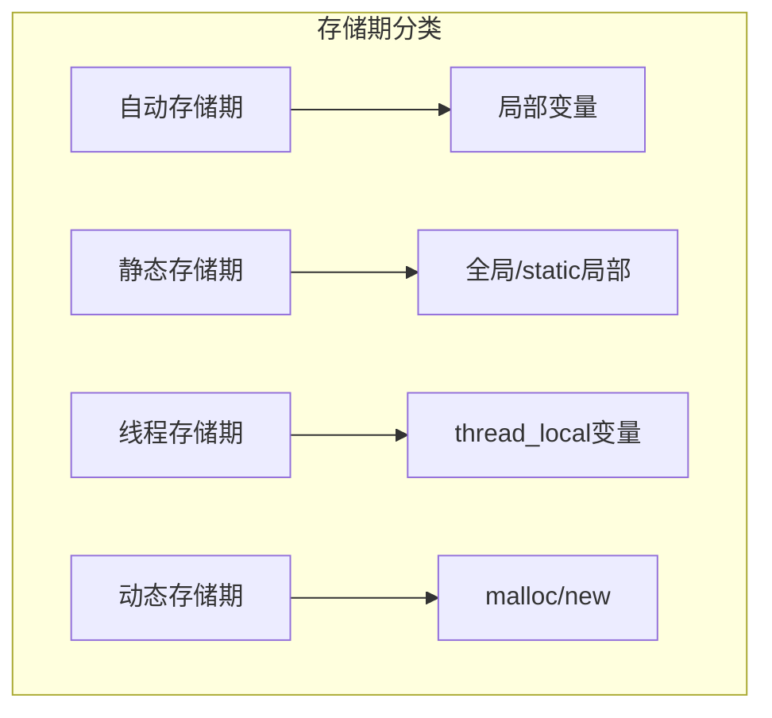
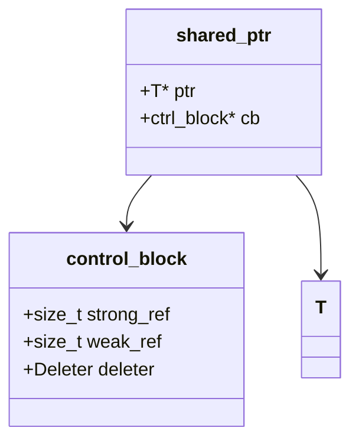
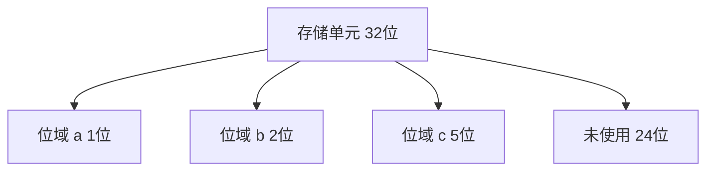
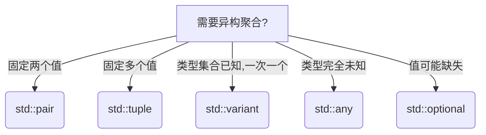
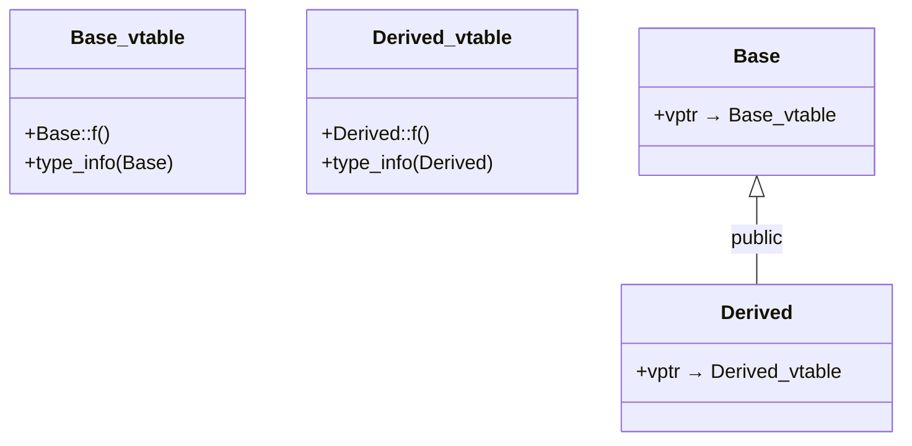
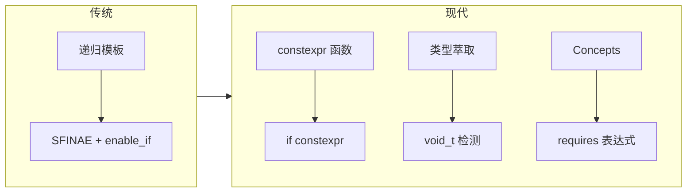
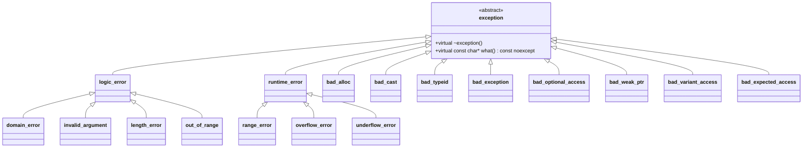
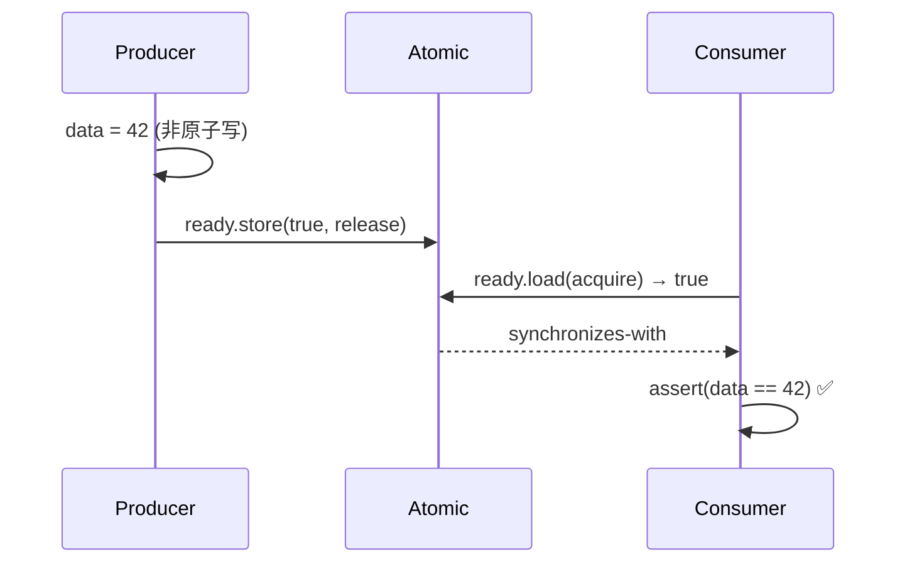
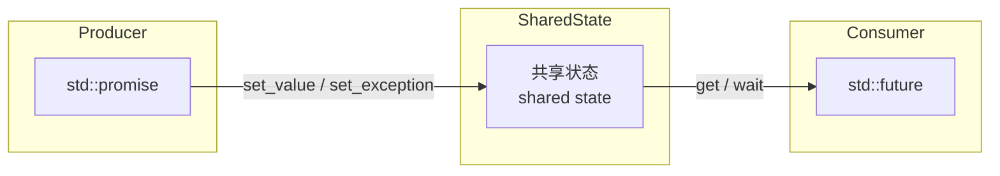

# C/C++ 编程完全指南

## 目录

[TOC]

# 第一部分：核心基础

# 第1章：C/C++ 核心概念

程序设计的本质是对现实世界问题求解的抽象。C与C++通过一套严谨而丰富的类型系统和控制结构，为这种抽象提供了从底层硬件到高层架构的全方位支撑。本章深入梳理数据、算法、机制-策略分离以及主要编程范式的核心思想，并详细追溯C与C++的演进关系，为后续章节奠定概念基础。

## 1.1 数据与算法

程序 = 数据结构 + 算法。这一经典公式在C和C++中体现得尤为彻底：**数据**通过类型系统刻画，**算法**通过函数实现，二者既独立又可组合。

### 1.1.1 数据

**数据**（Data）是程序操作的对象。C/C++通过**类型**（Type）定义数据的三个核心属性：

- **存储布局**（Storage Layout）：变量在内存中的大小与对齐方式，合法的对齐值是2的非负数次幂。
    - 例如 `struct` 成员可能因对齐要求而插入填充字节（padding），影响 `sizeof` 结果。
- **取值范围**（Range）：例如 `unsigned char` 的取值范围是0～255，而 `signed char` 为-128～127。
- **可执行操作**（Operations）：例如整型支持算术运算，结构体支持成员访问。

类型决定了数据“长什么样、能存什么值、能做什么”。C与C++的类型系统在演进中渐显差异。

**C语言**：
- 类型在编译期完全确定，不提供运行时类型信息（RTTI）。
- 结构体只能包含数据，不能包含成员函数（但可以包含函数指针）。
- 从C11开始引入 `_Generic` 关键字，可进行编译期类型选择，但这并非运行时多态。
- C23新增 `nullptr` 常量、`typeof` 和 `typeof_unqual` 运算符，增强了类型表达能力。

**C++语言**：
- 引入类（class），支持成员函数、访问控制、构造函数/析构函数、继承与多态。
- 通过**虚函数表**（vtable）实现运行时多态，每个多态类型的对象通常含有一个虚表指针（vptr，64位系统上占8字节）。
- C++11起增加 `auto`、`decltype` 类型推导，C++20引入概念（`concepts`）对类型进行编译期约束，类型系统更加丰富且安全。

```c
// C 语言示例 (C89)
int x = 10;          // 有符号整数，支持算术运算
double d = 3.14;     // 双精度浮点数，支持浮点运算
```

```cpp
// C++ 示例 (C++11)
auto y = 10;          // 推导为 int
decltype(y) z = 20;   // 获取 y 的类型作为 z 的类型

// C++20 概念约束示例
template<typename T>
concept Integral = std::is_integral_v<T>;

template<Integral T>
T increment(T x) { return x + 1; }
```

> **类型系统的差异**：C中的 `const` 变量默认具有外部链接，而C++中 `const` 对象默认是内部链接（具有编译期常量语义）；C中字符字面量类型为 `int`，C++中为 `char`。这些差异在混合编程时需特别注意。

**工程易错点**：
- **类型大小与对齐**：跨平台传输结构体时，不要直接 `memcpy`，应使用序列化库，因为不同编译器的填充规则可能不同。可用 `static_assert` 验证结构体大小。
- **符号类型**：有符号与无符号混用会导致意料之外的转换，例如 `-1 > 0u` 为真（因为 `-1` 被提升为无符号）。应开启编译器警告 `-Wsign-compare`。
- **C++中const全局变量**：若需要在多个.cpp文件共享，必须显式添加 `extern`，否则每个文件有一份独立副本。

### 1.1.2 算法

**算法**（Algorithm）是解决特定问题的有限指令序列，必须满足**明确性、有穷性、输入/输出、有效性**。C和C++都通过函数来实现算法，但对泛型的支持方式截然不同。

**C方式：数据与算法分离，通过指针传递操作**

经典例子是标准库的 `qsort`，它要求用户提供比较函数指针。

```c
/*
 * @brief   对数组进行快速排序
 * @param   base    [IN] 待排序数组的起始地址
 * @param   nmemb   [IN] 数组元素个数
 * @param   size    [IN] 每个元素的大小（字节）
 * @param   compar  [IN] 比较函数，返回 <0、0、>0 分别表示小于、等于、大于
 * @return  无
 * @note    函数指针无法内联，对简单比较操作存在调用开销。
 */
void qsort(void *base, size_t nmemb, size_t size,
           int (*compar)(const void *, const void *));
```

```c
// C 风格排序示例 (C89)
#include <stdlib.h>
int cmp_int(const void *a, const void *b) {
    return (*(int*)a - *(int*)b);
}
int arr[] = {5, 2, 8, 1};
qsort(arr, 4, sizeof(int), cmp_int);
```

**C++方式：模板与策略分离，实现编译期多态**

C++标准库提供 `std::sort`，通过模板参数接受比较器，可实现零开销抽象。

```cpp
/*
 * @brief   对范围 [first, last) 内的元素排序
 * @param   first   [IN] 随机访问迭代器，指向范围起始
 * @param   last    [IN] 随机访问迭代器，指向范围结尾
 * @param   comp    [IN,OPT] 比较函数对象，默认使用 operator<
 * @return  无
 * @note    要求迭代器满足随机访问迭代器（RandomAccessIterator）要求。
 *          比较器若可内联，排序性能常优于 C 的 qsort。
 *          自 C++17 起，可指定执行策略以支持并行排序。
 */
template< class RandomIt >
void sort( RandomIt first, RandomIt last );

template< class RandomIt, class Compare >
void sort( RandomIt first, RandomIt last, Compare comp );
```

```cpp
// C++ 风格排序示例 (C++11)
#include <algorithm>
#include <vector>
std::vector<int> v = {5, 2, 8, 1};
std::sort(v.begin(), v.end());          // 默认升序
std::sort(v.begin(), v.end(),
          [](int a, int b) { return a > b; }); // Lambda 定义降序策略

// C++17 并行排序
#include <execution>
std::sort(std::execution::par, v.begin(), v.end());
```

**C++20 受约束算法（Ranges）** （C++20）：C++20在命名空间 `std::ranges` 中提供大多数算法的受约束版本，范围既可以由迭代器-哨位对指定，也可以由单个 `range` 实参指定，还支持投影和成员指针可调用对象。

```cpp
// C++20 Ranges 风格
std::vector<int> v = {5, 2, 8, 1};
std::ranges::sort(v);  // 直接排序容器
auto it = std::ranges::find(v, 8);
```

**工程易错点**：
- **C的qsort回调**：比较函数必须正确返回负/零/正，不能简单返回 `a - b` 当元素为 `int` 时（可能溢出）。应使用 `return (a > b) - (a < b);`。
- **C++ sort与容器**：对 `std::list` 不能使用 `std::sort`（非随机访问迭代器），应使用成员函数 `sort()`。
- **并行算法**：C++17的并行策略 `std::execution::par` 要求元素类型满足可平凡复制且操作无数据竞争。使用前务必确保线程安全。

## 1.2 机制与策略分离

**机制与策略分离**（Separation of Mechanism and Policy）是C/C++设计哲学的核心原则之一。它要求将**底层能力提供者（机制）** 与**上层决策者（策略）** 解耦，使同一套机制可以适配多种策略，策略也可在不同机制间复用。

- **机制**（Mechanism）：回答“能做什么”。例如 `std::sort` 是排序机制，`std::vector` 是动态数组机制。
- **策略**（Policy）：回答“如何做”。例如排序时使用的比较器、容器采用的分配器、算法的执行策略等。

### 1.2.1 典型实例一：排序比较器策略（C++）

```cpp
std::sort(v.begin(), v.end(), std::greater<int>()); // 策略：降序
```

`std::sort` 是机制，`std::greater<int>` 是策略。用户可自由提供函数对象、函数指针或Lambda，而无需修改排序实现。

### 1.2.2 典型实例二：分配器策略（C++）

**分配器**（Allocator）是封装内存分配策略的类模板，它允许泛型容器将数据自身和内存管理解耦合。

```cpp
std::vector<int, MyAllocator<int>> v; // 策略：自定义内存管理
```

`std::vector` 是机制，分配器是策略。通过替换分配器，容器可在不同内存区域（如共享内存、栈空间）中分配元素。标准库容器默认使用 `std::allocator`，它是无状态的。C++11起还支持有状态分配器。

### C++17 执行策略（C++17）

```cpp
#include <execution>
std::sort(std::execution::par, v.begin(), v.end()); // 策略：并行排序
```

执行策略（`std::execution::seq`、`par`、`par_unseq`）将“如何执行”从算法本身剥离。

### C++20 范围与视图（C++20）

```cpp
#include <ranges>
auto even = v | std::views::filter([](int i){ return i % 2 == 0; });
```

范围库将数据访问机制（视图适配器）与具体操作策略（过滤条件）分离，通过管道语法灵活组合。

> **机制与策略分离的价值**：避免重复编写机制代码，最大化代码复用；策略可插拔，便于测试和扩展；符合开闭原则（对扩展开放，对修改关闭）。

**工程易错点**：
- **分配器状态**：C++11前分配器是无状态的，C++11后分配器可以有状态。跨容器移动元素时，需确保分配器可传递。
- **执行策略的陷阱**：`par_unseq` 允许向量化，禁止使用互斥锁，否则死锁。若算法中调用了 `std::mutex`，应改用 `par`。
- **视图懒求值**：C++20视图仅在迭代时计算，若重复使用同一视图可能导致多次计算开销，应注意缓存结果。

## 1.3 编程范式

C是经典的过程式语言，C++则是**多范式**（Multi-paradigm）语言，支持结构化、面向对象、泛型和函数式（Lambda）等编程风格。理解各范式的适用场景是高效使用C++的关键。

### 1.3.1 自顶向下设计（Top-Down Design） （C/C++）

- **理念**：将大型程序逐层分解为小型、职责单一的模块（函数）。
- **过程**：从高层任务出发，递归地细化直到每个叶子任务足够简单。
- **典型应用**：C语言的模块化程序设计、脚本式批处理任务。

```c
// 自顶向下：主流程清晰，细节封装在子函数中 (C89)
int main() {
    int a = get_input();
    int b = get_input();
    int result = compute(a, b);
    display(result);
    return 0;
}
```

在C++中，自顶向下设计常与类和命名空间结合，形成层次化的模块分解。

### 1.3.2 结构化编程（Structured Programming） （C/C++）

- **核心思想**：仅使用**顺序、分支（if/switch）、循环（for/while）** 三种控制结构，严格限制 `goto`（仅用于错误处理等少数场景）。
- **强调**：清晰的执行流，每一段代码块单入口单出口，便于推理和验证。
- **模块化**：函数和代码块是基本抽象单元，通过参数和返回值沟通。

```c
// 结构化示例：阶乘计算 (C89)
unsigned long long factorial(unsigned int n) {
    unsigned long long result = 1;
    for (unsigned int i = 2; i <= n; ++i) {
        result *= i;
    }
    return result;
}
```

> 结构化编程是C和C++所有范式的基石。即使在高度面向对象的系统中，每个成员函数内部仍是结构化代码。

### 1.3.3 面向对象编程（OOP, Object-Oriented Programming） （C++）

面向对象将**数据**与**操作数据的方法**封装在一起，C++通过类（class）定义对象模板，经由**实例化**创建具体对象。OOP的核心支柱包括：

1. **封装**（Encapsulation）：隐藏内部状态与实现细节，仅暴露公共接口。好处是减少耦合、易于维护。
2. **继承**（Inheritance）：子类复用父类的属性和行为，形成“is-a”关系，实现代码复用与层次建模。
3. **多态**（Polymorphism）：同一接口，多种实现。C++通过虚函数实现**运行时多态**（动态绑定），通过模板和重载实现**编译期多态**（静态多态）。
4. **重载**（Overloading）：同一作用域内多个同名函数，编译器根据参数类型/数量选择合适版本，属于静态多态的范畴。

```cpp
// 面向对象示例 (C++11)
class Shape {
public:
    virtual ~Shape() = default;                // 虚析构，保证正确释放派生类资源
    virtual double area() const = 0;           // 纯虚函数，定义接口
};

class Circle : public Shape {
    double r_;
public:
    explicit Circle(double r) : r_(r) {}       // explicit 防止隐式转换
    double area() const override { return 3.14159 * r_ * r_; } // override 明确重写意图
};

class Rectangle : public Shape {
    double w_, h_;
public:
    Rectangle(double w, double h) : w_(w), h_(h) {}
    double area() const override { return w_ * h_; }
};

void printArea(const Shape& s) {               // 多态调用
    std::cout << s.area() << '\n';
}
```

**工程易错点**：
- **虚析构函数**：作为基类的类必须将析构函数设为虚函数，否则 `delete base_ptr` 会导致派生类部分未释放。
- **切片问题**：按值传递多态对象会导致派生类被切片。应使用指针或引用。
- **重载与隐藏**：派生类中定义同名函数（即使参数不同）会隐藏基类的所有重载版本。如需使用基类版本，可用 `using Base::func;` 引入。

### 1.3.4 泛型编程（Generic Programming） （C++）

泛型编程的核心思想是编写**独立于具体类型**的算法和数据结构，通过模板（template）在编译时生成类型特化版本，从而获得与手写代码相同的运行时性能（零开销抽象）。

- **容器**：`std::vector<T>`, `std::map<Key,T>` 等，可容纳任意类型。
- **算法**：`std::sort`, `std::find` 等，通过迭代器解耦算法与容器。
- **智能指针**：`std::unique_ptr<T>`, `std::shared_ptr<T>`（C++11），管理任意动态分配对象的生命周期。

```cpp
// 泛型函数模板 (C++98)
template <typename T>
T max(T a, T b) {
    return (a > b) ? a : b;
}
```

C++20引入的**概念（`concepts`）** 进一步提升了泛型的表达能力，概念是**要求**的具名集合，每个概念都是一个在编译时求值的谓词。概念的目的是塑造语义分类（如 Number、Range、RegularFunction）而非语法上的限制。

```cpp
// 有约束的泛型 (C++20)
#include <concepts>
template <std::totally_ordered T>
T max(T a, T b) { return (a > b) ? a : b; }
```

**C++14 泛型Lambda**：允许使用 `auto` 作为参数类型。 (C++14)

```cpp
// C++14 泛型 Lambda
auto add = [](auto a, auto b) { return a + b; };
int    r1 = add(1, 2);
double r2 = add(1.5, 2.5);
```

**C++20 模板Lambda**：允许在lambda中使用显式模板参数列表。 (C++20)

```cpp
// C++20 模板 Lambda
auto f = []<typename T>(std::vector<T> v) {
    return v.size();
};
```

> **泛型 vs. OOP**：泛型实现的是编译期多态（无虚函数开销），类型在编译时必须确定；OOP实现的是运行时多态（更灵活，但有间接调用成本）。现代C++倾向于优先使用泛型，在确实需要运行时动态行为时才使用虚函数。

**工程易错点**：
- **模板代码膨胀**：每个实例化生成独立代码，可将类型无关逻辑提取到非模板基类。
- **依赖类型与typename**：模板中访问依赖类型（如 `T::iterator`）需加 `typename`，否则编译错误。
- **SFINAE vs Concepts**：C++20前常用 `std::enable_if` 约束模板，代码晦涩；C++20应优先使用Concepts。

### 1.3.5 函数式编程特性（Lambda表达式） （C++11）

C++11引入的Lambda表达式使得函数式编程风格在C++中成为可能。

```cpp
// Lambda 表达式示例 (C++11)
auto add = [](int a, int b) { return a + b; };
int sum = add(3, 5);  // 8

// 捕获外部变量 (C++11)
int multiplier = 2;
auto times = [multiplier](int x) { return x * multiplier; };
int result = times(10);  // 20
```

## 1.4 C 与 C++ 的关系与演进

### 1.4.1 历史背景

- **C语言**：1972年由Dennis Ritchie在贝尔实验室设计，用于编写Unix操作系统。随后发布K&R C，经ANSI C89/ISO C90标准化，后续有C99、C11、C17、C23标准。
- **C++语言**：1979年Bjarne Stroustrup开始开发“C with Classes”，1983年正式命名C++。1998年发布首个国际标准C++98，之后历经C++03（修复）、C++11（现代C++起点）、C++14、C++17、C++20和C++23。

C++的设计目标之一是**兼容C的大部分语法**，同时提供面向对象、泛型等高层抽象，并坚持**零开销原则**（你不用的东西不为你付出代价）。

### 1.4.2 C++ 作为 C 的超集（并非完全）

C++继承了C的大量语法和标准库，但并非100%兼容。常见不兼容点如下：

| 特性 | C | C++ |
|------|---|---|
| 隐式函数声明 | 允许（C89/C99），C11起移除 | 不允许 |
| `void*` 隐式转换 | 允许（可赋值给任何指针） | 不允许，需显式转换 |
| `const` 全局变量链接 | 外部链接 | 内部链接（需 `extern` 才具有外部链接） |
| 字符字面量类型 | `int`（C中字符常量是int） | `char` |
| `sizeof('a')` | `sizeof(int)`（通常4） | `sizeof(char)`（1） |
| 结构体标签作用域 | 使用时需 `struct S`（除非typedef） | `S` 可直接作为类型名 |
| 枚举类型隐式转换 | 可隐式转为 `int` | `enum class`（C++11）不可隐式转换 |
| 空指针常量 | `NULL`（通常为 `(void*)0` 或 `0`）（C23也引入了 `nullptr`） | C++11起推荐 `nullptr` |
| 布尔类型 | C99起 `_Bool`，C23前 `<stdbool.h>` 引入 `true`/`false` | 内置 `bool`，字面值 `true`/`false` |
| 聚合初始化（结构体/数组） | `= {0}` 可清零任意结构体/数组，剩余成员零初始化 | 聚合类型报警告部分初始化 |
| `restrict` 关键字 | C99支持，用于指针别名优化 | 不支持（部分编译器提供 `__restrict` 扩展） |

这些差异在混合编程时可能导致难以发现的bug，应在编译阶段开启严格警告并尽量使用 `extern "C"` 明确边界。

### 1.4.3 C++ 的主要增强

相比C，C++在不同标准阶段引入了大量现代化特性，解决了C语言在实际工程中的诸多痛点。

**C++98/03——经典C++**
- 类、继承、多态、封装
- 模板与STL（容器、迭代器、算法）
- 异常处理（`try`/`catch`/`throw`）
- RAII（资源获取即初始化）
- 命名空间（namespace）
- 类型安全的转换运算符（`static_cast`、`dynamic_cast`、`const_cast`、`reinterpret_cast`）

**C++11——现代C++起点**
- 自动类型推导（`auto`、`decltype`）
- 右值引用与移动语义（`&&`、`std::move`）
- 智能指针（`std::unique_ptr`、`std::shared_ptr`、`std::weak_ptr`）
- Lambda表达式
- 并发支持（`std::thread`、`std::mutex`、原子操作）
- 统一初始化列表、`nullptr`、`constexpr`、`override`/`final`
- 范围for循环
- 有状态分配器
- `std::initializer_list`

**C++14——泛型与实用增强**
- 泛型Lambda（`auto`参数）
- `std::make_unique`
- `constexpr` 函数放松限制
- 变量模板

**C++17——简化与性能**
- 结构化绑定（`auto [a,b] = ...`）
- `if constexpr`（编译期分支）
- 并行算法（`<execution>`）
- 文件系统库（`<filesystem>`）
- `std::optional`、`std::variant`、`std::any`
- 折叠表达式（fold expressions）
- 类模板参数推导（CTAD）

**C++20——革命性更新**
- 概念（Concepts）
- 协程（Coroutines，`co_await`/`co_yield`/`co_return`）
- 模块（Modules）
- 范围库（Ranges）
- `std::format`、`std::span`、`std::jthread`
- 宇宙飞船运算符 `<=>`
- `char8_t` 类型

**C++23——精化与收尾**
- `std::expected`（函数式错误处理）
- `std::generator`（协程生成器）
- `std::print`/`std::println`
- 范围适配器增强、monadic操作
- `constexpr` 支持进一步增强
- 定宽浮点数类型（`std::float16_t`、`std::float32_t` 等）

这些增强使得C++在表达力、类型安全、资源管理和并发编程等方面远优于C，同时保持了接近硬件的性能。

### 1.4.4 何时使用 C，何时使用 C++

| 场景 | 推荐语言 | 理由 |
|------|----------|------|
| 操作系统内核、驱动 | C（或受限C++） | 极简运行时，无异常/RTTI开销，精确控制内存布局 |
| 资源极端受限的嵌入式系统 | C | 更小的代码体积，可预测的行为 |
| 需要稳定ABI的跨语言库 | C（配合 `extern "C"`） | ABI简单稳定，方便FFI绑定 |
| 游戏引擎、图形应用 | C++ | 高性能零成本抽象，成熟引擎生态 |
| 大型桌面/服务器应用 | C++ | 丰富的标准库与设计模式，便于管理复杂度 |
| 科学计算与数值处理 | C++（结合模板库） | 运算符重载、模板元编程可编写直观且高效的数值代码 |
| 高频交易、实时系统 | C++ | 确定性析构、内联泛型、低延迟并发库 |
| 需要快速原型化的工具 | C++（或Python等） | 现代C++的标准库大幅减少了样板代码 |

实际项目中，两者常混合使用：核心底层用C实现以保证ABI稳定和最小依赖，上层用C++封装为类型安全的接口。通过 `extern "C"` 可以无缝衔接。

```cpp
// C 库头文件 util.h
#ifdef __cplusplus
extern "C" {
#endif
    int compute(int a, int b);
#ifdef __cplusplus
}
#endif
```

## 1.5 总结与最佳实践

1. **理解数据与算法的关系**
   - 类型决定数据的存储和操作，算法是操作的集合。C++的类型系统（尤其是模板）允许在编译期对类型进行丰富检查，尽可能利用类型安全减少运行时错误。

2. **善用机制与策略分离**
   - 优先使用标准库算法和容器，通过传递不同的比较器、分配器、执行策略来调整行为，而不是重写核心逻辑。这是代码复用和性能优化的关键。

3. **根据场景选择范式**
   - 对简单流程和底层操作，使用结构化编程保持代码清晰。
   - 当系统存在明确的实体与继承关系时，采用OOP，但要谨慎使用虚函数，优先考虑静态多态。
   - 编写独立于类型的算法和容器时，使用泛型编程；C++20起尽量用Concepts约束模板。
   - 现代C++提倡**在需要运行时多态时才用OOP，其余情况以泛型和函数式（Lambda）为主**。

4. **明确C与C++的边界**
   - 编写跨语言接口时使用 `extern "C"`，确保ABI兼容。
   - 注意 `void*`、字符字面量、`const` 链接等不兼容细节，编译时开启 `-Wall -Wextra` 并处理所有警告。
   - 在C++代码中避免使用C风格的类型转换、`NULL`、裸 `new`/`delete`，改用C++专属的 `static_cast`、`nullptr`、智能指针。

5. **拥抱现代C++标准**
   - 尽量使用C++17或更高标准进行开发。新标准不仅提供了更多的库组件，还通过语言层面的改进（如移动语义、结构化绑定、`constexpr` 函数）从根本上改变了我们组织代码的方式，显著提升安全性和开发效率。

6. **保持求知与审慎**
   - 所有范式、特性都有其适用边界。不要为了用新特性而用，而应从问题出发选择最简洁、最不易出错的解决方案。掌握核心概念，是写出健壮、高效、可维护的C/C++程序的永恒基石。

# 第2章：关键字与标识符

关键字（Keyword）是语言预定义的保留字，具有特殊含义，不能用作普通标识符。标识符（Identifier）是用户为变量、函数、类等实体赋予的名称。掌握关键字与标识符规则是编写可移植、健壮代码的基础。

## 2.1 C/C++ 关键字与特殊标识符速查表

关键字是语言语法的一部分，它们在预处理记号（preprocessing token）中被识别，但宏展开后仍作为语言记号处理。下表按照分类列出所有关键字，并标明其所属语言版本和简要作用。

**图例说明**：
- **C**：C语言独有
- **C++**：C++语言独有
- **C/C++**：两者共有
- **特殊标识符**：非全局保留字，在特定上下文有特殊含义
- 版本号直接标注为C89、C99、C11、C17、C23、C++、C++11、C++14、C++17、C++20、C++23

### 2.1.1 基本类型

| 分类 | 关键字/标识符 | 语言/版本 | 简要作用与含义演变 |
|------|--------------|-----------|-------------------|
| 整数类型 | `int` | C/C++ | 基本整数类型，通常为32位。 |
| 字符类型 | `char` | C/C++ | 字符类型，可表示字符或小整数。其符号性由实现定义。 |
| 单精度浮点 | `float` | C/C++ | 单精度浮点数，通常为IEEE-754 binary32。 |
| 双精度浮点 | `double` | C/C++ | 双精度浮点数，通常为IEEE-754 binary64。 |
| 无类型/空 | `void` | C/C++ | 空类型，用于无返回值函数或通用指针 `void*`。 |
| 布尔类型 | `bool` | C23/C++ | 布尔类型。C++原生关键字。C23起为C原生关键字；此前C99/C11/C17使用 `_Bool` 并通过 `<stdbool.h>` 宏定义为 `bool`。 |
| 布尔真值 | `true` | C23/C++ | 布尔真值常量。C23起为C原生关键字；此前C通过 `<stdbool.h>` 宏定义为 `1`。 |
| 布尔假值 | `false` | C23/C++ | 布尔假值常量。C23起为C原生关键字；此前C通过 `<stdbool.h>` 宏定义为 `0`。 |
| 宽字符 | `wchar_t` | C++ | 宽字符类型，C++原生关键字。C中为 `<stddef.h>` 的 `typedef`，大小平台相关（Windows为2字节，Linux/macOS为4字节）。 |
| UTF-16字符 | `char16_t` | C++11/C11 | UTF-16字符类型，大小固定为16位。C11起也在C中以 `<uchar.h>` 中的 `typedef` 形式存在。 |
| UTF-32字符 | `char32_t` | C++11/C11 | UTF-32字符类型，大小固定为32位。C11起在C中以 `typedef` 形式存在。 |
| UTF-8字符 | `char8_t` | C++20/C23 | UTF-8编码单元类型，大小固定为8位，与 `unsigned char` 不同，用于类型安全区分。C23也引入 `char8_t` 作为关键字。 |
| 复数类型 | `_Complex` | C99 | 复数类型，通常通过 `<complex.h>` 使用 `complex`、`complex float` 等宏。 |
| 虚数类型 | `_Imaginary` | C99 | 虚数类型（可选），通常通过 `<complex.h>` 使用 `imaginary` 宏。 |
| 十进制浮点 | `_Decimal32` | C23 | 32位十进制浮点数（IEC 60559，可选）。 |
| 十进制浮点 | `_Decimal64` | C23 | 64位十进制浮点数（IEC 60559，可选）。 |
| 十进制浮点 | `_Decimal128` | C23 | 128位十进制浮点数（IEC 60559，可选）。 |

### 2.1.2 类型修饰与限定符

| 分类 | 关键字/标识符 | 语言/版本 | 简要作用与含义演变 |
|------|--------------|-----------|-------------------|
| 长度修饰 | `short` | C/C++ | 声明短整数（至少16位）。 |
| 长度修饰 | `long` | C/C++ | 声明长整数（至少32位）。C++11起 `long long` 作为标准。 |
| 符号修饰 | `signed` | C/C++ | 显式声明有符号类型（默认对 `char` 外的整型通常为signed）。 |
| 符号修饰 | `unsigned` | C/C++ | 声明无符号类型。 |
| 常量限定 | `const` | C/C++ | 声明变量不可修改。C++中还可修饰成员函数（承诺不修改对象状态）。 |
| 易变限定 | `volatile` | C/C++ | 告知编译器变量值可能被外部因素改变（硬件寄存器、信号处理器等），禁止优化。 |
| 受限指针 | `restrict` | C99 | 告知编译器指针是访问所指内存的唯一方式，用于优化。C++标准不支持，但多数编译器提供 `__restrict` 扩展。 |
| 原子类型 | `_Atomic` | C11 | 原子类型说明符。通常通过 `<stdatomic.h>` 使用 `atomic_int` 等宏。C++中使用 `std::atomic<T>` 模板。 |
| 对齐指定 | `alignas` | C++11/C23 | 指定变量或类型的对齐要求。C++11起为C++关键字。C23起为C原生关键字；此前C11/C17使用 `_Alignas` 并通过 `<stdalign.h>` 宏定义为 `alignas`。 |

### 2.1.3 类型推导与属性查询

| 分类 | 关键字/标识符 | 语言/版本 | 简要作用与含义演变 |
|------|--------------|-----------|-------------------|
| 类型推导 | `auto` | C++11/14/17/20 | 自动类型推导。C++11引入新语义，C++14支持返回类型推导、lambda参数推导，C++17支持模板参数推导、结构化绑定，C++20支持 `auto` 参数（缩写函数模板）。C89中 `auto` 表示自动存储类（极少用）。 |
| 声明类型查询 | `decltype` | C++11 | 获取表达式或实体的声明类型，不进行求值。 |
| 类型查询 | `typeof` | C23 | 获取表达式的类型（GCC扩展已被标准化）。C++中无此关键字，使用 `decltype`。 |
| 去限定类型查询 | `typeof_unqual` | C23 | 获取表达式移除所有限定符后的类型。 |
| 大小查询 | `sizeof` | C/C++ | 返回类型或变量占用的字节数（类型为 `size_t`）。 |
| 对齐查询 | `alignof` | C++11/C23 | 查询类型的对齐要求（返回 `size_t`）。C++11起为C++关键字。C23起为C原生关键字；此前C11/C17使用 `_Alignof` 并通过 `<stdalign.h>` 宏定义为 `alignof`。 |
| 编译期泛型选择 | `_Generic` | C11 | 编译期根据表达式类型选择不同的代码分支。C++中使用模板或 `if constexpr` 替代。 |

### 2.1.4 存储类、生存期与链接

| 分类 | 关键字/标识符 | 语言/版本 | 简要作用与含义演变 |
|------|--------------|-----------|-------------------|
| 自动存储类 | `auto` | C89 | 声明自动变量（函数内局部变量，默认行为）。C++11起 `auto` 被重新定义为类型推导，C++中此存储类含义已废弃。 |
| 静态存储 | `static` | C/C++ | 函数内静态变量持久存在；文件作用域限制为内部链接。C++中还可修饰类的静态成员。 |
| 外部链接 | `extern` | C/C++ | 声明外部定义的变量或函数。C++中还可用于显式指定外部链接。 |
| 寄存器变量 | `register` | C/C++ | 建议编译器将变量放入寄存器。C++11废弃，C++17移除语义但保留关键字。 |
| 线程局部存储 | `thread_local` | C++11/C23 | 声明线程局部变量。C++11起为C++关键字。C23起为C原生关键字；此前C11/C17使用 `_Thread_local` 并通过 `<threads.h>` 宏定义为 `thread_local`。 |
| 可变成员 | `mutable` | C++ | 允许在 `const` 成员函数中修改该成员变量。C++11起lambda捕获也可用。 |
| 内联函数 | `inline` | C99 / C++ | 建议编译器内联展开函数。C++17起可用于声明内联变量。 |
| 不返回函数 | `_Noreturn` | C11 | 声明不会返回的函数（如 `exit`）。通常通过 `<stdnoreturn.h>` 使用 `noreturn` 宏。C++11起使用 `[[noreturn]]` 属性。 |

### 2.1.5 控制流

| 分类 | 关键字/标识符 | 语言/版本 | 简要作用与含义演变 |
|------|--------------|-----------|-------------------|
| 条件语句 | `if` | C/C++ | 条件分支。C++17起支持 `if constexpr` 和带初始化的 `if (init; condition)`。 |
| 否则分支 | `else` | C/C++ | 条件不满足时执行的分支。 |
| 多路选择 | `switch` | C/C++ | 根据整数值跳转到对应 `case` 标签。C++17起支持带初始化语句。 |
| 分支常量 | `case` | C/C++ | 定义 `switch` 语句中的分支入口。 |
| 默认分支 | `default` | C/C++ | 定义 `switch` 语句中的默认入口。C++11起 `default` 另有新含义（显式默认特殊成员函数）。 |
| 前置条件循环 | `while` | C/C++ | 先判断条件，再执行循环体。C++17起支持带初始化语句。 |
| 后置条件循环 | `do` | C/C++ | 先执行循环体，再判断条件。 |
| 计数循环 | `for` | C/C++ | 包含初始化、条件、迭代的循环。C++11起支持范围 `for`（range-based）。C++20起支持 `init-statement`。 |
| 跳出循环 | `break` | C/C++ | 跳出最近的 `switch` 或循环。 |
| 继续循环 | `continue` | C/C++ | 跳过当前循环体剩余部分，进入下一次迭代。 |
| 无条件跳转 | `goto` | C/C++ | 跳转到函数内的标签位置。C++中不能跳过具有非平凡构造/析构的变量声明。 |
| 函数返回 | `return` | C/C++ | 从函数返回，可携带返回值。 |
| 空指针常量 | `nullptr` | C++11/C23 | 空指针字面量，类型为 `std::nullptr_t`，替代 `NULL` 宏。C23起为C原生关键字。 |

### 2.1.6 复合类型与类型别名

| 分类 | 关键字/标识符 | 语言/版本 | 简要作用与含义演变 |
|------|--------------|-----------|-------------------|
| 结构体 | `struct` | C/C++ | 声明结构体类型，可包含不同类型的数据成员。C++也用于声明默认 `public` 的类。 |
| 联合体 | `union` | C/C++ | 声明联合体类型，所有成员共享同一内存地址。C++11起支持非受限联合。 |
| 枚举 | `enum` | C/C++ | 声明枚举类型，定义一组命名整型常量。C++11起支持强类型枚举 `enum class`，可指定底层类型。 |
| 类型别名 | `typedef` | C/C++ | 为现有类型创建别名（C风格）。 |
| 类 | `class` | C++ | 声明类类型，支持封装、继承、多态。默认 `private` 访问。 |
| 命名空间 | `namespace` | C++ | 定义命名空间，避免名称冲突。 |
| 引入名称 | `using` | C++ | 引入命名空间中的名称到当前作用域。C++11起还支持类型别名声明 `using Alias = Type;`。 |
| 类型别名声明 | `using` | C++11 | 用于声明类型别名（`using Alias = Type;`），替代 `typedef` 的现代语法，支持模板别名。 |
| 模板类型参数 | `typename` | C++ | 声明模板类型参数；在模板中指明依赖名称为类型。 |
| 模板声明 | `template` | C++ | 声明模板（函数模板、类模板、变量模板等）。 |

### 2.1.7 面向对象与访问控制

| 分类 | 关键字/标识符 | 语言/版本 | 简要作用与含义演变 |
|------|--------------|-----------|-------------------|
| 公有访问 | `public` | C++ | 声明公有成员。 |
| 保护访问 | `protected` | C++ | 声明受保护成员（仅类和派生类可访问）。 |
| 私有访问 | `private` | C++ | 声明私有成员（仅本类和友元可访问）。 |
| 友元 | `friend` | C++ | 声明友元函数或类，可访问私有或受保护成员。 |
| 虚函数 | `virtual` | C++ | 声明虚函数，支持运行时多态。 |
| 重写声明 | `override` | C++11（特殊标识符） | 标记函数意图重写基类虚函数，编译器检查签名匹配。非全局保留字。 |
| 禁止继承/重写 | `final` | C++11（特殊标识符） | 标记类不可被继承，或虚函数不可被进一步重写。非全局保留字。 |
| 显式构造函数 | `explicit` | C++ | 禁止构造函数用于隐式类型转换。C++20起可用于转换运算符。 |
| 当前对象指针 | `this` | C++ | 指向当前对象的指针（在非静态成员函数内部）。 |
| 动态类型识别 | `typeid` | C++ | 获取对象的运行时类型信息，返回 `std::type_info`。要求多态类型或编译期类型。 |
| 静态成员 | `static` | C++ | 声明类的静态成员（变量或函数），属于类而非对象。 |
| 常量成员函数 | `const` | C++ | 修饰成员函数，承诺不修改对象状态（除非 `mutable`）。 |
| 默认函数 | `default` | C++11 | 显式声明使用编译器生成的默认特殊成员函数（如 `= default;`）。 |
| 删除函数 | `delete` | C++11 | 显式禁止使用编译器生成的函数或任意函数（如 `= delete;`）。 |
| 运算符重载 | `operator` | C++ | 用于定义运算符重载、转换函数和用户定义字面量（C++11）。 |

### 2.1.8 动态内存管理

| 分类 | 关键字/标识符 | 语言/版本 | 简要作用与含义演变 |
|------|--------------|-----------|-------------------|
| 分配内存 | `new` | C++ | 在自由存储区分配内存并构造对象。可重载 `operator new`。 |
| 释放内存 | `delete` | C++ | 销毁对象并释放由 `new` 分配的内存。C++11起 `delete` 另有新含义（删除函数）。 |

### 2.1.9 类型转换

| 分类 | 关键字/标识符 | 语言/版本 | 简要作用与含义演变 |
|------|--------------|-----------|-------------------|
| 静态转换 | `static_cast` | C++ | 编译期类型转换，用于相关类型间的安全转换（如数值转换、`void*` 转具体指针）。 |
| 动态转换 | `dynamic_cast` | C++ | 运行时类型转换，用于多态类型的向下安全转换（指针失败返回 `nullptr`，引用失败抛出 `bad_cast`）。 |
| 常量转换 | `const_cast` | C++ | 添加或移除 `const` / `volatile` 限定符。修改原本const对象是未定义行为。 |
| 重解释转换 | `reinterpret_cast` | C++ | 底层位模式转换，用于无关指针类型之间的转换（如整数与指针互转），高度危险。 |

### 2.1.10 异常处理

| 分类 | 关键字/标识符 | 语言/版本 | 简要作用与含义演变 |
|------|--------------|-----------|-------------------|
| 抛出异常 | `throw` | C++ | 抛出异常对象。 |
| 尝试捕获 | `try` | C++ | 标记可能抛出异常的代码块。 |
| 捕获异常 | `catch` | C++ | 捕获并处理指定类型的异常。 |
| 不抛出声明 | `noexcept` | C++11 | 声明函数不会抛出异常。C++17起成为函数类型的一部分。 |

### 2.1.11 模板与泛型

| 分类 | 关键字/标识符 | 语言/版本 | 简要作用与含义演变 |
|------|--------------|-----------|-------------------|
| 概念定义 | `concept` | C++20 | 定义概念，用于编译期约束模板参数。 |
| 约束表达式 | `requires` | C++20 | 指定模板参数必须满足的约束条件，或引入 `requires` 子句。 |

### 2.1.12 编译期求值与断言

| 分类 | 关键字/标识符 | 语言/版本 | 简要作用与含义演变 |
|------|--------------|-----------|-------------------|
| 编译期常量 | `constexpr` | C++11 | 声明可在编译期求值的变量或函数。C++14放宽限制（允许循环、分支）。C++17支持lambda。C++20支持动态分配（受限）、`try-catch`。 |
| 立即函数 | `consteval` | C++20 | 声明必须在编译期求值的函数，比 `constexpr` 更严格。 |
| 编译期初始化 | `constinit` | C++20 | 确保变量在编译期初始化，防止运行时初始化顺序问题。 |
| 静态断言 | `static_assert` | C++11 / C23 | 编译期断言。C++11起为C++关键字。C23起为C原生关键字；此前C11/C17使用 `_Static_assert` 并通过 `<assert.h>` 宏定义为 `static_assert`。 |

### 2.1.13 协程

| 分类 | 关键字/标识符 | 语言/版本 | 简要作用与含义演变 |
|------|--------------|-----------|-------------------|
| 挂起协程 | `co_await` | C++20 | 挂起当前协程，等待异步操作完成。 |
| 返回结果 | `co_return` | C++20 | 从协程返回最终结果。 |
| 产出值 | `co_yield` | C++20 | 从协程产出一个值并挂起，用于生成器模式。 |

### 2.1.14 运算符替代标记

| 分类 | 关键字/标识符 | 语言/版本 | 简要作用与含义演变 |
|------|--------------|-----------|-------------------|
| 逻辑与 | `and` | C++ | 替代 `&&`。C95起在 `<iso646.h>` 中定义为宏。 |
| 逻辑或 | `or` | C++ | 替代 `\|\|`。C95起在 `<iso646.h>` 中定义为宏。 |
| 逻辑非 | `not` | C++ | 替代 `!`。C95起在 `<iso646.h>` 中定义为宏。 |
| 位与 | `bitand` | C++ | 替代 `&`。C95起在 `<iso646.h>` 中定义为宏。 |
| 位或 | `bitor` | C++ | 替代 `\|`。C95起在 `<iso646.h>` 中定义为宏。 |
| 位异或 | `xor` | C++ | 替代 `^`。C95起在 `<iso646.h>` 中定义为宏。 |
| 位取反 | `compl` | C++ | 替代 `~`。C95起在 `<iso646.h>` 中定义为宏。 |
| 与赋值 | `and_eq` | C++ | 替代 `&=`。C95起在 `<iso646.h>` 中定义为宏。 |
| 或赋值 | `or_eq` | C++ | 替代 `\|=`。C95起在 `<iso646.h>` 中定义为宏。 |
| 异或赋值 | `xor_eq` | C++ | 替代 `^=`。C95起在 `<iso646.h>` 中定义为宏。 |
| 非赋值 | `not_eq` | C++ | 替代 `!=`。C95起在 `<iso646.h>` 中定义为宏。 |

> **注意**：C++中以上替代标记是原生关键字，可以直接使用，无需包含头文件。在C中（C95起）它们是 `<iso646.h>` 中定义的宏，需包含该头文件。

### 2.1.15 其他

| 分类 | 关键字/标识符 | 语言/版本 | 简要作用与含义演变 |
|------|--------------|-----------|-------------------|
| 内联汇编 | `asm` | C++ | 声明内联汇编代码（行为由实现定义）。 |
| 导出/模块声明 | `export` | C++98 (废弃) / C++20 | C++98用于导出模板定义（几乎无实现，C++17移除）。C++20起重新用于模块声明。 |
| 预处理条件 | `#elifdef` | C23/C++23 | 预处理指令，检查标识符是否已定义。 |
| 预处理条件 | `#elifndef` | C23/C++23 | 预处理指令，检查标识符是否未定义。 |
| 模块声明 | `module` | C++20（特殊标识符） | 声明模块接口或实现单元。非全局保留关键字，可在普通代码中用作标识符（不推荐）。 |
| 模块导入 | `import` | C++20（特殊标识符） | 导入模块。非全局保留关键字，可在普通代码中用作标识符（不推荐）。 |

> **特殊标识符说明**：`final`、`override`、`module`、`import` 不是全局保留关键字，可在普通代码中用作变量名（强烈不推荐），但它们在特定上下文中具有编译器强制语义。

### 2.1.16 各标准版本新增关键字汇总

**C89/C90**（32个）：
`auto` `break` `case` `char` `const` `continue` `default` `do` `double` `else` `enum` `extern` `float` `for` `goto` `if` `int` `long` `register` `return` `short` `signed` `sizeof` `static` `struct` `switch` `typedef` `union` `unsigned` `void` `volatile` `while`

**C95**：无新增关键字（引入 `<iso646.h>` 替代标记宏）

**C99新增**（5个）：
`inline` `restrict` `_Bool` `_Complex` `_Imaginary`

**C11新增**（7个）：
`_Alignas` `_Alignof` `_Atomic` `_Generic` `_Noreturn` `_Static_assert` `_Thread_local`

**C17**：无新增关键字（仅缺陷修复）

**C23新增**（13个）：
`bool` `true` `false` `static_assert` `thread_local` `typeof` `typeof_unqual` `nullptr` `char8_t` `_Decimal32` `_Decimal64` `_Decimal128`，以及预处理指令 `#elifdef` `#elifndef`

**C++最初（C++98）**（63个 + 替代标记）：
`asm` `auto` `bool` `break` `case` `catch` `char` `class` `const` `const_cast` `continue` `default` `delete` `do` `double` `dynamic_cast` `else` `enum` `explicit` `export` `extern` `false` `float` `for` `friend` `goto` `if` `inline` `int` `long` `mutable` `namespace` `new` `operator` `private` `protected` `public` `register` `reinterpret_cast` `return` `short` `signed` `sizeof` `static` `static_cast` `struct` `switch` `template` `this` `throw` `true` `try` `typedef` `typeid` `typename` `union` `unsigned` `using` `virtual` `void` `volatile` `wchar_t` `while`
替代标记：`and` `and_eq` `bitand` `bitor` `compl` `not` `not_eq` `or` `or_eq` `xor` `xor_eq`

**C++11新增**（10个 + 2个特殊标识符）：
`alignas` `alignof` `char16_t` `char32_t` `constexpr` `decltype` `noexcept` `nullptr` `static_assert` `thread_local`
特殊标识符：`override` `final`
（`auto` 语义从存储类变更为类型推导）

**C++14**：无新增关键字

**C++17**：无新增核心关键字

**C++20新增**（8个 + 2个特殊标识符）：
`char8_t` `concept` `consteval` `constinit` `co_await` `co_return` `co_yield` `requires`
特殊标识符：`module` `import`

**C++23**：无新增核心关键字（预处理指令 `#elifdef`、`#elifndef` 与C23同步）

## 2.2 标识符命名规则

标识符（Identifier）是用户为变量、函数、类型、命名空间等实体起的名字。C和C++对标识符的构成有明确规定，同时标准也保留了一些名称供实现使用。

### 2.2.1 通用规则（C 和 C++）

- **组成字符**：字母（`A-Z`、`a-z`）、数字（`0-9`）、下划线 `_`。C23和C++还支持通用字符名（Unicode），例如 `\u0041` 表示 `'A'`，但实际使用中建议谨慎，避免可读性问题。
- **首字符**：不能为数字。
- **大小写敏感**：`myVar` 和 `myvar` 是不同的标识符。
- **不能与关键字同名**：但可以包含关键字，例如 `int my_class` 合法。
- **长度限制**：标准建议编译器至少支持63个字符的外部名称和31个字符的内部名称（C++则更高），实际编译器通常支持数千字符。

**C++对通用字符名的支持**：C++允许在标识符中使用通用字符名（UCN），形式为 `\uNNNN` 或 `\UNNNNNNNN`，其中N为十六进制数字。这些字符必须来自允许的字符集（如字母、数字、下划线等Unicode类别）。

**示例**：
```cpp
int \u03C0 = 3;   // π 的 Unicode 编码，变量名为 π，但可读性差，不推荐
```

### 2.2.2 保留标识符（不可使用）

C和C++标准明确保留以下形式的标识符，用户程序若定义它们将导致**未定义行为**：

1. **含双下划线的标识符**：任何位置出现连续两个下划线 `__` 的标识符（如 `__foo`、`bar__`）均保留给编译器及标准库实现。
2. **下划线开头后跟大写字母**：如 `_Bool`、`_Atomic`、`_Noreturn` 等，这类标识符在全局保留，用户在任何作用域都不得定义。
3. **下划线开头（全局作用域）**：在全局命名空间中，以下划线开头的标识符（如 `_my_global`）保留给实现。在非全局作用域（函数内、类内）下划线开头的名字虽然合法，但仍应避免，以防混淆。
4. **标准库中已使用的名称**：如 `std`、`printf`、`size_t` 等，用户不得在可能冲突的作用域内重新定义。

```c
int _Count;      // 未定义行为：下划线开头 + 大写字母
int __value;     // 未定义行为：含双下划线
namespace { int _detail; } // C++：非全局，合法但不推荐
```

**工程易错点**：
- 许多初学者使用 `_` 前缀表示私有成员，但这可能与系统保留标识符冲突。推荐使用尾随下划线（如 `name_`）或 `m_` 前缀。
- 宏保护中常见 `__XXX_HEADER_H__`，这属于保留标识符（双下划线、下划线+大写）。

### 2.2.3 命名风格建议（不强制但推荐）

| 实体类型 | 推荐风格 | 示例 |
|----------|----------|------|
| 宏（macro） | 全大写 + 下划线 | `#define BUFFER_SIZE 1024` |
| 常量（const / constexpr） | `k` 前缀 + 大驼峰，或全大写 | `const int kMaxConnections = 100;` `constexpr double PI = 3.14;` |
| 类型名（class、struct、enum、using） | 大驼峰（PascalCase） | `HttpRequest`, `Point2D` |
| 变量 / 对象 | 蛇形（snake_case） | `user_name`, `total_count` |
| 函数 / 成员函数 | 蛇形，动词开头 | `get_user_name()`, `compute_average()` |
| 私有 / 保护成员变量 | 蛇形 + 尾部下划线（常见） | `name_`, `age_` |
| 静态成员变量 | 前缀 `s_` + 小写 | `s_instance` |
| 全局变量（应尽量避免） | 前缀 `g_` + 小写 | `g_config` |
| 命名空间 | 小写蛇形 | `namespace my_lib` |

> 团队应统一编码规范（如Google C++ Style Guide、LLVM Coding Standards等），并借助 `clang-format`、`clang-tidy` 等工具自动检查和修复。

### 2.2.4 C 与 C++ 命名差异

- **结构体标签作用域**：C中定义 `struct S { ... };` 后，类型名仍为 `struct S`，除非用 `typedef` 创建别名；C++中 `S` 可直接作为类型使用，`struct S` 也可。混合编程时头文件常采用条件编译提供兼容性。
- **函数重载**：C++支持同名不同参的函数重载；C不允许。若要被C调用，C++函数需用 `extern "C"` 取消名字改编。
- **`const` 全局变量链接**：C中 `const` 对象默认外部链接（可被其他编译单元访问）；C++中 `const` 对象默认内部链接（仅当前编译单元可见，若需外部链接需显式加 `extern`）。

```c
// C 代码
const int max = 100;           // 外部链接，其他 .c 文件可见
```

```cpp
// C++ 代码
const int max = 100;           // 内部链接，仅本文件可见
extern const int limit = 200;  // 外部链接
```

## 2.3 总结与最佳实践

1. **绝不使用关键字作为标识符**。
   编写代码时保持对标准关键字的敏感度，特别是随着标准演进新增的单词（如 `concept`、`co_await`），避免采用可能在未来成为关键字的名称。

2. **杜绝使用保留标识符**。
   任何包含双下划线、下划线接大写字母的名字都应禁止。在全局作用域中避免下划线开头的名字。遵从“留给实现”的边界，是避免隐蔽冲突的保证。

3. **采用一致、清晰的命名风格**。
   推荐C++采用 `snake_case` 命名变量/函数，`PascalCase` 命名类型。对宏和全局常量使用全大写以显眼。使用前缀区分作用域（`g_`、`s_`、`k`）或成员类型（`_` 后缀）。工具链（`clang-format`）可帮助自动化。

4. **关注C与C++边界处的命名**。
   - 混合编程时，C++函数若要被C调用，必须用 `extern "C"` 声明，防止名字改编导致链接失败。
   - 注意 `const` 全局变量的链接差异，跨模块使用时请明确 `extern`。
   - 优先使用 `nullptr`（C++11/C23）代替 `NULL`；使用 `bool` 代替 `_Bool`（C23可直接用 `bool`）。

5. **了解但不滥用运算符替代关键字**。
   保持代码可读性，选用标准的 `&&`、`||` 等符号，仅在特殊要求（如字符集受限、安全编码规则）下才使用 `and`、`or` 等文本形式。

6. **紧跟标准，但慎用新关键字**。
   使用C++20的 `concept`、`requires` 等新特性时，确保编译器完整支持。在维护旧代码库时，避免引入可能与现有标识符冲突的关键字。通过 `-std=c++20` 等编译选项显式指定标准版本，并开启 `-Wc++20-extensions` 等警告检查。

遵守这些规则，能够让你的代码远离名字冲突、未定义行为，并保持极佳的跨平台、跨编译器可移植性。

# 第3章：基本数据类型

基本数据类型是编程语言的基石，直接映射硬件对数值和字符的表示。C和C++共享大部分基本类型，但C++的类型系统更为严格且提供了更丰富的变体。理解每种类型的存储特征、取值范围与操作规则，是编写正确、高效、可移植代码的第一步。

## 3.1 整型（`int`, `short`, `long`, `long long`, `signed`/`unsigned`）

整型表示整数，其核心差异在于位宽和符号性。标准只规定最小范围，实际大小依赖ABI（Application Binary Interface）。

### 3.1.1 标准整型

| 类型关键字 | 标准要求最小位宽 | 常见实现（32/64位系统） | 备注 |
|-----------|----------------|------------------------|------|
| `short` (或 `short int`) | ≥16位 | 16位 | 通常占2字节 |
| `int` | ≥16位（实际几乎均为32位） | 32位 | 系统自然整型，通常效率最高 |
| `long` (或 `long int`) | ≥32位 | 32位（Windows 64）<br>64位（Linux/macOS 64） | **跨平台差异明显** |
| `long long` (C99/C++11) | ≥64位 | 64位 | C99起引入，C++11正式纳入标准 |
| `signed` / `unsigned` | 修饰上述类型 | — | `signed` 默认，`unsigned` 修饰后取值范围翻倍 |

**有符号与无符号**

- `signed` 类型最高位为符号位，以补码形式存储（C/C++标准规定补码，C++20起明确强制补码）。
- `unsigned` 类型所有位均为数值位，范围从 `0` 到 `2^N - 1`。
- `int` 即 `signed int`，`unsigned int` 是独立的类型。
- 对于 `char`，`char`、`signed char`、`unsigned char` 是三种不同的类型；`char` 是否有符号由实现定义（x86上通常有符号，ARM上可配置）。

```c
// 不同整型的使用 (C99)
short s = 32767;
int i = 100000;
long l = 1000000L;          // L 后缀表示 long
long long ll = 123456789012345LL;  // LL 后缀
unsigned int ui = 3000000000U;     // U 后缀表示 unsigned
```

### 3.1.2 位宽与跨平台注意事项

标准只保证最小位宽和满足以下关系：
```
1 == sizeof(char) ≤ sizeof(short) ≤ sizeof(int) ≤ sizeof(long) ≤ sizeof(long long)
```

**常见陷阱**：
- `long` 在64位Windows上仍是32位，而Linux和macOS上是64位。若依赖 `long` 能容纳指针的代码将不可移植。
- 隐式类型转换（整型提升、符号扩展）容易导致难以察觉的bug，尤其是有符号与无符号混合运算时。
- 建议凡是涉及位宽精确性（如网络协议、文件格式、硬件寄存器）时，使用3.5节的固定宽度整型。

**工程易错点**：
- **有符号无符号混用**：`int x = -1; unsigned int y = 1; if (x < y) ...` 实际上 `x` 会被提升为 `unsigned int`，`-1` 变成很大的正数，条件为假。应开启 `-Wsign-compare` 警告。
- **整型提升**：`unsigned char a = 0xFF; int b = a << 8;` 中，`a` 被提升为 `int`（值为255），左移后结果为正；若 `char` 为有符号且值为负，提升后符号扩展，结果意外。建议位运算前显式转换为无符号类型。

### 3.1.3 整型字面值

整型字面值（literal）有多种表示方式，其类型由后缀和数值大小共同决定。

| 进制 | 前缀 | 示例 |
|------|------|------|
| 十进制 | 无 | `123` |
| 八进制 | `0` | `0123`（十进制83） |
| 十六进制 | `0x` 或 `0X` | `0x7B`（123） |
| 二进制 (C++14, C23) | `0b` 或 `0B` | `0b1111011`（123） |

**后缀及其类型**：
| 后缀 | 类型指示 |
|------|----------|
| `u` 或 `U` | `unsigned` |
| `l` 或 `L` | `long` |
| `ll` 或 `LL` | `long long` |
| `ul`, `lu`, `ULL` 等组合 | 组合对应无符号长整型 |

- 十进制字面值默认尝试 `int`，如不匹配则尝试 `long`、`long long`。
- 八/十六进制字面值默认尝试 `int`、`unsigned int`、`long`、`unsigned long`、`long long`、`unsigned long long`（C/C++规则略有细微差异，C++更严格）。
- **建议**：明确使用后缀来强调类型，尤其对于 `auto` 推导。

**数字分隔符** (C++14, C23)
可使用单引号 `'` 任意插入到数字中以提高可读性，编译器会忽略。

```cpp
int million = 1'000'000;
unsigned long long mask = 0xFFFF'FFFF'0000'0000ULL;
```

## 3.2 字符类型

字符类型用于存储字符编码单元。随着Unicode的普及，C/C++的字符类型体系变得丰富，但也带来了移植性挑战。

### 3.2.1 `char` (C/C++)

- `char` 保证大小为1字节（1 byte），但不一定是8位（实际所有现代平台均为8位）。
- 三种独立的类型：`char`、`signed char`、`unsigned char`。`char` 的符号性由实现定义，通常为有符号。
- 用途：存储ASCII字符、UTF-8编码单元、原始字节。

```c
char c = 'A';               // 字符
signed char sc = -1;        // 明确有符号
unsigned char uc = 255;     // 原始字节，0~255
```

> **注意**：`char` 类型用于存储小整数时，是否符号扩展经常引发bug。处理字节数据时推荐使用 `unsigned char` 或 `uint8_t`。

### 3.2.2 宽字符类型

为了支持更大的字符集，引入了宽字符类型，但它们在不同平台的大小不统一。

| 类型 | 引入标准 | 大小 | 常用编码 | 可移植性 |
|------|----------|------|----------|----------|
| `wchar_t` | C++98/C95 (通过 `<stddef.h>`) | 平台相关 | Windows: UTF-16 (2字节), Linux/macOS: UTF-32 (4字节) | 差，应避免新代码使用 |
| `char16_t` | C++11/C11 | 16位 | UTF-16 | 好（通过 `<uchar.h>` 或内置） |
| `char32_t` | C++11/C11 | 32位 | UTF-32 | 好 |
| `char8_t` | C++20 | 8位 | UTF-8编码单元（与 `unsigned char` 不同，类型安全） | C++20专属，用于区分UTF-8和普通字节 |

- C11将 `char16_t` 和 `char32_t` 定义为 `<uchar.h>` 中的typedef，C++11起直接作为内置关键字。
- `char8_t` 是C++20新增，目的是在重载、模板中提供区分度，避免UTF-8字符串和普通 `char` 混淆。

### 3.2.3 字符字面值

| 前缀 | 字符类型 | 示例 |
|------|----------|------|
| 无 | `char` | `'A'` |
| `L` | `wchar_t` | `L'A'` |
| `u` | `char16_t` | `u'A'` |
| `U` | `char32_t` | `U'A'` |
| `u8` (C++20) | `char8_t` | `u8'A'` （C++17之前 `u8` 字符字面量为 `char`，C++20起改为 `char8_t`） |

> **易错点**：C中字符字面量类型为 `int`（如 `'A'` 是 `int`），C++中为 `char`。`sizeof('A')` 在C中等于 `sizeof(int)`，在C++中等于1。这一差异在混合代码中易被忽略。

### 3.2.4 字符串字面值

字符串字面值是空字符结尾的字符数组。不同前缀决定元素类型。

| 前缀 | 元素类型 | 示例 |
|------|----------|------|
| 无 | `const char[N]` | `"hello"` |
| `L` | `const wchar_t[N]` | `L"hello"` |
| `u` | `const char16_t[N]` | `u"hello"` |
| `U` | `const char32_t[N]` | `U"hello"` |
| `u8` (C++20) | `const char8_t[N]` | `u8"hello"` (C++11~17为 `const char[N]`，C++20改为 `char8_t`) |

**原始字符串字面量** (C++11，C11作为扩展支持)
`R"delimiter( content )delimiter"` 形式，内容无需转义，可跨多行。

```cpp
const char* path = R"(C:\Program Files\MyApp)";          // 不需要转义反斜杠
const char* json = R"+*({"key":"value"})+*";             // 自定义分隔符避免冲突
```

### 3.2.5 转义字符与泛化转义序列

| 转义序列 | 含义 | ASCII码 |
|----------|------|---------|
| `\'` | 单引号 | 39 |
| `\"` | 双引号 | 34 |
| `\?` | 问号 | 63 |
| `\\` | 反斜杠 | 92 |
| `\a` | 响铃 | 7 |
| `\b` | 退格 | 8 |
| `\f` | 换页 | 12 |
| `\n` | 换行 | 10 |
| `\r` | 回车 | 13 |
| `\t` | 水平制表 | 9 |
| `\v` | 垂直制表 | 11 |
| `\0` | 空字符 | 0 |

**泛化转义序列**（数值方式）：
- 八进制：`\ooo`，最多跟随3位八进制数字。示例：`'\101'` 即 `'A'`。
- 十六进制：`\xhh...`，`\x` 后所有连续的十六进制数字都被视为转义序列的一部分。示例：`'\x41'` 即 `'A'`。

> **陷阱**：`"\x1234"` 并不会被解释为 `\x12` 加 `"34"`，而是整个 `\x1234` 被当作一个宽字符（超出 `char` 范围，可能警告）。限制十六进制长度可使用字符串连接：`"\x12" "34"`。

### 3.2.6 `std::byte` (C++17)

C++17引入 `std::byte`（定义于 `<cstddef>`），用于表示原始字节内存，不参与算术运算，只能通过位操作处理。它解决了 `char` 类型在语义上既表示字符又表示字节的混淆。

```cpp
/*
 * @brief   std::byte 类型，按位操作
 * @note    不能进行算术运算（+ - * /），只能进行位运算（| & ^ ~）和移位。
 */
enum class byte : unsigned char {};

// 构造与转换
std::byte b{0xFF};                     // 直接初始化
std::byte b2 = static_cast<std::byte>(0xAA);

// 位操作
b |= std::byte{0x0F};
b &= std::byte{0xF0};
b ^= std::byte{0xFF};

// 转换为整数
int val = std::to_integer<int>(b);
```

**工程建议**：处理二进制数据（如网络包、文件缓冲区）时，使用 `std::vector<std::byte>` 或 `std::span<std::byte>` 替代 `unsigned char*`，提高类型安全性。

## 3.3 布尔类型

布尔类型表示逻辑真/假。C和C++的布尔处理演进不同。

### 3.3.1 C 语言中的布尔

- **C99之前**：没有布尔类型，通常用 `int` 表示（非零为真，零为假）。
- **C99**：引入 `_Bool` 类型，大小通常为1字节。头文件 `<stdbool.h>` 定义宏 `bool` 为 `_Bool`，`true` 为1，`false` 为0。
- **C23**：`bool`、`true`、`false` 成为原生关键字，无需再包含 `<stdbool.h>`。

```c
// C99 通过头文件
#include <stdbool.h>
bool flag = true;
```

### 3.3.2 C++ 中的布尔

- C++98起 `bool` 是内置关键字，`true` 和 `false` 是字面值。
- 任何数值或指针可隐式转换为 `bool`：零值/空指针 → `false`，非零/非空 → `true`。
- 隐式转换可能带来意外：`int` 到 `bool` 后再提升为 `int` 为1（`true`）。因此应当避免对布尔值进行算术运算。
- `sizeof(bool)` 由实现定义，通常为1，但并非强制。

```cpp
bool b = true;
if (ptr) { /* ... */ }        // 指针隐式转换
int x = b;                    // x == 1
```

**接口说明**（C++标准库）：
```cpp
/*
 * @brief  swap 的特化，交换两个 bool 值
 * @param   a,b  要交换的 bool 对象
 * @note   位于 <utility>
 */
template<>
void swap<bool>(bool& a, bool& b) noexcept;
```

## 3.4 浮点类型

浮点数用于表示实数，遵循IEEE-754标准（绝大多数平台）。不同浮点类型精度和范围不同。

### 3.4.1 基本浮点类型

| 类型 | 标准最低精度 | 常见实现（IEEE-754） | 位宽 |
|------|-------------|---------------------|------|
| `float` | 至少6位十进制有效数字 | binary32 | 32位 |
| `double` | 至少10位有效数字，不低于 `float` | binary64 | 64位 |
| `long double` | 至少同 `double` | x86扩展精度80位（sizeof 12/16），MSVC同 `double`，ARM可128位 | 平台差异巨大 |

> **跨平台忠告**：避免使用 `long double` 进行可移植数据交换；若追求可预测精度，优先使用 `double` 或C++23定宽浮点类型。

### 3.4.2 浮点字面值

- 十进制形式：`3.14`, `0.001`, `100.0`
- 科学计数法：`1.23e4`（1.23×10⁴），`3.45E-2`
- 十六进制浮点 (C99/C++17)：`0x1.2p3` 表示 `1.125 × 2³ = 9.0`

**后缀决定类型**：
| 后缀 | 类型 |
|------|------|
| 无 | `double` |
| `f` / `F` | `float` |
| `l` / `L` | `long double` |

```cpp
float f = 3.14f;
double d = 3.14;
long double ld = 3.14L;
auto hex = 0x1.ffp10;   // C++17, double
```

### 3.4.3 IEEE-754 浮点数表示方法

浮点数在内存中以二进制存储，由**符号位 S**、**指数位 E**（偏移存储）和**尾数位 M**（隐含前导1）组成。

**位布局（binary32 / `float`）**：
```
31    30       23          0
┌─────┬────────┬───────────┐
│  S  │  E (8) │  M (23)   │
└─────┴────────┴───────────┘
```

**binary64 / `double`**：
```
63    62       52          0
┌─────┬────────┬───────────┐
│  S  │ E (11) │  M (52)   │
└─────┴────────┴───────────┘
```

| 参数 | float | double |
|------|-------|--------|
| 指数偏移 (bias) | 127 | 1023 |

**数值分类与计算公式**：

- **规格化数**（E不全0也不全1）：
  `value = (-1)^S × (1 + M / 2^Mbits) × 2^(E - bias)`

- **非规格化数**（E = 0，M ≠ 0）：
  `value = (-1)^S × (0 + M / 2^Mbits) × 2^(-bias + 1)`
  用于表达接近零的极小值，实现逐渐下溢。

- **零**（E = 0，M = 0）：`(-1)^S × 0`，有 ±0 之分。

- **无穷大**（E全1，M = 0）：`(-1)^S × ∞`，如1.0/0.0。

- **NaN**（E全1，M ≠ 0）：Not a Number，用于无效运算（如0/0, sqrt(-1)）。NaN不相等，甚至 `NaN != NaN`。

**特殊值十六进制模式（float示例）**：
| 值 | 十六进制 |
|----|---------|
| +0.0 | `0x00000000` |
| -0.0 | `0x80000000` |
| +Inf | `0x7F800000` |
| -Inf | `0xFF800000` |
| qNaN | `0x7FC00000` (典型) |

**舍入与运算**：IEEE-754定义向最近偶数舍入等模式，C/C++可通过 `<fenv.h>` / `<cfenv>` 访问。

**工程易错点**：
- **浮点比较**：不要直接使用 `==`，应检查绝对差是否小于一个很小的epsilon，例如 `fabs(a - b) < 1e-9`。
- **累积误差**：循环累加浮点数可能导致误差累积，考虑使用Kahan求和算法或更高精度类型。
- **NaN传播**：任何涉及NaN的运算结果仍为NaN，检查可用 `isnan()`（C++11/C99）。

### 3.4.4 C++23 定宽浮点类型（`<stdfloat>`）

C++23引入 `<stdfloat>` 头文件，提供精确匹配IEEE-754格式的浮点类型，解决了 `float`/`double` 位宽不确定的问题。

| 类型 | 字面量后缀 | IEEE-754 对应 |
|------|-----------|----------------|
| `std::float16_t` | `f16` 或 `F16` | binary16 (半精度) |
| `std::float32_t` | `f32` 或 `F32` | binary32 (单精度) |
| `std::float64_t` | `f64` 或 `F64` | binary64 (双精度) |
| `std::float128_t` | `f128` 或 `F128` | binary128 (四精度) |
| `std::bfloat16_t` | `bf16` 或 `BF16` | bfloat16 (与float32指数同，尾数7位) |

```cpp
#include <stdfloat>        // C++23
std::float32_t f = 1.23f32;
std::float64_t d = 1.41421356237f64;
auto s = 3.14f16;          // 后缀推导为 std::float16_t
```

这些类型与内置浮点类型互操作性强，支持标准算术和 `<cmath>` 函数重载，成为未来跨平台数值计算的推荐选择。

## 3.5 固定宽度整型（`<cstdint>` / `<stdint.h>`）

为了解决整数位宽不确定问题，C99引入了固定宽度整数类型，C++11将其纳入 `<cstdint>`。

```c
#include <stdint.h>      // C99
int32_t a = -1;           // 精确32位有符号
uint64_t b = 12345678901234567890ULL;
```

**主要typedef**：
| 有符号 | 无符号 | 宽度 |
|--------|--------|------|
| `int8_t` | `uint8_t` | 8位 |
| `int16_t` | `uint16_t` | 16位 |
| `int32_t` | `uint32_t` | 32位 |
| `int64_t` | `uint64_t` | 64位 |

此外还提供：
- `int_leastN_t`：至少N位的最小类型
- `int_fastN_t`：至少N位的最快类型
- `intmax_t`, `uintmax_t`：可表示任何有符号/无符号整数的最大类型
- `intptr_t`, `uintptr_t`：足以存储指针的整数类型

**接口声明示例**：
```c
/*
 * @brief  标准整数类型极限宏，定义在 <stdint.h> 或 <cstdint>
 */
#define INT32_MIN  (-2147483647 - 1)
#define INT32_MAX  2147483647
#define UINT32_MAX 4294967295U
```

> **最佳实践**：与外界交互（网络、文件）或需要精确位宽的算法，使用固定宽度类型；内部普通计算仍可使用 `int` 保持性能。

## 3.6 `void` 类型与 `nullptr`

### 3.6.1 `void` (C/C++)

- `void` 表示“无类型”，不能创建 `void` 对象。
- 用于函数返回类型 `void func();`、参数列表 `void func(void)`（C中表示不接受参数，C++中 `()` 效果相同）。
- 泛型指针 `void*`：可指向任意类型，但不能解引用，使用前必须显式转换为具体指针类型。
- **C vs C++**：C允许 `void*` 隐式转换为其他指针；C++禁止，需要显式转换，这增强了类型安全。

```c
void* ptr = malloc(100);
int* ip = (int*)ptr; // C 中可选强制转换
```

```cpp
void* ptr = malloc(100);
int* ip = static_cast<int*>(ptr); // C++ 必须显式转换
```

### 3.6.2 `nullptr` (C++11, C23)

空指针字面量，类型为 `std::nullptr_t`（可隐式转换为任何指针类型或成员指针类型）。它解决了传统 `NULL` 宏带来的问题：

- `NULL` 通常是 `0` 或 `(void*)0`，可能导致重载决议调用了整型版本而非指针版本。
- `nullptr` 不具有整型值，因此不会错误匹配整型重载。

```cpp
void f(int);
void f(void*);
f(0);          // 调用 f(int)
f(nullptr);    // 明确调用 f(void*)
```

C23引入 `nullptr` 为C语言原生关键字，同样推荐使用。

## 3.7 字面值完整示例

以下示例涵盖各类字面值，展示现代C++中的用法。

```cpp
#include <cstdint>
#include <string>
#include <iostream>

int main() {
    // 整型字面值
    int dec = 123;
    int oct = 0123;          // 八进制
    int hex = 0x7B;          // 十六进制
    int bin = 0b1111011;     // 二进制 (C++14)
    long long big = 123LL;
    unsigned int u = 123u;
    int sep = 1'000'000;     // 数字分隔符 (C++14)

    // 浮点字面值
    float f = 3.14f;
    double d = 3.14;
    long double ld = 3.14L;
    auto hexfloat = 0x1.2p3; // 十六进制浮点 (C++17)

    // 字符与字符串
    char c = 'A';
    wchar_t wc = L'中';
    char16_t u16c = u'中';
    char32_t u32c = U'中';
    char8_t u8c = u8'A';     // C++20

    const char* str = "hello";
    const wchar_t* wstr = L"hello";
    const char8_t* u8str = u8"hello";  // C++20
    const char* raw = R"(C:\Program Files)";

    // nullptr
    int* p = nullptr;        // C++11 起

    // 固定宽度
    uint32_t hash = 0xDEADBEEF;

    // std::byte (C++17)
    std::byte b{0xFF};
    b = static_cast<std::byte>(b | std::byte{0x0F});

    return 0;
}
```

## 3.8 总结与最佳实践

1. **优先使用 `int` 和 `double` 作通用数值类型**，除非有特殊理由（如内存、精度、ABI规定）。
2. **跨平台精确整型选用 `<cstdint>` / `<stdint.h>`**：序列化、通信协议、位字段等场景务必使用 `uint32_t` 等固定宽度类型。
3. **避免 `long` 用于需要固定宽度的场所**：它在不同系统上可能是32或64位。需要大整数直接用 `long long` 或 `int64_t`。
4. **显式添加字面值后缀**：`auto x = 100;` 是 `int`，`auto x = 100L;` 是 `long`，`auto y = 3.14;` 是 `double`。明确后缀可防止意外类型推导。
5. **字符类型选择**：处理UTF-8编码单元用 `char8_t` (C++20) 或 `char`/`unsigned char`（同时确保符号正确）；处理UTF-16/32用 `char16_t`/`char32_t`；远离 `wchar_t` 除非维护遗留代码。
6. **浮点比较不可用 `==`**：因舍入误差，应检查是否在容差范围内（如 `fabs(a - b) < epsilon`）。`std::numeric_limits<double>::epsilon()` 是差值最小的正值。
7. **使用 `nullptr`**：C++11起一律使用 `nullptr` 而非 `NULL` 或 `0`。C23也推荐 `nullptr`。
8. **关注有符号与无符号混合运算**：无符号类型与有符号类型混合时，有符号值会转换为无符号，可能导致意外的大数值。启用 `-Wsign-conversion` (GCC/Clang) 或类似警告。
9. **用 `numeric_limits` 查询类型属性**：不再依赖 `INT_MAX` 等宏（虽然仍可用），`std::numeric_limits<T>::max()` 更适合模板代码。
   ```cpp
   #include <limits>
   constexpr int max_int = std::numeric_limits<int>::max();
   ```
10. **利用C++23定宽浮点**：在性能敏感且精度要求明确的场景，使用 `std::float32_t`/`std::float64_t` 等取代传统 `float`/`double`，消除平台差异。
11. **使用 `std::byte` 处理原始内存**（C++17）：明确表达“字节”语义，避免字符与字节的混淆，且不参与算术运算。

理解基础类型的本质差异和它们在不同平台上的表现，是构建坚固软件大厦的坚实根基。结合正确的字面值书写和类型选择，能避免大量隐蔽的运行时错误。

# 第4章：变量与常量

变量是存储数据的基本单元，常量是值不可修改的“变量”。C和C++在定义、初始化、作用域、存储期以及类型推导等方面提供了丰富的机制。掌握这些机制是编写正确、高效代码的前提。

## 4.1 定义、声明与初始化

### 4.1.1 定义与声明的区别 (C/C++)

- **定义**（Definition）：为实体分配存储空间，可能同时指定初始值。一个实体只能被定义一次（单一定义规则ODR，One Definition Rule）。
- **声明**（Declaration）：向程序引入名字和类型，不分配存储空间。一个名字可以被声明多次。

```c
// 定义（也是声明）
int x = 10;          // 分配空间并初始化

// 仅声明（不分配存储）
extern int y;        // 告知编译器 y 存在于别处
```

- 头文件中通常只放声明，源文件中放定义（包括全局变量和函数）。
- C++中，类的静态数据成员在类内是声明，必须在类外定义（除非是 `inline` 或 `constexpr` 等特殊情况）。
- `extern` 关键字用于声明但不定义。若 `extern` 声明带有初始化器，则成为定义。

```cpp
extern int i;        // 声明
extern int j = 0;    // 定义（带初始化）
```

**ODR违规的常见场景**：在多个源文件中定义同一个非内联函数或全局变量，链接时会导致重定义错误。C++17引入 `inline` 变量可解决此问题。

**工程易错点**：
- 在头文件中定义非 `inline` 变量会导致多重定义。应使用 `extern` 声明，在某个 `.cpp` 中定义。
- C++中 `constexpr` 变量隐含 `inline`（C++17起），可以安全地放在头文件中。

### 4.1.2 初始化方式 (C/C++)

C语言主要使用赋值式初始化，C++则提供了更丰富的初始化语法，特别是C++11引入的**统一初始化**（列表初始化）。

**C风格初始化** (C89/C99/C11)
```c
int a = 10;           // 复制初始化
int b = {20};         // C99起支持，但语法不完整
int c[3] = {1, 2, 3}; // 聚合初始化
```

**C++初始化方式分类** (C++98/11/14/17/20)

| 初始化方式 | 语法 | 说明 | 标准 |
|-----------|------|------|------|
| 默认初始化 | `T obj;` | 局部内置类型不初始化（值未定义），类类型调用默认构造函数 | C++98 |
| 值初始化 | `T obj{};` 或 `T obj = T();` | 零初始化，然后默认构造（若类有默认构造则调用，否则零初始化） | C++11 |
| 直接初始化 | `T obj(args...);` 或 `T obj{args...};` | 调用匹配的构造函数 | C++98/11 |
| 复制初始化 | `T obj = value;` | 可能产生临时对象和复制/移动 | C++98 |
| 列表初始化 | `T obj{value};` 或 `T obj = {value};` | 禁止窄化转换，适用于任何类型 | C++11 |
| 聚合初始化 | `T obj = {a,b};` | 用于数组和聚合类 | C++98/11 |
| 引用初始化 | `T& ref = obj;` | 绑定引用到对象 | C++98 |
| 零初始化 | 静态/线程局部变量的隐式行为 | 将对象初始化为0 | C++98 |

**列表初始化的优势** (C++11)

- 语法统一，适用于变量、数组、类成员、容器等。
- 禁止窄化转换（narrowing conversion），如 `int x{3.14};` 编译错误，这避免了隐式精度损失。
- 与 `auto` 配合使用时需注意：`auto x{42};` 在C++11/14中推导为 `std::initializer_list<int>`，C++17起修正为 `int`（若列表中只有一个值，直接推导为元素类型；若多值则仍为 `initializer_list`）。

```cpp
int a1{10};           // 直接列表初始化
int a2 = {20};        // 复制列表初始化
int a3{};             // 值初始化 → 0
int a4(30);           // 直接初始化
int a5 = 40;          // 复制初始化

// 禁止窄化
double d = 3.14;
int nd = {d};         // 错误：窄化转换
int ok = d;           // 允许，但截断（丢失小数）
```

**C++17起 `auto` 与花括号的推导修正**：
```cpp
auto a1 = {1};        // std::initializer_list<int> (始终)
auto a2{1};           // int (C++17)，之前的规则可能推导为 initializer_list
auto a3{1, 2};        // 错误：多个值不能推导
```

### 4.1.3 默认初始化与值初始化的对比 (C/C++)

| 变量类型 | C默认行为 | C++默认行为 |
|----------|------------|--------------|
| 全局/静态局部变量 | 零初始化（空指针、0、0.0） | 零初始化，然后可能调用默认构造函数（静态初始化） |
| 局部变量（自动存储期） | 不初始化，值未定义 | 不初始化（内置类型），值未定义 |
| 类类型（有默认构造） | 调用默认构造函数 | 调用默认构造函数 |
| 类类型（无默认构造） | 编译错误 | 编译错误（除非聚合） |

**核心原则**：始终初始化变量，尤其是内置类型的局部变量。使用值初始化 `{}` 可以保证安全零初始化。

```cpp
int x;           // 未定义值（局部）
int y{};         // 明确零初始化 → 0
std::string s;   // 调用默认构造 → 空字符串（类类型有默认构造）
std::string s2{};// 同 s
```

### 4.1.4 聚合初始化与指定初始化器 (C++11/20)

**聚合类型**（Aggregate）满足以下条件（C++20前）：

- 无用户提供的构造函数（允许 `= default` 或 `= delete`）
- 无私有的非静态数据成员
- 无基类（C++17前）
- 无虚函数

C++20放宽了聚合的某些限制，允许聚合拥有用户声明的构造函数（用 `= default`）以及成员初始值设定项。

```cpp
struct Point {
    int x;
    int y;
};

Point p1 = {1, 2};    // 聚合初始化 (C++98)
Point p2{3, 4};       // 列表初始化 (C++11)
Point p3 = {.x = 5, .y = 6}; // 指定初始化器 (C++20)
```

**指定初始化器** (C++20)：C++20引入了与C99类似的指定初始化器，但要求必须按照成员声明顺序，不允许跳跃，且不能与普通初始化器混用。

```cpp
struct Agg {
    int a;
    double b;
};
Agg a = {.a = 1, .b = 2.0};   // OK (C++20)
// Agg b = {.b = 2.0, .a = 1}; // 错误：顺序必须与声明一致
```

## 4.2 作用域、链接属性、存储期

这三个概念决定了标识符的可见性、不同翻译单元中的同一性和生命期。

### 4.2.1 作用域（Scope） (C/C++)

作用域是程序中标识符可见的区域。

| 作用域类型 | 描述 | 适用范围 |
|-----------|------|----------|
| 块作用域 | `{...}` 内部的区域 | 函数体、循环体、条件分支等 |
| 函数作用域 | 整个函数体内，仅 `goto` 标签 | 标签名称 |
| 文件作用域 / 命名空间作用域 | 函数外部，C++中属于全局命名空间或命名空间 | 全局变量、函数 |
| 类作用域 | 类定义内部 | 成员变量、成员函数、嵌套类型等 |
| 语句作用域 | `if`/`switch`/`for`/`while` 的条件或初始化声明的作用域 | `if (int x = f()) { ... }` 中 x 的作用域 |
| 模板参数作用域 | 模板参数列表内 | 模板参数名称 |

**嵌套作用域与名称隐藏**：内层作用域可以声明同名变量，隐藏外层的名字。C++中可通过 `::x` 访问全局作用域的变量（若未被完全隐藏），C语言无法直接访问。

```cpp
int x = 10;              // 全局
void func() {
    int x = 20;          // 隐藏全局 x
    {
        int x = 30;      // 隐藏上一层的 x
        std::cout << ::x; // 打印 10（全局）
    }
}
```

### 4.2.2 链接属性（Linkage） (C/C++)

链接属性决定同名标识符在不同翻译单元中是否为同一实体。

| 链接类型 | 含义 | 典型获取方式 |
|----------|------|-------------|
| 外部链接 | 所有翻译单元共享同一实体 | 非 `static` 全局变量/函数，非 `const` 全局变量 (C) |
| 内部链接 | 仅当前翻译单元可见 | `static` 全局变量/函数，`const` 全局变量 (C++ 默认)，匿名命名空间 (C++) |
| 无链接 | 仅当前作用域可见，不涉及跨文件 | 局部变量、函数参数 |

**C与C++的关键差异**：
- **`const` 全局变量的链接**：C中默认外部链接，C++中默认内部链接。因此C++中若希望跨文件共享 `const` 变量，需显式加 `extern`。

```c
// C 中
const int n = 5;      // 外部链接，其他文件可见（可能引发冲突）
```

```cpp
// C++ 中
const int n = 5;      // 内部链接，仅本文件可见
extern const int m = 5; // 外部链接
```

- **`inline` 变量** (C++17)：允许在头文件中定义变量而不会触发ODR违规，自动具有外部链接（但可用 `static` 限定为内部）。这解决了头文件中定义全局常量的不便。

```cpp
// header.h
inline const int kMaxSize = 100;  // C++17, 多重定义安全
```

- **匿名命名空间**：其内部名字具有内部链接，是取代文件级 `static` 的现代C++方式。

```cpp
namespace {
    int hidden = 42;  // 内部链接
}
```

**工程易错点**：
- C++中 `const` 全局变量默认内部链接，若在头文件中定义，每个包含该头文件的 `.cpp` 都有独立副本，可能导致意想不到的内存浪费或比较错误。应改用 `inline const` (C++17) 或 `extern const` 并在一个 `.cpp` 中定义。
- 匿名命名空间内的符号具有内部链接，但匿名命名空间本身仍可能在不同翻译单元中生成不同符号（虽然通常不冲突）。对于简单内部链接，`static` 更直观。

### 4.2.3 存储期（Storage Duration） (C/C++)

存储期决定了对象的生命周期，即何时创建和销毁。



| 存储期 | 生命周期 | 关键字/方式 | 标准 |
|--------|----------|------------|------|
| 自动存储期 | 进入块时创建，离开块时销毁 | 普通局部变量 | C/C++ |
| 静态存储期 | 程序启动时创建，程序结束时销毁 | 全局变量、`static` 局部变量、`static` 成员 | C/C++ |
| 线程存储期 | 线程启动时创建，线程结束时销毁 | `thread_local` (C11 `_Thread_local`, C++11) | C11 / C++11 |
| 动态存储期 | 手动分配和释放 | `malloc`/`free` (C), `new`/`delete` (C++) | C/C++ |

- **静态局部变量**：在首次执行到定义点时初始化，之后保持状态到程序结束。在多线程环境下，C++11起要求编译器保证静态局部变量初始化的线程安全性（魔法静态）。
```cpp
int counter() {
    static int count = 0;  // 线程安全初始化（C++11起）
    return ++count;
}
```

- **线程局部变量**：每个线程拥有独立副本，生命周期绑定到线程。

```cpp
thread_local int thread_id; // 每个线程一份
```

**工程易错点**：
- 静态局部变量的初始化在C++11前非线程安全，多线程中可能多次初始化。C++11后安全，但仍有性能开销。若无需线程安全，可用 `std::call_once` 或原子操作。
- 动态存储期务必配对使用 `new`/`delete`，避免内存泄漏。使用智能指针（C++11）代替裸指针管理动态资源。

## 4.3 常量（`const`, `constexpr`, `consteval`, `constinit`）

从只读到编译期计算，C++提供层次化的常量能力。

### 4.3.1 `const` 关键字 (C/C++)

- 声明变量为只读，初始化后不可修改。
- `const` 对象必须初始化。
- C中 `const` 变量不是编译期常量，不能用于数组大小（除非VLA），C++中若用常量表达式初始化则可以作为数组大小。
- 全局 `const` 变量链接属性差异（见上节）。

**顶层const与底层const**：
- 顶层const：对象本身是常量 (`int *const p`)。
- 底层const：所指物是常量 (`const int *p`)。

```cpp
const int *p1 = ...;   // 所指 int 不可改（底层 const）
int *const p2 = ...;   // 指针本身不可改（顶层 const）
const int *const p3 = ...; // 两者都是 const
```

**工程易错点**：
- 顶层 `const` 在函数重载中被忽略：`void f(int)` 和 `void f(const int)` 被视为同一函数。
- 传递 `const` 对象给非 `const` 参数会编译错误，应正确使用 `const` 引用。

### 4.3.2 `constexpr` (C++11)

`constexpr` 指定变量或函数的值**必须在编译期可得**，从而实现编译期计算和常量表达式。

**`constexpr` 变量**：
- 必须由常量表达式初始化。
- 隐含 `const`（对于变量）。
- 可以作为数组大小、模板实参等。

```cpp
constexpr int square(int x) { return x * x; }
constexpr int n = square(5);   // 编译期计算
int arr[n];                    // 合法
```

**`constexpr` 函数的演进**：

- **C++11**：函数体基本只能包含一条 `return` 语句。
- **C++14**：允许局部变量、循环、分支（`if`/`switch`），但不能有 `goto`、`try`、静态变量、未初始化变量等。
- **C++17**：`constexpr` lambda表达式，`if constexpr` 等。
- **C++20**：允许 `constexpr` 虚函数、`constexpr` 动态内存分配（`new`/`delete`），`std::vector` 和 `std::string` 可在编译期使用。

```cpp
// C++14 constexpr 函数
constexpr int factorial(int n) {
    int result = 1;
    for (int i = 2; i <= n; ++i) result *= i;
    return result;
}

// C++20 constexpr 容器
#include <vector>
constexpr int sumVec() {
    std::vector<int> v = {1, 2, 3};
    int s = 0;
    for (int x : v) s += x;
    return s;
}
static_assert(sumVec() == 6);
```

**工程易错点**：
- `constexpr` 函数可以在运行时调用，但若在常量表达式上下文中使用（如数组大小、模板参数），则必须在编译期可求值。若无法求值，编译错误。
- 不要滥用 `constexpr` 对复杂函数，编译时间会显著增加。

### 4.3.3 `consteval` (C++20)

`consteval` 指定函数**必须在编译期求值**，任何可能导致运行时调用的场景都会产生编译错误。`consteval` 函数称为**立即函数**（Immediate Function）。

```cpp
consteval int cube(int x) { return x * x * x; }
constexpr int a = cube(3);   // OK，编译期调用
// int b = cube(5);          // 错误：不能出现在运行时调用上下文
```

与 `constexpr` 函数对比：`constexpr` 函数既可以在编译期调用也可以在运行时调用，而 `consteval` 只能在编译期调用。

### 4.3.4 `constinit` (C++20)

`constinit` 确保变量具有**静态存储期**且在**编译期初始化**。与 `constexpr` 不同，`constinit` 变量不是常量，可以被修改。它主要用于避免静态初始化顺序问题（Static Initialization Order Fiasco），确保变量在动态初始化之前已经初始化完毕。

```cpp
constinit int x = 42;  // 编译期初始化，且 x 可后续修改
x = 100;               // OK

// 错误示例：若初始化式非编译期表达式则失败
int f() { return 5; }
// constinit int y = f(); // 错误：不是编译期常量
```

**`constinit` 与 `constexpr` 的区别**

- `constexpr` 变量隐含 `const`，不可修改；`constinit` 变量非const，可修改。
- `constexpr` 变量必须为编译期常量，`constinit` 只要求初始化是编译期，值可运行时改变。

**工程易错点**：
- `constinit` 不能用于非静态局部变量（即不能有自动存储期）。只适用于静态或线程局部变量。
- `constinit` 与 `constexpr` 可以同时使用？`constexpr` 隐含 `const`，而 `constinit` 不隐含 `const`，因此 `constexpr constinit` 是冗余的，通常仅用 `constexpr`。

## 4.4 类型别名（`typedef` 与 `using`）

类型别名为现有类型赋予新名字，提高可读性，简化复杂类型。

### 4.4.1 `typedef` (C 和 C++)

传统方式，语法与变量声明类似，但易读性稍差，尤其是定义函数指针等复杂类型时。

```c
typedef unsigned int uint;
typedef int (*FuncPtr)(double);   // FuncPtr 是函数指针类型
```

`typedef` **不能用于模板别名**：无法为模板定义别名，需要借助类模板的 `type` 成员（如 `std::remove_reference<T>::type`）。

### 4.4.2 `using` 别名声明 (C++11)

语法清晰，更像赋值，且**支持模板别名**。

```cpp
using uint = unsigned int;
using FuncPtr = int(*)(double);

// 模板别名：typedef 无法做到
template<typename T>
using Vec = std::vector<T>;
Vec<int> vi;  // std::vector<int>
```

模板别名在泛型编程中非常有用，可以简化复杂的模板特化，例如：

```cpp
template<typename T>
using MyMap = std::map<std::string, T>;
MyMap<int> m; // std::map<std::string, int>
```

**标准库中的模板别名** (C++14/17)：

```cpp
template<typename T>
using remove_const_t = typename std::remove_const<T>::type; // C++14

template<typename T>
inline constexpr bool is_integral_v = std::is_integral<T>::value; // C++17
```

这些 `_t` 和 `_v` 后缀别名极大提升了类型萃取的简洁性。

## 4.5 类型推导（`auto`, `decltype`, `typeof`）

### 4.5.1 `auto` (C++11)

`auto` 让编译器从初始化表达式推断变量类型。

**推导规则**：
- `auto` 会**忽略顶层 const** 和**引用**，保留底层 const。
- `auto&` 会保留顶层 const，并可绑定到左值。
- `auto&&` 是万能引用（转发引用），根据初始化表达式推导为左值引用或右值引用。

```cpp
int x = 10;
const int cx = x;
auto a = cx;          // a 为 int（顶层 const 忽略）
const auto ca = cx;   // ca 为 const int
auto& ra = cx;        // ra 为 const int&（引用推导时保留顶层 const）
auto&& ur = 42;       // ur 为 int&&（万能引用）
```

**`auto` 的典型用途**：
- 简化冗长类型：`auto it = m.begin();`
- 避免隐式转换错误：`auto val = vec.size();`（正确推导为 `size_t`）
- 泛型代码中接受任意类型。

**C++14起**：
- 函数返回类型可设为 `auto`，由返回语句推导。
- 泛型lambda的参数可用 `auto`（实质是模板）。

```cpp
auto add(int a, int b) { return a + b; }       // 返回 int
auto lambda = [](auto a, auto b) { return a + b; }; // C++14 泛型 lambda
```

**C++17起**：`auto` 可用于非类型模板参数。
```cpp
template<auto N>
struct S { static constexpr auto value = N; };
S<42> s;
```

**C++20**：`auto` 可出现在函数参数中（缩写函数模板），类似概念约束。
```cpp
void f(auto x) { /* x 为任意类型 */ }
```

**常见误用**：
- `auto` 推导丢失引用导致复制而非修改原对象。
- 对 `vector<bool>` 使用 `auto` 可能推导出代理类型而非 `bool&`，引发悬垂。
- 使用 `auto` 时加 `&` 或 `const auto&` 可避免不必要拷贝。

### 4.5.2 `decltype` (C++11)

`decltype(expr)` 返回表达式的**确切类型**，包括引用和顶层const。

- 若 `expr` 是一个未加括号的变量名或成员访问，`decltype` 得到该实体的声明类型。
- 若 `expr` 是其他表达式（如 `(x)`、函数调用、算术表达式等），返回表达式的值类别对应的类型：左值 → 左值引用，xvalue → 右值引用，prvalue → 纯类型。

```cpp
int x = 0;
const int& rx = x;
decltype(x) a = 10;     // int
decltype(rx) b = x;    // const int&
decltype((x)) c = x;   // int&（括号表达式为左值）
```

常用于模板中推导返回类型，特别是当返回类型依赖于参数时。

```cpp
template<typename T, typename U>
auto add(T&& t, U&& u) -> decltype(std::forward<T>(t) + std::forward<U>(u)) {
    return std::forward<T>(t) + std::forward<U>(u);
}
```

C++14起可省略 `decltype` 转而使用返回类型推导 `auto`，但 `decltype(auto)` 保留引用性。

**`decltype(auto)`** (C++14)：
- 让编译器使用 `decltype` 规则推导，而不是 `auto` 规则（保留引用和顶层const）。
```cpp
int x = 5;
int& rx = x;
auto a = rx;           // a 是 int
decltype(auto) b = rx; // b 是 int&

// 常用于完美转发返回
template<typename T>
decltype(auto) forward_like(T&& x) {
    return std::forward<T>(x);
}
```

### 4.5.3 `typeof` 与 `typeof_unqual` (C23)

C23引入原生 `typeof` 和 `typeof_unqual` 运算符，功能类似GCC扩展 `typeof` 和 `decltype`。

```c
int x = 10;
typeof(x) y = 20;             // y 为 int
typeof_unqual(const int) z;   // z 为 int（移除限定符）
```

`typeof` 在C中提供了与 `decltype` 相似的能力，但不涉及引用（C无引用）。在C++中应继续使用 `decltype`；C代码中若需类型推导，C23的 `typeof` 是标准化的选择。

### 4.5.4 `decltype` 与 `auto` 区别 (C++11)

`auto` 和 `decltype` 虽然都能推导类型，但它们的**推导规则、应用场景和底层逻辑完全不同**。简单来说：

- `auto`    ：像**函数参数传递**一样推导类型（会忽略引用和const，发生值拷贝）
- `decltype`：像**类型查询**一样推导类型（精确保留引用、const等修饰符）

**核心区别对比表**

| 特性 | `auto` | `decltype` |
| :--- | :--- | :--- |
| 推导规则 | 模板参数推导规则 | 表达式类型查询规则 |
| 引用处理 | **忽略**引用（推导为值类型） | **保留**引用（左值→`&`，右值→`&&`） |
| const/volatile | **忽略**顶层const | **保留**顶层const |
| 求值行为 | 仅推导类型，**不求值**表达式 | 仅推导类型，**不求值**表达式 |
| 典型用途 | 变量初始化、简化类型书写 | 泛型编程、返回类型后置、精确类型查询 |

**详细差异解析**

- 示例1：引用与const的处理（最关键区别）

    ```cpp
    const int& ref = 42;

    auto a = ref;        // a 是 int（忽略 const 和 &）
    decltype(ref) b = ref; // b 是 const int&（精确保留）

    const int x = 10;
    auto c = x;          // c 是 int（忽略顶层 const）
    decltype(x) d = x;   // d 是 const int（保留顶层 const）
    ```

- 示例2：表达式 vs 变量名（decltype的特殊规则）
    - `decltype` 对**变量名**和**表达式**的推导结果不同：
        - **变量名**：推导为声明时的精确类型。
        - **表达式**：左值表达式推导为 `T&`，右值表达式推导为 `T&&`，纯右值推导为 `T`

    ```cpp
    int x = 0;

    decltype(x) a = x;      // a 是 int（变量名→精确类型）
    decltype((x)) b = x;    // b 是 int&（括号包裹→视为左值表达式→加&）

    int& get_ref() { return x; }
    decltype(get_ref()) c = x; // c 是 int&（函数返回引用→保留引用）
    ```

- 示例3：`auto` 的典型适用场景

    ```cpp
    // 1. 简化冗长类型
    std::map<std::string, std::vector<int>>::iterator it = m.begin(); // 冗长
    auto it = m.begin(); // 简洁

    // 2. 避免隐式转换错误
    auto val = vec.size(); // 正确推导为 size_t
    int val = vec.size();  // 可能溢出警告

    // 3. 泛型代码中接受任意类型
    template<typename T>
    void process(T&& t) {
        auto copy = std::forward<T>(t); // 安全拷贝
    }
    ```

- 示例4：`decltype` 的典型适用场景

    ```cpp
    // 1. 返回类型后置（C++11）
    template<typename T, typename U>
    auto add(T t, U u) -> decltype(t + u) {
        return t + u;
    }

    // 2. 泛型代码中精确传递类型
    template<typename T>
    void wrapper(T&& t) {
        decltype(t) ref = std::forward<T>(t); // 保留引用语义
    }

    // 3. 查询表达式类型而不求值
    decltype(std::declval<MyClass>().method()) result; // 查询返回类型
    ```

**常见陷阱**

- `auto` 可能意外拷贝，建议当需要引用时，显式使用 `auto&` 或 `const auto&`

    ```cpp
    std::vector<int> vec = {1, 2, 3};
    auto first = vec[0];      // first 是 int（拷贝！）
    auto& first_ref = vec[0]; // first_ref 是 int&（引用，正确）
    ```

- `decltype` 的括号陷阱，建议查询变量类型时不加括号，查询表达式类型时加括号
    ```cpp
    int x = 0;
    decltype(x) a;    // int
    decltype((x)) b;  // int&（注意括号）
    ```

- `auto` 与 `decltype(auto)` 的混淆 (C++14)
    ```cpp
    int x = 0;
    int& get_ref() { return x; }

    auto a = get_ref();          // a 是 int（auto 忽略引用）
    decltype(auto) b = get_ref(); // b 是 int&（decltype(auto) 保留引用）
    ```

## 4.6 总结与最佳实践

1. **始终初始化变量**：使用值初始化 `{}` 可以保证内置类型零初始化，避免未定义行为。 (C/C++)
2. **优先使用列表初始化 `{}`**：语法统一，禁止窄化转换，安全。 (C++11)
3. **区分定义与声明**：头文件中放声明，源文件中放定义。全局变量尽量用 `inline` (C++17) 或匿名命名空间限制内部链接。 (C/C++)
4. **理解链接属性差异**：C与C++中 `const` 全局变量链接不同，混合编程时需用 `extern` 明确。 (C/C++)
5. **慎用全局变量**：若必须使用，用 `static` 或匿名命名空间约束为内部链接。 (C/C++)
6. **编译期计算优先 `constexpr`**：当值编译期可知时，用 `constexpr` 代替 `const`，能确保值作为常量表达式使用。 (C++11)
7. **立即函数用 `consteval`**：要求必须在编译期求值的函数，避免运行时开销和错误。 (C++20)
8. **防止静态初始化顺序问题用 `constinit`**：确保静态变量在编译期初始化，避免跨翻译单元初始化顺序依赖。 (C++20)
9. **类型别名用 `using`**：语法清晰，支持模板，逐步取代 `typedef`。 (C++11)
10. **合理使用 `auto`**：简化长类型，避免无意中产生拷贝或丢失引用。对不希望修改的值使用 `const auto&` 遍历。 (C++11)
11. **精确类型获取用 `decltype`**：尤其是模板元编程中依赖表达式类型时，注意 `decltype((var))` 的引用性。 (C++11)
12. **利用标准库类型萃取**：结合 `decltype`、`auto` 和 `<type_traits>`，写出类型安全的泛型代码。 (C++11/14/17)

掌握变量与常量的精确定义和使用，能为大型项目的模块化、可维护性和安全性奠定坚实基础。

# 第5章：运算符与表达式

运算符是构建表达式的原子，它们作用于操作数（operand）以产生计算结果。C与C++拥有极其丰富的运算符集合，并遵循相同的优先级、结合性与求值规则工作。掌握运算符的精确语义，不仅是避免未定义行为的必要条件，更是写出清晰、高效代码的基础。本章全面梳理运算符的优先级体系，深入剖析算术、位、逻辑、比较、类型转换等各类运算符，并重点引入C++11至C++23的演进（如宇宙飞船运算符、求值顺序规定等）。

## 5.1 运算符优先级完整表 (C/C++)

优先级数字越小，意味着越先结合。若相邻运算符优先级相同，则由**结合性**决定求值方向。下表涵盖了C与C++的所有运算符，并标注了各特性的最早适用标准。

| 优先级 | 运算符 | 名称 | 结合性 | 标准 |
|:---:|:---|:---|:---:|:---|
| 1 | `::` | 作用域解析（C++） | 左→右 | C++98 |
| 2 | `a++` `a--` | 后缀自增/自减 | 左→右 | C/C++ |
|   | `type()` `type{}` | 函数风格转型（C++） | | C++98 |
|   | `a()` | 函数调用 | | C/C++ |
|   | `a[]` | 下标访问 | | C/C++ |
|   | `.` `->` | 成员访问 | | C/C++ |
| 3 | `++a` `--a` | 前缀自增/自减 | 右→左 | C/C++ |
|   | `+a` `-a` | 一元正/负 | | C/C++ |
|   | `!` `~` | 逻辑非/按位非 | | C/C++ |
|   | `(type)` | C风格转型 | | C/C++ |
|   | `*a` | 解引用 | | C/C++ |
|   | `&a` | 取地址 | | C/C++ |
|   | `sizeof` | 获取字节大小 | | C/C++ |
|   | `alignof` | 获取对齐要求 | | C++11 / C23 |
|   | `new` `new[]` | 动态分配（C++） | | C++98 |
|   | `delete` `delete[]` | 动态释放（C++） | | C++98 |
| 4 | `.*` `->*` | 成员指针解引用（C++） | 左→右 | C++98 |
| 5 | `*` `/` `%` | 乘法/除法/取模 | 左→右 | C/C++ |
| 6 | `+` `-` | 加法/减法 | 左→右 | C/C++ |
| 7 | `<<` `>>` | 移位 | 左→右 | C/C++ |
| 8 | `<=>` | 三路比较（宇宙飞船） | 左→右 | C++20 |
| 9 | `<` `<=` `>` `>=` | 关系比较 | 左→右 | C/C++ |
| 10 | `==` `!=` | 相等比较 | 左→右 | C/C++ |
| 11 | `&` | 按位与 | 左→右 | C/C++ |
| 12 | `^` | 按位异或 | 左→右 | C/C++ |
| 13 | `\|` | 按位或 | 左→右 | C/C++ |
| 14 | `&&` | 逻辑与 | 左→右 | C/C++ |
| 15 | `\|\|` | 逻辑或 | 左→右 | C/C++ |
| 16 | `? :` | 条件运算符 | 右→左 | C/C++ |
|    | `=` `*=` `/=` `%=` `+=` `-=` `<<=` `>>=` `&=` `^=` `\|=` | 赋值与复合赋值 | 右→左 | C/C++ |
|    | `throw` | 抛出异常（C++） | 右→左 | C++98 |
| 17 | `,` | 逗号运算符 | 左→右 | C/C++ |

**核心原则**：当无法立即确定优先级时，请添加括号。`()` 的优先级最高，但实质是改变绑定，而非运算符本身。

## 5.2 算术、关系、逻辑、位运算符

### 5.2.1 算术运算符 (C/C++)

算术运算符包括 `+` `-` `*` `/` `%` 以及一元 `+` `-`。它们遵循通常的算术转换规则（usual arithmetic conversions）：混合类型操作数会被提升为共同类型。

**除法 `/`**：整数除法的商向零截断（C99起明确规定，C++11起同样保证）。浮点除法则遵循IEEE-754。
**取模 `%`**：仅接受整数操作数，结果符号与被除数相同，且满足 `(a/b)*b + a%b == a`。

```cpp
int a = 10 / 3;   // 3
int b = -10 / 3;  // -3 (向零)
int c = 10 % 3;   // 1
int d = -10 % 3;  // -1 (结果符号与被除数一致)
```

**溢出与未定义行为**：有符号整数算术溢出属于未定义行为（UB），而 `unsigned` 整数溢出会回绕（模 `2^N`）。因此，对于可能溢出的计算，推荐使用无符号类型或手动检查。

**一元 `+`** 可用于触发整型提升（如 `+a` 使 `char` 提升为 `int`），实用场景较少，但某些模板代码中会用到。

**工程易错点**：
- 整数除法向零截断，负数除法易误解。`-5/2 = -2`，而不是 `-3`。
- 取模结果符号与被除数相同，`-5%2 = -1`，`5%-2 = 1`（C++11起保证）。
- 有符号溢出是UB，例如 `INT_MAX + 1`，编译器可能优化出意想不到的结果。应使用无符号类型或检查。

### 5.2.2 关系运算符 (C/C++)

`<` `<=` `>` `>=` 返回 `bool` (C++) 或 `int` (C)。它们适用于算术类型和指针。对于指针，仅允许比较指向同一数组对象（或尾后）的指针，否则行为未定义。

**浮点比较陷阱**：由于精度问题，直接 `==` 比较浮点数通常会导致错误。应采用近似比较，如 `fabs(a - b) < epsilon`。

```cpp
double a = 0.1 + 0.2;
double b = 0.3;
if (fabs(a - b) < 1e-9) { /* 相等 */ }
```

### 5.2.3 逻辑运算符 (C/C++)

`&&` `||` `!` 执行布尔逻辑。操作数首先转换为 `bool`：零、空指针、空值 → `false`，其余 → `true`。

**短路求值**：
- `a && b`：若 `a` 为 `false`，则 `b` 不会被求值。
- `a || b`：若 `a` 为 `true`，则 `b` 不会被求值。

这一特性常用于指针判空后安全访问成员：

```cpp
if (ptr != nullptr && ptr->value > 0) { ... }
```

**注意**：短路求值只保证不计算多余的子表达式，但若右侧有副作用，需谨慎理解逻辑。滥用可能降低可读性。

**C++中重载 `&&` 和 `||` 的影响**：可以重载这两个运算符，但一旦重载，短路求值将失效（因为重载函数调用形式会先对两个操作数求值）。因此**强烈不建议重载**。

### 5.2.4 位运算符 (C/C++)

位运算符（`&` `|` `^` `~` `<<` `>>`）直接操作整型的二进制位。操作数会经历**整型提升**（`char`、`short` 提升为 `int`），因此结果类型至少为 `int`。

- `&` 按位与，`|` 按位或，`^` 按位异或，`~` 按位取反。
- `<<` 左移：右侧补零。
- `>>` 右移：
  - 无符号数：逻辑右移（高位补零）。
  - 有符号数：**C++20前**行为由实现定义，多数编译器采用算术右移（补符号位）；**C++20起**标准强制要求补码表示，并规定有符号负数的 `>>` 为算术右移（符号位传播）。

```cpp
int x = -4;          // 二进制表示（补码）：...11111100
int y = x >> 1;      // C++20 起保证得到 -2 (算术右移)
```

**移位未定义行为**：移位数大于等于操作数位宽，或对负数执行左移（C++20前UB，C++20仍为UB），以及移位导致有符号溢出，均属于未定义行为。因此建议**只对无符号整数使用位运算**。

**`0b` 字面量**（C++14 / C23）和**数字分隔符**（C++14）可大幅提升位掩码的可读性：

```cpp
constexpr unsigned int mask = 0b1010'1100;
```

## 5.3 自增自减（前缀/后缀） (C/C++)

自增 `++` 和自减 `--` 都有前缀与后缀形式。

| 形式 | 语义 | 返回值类型 |
|------|------|-----------|
| `++i` | 先加后用 | 左值 (C++), 右值 (C) |
| `i++` | 先用后加 | 右值（临时副本） |

```cpp
int i = 5;
int a = ++i;   // i = 6, a = 6
int b = i++;   // b = 6, i = 7
```

**多重修改未定义**：在同一个表达式内对同一变量进行多次修改，且没有序列点分隔，是未定义行为。例如 `i = i++ + ++i;` 行为完全未定义。

**C++17求值顺序的改进**：C++17保证了函数调用、下标、成员访问等后缀表达式从左到右求值，但并未完全消除所有未定义行为。例如 `f(++i, ++i)` 中两个参数的求值顺序仍然未指定。因此，最佳实践是**每个表达式最多修改一次变量**。

## 5.4 赋值与复合赋值 (C/C++)

赋值运算符 `=` 和复合赋值 `op=` 的结合性是**从右到左**。`a = b = c` 等价于 `a = (b = c)`。

复合赋值将运算与赋值合并，不仅书写更简洁，而且只求值左操作数一次：

| 运算符 | 等价形式 |
|--------|----------|
| `a += b` | `a = a + b` |
| `a %= b` | `a = a % b` |
| `a <<= b` | `a = a << b` |
| 等等 | |

**返回值**：赋值表达式的结果为左操作数的引用（C++）或值（C），这允许链式赋值。但注意不要将赋值与相等比较 `==` 混淆，编译器可警告此类错误（利用 `-Wparentheses`）。

```cpp
int a, b, c;
a = b = c = 5;   // 等价于 (a = (b = (c = 5)))
```

## 5.5 条件运算符与逗号表达式

### 5.5.1 条件运算符 `?:` (C/C++)

`condition ? expr1 : expr2` 是唯一的三元运算符。先求值条件，若为真则只求值 `expr1`，否则只求值 `expr2`。结果类型为 `expr1` 和 `expr2` 的共同类型（经过算术转换）。

**C++规范**：若两个分支均为 `void` 表达式，则结果类型为 `void`。若一个为 `void`，另一个不是，编译错误。

```cpp
int max = (a > b) ? a : b;
```

**注意**：条件运算符的优先级较低，在复杂表达式中应加括号。

**C++中条件运算符的返回值类别**：若两个分支都是左值且类型相同，则结果为左值；否则为纯右值。

```cpp
int x = 10, y = 20;
(x > y ? x : y) = 30;  // 如果条件为假，y 被赋值为 30
```

### 5.5.2 逗号运算符 `,` (C/C++)

逗号运算符从左到右依次求值，并丢弃前面的值，整个表达式的结果为最右子表达式的值。它常出现在 `for` 循环的初始化或迭代表达式中：

```cpp
for (int i = 0, j = n; i < j; ++i, --j) { ... }
```

优先级极低，因此用作函数参数的分隔符时不会混淆。但若想将逗号表达式作为实参，必须加括号：`f((a, b), c)`。

## 5.6 `sizeof` 与 `alignof`

### 5.6.1 `sizeof` (C/C++)

`sizeof` 返回对象或类型所占存储的字节数，类型为 `size_t`（定义于 `<stddef.h>` 或 `<cstddef>`）。它有两种语法：

```cpp
sizeof(type)
sizeof expression   // 不计算表达式，仅推导类型
```

对于数组，`sizeof(arr)` 返回整个数组的大小，而非指针大小；作为函数参数时，数组退化为指针，`sizeof` 会丢失数组长度，这是常见陷阱。

```cpp
void func(int param[10]) {
    // sizeof(param) 是指针大小，而非 10*sizeof(int)
}
```

**C++中 `sizeof` 可用于类类型**，但不完整类型（前向声明）无法使用。C++11起 `sizeof` 可用于 `constexpr` 上下文。

### 5.6.2 `alignof` (C++11/C23)

`alignof` 返回类型的对齐要求（字节数），结果类型 `size_t`。

```cpp
alignof(int)   // 通常为 4
alignof(std::max_align_t)  // 最大基本对齐
```

在C++11中引入，C23也加入标准。用于查询对齐特性，尤其在自定义内存分配器时。

## 5.7 类型转换

C风格的类型转换 `(type) expr` 威力强大但隐患重重，C++提供了四种**命名转换**，意图明确且可读性更好。

### 5.7.1 C++ 命名的类型转换 (C++98/11)

- **`static_cast<T>(expr)`**：最常用的转换。用于相关类型间的显式转换（如 `void*` 转具体指针，浮点转整型），以及向上转型（派生类指针转基类指针）。编译时检查，无运行时开销。
- **`dynamic_cast<T>(expr)`**：专用于多态类型（含虚函数）的指针或引用。执行运行时安全检查，向下转型失败时返回 `nullptr`（指针）或抛出 `std::bad_cast`（引用）。需RTTI支持。
- **`reinterpret_cast<T>(expr)`**：重新解释位模式，用于不相关类型间的转换（如整数与指针互转）。具有高度平台依赖性，极易出错。
- **`const_cast<T>(expr)`**：添加或移除 `const` 或 `volatile` 限定符。常用于适配遗留接口，但若移除后修改原本为 `const` 的对象，导致未定义行为。

**核心维度对比表**

| 转换方式 | 安全性 | 性能开销 | 核心设计意图 | 典型误用风险 |
| :--- | :--- | :--- | :--- | :--- |
| `static_cast` | ⚠️ 中 | 零开销 | 相关类型的显式转换 | 向下转型时不检查，导致未定义行为 |
| `dynamic_cast` | ✅ 高 | 运行时开销 | 多态继承的安全向下转型 | 滥用导致性能瓶颈，或误用于非多态类型 |
| `reinterpret_cast` | ❌ 极低 | 零开销 | 位模式的重新解释 | 违反严格别名规则，导致编译器优化出错 |
| `const_cast` | ⚠️ 中 | 零开销 | 限定符的添加/移除 | 修改原本 `const` / `volatile` 的对象，导致未定义行为 |

**决策逻辑链条**

1. **第1问**：是否涉及多态继承的向下转型？
    - 是 → 必须用 `dynamic_cast`。
        - 这是唯一能保证类型安全的向下转型方式。
        - 代价：需要RTTI支持，且每次转换都有运行时开销（虚表查找 + 类型信息比对），比 `static_cast` 慢 **10~100倍**。
        - 优化提示：如果在性能敏感路径中频繁使用 `dynamic_cast`，应重新审视设计。
    - 否 → 进入下一问。
2. **第2问**：是否是相关类型间的转换？
    - 是 → 用 `static_cast`。
        - 包括：基本类型转换（`double`→`int`）、`void*` 转具体指针、向上转型、非多态类的向下转型（前提是程序员保证安全）。
        - 关键约束：向下转型时，必须确保对象确实是目标类型，否则是未定义行为。如果无法保证，说明设计有问题，不应强行使用 `static_cast`。
    - 否 → 进入下一问。
3. **第3问**：是否仅需要修改 `const` / `volatile`？
    - 是 → 用 `const_cast`。
        - 唯一合法用途：适配遗留C接口、实现 `const` 正确性的成员函数（如 `const` 版本调用非 `const` 版本）。
        - 绝对禁止：移除 `const` 后修改原本就是 `const` 的对象。这会导致未定义行为，且编译器可能基于 `const` 假设进行激进优化，引发难以调试的Bug。
    - 否 → 进入下一问。
4. **第4问**：是否必须重新解释位模式？
    - 是 → 用 `reinterpret_cast`，但需极度谨慎。
        - 合法场景：序列化/反序列化、与硬件寄存器交互、实现自定义内存分配器、与C库的指针互操作。
        - 核心风险：违反严格别名规则。例如，通过 `reinterpret_cast<int*>(float_ptr)` 访问 `float` 对象是未定义行为，编译器可能优化掉看似“多余”的读写操作。
        - 安全替代：如果只是想查看对象的位表示，优先使用 `std::bit_cast`（C++20）或 `memcpy`，它们不违反严格别名规则。
    - 否 → 不应使用任何C++风格转换。如果代码走到这一步，说明设计存在根本问题，应重构而非强行转换。

**C++风格转换 vs C风格转换**

- C风格转换 `(T)expr` 是上述四种转换的隐式组合，编译器会按顺序尝试：
    1. `const_cast`
    2. `static_cast`
    3. `static_cast` + `const_cast`
    4. `reinterpret_cast`
    5. `reinterpret_cast` + `const_cast`
- 永远不要使用C风格转换，因为：
    - 意图不明确：无法从代码中看出程序员真正想做什么。
    - 隐藏风险：可能意外触发 `reinterpret_cast`，导致难以追踪的Bug。
    - 难以搜索：在代码库中无法通过 `grep` 精准定位所有转换点。

**示例说明**

- 示例1：`static_cast`：相关类型的“显式契约”
    - **场景**：数值计算、`void*` 回调、向上转型。

    ```cpp
    // 场景1：数值转换（编译期检查，无运行时开销）
    double pi = 3.14159;
    int truncated = static_cast<int>(pi); // 明确告诉编译器："我知道会丢精度，我负责"

    // 场景2：void* 转具体指针（C 回调接口适配）
    void on_event(void* user_data) {
        // user_data 在注册时传入的是 MyContext*
        MyContext* ctx = static_cast<MyContext*>(user_data); // 安全，因为程序员保证类型正确
        ctx->handle();
    }

    // 场景3：向上转型（派生类 → 基类，隐式安全但显式更清晰）
    class Animal { public: virtual ~Animal() = default; };
    class Dog : public Animal {};
    Dog* dog = new Dog();
    Animal* animal = static_cast<Animal*>(dog); // 显式表达"向上转型"意图，不加也可以

    // 场景4：向下转型（用 static_cast 的前提是程序员100%确定类型，否则必须用 dynamic_cast）
    Animal* animal = new Dog();
    Dog* dog = static_cast<Dog*>(animal); // 编译通过！但如果 animal 实际是 Cat*，则 UB
    ```

- 示例2：`dynamic_cast`：多态继承的"安全阀"
    - **场景**：运行时类型检查、插件系统、事件分发。

    ```cpp
    class Animal { public: virtual ~Animal() = default; };
    class Dog : public Animal { public: void bark() { /* ... */ } };
    class Cat : public Animal { public: void meow() { /* ... */ } };

    void handle_animal(Animal* a) {
        // 安全向下转型：失败返回 nullptr，不崩溃
        if (auto* dog = dynamic_cast<Dog*>(a)) {
            dog->bark(); // 类型安全
        } else if (auto* cat = dynamic_cast<Cat*>(a)) {
            cat->meow();
        }
    }

    // 插件系统：运行时加载的插件类型不确定
    class Plugin { public: virtual ~Plugin() = default; };
    class AudioPlugin : public Plugin { /* ... */ };

    Plugin* plugin = load_plugin("audio.dll"); // 运行时决定类型
    if (auto* audio = dynamic_cast<AudioPlugin*>(plugin)) {
        audio->process(); // 只有确实是 AudioPlugin 才调用
    }

    // 替代方案：类型标签（编译期分派，零运行时开销）
    enum class AnimalType { DOG, CAT };
    class Animal {
    public:
        AnimalType type;
        virtual ~Animal() = default;
    };
    class Dog : public Animal { public: Dog() { type = AnimalType::DOG; } };

    void handle(Animal* a) {
        switch (a->type) { // 编译期 switch，无 RTTI 开销
            case AnimalType::DOG: static_cast<Dog*>(a)->bark(); break;
            case AnimalType::CAT: static_cast<Cat*>(a)->meow(); break;
        }
    }
    ```

- 示例3：`reinterpret_cast`：位模式的"危险操作"
    - **场景**：序列化、硬件交互、自定义内存分配器。

    ```cpp
    // 场景1：序列化（将对象位模式写入字节流）
    struct Header {
        uint32_t magic;
        uint16_t version;
    };

    void serialize(const Header& h, std::vector<uint8_t>& buf) {
        // 将 Header 的位模式直接拷贝到字节数组
        buf.resize(sizeof(Header));
        std::memcpy(buf.data(), &h, sizeof(Header)); // ✅ 安全替代方案

        // 危险但常见写法（不推荐）：
        // auto* bytes = reinterpret_cast<const uint8_t*>(&h);
        // buf.assign(bytes, bytes + sizeof(Header));
    }

    // 场景2：硬件寄存器映射（嵌入式开发）
    volatile uint32_t* gpio_reg = reinterpret_cast<volatile uint32_t*>(0x40021000);
    *gpio_reg = 0x01; // 直接操作硬件地址

    // 场景3：自定义内存池
    void* raw = malloc(sizeof(MyClass));
    MyClass* obj = new (raw) MyClass(); // placement new
    // 释放时：
    obj->~MyClass();
    free(obj); // 不能直接 free，需要先析构
    ```

- 示例4：`const_cast`：限定符的"精确手术刀"
    - **场景**：适配遗留 C 接口、实现 `const` / `volatile` 正确性。

    ```cpp
    // 场景1：适配遗留 C 接口（唯一合法用途）
    void legacy_c_function(char* buffer); // C 接口，不接受 const

    void my_function(const std::string& str) {
        // str 是 const，但 legacy_c_function 需要非 const
        // 前提：legacy_c_function 保证不修改 buffer
        legacy_c_function(const_cast<char*>(str.c_str()));
    }

    // 场景2：实现 const 正确性（避免代码重复）
    class Buffer {
        std::vector<int> data_;
    public:
        // 非 const 版本：直接返回引用
        int& at(size_t i) {
            return data_.at(i);
        }

        // const 版本：复用非 const 版本，避免重复逻辑
        const int& at(size_t i) const {
            // 关键：const_cast 移除 this 的 const，调用非 const 版本
            // 然后返回 const 引用，保证外部不能修改
            return const_cast<Buffer*>(this)->at(i);
        }
    };

    // 场景3：未定义行为陷阱
    const int x = 42;
    int* p = const_cast<int*>(&x);
    *p = 100; // ❌ UB！x 原本是 const，修改它导致未定义行为
    ```

**C++建议**：彻底弃用C风格转换，使用命名转换使意图一目了然。

**C++20改进**：`reinterpret_cast` 无法在常量表达式（`constexpr`）中使用，而 `static_cast` 等受限。这有助于编译期安全。

### 5.7.2 隐式转换与显式 (C++)

C++允许隐式转换（如整型提升，派生类指针转基类指针），有时会带来意外。可使用 `explicit` 关键字禁止单参数构造函数隐式转换，或者C++20的 `explicit(bool)` 条件显式。

**C++11列表初始化 `{}` 禁止窄化转换**，是预防隐式转换损失的好方法。

```cpp
int x = 3.14;      // 允许，截断
int y{3.14};       // 错误：窄化转换
```

**C++20的 `explicit(bool)`**：
```cpp
template<typename T>
struct Wrapper {
    explicit(!std::is_convertible_v<T, int>) Wrapper(T) {} // 条件性 explicit
};
```

### 5.7.3 `std::bit_cast` (C++20)

C++20引入 `<bit>` 中的 `std::bit_cast`，提供类型安全的位模式重新解释，不违反严格别名规则。

```cpp
#include <bit>
float f = 3.14f;
uint32_t bits = std::bit_cast<uint32_t>(f); // 安全地将浮点位模式转为整数
```

`std::bit_cast` 要求源类型和目标类型大小相同且均为平凡可复制。

## 5.8 求值顺序与三路比较

### 5.8.1 短路求值 (C/C++)

`&&` 和 `||` 保证短路。合理利用可优化性能并保证安全。

### 5.8.2 C++17 的求值顺序保障 (C++17)

**C++17前**，类似 `std::cout << f1() << f2()` 的多个函数调用之间，求值顺序未指定，可能导致出乎意料的结果。

**C++17起新增的保证**包括：
- 后缀表达式从左到右求值（如 `a.b`、`a->b`、`a[b]`、函数调用）。
- 赋值运算中，右操作数先于左操作数求值。
- 移位运算符 `<<` 和 `>>` 从左到右求值。
- 对于 `new` 表达式，分配内存的求值在构造函数之前，但顺序与其他部分有明确约束。

然而，函数调用中各个实参的求值顺序仍然**未指定**，因此 `foo(++i, ++i)` 依然有风险。坚持“一个表达式内只修改一次变量”的铁律。

**C++17起保证的求值顺序列表**：
- `a.b`：先求值 `a`，再访问成员 `b`。
- `a->b`：先求值 `a`，再访问成员 `b`。
- `a[b]`：先求值 `a` 和 `b`，但顺序未指定，然后进行下标操作。
- 函数调用：先求值函数对象，再求值所有实参，最后调用函数。
- 赋值运算符：先求值右操作数，再求值左操作数，然后赋值。

### 5.8.3 三路比较运算符 `<=>` (C++20)

C++20引入了**宇宙飞船运算符** `<=>`，它执行三路比较，返回一个可与零比较的类别对象，用于生成全部六种关系运算符。

**返回类型**（定义于 `<compare>`）：
- `std::strong_ordering`：全序（相等即不可区分），如整数比较。
- `std::weak_ordering`：弱序（相等但可区分），如字符串忽略大小写。
- `std::partial_ordering`：偏序（存在不可比较值），如浮点数的NaN。

```cpp
#include <compare>
int a = 10, b = 20;
auto result = a <=> b;        // 返回 std::strong_ordering::less
if (result < 0) { /* a < b */ }

// 编译器可自动生成关系运算符
struct Point {
    int x, y;
    auto operator<=>(const Point&) const = default;
};
// 自动生成 ==, !=, <, <=, >, >=
```

若类型仅定义了 `operator==`，`!=` 可由编译器合成（C++20）。三路比较大幅减少了手写比较运算符的样板代码。

**自定义 `<=>` 示例**：

```cpp
class Version {
    int major, minor;
public:
    std::strong_ordering operator<=>(const Version& other) const {
        if (auto cmp = major <=> other.major; cmp != 0)
            return cmp;
        return minor <=> other.minor;
    }
    bool operator==(const Version& other) const = default; // C++20 自动生成 !=
};
```

**工程易错点**：
- 自定义 `<=>` 时需确保返回正确的比较类别，特别是浮点成员可能导致 `partial_ordering`。
- `<=>` 默认生成的逐成员比较顺序是声明顺序，若需特殊顺序应手动实现。
- 当 `<=>` 被定义为 `default` 时，`operator==` 也会自动生成，但也可以单独定义 `operator==` 以优化性能（因为 `==` 不需要返回比较类别）。

## 5.9 `new` 和 `delete` 表达式 (C++)

`new` 表达式分配内存并构造对象，`delete` 表达式析构对象并释放内存。

**`new` 表达式**：
```cpp
T* p = new T;          // 默认构造
T* p2 = new T(args);   // 带参数构造
T* p3 = new T[n];      // 数组
T* p4 = new (std::nothrow) T; // 不抛出异常版本 (C++11)
```

**`delete` 表达式**：
```cpp
delete p;      // 单个对象
delete[] p;    // 数组
```

**`placement new`**：在已分配的内存上构造对象。
```cpp
void* mem = malloc(sizeof(T));
T* p = new (mem) T(args);  // placement new
p->~T();  // 显式调用析构
free(mem);
```

**C++20起 `constexpr new`/`delete`**：允许在 `constexpr` 函数中使用 `new` 和 `delete`（仅限编译期求值，且分配的内存必须在编译期释放）。

## 5.10 总结与最佳实践

1. **依赖括号而不是记忆力**：在复杂表达式中明确运算顺序，提升可读性并避免优先级陷阱。
2. **避免在同一表达式内多次修改同一变量**：防止求值顺序导致的未定义行为。
3. **优先使用无符号整数进行位运算**：规避有符号移位和溢出的实现定义/未定义行为。
4. **警惕整数除法和取模的符号规则**：商向零截断，余数与被除数同号；避免负数取模引发逻辑错误。
5. **逻辑表达式利用短路特性**：将开销大或可能出错的条件后置，提高性能与安全性。
6. **使用C++命名转换**：彻底弃用C风格强制转换，通过 `static_cast`、`dynamic_cast`、`const_cast` 和 `reinterpret_cast` 清晰表达意图。
7. **比较浮点数使用容差**：不要直接用 `==`。
8. **拥抱 `<=>`**（C++20）：自动生成比较运算符，减少冗余代码并强化类型语义。
9. **理解 `alignof` 和 `sizeof` 的用途**：编写可移植的内存分配代码时，必须查询对齐。
10. **利用C++17的求值顺序保障**：但仍需谨慎处理函数参数列表的顺序，避免依赖性未指定。
11. **使用 `std::bit_cast`**（C++20）替代 `reinterpret_cast` 进行类型双关，安全且不违反严格别名规则。
12. **了解 `new`/`delete` 的底层机制**：在需要自定义内存管理时重载 `operator new`/`delete`，但通常情况下优先使用智能指针。

掌握运算符的每一个细节，是成为C/C++高效开发者的坚实一步。将优先级与类型安全铭记于心，你将书写出既高效又健壮的表达逻辑。

# 第6章：语句与流程控制

语句是构造程序执行流的原子单元。C与C++提供了丰富的语句体系：表达式语句、复合语句（代码块）、选择语句（`if`/`switch`）、循环语句（`while`/`for`）以及跳转语句（`break`/`continue`/`goto`/`return`）。本章逐一讲解这些语句的语法、语义与适用标准，并重点突出C++11/17/20引入的现代增强（范围 `for`、初始化语句、`[[fallthrough]]` 等），帮助开发者编写清晰、高效、安全的控制流。

## 6.1 声明语句、空语句、代码块 (C/C++)

### 6.1.1 声明语句

声明语句用于引入变量或函数声明。C89强制所有声明必须位于块的开头；C99及C++放松了此限制，允许在任何语句位置混入声明，从而可以更晚地引入变量，增强局部性。

```c
// C89 风格：声明必须在前
void func(void) {
    int x;
    x = 10;
    int y;   // C89 错误，C99/C++ 允许
}
```

**C++17初始化语句扩展**：`if`、`switch`、`while` 的条件部分现在可以包含初始化语句，将变量的作用域严格限制在语句内部，这是现代C++提倡的“最小作用域原则”的体现。

```cpp
if (int result = compute(); result > 0) {
    // 使用 result
} // result 在此销毁
```

这种语法将在6.2和6.3节中详细说明。

### 6.1.2 空语句

空语句仅由一个分号 `;` 构成，代表什么都不执行。常见于循环体为空的场景，或者宏展开的占位符。

```c
while (*dst++ = *src++) ;   // 复制字符串，循环体为空
```

使用空语句时应当明确标注意图，以免与误用的 `;` 混淆（例如 `if (x);` 会导致隐蔽的逻辑错误）。

### 6.1.3 代码块（复合语句）

用花括号 `{ }` 将多条语句括起来即构成一个**复合语句**，也称为代码块。代码块会引入新的作用域，内部声明的变量（除 `static` 和 `thread_local` 外）具有自动存储期，在块结束时自动销毁。

```cpp
{
    int x = 10;
    // ...
}  // x 在此销毁
```

代码块可以嵌套，内层作用域可以隐藏外层同名变量，但建议避免命名冲突以利可读性。C++中还可通过 `::` 访问被隐藏的全局变量，但应谨慎使用。

## 6.2 分支语句

### 6.2.1 `if`-`else` 语句 (C/C++)

```cpp
if (condition)
    statement1
else if (condition2)
    statement2
else
    statement3
```

- `else` 与最近的尚未配对的 `if` 结合；为避免歧义，建议总是使用花括号明确配对。
- 条件 `condition` 可以是任意可隐式转换为 `bool` 的表达式（C++），在C中为标量类型（非零为真）。

**C++17 `if` 初始化语句**：

```cpp
if (auto it = map.find(key); it != map.end()) {
    // 使用 it->second
} else {
    // it 仍然可见，但已不等于 end
}
// it 作用域结束
```

此语法将变量限定在 `if` 块内，避免污染外部作用域，是现代C++的推荐写法。

**`if constexpr`** (C++17)：在泛型代码中用于**编译期条件分支**，未选中的分支不会被实例化，从而丢弃可能导致编译错误的代码。

```cpp
template<typename T>
auto get_value(T t) {
    if constexpr (std::is_pointer_v<T>)
        return *t;       // 仅当 T 是指针时实例化
    else
        return t;
}
```

**工程易错点**：
- `if constexpr` 的条件必须是编译期常量表达式，不能依赖运行时变量。
- 不要将赋值 `=` 误写为相等 `==`，编译器可开启 `-Wparentheses` 警告。
- 悬空 `else`：花括号明确归属。

### 6.2.2 `switch`-`case` 语句 (C/C++)

```cpp
switch (expression) {
    case constant1:
        statements;
        break;
    case constant2:
        statements;
        break;
    default:
        statements;
}
```

- `expression` 必须是整型、枚举类型，或在C++中可隐式转换为整型的类类型。
- `case` 标签必须为整型常量表达式。
- 若缺少 `break`，执行会**穿透**（fall through）到下一个 `case`。C++17提供 `[[fallthrough]]` 属性，用于明确标注有意穿透，消除编译器警告。

```cpp
switch (c) {
    case 'a':
        do_a();
        [[fallthrough]];   // C++17 明确标记有意穿透
    case 'b':
        do_b();
        break;
}
```

- **GCC/Clang扩展**：支持范围 `case 1 ... 10` 和多值 `case 1,2,3`，但非标准，跨平台时应避免使用。
- C++17同样允许 `switch` 带初始化语句：

```cpp
switch (int fd = open(...); fd) {
    case -1: handle_error(); break;
    default: process(fd); close(fd);
}
```

**易错点**：
- 忘记写 `break` 导致的非预期穿透。
- `switch` 中不能声明变量且跨 `case` 跳过初始化（除非用 `{}` 限定作用域）：

```cpp
switch (n) {
    case 1:
        int x = 10;   // 可能被跳过初始化，编译错误（C++）或警告（C）
        break;
    case 2:
        x = 20;       // 错误
        break;
}
```

解决方法：为每个 `case` 增加花括号。

```cpp
case 1: { int x = 10; break; }
case 2: { int y = 20; break; }
```

## 6.3 循环语句

### 6.3.1 `while` 循环 (C/C++)

```cpp
while (condition)
    statement
```

先判断条件，条件为真才执行循环体。若首次判断即为假，循环体一次也不执行。

C++17起也支持初始化语句：

```cpp
while (auto opt = try_pop()) {
    process(*opt);
}
```

### 6.3.2 `do`-`while` 循环 (C/C++)

```cpp
do {
    statement
} while (condition);
```

先执行一次循环体，再检查条件。至少执行一次。

常用于宏定义中的安全包装（`do { ... } while(0)`）或需要保证至少执行一次的输入处理。

### 6.3.3 `for` 循环 (C/C++)

```cpp
for (init-statement; condition; expression)
    statement
```

执行顺序：`init` → 检查 `condition`（非零执行）→ 循环体 → `expression` → 检查 `condition` …
任何部分均可省略，省略条件等价于 `true`。

C99允许 `init` 部分声明变量，其作用域为整个循环。

```c
for (int i = 0; i < n; ++i) { ... }
```

**C++11**起，`for` 可使用**范围 `for`**（见下节）。

**C++20**为 `for` 引入范围初始化语句，类似于 `if`：

```cpp
for (auto vec = get_vec(); auto& elem : vec) {
    // 使用 elem
}
```

但这属于范围 `for` 扩展，详见6.3.4。

### 6.3.4 范围 `for` 循环 (C++11)

范围 `for` 基于迭代器模型，遍历任何提供 `begin()` 和 `end()` 的序列（包括内建数组、`std::initializer_list`、标准容器等）。其内部展开为：

```cpp
{
    auto && __range = range-expression;
    for (auto __begin = begin-expr, __end = end-expr; __begin != __end; ++__begin) {
        declaration = *__begin;
        statement
    }
}
```

**关键点**：
- 使用 `auto&&` 安全绑定，可接受左值和右值。
- `begin-expr` 与 `end-expr` 通过ADL（参数依赖查找）搜索 `begin(__range)` / `end(__range)`，并优先使用成员函数。
- 内建数组可通过 `std::begin` 和 `std::end`（C++11）处理。

**标准库接口**（`<iterator>`）：

```cpp
/*
 * @brief   返回容器的起始迭代器
 * @param   c [IN] 容器或数组
 * @return  起始迭代器
 */
template< class C >
auto begin( C& c ) -> decltype(c.begin());

/*
 * @brief   返回数组的起始指针
 * @param   array [IN] 数组引用
 * @return  指向数组首元素的指针
 */
template< class T, std::size_t N >
constexpr T* begin( T (&array)[N] ) noexcept;
```

**遍历示例**：

```cpp
std::vector<int> v = {1, 2, 3};
for (int x : v) std::cout << x;            // 值拷贝
for (int& x : v) x *= 2;                   // 可修改元素
for (const auto& x : v) std::cout << x;    // 只读，避免拷贝
```

**多维数组陷阱**：外层的循环变量必须使用引用，否则退化为指针导致内层循环失败。

```cpp
int matrix[2][3] = {{1,2,3},{4,5,6}};
for (auto& row : matrix) {       // 必须为引用
    for (int x : row) {          // 正确
        std::cout << x;
    }
}
// 若写成 auto row，则 row 类型为 int*，内层范围 for 无法对指针使用
```

**C++20范围 `for` 初始化**：可在 `for` 前添加初始化语句，生命周期与循环相同，便于处理临时量或锁等。

```cpp
for (auto lock = std::lock_guard(mtx); auto& val : shared_data) {
    process(val);
} // lock 在此释放
```

**C++23的增强**：C++23允许在范围 `for` 中使用 `init-statement` 且支持 `using` 声明，进一步提升灵活性，但核心机制不变。

### 6.3.5 无限循环

`for (;;)` 和 `while (true)` 都可表达无限循环，选择依团队规范。`for (;;)` 不进行条件判断，可避免某些静态分析工具的警告。

## 6.4 跳转语句

### 6.4.1 `break` (C/C++)

`break` 立即终止最内层的 `switch`、`while`、`do`-`while` 或 `for` 循环。不能用于跳出 `if` 或单独出现。

```cpp
for (int i = 0; i < 10; ++i) {
    if (i == 5) break;   // 退出循环
}
```

### 6.4.2 `continue` (C/C++)

`continue` 跳过当前迭代的剩余部分，进入下一次迭代的检查。在 `while` / `do`-`while` 中跳转到条件表达式；在 `for` 中跳转到 `expression`。

```cpp
for (int i = 0; i < 10; ++i) {
    if (i % 2 == 0) continue;
    std::cout << i;   // 只输出奇数
}
```

### 6.4.3 `goto` (C/C++)

`goto` 允许在同一函数内跳转到带标签的语句。尽管因其可能破坏结构化编程而不被推荐，但仍有少数合理场景：跳出深层嵌套循环、统一错误处理（尤其是在C语言中）。

```c
for (int i = 0; i < N; ++i) {
    for (int j = 0; j < M; ++j) {
        if (error_condition)
            goto cleanup;
    }
}
cleanup:
    release_resources();
```

**限制与陷阱**：
- **C++禁止跳过具有初始化（包括非平凡构造函数/析构函数）的变量声明**。

```cpp
goto label;
int x = 10;   // 错误：跳过非平凡初始化
label:
```

C语言虽允许跳过，但访问跳过的变量会导致未定义行为。

- 不能从循环外跳到循环内，也不能跳过带有 `try` 块的区域（C++）。
- 对于RAII资源管理，`goto` 仍可能跳过析构函数，应优先使用 `break`、`continue` 或合理的控制结构，或在C++中依赖异常和智能指针。

**C++中 `goto` 的合法使用场景**：
- 跳出多层嵌套循环（但在C++中可用RAII或 `return` 重构）。
- 在C代码中实现统一的错误清理（但在C++中推荐使用RAII）。

### 6.4.4 `return` (C/C++)

`return` 终止当前函数并将控制权交回调用者。可带一个表达式作为返回值（与函数声明类型兼容或可转换）。`void` 函数可写 `return;` 提前退出。

**`main` 函数的特殊规则**：若 `main` 函数未显式 `return`，C++标准规定隐式执行 `return 0;`。C99起同样规定到达 `main` 结尾等价于 `return 0;`（C89中为未定义行为）。

```cpp
int main() {
    // 无 return，相当于 return 0; (C++/C99+)
}
```

## 6.5 语句作用域与生命周期 (C/C++)

在语句或块中声明的变量遵循通常的作用域和存储期规则。值得注意的细节：

- `for` / `while` / `if` 中声明的变量，其作用域限制在语句内部（C++17后的初始化语句变量同样适用）。
- 静态局部变量（`static`）仅首次执行时初始化，后续保持状态，生命周期同全局。
- 循环体内定义的自动变量每次迭代都重新构造（除非是 `static` 或 `thread_local`）。

```cpp
for (int i = 0; i < 3; ++i) {
    static int count = 0;   // 只初始化一次
    int temp = 0;           // 每次迭代新创建
    ++count; ++temp;
    // count 最终为 3，temp 每次都为 1
}
```

理解这些差异有助于避免常见的变量生命周期错误，如返回局部变量的引用或指针。

## 6.6 `[[likely]]` 和 `[[unlikely]]` 属性 (C++20)

C++20引入了 `[[likely]]` 和 `[[unlikely]]` 属性，用于向编译器提示分支的期望走向，帮助优化器进行代码布局和分支预测。

```cpp
if (ptr != nullptr) [[likely]] {
    // 常见路径，编译器会优化此分支为热路径
} else [[unlikely]] {
    // 罕见路径
}
```

它们可以应用于 `if`、`else`、`switch` 的标签或循环条件。

**注意**：这些属性只是提示，编译器可以忽略。在分支概率极度倾斜时才有明显效果，滥用可能导致代码膨胀。

## 6.7 C++20 初始化语句的更多使用场景 (C++20)

除了 `if`、`switch`、`while`、`for` 外，C++20还允许在 `range-for` 循环中使用初始化语句，以及在 `if constexpr` 中使用初始化语句（但需注意 `if constexpr` 的条件必须是常量表达式）。

```cpp
// if constexpr with init (C++20)
if constexpr (auto x = get_size(); x > 10) {
    // x 是编译期常量
}
// 注意：上述写法要求 get_size() 是 constexpr 函数
```

## 6.8 总结与最佳实践

1. **最小化变量作用域**：在需要时才声明变量，并利用C++17的 `if`/`switch`/`while` 初始化语句将变量限定在相关区域内。
2. **优先使用范围 `for`**（C++11）遍历序列，简洁且安全。注意多维数组外层使用引用，避免退化。
3. **循环控制明确**：对于简单的遍历，`for` 是自然选择；当需要先判断后执行时使用 `while`；至少执行一次时使用 `do`-`while`。
4. **`switch` 务必处理所有情况**：每个非空 `case` 应包含 `break` 或明确使用 `[[fallthrough]]`（C++17）并说明意图。同时开启编译器警告（`-Wimplicit-fallthrough`）。
5. **避免使用 `goto`**：除非在最底层的错误处理或跳出深层嵌套，且无法通过重构改善。用RAII和异常（C++）替代资源释放。
6. **注意 `for` 循环中的前缀自增**：对于迭代器，`++it` 可能比 `it++` 更高效（避免临时对象），养成前缀优先的习惯。
7. **理解 `if constexpr`**（C++17）在模板中的应用，将运行时分支移至编译期，提升泛型代码的安全性。
8. **善用 `[[likely]]` 和 `[[unlikely]]`**（C++20）优化热路径，但仅在分支概率显著倾斜时使用。
9. **善用编译器警告**：对于不可达代码、未使用的变量、可能的fallthrough等，编译器能给出有价值的提示，应保持零警告。
10. **生命周期谨慎**：不要在循环内取局部变量的地址并传出；注意静态局部变量在多线程环境下的初始化安全（C++11起保证线程安全）。
11. **跨版本兼容**：C程序员注意C++对 `goto` 跳过初始化的限制；在C++中尽量不使用可能被跳过的未初始化变量。

掌握控制流语句的语义及其现代增强，是编写结构化、可维护代码的关键。合理的控制流不仅能提升执行效率，更能显著减少错误发生的可能性。

# 第7章：预处理与宏（C/C++）

预处理是编译过程的第一阶段，由预处理器在编译前执行。它处理以 `#` 开头的指令，完成宏替换、条件编译、文件包含等文本级操作。预处理器对 C 和 C++ 几乎一视同仁，但 C++ 提供了更现代的替代机制以减少对宏的依赖。理解预处理是掌控编译流程、编写可移植代码的关键。

## 7.1 预处理指令概述

预处理指令以 `#` 开头，预处理记号（preprocessing token）由预处理器在翻译阶段 3 和 4 处理。主要指令包括：

| 指令 | 作用 |
|------|------|
| `#define` | 定义宏 |
| `#undef` | 取消宏定义 |
| `#include` | 包含头文件 |
| `#if` | 条件编译（常量表达式） |
| `#ifdef` | 如果宏已定义 |
| `#ifndef` | 如果宏未定义 |
| `#elif` | 否则如果 |
| `#elifdef` (C23/C++23) | 否则如果宏已定义 |
| `#elifndef` (C23/C++23) | 否则如果宏未定义 |
| `#else` | 否则 |
| `#endif` | 结束条件编译块 |
| `#error` | 产生错误信息 |
| `#warning` | 产生警告信息（C23/C++23 标准化） |
| `#pragma` | 实现定义的行为 |
| `#line` | 改变当前行号和文件名 |
| `#` | 字符串化运算符（在宏内） |
| `##` | 标记粘贴运算符（在宏内） |

预处理指令独立于 C++ 语法，不受作用域限制，且仅在当前翻译单元有效。所有指令在预处理阶段执行，其结果是一个被处理后的翻译单元，随后交给编译器进行词法和语法分析。

## 7.2 宏定义（`#define`）

宏定义是最常用的预处理指令，用于创建符号常量或代码片段的文本替换。它分为**对象式宏**（简单宏）和**函数式宏**（带参数的宏）。宏的本质是文本替换，因此在带来灵活性的同时也暗藏诸多风险。

### 7.2.1 对象式宏（Object-like Macro）

```c
#define 标识符 替换列表
```

**行为**：后续源码中所有独立出现的 `标识符` 都将被 `替换列表` 替换，直到文件结束或遇到 `#undef`。

**注意**：
- 宏定义的末尾**没有分号**，除非希望分号成为替换的一部分（极少需要）。
- 替换列表可以为空，此时宏被定义但展开为空。
- 宏的作用域是文件级，不受 C/C++ 作用域限制。

```c
#define PI 3.14159265
#define MAX_BUF 1024
#define ENABLE_FEATURE   // 定义为空，通常配合 #ifdef

double area = PI * r * r;
char buf[MAX_BUF];
```

**编译时定义宏**：
所有主流编译器都支持通过命令行选项 `-D` 定义宏，这非常利于构建配置。

```bash
gcc -DDEBUG -DVERSION=3 program.c
```
- 若未指定值，宏的替换列表默认为 `1`。
- CMake 等构建工具通常利用 `add_definitions(-DXXX)`。

**工程易错点**：
- 宏定义末尾意外加分号：`#define PI 3.14;` 会导致 `double area = PI * r * r;` 展开为 `double area = 3.14; * r * r;`，产生语法错误。
- 宏展开后的文本可能产生意料之外的运算符优先级问题（见函数式宏）。

### 7.2.2 函数式宏（Function-like Macro）

```c
#define 宏名(参数列表) 替换列表
```

宏调用类似函数调用，但本质是**文本替换**。预处理器不进行类型检查，也不对实参求值，而是直接替换，这带来灵活性的同时也暗藏风险。

**关键规则**：
1. **宏名与 `(` 之间不能有空格**。若存在空格，`(参数列表)` 将被视为替换列表的一部分，宏名被当作无参数宏。
2. **实参替换是直接文本复制**，不会先计算再传递。因此**必须用括号保护好每个参数和整个表达式**，以防止运算符优先级错乱。
3. **宏不支持重载、递归、地址**。不能像函数那样存在多个同名版本，也不能直接或间接递归展开（预处理器会停止递归）。

```c
// 错误：缺少括号导致优先级问题
#define SQUARE(x) x * x
int y = SQUARE(1 + 2);   // 展开为 1+2*1+2 = 5，非预期 9

// 正确：参数和整体均加括号
#define SQUARE(x) ((x) * (x))
```

### 7.2.3 字符串化运算符 `#`

`#` 运算符将宏参数转换为字符串字面量。预处理器在展开宏时，会将 `#` 后面紧跟的形参替换为实参的字符串化结果，并在必要时对特殊字符（如 `"`、`\`）进行自动转义。

```c
/*
 * @brief   将宏参数转换为字符串字面量
 * @param   x [IN] 宏参数（会被原样转换为字符串）
 * @return  字符串字面量
 * @note    参数中的空白符会被压缩为一个空格，引号和反斜杠会被转义
 */
#define STR(x) #x

const char *s = STR(hello  world);   // 展开为 "hello world"
const char *t = STR("quote");        // 展开为 "\"quote\""
```

**典型应用——调试输出**：

```c
#define LOG_VAR(var) printf(#var " = %d\n", var)
int x = 10;
LOG_VAR(x);                          // 输出 "x = 10"
```

**与可变参数宏结合**：

```c
#define TRACE(fmt, ...) printf("TRACE: " #fmt "\n", ##__VA_ARGS__)
// C++20 / C23 推荐使用 __VA_OPT__ 替代 ##__VA_ARGS__ 的 GNU 扩展
```

**字符串化的展开顺序**：`#` 会阻止其参数的宏展开，因此若需要参数自身的宏先展开，则需使用两层宏：

```c
#define VERSION 3
#define STR_HELPER(x) #x
#define STR(x) STR_HELPER(x)
STR(VERSION)          // "3"
STR_HELPER(VERSION)   // "VERSION"
```

### 7.2.4 标记粘贴运算符 `##`

`##` 运算符将两个预处理记号（token）拼接成一个新记号。若拼接结果本身是一个合法的宏名，还会触发进一步的宏展开。

```c
/*
 * @brief   连接两个标记
 * @param   a [IN] 第一个标记
 * @param   b [IN] 第二个标记
 * @return  拼接后的新标记
 */
#define CONCAT(a, b) a##b

int xy = 100;
int val = CONCAT(x, y);              // 展开为 xy
```

**工程中生成函数名**：

```c
#define CREATE_FUNC(prefix, suffix) void prefix##_##suffix(void)
CREATE_FUNC(log, error);              // 生成 void log_error(void)
```

**注意事项**：
- 若拼接结果不是一个合法预处理记号，行为未定义。
- 拼接后的记号如果是宏名，会被再次扫描展开（但在 `##` 操作中，结果不会再被宏展开，除非它参与进一步的替换）。

**实际工程示例**（仿 Linux 内核风格）：
```c
#define UVC_ATTR(prefix, cname, aname)                       \
    static struct configfs_attribute prefix##attr_##cname = { \
        .ca_name = __stringify(aname),                        \
        .ca_mode = S_IRUGO | S_IWUGO,                         \
        .ca_owner = THIS_MODULE,                               \
        .show = prefix##cname##_show,                         \
        .store = prefix##cname##_store,                       \
    }
```

### 7.2.5 可变参数宏（Variadic Macros）与 `__VA_OPT__`

宏可以接受可变数量的参数，通过省略号 `...` 和预定义标识符 `__VA_ARGS__` 引用。 (C99/C++11)

```c
#define LOG(fmt, ...) printf("LOG: " fmt, __VA_ARGS__)
LOG("value = %d\n", x);
```

**处理参数为空时的逗号问题**：可变部分为空时，`__VA_ARGS__` 前的逗号会导致语法错误（如 `LOG("hello\n")` 展开为 `printf("LOG: " "hello\n", )`）。

- **GNU 扩展**：`##__VA_ARGS__` 可以删除前面的逗号（GCC/Clang 长期支持，但非标准）。
- **C++20 / C23 标准方案**：引入 `__VA_OPT__`，其括号中的内容仅在 `__VA_ARGS__` 非空时出现。

```c
// C++20 / C23
#define LOG(fmt, ...) printf("LOG: " fmt __VA_OPT__(,) __VA_ARGS__)
LOG("hello\n");              // printf("LOG: " "hello\n");
LOG("val = %d\n", x);        // printf("LOG: " "val = %d\n", x);
```

`__VA_OPT__` 完全标准化，是处理可变宏逗号问题的推荐方式。

**多语句宏的安全包装**：

若宏包含多条语句，直接用花括号 `{}` 可能破坏 `if-else` 结构。应采用 `do { ... } while(0)` 技法：

```c
#define SWAP(a, b) do {        \
    typeof(a) _tmp = (a);      \
    (a) = (b);                 \
    (b) = _tmp;                \
} while(0)
```

`do-while(0)` 消耗掉尾随分号，且保证宏在任何控制流中行为一致。

> **注意**：`typeof` 是 GCC 扩展，C23 有标准 `typeof`，但在 C++ 中可使用 `auto` 或模板函数代替。

**接口定义示例**（自定义宏的文档格式）：

```c
/*
 * @brief   计算平方的宏
 * @param   x [IN] 输入值（表达式，会被多次求值）
 * @return  x 的平方
 * @note    由于是文本替换，x 会被求值两次，避免传入有副作用的表达式如 ++i。
 */
#define SQUARE(x) ((x) * (x))
```

### 7.2.6 取消宏定义（`#undef`）

```c
#undef 标识符
```

取消之前的宏定义，使标识符不再被替换，后续可重新定义为其他内容。常用于消除局部宏或覆盖平台宏。

```c
#define SIZE 100
// ... 使用 SIZE
#undef SIZE
#define SIZE 200   // 重新定义
```

## 7.3 条件编译

条件编译根据预处理表达式的真假有选择地保留或丢弃代码段，这在跨平台、调试、特性开关等场景中不可或缺。

### 7.3.1 基础语法：`#if` / `#elif` / `#else` / `#endif`

```c
#if 常量表达式
    // 程序段1
#elif 常量表达式2
    // 程序段2
#else
    // 程序段3
#endif
```

- 表达式必须是**整型常量表达式**，可包含宏、字面量、`defined` 运算符和通常的算术/关系/逻辑运算，但绝不能引用运行时变量。
- 未定义的宏在 `#if` 中求值为 `0`，而非错误。这是常见的隐蔽陷阱。

```c
#if LOG_LEVEL >= 3
    #define DEBUG_PRINT(x) printf("%s\n", x)
#else
    #define DEBUG_PRINT(x) ((void)0)
#endif
```

### 7.3.2 `#ifdef` / `#ifndef` 及 `defined` 运算符

```c
#ifdef MACRO        // 等价于 #if defined(MACRO)
#ifndef MACRO       // 等价于 #if !defined(MACRO)
```

仅检查宏是否已定义，不关心其值。因此定义为空或为 `0` 都算“已定义”。

```c
#define FEATURE_A
#ifdef FEATURE_A        // 真，即使 FEATURE_A 没有值
    // ...
#endif
```

`defined` 运算符可出现在 `#if` 或 `#elif` 中，还可以组合逻辑：

```c
#if defined(FEATURE_A) && (FEATURE_A_VERSION >= 2)
    // ...
#endif
```

**`#elifdef` 和 `#elifndef`（C23 / C++23）**
简化嵌套条件编译：

```c
#ifdef HAS_OPENGL
    // ...
#elifdef HAS_VULKAN      // 等价于 #elif defined(HAS_VULKAN)
    // ...
#else
    // ...
#endif
```

### 7.3.3 条件编译的工程应用模式

- **调试输出开关**：用 `#ifdef DEBUG` 包裹诊断输出，发布版可定义 `NDEBUG` 关闭。
- **平台适配**：根据 `_WIN32`、`__linux__` 等宏选择不同的系统调用或头文件。
- **特性检测**：检查标准版本（`__cplusplus`）或特定编译器特性。
- **头文件保护**：防止重复包含（见 7.4 节）。

**工程易错点**：
- 使用 `#ifdef` 而不是 `#if` 时，注意 `#define VALUE 0` 也会被判定为“已定义”，可能导致逻辑错误。若需检查值非零，应使用 `#if VALUE`。
- 条件编译中未定义的宏默认为 0，可能导致本应包含的代码被意外排除。建议显式设置默认值（如 `#ifndef FEATURE_X #define FEATURE_X 0 #endif`

```c
// 调试开关示例
#ifdef DEBUG
    #define DPRINT(fmt, ...) fprintf(stderr, "[DEBUG] " fmt "\n", ##__VA_ARGS__)
#else
    #define DPRINT(fmt, ...) ((void)0)
#endif

// 平台适配示例
#if defined(_WIN32) || defined(_WIN64)
    #define PLATFORM_WINDOWS 1
#elif defined(__linux__)
    #define PLATFORM_LINUX 1
#elif defined(__APPLE__) && defined(__MACH__)
    #include <TargetConditionals.h>
    #if TARGET_OS_IPHONE
        #define PLATFORM_IOS 1
    #else
        #define PLATFORM_MACOS 1
    #endif
#else
    #error "Unsupported platform"
#endif
```

### 7.3.4 特性检测宏（Feature Test）(C++17/20)

C++17 起提供了 `__has_include` 预处理表达式，用于检测头文件是否可用。

```cpp
#if __has_include(<optional>)
    #include <optional>
    #define HAVE_OPTIONAL 1
#else
    #define HAVE_OPTIONAL 0
#endif

#if __has_include(<filesystem>)
    #include <filesystem>
#endif
```

C++20 增加了 `__has_cpp_attribute`，用于检测属性是否支持。

```cpp
#if __has_cpp_attribute(nodiscard)
    #define NODISCARD [[nodiscard]]
#else
    #define NODISCARD
#endif

NODISCARD int important_func();
```

C++20 还引入了 `__has_builtin`（部分编译器如 Clang 支持）以及 `__has_feature`，用于检测编译器内建功能和语言扩展。

**标准版本检测**：
```cpp
#if __cplusplus >= 202002L
    // C++20 及更高
#elif __cplusplus >= 201703L
    // C++17
#elif __cplusplus >= 201402L
    // C++14
#elif __cplusplus >= 201103L
    // C++11
#endif
```

**工程易错点**：
- 使用 `#ifdef` 而不是 `#if` 时，注意 `#define VALUE 0` 也会被判定为“已定义”，可能导致逻辑错误。若需检查值非零，应使用 `#if VALUE`。
- 条件编译中未定义的宏默认为 0，可能导致本应包含的代码被意外排除。建议显式设置默认值（如 `#ifndef FEATURE_X #define FEATURE_X 0 #endif`）。

## 7.4 文件包含（`#include`）与头文件保护

`#include` 指令将指定文件的内容插入到当前位置。

- **尖括号形式** `#include <header>`：在系统包含路径中搜索。
- **双引号形式** `#include "header"`：先在当前目录搜索，再在系统路径搜索。

### 7.4.1 防止重复包含

**标准做法——`#ifndef` 宏保护**：

```c
#ifndef MY_HEADER_H
#define MY_HEADER_H
/* 头文件内容 */
#endif
```

**必须确保宏名唯一**。常见错误是使用以下划线开头、后随大写字母的名字（如 `_MY_HEADER_H_`），这类标识符属于标准保留名，用户不可定义。应采用项目前缀：`PROJECT_PATH_FILENAME_H` 或 `PROJECT_FILENAME_H_`。

优点：绝对可移植。
缺点：需要手动维护宏名；每次包含都需打开文件并扫描条件。

**`#pragma once`**（非标准但广泛支持） (GCC 3.4+, Clang 1.0+, MSVC 8.0+)

```c
#pragma once
/* 头文件内容 */
```

优点：简洁，无命名冲突，编译器可针对物理文件优化，减少重复打开。
缺点：非 ISO 标准；对于通过符号链接或硬链接被引用的同一文件的不同路径名，某些编译器可能无法识别为同一文件。

| 特性 | `#pragma once` | `#ifndef` 宏保护 |
|------|----------------|------------------|
| 标准化 | 否（事实标准） | ISO C/C++ |
| 命名冲突风险 | 无 | 需全局唯一宏名 |
| 编译性能 | 高（避免重复文件 I/O） | 较低（每次仍需打开文件） |
| 文件识别依据 | 物理文件路径/ID | 宏名 |

**现代实践**：许多项目同时使用两者，以获得最大的兼容性和编译性能。

```c
#pragma once
#ifndef MY_HEADER_H
#define MY_HEADER_H
/* 头文件内容 */
#endif
```

C++20 模块（Module）从根本上消除了头文件包含问题，是未来的终极解决方案，但目前仍需兼容传统头文件。

### 7.4.2 头文件依赖管理建议

- 头文件应自包含（即自身包含所有需要的头文件），使用者无需手动包含其依赖。
- 尽可能使用前向声明（forward declaration）代替包含，以减少编译依赖。
- 使用 `#include` 时注意搜索路径顺序，避免意外包含旧版本头文件。

## 7.5 错误与警告指令

### 7.5.1 `#error`

```c
#error 自定义错误消息
```

强制编译器停止编译并输出指定消息。常用于编译期断言，如检测必需的宏定义或禁止的平台。

```c
#ifndef __cplusplus
#error This library requires a C++ compiler.
#endif
```

### 7.5.2 `#warning` (C23 / C++23 标准化，GCC/Clang 长期支持)

```c
#warning 自定义警告消息
```

与 `#error` 类似，但仅产生警告，编译继续。适合标记待办事项或提示弃用信息。

```c
#if __cplusplus < 202002L
#warning This module may require C++20 features.
#endif
```

## 7.6 预定义调试宏与编译器/平台/架构检测

编译器自动定义若干宏，提供源文件位置、日期时间、标准版本等信息，广泛用于诊断和断言。

| 宏 | 展开类型 | 描述 | 首次标准 |
|----|---------|------|----------|
| `__FILE__` | 字符串字面量 | 当前源文件名（含路径取决于编译器） | C89/C++98 |
| `__LINE__` | 整数常量 | 当前行号 | C89/C++98 |
| `__func__` | 静态 const char 数组 | 当前函数名 | C99/C++11 |
| `__DATE__` | 字符串字面量 | 编译日期（"Mmm dd yyyy"） | C89/C++98 |
| `__TIME__` | 字符串字面量 | 编译时间（"hh:mm:ss"） | C89/C++98 |
| `__STDC_VERSION__` | 整数常量 | C 标准版本（如 201710L 为 C17，202311L 为 C23） | C99 |
| `__cplusplus` | 整数常量 | C++ 标准版本：199711L(C++98), 201103L(C++11), 201402L(C++14), 201703L(C++17), 202002L(C++20), 202302L(C++23) | C++98 |
| `__STDC_HOSTED__` | 整数常量 | 1 表示宿主实现，0 表示独立实现 | C99/C++11 |
| `__STDCPP_DEFAULT_NEW_ALIGNMENT__` | 整数常量 | `alignof(std::max_align_t)` | C++17 |

**示例**：自定义断言宏（C/C++）

```c
#define ASSERT(expr)                                                      \
    ((expr) ? (void)0                                                      \
            : (fprintf(stderr, "Assertion failed: %s, file %s, line %d\n",  \
                       #expr, __FILE__, __LINE__),                         \
               abort()))
```

C++11 起更好的方式是使用 `static_assert` 进行编译期检查，运行时则用标准库的 `assert` 宏（`<cassert>`），但自定义版本有时仍用于特定格式。

### 7.6.1 编译器检测

| 编译器 | 特征宏 | 版本宏 |
|--------|--------|--------|
| GCC | `__GNUC__` | `__GNUC__`, `__GNUC_MINOR__`, `__GNUC_PATCHLEVEL__` |
| Clang/LLVM | `__clang__` | `__clang_major__`, `__clang_minor__`, `__clang_patchlevel__` |
| MSVC | `_MSC_VER` | `_MSC_VER` （如 VS2022 是 1930） |
| Intel ICC | `__INTEL_COMPILER` | `__INTEL_COMPILER` |
| MinGW | `__MINGW32__` / `__MINGW64__` | 可由 `__GNUC__` 系列判断 |
| TinyCC | `__TINYC__` | 无细分 |

版本比较模板：
```c
#if defined(__GNUC__) && __GNUC__ >= 10
    // GCC 10+ 特性
#endif

#if defined(_MSC_VER) && _MSC_VER >= 1920
    // Visual Studio 2019 及以上
#endif
```

### 7.6.2 操作系统检测

| 操作系统 | 宏组合 |
|----------|--------|
| Windows 32/64 | `_WIN32` (都定义), `_WIN64` (仅64位) |
| Linux | `__linux__` |
| macOS | `__APPLE__` && `__MACH__` |
| iOS | `__APPLE__` && `TARGET_OS_IPHONE` |
| Android | `__ANDROID__` |
| FreeBSD | `__FreeBSD__` |
| Unix 通用 | `__unix__` 或 `__unix` |

**工程常见模式**：先定义统一的平台宏，后续代码基于它分支。
```c
#if defined(_WIN32) || defined(_WIN64)
    #define PLATFORM_WINDOWS
#elif defined(__linux__)
    #define PLATFORM_LINUX
#elif defined(__APPLE__) && defined(__MACH__)
    #include <TargetConditionals.h>
    #if TARGET_OS_IPHONE
        #define PLATFORM_IOS
    #else
        #define PLATFORM_MACOS
    #endif
#endif
```

### 7.6.3 处理器架构检测

| 架构 | 宏 |
|------|-----|
| x86 32-bit | `__i386__`, `_M_IX86` |
| x86-64 | `__x86_64__`, `_M_X64` |
| ARM 32-bit | `__arm__`, `_M_ARM` |
| ARM 64-bit | `__aarch64__`, `__arm64__` |
| RISC-V | `__riscv` |
| MIPS | `__mips__` |
| PowerPC | `__powerpc__` |

## 7.7 编译期断言

### 7.7.1 `static_assert` (C++11/C11)

`static_assert` 在编译期检查常量表达式的真假，若为假则产生编译错误并显示指定消息。它是模板元编程和跨平台基础验证的重要工具。

```cpp
/*
 * @brief   编译期静态断言
 * @param   constant_expression [IN] 必须为编译期可求值的布尔常量表达式
 * @param   message             [IN] 错误消息字符串（C++17 起可选）
 * @note    若 constant_expression 为 false，编译失败并输出 message
 */
static_assert(sizeof(int) >= 4, "int must be at least 4 bytes");

// C++17 起 message 可省略
static_assert(sizeof(void*) == 8);

template<typename T>
void swap(T& a, T& b) noexcept {
    static_assert(std::is_copy_constructible_v<T> &&
                  std::is_copy_assignable_v<T>,
                  "T must be copy constructible and assignable");
    T tmp = a; a = b; b = tmp;
}
```

**C11 `_Static_assert`**：C11 引入了 `_Static_assert` 关键字，通常通过 `<assert.h>` 中的宏 `static_assert` 使用。C23 将其正式升级为关键字。

```c
#include <assert.h>
_Static_assert(sizeof(long) >= 8, "long must be at least 64-bit");
// C23 之后可以直接使用 static_assert
```

### 7.7.2 运行时断言 `assert`

```c
#include <assert.h>

/*
 * @brief   运行时断言
 * @param   expr [IN] 表达式，若为 false 则打印诊断信息并调用 abort()
 * @note    - 若定义了 NDEBUG 宏，则 assert 被展开为空，不产生任何代码
 *          - 适用于不可恢复的逻辑错误，不应用于错误处理（如文件未找到）
 */
assert(ptr != nullptr && "Pointer must not be null");  // C++11 起支持字符串字面量
assert(n > 0);
```

`assert` 仅在调试构建中启用，发布版本通常定义 `NDEBUG` 以消除其开销。切记不要在 `assert` 的表达式中包含副作用，因为发布版本中这些表达式将不会被求值。

## 7.8 避免宏的常见陷阱

| 陷阱 | 错误示例 | 正确做法 |
|------|----------|----------|
| 缺少括号导致优先级错误 | `#define SQUARE(x) x*x` | `#define SQUARE(x) ((x)*(x))` |
| 参数多次求值导致副作用 | `#define MAX(a,b) ((a)>(b)?(a):(b))` | 改用 `inline` 函数或函数模板 |
| 多语句宏在 `if-else` 中展开错误 | `#define LOG(msg) printf(msg); fflush(stdout);` | 使用 `do { ... } while(0)` 包裹 |
| 宏名与变量名冲突 | `#define min(a,b)` | 全大写命名宏，或替换为函数 |
| 宏末尾意外分号 | `#define CALL(func) func();` | 不添加分号，由调用者书写 |
| 宏参数中含逗号被误拆 | `MY_MACRO(std::pair<int, double>, 10)` | 将参数加括号 `(std::pair<int, double>)` |

**多语句宏的正确写法**：

```c
#define LOG(msg) do {                  \
    printf("%s\n", (msg));             \
    fflush(stdout);                    \
} while(0)
```

`do-while(0)` 确保宏在任何控制流上下文中行为与单条语句一致，且消费掉调用者必须书写的分号。

## 7.9 现代 C++ 对宏的替代方案

随着 C++ 标准的演进，大量原本必须依赖宏的场景已经出现了类型安全、可调试、遵循作用域的语言级替代方案。

| 宏的用途 | 现代替代方案 | 引入标准 | 优势 |
|----------|-------------|----------|------|
| 常量定义 | `constexpr` / `constinit` 变量 | C++11 / C++20 | 类型安全，作用域控制，可调试 |
| 函数式宏 | `constexpr` / `inline` 函数、函数模板 | C++11 | 类型检查，参数求值一次，支持重载 |
| 类型别名 | `using` 声明 | C++11 | 支持模板别名，更清晰的语法 |
| 条件编译（编译期分支） | `if constexpr` | C++17 | 丢弃的分支不参与编译，局部作用域 |
| 编译期断言 | `static_assert` | C++11 | 清晰的错误消息，无需预处理器 |
| 头文件保护 | `#pragma once` 或 C++20 模块 | — | 更简洁，模块从根源消除问题 |
| 调试信息（文件/行号） | `std::source_location` | C++20 | 类型安全，不再依赖 `__FILE__`/`__LINE__` 宏 |
| 跨平台抽象 | `constexpr` 函数 + 命名空间 | C++11 | 类型安全，可重载，易于测试 |
| 代码生成（如序列化） | 模板元编程、静态反射（C++26 预期） | — | 类型安全，编译期执行 |

**`std::source_location` 示例** (C++20)：

```cpp
#include <source_location>
#include <iostream>

void log(const std::string& message,
         const std::source_location& loc = std::source_location::current()) {
    std::cerr << loc.file_name() << ":" << loc.line() << ": " << message << '\n';
}

// 调用时自动捕获调用位置的文件名和行号
log("something happened");
```

这一设施取代了传统的 `__FILE__` / `__LINE__` 宏，且类型安全，支持默认参数。

**`if constexpr` 替代条件编译**：在模板中，`if constexpr` 可以替代 `#if` 来实现编译期分支，且分支内的代码仅当条件为真时才实例化。

```cpp
template<typename T>
void process(T value) {
    if constexpr (std::is_integral_v<T>) {
        // 仅当 T 是整型时编译此分支
    } else {
        // 否则编译此分支
    }
}
```

**仍需使用宏的少数场合**：
- 必须实现真正的文本替换（如 `#` 字符串化和 `##` 粘贴）。
- 需要从构建系统（如 `-D`）传递配置信息。
- 在 C 代码中或 C++ 代码中需要确保与 C 兼容的接口。
- 某些性能极敏感的场景，宏可能比内联函数更可控（但现代编译器通常能内联得更好）。

## 7.10 总结与最佳实践

1. **谨慎使用宏**：在现代 C++ 中，大多数宏用法都有更好的替代方案。只有在确实需要文本级替换（如 `#`/`##` 字符串化）或必须跨越编译单元边界（如条件编译）时才使用宏。
2. **宏命名全大写**：并采用项目前缀避免与变量、类型名冲突。
3. **每个参数和整个表达式加括号**：避免运算符优先级陷阱。`#define MUL(a,b) ((a)*(b))`。
4. **多语句宏用 `do { ... } while(0)` 包装**：保证在分支、循环和空语句后行为正确。
5. **可变参数宏**：优先使用 `__VA_OPT__` (C++20/C23) 代替 `##__VA_ARGS__` 处理空参数，提升可移植性。
6. **用 `static_assert` 代替 `#if` + `#error`**：获得更精准的错误定位和更清晰的错误信息。
7. **平台适配集中管理**：将操作系统、编译器等检测宏集中在少量头文件中，避免散落于项目各处。
8. **善用 `__has_include` 和 `__has_cpp_attribute`**：编写兼容多版本标准库和编译器的代码。
9. **头文件保护采用 `#pragma once` + `#ifndef` 双重机制**，并在未来迁移到 C++20 模块。
10. **利用现代替代**：常量用 `constexpr`，条件分支用 `if constexpr`，调试信息用 `std::source_location` (C++20)，最大限度减少对预处理器的依赖。

预处理是 C/C++ 编译模型中历史最悠久的部分，正确使用其高级特性可以解决许多跨平台和元编程难题，但过度依赖宏也是代码腐化的开始。在现代 C++ 工程的演进中，应逐步将宏的功能让位于类型安全的语言特性和库设施。


# 第8章：函数详解

函数是程序模块化的基本单位，也是代码复用的核心载体。C语言中的函数相对简单，而C++在继承C函数语法的基础上，逐步引入了重载、默认实参、引用传递、Lambda表达式、变参模板、`noexcept` 规范等现代特性，使函数在表达力、类型安全和性能上都有了质的飞跃。本章从函数的定义与声明出发，逐步展开参数传递策略、返回值优化、内联、重载、Lambda与泛型编程等话题，覆盖从C89到C++23的关键演进。

## 8.1 函数定义、声明与调用 (C/C++)

### 8.1.1 函数定义 (C/C++)

函数定义的完整语法：

```
返回类型 函数名(参数列表) 函数体
```

- 返回类型可以是基本类型、指针、引用（C++）、`void`（表示无返回值）。
- 参数列表是逗号分隔的零或多个参数声明。
- 在C中，空参数列表（`()`）表示“未指定参数”（已过时的风格），应使用 `void` 明确表示无参数。
- C++中，空参数列表即表示无参数，`f()` 与 `f(void)` 等价。

```c
// C 语言
int add(int a, int b) {
    return a + b;
}
void print_nothing(void) {
    // 明确无参数
}
```

```cpp
// C++ 语言
int add(int a, int b) {
    return a + b;
}
void print_nothing() {   // 空参数即表示无参数
    // ...
}
```

**C++11起函数可以使用尾置返回类型（trailing return type）**，尤其适用于返回类型依赖于参数的情况：

```cpp
auto add(int a, int b) -> int { return a + b; }
```

### 8.1.2 函数声明（原型） (C/C++)

函数在使用前必须先被声明（或定义）。声明向编译器告知函数的名称、参数和返回类型，但不提供函数体。声明也称为**函数原型**。

```c
int add(int a, int b);      // 声明（原型）
```

- 原型中参数名可以省略：`int add(int, int);`
- C99之前，缺失原型视为隐式声明，参数类型和返回类型默认为 `int`，极易引发错误。C99起移除了隐式函数声明，C++从不存在此问题。
- C++中，声明时可附带**默认实参**（见8.4节）。

```cpp
/*
 * @brief   日志输出函数
 * @param   msg   [IN] 日志消息
 * @param   level [IN] 日志级别，默认 0
 */
void log(const char* msg, int level = 0);
```

### 8.1.3 函数调用 (C/C++)

函数调用通过函数名和实参列表完成。C++中调用时会进行**重载解析**（见8.6节），以选择最匹配的函数版本。

```cpp
int result = add(3, 5);   // 8
```

**函数调用的求值顺序**（C++17起）：函数名和所有实参的求值顺序是未指定的，但每个实参的求值本身是完整的表达式。C++17保证在函数调用中，后缀表达式（函数名）先于实参求值。

## 8.2 参数传递：C 值传递 vs C++ 引用传递

### 8.2.1 C 风格：值传递 (C)

C语言中**所有参数均按值传递**——实参的副本被赋给形参，函数内部对形参的修改不会影响实参。

```c
void f(int x) { x = 10; }
int a = 5;
f(a);   // a 仍然是 5
```

若需要修改实参，必须通过**指针**显式传递地址：

```c
void f(int* p) { *p = 10; }
f(&a);   // a 变为 10
```

**数组参数的特殊性**：数组作为函数参数时，会退化为指向首元素的指针，不能按值传递整个数组。这导致 `sizeof(arr)` 在函数内部无法获取数组实际大小，往往需要额外传递长度。

```c
/*
 * @brief   处理整型数组
 * @param   arr  [IN] 数组指针（退化后）
 * @param   len  [IN] 数组长度
 */
void process(int arr[10], size_t len) {
    // 等价于 void process(int *arr, size_t len)
    // sizeof(arr) 是指针大小，不是数组大小
}
```

### 8.2.2 C++ 引用传递 (C++)

C++引入了**引用**，使得传递大型对象时无需拷贝，同时允许函数修改实参且语法简洁。

```cpp
/*
 * @brief   自增整数
 * @param   x [IN/OUT] 要自增的整数
 */
void increment(int& x) { x++; }
int a = 5;
increment(a);   // a 变为 6
```

- **常量引用 `const T&`**：用于只读访问大型对象，既避免拷贝又保证对象不被修改，还可以绑定到右值（临时对象）。
- **右值引用 `T&&`**（C++11）：用于实现移动语义和完美转发，详见第13章。

```cpp
/*
 * @brief   打印字符串（只读，避免拷贝）
 * @param   s [IN] 字符串
 */
void print(const std::string& s);

/*
 * @brief   窃取临时 vector 的资源
 * @param   v [IN/OUT] 右值引用，将从中移动资源
 */
void take(std::vector<int>&& v);
```

### 8.2.3 参数传递选择建议 (C++)

| 场景 | 推荐方式 | 原因 |
|------|----------|------|
| 小且平凡的类型（`int`, `double`），只读 | 值传递 | 寄存器传值，高效 |
| 小且平凡的类型，需修改实参 | `T*` 或 `T&` | 直接修改 |
| 中型及以上对象，只读 | `const T&` | 避免拷贝 |
| 中型及以上对象，需修改 | `T&` | 避免拷贝且可改 |
| 可能不存在的对象 | `T*`（`nullptr` 表示无） | 空指针有明确语义 |
| 转移所有权 | `T&&` 或 `std::unique_ptr<T>` | 移动语义（C++11） |
| 需要在函数内保留副本 | 按值传递（`T`），然后移动 | 可接受左值和右值，灵活 |

> **C++11起**，对于小型且平凡的类型，值传递通常比引用传递更高效，因为引用在底层仍是指针，存在间接访问开销。C++20起，**“在可能的情况下按值传递”** 在标准库中进一步推广。对于在函数内部需要副本的参数，直接按值传递然后移动，可以同时接受左值和右值。

**示例**：按值传递并移动的惯用法

```cpp
class Widget {
    std::string name_;
public:
    // 按值传递，然后移动
    void setName(std::string name) { name_ = std::move(name); }
};
Widget w;
std::string s = "hello";
w.setName(s);           // 拷贝一次
w.setName("world");     // 零拷贝（直接移动临时量）
```

## 8.3 返回值与复制消除（RVO / NRVO / 强制消除） (C++)

### 8.3.1 按值返回与优化

函数按值返回时，理论上会通过拷贝或移动将值传递给调用方。C++编译器允许且通常实施两种**复制消除**（copy elision）优化：

- **RVO（Return Value Optimization）**：返回一个**未命名的临时对象**时，编译器直接在调用方的目标位置构造该对象。
- **NRVO（Named Return Value Optimization）**：返回一个**具名的局部对象**时，编译器可能省略拷贝/移动。

```cpp
std::string create1() {
    return std::string("hello");   // 无名临时 → RVO
}
std::string create2() {
    std::string s = "hello";
    return s;                      // 具名对象 → NRVO（可能）
}
```

**C++17强制复制消除**：当返回值为**纯右值**（prvalue）——即返回临时对象或字面量表达式——时，C++17标准**强制要求**省略拷贝和移动，直接在调用方构造对象。这从根本上消除了临时对象的创建。注意，NRVO仍非强制，但主流编译器在实际中通常也会实施。

```cpp
std::string s = create1();   // C++17 起保证无拷贝/无移动
```

**C++11起**，如果复制消除无法进行，编译器会尝试使用移动构造函数（如果可用），否则使用拷贝构造函数。

### 8.3.2 返回引用 (C++)

可以返回左值引用或常量左值引用，但**必须确保返回的对象在函数返回后仍然存活**。合法来源包括：
- 静态局部变量
- 类成员变量（前提是调用者确保对象生命期）
- 通过引用或指针参数传入的对象

```cpp
/*
 * @brief   获取 vector 中指定位置的元素
 * @param   v   [IN] vector 对象
 * @param   idx [IN] 索引
 * @return  元素的引用
 * @note    调用者需保证 idx 在有效范围内且 v 的生命期覆盖返回值使用期。
 */
int& get_element(std::vector<int>& v, size_t idx) {
    return v[idx];   // 安全：v 的生命期由调用者保证
}

int& dangling() {
    int x = 42;
    return x;        // 错误：返回局部变量的引用
}
```

**不要返回局部变量的引用或指针**，这是最常见的悬垂引用根源。

C++11起，函数还可以返回右值引用（`T&&`），主要用于实现 `std::move` 和完美转发等，但同样需注意生命周期。

### 8.3.3 `[[nodiscard]]` 属性 (C++17)

若调用者忽略返回值可能导致错误，可在函数声明时添加 `[[nodiscard]]` 属性，编译器将发出警告。

```cpp
/*
 * @brief   计算重要值
 * @return  计算结果
 * @note    返回值不可忽略，否则可能导致逻辑错误。
 */
[[nodiscard]] int compute_important_value();

compute_important_value();   // 编译器警告：返回值被丢弃
```

C++20允许 `[[nodiscard]]` 包含说明性字符串，如 `[[nodiscard("check error code")]]`，提供更清晰的警告信息。

```cpp
[[nodiscard("You must handle the error code")]] int open_file(const char* path);
```

## 8.4 默认实参（C++ 独有） (C++98)

C++允许在函数声明中为参数指定默认值。调用时，可从右向左省略具有默认值的实参。

```cpp
/*
 * @brief   日志输出函数
 * @param   msg       [IN] 日志消息
 * @param   level     [IN] 日志级别，默认 0
 * @param   timestamp [IN] 是否输出时间戳，默认 true
 */
void log(const std::string& msg, int level = 0, bool timestamp = true);
log("error");                  // 等价于 log("error", 0, true)
log("warning", 2);             // 等价于 log("warning", 2, true)
log("info", 3, false);         // 全部显式
```

**规则与陷阱**：
- 默认实参必须从右向左连续给出，不允许跳位。
- 默认实参通常在**第一个声明**（通常是头文件）中给出，不允许重复定义（即使值相同）。
- 默认实参表达式在**调用点**求值，可以使用全局变量或静态变量，每次调用都可能看到不同值。

```cpp
int threshold = 100;
void f(int x = threshold);  // 默认值在调用点求值
threshold = 200;
f();  // 相当于 f(200)
```

- 默认实参不得与函数重载产生二义性。

```cpp
void f(int x);
void f(int x, int y = 10);
f(5);  // 二义性错误：两个函数均可匹配
```

- 在类成员函数中，默认实参可以使用类的静态成员或成员函数（但不能使用非静态成员，因为它们依赖于 `this`）。

## 8.5 内联函数（`inline`） (C99/C++98)

`inline` 关键字建议编译器将函数体直接替换到调用处，以避免函数调用开销（压栈、跳转、返回）。编译器视复杂性、优化等级等因素决定是否实际内联。

```cpp
inline int square(int x) { return x * x; }
```

- 内联函数通常定义在头文件中，因为编译器需要看到完整定义才能内联。
- 在类/结构体内直接定义的成员函数隐式地是 `inline`。
- C++中 `inline` 函数可以在多个翻译单元中定义，链接器只会保留一份，这是解决ODR（One Definition Rule）的利器。
- C99也引入了 `inline`，但链接语义与C++略有差异，建议通过 `static inline` 或外部定义实现跨文件使用。

**C++17起 `inline` 可用于变量**，允许在头文件中定义全局变量而不违反ODR。

```cpp
// config.h
inline int max_connections = 100;   // 多重定义安全
```

**与宏的对比**：

| 特性 | 宏 | 内联函数 |
|------|-----|----------|
| 类型检查 | 无 | 有 |
| 参数求值次数 | 可能多次 | 仅一次 |
| 作用域规则 | 预处理阶段，无视作用域 | 遵循 C++ 作用域 |
| 调试信息 | 难以调试 | 支持断点、符号信息 |
| 重载 | 不支持 | 支持 |

```cpp
#define SQUARE(x) ((x)*(x))    // 若传入 ++i，i 被自增两次
inline int square(int x) { return x * x; }  // 安全，仅求值一次
```

**`constexpr` 函数隐含 `inline`**（C++11起），因此 `constexpr` 函数也通常定义在头文件中。

## 8.6 函数重载（C++） (C++98)

C++允许同一个作用域内定义**名称相同但参数列表不同**的多个函数，这就是**函数重载**。重载通过参数个数、类型或顺序来区分，**返回类型不参与重载决议**。

```cpp
void print(int x);
void print(double d);
void print(const std::string& s);
void print(int x, int y);
```

### 重载解析（Overload Resolution）

调用时，编译器按以下顺序寻找最佳匹配：
1. **精确匹配**（包括类型完全一致、`T` 到 `T&` 的转换等）
2. **提升**（如 `char`→`int`、`float`→`double`）
3. **标准转换**（如 `int`→`double`、派生指针→基类指针）
4. **用户定义转换**（通过构造函数或转换运算符）
5. **省略号匹配**（...，变参）

若存在多个同等级候选，产生**二义性**，编译错误。

```cpp
void f(int x);
void f(double x);
f(1L);  // long 可转为 int 或 double，优先级相同 → 二义性错误
```

**关于 `const` 重载**：
- 顶层 `const`（如 `void f(int)` 与 `void f(const int)`）被视为相同函数。
- 底层 `const`（如 `void f(int&)` 与 `void f(const int&)`）可以重载，体现“只读”与“可读可写”的区别。

```cpp
void g(int& x) { std::cout << "lvalue ref\n"; }
void g(const int& x) { std::cout << "const lvalue ref\n"; }
int a = 5;
g(a);      // 调用非 const 版本
g(10);     // 调用 const 版本（绑定到临时）
```

**工程易错点**：
- 重载解析中，隐式转换可能导致意外调用。使用 `explicit` 构造函数和转换运算符可减少风险。
- 不要仅靠返回类型重载，编译器不支持。
- 在继承体系中，派生类中的函数会隐藏基类的同名函数（除非使用 `using` 引入），而不是重载。

## 8.7 函数指针与 `std::function` (C/C++)

### 8.7.1 函数指针 (C/C++)

函数指针存储函数的入口地址，可用于回调、策略模式等。

```c
/*
 * @brief   加法函数
 * @param   a [IN] 加数
 * @param   b [IN] 加数
 * @return  和
 */
int add(int a, int b) { return a + b; }
int (*funcPtr)(int, int) = &add;    // & 可省略
int result = funcPtr(3, 5);        // 调用
```

使用类型别名简化：

```cpp
using BinaryOp = int(*)(int, int);   // C++11
BinaryOp op = add;
```

**指向成员函数的指针**（C++）：

```cpp
struct MyClass {
    int add(int a, int b) const { return a + b; }
};
int (MyClass::*memFn)(int, int) const = &MyClass::add;
MyClass obj;
int r = (obj.*memFn)(3, 4);
```

### 8.7.2 `std::function` (C++11)

`std::function`（定义于 `<functional>`）是一个**通用可调用包装器**，可存储任意可调用对象：函数指针、lambda、函数对象、成员函数（配合 `std::bind`）等。

```cpp
#include <functional>
std::function<int(int,int)> f = add;
f = [](int a, int b) { return a * b; };
int r = f(3, 5);
```

**接口声明**：

```cpp
/*
 * @brief   std::function 类模板
 * @tparam  R     返回值类型
 * @tparam  Args  参数类型列表
 */
template<class R, class... Args>
class function<R(Args...)> {
public:
    /*
     * @brief   默认构造函数，创建空 function
     */
    function() noexcept;

    /*
     * @brief   从可调用对象构造
     * @param   f [IN] 可调用对象（函数指针、lambda、函数对象等）
     * @note    若 f 为空，则 *this 为空。
     */
    template<class F> function(F f);

    /*
     * @brief   调用存储的可调用对象
     * @param   args [IN] 参数
     * @return  可调用对象的返回值
     * @throws  std::bad_function_call 若 *this 为空
     */
    R operator()(Args... args) const;

    /*
     * @brief   检查是否存储了可调用对象
     * @return  true 若非空，否则 false
     */
    explicit operator bool() const noexcept;

    /*
     * @brief   返回存储的目标类型的 type_info
     */
    const std::type_info& target_type() const noexcept;

    /*
     * @brief   获取存储的目标指针
     * @return  若类型匹配则返回指针，否则返回 nullptr
     */
    template<class T> T* target() noexcept;
    template<class T> const T* target() const noexcept;
};
```

**`std::function` 与裸函数指针的权衡**：
- `std::function` 提供类型擦除，更灵活，但存在少量运行时开销（虚函数调用或类似机制）。
- 对性能敏感的内循环，建议使用模板或函数指针，避免 `std::function` 的间接调用成本。

**C++23的 `std::move_only_function`**：类似于 `std::function` 但只可移动，用于存储仅可移动的可调用对象（如捕获了 `std::unique_ptr` 的lambda）。

## 8.8 Lambda 表达式 (C++11/14/17/20/23)

Lambda表达式是C++11引入的创建**匿名函数对象**的简洁语法，现已成为现代C++风格的基石。其本质是编译器生成的一个独一无二的函数对象类型（闭包类型）。

### 8.8.1 基本语法 (C++11)

```
[捕获](参数) -> 返回类型 { 函数体 }
```

参数与返回类型可省略（由编译器推导），最简单的lambda可以是 `[]{}`。

```cpp
auto add = [](int a, int b) { return a + b; };
int sum = add(3, 5);   // 8
```

### 8.8.2 捕获列表 (C++11)

捕获列表定义了lambda体如何访问外部变量。

| 捕获形式 | 含义 |
|----------|------|
| `[]` | 不捕获任何外部变量 |
| `[=]` | 以值捕获所有自动存储期变量（拷贝） |
| `[&]` | 以引用捕获所有自动存储期变量 |
| `[x, &y]` | x 按值，y 按引用 |
| `[this]` | 捕获当前对象的 `this` 指针（通过它可以访问成员） |
| `[*this]` (C++17) | 按值捕获整个当前对象（深拷贝） |
| `[=, &x]` | 默认按值，但 x 按引用 |
| `[&, =y]` | 默认按引用，但 y 按值 |

**值捕获的时机**：值捕获在lambda **定义时**发生，而非调用时。这对循环和延时执行非常关键。

```cpp
int x = 10;
auto f = [x] { return x; };
x = 20;
int r = f();   // r = 10（捕获时 x 为 10）
```

### 8.8.3 `mutable` 修饰 (C++11)

默认情况下，以值捕获的变量在lambda体内是 `const` 的。添加 `mutable` 关键字可以修改这些副本（不影响原始变量）。

```cpp
int counter = 0;
auto increment = [counter]() mutable { return ++counter; };
increment();  // 1
increment();  // 2
// 外部 counter 仍为 0
```

### 8.8.4 返回类型推导 (C++11/14)

- C++11中，若lambda体只有一条 `return` 语句，返回类型自动推导；否则需显式用 `-> Type` 指定。
- C++14起，返回类型推导扩展为对所有lambda生效（即使有多个return语句，只要类型一致），因此显式返回类型的需求大大减少。

```cpp
auto f = [](int x) { return x * 2; };            // 自动推导 int
auto g = [](int x) -> double { return x * 2; };  // 显式 double
```

### 8.8.5 泛型 Lambda (C++14)

使用 `auto` 作为参数类型，即可得到**泛型lambda**。编译器实际上将该lambda的 `operator()` 变成模板函数。

```cpp
auto add = [](auto a, auto b) { return a + b; };
int    r1 = add(1, 2);
double r2 = add(1.5, 2.5);
```

### 8.8.6 模板 Lambda (C++20)

C++20允许在lambda中使用显式模板参数列表，以获得比 `auto` 更精确的类型控制。

```cpp
auto f = []<typename T>(std::vector<T> v) {
    return v.size();
};
```

这避免了泛型lambda中 `auto` 可能推导出意外类型的问题，也可以直接访问模板参数的成员类型等。

### 8.8.7 捕获 `*this` 与显式对象参数 (C++17/23)

- **`[*this]`**（C++17）：按值捕获当前对象的副本，使lambda成为独立于原对象的闭包，避免对象销毁后访问悬挂指针。

```cpp
struct Session {
    auto get_handler() {
        return [*this] { /* 使用成员变量 */ };
    }
};
```

- **显式对象参数**（C++23）：允许在lambda（及成员函数）中接受 `this` 作为显式参数，便于实现递归lambda或成员推导。

```cpp
auto factorial = [](this auto&& self, int n) -> int {
    return n <= 1 ? 1 : n * self(n - 1);
};
```

### 8.8.8 无状态 Lambda 与隐式转换 (C++11)

无捕获的lambda可以**隐式转换为函数指针**（只要其 `operator()` 不是 `const` 重载或带有其他特殊性）。

```cpp
int (*fp)(int) = [](int x) { return x * 2; };  // 无捕获 lambda → 函数指针
```

这允许无缝衔接C风格回调接口。

## 8.9 可变参数 (C/C++)

### 8.9.1 C 风格：`va_list` (C89)

C通过 `<stdarg.h>` 提供一组宏以访问可变参数，但类型不安全且易出错。

```c
#include <stdarg.h>
/*
 * @brief   计算若干 int 的和
 * @param   count [IN] 参数个数
 * @param   ...   [IN] 可变参数列表（均为 int）
 * @return  总和
 * @note    若传入非 int 类型或数量不匹配，行为未定义
 */
int sum(int count, ...) {
    va_list args;
    va_start(args, count);
    int total = 0;
    for (int i = 0; i < count; ++i)
        total += va_arg(args, int);
    va_end(args);
    return total;
}
```

### 8.9.2 C++ 变参模板 (C++11)

C++提供了类型安全的变参模板（Variadic Templates），并结合**折叠表达式**（C++17）极大简化了对参数包的操作。

```cpp
/*
 * @brief   打印任意数量参数
 * @param   args [IN] 可变参数包
 */
template<typename... Args>
void print(Args&&... args) {
    (std::cout << ... << args);   // 二元左折叠
}
```

```cpp
/*
 * @brief   计算任意数量参数的和
 * @param   args [IN] 任意数量的算术类型参数
 * @return  和
 * @note    若参数包为空，此版本返回 0（需特殊处理）
 */
template<typename... T>
auto sum(T... args) {
    return (args + ... + 0);   // 二元左折叠，空包返回 0
}
```

**折叠表达式**（C++17）的语法总结：

| 折叠类型 | 语法 | 展开示例 (args = a,b,c) |
|----------|------|--------------------------|
| 一元左折叠 | `( ... op args )` | `((a op b) op c)` |
| 一元右折叠 | `( args op ... )` | `(a op (b op c))` |
| 二元左折叠 | `( init op ... op args )` | `(((init op a) op b) op c)` |
| 二元右折叠 | `( args op ... op init )` | `(a op (b op (c op init)))` |

**C++20的改进**：模板lambda可以与变参模板更好地结合；C++23进一步增强了折叠表达式的灵活性（如对空包的更完善处理）。

## 8.10 `noexcept` 说明符 (C++11)

`noexcept` 用于声明函数不会抛出异常，为编译器和标准库提供优化和安全保障。

### 8.10.1 语法 (C++11)

```cpp
void safe_func() noexcept;             // 承诺不抛异常
void risky_func() noexcept(false);     // 可能抛异常（默认行为）
void conditional() noexcept(expr);     // 根据编译期表达式
```

### 8.10.2 运算符 `noexcept`

`noexcept(expression)` 返回 `bool`，指示表达式是否被声明为 `noexcept`。

```cpp
static_assert(noexcept(safe_func()));
```

常用于模板中条件性地标记函数。

### 8.10.3 与移动语义的关系 (C++11)

`std::vector` 在扩容时，若元素类型的**移动构造函数**被标记为 `noexcept`，则会使用移动操作来迁移元素；否则使用拷贝操作，以保证**强异常安全**。因此，实现资源管理类时，移动构造和移动赋值应尽可能标记为 `noexcept`。

```cpp
class MyString {
public:
    MyString(MyString&& other) noexcept;   // 强烈建议
    MyString& operator=(MyString&&) noexcept;
};
```

### 8.10.4 `noexcept` 与析构函数

析构函数隐式为 `noexcept(true)`，除非显式声明为 `noexcept(false)` 或有成员析构函数可能抛出。若析构函数抛出异常且未捕获，程序会调用 `std::terminate`。

## 8.11 函数模板与重载的交互

函数模板也可以重载，且重载解析在模板和非模板函数之间进行。规则如下：

- 非模板函数优先于模板函数（如果匹配程度相同）。
- 模板特化不参与重载解析，只有主模板参与，然后选择最匹配的特化。

```cpp
template<typename T>
void f(T t) { std::cout << "template\n"; }

void f(int i) { std::cout << "non-template\n"; }

f(42);      // 调用非模板版本
f(3.14);    // 调用模板版本（推导为 double）
```

**最佳实践**：避免对函数模板进行全特化，而是使用重载，因为重载的解析规则更直观。
## 8.12 `std::invoke` (C++17)

`std::invoke`（定义于 `<functional>`）可以统一调用任何可调用对象（函数指针、lambda、成员函数指针、成员对象指针等），语法统一。

```cpp
#include <functional>

struct Foo { void bar(int) const; };
Foo foo;
std::invoke(&Foo::bar, foo, 42);  // 调用成员函数
std::invoke([](int x) { return x*2; }, 10); // 调用 lambda
```

`std::invoke` 是很多标准库组件（如 `std::apply`、`std::bind`、`std::thread` 构造函数）的底层实现基础。

## 8.13 总结与最佳实践

1. **参数传递**：
   - 小平凡类型按值传递。
   - 大对象用 `const T&` 只读，`T&` 修改。
   - 需要可空或重新绑定用指针 `T*`。
   - 需要所有权转移使用 `T&&` 或智能指针。 (C++)
2. **返回值**：
   - 按值返回，依赖RVO / 强制复制消除（C++17），不要用 `std::move` 阻碍优化。
   - 绝不返回局部变量的引用或指针。
   - 使用 `[[nodiscard]]` 标记不可忽略的返回值。 (C++17)
3. **默认实参**：在声明处一次性提供，避免与重载冲突。
4. **内联**：小型、频繁调用的函数用 `inline`（定义在头文件），彻底替代宏。
5. **重载**：参数类型应清晰区分，避免二义性。不要仅依赖顶层 `const` 区分。
6. **Lambda**：
   - 局部使用优先选择lambda，可读性好且易于维护。
   - 注意捕获时机（值捕获在定义时复制）。
   - 泛型lambda（C++14）和模板lambda（C++20）用于通用操作。
   - 无状态lambda可隐式转为函数指针，便于C接口回调。
7. **变参**：C++中优先使用变参模板 + 折叠表达式，彻底淘汰不安全的 `va_list`。
8. **`noexcept`**：移动构造/赋值、swap、析构函数等通常应标记为 `noexcept`，以利容器优化。
9. **`std::function`**：仅在需要统一存储不同类型的可调用对象时使用；性能敏感处用模板或裸指针。
10. **显式对象参数** (C++23)：在递归lambda或需要推导 `this` 指向的场景中，使用显式对象参数提升灵活性。
11. **`std::invoke`** (C++17)：当需要通用调用语法时，使用 `std::invoke` 统一处理普通函数、成员函数和函数对象。

函数作为C/C++中最基本的抽象单元，其设计质量直接影响代码的可读性、复用性和性能。掌握从C的基础调用约定到现代C++的函数式风格，是编写高质量软件的核心能力。

# 第二部分：复合类型、内存管理与异构数据

# 第9章：数组与 C 风格字符串

数组是连续存储的同类型元素集合，是C语言最基础的复合类型。C++继承了C数组，同时以零开销包装 `std::array` 和动态容器 `std::vector` 提供更安全的替代方案。字符串在C中以空字符结尾的字符数组呈现，而C++提供了 `std::string` / `std::string_view` 等高效抽象。本章由底层数组起步，逐步过渡到现代C++的安全实践。

## 9.1 数组定义、初始化、访问 (C/C++)

### 9.1.1 一维数组 (C/C++)

**定义**：`元素类型 数组名[常量表达式];`
数组大小在C89/C++98中必须是编译期常量；C99引入变长数组（VLA），C11将其作为可选特性，C++标准从未支持VLA（部分编译器有扩展）。数组大小一经确定不可改变。

```c
int arr[10];          // 10 个未初始化的 int
float points[5];      // 5 个 float
```

**初始化**：提供初始值时可省略长度，编译器自动推导。

| 初始化方式 | 示例 | 含义 | 适用标准 |
|-----------|------|------|----------|
| 完全初始化 | `int a[3] = {1, 2, 3};` | 前三个元素依次赋值 | C89 / C++98 |
| 部分初始化 | `int a[5] = {1, 2};` | 前两个为1、2，其余零初始化 | C89 / C++98 |
| 全零初始化 | `int a[5] = {0};` | 全部为0 | C89 / C++98 |
| 全零初始化(空列表) | `int a[5]{};` | C++11列表初始化，全部值初始化为0 | C++11 |
| 省略长度 | `int a[] = {1,2,3};` | 长度推导为3 | C89 / C++98 |
| 指定初始化器 | `int a[5] = {[2]=10, [4]=20};` | 索引2为10，索引4为20，其余0 | C99 |
| 指定初始化器 | `int a[5] = {2, 4 = 20};` | C++20支持，但必须按声明顺序，不可跳跃赋值 | C++20 |
| 列表初始化 | `int a[3]{1, 2, 3};` | 等价于等号形式，禁止窄化转换 | C++11 |

- C++20引入了与C99类似的指定初始化，但强加了**严格顺序**：初始化的成员必须按声明顺序出现，不可交叉或跳跃，且不能混用常规初始化器和指定初始化器。
- 窄化转换（如 `int a[3]{1.2};`）在列表初始化中会编译失败，这避免了精度丢失。

**访问**：通过下标 `[]`，从0开始。C/C++不检查越界，访问 `arr[5]`（长度5时）是未定义行为，可能覆盖相邻内存，产生安全漏洞。

```c
int a[5] = {10,20,30,40,50};
int x = a[2];        // 30
a[4] = 100;          // 修改最后一个元素
```

**工程易错点**：
- 数组越界不会自动报错，是常见安全漏洞根源。建议使用容器（如 `std::vector`）的 `at()` 方法或手动边界检查。
- 对数组使用 `sizeof` 得到整个数组大小，但若作为函数参数传递，数组退化为指针，`sizeof` 得到指针大小。应同时传递长度。

### 9.1.2 多维数组 (C/C++)

多维数组本质是“数组的数组”，内存按**行优先**顺序连续存储。

```c
int matrix[3][4];    // 3 行 4 列，共 12 个 int
```

内存布局（以 `int m[2][3] = {{1,2,3},{4,5,6}};` 为例）：

```
低地址 → 高地址
| m[0][0] | m[0][1] | m[0][2] | m[1][0] | m[1][1] | m[1][2] |
|    1    |    2    |    3    |    4    |    5    |    6    |
```

**初始化**：可以嵌套花括号，也可平铺（依赖行优先填充）。

```c
int a[2][3] = {1,2,3,4,5,6};           // 平铺
int b[2][3] = {{1,2,3},{4,5,6}};       // 分行
int c[2][3] = {{1},{4,5}};             // 第一行 1,0,0；第二行 4,5,0
```

**作为函数参数**：除第一维外，其余维度必须显式指定，以便编译器计算地址偏移。

```c
/*
 * @brief   打印二维矩阵
 * @param   mat [IN] 二维 int 数组，列数固定为 4
 * @param   rows [IN] 行数
 * @return  无
 * @note    第二维必须给出，否则编译器无法计算偏移量。
 */
void print_matrix(int mat[][4], int rows) {
    for (int i = 0; i < rows; ++i) {
        for (int j = 0; j < 4; ++j) {
            printf("%d ", mat[i][j]);
        }
        printf("\n");
    }
}
```

### 9.1.3 C99 变长数组（VLA） (C99)

C99允许函数内以非编译期常量定义数组长度，C11将其变为可选特性（通常实现仍支持），C++标准不支持。这增加了灵活性，但易导致栈溢出且可移植性差。

```c
void func(int n) {
    int arr[n];   // VLA，n 运行时确定
    // ...
}
```

> **工程建议**：避免VLA，改用动态分配或 `std::vector`，保证可移植性和安全性。

## 9.2 数组与指针的关系 (C/C++)

### 9.2.1 数组名退化为指针

在大多数表达式上下文中，数组名被转换为指向其首元素的指针。但以下场景不会退化：

- `sizeof(arr)`：返回整个数组的字节数，而不是指针大小。
- `&arr`：取地址得到指向整个数组的指针（类型为 `T (*)[N]`）。
- 字符串字面量用于初始化字符数组时。
- C++中的 `decltype(arr)` 推导出数组类型，包括大小。

```c
int arr[10];
size_t s1 = sizeof(arr);   // 40（假设 int 为 4 字节）
int *p = arr;
size_t s2 = sizeof(p);     // 8（64 位指针大小）
```

### 9.2.2 数组作为函数参数 (C/C++)

函数参数列表中的数组声明会被编译器调整为指针，以下三种写法完全等价：

```c
void f(int arr[10]);   // arr 实际类型为 int*
void f(int arr[]);     // 同上
void f(int *arr);      // 同上
```

多维数组参数仅第一维可省略，其余必须指定，因为编译器需要知道除第一维外的维度以计算偏移量。

```c
/*
 * @brief   处理二维数组
 * @param   mat [IN] 二维数组，第二维固定为 4
 * @param   rows [IN] 行数
 * @note    第一维可以省略，但第二维必须给出。
 */
void process(int mat[][4], int rows);
```

### 9.2.3 指针遍历数组 (C/C++)

下标操作 `p[i]` 等同于 `*(p+i)`，因此可以用指针算术遍历数组。

```c
int arr[] = {10, 20, 30};
int *p = arr;
for (int i = 0; i < 3; ++i) {
    printf("%d ", p[i]);   // 等价于 *(p + i)
}
```

**工程易错点**：
- 指针算术的结果必须在数组范围内或尾后一个位置，否则未定义行为。
- 两个指针相减得到 `ptrdiff_t`（有符号类型），与 `size_t`（无符号）混用时需注意符号性。

## 9.3 C 风格字符串（C-style String） (C/C++)

C语言以空字符 `'\0'` 结尾的字符数组表示字符串，操作依赖标准库函数，极易因边界问题导致漏洞。

### 9.3.1 字符串字面量与字符数组 (C/C++)

- 字符串字面量类型：C中为 `char[N]`，C++中为 `const char[N]`。修改字面量属于未定义行为，C++强制要求使用 `const char*` 接收。
- 字符数组初始化时可自动添加结尾 `'\0'`。

```c
char s1[] = "hello";                     // s1 有 6 个元素，包含 '\0'
char s2[] = {'h','e','l','l','o','\0'}; // 等价
const char *p = "world";                // C++ 中必须加 const
```

**宽字符串**：加前缀 `L`、`u`、`U`、`u8` 可得到 `wchar_t`、`char16_t`、`char32_t`、`char8_t` 数组。

### 9.3.2 常用字符串操作函数（`<string.h>` / `<cstring>`） (C89)

以下函数均不检查目标缓冲区大小，极易溢出。

```c
/*
 * @brief   计算字符串长度
 * @param   str [IN] 以 '\0' 结尾的字符串
 * @return  字符个数（不含 '\0'）
 * @note    若 str 不以 '\0' 结尾，行为未定义
 */
size_t strlen(const char *str);

/*
 * @brief   复制字符串
 * @param   dest [OUT] 目标缓冲区（必须足够大）
 * @param   src  [IN] 源字符串
 * @return  dest 指针
 * @note    不检查 dest 大小，可能导致溢出
 */
char *strcpy(char *restrict dest, const char *restrict src);

/*
 * @brief   最多复制 n 个字符
 * @param   dest [OUT] 目标缓冲区
 * @param   src  [IN] 源字符串
 * @param   n    [IN] 最多复制的字符数
 * @return  dest
 * @note    1. 若 src 长度 < n，则填充 '\0' 至 n；否则 dest 不以 '\0' 结尾！
 *          2. 用法：`dest[dest_size - 1] = '\0'; strncpy(dest, src, dest_size - 1);`
 */
char *strncpy(char *restrict dest, const char *restrict src, size_t n);

/*
 * @brief   连接字符串
 * @param   dest [IN/OUT] 目标缓冲区（必须容纳附加后的全部字符）
 * @param   src  [IN] 追加的源字符串
 * @return  dest
 * @note    不检查溢出
 */
char *strcat(char *restrict dest, const char *restrict src);

/*
 * @brief   比较字符串
 * @param   s1 [IN] 字符串1
 * @param   s2 [IN] 字符串2
 * @return  负数（s1 < s2），0（相等），正数（s1 > s2）
 */
int strcmp(const char *s1, const char *s2);
```

`strncpy` 特别危险：当源长度大于等于 n 时，目标不会以 `'\0'` 结尾。推荐使用 `snprintf` 或 `strlcpy`（BSD扩展），或直接使用C++的 `std::string`。

**工程易错点**：
- 忘记预留结尾 `'\0'` 的空间：`char buf[5]; strcpy(buf, "hello");` 溢出（需要6字节）。
- 使用 `strncpy` 后未手动添加 `'\0'`，导致后续字符串操作越界。
- 返回局部数组的指针：函数内定义的字符数组在返回后销毁，返回的指针悬垂。

### 9.3.3 常见陷阱 (C/C++)

- **缺少 `'\0'`**：手动构建字符数组时忘记结尾空字符，导致 `strlen` 越界。
- **缓冲区溢出**：`strcpy`/`strcat` 不加长度保护，是无数安全漏洞的根源。
- **返回局部数组指针/引用**：函数返回局部数组地址，调用方获得悬垂指针。
- **修改字符串字面量**：试图向 `char *p = "abc"; p[0] = 'A';` 写入，导致运行时崩溃（现代OS将字面量放在只读段）。
- **误用 `sizeof`**：对函数参数中的“数组”使用 `sizeof`，得到的是指针大小，而非数组长度。

## 9.4 动态数组 (C/C++)

运行时决定大小必须动态分配内存。

### 9.4.1 C 方式：`malloc` / `calloc` / `realloc` / `free` (C89)

```c
/*
 * @brief   分配未初始化的内存块
 * @param   size [IN] 分配的字节数
 * @return  指向分配内存的指针，失败返回 NULL
 */
void *malloc(size_t size);

/*
 * @brief   分配并零初始化的内存块
 * @param   nmemb [IN] 元素个数
 * @param   size  [IN] 每个元素大小
 * @return  指针，失败返回 NULL
 */
void *calloc(size_t nmemb, size_t size);

/*
 * @brief   调整已分配内存的大小
 * @param   ptr     [IN] 原内存指针（NULL 时行为同 malloc）
 * @param   newsize [IN] 新大小（字节）
 * @return  新内存指针（可能与 ptr 不同），失败返回 NULL（原内存仍有效）
 */
void *realloc(void *ptr, size_t newsize);

/*
 * @brief   释放动态分配的内存
 * @param   ptr [IN] 由 malloc/calloc/realloc 返回的指针
 */
void free(void *ptr);
```

典型用法：

```c
int n = 100;
int *arr = (int *)malloc(n * sizeof(int));
if (!arr) { /* 处理错误 */ }
for (int i = 0; i < n; ++i) arr[i] = i;
free(arr);
```

必须保证 `free` 之前不丢失指针，释放后不再访问内存。

**工程易错点**：
- `malloc` 返回的内存未初始化，读取其中的值是未定义的。
- 忘记 `free` 导致内存泄漏；多次 `free` 导致双重释放（UB）。
- `realloc` 失败时返回NULL，原指针仍有效，若直接将返回值赋给原指针会丢失原内存。

### 9.4.2 C++ 方式：`new[]` / `delete[]` (C++98)

```cpp
int n = 100;
int *arr = new int[n];          // 未初始化
int *arr2 = new int[n]();       // 值初始化（全 0）
delete[] arr;                   // 必须使用 delete[]
```

`new[]` 抛 `std::bad_alloc` 异常表示失败，使用 `std::nothrow` 可返回 `nullptr`：

```cpp
int *p = new (std::nothrow) int[100];
if (!p) { /* 处理失败 */ }
```

**切勿混用 `new[]` 与 `delete`**，反之亦然。对单一对象用 `delete`，对数组用 `delete[]`。

**工程易错点**：
- `new[]` 分配的内存必须用 `delete[]` 释放，否则未定义行为（通常只析构第一个元素，其余泄漏）。
- 若数组元素是类类型，`new[]` 会调用每个元素的默认构造函数，`delete[]` 调用析构函数，开销可能较大。

## 9.5 C99 变长数组（VLA）再讨论 (C99)

如前所述，VLA在C99引入，C11可选，C++不支持。其在栈上分配大小可变的数组，但可能导致栈溢出，且不能用于全局或静态存储期。工程中应避免使用，改用动态分配或 `std::vector`。

## 9.6 总结与最佳实践

1. **优先使用标准容器**：C++中，`std::array` 替代固定大小C数组，`std::vector` 替代动态数组，`std::string` 替代字符数组。它们消除了手动内存管理和越界隐患。
2. **避免C风格字符串操作**：除非在极受约束的C环境或硬件近邻代码中，否则坚决不用 `strcpy`/`strcat`。即使C语言，也应使用 `snprintf`、`strncpy`（注意 `\0`）或 `strlcpy`（BSD）。
3. **函数参数传递**：
   - 只读字符串 → `std::string_view` (C++17)，或 `const std::string&`。
   - 只读连续数据 → `std::span<const T>` (C++20)。
   - 修改字符串 → `std::string&`。
4. **注意生命周期**：`string_view` 和 `span` 不拥有数据，确保源数据的存活期覆盖视图的使用期，切勿返回指向临时对象的视图。
5. **多维数组用嵌套容器**：`std::array<std::array<int, Cols>, Rows>` 或一维数组手动索引，避免裸多维指针的复杂语法。
6. **不要混用 `new[]` 与 `delete`**：匹配性错误导致未定义行为；尽量使用 `std::make_unique<T[]>` (C++14) 管理动态数组。
7. **数组越界保护**：使用 `at()` 成员函数（抛出异常）替代 `operator[]`，或在关键处静态分析工具检测。
8. **C与C++混合时明确所有权**：若从C函数返回动态分配的 `char*`，须约定由谁释放；C++端可将其包装到 `std::unique_ptr<char, decltype(&free)>` 以确保正确释放。
9. **关注新标准**：C++20的 `std::span` 和 `std::string_view` 已能覆盖绝大多数传统数组/字符串参数场景；C++23进一步为范围库和格式化增强提供了更佳支持。
10. **零初始化**：使用 `{}` 进行值初始化，杜绝未初始化变量的安全隐患。动态数组也应优先采用 `std::vector` 的值初始化行为。

掌握从原始数组到现代C++视图的演进，能让你在编写高性能代码的同时，最大程度避免内存错误和缓冲区溢出问题。

# 第10章：数组与字符串现代 C++ 替代方案（C++11/14/17/20/23）

C 语言中的数组和 C 风格字符串虽然灵活，但手动管理内存和边界极易出错。C++ 标准库提供了一系列类型安全、自动管理生命周期的替代方案，从 `std::vector` 到 `std::array`，从 `std::string` 到 `std::string_view`，以及格式化工具，彻底改变了我们处理数据集合和文本的方式。本章系统讲解这些现代 C++ 组件的完整接口、用法、性能特点及最佳实践，覆盖 C++11 至 C++23 的演进。

## 10.1 `std::vector` —— 动态数组（C++98/11/14/17/20/23）

`std::vector` 是最常用的容器，元素在堆上连续存储，支持 O(1) 随机访问和摊还 O(1) 尾部插入。与 C 的 `malloc` 动态数组相比，它自动管理内存，异常安全，并提供丰富的成员函数。C++20 起，`std::vector` 的所有成员函数均为 `constexpr`，可以在常量表达式中使用。C++17 起，`std::pmr::vector` 使用多态分配器（polymorphic allocator）。

### 10.1.1 完整构造函数列表（C++98/11/17）

```cpp
#include <vector>

/*
 * @brief   默认构造函数：创建空 vector
 * @param   alloc [IN] 分配器（可选）
 * @note    C++11 起为 noexcept
 */
vector() noexcept(noexcept(Allocator()));

/*
 * @brief   构造 count 个值初始化的元素
 * @param   count [IN] 元素个数
 * @note    基本类型值初始化为 0
 */
explicit vector(size_type count);

/*
 * @brief   构造 count 个 value 的副本
 * @param   count [IN] 元素个数
 * @param   value [IN] 元素值
 * @param   alloc [IN] 分配器（可选）
 */
vector(size_type count, const T& value, const Allocator& alloc = Allocator());

/*
 * @brief   拷贝构造函数
 * @param   other [IN] 源 vector
 */
vector(const vector& other);

/*
 * @brief   移动构造函数（C++11）
 * @param   other [IN/OUT] 源 vector，移动后处于有效但未指定状态（通常为空）
 */
vector(vector&& other) noexcept;

/*
 * @brief   初始化列表构造函数（C++11）
 * @param   init  [IN] 初始化列表
 * @param   alloc [IN] 分配器
 */
vector(std::initializer_list<T> init, const Allocator& alloc = Allocator());

/*
 * @brief   范围构造函数
 * @param   first [IN] 起始迭代器
 * @param   last  [IN] 尾后迭代器
 * @param   alloc [IN] 分配器
 */
template<typename InputIt>
vector(InputIt first, InputIt last, const Allocator& alloc = Allocator());

/*
 * @brief   从 string_view 构造（C++17，仅当 T = char 时可用）
 * @param   sv    [IN] 字符串视图
 * @param   alloc [IN] 分配器
 * @note    将 string_view 的内容复制到 vector 中
 */
explicit vector(std::string_view sv, const Allocator& alloc = Allocator());

/*
 * @brief   推导指南（C++17）
 * @note    允许从初始化列表或迭代器对自动推导元素类型
 */
template<class InputIt>
vector(InputIt first, InputIt last) -> vector<typename std::iterator_traits<InputIt>::value_type>;
```

### 10.1.2 容量与大小管理

```cpp
/*
 * @brief   返回元素个数
 */
size_type size() const noexcept;

/*
 * @brief   返回当前分配的空间可容纳的元素数
 */
size_type capacity() const noexcept;

/*
 * @brief   检查是否为空
 */
bool empty() const noexcept;

/*
 * @brief   预分配内存，使容量至少为 new_cap
 * @param   new_cap [IN] 新容量下限
 * @note    若 new_cap > capacity()，则重新分配，所有迭代器失效
 */
void reserve(size_type new_cap);

/*
 * @brief   调整大小，若新大小大于当前 size，插入默认值；否则删除尾部元素
 * @param   count [IN] 新大小
 * @param   value [IN] 若需要插入，使用此值（可选）
 */
void resize(size_type count);
void resize(size_type count, const T& value);

/*
 * @brief   请求释放多余容量（非强制）（C++11）
 * @note    可能触发重新分配，使所有迭代器失效
 */
void shrink_to_fit();
```

**工程建议**：若已知元素数量上限，使用 `reserve()` 预分配容量，避免多次重新分配和元素移动。

### 10.1.3 元素访问

```cpp
/*
 * @brief   带边界检查的访问
 * @param   pos [IN] 索引
 * @return  元素引用
 * @throws  std::out_of_range 若 pos >= size()
 */
reference at(size_type pos);
const_reference at(size_type pos) const;

/*
 * @brief   无边界检查的访问
 * @param   pos [IN] 索引
 * @return  元素引用
 * @note    越界为未定义行为。C++26 起若实现启用了“强化模式”（hardened mode），
 *          越界访问可能触发运行时检查
 */
reference operator[](size_type pos);
const_reference operator[](size_type pos) const;

/*
 * @brief   访问首元素
 * @pre     !empty()
 */
reference front();
const_reference front() const;

/*
 * @brief   访问尾元素
 * @pre     !empty()
 */
reference back();
const_reference back() const;

/*
 * @brief   获取底层连续存储的指针（C++11）
 * @return  指向首元素的指针，若空则返回 nullptr
 * @note    可用于与 C 接口交互
 */
T* data() noexcept;
const T* data() const noexcept;
```

### 10.1.4 修改操作

```cpp
/*
 * @brief   尾部添加元素
 * @param   value [IN] 元素值
 */
void push_back(const T& value);
void push_back(T&& value);   // C++11 移动版本

/*
 * @brief   尾部原位构造元素（C++11）
 * @param   args [IN] 转发给 T 构造函数的参数
 * @return  新元素的引用
 */
template<typename... Args>
reference emplace_back(Args&&... args);

/*
 * @brief   在指定位置插入元素
 * @param   pos   [IN] 插入位置迭代器
 * @param   value [IN] 元素值
 * @return  指向新插入元素的迭代器
 */
iterator insert(const_iterator pos, const T& value);
iterator insert(const_iterator pos, T&& value);   // C++11

/*
 * @brief   插入 count 个 value
 */
iterator insert(const_iterator pos, size_type count, const T& value);

/*
 * @brief   范围插入
 */
template<typename InputIt>
iterator insert(const_iterator pos, InputIt first, InputIt last);

/*
 * @brief   插入初始化列表（C++11）
 */
iterator insert(const_iterator pos, std::initializer_list<T> ilist);

/*
 * @brief   删除指定位置元素
 * @param   pos [IN] 要删除的迭代器
 * @return  删除元素之后元素的迭代器
 */
iterator erase(const_iterator pos);

/*
 * @brief   删除 [first, last) 范围
 */
iterator erase(const_iterator first, const_iterator last);

/*
 * @brief   清空所有元素
 */
void clear() noexcept;

/*
 * @brief   交换两个 vector 的内容
 */
void swap(vector& other);

/*
 * @brief   赋值操作
 */
vector& operator=(const vector& other);
vector& operator=(vector&& other);          // C++11
vector& operator=(std::initializer_list<T> ilist); // C++11

/*
 * @brief   赋值新内容
 */
void assign(size_type count, const T& value);
template<typename InputIt>
void assign(InputIt first, InputIt last);
void assign(std::initializer_list<T> ilist); // C++11
```

### 10.1.5 `std::vector<bool>` 特化

`std::vector<bool>` 是 `std::vector` 对 `bool` 类型的特化，为节省空间将每个布尔值存储为 1 位。这意味着：
- `operator[]` 返回的是代理对象 `std::vector<bool>::reference`，而非 `bool&`。
- 不能获取元素的地址。
- 代理对象的行为可能与 `bool&` 不同，在泛型代码中需特别注意。

**替代方案**：若需要真正的 `bool` 容器，可使用 `std::deque<bool>` 或 `std::bitset`（固定大小）。

### 10.1.6 迭代器支持

`std::vector` 提供随机访问迭代器，支持 `begin()`、`end()`、`rbegin()`、`rend()` 及其 `const` 版本。C++11 起提供 `cbegin()`/`cend()`。

```cpp
for (auto it = v.begin(); it != v.end(); ++it) { /* ... */ }
for (int& x : v) { /* ... */ }   // 范围 for（C++11）
```

### 10.1.7 迭代器失效规则

| 操作 | 失效范围 |
|------|----------|
| 插入导致重新分配 | 所有迭代器、指针、引用失效 |
| 插入不重新分配 | 插入点之后的迭代器失效 |
| `erase` | 被删除元素及其后的迭代器失效 |
| `reserve`（若重新分配） | 所有迭代器失效 |
| `swap` | 迭代器不失效（但指向的内容交换） |
| `shrink_to_fit` | 所有迭代器失效（若重新分配） |

### 10.1.8 性能特性

- 尾部插入：摊还 O(1)
- 随机访问：O(1)
- 任意位置插入/删除：O(n)
- 内存连续性使其缓存友好，适合 SIMD 向量化

## 10.2 `std::array` —— 固定大小数组（C++11/14/17/20）

`std::array` 是对 C 风格固定数组的零开销包装，大小在编译期确定，且不会退化为指针。它是聚合类型（aggregate type），支持列表初始化。C++14 起 `at()` 为 `constexpr`，C++17 起几乎所有操作均为 `constexpr`。

```cpp
#include <array>
std::array<int, 5> a{};               // 值初始化全为0
std::array<int, 5> b{1, 2, 3, 4, 5}; // 聚合初始化
std::array<int, 5> c = b;             // 拷贝构造
```

### 10.2.1 完整接口（C++11/14/17/20）

```cpp
template<class T, size_t N>
struct array {
    // 类型定义
    using value_type             = T;
    using size_type              = size_t;
    using difference_type        = ptrdiff_t;
    using reference              = value_type&;
    using const_reference        = const value_type&;
    using pointer                = value_type*;
    using const_pointer          = const value_type*;
    using iterator               = /* 实现定义 */;
    using const_iterator         = /* 实现定义 */;
    using reverse_iterator       = std::reverse_iterator<iterator>;
    using const_reverse_iterator = std::reverse_iterator<const_iterator>;

    // 元素访问
    /*
     * @brief   带边界检查的访问（C++14 起 constexpr）
     * @param   pos [IN] 索引
     * @throws  std::out_of_range 若 pos >= N
     */
    constexpr reference at(size_type pos);
    constexpr const_reference at(size_type pos) const;

    /*
     * @brief   无边界检查的访问
     * @param   pos [IN] 索引
     * @note    越界为未定义行为。C++26 起若启用强化模式可能触发检查
     */
    constexpr reference operator[](size_type pos) noexcept;
    constexpr const_reference operator[](size_type pos) const noexcept;

    /*
     * @brief   返回首元素引用
     * @pre     N > 0，否则未定义行为
     */
    constexpr reference front();
    constexpr const_reference front() const;

    /*
     * @brief   返回尾元素引用
     * @pre     N > 0，否则未定义行为
     */
    constexpr reference back();
    constexpr const_reference back() const;

    /*
     * @brief   返回底层指针
     */
    constexpr T* data() noexcept;
    constexpr const T* data() const noexcept;

    // 迭代器（C++17 起 constexpr）
    constexpr iterator begin() noexcept;
    constexpr const_iterator begin() const noexcept;
    constexpr const_iterator cbegin() const noexcept;
    constexpr iterator end() noexcept;
    constexpr const_iterator end() const noexcept;
    constexpr const_iterator cend() const noexcept;
    constexpr reverse_iterator rbegin() noexcept;
    constexpr const_reverse_iterator rbegin() const noexcept;
    constexpr const_reverse_iterator crbegin() const noexcept;
    constexpr reverse_iterator rend() noexcept;
    constexpr const_reverse_iterator rend() const noexcept;
    constexpr const_reverse_iterator crend() const noexcept;

    // 容量
    constexpr size_type size() const noexcept { return N; }
    constexpr size_type max_size() const noexcept { return N; }
    constexpr bool empty() const noexcept { return N == 0; }

    // 操作
    /*
     * @brief   填充所有元素为 value
     */
    constexpr void fill(const T& value);

    /*
     * @brief   交换两个 array 的内容
     */
    constexpr void swap(array& other) noexcept(/* 条件 */);
};

// 非成员函数（C++20 移除部分重载）
template<class T, size_t N>
constexpr bool operator==(const array<T,N>& lhs, const array<T,N>& rhs);
// 其他比较运算符（C++20 起由 operator<=> 替代）

// 辅助函数（C++17）
/*
 * @brief   从 C 数组或初始化列表创建 std::array
 * @param   arr [IN] 数组引用
 * @return  std::array 对象
 */
template<class T, size_t N>
constexpr std::array<std::remove_cv_t<T>, N> to_array(T (&arr)[N]);

template<class T, size_t N>
constexpr std::array<std::remove_cv_t<T>, N> to_array(T (&&arr)[N]);

// 类模板参数推导（CTAD，C++17）
template<class T, class... U>
array(T, U...) -> array<T, 1 + sizeof...(U)>;
```

### 10.2.2 零长度数组

当 `N == 0` 时，`std::array<T, 0>` 是合法的。此时 `begin() == end()`，`front()` 和 `back()` 的行为未定义。

### 10.2.3 易错点

- `std::array<int,5>` 与 `std::array<int,6>` 是不同类型，不能互相赋值。
- 作为函数参数传递时，若需接受任意大小，可使用模板或 `std::span`（C++20）。
- `array` 大小是类型的一部分，编译期确定，无法动态改变。

## 10.3 `std::string` —— 动态字符串（C++98/11/14/17/20/23）

`std::string` 是 `std::basic_string<char>` 的特化，管理动态字符数组，自动处理内存和边界。C++20 起，`std::string` 的许多操作成为 `constexpr`。

### 10.3.1 完整构造函数列表（C++98/11/17/20）

```cpp
/*
 * @brief   默认构造函数：空字符串
 */
basic_string() noexcept(noexcept(Allocator()));

/*
 * @brief   从 C 风格字符串构造（自动计算长度）
 * @param   s [IN] 以空字符结尾的字符数组
 * @note    若 s 为空指针，行为未定义
 */
basic_string(const CharT* s);

/*
 * @brief   从 C 字符串的前 count 个字符构造
 * @param   s     [IN] 字符数组（不必以 '\0' 结尾）
 * @param   count [IN] 要复制的字符数
 */
basic_string(const CharT* s, size_type count);

/*
 * @brief   构造 count 个字符 ch 的副本
 * @param   count [IN] 字符个数
 * @param   ch    [IN] 填充字符
 */
basic_string(size_type count, CharT ch);

/*
 * @brief   拷贝构造函数
 */
basic_string(const basic_string& other);

/*
 * @brief   子串构造函数
 * @param   other [IN] 源字符串
 * @param   pos   [IN] 子串起始位置
 * @param   count [IN] 子串长度（默认 npos）
 * @throws  std::out_of_range 若 pos > other.size()
 */
basic_string(const basic_string& other, size_type pos, size_type count = npos);

/*
 * @brief   移动构造函数（C++11）
 */
basic_string(basic_string&& other) noexcept;

/*
 * @brief   初始化列表构造函数（C++11）
 */
basic_string(std::initializer_list<CharT> ilist);

/*
 * @brief   范围构造函数
 */
template<class InputIt>
basic_string(InputIt first, InputIt last);

/*
 * @brief   从 string_view 构造（C++17）
 */
explicit basic_string(std::basic_string_view<CharT, Traits> sv);

/*
 * @brief   从 nullptr_t 的构造函数被删除（C++23）
 * @note    防止意外将 nullptr 传递给 string 构造函数
 */
basic_string(std::nullptr_t) = delete;

/*
 * @brief   推导指南（C++17）
 */
template<class InputIt>
basic_string(InputIt first, InputIt last) -> basic_string<typename std::iterator_traits<InputIt>::value_type>;
```

### 10.3.2 容量与访问

```cpp
size_type size() const noexcept;
size_type length() const noexcept;
bool empty() const noexcept;
size_type capacity() const noexcept;

void reserve(size_type new_cap);
void resize(size_type n);
void resize(size_type n, CharT ch);
void shrink_to_fit();   // C++11

// 元素访问
CharT& operator[](size_type pos);
const CharT& operator[](size_type pos) const;
CharT& at(size_type pos);
const CharT& at(size_type pos) const;
CharT& front();         // C++11
const CharT& front() const;
CharT& back();          // C++11
const CharT& back() const;

// 底层数据访问
const CharT* data() const noexcept;   // C++11 起保证以 '\0' 结尾
const CharT* c_str() const noexcept;

// C++17 起 data() 提供非 const 重载
CharT* data() noexcept;               // C++17
```

### 10.3.3 修改操作

```cpp
basic_string& operator+=(const basic_string& str);
basic_string& operator+=(CharT ch);
basic_string& operator+=(const CharT* s);

void push_back(CharT ch);
void pop_back();   // C++11

basic_string& append(const basic_string& str);
basic_string& append(const CharT* s);
basic_string& append(size_type count, CharT ch);
template<class InputIt>
basic_string& append(InputIt first, InputIt last);
basic_string& append(std::initializer_list<CharT> ilist); // C++11

basic_string& insert(size_type pos, const basic_string& str);
basic_string& insert(size_type pos, const CharT* s);
basic_string& insert(size_type pos, size_type count, CharT ch);
iterator insert(const_iterator pos, CharT ch);   // C++11
iterator insert(const_iterator pos, size_type count, CharT ch); // C++11
template<class InputIt>
iterator insert(const_iterator pos, InputIt first, InputIt last); // C++11
iterator insert(const_iterator pos, std::initializer_list<CharT> ilist); // C++11

basic_string& erase(size_type pos = 0, size_type count = npos);
iterator erase(const_iterator first, const_iterator last); // C++11
iterator erase(const_iterator pos); // C++11

basic_string& replace(size_type pos, size_type count, const basic_string& str);
basic_string& replace(const_iterator first, const_iterator last, const basic_string& str);
// 多种 replace 重载

void clear() noexcept;

void swap(basic_string& other);

// 赋值
basic_string& assign(const basic_string& str);
basic_string& assign(const CharT* s);
basic_string& assign(size_type count, CharT ch);
template<class InputIt>
basic_string& assign(InputIt first, InputIt last);
basic_string& assign(std::initializer_list<CharT> ilist); // C++11
basic_string& assign(const basic_string& str, size_type pos, size_type count = npos);
```

### 10.3.4 查找与子串

```cpp
size_type find(const basic_string& str, size_type pos = 0) const noexcept;
size_type find(const CharT* s, size_type pos = 0) const;
size_type find(CharT ch, size_type pos = 0) const noexcept;

size_type rfind(const basic_string& str, size_type pos = npos) const noexcept;
size_type rfind(const CharT* s, size_type pos = npos) const;
size_type rfind(CharT ch, size_type pos = npos) const noexcept;

size_type find_first_of(const basic_string& str, size_type pos = 0) const;
size_type find_first_not_of(const basic_string& str, size_type pos = 0) const;
size_type find_last_of(const basic_string& str, size_type pos = npos) const;
size_type find_last_not_of(const basic_string& str, size_type pos = npos) const;

/*
 * @brief   返回子串
 * @param   pos   [IN] 起始位置（默认 0）
 * @param   count [IN] 长度（默认 npos 表示到末尾）
 * @return  新字符串
 * @throws  std::out_of_range 若 pos > size()
 */
basic_string substr(size_type pos = 0, size_type count = npos) const;

/*
 * @brief   比较字符串
 * @return  负值（*this < str）、0（相等）、正值（*this > str）
 */
int compare(const basic_string& str) const noexcept;
int compare(const CharT* s) const;
int compare(size_type pos, size_type count, const basic_string& str) const;
```

### 10.3.5 C++20/23 新增成员函数

```cpp
// C++20
bool starts_with(basic_string_view sv) const noexcept;
bool starts_with(CharT ch) const noexcept;
bool starts_with(const CharT* s) const;

bool ends_with(basic_string_view sv) const noexcept;
bool ends_with(CharT ch) const noexcept;
bool ends_with(const CharT* s) const;

// C++23
bool contains(basic_string_view sv) const noexcept;
bool contains(CharT ch) const noexcept;
bool contains(const CharT* s) const;

/*
 * @brief   调整大小并就地覆盖，避免初始化新字符（C++23）
 * @param   count [IN] 新大小
 * @param   op    [IN] 可调用对象，接受 (CharT* buffer, size_t count)，
 *                    返回实际写入的字符数
 * @note    新字符不会被零初始化，性能敏感场景适用
 */
template<class Operation>
void resize_and_overwrite(size_type count, Operation op);
```

**示例**：

```cpp
std::string s = "hello world";
if (s.starts_with("hello")) { /* true */ }
if (s.ends_with('d')) { /* true */ }
if (s.contains("lo wo")) { /* true (C++23) */ }

// C++23 resize_and_overwrite
s.resize_and_overwrite(5, [](char* buf, size_t n) {
    std::memcpy(buf, "hello", 5);
    return 5;
});
```

### 10.3.6 与 C 字符串互操作

- 从 C 字符串可隐式转换构造 `std::string`。
- 通过 `c_str()` 或 `data()` 获取以 `\0` 结尾的 `const char*`，用于 C 接口。
- 任何非 const 成员函数调用后，该指针可能失效。

```cpp
void legacy_c_func(const char* str);
std::string s = "Hello";
legacy_c_func(s.c_str());   // 安全，只要在调用期间不修改 s
```

## 10.4 数值与字符串互转（C++11/17）

### 10.4.1 数值到字符串（C++11）

```cpp
/*
 * @brief   将整数值转换为字符串
 * @param   val [IN] 要转换的数值
 * @return  std::string
 * @note    依赖当前 C  locale 进行格式化
 */
std::string to_string(int val);
std::string to_string(long val);
std::string to_string(long long val);
std::string to_string(unsigned val);
std::string to_string(unsigned long val);
std::string to_string(unsigned long long val);
std::string to_string(float val);
std::string to_string(double val);
std::string to_string(long double val);

// 对应的宽字符版本
std::wstring to_wstring(int val);
// ... 其他重载
```

**注意**：浮点数默认六位精度，若需精确控制格式，应使用 `std::format` (C++20)。

### 10.4.2 字符串到数值（C++11）

```cpp
/*
 * @brief   将字符串转换为 int
 * @param   str  [IN] 输入字符串
 * @param   pos  [OUT] 若非空，存储首个未转换字符的索引
 * @param   base [IN] 进制（默认 10）
 * @return  转换结果
 * @throws  std::invalid_argument 若无法转换
 * @throws  std::out_of_range     若值超出范围
 */
int stoi(const std::string& str, size_t* pos = nullptr, int base = 10);
long stol(const std::string& str, size_t* pos = nullptr, int base = 10);
long long stoll(const std::string& str, size_t* pos = nullptr, int base = 10);
unsigned long stoul(const std::string& str, size_t* pos = nullptr, int base = 10);
unsigned long long stoull(const std::string& str, size_t* pos = nullptr, int base = 10);
float stof(const std::string& str, size_t* pos = nullptr);
double stod(const std::string& str, size_t* pos = nullptr);
long double stold(const std::string& str, size_t* pos = nullptr);
```

### 10.4.3 高性能 `from_chars` / `to_chars`（C++17/23）

定义于 `<charconv>`，提供无异常、无内存分配、不依赖 locale 的快速转换。

```cpp
/*
 * @brief   from_chars 的返回类型
 */
struct from_chars_result {
    const char* ptr;  // 指向首个未转换字符的指针
    std::errc ec;     // 错误码
};

/*
 * @brief   to_chars 的返回类型
 */
struct to_chars_result {
    char* ptr;        // 指向写入末尾后一个位置的指针
    std::errc ec;     // 错误码
};

/*
 * @brief   从字符范围解析整数值（C++17）
 * @param   first [IN]  起始指针
 * @param   last  [IN]  尾后指针
 * @param   value [OUT] 存储转换结果
 * @param   base  [IN]  进制（2-36）
 * @return  from_chars_result
 */
from_chars_result from_chars(const char* first, const char* last,
                             int& value, int base = 10);
// 同样支持 long, long long, unsigned 等

/*
 * @brief   从字符范围解析浮点数值（C++17）
 * @param   first [IN]  起始指针
 * @param   last  [IN]  尾后指针
 * @param   value [OUT] 存储转换结果
 * @param   fmt   [IN]  格式标志（C++17 起）
 */
from_chars_result from_chars(const char* first, const char* last,
                             float& value, chars_format fmt = chars_format::general);
// 同样支持 double, long double

/*
 * @brief   将整数值格式化为字符序列（C++17）
 * @param   first [OUT] 输出缓冲区起始
 * @param   last  [IN]  输出缓冲区尾后
 * @param   value [IN]  待转换的值
 * @param   base  [IN]  进制（2-36）
 * @return  to_chars_result
 */
to_chars_result to_chars(char* first, char* last, int value, int base = 10);

/*
 * @brief   将浮点数值格式化为字符序列（C++17/23）
 * @param   first     [OUT] 输出缓冲区起始
 * @param   last      [IN]  输出缓冲区尾后
 * @param   value     [IN]  待转换的值
 * @param   fmt       [IN]  格式（C++17）
 * @param   precision [IN]  精度（C++23）
 */
to_chars_result to_chars(char* first, char* last, float value);
to_chars_result to_chars(char* first, char* last, float value,
                         chars_format fmt, int precision = 0);
// 同样支持 double, long double

/*
 * @brief   字符格式化标志（C++17）
 */
enum class chars_format {
    scientific,  // 科学计数法
    fixed,       // 定点表示
    hex,         // 十六进制浮点
    general = fixed | scientific
};
```

**示例**：

```cpp
std::string str = "123abc";
int value;
auto [ptr, ec] = std::from_chars(str.data(), str.data() + str.size(), value);
if (ec == std::errc{}) {
    // 成功，value = 123，ptr 指向 'a'
}

// to_chars 示例
char buffer[64];
auto result = std::to_chars(buffer, buffer + sizeof(buffer), 3.14159f,
                            std::chars_format::fixed, 2);
if (result.ec == std::errc{}) {
    *result.ptr = '\0';  // 添加终止符
    std::cout << buffer; // 输出 "3.14"
}
```

**性能对比**：`from_chars`/`to_chars` 通常比 `stoi`/`to_string` 快数倍，因为它不涉及内存分配、不依赖本地化、不抛出异常。

## 10.5 `std::string_view` —— 轻量只读视图（C++17/20/23）

`std::string_view`（即 `std::basic_string_view<char>`）是对字符序列的非拥有、只读视图。它可接受 `std::string`、C 字符串、字面量等，避免不必要的拷贝。**不保证以 `\0` 结尾**。

### 10.5.1 完整构造函数

```cpp
/*
 * @brief   默认构造函数：空视图
 * @note    data() == nullptr, size() == 0
 */
constexpr basic_string_view() noexcept;

/*
 * @brief   从 C 字符串构造（自动计算长度）
 * @param   str [IN] 以空字符结尾的字符串
 */
constexpr basic_string_view(const CharT* str);

/*
 * @brief   从指针和长度构造
 * @param   str   [IN] 字符指针（可为 nullptr，当 count == 0 时）
 * @param   count [IN] 字符数
 */
constexpr basic_string_view(const CharT* str, size_type count);

/*
 * @brief   拷贝构造函数
 */
constexpr basic_string_view(const basic_string_view& other) noexcept = default;
```

### 10.5.2 完整接口

```cpp
// 容量
constexpr size_type size() const noexcept;
constexpr size_type length() const noexcept;
constexpr size_type max_size() const noexcept;
constexpr bool empty() const noexcept;

// 元素访问
constexpr const_reference operator[](size_type pos) const noexcept;
constexpr const_reference at(size_type pos) const;  // C++23 起 constexpr
constexpr const_reference front() const;
constexpr const_reference back() const;
constexpr const_pointer data() const noexcept;

// 修改器（仅移动视图边界，不修改底层数据）
constexpr void remove_prefix(size_type n) noexcept;  // 移除前 n 个字符
constexpr void remove_suffix(size_type n) noexcept;  // 移除后 n 个字符
constexpr void swap(basic_string_view& other) noexcept;

// 子视图
constexpr basic_string_view substr(size_type pos = 0, size_type count = npos) const;

// 比较
constexpr int compare(basic_string_view v) const noexcept;
// 比较运算符：==, !=, <, <=, >, >=（C++20 起由 <=> 替代）

// 查找
constexpr size_type find(basic_string_view v, size_type pos = 0) const noexcept;
constexpr size_type find(CharT ch, size_type pos = 0) const noexcept;
constexpr size_type find(const CharT* s, size_type pos = 0) const;
constexpr size_type rfind(basic_string_view v, size_type pos = npos) const noexcept;
// find_first_of, find_last_of, find_first_not_of, find_last_not_of

// C++20 新增
constexpr bool starts_with(basic_string_view sv) const noexcept;
constexpr bool starts_with(CharT ch) const noexcept;
constexpr bool starts_with(const CharT* s) const;
constexpr bool ends_with(basic_string_view sv) const noexcept;
constexpr bool ends_with(CharT ch) const noexcept;
constexpr bool ends_with(const CharT* s) const;

// C++23 新增
constexpr bool contains(basic_string_view sv) const noexcept;
constexpr bool contains(CharT ch) const noexcept;
constexpr bool contains(const CharT* s) const;
```

**示例**：

```cpp
std::string_view sv = "hello world";
bool a = sv.starts_with("hel");      // true (C++20)
bool b = sv.ends_with("rld");        // true (C++20)
bool c = sv.contains("lo wo");       // true (C++23)

// 子视图
auto part = sv.substr(0, 5);         // "hello"
```

**生命周期陷阱**：

```cpp
std::string_view bad() {
    std::string s = "temporary";
    return s;  // 错误！返回局部变量的视图，悬垂引用
}

std::string_view good() {
    return "string literal";  // OK，字面量是静态存储期
}
```

## 10.6 格式化：`std::format`（C++20）与 `std::print`（C++23）

### 10.6.1 `std::format` —— 类型安全格式化（C++20）

定义于 `<format>`，提供类型安全的字符串格式化。C++20 起格式字符串必须是编译期常量，并接受编译期检查。

```cpp
/*
 * @brief   格式化字符串
 * @param   fmt  [IN] 格式字符串（包含 {} 占位符）
 * @param   args [IN] 要格式化的参数
 * @return  格式化后的 std::string
 * @throws  std::format_error 若格式字符串无效
 * @note    格式字符串必须是编译期常量
 */
template<class... Args>
std::string format(std::format_string<Args...> fmt, Args&&... args);

/*
 * @brief   带 locale 的格式化（C++20）
 */
template<class... Args>
std::string format(const std::locale& loc,
                   std::format_string<Args...> fmt, Args&&... args);

/*
 * @brief   格式化到输出迭代器（C++20）
 */
template<class OutputIt, class... Args>
OutputIt format_to(OutputIt out, std::format_string<Args...> fmt, Args&&... args);

/*
 * @brief   格式化到指定大小的缓冲区（C++23）
 * @return  实际写入的字符数
 */
template<class... Args>
size_t format_to_n(OutputIt out, size_t n,
                   std::format_string<Args...> fmt, Args&&... args);

/*
 * @brief   运行时格式字符串（C++26，C++23 中可使用 std::vformat）
 */
template<class... Args>
std::string format(std::runtime_format fmt, Args&&... args);

/*
 * @brief   类型擦除的格式化（C++20）
 * @note    当格式字符串在运行时确定时使用
 */
std::string vformat(std::string_view fmt, std::format_args args);
```

**格式说明符**：

| 说明 | 示例 | 输出 |
|------|------|------|
| 十进制整数 | `{:d}` | `42` |
| 十六进制（小写） | `{:x}` | `2a` |
| 十六进制（大写） | `{:X}` | `2A` |
| 八进制 | `{:o}` | `52` |
| 二进制 | `{:b}` | `101010` |
| 浮点固定精度 | `{:.2f}` | `3.14` |
| 科学计数法 | `{:e}` | `3.140000e+00` |
| 左对齐宽度 | `{:<10}` | `"hello     "` |
| 右对齐宽度 | `{:>10}` | `"     hello"` |
| 居中对齐 | `{:^10}` | `"  hello   "` |
| 用字符填充 | `{:*^10}` | `"**hello***"` |
| 百分号 | `{:.2%}` | `"42.86%"` |
| 日期时间（C++20） | `{:%Y-%m-%d}` | `2025-01-15` |

**自定义类型格式化**：

```cpp
struct Point { int x, y; };

template<> struct std::formatter<Point> {
    constexpr auto parse(std::format_parse_context& ctx) {
        return ctx.begin();
    }
    auto format(const Point& p, std::format_context& ctx) const {
        return std::format_to(ctx.out(), "({}, {})", p.x, p.y);
    }
};

Point pt{1, 2};
std::string s = std::format("{}", pt); // "(1, 2)"
```

### 10.6.2 `std::print` 与 `std::println`（C++23）

定义于 `<print>`，直接格式化输出到 stdout 或文件流。

```cpp
/*
 * @brief   格式化为字符串并输出到 stdout（C++23）
 * @param   fmt  [IN] 格式字符串
 * @param   args [IN] 要格式化的参数
 */
template<class... Args>
void print(std::format_string<Args...> fmt, Args&&... args);

/*
 * @brief   输出到指定文件流（C++23）
 * @param   stream [IN] 输出 FILE* 流（如 stdout, stderr）
 */
template<class... Args>
void print(std::FILE* stream, std::format_string<Args...> fmt, Args&&... args);

/*
 * @brief   格式化为字符串，追加换行并输出（C++23）
 */
template<class... Args>
void println(std::format_string<Args...> fmt, Args&&... args);
template<class... Args>
void println(std::FILE* stream, std::format_string<Args...> fmt, Args&&... args);
```

**示例**：

```cpp
std::print("Hello, {}!", "world");             // 无换行
std::println("The answer is {}.", 42);         // 带换行
std::println(std::stderr, "Error: {}", "oops"); // 输出到 stderr
```

## 10.7 字符串字面量后缀（C++14/17/20）

C++ 通过标准库提供了用户定义字面量（User-Defined Literal, UDL），方便创建特定类型的字符串。

| 后缀 | 生成类型 | 引入标准 |
|------|----------|----------|
| `s` | `std::string` | C++14 |
| `sv` | `std::string_view` | C++17 |
| `us` | `std::u16string` | C++14 |
| `Us` | `std::u32string` | C++14 |
| `u8s` | `std::u8string` | C++20 |

```cpp
using namespace std::string_literals;
using namespace std::string_view_literals;

auto str = "hello"s;           // std::string
auto sv = "world"sv;           // std::string_view
auto u8str = u8"UTF-8"s;       // std::u8string (C++20)
```

## 10.8 总结与最佳实践

1. **默认使用 `std::vector` 管理动态数组**，自动处理内存和大小。C++20 起可在常量表达式中使用。
2. **固定大小且编译期确定时使用 `std::array`**，替代 C 风格数组。C++17 起支持 CTAD。
3. **字符串默认使用 `std::string`**，避免手动管理 C 风格字符串。C++20/23 新增 `starts_with`、`ends_with`、`contains` 使检查更直观。
4. **传递只读字符串参数时优先使用 `std::string_view`**（C++17），避免拷贝，但注意生命周期。
5. **数值转换**：常规场景用 `to_string`/`stoi`，性能敏感场景用 `from_chars`/`to_chars`（C++17）。
6. **格式化**：C++20 起使用 `std::format`，C++23 起使用 `std::print`/`println` 直接输出。
7. **善用 `reserve`**：对 `vector` 和 `string`，若已知大致大小，预分配减少重新分配。
8. **使用 `emplace_back` 替代 `push_back`**：避免临时对象，提高效率（C++11）。
9. **注意 `string_view` 生命周期**：不拥有数据，必须确保源数据在视图使用期间有效。
10. **利用字面量后缀**：使用 `s` 和 `sv` 后缀简化字符串和视图的创建。
11. **`vector<bool>` 特化陷阱**：注意其代理对象行为，泛型代码中需特别处理。
12. **关注 C++23/26 新特性**：`resize_and_overwrite`、`std::runtime_format` 等持续提升字符串处理能力。

# 第11章：指针（裸指针）

指针是 C 语言的核心机制，也是 C++ 内存模型的基础。它提供了一种间接访问内存的方式，使得动态内存管理、数组遍历、回调函数等成为可能。理解裸指针是迈向安全使用 C/C++ 的必经之路。本章从基本概念出发，详述指针运算、限定符组合、函数指针、`void*` 泛型指针以及 C 与 C++ 的差异，并对比引用的设计动机，为后续章节中的智能指针和引用做铺垫。

## 11.1 指针基础 (C/C++)

### 11.1.1 什么是指针

指针是一个变量，其值是**另一个对象的内存地址**。通过指针，我们可以间接访问或修改它所指向的对象。

```c
int x = 42;
int *p = &x;   // p 保存 x 的地址
```

内存示意（32位系统概念图）：

```
地址      值       变量
0x1000    42       x
0x1004    0x1000   p
```

> **关键区别**：指针本身也占用内存（通常为4或8字节），其值为地址；而它指向的对象是独立存在的。

### 11.1.2 指针的声明 (C/C++)

声明形式：`指向的类型 *指针名；`

- `*` 表示该变量为指针，`指向的类型` 决定了该指针可指向的数据类型，也决定了指针算术的步长。
- `*` 靠近类型还是变量名纯粹是代码风格问题，但声明多个变量时必须每个指针前加 `*`。

```c
int *p1, *p2;   // 两个 int 指针
int* p3, p4;    // p3 是指针，p4 是普通 int —— 极易误解，不推荐混写
```

**建议**：每行只声明一个指针，或统一将 `*` 紧贴变量名。

### 11.1.3 取地址与解引用 (C/C++)

- **取地址运算符 `&`**：获取对象的地址。
- **解引用运算符 `*`**：根据地址访问对象本身。

```c
int x = 10;
int *ptr = &x;   // &x 得到 int* 类型的地址
*ptr = 20;       // 通过指针修改 x 的值
printf("%d\n", x); // 20
```

必须保证指针指向合法对象，对无效指针（如未初始化、已释放、越界）解引用是**未定义行为**。

### 11.1.4 指针的初始化 (C/C++)

未初始化的指针含有不确定的地址，极可能导致崩溃或更隐蔽的错误。**必须初始化**。

```c
int x = 10;
int *p1 = &x;        // 指向已有变量
int *p2 = NULL;      // C 传统空指针宏
int *p3 = nullptr;   // C++11 起推荐，C23 也引入
int *p4;             // 危险：未初始化
```

- `NULL` 通常定义为 `0` 或 `(void*)0`，在 C++ 中可能引起重载歧义。
- `nullptr` 类型为 `std::nullptr_t`，可隐式转换为任意指针类型，但不能转换为整数，从而保证类型安全。

**指针的零初始化**：
- 静态存储期的指针默认初始化为空指针（零初始化）。
- 自动存储期的指针不会自动初始化，必须显式赋值。

## 11.2 指针运算与数组遍历 (C/C++)

### 11.2.1 指针算术

指针可与整数进行加减，结果按**基类型大小**缩放。

```c
int arr[5] = {10, 20, 30, 40, 50};
int *p = arr;       // 指向 arr[0]
p++;                // 向后移动 1 个 int（地址增加 sizeof(int)）
int *q = p + 2;     // 从 p 向后移动 2 个 int，现在指向 arr[3]
```

- `p + n` 等价于 `&p[n]`，前提是结果仍在数组范围内或指向“尾后”位置。
- 两个**相同类型**的指针可以相减，结果为它们之间的元素个数，类型为 `ptrdiff_t`（定义于 `<stddef.h>`）。

```c
ptrdiff_t n = &arr[4] - &arr[0];  // n = 4
```

**工程易错点**：
- 指针加减运算结果超出数组范围（除尾后位置）是未定义行为。
- 对 `void*` 进行算术运算非标准（GCC 扩展视为 `char*`），不可移植。

### 11.2.2 指针与数组的等价性

数组名在大多数表达式中会退化为指向首元素的指针，因此可以用指针遍历数组。

```c
int a[] = {1, 2, 3, 4, 5};
int *p = a;
for (int i = 0; i < 5; ++i) {
    printf("%d ", *(p + i));   // 等同于 p[i]
}
```

**重要差异**：
- `sizeof(a)` 是整个数组的字节数，`sizeof(p)` 是指针变量的大小（8字节在64位系统）。
- `&a` 的类型为 `int(*)[5]`（指向整个数组的指针），`&a[0]` 的类型为 `int*`。
- 对参数中的“数组”（如 `void f(int arr[10])`），实际类型为指针，此时 `sizeof(arr)` 是指针大小。

### 11.2.3 指针比较

关系运算符可用于**指向同一数组元素的指针**，比较它们在数组中的位置（底层是地址比较）。相等与不等运算符可比较任意类型兼容的指针。

```c
int arr[10];
int *p = &arr[2], *q = &arr[5];
if (p < q) { /* p 指向的元素在 q 之前 */ }
if (p == q) { /* 指向同一元素 */ }
```

比较不相关的指针（非同一数组或未分配内存块）会导致未定义行为，除非检查是否指向同一对象或均为空。

## 11.3 `void*` 泛型指针与空指针 (C/C++)

### 11.3.1 `void*` 万能指针 (C/C++)

`void*` 可以存储任意类型的地址，但不能直接解引用（因为编译器不知道对象类型），也不能进行算术运算。

```c
int x = 10;
double d = 3.14;
void *vp = &x;
vp = &d;               // 可重新指向其他类型
// *vp = 20;           // 错误：不能解引用 void*
```

**C 与 C++ 的关键差异**：

| 操作 | C | C++ |
|------|---|-----|
| `void*` 赋值给 `int*` | 隐式转换允许 | **禁止**，必须显式转换 |
| `malloc` 返回值赋值 | `int *p = malloc(100);` | `int *p = static_cast<int*>(malloc(100));` |

C++ 强化类型安全，要求使用 `static_cast` 或 `reinterpret_cast` 进行显式转换：

```cpp
void *vp = malloc(100);
int *ip = static_cast<int*>(vp);
```

> **陷阱**：在 C++ 中若忘记显式转换，编译错误；在 C 中虽然合法但可能隐藏类型错误。

### 11.3.2 空指针（`NULL` vs `nullptr`） (C/C++)

空指针表示不指向任何有效对象，用于表示“无”或错误状态。

- C 传统使用宏 `NULL`，定义为 `0` 或 `(void*)0`。
- C++11 引入 `nullptr`，类型为 `std::nullptr_t`，可隐式转换为任何指针类型或成员指针类型，但不能转换为整型，从而消除了重载歧义。

```cpp
void f(int);
void f(void*);
f(NULL);       // 通常调用 f(int)，并非预期
f(nullptr);    // 明确调用 f(void*)
```

**C23** 将 `nullptr` 作为关键字引入 C 语言，建议在新代码中逐步替代 `NULL`。

## 11.4 常量指针与指向常量的指针 (C/C++)

`const` 与指针结合会形成不同的限定语义，理解的关键在于区分“指针本身是常量”还是“所指对象是常量”。

### 11.4.1 指向常量的指针（底层 const）

指针指向的内容不能通过该指针修改，但指针本身可以指向其他对象。

```c
const int x = 10;
int y = 20;
const int *p = &x;   // p 指向 const int
// *p = 30;          // 错误：所指对象不可修改
p = &y;              // 合法：p 可指向其他 int
```

即使 `p` 指向了非 const 的 `y`，也不能通过 `p` 修改 `y`。这保证了接口承诺的“只读”。

### 11.4.2 常量指针（顶层 const）

指针本身是常量，初始化后不能再指向其他地址，但可以通过它修改所指对象（除非对象本身是 const）。

```c
int x = 10, y = 20;
int *const p = &x;   // p 是 const 指针
*p = 30;             // 合法：修改 x
// p = &y;           // 错误：p 不可改
```

### 11.4.3 指向常量的常量指针

```c
const int x = 10;
const int *const p = &x; // 既不能通过 p 修改 x，也不能改变 p 的指向
```

### 11.4.4 记忆技巧

从右向左阅读：

- `const int *p`：p 是 pointer to const int（指向常量的指针）。
- `int *const p`：p 是 const pointer to int（常量指针）。
- `const int *const p`：p 是 const pointer to const int。

**错误常见点**：将 `int *const` 与 `const int*` 混淆，尤其在函数参数中：

```c
void f(const int *p); // 承诺不修改数据
void g(int *const p); // 无意义，因为值传递时指针本身已是副本，不能改变调用方的指针
```

因此参数中的顶层 const 对调用方无意义，通常仅用于实现细节。

## 11.5 多级指针 (C/C++)

多级指针是指向指针的指针，常用于修改指针本身的值（如动态分配二维数组、函数内分配内存并返回给调用方）。

```c
int x = 10;
int *p = &x;
int **pp = &p;      // pp 指向 p

**pp = 20;          // 等价于 *p = 20，最终 x = 20
```

**典型用法**：函数需要将分配的内存通过参数返回。

```c
/*
 * @brief   分配 int 数组
 * @param   ptr [OUT] 指向指针的指针，用于返回分配的内存地址
 * @param   n   [IN]  元素个数
 * @return  无
 * @note    调用者负责 free(*ptr)
 */
void alloc_array(int **ptr, size_t n) {
    *ptr = (int*)malloc(n * sizeof(int));
}

int *arr = NULL;
alloc_array(&arr, 10);  // arr 指向新分配的内存
// ... 使用 arr
free(arr);
```

在 C++ 中，可用引用替代多级指针提高可读性：

```cpp
void alloc_array(int *&ptr, size_t n) {
    ptr = new int[n]();
}
```

甚至更推荐直接返回 `std::vector` 或 `std::unique_ptr<int[]>`。

## 11.6 函数指针 (C/C++)

函数指针存储函数的入口地址，可用于回调、策略模式等。

### 11.6.1 声明与赋值 (C/C++)

语法：`返回值类型 (*指针名)(参数类型列表);`

```c
int add(int a, int b) { return a + b; }
int (*funcPtr)(int, int);    // 声明函数指针
funcPtr = &add;              // 赋值（& 可省略）
int result = funcPtr(3, 4);  // 调用（等价于 (*funcPtr)(3,4)）
```

函数名在表达式中也会退化为函数指针。

### 11.6.2 类型别名简化 (C/C++)

使用 `typedef` 或 `using` 可大幅提高可读性。

```c
typedef int (*Operation)(int, int);    // C 风格
Operation op = add;

// C++11 起
using Operation = int(*)(int, int);
Operation op2 = add;
```

### 11.6.3 函数指针作为参数 (C/C++)

```c
/*
 * @brief   对两个数应用二元运算
 * @param   a    [IN] 第一个操作数
 * @param   b    [IN] 第二个操作数
 * @param   func [IN] 二元运算函数指针
 * @return  运算结果
 */
int apply(int a, int b, int (*func)(int, int)) {
    return func(a, b);
}
apply(2, 3, add);      // 5
```

**回调注册示例**：标准库的 `qsort` 使用比较函数指针（见第1章）。

### 11.6.4 C++ 中的改进：`std::function` (C++11)

`std::function` 是通用的可调用对象包装器，能接受函数指针、lambda、函数对象等，并提供安全的空状态检测。

```cpp
#include <functional>
std::function<int(int,int)> f = add;
f = [](int a, int b) { return a - b; };
int r = f(3, 5);  // -2
```

**接口定义**（见第8章8.7.2）。

### 11.6.5 C++ 成员指针（指向成员函数的指针） (C++)

C++ 支持指向非静态成员函数的指针，语法与普通函数指针不同，且需要对象实例才能调用。

```cpp
class MyClass {
public:
    int add(int a, int b) const { return a + b; }
};

// 声明指向 MyClass 的 const 成员函数的指针
int (MyClass::*memFuncPtr)(int, int) const = &MyClass::add;

MyClass obj;
int result = (obj.*memFuncPtr)(3, 4);  // 通过对象调用
MyClass* p = &obj;
int result2 = (p->*memFuncPtr)(5, 6);  // 通过指针调用
```

**类型别名简化**：
```cpp
using MemFunc = int (MyClass::*)(int, int) const;
MemFunc mf = &MyClass::add;
```

**注意事项**：
- 成员函数指针不能与普通函数指针互相转换（类型不同）。
- 指向 `const` 成员函数的指针与指向非 `const` 成员函数的指针是不同的类型。
- C++17 起可使用 `std::invoke` 统一调用可调用对象。

```cpp
#include <functional>
int r = std::invoke(&MyClass::add, obj, 3, 4);
```

## 11.7 指针与引用的对比（引出第13章）

C++ 引入引用，提供了一种安全别名，避免了许多指针陷阱。二者核心差异如下：

| 特性 | 指针 | 引用 (C++) |
|------|------|------------|
| 是否可为空 | 可以（nullptr） | 必须绑定到合法对象 |
| 可否重新绑定 | 可重新赋值指向 | 一旦绑定，不可改变 |
| 访问语法 | `*ptr`, `ptr->` | 直接使用原名 |
| 是否占用存储 | 是（存储地址） | 通常不占用（编译器实现为指针，但语义上非对象） |
| 算术运算 | 支持 | 不支持 |
| 数组引用 | 无法直接遍历（但可有指向数组的指针） | 引用数组本身？不可（但可绑定到数组元素） |

现代 C++ 推荐：优先使用引用传递参数；需要“可选”或“重新指向”语义时使用指针，或考虑 `std::optional<std::reference_wrapper<T>>`。

## 11.8 小结与最佳实践 (C/C++)

1. **必须初始化指针**：定义时立即赋予有效地址或 `nullptr`，避免垃圾值。
2. **解引用前确保非空**：对从外部传入的指针或可能为空的指针，务必检查。
3. **避免悬垂指针**：释放内存或离开作用域后，将指针置为 `nullptr`，但不要依赖此行为解决所有问题。
4. **限制指针运算**：仅在数组遍历或内存块操作时使用，且严格保证不越界。
5. **理解 `const` 修饰位置**：从右向左读，区分底层 const 与顶层 const；在函数形参中合理使用 `const` 来保护数据。
6. **使用 `void*` 时注意类型安全**：C++ 中必须显式转换，防止意外截断或类型错配。
7. **优先用 `nullptr` 而非 `NULL`**：解决重载歧义，增强类型安全。 (C++11 / C23)
8. **避免裸露的多级指针**：用引用、`std::vector`、智能指针等替代，提高可读性和安全性。
9. **函数指针尽量用 `std::function` 或模板**：`std::function` 提供统一接口，lambda 更直观；纯 C 接口保留函数指针。
10. **在性能热点注意 `std::function` 的开销**：若不需要类型擦除，可直接使用模板或 `auto&&` 参数。
11. **使用智能指针管理资源所有权**：裸指针仅用于“非拥有”观察或与 C 接口交互，所有权转移用 `std::unique_ptr`，共享用 `std::shared_ptr`。 (C++11)
12. **跨语言边界用指针传递**：在 `extern "C"` 接口中，指针是通用传递方式；C++ 侧可包装成引用或智能指针提供安全层。

裸指针是系统编程的基石，但也是大多数内存错误之源。只有掌握了其底层机制并遵循严格的使用约定，才能写出既高效又可靠的程序。

# 第12章：智能指针—现代C++内存管理 (C++11/14/17/20/23)

C 语言中动态内存管理完全依赖 `malloc` / `free`，需要程序员显式控制资源的生命周期，稍有不慎便会引发内存泄漏、重复释放或悬挂指针等严重问题。C++ 在继承 C 的原始指针同时，引入了 RAII（Resource Acquisition Is Initialization，资源获取即初始化）机制，而智能指针正是这一思想的产物。C++11 起，标准库提供了 `std::unique_ptr`、`std::shared_ptr` 和 `std::weak_ptr`，彻底改变了 C++ 内存管理的方式。本章从工程实践出发，深入讲解这三类智能指针的核心机制、接口、使用场景、常见陷阱以及从 C++14 到 C++23 的重要增强。

## 12.1 从 C 的内存管理到智能指针

### C 方式：`malloc` / `free` (C89)
```c
#include <stdlib.h>
int* p = (int*)malloc(100 * sizeof(int));
if (!p) { /* 处理分配失败 */ }
// 使用 p...
free(p);
```
- 必须手动调用 `free`，且不能忘记。
- 异常路径或提前 `return` 时极易遗漏释放。
- 多次释放或使用已释放内存导致未定义行为。

### C++ 裸 `new` / `delete` (C++98)
```cpp
int* p = new int[100];
// 若下面抛出异常，delete[] 不会执行 → 内存泄漏
delete[] p;
```

### RAII 与智能指针 (C++11)
RAII 原则：将资源生命周期绑定到栈对象的生命周期上——构造时获取，析构时释放。智能指针就是管理动态内存的 RAII 对象。C++11 提供的智能指针彻底消除了显式 `delete` 的需要，使代码更安全、更简洁。

```cpp
#include <memory>
void safe() {
    auto p = std::make_unique<int[]>(100);  // C++14
    // 即使抛出异常，unique_ptr 的析构函数也会释放内存
}
```

**工程易错点**：
- 裸指针与智能指针混用易导致双重释放或悬垂指针。
- 智能指针只能管理动态分配的对象，不能管理栈对象或全局对象（会导致双重释放）。

## 12.2 `std::unique_ptr` —— 独占所有权 (C++11/14)

`std::unique_ptr` 实现了对所管理对象的独占所有权，不可复制，只能移动。它是管理动态内存的首选智能指针，运行时开销与裸指针相同。

### 12.2.1 基本特性与接口 (C++11)

```cpp
template< class T, class Deleter = std::default_delete<T> >
class unique_ptr;
template< class T, class Deleter >
class unique_ptr<T[], Deleter>;  // 数组特化
```

核心接口：

```cpp
/*
 * @brief   构造一个新的 unique_ptr
 * @param   ptr [IN] 要管理的裸指针，默认为 nullptr
 * @note    采用 delete 作为默认删除器；若提供删除器，其类型作为模板参数
 */
explicit unique_ptr( pointer ptr = pointer() ) noexcept;

/*
 * @brief   移动构造函数，转移所有权
 * @param   other [IN/OUT] 源 unique_ptr，移动后置空
 */
unique_ptr( unique_ptr&& other ) noexcept;

/*
 * @brief   获取所管理的裸指针，不释放所有权
 * @return  内部指针
 * @note    绝不应用此指针构造另一个智能指针，否则双重释放
 */
pointer get() const noexcept;

/*
 * @brief   释放所有权并返回裸指针，之后调用者需手动 delete
 * @return  原管理指针
 * @note    通常用于与 C API 交接，之后必须手工释放
 */
pointer release() noexcept;

/*
 * @brief   销毁当前对象并接管新的裸指针
 * @param   ptr [IN] 新的裸指针
 */
void reset( pointer ptr = pointer() ) noexcept;

/*
 * @brief   解引用
 * @return  指向所管理对象的引用
 * @pre     get() != nullptr
 */
T& operator*() const;
T* operator->() const noexcept;

/*
 * @brief   数组版本提供下标访问
 * @param   i [IN] 索引
 * @return  第 i 个元素的引用
 * @pre     i < size
 */
T& operator[]( size_t i ) const;
```

**自定义删除器示例**（删除器类型影响 `unique_ptr` 的类型）：
```cpp
auto file_deleter = [](FILE* f) { if (f) fclose(f); };
std::unique_ptr<FILE, decltype(file_deleter)> fp(fopen("test.txt", "r"), file_deleter);
```

对于无捕获的 lambda，其类型为函数指针或简单结构，`unique_ptr` 大小通常与裸指针相同。若删除器是函数对象且含数据成员，则 `unique_ptr` 大小会增加。

### 12.2.2 创建方式 (C++11/14)

**C++11 构造函数形式**：
```cpp
std::unique_ptr<int> p1(new int(42));
std::unique_ptr<int[]> arr1(new int[10]);
```

**C++14 推荐 `std::make_unique`**：避免重复书写类型，且异常安全（确保 new 和构造函数之间不会泄漏）。
```cpp
auto p2 = std::make_unique<int>(42);
auto arr2 = std::make_unique<int[]>(10);   // C++14
```

**接口声明**（`<memory>`）：

```cpp
/*
 * @brief   构造一个 unique_ptr 管理新对象 (非数组)
 * @param   args [IN] 转发给 T 构造函数的参数
 * @return  unique_ptr<T>
 * @note    C++14 引入
 */
template< class T, class... Args >
std::unique_ptr<T> make_unique( Args&&... args );

/*
 * @brief   构造一个 unique_ptr 管理动态数组
 * @param   size [IN] 数组元素个数
 * @return  unique_ptr<T[]>
 */
template< class T >
std::unique_ptr<T> make_unique( std::size_t size );
```

### 12.2.3 定制删除器 (C++11)

当资源并非来自 `new`（例如文件句柄、`malloc` 分配的内存），需要提供自定义删除器。删除器类型作为模板参数，影响 `unique_ptr` 的类型。

```cpp
auto deleter = [](FILE* f) { if (f) fclose(f); };
std::unique_ptr<FILE, decltype(deleter)> filePtr(fopen("a.txt","r"), deleter);
```

- 对于无捕获的 lambda，其类型为函数指针或简单结构，`unique_ptr` 大小通常与裸指针相同。
- 若删除器是函数对象且含数据成员，则 `unique_ptr` 大小会增加。
- 删除器类型不同的 `unique_ptr` 彼此类型不同，不能直接赋值，但可通过移动转换。

### 12.2.4 数组特化 (C++11)

`std::unique_ptr<T[]>` 专为数组设计，提供 `operator[]`，析构时调用 `delete[]`。但 `make_unique<T[]>` 是 C++14 才提供的。

```cpp
auto arr = std::make_unique<int[]>(5);
arr[0] = 10;
```

**注意**：不能将 `std::unique_ptr<T>` 用于数组，否则析构时调用 `delete` 而非 `delete[]`，属于未定义行为。同理，数组特化的 `unique_ptr` 不提供 `operator*` 和 `operator->`。

### 12.2.5 工程易错点

1. **禁止拷贝**：`unique_ptr` 不可拷贝，只能移动。尝试拷贝会引发编译错误。
2. **移动后源指针为空**：移动后源 `unique_ptr` 不再管理任何对象，解引用会崩溃。
3. **不要从 `get()` 构造另一个智能指针**：这会导致双重释放。
4. **`release()` 后必须手动释放**：否则泄漏。
5. **工厂函数应返回 `unique_ptr`**：将所有权转移给调用者。

```cpp
std::unique_ptr<Shape> createShape(int type) {    // C++14
    if (type == 1) return std::make_unique<Circle>(5.0);
    else return std::make_unique<Rectangle>(3.0, 4.0);
}
```

## 12.3 `std::shared_ptr` —— 共享所有权 (C++11/14/17/20)

`std::shared_ptr` 通过引用计数实现共享所有权，当最后一个 `shared_ptr` 被销毁时释放资源。它引入控制块，带来一定的时间和空间开销。

### 12.3.1 基本构造与接口 (C++11)

```cpp
template< class T > class shared_ptr;
```

**核心接口**：

```cpp
/*
 * @brief   构造 shared_ptr 管理给定裸指针
 * @param   ptr [IN] 裸指针（必须由 new 分配或兼容）
 * @note    会分配控制块，包含引用计数和删除器
 */
explicit shared_ptr( T* ptr );

/*
 * @brief   拷贝构造，共享所有权，强引用计数+1
 * @param   r [IN] 源 shared_ptr
 */
shared_ptr( const shared_ptr& r ) noexcept;

/*
 * @brief   移动构造，转移所有权，原 shared_ptr 置空
 * @param   r [IN/OUT] 源 shared_ptr
 */
shared_ptr( shared_ptr&& r ) noexcept;

/*
 * @brief   从 unique_ptr 构造 (C++11)
 * @param   r [IN/OUT] 源 unique_ptr，移动后置空
 */
template< class Y, class Deleter >
shared_ptr( std::unique_ptr<Y, Deleter>&& r );

/*
 * @brief   获取裸指针，不增加引用
 * @return  内部指针
 */
T* get() const noexcept;

/*
 * @brief   解引用
 */
T& operator*() const noexcept;
T* operator->() const noexcept;

/*
 * @brief   返回强引用计数（包括当前实例）
 */
long use_count() const noexcept;

/*
 * @brief   重置，释放当前所有权并可能接管新指针
 */
void reset() noexcept;
void reset( T* ptr );

/*
 * @brief   检查是否唯一所有者
 */
bool unique() const noexcept;
```

`std::make_shared`（C++11）是一次性分配对象和控制块的工厂函数，性能更优且异常安全：

```cpp
/*
 * @brief   构造 shared_ptr，单次分配对象和控制块
 * @param   args [IN] 转发给 T 构造函数的参数
 * @return  shared_ptr<T>
 * @note    比直接使用 new 更高效，强异常安全
 */
template< class T, class... Args >
shared_ptr<T> make_shared( Args&&... args );
```

### 12.3.2 控制块与引用计数

`shared_ptr` 内部有两个指针：一个指向所管理对象，一个指向**控制块**（control block）。控制块包含：
- 强引用计数（shared owners count）
- 弱引用计数（weak owners count）
- 删除器（deleter，可能是类型擦除存储的）
- 分配器（allocator，可选）



对 `shared_ptr` 的拷贝会增加强引用计数，销毁则减少。计数为 0 时，对象被销毁（通过删除器）。弱引用计数用于 `weak_ptr`，当强计数为 0 但弱计数仍 >0 时，控制块保持存活（直到弱计数也归零）。

**内存布局**：`make_shared` 将对象和控制块分配在同一连续内存区域，提升缓存局部性；但代价是只要存在 `weak_ptr`，整块内存就不可回收，可能造成**内存延迟释放**。若对象很大且弱引用可能长期存在，可改用手动 `new` 分离对象和控制块。

### 12.3.3 定制删除器 (C++11)

`shared_ptr` 的删除器不编码在类型中（通过类型擦除存储于控制块），因此带不同删除器的 `shared_ptr` 可以是同一类型，可互相赋值。

```cpp
auto deleter = [](FILE* f) { fclose(f); };
std::shared_ptr<FILE> filePtr(fopen("test.txt","r"), deleter);
```

### 12.3.4 数组支持 (C++17)

C++17 开始，`shared_ptr` 可以管理动态数组，并正确调用 `delete[]`。但需要显式指定模板参数为数组类型，并配合 `make_shared<T[]>`。

```cpp
auto spArr = std::make_shared<int[]>(10);   // C++17，元素值未初始化
spArr[0] = 42;                              // 提供 operator[]
```

C++20 引入了 `std::make_shared_for_overwrite` 创建未初始化的数组或对象，避免多余的零初始化。

### 12.3.5 `std::enable_shared_from_this` (C++11)

当一个类需要在成员函数内部获取自身的 `shared_ptr` 时（例如注册回调），应继承 `std::enable_shared_from_this<T>`，并使用 `shared_from_this()`。**前提**：对象必须已经由某个 `shared_ptr` 管理，否则调用 `shared_from_this()` 会抛出 `std::bad_weak_ptr` 或行为未定义。

```cpp
class Widget : public std::enable_shared_from_this<Widget> {
public:
    std::shared_ptr<Widget> getShared() {
        return shared_from_this();
    }
};

auto w = std::make_shared<Widget>();
auto w2 = w->getShared();   // 安全，共享同一个控制块
```

**内部原理**：`enable_shared_from_this` 内部有一个 `weak_ptr`，在对象被 `shared_ptr` 管理时自动初始化。`shared_from_this()` 通过该 `weak_ptr` 构造一个 `shared_ptr`。

### 12.3.6 `std::allocate_shared` (C++11)

与 `make_shared` 类似，但允许指定自定义分配器。

```cpp
template< class T, class Alloc, class... Args >
shared_ptr<T> allocate_shared( const Alloc& alloc, Args&&... args );
```

## 12.4 `std::weak_ptr` —— 弱引用 (C++11)

`std::weak_ptr` 是对 `shared_ptr` 所管理对象的**非拥有观察**，不增加强引用计数，用于打破循环引用或实现缓存。

### 12.4.1 接口与使用 (C++11)

```cpp
template< class T > class weak_ptr;
```

```cpp
/*
 * @brief   从 shared_ptr 构造 weak_ptr
 * @param   r [IN] 源 shared_ptr
 */
weak_ptr( const shared_ptr<T>& r ) noexcept;

/*
 * @brief   检查所指对象是否已被销毁
 * @return  true 如果对象已销毁，否则 false
 */
bool expired() const noexcept;

/*
 * @brief   尝试获取一个 shared_ptr 共享所有权
 * @return  若对象存在则返回有效 shared_ptr，否则返回空
 */
shared_ptr<T> lock() const noexcept;

/*
 * @brief   返回强引用计数（仅供调试）
 */
long use_count() const noexcept;
```

### 12.4.2 打破循环引用

经典场景：双向链表或树结构中，若父子节点都用 `shared_ptr` 互指，则永远无法释放。

```cpp
struct Node {
    std::shared_ptr<Node> next;
    std::weak_ptr<Node> prev;   // 一个方向用 weak_ptr
};
auto a = std::make_shared<Node>();
auto b = std::make_shared<Node>();
a->next = b;
b->prev = a;    // 不增加强引用计数，不会循环
```

### 12.4.3 缓存与观察者

缓存可用 `weak_ptr` 存储，当外部无使用者时对象自动销毁。观察者模式中，被观察者无需控制观察者生命周期。

```cpp
std::weak_ptr<Texture> cachedTexture;
// ...
if (auto tex = cachedTexture.lock()) {
    // 纹理仍然有效
} else {
    tex = loadTexture();
    cachedTexture = tex;  // 更新缓存
}
```

### 12.4.4 易错点

- `expired()` 和 `lock()` 之间对象可能被其他线程销毁，应直接用 `lock()` 并检查返回值。
- `weak_ptr` 必须由 `shared_ptr` 构造，不能直接从裸指针构造。

## 12.5 `make_unique` 与 `make_shared` 深入对比 (C++11/14)

| 特性 | `make_unique<T>` (C++14) | `make_shared<T>` (C++11) |
|------|---------------------------|--------------------------|
| 分配次数 | 1（仅对象） | 1（对象 + 控制块合并） |
| 异常安全 | 高 | 高 |
| 定制删除器 | 不支持 | 不支持 |
| 内存局部性 | 一般 | 更好（对象和控制块相邻） |
| `weak_ptr` 影响 | 对象释放后内存立即回收 | 控制块与对象共存，弱引用存在时内存不释放 |

**选型建议**：
- 需要定制删除器时，直接使用智能指针构造函数。
- 如果对象极大且弱引用可能长时间存在，考虑 `new shared_ptr<T>(new T(...))` 分离分配，避免内存占用。

## 12.6 智能指针类型转换 (C++11/17)

标准库为 `shared_ptr` 提供与裸指针转换对应的安全函数。

```cpp
/*
 * @brief   动态转换，失败返回空 shared_ptr
 */
template< class T, class U >
std::shared_ptr<T> dynamic_pointer_cast( const std::shared_ptr<U>& r ) noexcept;

/*
 * @brief   静态转换
 */
template< class T, class U >
std::shared_ptr<T> static_pointer_cast( const std::shared_ptr<U>& r ) noexcept;

/*
 * @brief   去除 const 转换
 */
template< class T, class U >
std::shared_ptr<T> const_pointer_cast( const std::shared_ptr<U>& r ) noexcept;

/*
 * @brief   重新解释转换（谨慎使用） (C++17)
 */
template< class T, class U >
std::shared_ptr<T> reinterpret_pointer_cast( const std::shared_ptr<U>& r ) noexcept;
```

若要对 `unique_ptr` 转换，需手动释放并重置，例如：

```cpp
std::unique_ptr<Derived> d = std::make_unique<Derived>();
std::unique_ptr<Base> b(d.release());   // 转移所有权
```

## 12.7 智能指针与裸指针的互操作 (C++11/23)

- **从裸指针获取**：通过 `get()` 仅观察，绝不用其构造其他智能指针。
- **移交所有权**：`unique_ptr::release()` 返回裸指针并放弃所有权；之后必须手动 `delete` 或传递给其他所有权机制。
- **与 C API 交互**：C++23 引入了 `std::out_ptr` 和 `std::inout_ptr` 来安全地处理接受 `T**` 参数的 C 函数。

```cpp
// 传统方式，易出错
SomeCObject* raw = nullptr;
create_c_object(&raw);
std::unique_ptr<SomeCObject, decltype(&destroy_c_object)> obj(raw, destroy_c_object);

// C++23 方式
std::unique_ptr<SomeCObject, decltype(&destroy_c_object)> obj(nullptr, destroy_c_object);
std::out_ptr out(obj);  // 提供二级指针，内部自动接管
some_c_function_that_opens_file(out.operator FILE**()); // 略...
// obj 自动接管
```

## 12.8 C++20 与 C++23 的关键增强

### 12.8.1 `std::atomic<std::shared_ptr<T>>` (C++20)

允许对 `shared_ptr` 进行原子操作，避免多线程同时读写同一个 `shared_ptr` 对象的数据竞争。

```cpp
std::atomic<std::shared_ptr<int>> atom = std::make_shared<int>(42);
auto sp = atom.load();
```

### 12.8.2 `std::make_shared_for_overwrite` (C++20)

创建未初始化的对象或数组，用于性能关键场景。

```cpp
auto sp = std::make_shared_for_overwrite<int>(); // 值未定义
auto arr = std::make_shared_for_overwrite<int[]>(100);
```

### 12.8.3 `std::out_ptr` / `std::inout_ptr` (C++23)

用于安全地将智能指针传递给接受 `T**` 参数的 C 函数。

```cpp
std::unique_ptr<FILE, decltype(&fclose)> fp(nullptr, fclose);
std::out_ptr out(fp);  // 提供二级指针，内部自动接管资源
some_c_function_that_opens_file(out.operator FILE**()); // 略...
// fp 自动接管
```

## 12.9 总结与最佳实践

1. **所有权清晰**：能用 `unique_ptr` 就不用 `shared_ptr`，保持最小权限原则。
2. **构造方式**：始终优先使用 `std::make_unique` 和 `std::make_shared` 创建智能指针，避免直接 `new`。
3. **函数参数传递**：
   - 不转移所有权且只读：`const T&` 或 `T*`（若可能为空）。
   - 转移独占所有权：`std::unique_ptr<T>` 按值。
   - 共享所有权：`std::shared_ptr<T>` 按值（考虑到开销，需谨慎）。
   - 重绑定/可选观察：`std::unique_ptr<T>&`。
4. **打破循环引用**：在双向关系中用一个 `weak_ptr` 替代 `shared_ptr`。
5. **避免裸指针管理资源**：消除代码中的 `new` 和 `delete`（构造智能指针除外），资源一律由 RAII 包装。
6. **使用 `std::enable_shared_from_this`**：需从 `this` 获得 `shared_ptr` 的类继承之，并确保对象已由 `shared_ptr` 管理。
7. **定制删除器**：如需特殊释放逻辑，给智能指针传递删除器；`unique_ptr` 类型会受影响，`shared_ptr` 则保持灵活。
8. **多线程环境**：`shared_ptr` 的控制块是线程安全的，但对象本身需要另行同步。C++20 提供原子 `shared_ptr` 进一步简化。
9. **性能警觉**：`shared_ptr` 有额外开销，非必要不使用；`make_shared` 合并分配但有内存延迟释放风险，大对象或长生命周期 `weak_ptr` 时需评估。
10. **与 C API 交互**：善用 `unique_ptr` 定制删除器和 C++23 的 `out_ptr`/`inout_ptr` 安全管理外部资源。

智能指针是 C++ 迈向安全系统编程的关键一步，但并非银弹。理解其内部机制和边界，才能驾驭复杂场景下的资源管理，编写出健壮且高效的现代 C++ 程序。

# 第13章：引用与移动语义（C++）

引用是 C++ 对 C 的重要扩展，它提供了一种比指针更安全、更直观的别名机制。C++11 引入的右值引用和移动语义，则是现代 C++ 实现高性能资源管理的关键，彻底改变了我们设计类和泛型代码的方式。本章从基础的左值引用出发，逐步深入常量引用、右值引用、移动语义、完美转发及相关的现代最佳实践。

## 13.1 左值引用（`&`） (C++98)

左值引用为已存在的对象创建别名，所有操作都作用在原对象上。它必须在定义时初始化，且不可重新绑定。

### 13.1.1 基本概念 (C++98)

```cpp
int x = 10;
int& ref = x;       // ref 是 x 的引用
ref = 20;           // 实际修改 x，x 变为 20
int y = ref;        // y = 20，等价于 y = x
```

**核心特性**：
- **初始化要求**：引用必须绑定到一个合法对象，不能为空。
- **不可重绑定**：一旦绑定，将始终代表同一对象。
- **无间接操作**：使用引用时无需 `*` 或 `->`，直接像原变量一样操作。
- **底层实现**：通常由编译器用指针实现，但对程序员透明。

**引用的合法目标**：
- 左值引用只能绑定到**左值**（具有持久地址的对象），不能绑定到临时对象（右值）或字面量，除非使用 `const` 引用（见13.2节）。

```cpp
int x = 10;
int& r1 = x;        // OK
int& r2 = 10;       // 错误：不能绑定到右值
int& r3 = x + 1;    // 错误：x + 1 是右值
```

### 13.1.2 引用作为函数参数 (C++98)

通过传递引用，函数可以直接修改实参，同时避免大型对象的拷贝开销。

```cpp
/*
 * @brief   交换两个整数的值
 * @param   a [IN/OUT] 第一个整数
 * @param   b [IN/OUT] 第二个整数
 * @return  无
 * @note    使用引用传递，直接修改实参。
 */
void swap(int& a, int& b) {
    int tmp = a;
    a = b;
    b = tmp;
}

int x = 5, y = 10;
swap(x, y);         // x = 10, y = 5
```

**工程建议**：
- 对于只读参数，优先使用 `const T&` 传递，可接受右值。
- 对于输出参数，非 const 左值引用是传统方式，但现代 C++ 更倾向于返回值（依赖 RVO）或 `std::optional`。

### 13.1.3 引用作为返回值 (C++98)

返回左值引用允许函数调用出现在赋值号左侧，但必须确保返回的对象在函数返回后依然存在（不能返回局部对象的引用）。

```cpp
/*
 * @brief   获取 vector 中指定位置的元素（可修改）
 * @param   v   [IN] vector 对象
 * @param   idx [IN] 索引
 * @return  元素的引用
 * @note    调用者需保证 idx 在有效范围内。
 */
int& element(std::vector<int>& v, size_t idx) {
    return v[idx];            // 有效：v 的生命期长于返回值
}

int& dangling() {
    int x = 42;
    return x;               // 危险：局部变量已销毁
}
```

返回 `*this` 的成员函数常用左值引用返回，以支持链式调用。

### 13.1.4 引用的底层实现 (C++)

从汇编层面看，引用通常等同于指针，但编译器在语义层面对其进行约束：
- 自动解引用：`r = 5` 等价于 `*p = 5`。
- 不可空、不可重绑定，这些由编译期检查保证，不会在运行时产生额外开销。

## 13.2 常量引用（`const &`）与临时对象生命周期延长 (C++98)

### 13.2.1 `const` 引用可绑定到右值 (C++98)

普通左值引用不能绑定到右值（字面量、临时对象、表达式结果）。但**常量左值引用可以绑定到右值**，这使得函数能够同时接受左值和右值实参。

```cpp
/*
 * @brief   打印字符串（只读）
 * @param   s [IN] 字符串，可接受左值或右值
 */
void print(const std::string& s) {
    std::cout << s;
}

std::string msg = "hello";
print(msg);                     // 绑定左值
print("world");                 // 绑定临时 string，合法
print(std::string("!"));        // 绑定临时对象
```

### 13.2.2 临时对象生命周期延长 (C++98)

当一个 `const T&` 直接绑定到临时对象时，该临时对象的生命周期会被延长至**引用本身的生命周期结束**。但该规则不适用于通过函数参数传递的临时对象（其生命期仅在函数调用期间）。

```cpp
const std::string& ref = std::string("Hello") + " World";
// 临时 string 的生命期延长至 ref 作用域结束，这里安全
std::cout << ref;   // OK
```

**易错点**：
```cpp
const int& f() {
    const int& r = 42;  // 临时 int 生命期延长至 r 作用域结束
    return r;           // 返回引用，但 r 超出作用域后临时对象销毁，调用方得到悬垂引用
}
```

**实现原理**：编译器在堆栈上为临时对象分配空间，并让引用指向该空间，而不像普通临时对象在表达式结束时释放。

## 13.3 右值引用（`&&`）与移动语义 (C++11)

右值引用是 C++11 引入的新引用类型，专用于绑定到右值。它是实现移动语义和完美转发的基础。

### 13.3.1 右值与左值的区分 (C++11)

- **左值**（lvalue）：具有持久存储地址的表达式，可以位于赋值运算符左侧，如变量名、函数返回左值引用的调用。
- **右值**（rvalue）：临时的、不可寻址的值，通常位于赋值运算符右侧，如字面量、算术表达式、返回非引用类型的函数调用。
- **将亡值**（xvalue，C++11）：即将被移动的对象，如 `std::move(x)` 的结果。

简单判断：**能否对表达式取地址**。能取地址的是左值。

```cpp
int a = 10;
int b = 20;
int* p = &a;            // a 是左值
// int* p2 = &(a + b);  // 错误：a+b 是右值，无法取地址
```

C++11 后，右值细分为纯右值（prvalue，如 42、a+b）和将亡值（xvalue，如 `std::move(a)`），统称右值。

### 13.3.2 右值引用语法 (C++11)

使用 `&&` 声明，只能绑定到右值。

```cpp
int&& rref = 42;        // 绑定到字面量
int x = 5;
// int&& rref2 = x;     // 错误：x 是左值
rref = 100;             // 修改临时对象（实际上该临时对象现在存活，因为被引用绑定）
```

右值引用本身是一个左值（有名字，可取地址），但它的类型是右值引用。

**重载决议中的应用**：右值引用常用于区分拷贝和移动。

```cpp
void process(const std::string& s) { std::cout << "lvalue\n"; }
void process(std::string&& s) { std::cout << "rvalue\n"; }

std::string x = "hello";
process(x);           // 调用 lvalue 版本
process("world");     // 调用 rvalue 版本
process(std::move(x)); // 调用 rvalue 版本
```

### 13.3.3 移动语义解决的问题 (C++11)

对于管理动态资源的类（如 `std::string`、`std::vector`），传统拷贝必须进行深拷贝，开销大。移动语义允许**资源所有权转移**，源对象不再拥有资源，从而避免复制大量数据，将操作从 O(n) 降为 O(1)。

**示例**：自定义 `MyString` 类

```cpp
class MyString {
    char* data;
    size_t len;
public:
    // 构造函数
    MyString(const char* s) {
        len = strlen(s);
        data = new char[len + 1];
        memcpy(data, s, len + 1);
    }

    // 拷贝构造函数（深拷贝）
    MyString(const MyString& other) : len(other.len) {
        data = new char[len + 1];
        memcpy(data, other.data, len + 1);
    }

    // 移动构造函数（C++11）
    MyString(MyString&& other) noexcept : data(nullptr), len(0) {
        data = other.data;
        len = other.len;
        other.data = nullptr;
        other.len = 0;
    }

    ~MyString() { delete[] data; }
};
```

当源对象是右值时，编译器自动选择移动构造函数；左值则需显式使用 `std::move`。

### 13.3.4 `std::move` (C++11)

`std::move` 实际上是一个强制类型转换，它将实参无条件转换为右值引用，从而允许移动语义的触发。它本身不执行任何移动操作。

**接口声明**（`<utility>`）：

```cpp
/*
 * @brief   将左值转换为右值引用
 * @param   t [IN] 要转换的对象
 * @return  右值引用
 * @note    转换后，t 处于有效但未指定的状态，不应再使用其值。
 */
template <class T>
constexpr typename std::remove_reference<T>::type&& move(T&& t) noexcept {
    return static_cast<typename std::remove_reference<T>::type&&>(t);
}
```

`std::move` 定义在 `<utility>` 头文件中。使用后，源对象处于“有效但未指定”的状态，通常应当被销毁或重新赋值，而不应访问其内容。

```cpp
std::vector<int> v1 = {1, 2, 3};
std::vector<int> v2 = std::move(v1); // v1 的资源转移到 v2
// v1 现在为空，但不保证；不应使用 v1 的内容，但可以安全销毁或赋值
```

### 13.3.5 移动赋值运算符 (C++11)

除了移动构造函数，移动赋值运算符同样用于转移资源。

```cpp
/*
 * @brief   移动赋值运算符
 * @param   other [IN/OUT] 源对象（右值引用），其资源将被窃取
 * @return  *this 的引用
 * @note    应标记 noexcept；移动后 other 处于有效但未指定状态。
 */
MyString& operator=(MyString&& other) noexcept {
    if (this != &other) {
        delete[] data;       // 释放自身原有资源
        data = other.data;   // 转移资源
        len = other.len;
        other.data = nullptr;
        other.len = 0;
    }
    return *this;
}
```

**处理自赋值**：虽然自移动赋值（`obj = std::move(obj)`）通常不会发生，但安全的实现应包含自赋值检查，或通过交换技术优雅处理。

**交换技术实现移动赋值**（更简洁且异常安全）：
```cpp
MyString& operator=(MyString&& other) noexcept {
    // 直接交换资源，利用移动构造函数
    MyString tmp(std::move(other));
    swap(tmp);
    return *this;
}
```

### 13.3.6 移动语义的性能收益 (C++11)

标准库中的容器（如 `std::vector`、`std::string`）都实现了移动操作。在以下场景中，移动语义避免深拷贝，极大提升性能：
- 函数按值返回大对象（C++17 起强制 RVO，很多时候连移动都省略了）。
- 容器元素重新分配（`push_back`、`insert`）时，如果元素类型支持移动，旧元素将被移动而非拷贝。
- 将对象存入容器或传递给其他函数时，显式使用 `std::move`。

**示例**：
```cpp
std::vector<std::string> createHugeStrings();
std::vector<std::string> v = createHugeStrings(); // RVO，也可能移动
std::vector<std::string> v2 = std::move(v);       // 显式移动，O(1)
```

### 13.3.7 移动操作应标记为 `noexcept` (C++11)

标准库容器（如 `std::vector`）在重新分配内存时，如果元素类型的移动构造函数声明为 `noexcept`，则会使用移动来迁移元素；否则将使用拷贝以保证异常安全。因此，移动构造函数和移动赋值运算符应当尽量声明为 `noexcept`。

```cpp
MyString(MyString&& other) noexcept : data(other.data), len(other.len) {
    other.data = nullptr;
    other.len = 0;
}
MyString& operator=(MyString&& other) noexcept { /* ... */ }
```

## 13.4 引用折叠与完美转发 (C++11)

### 13.4.1 引用折叠规则（Reference Collapsing） (C++11)

C++ 不允许直接定义引用的引用，但通过模板参数推导或 `typedef` 等间接途径可能产生引用的引用。此时编译器应用**折叠规则**将双重引用简化为单层引用：

| 类型组合 | 结果 |
|----------|------|
| `T& &`   | `T&` |
| `T& &&`  | `T&` |
| `T&& &`  | `T&` |
| `T&& &&` | `T&&` |

**记忆法则**：只要出现左值引用，结果就是左值引用；只有两个都是右值引用时，结果才是右值引用。

### 13.4.2 万能引用（Universal Reference） (C++11)

在类型推导的上下文中，`T&&` 不再是单纯的右值引用，而是一个**万能引用**（也称转发引用），它可以绑定到左值或右值。当绑定左值时，`T` 被推导为 `T&`，根据折叠规则得到左值引用；当绑定右值时，`T` 被推导为非引用类型，结果为右值引用。

```cpp
template <typename T>
void wrapper(T&& arg) {
    // arg 可能是左值引用，也可能是右值引用
}

int x = 5;
wrapper(x);      // T 推导为 int&，arg 类型为 int&
wrapper(10);     // T 推导为 int， arg 类型为 int&&
```

**万能引用必须满足两个条件**：
1. 必须发生模板参数推导（而非显式指定）。
2. 形式必须为 `T&&`（其中 `T` 是模板参数）。

**注意**：`const T&&` 不是万能引用，它只能绑定到右值。

### 13.4.3 完美转发 `std::forward` (C++11)

`std::forward` 能够根据模板参数的类型，保持实参的左值/右值属性进行转发。它实质上是条件性的 `static_cast`：当参数是左值引用时，返回左值引用；当参数是右值引用时，返回右值引用（即移动）。

**接口声明**：

```cpp
/*
 * @brief   条件性转发，保持实参的值类别
 * @param   t [IN] 待转发的参数
 * @return  若 T 是左值引用则返回左值引用，否则返回右值引用
 */
template<class T>
T&& forward(typename std::remove_reference<T>::type& t) noexcept {
    return static_cast<T&&>(t);
}

template<class T>
T&& forward(typename std::remove_reference<T>::type&& t) noexcept {
    static_assert(!std::is_lvalue_reference<T>::value,
        "can not forward an rvalue as an lvalue");
    return static_cast<T&&>(t);
}
```

使用 `std::forward<T>(arg)` 可将 `arg` 以其原始值类别转发给下游函数。

**`std::forward` 与 `std::move` 的区别**：
- `std::move` 无条件将对象转为右值引用（表示“可移动”）。
- `std::forward` 有条件地转为右值引用，仅当原实参是右值时，才触发移动。

### 13.4.4 完美转发的典型应用 (C++11)

- **工厂函数**：`std::make_unique`、`std::make_shared` 等将参数完美转发给构造函数。
- **容器 emplace 方法**：`vector::emplace_back` 在容器内部直接构造元素，避免临时对象。
- **通用包装器**：如 `std::function`、`std::bind` 等。

```cpp
// 标准库 std::make_unique 示例 (C++14)
template<typename T, typename... Args>
std::unique_ptr<T> make_unique(Args&&... args) {
    return std::unique_ptr<T>(new T(std::forward<Args>(args)...));
}

// 通用转发函数
template<typename F, typename... Args>
auto forward_call(F&& f, Args&&... args) {
    return std::forward<F>(f)(std::forward<Args>(args)...);
}
```

## 13.5 引用与指针的对比总结

| 特性 | 指针 `T*` | 左值引用 `T&` | 右值引用 `T&&` (C++11) |
|------|-----------|---------------|--------------------------|
| 是否可为空 | 是 | 否 | 通常绑定到临时对象，但也可为"空"通过未初始化的引用？不，需绑定有效对象 |
| 是否可重新绑定 | 可重新赋值 | 不可 | 不可，但移动后原对象资源被转移 |
| 是否需要显式解引用 | 是 | 否 | 否 |
| 绑定对象的存储期要求 | 只要地址有效即可，危险 | 必须长于引用 | 临时对象生命期可能延长，但需谨慎 |
| 常用用途 | 可选参数、动态数组、回调 | 函数参数别名、避免拷贝 | 移动语义、完美转发 |
| 语法复杂度 | 相对复杂 | 简洁 | 与左值引用类似，但需注意 `std::move` |

## 13.6 常见陷阱与最佳实践 (C++)

### 13.6.1 避免返回局部变量的引用 (C++)

无论是左值引用还是右值引用，返回局部对象的引用都会导致悬垂引用。

```cpp
int& bad_lref() {
    int x = 5;
    return x;          // 悬垂
}

int&& bad_rref() {
    int x = 5;
    return std::move(x); // 同样悬垂
}
```

**正确做法**：直接按值返回，依赖 RVO。

### 13.6.2 移动后对象状态 (C++11)

移动操作将源对象置于“有效但未指定”状态。标准库类型的通常约定是：移动后对象保持有效、可析构，并且可以赋予新值，但对其值不抱任何假设。例如，`std::string` 移动后通常为空，`std::vector` 移动后为空。用户自定义类型也应遵循这一约定。

**使用建议**：移动后，要么销毁对象，要么重新赋予明确的值；不要依赖其内容做逻辑判断。

### 13.6.3 不要过度使用 `std::move` (C++11)

在返回局部变量时添加 `std::move` 是画蛇添足，甚至会**抑制编译器的 RVO（返回值优化）**。

```cpp
std::vector<int> makeVec() {
    std::vector<int> v = {1,2,3};
    return v;                     // 允许 RVO，不必写 std::move
    // return std::move(v);       // 错误！会抑制 RVO
}
```

C++11 起标准规定，当按值返回局部变量时，编译器优先考虑移动（若移动构造函数可用），否则拷贝；C++17 起强制拷贝消除（RVO）在很多上下文直接生效。因此无需显式 `return std::move(v);`，后者会阻止 RVO，迫使移动构造发生。

**同样适用于**：从函数返回的临时对象，直接 `return T(args);` 即可。

### 13.6.4 对 `const` 对象使用 `std::move` (C++11)

`std::move` 作用在 const 对象上得到 `const T&&`，这是一个常量右值引用。由于移动构造函数通常接受非 const 的 `T&&`，它无法匹配，最终会退化到拷贝构造函数。因此移动应当只应用于非 const 对象。

```cpp
const std::string s = "hello";
std::string s2 = std::move(s);  // 实际调用拷贝构造函数！
```

### 13.6.5 完美转发中的悬垂问题 (C++11)

完美转发若将右值引用转发给一个接收左值引用的函数，并且该函数存储了引用，临时对象可能在引用使用前被销毁。确保被转发对象的生命期足够长，或者在接收端按值接收。

```cpp
template<typename T>
void relay(T&& arg) {
    // 如果 arg 绑定的是右值，这里 arg 本身是左值
    // 若 target 的参数是 const T&，并在内部存储了该引用，则临时对象被绑定延长生命期，安全
    // 但如果 target 的参数是 T&& 并转移了资源，也安全。
    // 需要具体分析。
}

// 危险示例：
template<typename T>
class Store {
    T&& ref;  // 危险！右值引用作为数据成员
public:
    Store(T&& r) : ref(std::forward<T>(r)) {}
};
// 应避免将右值引用作为数据成员，除非非常小心地管理生命周期。
```

## 13.7 总结与最佳实践

1. **函数参数**：只读参数用 `const T&`，输出参数可用指针或非 const 引用（若必须修改）；需要保有副本时按值传递并移动。
2. **避免拷贝**：对大型对象使用移动语义，编写自定义资源管理类时务必实现移动构造函数和移动赋值运算符，并标记 `noexcept`。
3. **移动后状态**：移动源对象置于有效但未指定状态，立即销毁或重置，切勿访问。
4. **RVO 优先级高于移动**：返回局部变量时直接 `return v;`，不要画蛇添足加 `std::move`。
5. **完美转发**：工厂函数、`emplace` 等场景使用万能引用和 `std::forward`，保留参数值类别。
6. **`std::move` 要慎重**：仅在确实需要转移资源且不再使用原对象时使用，对 const 对象无效。
7. **生命周期管理**：不要返回局部变量的引用或临时对象的裸指针；绑定 `const &` 延长临时对象生命期只在直接绑定时生效，注意作用域。
8. **现代替代**：对于所有权转移，优先使用智能指针而非裸指针引用。
9. **掌握引用折叠**：理解万能引用和 `std::forward` 的机制，避免在非模板上下文中误用 `T&&`。
10. **利用标准库**：使用 `std::move`、`std::forward`、`std::make_unique`、`std::make_shared` 等标准设施，减少手动管理。

引用和移动语义是现代 C++ 高效编程的基石。合理运用它们，可以在保证类型安全的同时，获得逼近 C 语言的性能。

# 第14章：结构体、联合与枚举

结构体、联合和枚举是C语言中组织数据的三大基本复合类型。C++不仅完全兼容了这些机制，还注入了面向对象、类型安全和编译期计算等现代特性。本章从C语言的原始设计出发，逐步展开C++在聚合初始化、访问控制、作用域枚举、非受限联合等方面的增强，并结合实际工程中的易错点进行透彻讲解。

## 14.1 C 语言的 `struct` —— 纯数据聚合 (C89/C99/C11/C23)

C语言中的结构体将不同类型的数据组合成一个整体，成员默认为公有，只能包含数据成员（函数指针可视为数据，但不能定义成员函数）。

### 14.1.1 定义与使用 (C89)

```c
struct Point {
    int x;
    int y;
};
```

在 C 中，类型名为 `struct Point`，使用时必须带关键字 `struct`（除非通过 `typedef` 创建别名）。

```c
struct Point p1;                // 定义变量
p1.x = 10;
p1.y = 20;
```

**`typedef` 简化** (C89)：

```c
typedef struct Point Point;     // 别名
Point p2;

// 或匿名结构体 + typedef
typedef struct {
    int x;
    int y;
} Point;
```

### 14.1.2 初始化 (C89/C99)

C89 支持按顺序初始化，C99 引入了**指定初始化器**（designated initializers），可按成员名称赋值，顺序任意。

```c
struct Point p = {10, 20};           // C89 顺序初始化
struct Point p2 = {.y = 20, .x = 10}; // C99 指定初始化
```

**C23** 对指定初始化器的语法进行了部分调整，但核心机制保持一致。

### 14.1.3 内存布局与对齐 (C/C++)

结构体成员按照声明顺序依次存放，但编译器为了满足硬件对齐要求，会在成员之间或末尾插入**填充字节**（padding）。结构体的对齐值通常等于其最宽成员的对齐值。

```c
struct Example {
    char c;   // 1 byte
    // 可能填充3字节
    int i;    // 4 bytes
}; // 总大小通常为 8
```

内存布局（x86-64，假设默认对齐）：

```
offset:  0        1        2        3        4        5        6        7
         +--------+--------+--------+--------+--------+--------+--------+--------+
         |   c    | pad    | pad    | pad    |        i (little-endian)         |
         +--------+--------+--------+--------+--------+--------+--------+--------+
```

可使用标准宏 `offsetof`（定义于 `<stddef.h>`）获取成员偏移量：

```c
#include <stddef.h>
size_t offset = offsetof(struct Example, i);   // 通常为 4
```

> **易错点**：结构体大小并非各成员大小之和，依赖 `sizeof` 获取真实大小；跨平台传输结构体时需处理字节序与填充。

## 14.2 C++ 的 `struct` 与 `class` (C++98/11/17/20)

C++ 将 `struct` 升级为与 `class` 几乎等价的复合类型，唯一的区别在于**默认访问权限**：`struct` 的成员和继承默认为 `public`，`class` 默认为 `private`。

### 14.2.1 成员函数与访问控制 (C++98)

C++ 结构体可以包含成员函数、构造函数、析构函数、静态成员以及访问说明符。

```cpp
struct Point {
    // 默认 public
    int x, y;

    Point(int x, int y) : x(x), y(y) {}   // 构造函数
    void move(int dx, int dy) { x += dx; y += dy; }
    int getX() const { return x; }        // const 成员函数
};
```

建议：当类型仅聚合数据且无复杂行为时使用 `struct`；当需要封装或面向对象设计时使用 `class`。

### 14.2.2 聚合类型与列表初始化 (C++11/14/17/20)

C++11 起定义了**聚合类型**（Aggregate），满足特定条件的类型可使用聚合初始化。

**C++17 前聚合条件**：
- 没有用户提供的构造函数（允许 `= default` 或 `= delete`）
- 没有私有或保护非静态数据成员
- 没有基类（C++17 前）
- 没有虚函数

**C++17 放宽**：允许聚合拥有基类（只要基类也是聚合且非虚继承）。
**C++20 进一步放宽**：聚合可以有用户声明的构造函数（用 `= default`）以及成员初始值设定项。

```cpp
struct Aggregate {
    int a;
    double b;
    std::string s;   // C++11 起聚合可包含非平凡成员
};

Aggregate a1 = {1, 3.14, "hello"};  // 列表初始化
Aggregate a2{2, 2.71, "world"};     // 直接列表初始化
```

**指定初始化器** (C++20)：C++20 引入了与 C 类似的指定初始化器，但要求必须按照成员声明顺序，不允许跳跃，且不能与普通初始化器混用。

```cpp
Aggregate a3 = {.a = 1, .b = 2.0, .s = "hi"};   // C++20
// 错误的顺序：{.b = 2.0, .a = 1};   // 编译错误
// 不允许混用：{1, .b = 2.0};         // 编译错误
```

### 14.2.3 平凡类型与标准布局 (C++11)

- **平凡类型**（Trivial type）：编译器可以简单地按位复制，没有非平凡的特殊成员函数。适用于与 C 接口交互。
- **标准布局类型**（Standard-layout type）：具有与 C 结构体兼容的内存布局，没有虚函数、虚基类，所有非静态数据成员具有相同的访问控制等。

可借助 `<type_traits>` 中的 `std::is_trivial<T>`、`std::is_standard_layout<T>` 进行编译期检查。 (C++11)

```cpp
static_assert(std::is_standard_layout_v<Point>, "Point must be standard-layout for C compatibility");
```

## 14.3 位域（Bit Fields） (C/C++)

位域允许将整数按位拆分存储，通常用于硬件寄存器映射或协议头解析。

### 14.3.1 基本语法 (C/C++)

```c
struct Flags {
    unsigned int a : 1;   // 占 1 位
    unsigned int b : 2;   // 占 2 位
    unsigned int c : 5;   // 占 5 位
};
```

位域成员的类型通常为 `unsigned int` 或 `int`（C99/C++11 起允许任何整型，包括 `bool`）。

### 14.3.2 内存布局与可移植性问题 (C/C++)

位域在内存中的排列顺序（从高位到低位还是从低位到高位）以及能否跨越存储单元边界，完全由实现定义。这导致了位域结构的跨平台移植非常困难。

现代通用计算机(x86-64、ARM64)均为小端字节序 + LSB（小端）位序（低字节在前，低位在前）。



**易错点**：
- 不能对位域取地址（`&` 运算符）。
- 位域不拥有独立的存储空间，因此不支持 `sizeof` 直接作用于位域成员。
- 跨平台传输包含位域的结构体需显式序列化，而不是直接 `memcpy`。

### 14.3.3 零宽位域 (C/C++)

长度为零的位域用于强制对齐到下一个存储单元边界，常用来填充剩余位。

```c
struct Packed {
    unsigned int flag : 1;
    unsigned int : 0;   // 零宽位域，下一个成员从新 unsigned int 开始
    unsigned int value : 4;
};
```

### 14.3.4 C++ 中位域的类型支持 (C++11)

C++11 起，位域可以使用任何整型类型（包括枚举类型），但枚举必须具有固定底层类型（`enum class` 默认底层为 `int`）。

```cpp
enum class BitFlags : unsigned char { None = 0, Read = 1, Write = 2 };
struct Control {
    BitFlags flag : 2;   // 占 2 位
};
```

## 14.4 联合（`union`）—— 共享内存 (C/C++)

联合允许多个成员共享同一块内存，大小等于其最大成员的大小。同一时间只能安全地访问最后写入的成员（活跃成员）。

### 14.4.1 C 语言的联合 (C89)

C 语言中联合通常用于节省内存或实现类型双关（type punning），但读取非活跃成员属于**未定义行为**（尽管在许多编译器中这种行为被作为扩展支持）。

```c
union Value {
    int i;
    float f;
};
union Value v;
v.i = 10;
printf("%d\n", v.i);
v.f = 3.14f;   // 此时活跃成员变为 f
```

### 14.4.2 C++ 的非受限联合 (Unrestricted Union) (C++11)

C++98 禁止联合包含具有非平凡构造函数或析构函数的成员（如 `std::string`）。C++11 移除了这一限制，但要求用户**手动管理**非平凡成员的生命周期：通过 placement new 构造，显式调用析构函数销毁。

```cpp
union U {
    int i;
    std::string s;   // 有非平凡构造/析构

    U() { new (&s) std::string(); }    // 必须在构造函数中构造 s
    ~U() { s.~basic_string(); }        // 析构 s
};
```

**强烈建议**：除非在极底层代码中，否则应使用 `std::variant`（C++17）代替手动管理的联合，以保证类型安全和异常安全。

### 14.4.3 匿名联合 (C++98, C11)

C++ 允许在类或结构体内定义**匿名联合**，其成员直接作为外围作用域的成员访问，无需前缀。匿名联合不能有成员函数、私有或保护成员。

```cpp
struct S {
    int tag;
    union {
        int intVal;
        float floatVal;
    }; // 匿名联合
};
S s;
s.tag = 0;
s.intVal = 42;   // 直接访问
```

## 14.5 枚举：从 C 到 C++ 的类型安全演进

### 14.5.1 C 语言的枚举 (C89/C23)

C 语言枚举定义了一组具名整数常量，但其作用域不加限制，且枚举值可隐式转换为 `int`。

```c
enum Color { RED, GREEN, BLUE };
int c = RED;             // 隐式转换
enum Color col = 1;      // 允许，但可能代表未定义的值
```

**底层类型**：C 枚举的底层类型取决于编译器，但必须能表示所有枚举常量，通常为 `int`。C23 允许显式指定底层类型（类似 C++）。

### 14.5.2 C++11 作用域枚举 —— `enum class` (C++11)

`enum class`（或 `enum struct`）引入了作用域枚举，解决了传统枚举的两大痛点：
- **作用域污染**：枚举量必须通过枚举名限定，如 `Color::Red`。
- **类型安全**：禁止隐式转换为整数，需显式转换。

```cpp
enum class Color { Red, Green, Blue };
Color c = Color::Red;
// int n = c;                     // 错误
int n = static_cast<int>(c);      // 需显式转换
```

可**显式指定底层类型**：

```cpp
enum class Flags : unsigned char { Read = 1, Write = 2, Exec = 4 };
```

这保证了枚举的尺寸和可以表示的位标志。使用 `std::underlying_type_t<Enum>` (C++11) 可提取底层类型。

**传统枚举（C++98 风格）也可指定底层类型（C++11）**：
```cpp
enum Color : int { RED, GREEN, BLUE };  // 仍为无作用域
```

### 14.5.3 `using enum` 声明 (C++20)

C++20 引入了 `using enum`，将作用域枚举的枚举量引入当前作用域，以便无需枚举名前缀使用，同时保留类型安全（不会隐式转换为 int）。

```cpp
enum class Month { Jan, Feb, Mar };
using enum Month;
Month m = Jan;   // 可以直接使用 Jan，而不是 Month::Jan
```

**典型场景**：在同一命名空间或类内部频繁使用枚举量时，可简化代码。

### 14.5.4 枚举作为非类型模板参数 (C++17/20)

C++17 起，`auto` 非类型模板参数可以使用枚举值。作用域枚举的常量表达式适合编译期计算。

```cpp
template<Color C>
struct Palette { /* ... */ };
Palette<Color::Red> redPalette;
```

### 14.5.5 枚举的常见陷阱 (C++)

- **传统枚举的范围不确定性**：`enum` 值可能与宏或其他标识符冲突。
- **混合作用域枚举和传统枚举**：虽然 C++11 传统枚举也可以使用 `::` 限定，但没有强制作用域，容易混淆。
- **枚举作为位标志**：应使用作用域枚举并重载运算符，或使用 `std::bitset`。

**位标志运算符重载示例**：
```cpp
enum class Flags : unsigned char { Read = 1, Write = 2, Exec = 4 };

constexpr Flags operator|(Flags a, Flags b) {
    return static_cast<Flags>(static_cast<unsigned char>(a) |
                              static_cast<unsigned char>(b));
}

Flags f = Flags::Read | Flags::Write;
```

## 14.6 总结与最佳实践

1. **类型选择**：
   - 纯数据聚合，特别是与 C 交互时，使用 `struct`（确保标准布局）。
   - 需要封装和面向对象设计时，使用 `class`。
   - 命名常量集优先使用 `enum class`，避免传统枚举。
   - 节省内存或实现类型双关时，谨慎使用 `union`；优先考虑 `std::variant` (C++17)。
2. **初始化**：
   - C 语言尽量使用指定初始化器提高可读性（C99）。
   - C++ 聚合类型利用列表初始化 `{}`，C++20 起可结合指定初始化器，但必须遵守顺序。
   - 避免窄化转换（列表初始化已禁止）。
3. **内存与对齐**：
   - 理解结构体填充规则，必要时使用 `alignas` 控制对齐 (C++11)。
   - 跨平台数据结构应避免位域或手动序列化。
   - 联合的活跃成员规则需牢记，避免未定义行为。
4. **位域**：
   - 仅在硬件映射或协议解析等底层场景使用。
   - 尽量使用 `unsigned int` 明确符号性。
   - 无法保证跨平台位序，需封装访问器。
5. **枚举**：
   - 默认使用 `enum class` 获得类型安全。
   - 若需作为位掩码，定义 `enum class` 并重载位运算符。
   - 使用 `std::underlying_type_t` 获取底层类型。
   - C++20 的 `using enum` 可简化长枚举名的使用。
6. **与C接口交互**：
   - 确保 `struct` 是标准布局，避免虚函数、访问说明符混合。
   - 用 `extern "C"` 包裹，确保名字改编一致。
   - 联合传递时注意活跃成员约定。

掌握这些复合类型及其演进，是编写高效、可移植且安全的 C/C++ 代码的必备技能。

# 第15章：类型安全容器（C++11/14/17/20/23）

C 语言中，结构体、联合和枚举提供了基本的数据组织方式，但缺乏类型安全与生命周期管理。C++ 标准库引入了一系列类型安全的容器，不仅替代了不安全的 `union` 和裸结构体组合，还提供了清晰的语义与编译期支持。本章系统讲解 `std::pair`、`std::tuple`、`std::variant`、`std::any` 与 `std::optional` 的核心机制、接口、使用场景及现代演进，帮助开发者安全高效地处理异构数据与可选值。

## 15.1 `std::pair` —— 两个值的简单对 (C++98/11/14/17/20)

`std::pair` 将两个可能类型不同的值组合成一个对象，是标准库中最基础的异构聚合类型。其定义位于 `<utility>`。

### 15.1.1 定义与基本接口 (C++98/11/17/20)

```cpp
namespace std {
    template<class T1, class T2>
    struct pair {
        using first_type  = T1;
        using second_type = T2;

        T1 first;
        T2 second;

        // 默认构造函数 (C++11 起为 constexpr)
        constexpr pair() noexcept(/*条件*/) 
            : first(), second() {}

        // 拷贝/移动构造
        constexpr pair(const T1& x, const T2& y);
        template<class U1, class U2> 
        constexpr pair(U1&& x, U2&& y); // C++11 起完美转发

        // 转换构造函数
        template<class U1, class U2> 
        constexpr pair(const pair<U1, U2>& p);
        template<class U1, class U2> 
        constexpr pair(pair<U1, U2>&& p);

        // 赋值操作
        pair& operator=(const pair& p);
        pair& operator=(pair&& p) noexcept(...);

        void swap(pair& p) noexcept(...);
    };

    // 比较运算符：字典序比较 (C++20 起可使用 <=> 自动生成)
    template<class T1, class T2>
    constexpr bool operator==(const pair<T1,T2>&, const pair<T1,T2>&);
    // ... 同样提供 !=, <, <=, >, >=

    // 制造函数 (C++11)
    template<class T1, class T2>
    constexpr pair<std::unwrap_ref_decay_t<T1>, std::unwrap_ref_decay_t<T2>>
        make_pair(T1&& t, T2&& u);
}
```

**关键点**：
- `pair` 是聚合（C++17 起因其有用户声明的构造函数而不再是聚合，但仍可列表初始化）。
- 支持 `swap`、比较运算符（按 `first` 比较，相等时比较 `second`）。
- `make_pair` 自动推导类型，且会去除引用和 cv 限定符（C++11）。
- C++20 起 `pair` 的 `operator==` 可自动生成，且支持三路比较。

### 15.1.2 构造与访问 (C++11/17)

**基本使用**：
```cpp
#include <utility>
std::pair<int, std::string> p1(42, "hello");
auto p2 = std::make_pair(100, "world");   // 推导为 pair<int, const char*>
std::pair<double, double> p3{1.5, 2.5};   // C++11 列表初始化
```

**C++17 类模板参数推导 (CTAD)** 允许省略模板实参：
```cpp
std::pair p4{3.14, "pi"};  // 推导为 pair<double, const char*>
```

**结构化绑定** (C++17) 可直接将 `pair` 分解为独立变量：
```cpp
auto [num, str] = p1;   // num = 42, str = "hello"
```

**访问**：使用 `first`、`second` 成员。

```cpp
std::cout << p1.first << " " << p1.second;
```

**C++20 起支持三路比较**：
```cpp
std::pair<int, int> a{1, 2}, b{1, 3};
auto cmp = a <=> b;  // strong_ordering::less
```

### 15.1.3 常见用途 (C++)

- **函数返回两个值**：比输出参数更清晰。
- **标准库关联容器**：`std::map<K,V>` 的 `value_type` 就是 `pair<const K, V>`。
- **组合临时数据**：如 `std::minmax_element` 返回 `pair<It,It>`。
- **作为 `std::tuple` 的轻量替代**：当固定两个值时。

### 15.1.4 易错点

- `make_pair` 会退化 `const char*` 等数组类型，导致生命期问题（若原字符串是临时量）。
- 结构化绑定时，注意 `auto` 是拷贝还是引用：`auto [a,b] = p;` 拷贝；`auto& [a,b] = p;` 绑定引用。
- 比较时依赖所有成员类型的比较运算符。
- 当使用 `std::pair<int, std::string>` 作为 `map` 键时，注意比较的语义符合预期。

## 15.2 `std::tuple` —— 任意数量值的集合 (C++11/14/17/20)

`std::tuple` 是 `pair` 的泛化，可容纳零个或多个异构元素，定义于 `<tuple>`。它天然支持编译期元编程操作。

### 15.2.1 定义与构造 (C++11/17)

```cpp
std::tuple<int, double, std::string> t1(42, 3.14, "hello");
auto t2 = std::make_tuple(100, 2.718, "world");   // 自动推导
std::tuple t3{1, 2.2, "xxx"};   // C++17 CTAD
```

**接口摘录** (C++11/17)：
```cpp
namespace std {
    template<class... Types>
    class tuple {
    public:
        // 默认构造、拷贝、移动
        constexpr tuple();
        constexpr tuple(const Types&... args);      // C++11
        template<class... UTypes> 
        constexpr tuple(UTypes&&... args);          // C++11 完美转发

        constexpr tuple(const tuple&) = default;
        constexpr tuple(tuple&&) = default;

        // 赋值
        tuple& operator=(const tuple&);
        tuple& operator=(tuple&&);

        void swap(tuple&) noexcept;

        // 比较运算符：字典序 (C++20 起支持 <=>)
    };
}
```

`tuple` 允许零长度：`std::tuple<>`，用于标记空结果。

### 15.2.2 元素访问 (C++11/17)

- **索引访问**：`std::get<index>(t)` 返回第 `index` 个元素的引用。索引必须在编译期确定。
- **类型访问**：`std::get<Type>(t)` 当 `Type` 在 tuple 中唯一出现时可用，否则编译错误。

```cpp
int i = std::get<0>(t1);
double d = std::get<1>(t1);
std::string s = std::get<std::string>(t1);  // 唯一的 string
```

**类型萃取**：
- `std::tuple_size_v<T>` (C++17) 获取元素个数。
- `std::tuple_element_t<Index, T>` 获取第 Index 个元素的类型。

```cpp
static_assert(std::tuple_size_v<decltype(t1)> == 3);
using SecondType = std::tuple_element_t<1, decltype(t1)>; // double
```

### 15.2.3 操作与泛型应用 (C++11/17)

- **`std::tuple_cat`**：连接多个 tuple 为一个 tuple。
- **`std::apply`** (C++17)：将 tuple 的元素展开为函数参数。

```cpp
auto add = [](int a, double b, const char* c) { /* ... */ };
std::apply(add, t1);
```

- **结构化绑定** (C++17)：解包到变量。
```cpp
auto [a, b, c] = t1;
```

- **`std::forward_as_tuple`** (C++11)：创建转发用的 tuple，保留引用性，常用于实现完美转发。

```cpp
void set_values(int&, double&);
auto args = std::forward_as_tuple(x, y);
std::apply(set_values, args); // 保留引用
```

- **`std::tie`** (C++11)：创建引用 tuple，可用于解包到已有变量或忽略某些值。

```cpp
int a; double b;
std::tie(a, b, std::ignore) = t1;  // 忽略第三个元素
```

### 15.2.4 典型用途 (C++)

- 多返回值函数，尤其是返回三个及以上值时。
- 泛型编程中打包/解包异构参数。
- 实现编译期状态机（结合 `std::index_sequence`）。
- 模拟多索引序列。

### 15.2.5 易错点

- 大量使用 `std::get` 索引会使代码难以阅读；优先使用结构化绑定或定义具名结构体。
- `std::tuple` 比较要求所有元素类型都支持相应比较运算符。
- `std::tuple` 的默认构造函数要求所有元素都可默认构造，否则整个 tuple 无法默认构造。
- 元素顺序改变会导致类型完全不同，注意维护。

## 15.3 `std::variant` —— 类型安全的联合 (C++17/20/23)

`std::variant` 是 C 语言 `union` 的类型安全替代，可存储一组给定类型中的某个值，并自动跟踪当前存储的类型。定义于 `<variant>`。

### 15.3.1 定义与构造 (C++17)

```cpp
std::variant<int, double, std::string> v;   // 默认初始化为 int{} (0)
v = 42;                // 当前为 int
v = "hello"s;          // 当前为 std::string
```

- 不允许重复类型，也不允许引用类型（但可包含 `std::reference_wrapper`）。
- 如果第一个类型不可默认构造，可使用 `std::monostate` 作为第一个选项，表示“空”状态。
- 赋值时，如果新类型与当前不同，会先销毁当前值，再构造新值；如果构造新值时抛出异常，`variant` 可能变为 `valueless_by_exception()` 状态。

### 15.3.2 接口 (C++17/20)

```cpp
namespace std {
    template<class... Types>
    class variant {
    public:
        constexpr variant() noexcept(...);
        variant(const variant&);
        variant(variant&&) noexcept(...);

        template<class T> variant(T&& t) noexcept(...);

        variant& operator=(const variant&);
        variant& operator=(variant&&) noexcept(...);
        template<class T> variant& operator=(T&& t) noexcept(...);

        size_t index() const noexcept;      // 当前类型索引
        bool valueless_by_exception() const noexcept; // 是否因异常失去值

        void swap(variant&) noexcept(...);

        // C++23 新增
        template<class T> constexpr T& emplace(Args&&... args);
    };

    // 取值
    template<class T, class... Types>
    constexpr T& get(variant<Types...>& v);
    template<size_t I, class... Types>
    constexpr variant_alternative_t<I, variant<Types...>>& get(variant<Types...>& v);

    // 指针取值
    template<class T, class... Types>
    constexpr add_pointer_t<T> get_if(variant<Types...>* pv) noexcept;

    // 类型检查
    template<class T, class... Types>
    constexpr bool holds_alternative(const variant<Types...>& v) noexcept;

    // 访问
    template<class Visitor, class... Variants>
    constexpr auto visit(Visitor&& vis, Variants&&... vars);
}
```

- `std::get<T>` 或 `std::get<I>` 若类型不匹配，抛出 `std::bad_variant_access`。
- `std::get_if<T>` 返回 `T*`，若不匹配返回 `nullptr`。
- `std::visit` 安全访问当前值。

**`std::monostate`**（C++17）：空类型，用于使 variant 可默认构造。

```cpp
std::variant<std::monostate, int, double> v;  // 默认为空
v = 42;
if (std::holds_alternative<int>(v)) { /* ... */ }
```

### 15.3.3 `std::visit` 与重载技巧 (C++17)

使用 `std::visit` 需要提供一个可调用对象，它必须能接受 `variant` 的每种可能类型。可以利用 `if constexpr` 配合泛型 lambda：

```cpp
std::visit([](auto&& arg) {
    using T = std::decay_t<decltype(arg)>;
    if constexpr (std::is_same_v<T, int>)
        std::cout << "int: " << arg << '\n';
    else if constexpr (std::is_same_v<T, std::string>)
        std::cout << "string: " << arg << '\n';
    // ...
}, v);
```

更优雅的方式是**重载集**（overloaded pattern）：
```cpp
template<class... Ts> struct overloaded : Ts... { using Ts::operator()...; };
template<class... Ts> overloaded(Ts...) -> overloaded<Ts...>; // C++17 CTAD

std::visit(overloaded{
    [](int i) { std::cout << "int " << i; },
    [](double d) { std::cout << "double " << d; },
    [](const std::string& s) { std::cout << "string " << s; }
}, v);
```

**C++23** 引入了 `std::visit<R>` 可指定返回类型，以及若干其他改进。

```cpp
// C++23 指定返回类型
int result = std::visit<int>([](auto&& arg) -> int {
    if constexpr (std::is_same_v<...>) return ...;
    // ...
}, v);
```

### 15.3.4 异常安全与 valueless 状态 (C++17)

当在赋值或 `emplace` 过程中，新值的构造抛出异常，且原来的值已被销毁，则 `variant` 可能进入 `valueless_by_exception()` 状态。此时 `index()` 返回 `variant_npos`，任何访问将抛出 `bad_variant_access`。可通过 `emplace` 或重新赋值恢复。

为防止此情况，可使用**双缓冲**或利用 `std::variant` 的异常保证（通常提供基本保证）。如果类型都是 `noexcept` 可移动构造，则可提供强保证。

**C++23 增强**：`std::variant` 的 `emplace` 返回新值的引用，且对 `valueless_by_exception` 状态有更好的处理。

### 15.3.5 与 `union` 对比 (C++)

| 特性 | `union` | `std::variant` |
|------|---------|----------------|
| 类型安全 | 否 | 是，自动跟踪类型 |
| 生命周期管理 | 手动（C++11 前不能包含非平凡类型） | 自动构造/析构 |
| 内存开销 | 最大成员大小 | 最大成员大小 + 索引（通常 1~2 字节） |
| 访问 | 直接访问成员，未定义行为 | `get`/`visit` 安全 |
| 支持的类型 | 仅平凡（C++98），C++11 放宽但需手动管理 | 任意类型 |

**建议**：默认使用 `std::variant`，只有在极致性能或纯 C 接口交互时考虑 `union`。

## 15.4 `std::any` —— 任意类型的单值容器 (C++17/23)

`std::any` 可存储任意可拷贝构造类型的单个值，提供了类型擦除的安全包装，定义于 `<any>`。

### 15.4.1 构造与赋值 (C++17)

```cpp
std::any a;
a = 42;                      // 存储 int
a = std::string("hello");    // 存储 string
a.emplace<double>(3.14);     // 就地构造
```

- 默认构造的 `std::any` 为空（`has_value() == false`）。
- 赋值和构造会存储值的副本或通过移动构造。

### 15.4.2 接口 (C++17/20)

```cpp
namespace std {
    class any {
    public:
        any() noexcept;
        any(const any& other);
        any(any&& other) noexcept;
        template<class T> any(T&& value);

        any& operator=(const any& rhs);
        any& operator=(any&& rhs) noexcept;
        template<class T> any& operator=(T&& rhs);

        bool has_value() const noexcept;
        void reset() noexcept;
        void swap(any& other) noexcept;

        const type_info& type() const noexcept;

        template<class T, class... Args>
        decay_t<T>& emplace(Args&&... args);
        template<class T, class U, class... Args>
        decay_t<T>& emplace(initializer_list<U>, Args&&...);

        // 访问
        template<class T>
        friend T any_cast(const any& operand);
        template<class T>
        friend T any_cast(any& operand);
        template<class T>
        friend T any_cast(any&& operand);
        template<class T>
        friend const T* any_cast(const any* operand) noexcept;
        template<class T>
        friend T* any_cast(any* operand) noexcept;
    };
}
```

- `any_cast<T>`：将 `any` 转换为 `T` 的引用或值。类型不匹配时抛出 `std::bad_any_cast`。
- `any_cast<T>(&a)`：返回 `T*`，不匹配时返回 `nullptr`。

**使用示例**：
```cpp
if (a.type() == typeid(int)) {
    int i = std::any_cast<int>(a);
}

if (auto p = std::any_cast<std::string>(&a)) {
    std::cout << *p << '\n';
}
```

### 15.4.3 内存与性能 (C++17)

- **小对象优化**：实现通常对不大于一个指针（或两个指针）大小的对象进行原地存储（如 GCC 使用 16 字节缓冲区），避免堆分配。
- **大对象**：触发堆分配，存储副本。
- 任何情况下，`std::any` 都包含类型信息和可能的删除器，开销大于裸指针或 `std::variant`。

### 15.4.4 与 `void*` 对比 (C++)

| 特性 | `void*` | `std::any` |
|------|---------|------------|
| 类型安全 | 否 | 是，通过 `type_info` 和 `any_cast` 检查 |
| 生命周期管理 | 需手动 `delete` 正确类型 | 自动析构 |
| 语义 | 仅指针，不拥有对象 | 拥有对象的值语义 |
| 支持的类型 | 任意指针类型 | 任意可拷贝构造的值类型 |

### 15.4.5 常见陷阱 (C++17)

- `std::any` 的拷贝是深拷贝，大对象开销大。
- `std::any_cast` 要求类型精确匹配，不能转换为基类。
- 空的 `any` 对象不能获取值，调用 `any_cast` 会抛出异常。
- 存储数组或函数指针时需注意类型推导。

**C++23 改进**：`std::any` 支持更高效的移动操作，且 `emplace` 返回引用。

## 15.5 `std::optional` —— 可选值 (C++17/23)

`std::optional` 表示一个可能存在也可能不存在的值，定义于 `<optional>`。它替代了诸如返回特殊哨兵值、`bool` + 值输出参数等不安全实践。

### 15.5.1 定义与基本操作 (C++17)

```cpp
/*
 * @brief   解析字符串为整数
 * @param   s [IN] 输入字符串
 * @return  若解析成功返回整数，否则返回空 optional
 */
std::optional<int> parse_int(const std::string& s) {
    try {
        return std::stoi(s);
    } catch (...) {
        return std::nullopt;   // 无值
    }
}

auto opt = parse_int("123");
if (opt.has_value()) {
    std::cout << opt.value();
}
// 等价于
if (opt) {
    std::cout << *opt;
}
```

**接口摘要** (C++17/20/23)：
```cpp
template<class T>
class optional {
public:
    using value_type = T;

    constexpr optional() noexcept;                // 空 optional
    constexpr optional(nullopt_t) noexcept;       // 空 optional
    optional(const optional&);
    optional(optional&&) noexcept(...);
    template<class U> explicit optional(U&& value);

    optional& operator=(nullopt_t) noexcept;
    optional& operator=(const optional&);
    optional& operator=(optional&&) noexcept(...);
    template<class U> optional& operator=(U&& value);

    template<class... Args> T& emplace(Args&&... args);

    void reset() noexcept;                        // 清空

    constexpr bool has_value() const noexcept;
    constexpr explicit operator bool() const noexcept;

    constexpr T& operator*() &;
    constexpr T&& operator*() &&;
    constexpr const T& operator*() const &;

    constexpr T& value() &;                       // 无值时抛出 bad_optional_access
    constexpr const T& value() const &;

    template<class U> constexpr T value_or(U&& default_value) const&;

    void swap(optional&) noexcept(...);

    // C++23 的 monadic 操作
    template<class F> constexpr auto transform(F&& f) &;
    template<class F> constexpr auto and_then(F&& f) &;
    template<class F> constexpr optional or_else(F&& f) &&;
};

// 比较运算符 (C++20 起可用 <=>)
template<class T, class U> constexpr bool operator==(const optional<T>&, const optional<U>&);
template<class T, class U> constexpr bool operator!=(const optional<T>&, const optional<U>&);
// ... 也支持与 nullopt 及值比较
```

- `std::nullopt` 是 `std::nullopt_t` 类型的常量，用于创建空 `optional`。
- `std::make_optional` 可从值构造。

### 15.5.2 访问与错误处理 (C++17/23)

- `*opt`：解引用，若空则为**未定义行为**，使用时确保非空。
- `opt.value()`：若空抛出 `std::bad_optional_access`。
- `opt.value_or(default)`：返回有效值或提供的默认值。
- `opt.and_then(f)` (C++23)：如果 `opt` 有值，调用 `f` 并返回结果（必须是 `optional`），否则返回空 `optional`。
- `opt.transform(f)` (C++23)：如果 `opt` 有值，返回 `f(*opt)` 包装进 `optional`，否则返回空 `optional`。
- `opt.or_else(f)` (C++23)：如果 `opt` 空，返回 `f()` 的结果（必须是 `optional`），否则返回 `*this`。

这些 monadic 操作极大地增强了 `optional` 的表达力。

**C++23 示例**：
```cpp
auto result = parse_int("42")
    .transform([](int x) { return x * 2; })
    .and_then([](int x) -> std::optional<int> {
        if (x > 100) return std::nullopt;
        return x + 1;
    })
    .or_else([] { return parse_int("0"); });
```

### 15.5.3 性能与内存 (C++17)

- `sizeof(optional<T>)` 通常为 `sizeof(T) + sizeof(bool)` 并对齐至合适大小，比如 `optional<int>` 通常是 8 字节（4字节int + 1字节bool + 填充）。实现可能利用高位地址空间或其他技巧（但通常仍额外占用）。
- 内部存储为值语义，无堆分配。

### 15.5.4 与传统方式的对比 (C++)

| 传统方式 | 问题 | `optional` 优势 |
|----------|------|-----------------|
| 返回特殊值（如 `-1`、`nullptr`） | 无法表示“无”的语义，可能与合法值冲突 | 强制类型安全，编译器检查 |
| 输出参数 `bool& ok` 或 `bool*` | 忽略检查时导致未定义行为 | 返回值内嵌有效性 |
| `pair<T, bool>` | 冗长且不符合惯用写法 | 简洁、标准支持 |
| 使用智能指针模拟可选 | 多余堆分配，语义不清 | 值语义，无堆分配 |

### 15.5.5 易错点 (C++17)

- 解引用空 `optional` 是未定义行为，务必先检查。
- `optional` 的比较运算符可能引发歧义：`optional<int>{} == 0` 是 `false`，因为空 optional 不等于任何值。
- `optional` 的 `value_or` 会求值默认参数，若默认值有副作用需注意。
- 作为函数参数传递时，避免使用 `std::optional<const T&>`，因为引用包装不被支持（需用 `std::reference_wrapper` 或指针）。
- `std::optional` 不应作为类成员替代指针进行“惰性初始化”，因为其本身占用额外空间且不可重新绑定（需用 `std::unique_ptr` 或裸指针表示延迟分配）。

## 15.6 选型指南



- **`pair` / `tuple`**：编译期已知数量和类型，用于传递多个相关值。当元素超过3个时，优先定义具名结构体。
- **`variant`**：替代 `union`，安全处理多态值，避免手动管理生命周期。
- **`any`**：当类型完全动态时才使用，否则开销大。
- **`optional`**：任何可能为“无”的返回值，取代哨兵值或输出参数。

## 15.7 现代 C++ 演进与展望

- **C++23**：`std::optional` 引入 monadic 操作 `and_then`、`transform`、`or_else`；`std::variant` 增加 `std::visit<R>` 显式返回类型；`std::expected` 成为错误处理的另一选择。
- **C++23** 进一步强化了这些类型与范围（Ranges）和协程的交互。
- **C++26 预期**：模式匹配（Pattern Matching）可能原生集成，届时 `std::variant` 的访问将更简洁、表达力更强。

## 15.8 总结与最佳实践

1. **固定多值**：优先用 `std::pair` / `std::tuple`，并结合结构化绑定（C++17）提高可读性；当语义明确时，自定义结构体更优。
2. **类型安全的联合**：用 `std::variant` 替代 `union`，配合 `std::visit` 安全访问。
3. **动态类型存储**：谨慎使用 `std::any`，主要用于库接口或反射场景，注意性能开销。
4. **可选值**：返回可能不存在的值时使用 `std::optional`，永远不要用 `-1` 或 `nullptr` 表示无值。
5. **异常安全**：`variant` 赋值可能进入 `valueless_by_exception` 状态，需设计异常安全策略或使用 `emplace`。
6. **完美转发**：使用 `std::forward_as_tuple` 创建转发元组，与 `std::apply` 配合实现参数完美转发。
7. **避免过度使用**：当一个数据结构有超过3个字段时，定义具名类型，避免使用 `tuple` 造成代码难以维护。
8. **接口设计**：接受 `optional` 参数时要小心，优先重载或使用 `const T&` 加 `bool` 参数更清晰。
9. **与时俱进**：利用 C++20/23 的 monadic 操作简化链式处理，提高代码的表达力和健壮性。
10. **性能考量**：`std::variant` 和 `std::any` 有额外开销，在性能敏感的热路径中应谨慎评估，必要时回到传统设计。

掌握这些类型安全容器，能让你在现代 C++ 中远离原始 `union` 和裸指针的风险，编写出既安全又清晰的代码。

# 第三部分：面向对象、泛型与元编程

# 第16章：类的基础（C++98/11/17/20）

类是 C++ 面向对象编程的基石，它将数据（属性）与操作（方法）封装为一个逻辑整体，通过访问控制保护内部状态。相比于 C 语言的 `struct`，C++ 的类不仅支持成员函数，还引入了构造函数、析构函数、静态成员、常量成员、友元以及嵌套类等机制。本章从类的基本定义与访问控制出发，逐一讲解成员构成、静态与常量修饰、友元与嵌套类，并穿插 C++11/14/17/20/23 的现代增强，为深入学习特殊成员函数与继承多态打下坚实基础。

## 16.1 类的定义与访问控制 (C++98/11/17/20)

### 16.1.1 类的基本形式 (C++98)

```cpp
class ClassName {
public:
    // 公有成员：对外接口
    void pub_func();
private:
    // 私有成员：仅类内部访问
    int private_data;
protected:
    // 受保护成员：类内部及派生类可访问
    int protected_data;
};
```

- **`public`**：任意代码可访问。
- **`private`**：仅本类成员函数和友元可访问；`class` 的默认访问级别。
- **`protected`**：本类、派生类和友元可访问。

**`struct` vs `class`**：
两者唯一的区别是默认访问权限。`struct` 中成员和继承默认为 `public`，`class` 默认为 `private`。除此之外，它们完全等价，均可拥有成员函数、构造/析构函数、继承等。

```cpp
struct S { int a; };       // a 是 public
class C { int a; };        // a 是 private
```

### 16.1.2 成员变量与成员函数 (C++98/11)

- 成员变量可以是任意完整类型（包括其他类对象、指针、引用等）。
- 成员函数可在类内定义（此时隐式 `inline`），也可在类外定义，需用作用域解析符 `::` 限定。

```cpp
class Point {
public:
    void setX(int x) { x_ = x; }          // 类内定义，隐式 inline
    int getX() const;                      // 类内声明
private:
    int x_, y_;
};

int Point::getX() const {                  // 类外定义
    return x_;
}
```

**类内初始化器**（C++11）：允许在类内直接为非静态成员提供默认值，该值会在构造函数的成员初始化列表未显式覆盖时使用。

```cpp
class Point {
    int x_ = 0;          // 类内初始化器 (C++11)
    int y_ = 0;
public:
    Point() = default;   // 使用默认值
    Point(int x) : x_(x) {} // 覆盖 x_ 的默认值
};
```

**`inline` 成员函数**：在类内定义的成员函数自动为 `inline`，但若定义在类外且希望内联，需显式加 `inline` 关键字。

### 16.1.3 对象创建与成员访问 (C++98/11)

创建对象后，通过 `.` 或 `->` 访问公有成员。

```cpp
Point p;                // 栈对象
p.setX(10);             // 通过 . 调用成员函数
Point* ptr = &p;
ptr->setX(20);          // 通过 -> 调用
```

C++11 统一初始化语法 `{}` 同样适用于类对象：

```cpp
Point p2{1, 2};         // 列表初始化，调用匹配的构造函数
```

**C++17 类模板参数推导（CTAD）**：若类是模板，可从构造函数实参推导模板参数。

```cpp
template<typename T>
class Wrapper {
    T value;
public:
    Wrapper(T v) : value(v) {}
};
Wrapper w(42);  // C++17 推导为 Wrapper<int>
```

### 16.1.4 访问控制与封装 (C++)

访问控制是封装的基础，它隐藏内部状态与实现细节，仅暴露公共接口。好处是减少耦合、易于维护，并允许在不影响外部代码的情况下修改内部实现。

**`friend` 类与函数**（详见16.5节）可以突破访问控制，但应谨慎使用。

## 16.2 构造函数与析构函数概述 (C++98/11)

构造函数和析构函数管理对象的生命周期（第17章将详细剖析）。本节仅建立基本概念。

- **构造函数**：与类同名，无返回类型，对象创建时自动调用，负责初始化。
- **析构函数**：`~ClassName()`，无参无返回，对象销毁时自动调用，负责清理资源。

```cpp
class MyClass {
public:
    MyClass();           // 默认构造函数
    ~MyClass();          // 析构函数
};
```

C++11 起，可声明编译器自动生成的版本：

```cpp
class MyClass {
public:
    MyClass() = default;            // 使用编译器生成的默认构造
    MyClass(const MyClass&) = delete; // 禁止拷贝
};
```

C++17 起，如果类满足聚合条件，即使有用户声明的 `= default` 构造函数仍可聚合初始化。

## 16.3 静态成员 (C++98/11/17)

静态成员属于类本身，而非某个对象，所有对象共享同一份静态数据。

### 16.3.1 静态成员变量 (C++98/11/17)

- 在类内用 `static` 声明，在类外定义（并初始化）。
- 可通过 `类名::成员` 或对象访问。

```cpp
class Counter {
public:
    static int count;          // 声明
    Counter() { ++count; }
    ~Counter() { --count; }
};
int Counter::count = 0;        // 定义与初始化

Counter a, b;
std::cout << Counter::count;   // 2
```

**`inline` 静态成员**（C++17）：允许在类内直接定义并初始化，无需类外定义，解决了头文件中静态成员定义违反 ODR 的痛点。

```cpp
class Config {
public:
    static inline int maxConnections = 100; // C++17
};
```

**`constexpr` 静态成员**（C++11/17）：整型静态常量可在类内直接初始化（C++11），非整型也可用 `constexpr`（C++17 起隐含 `inline`）。

```cpp
class Constants {
public:
    static constexpr double pi = 3.1415926535; // C++11, 隐含 inline (C++17)
    static constexpr int version = 2;
};
```

### 16.3.2 静态成员函数 (C++98/11/17)

静态成员函数没有 `this` 指针，只能访问静态成员。它可用类名直接调用，常作为工厂方法或工具函数。

```cpp
class Math {
public:
    static double pi() { return 3.1415926535; }
};
double area = Math::pi() * r * r;
```

**constexpr 静态成员函数**（C++11/14/17）允许在编译期求值：

```cpp
class Literals {
public:
    static constexpr int version() { return 2; }   // C++14 放宽后支持循环等
};
```

**静态成员函数不能是 `virtual`**，因为它们不依赖于对象实例。

## 16.4 `const` 成员函数与 `mutable` (C++98/11)

### 16.4.1 `const` 成员函数 (C++98)

在成员函数参数列表后添加 `const`，承诺该函数不会修改对象的非 `mutable` 非静态数据成员。

- `const` 对象只能调用 `const` 成员函数。
- 非 `const` 对象优先调用非 `const` 版本（如有重载）。

```cpp
class Point {
    int x_ = 0;
public:
    int getX() const { return x_; }   // const 成员
    void setX(int x) { x_ = x; }      // 非 const
};

const Point origin;
origin.getX();        // OK
// origin.setX(10);   // 错误
```

**`const` 与重载**：`void f() const` 和 `void f()` 构成重载，根据对象是否 `const` 选择。

```cpp
class Printer {
public:
    void print()       { std::cout << "non-const\n"; }
    void print() const { std::cout << "const\n"; }
};
Printer p1;
const Printer p2;
p1.print();  // "non-const"
p2.print();  // "const"
```

**`const` 成员函数可以修改 `mutable` 成员和静态成员**。

### 16.4.2 `mutable` 成员变量 (C++98)

被 `mutable` 修饰的非静态数据成员可在 `const` 成员函数中修改，常用于缓存、互斥锁等逻辑上不影响对象可见状态的场景。

```cpp
class Cache {
    mutable bool valid_ = false;
    mutable int value_;
public:
    int get() const {
        if (!valid_) {
            value_ = expensive_compute();   // 允许修改 mutable 成员
            valid_ = true;
        }
        return value_;
    }
};
```

**易错点**：滥用 `mutable` 会破坏 `const` 语义的约束力；应确保修改的部分不影响对象的可观察状态。

## 16.5 友元（`friend`） (C++98/11/20)

友元机制允许外部函数或类访问本类的 `private` 和 `protected` 成员。友元声明在类内部，但友元本身并非成员，不受访问控制影响。

### 16.5.1 友元函数 (C++98)

```cpp
class Point {
    friend Point add(const Point& a, const Point& b);
    int x_, y_;
public:
    Point(int x, int y) : x_(x), y_(y) {}
};

/*
 * @brief   两个 Point 相加（友元函数，可访问私有成员）
 * @param   a [IN] 第一个点
 * @param   b [IN] 第二个点
 * @return  新点，坐标为两点坐标之和
 */
Point add(const Point& a, const Point& b) {
    return Point(a.x_ + b.x_, a.y_ + b.y_);   // 直接访问私有成员
}
```

**C++11 起**，可以在类内直接定义友元函数（此时函数为非成员函数，但在外围作用域可见）。
**C++20 起**，友元函数可参与类模板参数推导（CTAD）等。

### 16.5.2 友元类 (C++98)

若 A 声明 B 为友元类，则 B 的所有成员函数可访问 A 的私有/保护成员。

```cpp
class A {
    friend class B;
    int secret_;
};

class B {
public:
    void reveal(A& a) { a.secret_ = 42; }
};
```

**注意**：友元关系不传递、不继承。破坏封装性，应谨慎使用。

### 16.5.3 友元成员函数 (C++98)

可以仅将另一个类的某个成员函数声明为友元，而不是整个类。

```cpp
class A; // 前向声明

class B {
public:
    void accessA(A& a);
};

class A {
    friend void B::accessA(A& a);  // 只友元 B 的特定成员
    int secret_ = 0;
};

void B::accessA(A& a) {
    a.secret_ = 100;  // OK，因为是友元
}
```

## 16.6 嵌套类与局部类 (C++98/11)

### 16.6.1 嵌套类 (C++98)

在类内部定义的类称为嵌套类。嵌套类的作用域位于外围类内，但其本身仍是独立的类，可以访问外围类的私有成员（若传递了外围类对象或指针）。

```cpp
class Outer {
    static int shared;
    int value_ = 0;
public:
    class Inner {
    public:
        /*
         * @brief   修改外围类对象的私有成员
         * @param   o [IN/OUT] 外围类对象
         */
        void modify(Outer& o) {
            o.value_ = 10;   // 可访问外围类的私有成员
            shared = 20;     // 访问静态成员
        }
    };
};
int Outer::shared = 0;
```

嵌套类常用于实现细节，如容器的迭代器、Pimpl 模式中的实现类。

**嵌套类的访问控制**：嵌套类本身遵循外围类的访问控制（若声明为 `private`，则外部无法使用）。

### 16.6.2 局部类 (C++98)

在函数体内定义的类称为局部类。其作用域局限于该函数，不能拥有外部链接，因此有很多限制：

- 不能有静态数据成员（除 `const` 整型或 `constexpr` 外，C++11 起允许 `constexpr` 静态字面量类型）。
- 成员函数必须在类内定义（隐式 `inline`），且不能是模板。
- 不能有友元（局部类没有外部可见的名字）。
- C++11 起允许在局部类中使用 `auto` 和 `decltype` 推导类型，且可以访问外围作用域的非静态自动变量（通过 lambda 更自然）。

```cpp
void func() {
    class Local {
        int x;
    public:
        Local(int v) : x(v) {}
        int get() const { return x; }
    };
    Local l(5);
    std::cout << l.get();
}
```

> **现代风格**：局部类很少使用；Lambda 表达式（C++11）已能简洁地创建局部闭包对象，大部分场景下可替代局部类。

## 16.7 类的大小与内存布局 (C++98/11/20)

类对象的大小由非静态数据成员的总和决定，并受对齐规则和虚函数机制的影响：

- **空类大小**：至少为 1 字节，以确保不同对象有不同地址。但作为基类时，空基类优化（EBO）允许派生类不增加额外字节。
- **成员函数** 不占用对象空间，存放在代码段。
- **虚函数** 会引入一个虚表指针（vptr），通常增加一个指针的大小（8 字节在 64 位系统）。
- **对齐** 会根据成员对齐要求插入填充字节（padding）。

```cpp
class Empty {};                                 // sizeof = 1
class WithInt { int x; };                       // sizeof = sizeof(int)
class WithVirt { virtual void f(); int x; };    // 通常为 16 (vptr + int + padding)
```

**`[[no_unique_address]]`**（C++20）：允许非静态数据成员不占用独立地址，用于优化布局。它不能用于静态成员或位域，常用于空状态对象的标签类。

```cpp
struct Empty {};

class Optimized {
    [[no_unique_address]] Empty e;   // 可能不占用空间
    int value;
};
// sizeof(Optimized) 可能等于 sizeof(int) （若编译器实现空基类优化效果）
```

**内存布局示意**（以 `WithVirt` 为例，64 位系统）：

```
地址偏移:  0         8         12        16
         +---------+---------+---------+
         | vptr    |   x     | padding |
         +---------+---------+---------+
```

**标准布局（Standard-layout）类型**：C++11 定义了标准布局类型，保证与 C 结构体兼容的内存布局。条件包括：没有虚函数、没有虚基类、所有非静态成员具有相同访问控制、没有非标准布局的基类等。可通过 `std::is_standard_layout_v<T>` 检测。

## 16.8 总结与最佳实践

1. **明确封装边界**：数据成员设为 `private`，通过 `public` 成员函数访问；对外接口保持最小化。
2. **使用 `class` 而非 `struct`**，除非是纯数据的聚合（POD 或标准布局）。
3. **善用类内初始化器**（C++11）：为成员提供默认值，减少构造函数的重复代码。
4. **静态成员优先考虑 `inline static`**（C++17）：简化头文件中的静态变量定义，避免 ODR 问题。
5. **`const` 成员函数与 `mutable`**：标记不修改对象状态的方法；仅将真正的缓存或互斥锁等标记为 `mutable`。
6. **适度使用友元**：当确实需要给予特殊访问权限时使用，但不应滥用（优先考虑提供公有接口或封装）。
7. **嵌套类用于实现细节**：将辅助结构隐藏在类内部，避免命名污染；注意嵌套类可访问外部类的私有成员。
8. **局部类已过时**：采用 Lambda 表达式（C++11）代替局部类实现轻量闭包。
9. **注意对象大小与对齐**：对于内存敏感的系统，合理安排成员顺序可减少填充；利用 `alignof` 和 `alignas` 控制对齐。
10. **启用编译器警告**：对未使用的私有成员、未初始化的成员等保持零警告。

掌握类的基础设计，是编写安全、可维护 C++ 程序的前提。随着后续章节的深入，我们将看到这些基础组件如何在继承、多态和泛型编程中发挥更大的作用。

# 第17章：特殊成员函数（C++11/17/20）

C 语言中，结构体没有构造函数和析构函数，资源的初始化与释放必须手动完成，极易遗漏。C++ 引入了特殊成员函数的概念，通过构造函数与析构函数自动管理对象生命周期，同时允许自定义拷贝与移动行为，为 RAII（Resource Acquisition Is Initialization）提供了语言级支持。理解默认构造、析构、拷贝、移动（C++11）这些特殊成员函数的自动生成规则、自定义时机以及它们之间的相互制约，是编写安全、高效 C++ 类的基石。

## 17.1 构造函数概览 (C++98/11/17/20)

构造函数是与类同名的特殊成员函数，无返回类型，在对象创建时自动调用，负责初始化对象的状态。构造函数可以重载，以支持不同的初始化方式。

### 17.1.1 默认构造函数 (C++98/11)

**默认构造函数**是可以不经任何实参调用的构造函数。其来源有两种：
- 无参数的构造函数。
- 所有参数都具有默认值的构造函数。

**编译器自动生成的条件**：当用户未声明**任何**构造函数时，编译器会隐式生成一个非 `explicit` 的内联公有默认构造函数。该自动生成的构造函数行为如下：
- 按声明顺序调用基类的默认构造函数。
- 对于非静态类类型成员，调用其默认构造函数。
- 对于内置类型成员（如 `int`, `double*`），**不进行初始化**——它们的值是未定义的（除非对象具有静态存储期，此时为零初始化）。

```cpp
class Widget {
public:
    // 用户未声明任何构造函数，编译器生成:
    // Widget() {}   // 但成员 a 和 b 未初始化！
    int a;
    double b;
};
Widget w;            // w.a 和 w.b 的值未定义（若为局部变量）
```

**用户定义默认构造函数的方式**：

```cpp
class Point {
public:
    Point() = default;           // C++11 显式要求编译器生成
    Point() : x(0), y(0) {}      // 用户提供，明确初始化
    // 或使用类内初始值 (C++11)
    int x = 0;
    int y = 0;
    Point() = default;           // 此时使用类内初始值
};
```

一旦用户声明了任何其他构造函数（如带参构造、拷贝构造），编译器就不再自动生成默认构造函数。若仍需要，应使用 `= default` 显式要求。

**工程易错点**：
- 常见错误：定义了带参构造函数后忘记添加默认构造函数，导致 `std::vector` 等容器无法默认构造元素。解决：显式添加 `= default`。
- 默认构造函数不应抛出异常（否则对象构造失败，资源难以管理）。

### 17.1.2 有参构造函数 (C++98)

用于根据传入参数初始化对象。示例：

```cpp
class Point {
    int x_, y_;
public:
    /*
     * @brief   带参构造函数
     * @param   x [IN] 横坐标
     * @param   y [IN] 纵坐标
     */
    Point(int x, int y) : x_(x), y_(y) {}   // 成员初始化列表
};
```

成员初始化列表直接初始化成员，效率高于在函数体内赋值。对于 `const` 成员、引用成员、没有默认构造函数的类类型成员，**必须**通过初始化列表进行初始化。
**初始化顺序**：成员按**声明顺序**初始化，而非初始化列表中的顺序。因此应保持初始化列表顺序与声明顺序一致，避免潜在的依赖问题。

```cpp
class Example {
    int a_;
    int b_;
public:
    // 危险：b_ 先声明，但 a_ 在列表中先初始化，实际顺序仍为 b_ 先初始化
    Example(int a, int b) : a_(a), b_(b) {} // 顺序无关紧要，但为了可读性建议与声明一致
};
```

### 17.1.3 委托构造函数（Delegating Constructor） (C++11)

C++11 允许一个构造函数在其成员初始化列表中调用本类的另一个构造函数，从而避免重复代码。此时，构造函数体将在被委托构造函数执行完成后运行。

```cpp
class Rectangle {
    int w, h;
public:
    /*
     * @brief   主构造函数
     * @param   width  [IN] 宽度
     * @param   height [IN] 高度
     */
    Rectangle(int width, int height) : w(width), h(height) {}

    /*
     * @brief   委托构造函数：默认矩形
     */
    Rectangle() : Rectangle(0, 0) {}           // 委托给双参构造

    /*
     * @brief   委托构造函数：正方形
     * @param   side [IN] 边长
     */
    Rectangle(int side) : Rectangle(side, side) {} // 正方形
};
```

**重要约束**：
- 委托构造函数**不能同时包含其他成员初始化器**——初始化工作全部交由被委托构造函数完成。
- 委托链不能形成循环（编译器会检查）。
- 被委托构造函数执行完毕后，本构造函数体执行；若被委托构造函数抛出异常，本构造函数体不会执行。

### 17.1.4 继承构造函数（Inheriting Constructor） (C++11)

派生类可以通过 `using Base::Base;` 声明，将基类的**所有构造函数**引入自身作用域，编译器会为每个基类构造函数生成一个对应的派生类构造函数，其唯一作用就是完美转发参数给基类。这避免了在派生类中编写大量纯转发的构造函数。

```cpp
struct Base {
    Base(int x) {}
    Base(double d) {}
    Base(int x, int y) {}
};

struct Derived : Base {
    using Base::Base;   // 继承 Base 的全部构造函数
};

Derived d1(10);        // 调用 Base(int)
Derived d2(3.14);      // 调用 Base(double)
Derived d3(1, 2);      // 调用 Base(int, int)
```

**注意事项**：
- 继承的构造函数不会改变其访问级别，仍保持基类中的 `public`/`protected`/`private`。
- 如果基类的某个构造函数与派生类自己的构造函数冲突，则不会生成。
- C++20 起，继承构造函数的生成规则有细微调整（允许与默认参数更好地协同），但基本思想不变。

## 17.2 析构函数 (C++98/11/20)

析构函数在对象生命周期结束时自动调用，负责释放对象持有的资源（动态内存、文件句柄、锁等）。它没有参数和返回值，名称是 `~ClassName`。一个类只能有一个析构函数。

**自动生成的析构函数**：当用户未声明析构函数时，编译器生成一个非虚的 `inline` 公有析构函数，其行为是：
- 执行函数体（空）。
- 按声明顺序**逆序**销毁非静态成员（调用其析构函数）。
- 调用基类的析构函数。

**自定义析构函数**：若类管理需要手动释放的资源（如 `new` 出的内存），则必须自定义析构函数，并且往往需要同时自定义拷贝与移动操作（参见17.5三五法则）。

```cpp
class Buffer {
    char* data;
public:
    /*
     * @brief   构造函数
     * @param   sz [IN] 缓冲区大小
     */
    Buffer(size_t sz) : data(new char[sz]) {}

    /*
     * @brief   析构函数
     * @note    释放动态数组
     */
    ~Buffer() { delete[] data; }
};
```

**虚析构函数**：如果类作为基类使用（即可能通过基类指针删除派生类对象），则必须将析构函数声明为 `virtual`，否则 `delete` 基类指针将仅调用基类析构函数，导致派生类资源泄漏（未定义行为）。

```cpp
class Base {
public:
    virtual ~Base() = default;    // 虚析构，保证多态删除安全
};

class Derived : public Base {
    std::string data;
public:
    ~Derived() override = default;
};

Base* p = new Derived();
delete p;   // 若析构非虚，此处只会调用 Base::~Base()，泄漏 data
```

C++20 起，析构函数可以是 `constexpr`，允许在编译期上下文（如 `constexpr` 容器）中销毁对象。

**析构函数不应抛出异常**：若析构函数抛出异常，可能导致 `std::terminate` 被调用（尤其是在异常传播过程中）。应确保析构函数 `noexcept`（隐式或显式）。

## 17.3 拷贝构造函数与拷贝赋值运算符 (C++98/11)

### 17.3.1 拷贝构造函数 (C++98)

拷贝构造函数用于创建新对象时，以同类型的另一对象初始化。其典型签名：

```cpp
class MyClass {
public:
    /*
     * @brief   拷贝构造函数
     * @param   other [IN] 源对象
     */
    MyClass(const MyClass& other);
};
```

- 参数必须是引用（通常为 `const` 左值引用），否则会陷入无限递归（因为参数传递是按值，会再次调用拷贝构造）。
- 若用户未声明，编译器会自动生成**逐成员拷贝**的版本：对于类类型成员调用其拷贝构造，对于内置类型直接按位复制（浅拷贝）。

**调用场景**：
- `T a = b;` （复制初始化）
- `T a(b);` 或 `T a{b};` （直接初始化）
- 按值传递函数参数
- 按值返回函数结果（C++17 前可能调用，C++17 起强制复制消除在许多场景下不再调用拷贝/移动）

### 17.3.2 拷贝赋值运算符 (C++98)

拷贝赋值运算符用于将一个已存在对象赋值给另一个已存在对象。其典型签名：

```cpp
class MyClass {
public:
    /*
     * @brief   拷贝赋值运算符
     * @param   other [IN] 源对象
     * @return  本对象的引用
     */
    MyClass& operator=(const MyClass& other);
};
```

- 返回 `*this` 的引用，以支持链式赋值 `a = b = c`。
- 若用户未声明，编译器自动生成**逐成员赋值**的版本。
- 必须正确处理自赋值：`if (this == &other) return *this;`

```cpp
/*
 * @brief   拷贝赋值运算符
 * @param   other [IN] 源对象
 * @return  *this 的引用
 * @note    必须处理自赋值，并释放已有资源后再复制
 */
MyClass& operator=(const MyClass& other) {
    if (this != &other) {
        // 释放现有资源，执行深拷贝
    }
    return *this;
}
```

### 17.3.3 深拷贝 vs 浅拷贝 (C++98)

编译器自动生成的拷贝操作是**浅拷贝**：直接复制指针的值，导致多个对象共享同一块动态内存。当其中一个对象析构释放资源后，其他对象持有的指针成为悬垂指针，再次析构时发生双重释放，引发崩溃。

**深拷贝**则需要自定义拷贝操作，为指针成员分配新内存并复制内容。

**完整示例**：管理 C 风格字符串的 `MyString` 类（遵循三法则，之后扩展为五法则）。

```cpp
class MyString {
    char* str;
    size_t len;
public:
    /*
     * @brief   构造函数
     * @param   s [IN] C 风格字符串
     */
    MyString(const char* s) : len(strlen(s)) {
        str = new char[len + 1];
        memcpy(str, s, len + 1);
    }

    /*
     * @brief   析构函数
     */
    ~MyString() { delete[] str; }

    /*
     * @brief   拷贝构造函数（深拷贝）
     * @param   other [IN] 源对象
     */
    MyString(const MyString& other) : len(other.len) {
        str = new char[len + 1];
        memcpy(str, other.str, len + 1);
    }

    /*
     * @brief   拷贝赋值运算符（深拷贝，处理自赋值）
     * @param   other [IN] 源对象
     * @return  *this
     */
    MyString& operator=(const MyString& other) {
        if (this != &other) {
            delete[] str;                   // 释放旧资源
            len = other.len;
            str = new char[len + 1];
            memcpy(str, other.str, len + 1);
        }
        return *this;
    }
};
```

## 17.4 移动构造函数与移动赋值运算符 (C++11)

移动语义允许将资源所有权从一个对象（源）转移到另一个对象（目标），避免昂贵的深拷贝。源对象在移动后处于**有效但未指定**状态，通常将其资源指针置空。

### 17.4.1 移动构造函数 (C++11)

移动构造函数接受一个**右值引用** `T&&` 参数。

```cpp
/*
 * @brief   移动构造函数
 * @param   other [IN/OUT] 源对象（右值引用），其资源将被窃取
 * @note    应标记为 noexcept；移动后 other 的资源指针置空
 */
MyString(MyString&& other) noexcept
    : str(other.str), len(other.len) {
    other.str = nullptr;
    other.len = 0;
}
```

### 17.4.2 移动赋值运算符 (C++11)

```cpp
/*
 * @brief   移动赋值运算符
 * @param   other [IN/OUT] 源对象（右值引用）
 * @return  *this 的引用
 * @note    必须处理自赋值；释放目标原有资源，再转移
 */
MyString& operator=(MyString&& other) noexcept {
    if (this != &other) {
        delete[] str;               // 释放现有资源
        str = other.str;
        len = other.len;
        other.str = nullptr;
        other.len = 0;
    }
    return *this;
}
```

**必须标记 `noexcept`**：标准库容器（如 `std::vector`）在扩容时，若元素类型的移动构造函数是 `noexcept`，则会使用移动来迁移元素；否则将使用拷贝，以保证强异常安全。因此，凡是不抛异常的移动操作都应标记 `noexcept`。

### 17.4.3 自动生成规则 (C++11)

移动操作的自动生成受到用户声明的其他特殊函数的影响：
- 如果用户定义了**拷贝操作**、**移动操作**或**析构函数**中的任何一个，编译器**不再自动生成**移动操作。
- 若用户未声明以上任何函数，且所有非静态成员均可移动，编译器会自动生成默认移动构造函数和移动赋值运算符，执行逐成员移动。

**C++11 起的重要原则**：只要自定义了析构函数，就表示类需要特殊资源管理，此时编译器不会自动生成移动操作，必须手动提供（遵循五法则）。

## 17.5 三五法则（Rule of Three/Five/Zero） (C++98/11)

### 三法则 (C++98)

若类因管理动态资源而需要自定义**析构函数**、**拷贝构造函数**或**拷贝赋值运算符**中的任意一个，则几乎总是需要同时自定义另外两个。因为编译器生成的默认版本是浅拷贝，会导致多次释放等问题。

### 五法则（C++11）

在三法则基础上，增加**移动构造函数**和**移动赋值运算符**。若需要自定义其中任意一个，通常需要自定义全部五个，以保证资源管理的完整性和高效性。

### 零法则（Rule of Zero） (C++11)

若类没有手动管理资源（即不使用裸指针持有动态资源），则不应自定义任何特殊成员函数。应使用 RAII 包装器（如 `std::string`, `std::vector`, `std::unique_ptr`）作为成员，完全依赖编译器自动生成的默认版本。这是现代 C++ 的首选策略。

```cpp
// 遵循零法则：所有成员都是 RAII 类型
class ModernString {
    std::string data;
public:
    // 无需声明析构、拷贝或移动，编译器自动生成一切
};
```

**注意**：零法则的例外情况是当需要自定义析构函数用于日志或调试目的时，即使不管理资源，也可能需要显式声明析构函数，此时需考虑是否影响移动操作的自动生成。

## 17.6 `=default` 与 `=delete` (C++11)

### 17.6.1 `=default`

显式指示编译器为类生成默认版本的特定特殊成员函数，即使在其他用户声明存在的情况下（只要规则允许）。这可以清晰表达意图，避免漏写。

```cpp
class MyClass {
public:
    MyClass() = default;                     // 显式使用编译器默认构造
    MyClass(const MyClass&) = default;       // 默认拷贝
    MyClass& operator=(const MyClass&) = default;
    ~MyClass() = default;
};
```

### 17.6.2 `=delete`

禁止编译器生成某个函数，或者禁止特定的隐式转换。

```cpp
class NonCopyable {
public:
    NonCopyable() = default;
    NonCopyable(const NonCopyable&) = delete;            // 禁止拷贝构造
    NonCopyable& operator=(const NonCopyable&) = delete; // 禁止拷贝赋值
};

void f(int);
void f(double) = delete;   // 禁止传入 double，强制 compile error
```

将拷贝操作声明为 `= delete` 是比声明为 `private` 且不实现更好的做法。

**`= delete` 可用于任何函数**，不仅限于特殊成员函数，例如可用于禁止特定的重载版本。

```cpp
template<typename T>
void process(T t) { /* ... */ }
void process(int) = delete;  // 禁止 int 版本
```

## 17.7 `explicit` 关键字 (C++98/11/20)

### 17.7.1 防止隐式类型转换 (C++98)

单参数构造函数（或除首个参数外均有默认值的多参数构造函数）可用于隐式类型转换，这有时会导致意外的行为。用 `explicit` 修饰即可禁止。

```cpp
class String {
public:
    /*
     * @brief   显式构造函数，禁止隐式转换
     * @param   s [IN] C 风格字符串
     */
    explicit String(const char* s);   // 不能隐式从 const char* 构造
};
void print(String s);
print("hello");            // 错误：不能隐式转换
print(String("hello"));    // 正确
```

### 17.7.2 转换运算符上的 `explicit` (C++11)

C++11 起，`explicit` 可用于用户定义的类型转换运算符，禁止隐式转换到其他类型。

```cpp
class Bool {
    bool value;
public:
    explicit operator bool() const { return value; }
};
Bool flag;
if (flag) {}            // 错误：不能隐式转换为 bool
if (static_cast<bool>(flag)) {} // 正确
```

### 17.7.3 `explicit(bool)` (C++20)

C++20 引入了 `explicit` 的条件形式，允许根据编译期表达式决定构造函数或转换函数是否为 `explicit`。

```cpp
template<typename T>
struct Wrapper {
    // 若 T 可隐式转换为 int，则允许隐式构造
    explicit(!std::is_convertible_v<T, int>) Wrapper(T) {}
};
```

这为泛型库提供了更精细的控制，避免了不必要的显式构造。

## 17.8 生成规则总结 (C++11/14/17/20)

下表列出了用户声明对编译器自动生成特殊成员函数的影响：

| 特殊成员函数 | 默认生成的规则 |
|-------------|----------------|
| **默认构造函数** | 若未声明任何构造函数，编译器自动生成。一旦声明了任意构造函数（含拷贝、移动），则不再生成。 |
| **析构函数** | 若未声明，编译器自动生成（`public`，非虚）。 |
| **拷贝构造函数** | 若未声明移动操作，且未声明拷贝构造函数，编译器自动生成（逐成员拷贝）。若声明了移动操作或析构函数，则弃置该自动生成。 |
| **拷贝赋值运算符** | 同上规则。 |
| **移动构造函数** | 若未声明拷贝操作、移动操作或析构函数中的任何一个，且所有成员可移动，编译器自动生成（逐成员移动）。否则不生成。 |
| **移动赋值运算符** | 同上规则。 |

**弃置（deprecated）的特殊成员**：若某特殊成员函数因上述规则被自动弃置（例如因用户声明了析构函数而导致移动构造函数不被生成），则尝试使用它会导致编译错误。

**C++20 起新增规则**：如果类的某个成员是引用类型，则默认的移动构造函数会被弃置，因为引用不能被移动（移动引用成员会导致悬垂）。

## 17.9 总结与最佳实践

1. **优先遵循零法则**：尽可能使用 RAII 成员（`std::string`, `std::vector`, `std::unique_ptr`）来管理资源，让编译器生成特殊成员函数，彻底避免手动管理。
2. **需要管理资源时遵循五法则**：若必须自定义析构函数、拷贝或移动操作之一，则显式实现或使用 `=default` / `=delete` 明确另外四个。
3. **基类的析构函数若多态则必须是 `virtual`**，否则 `delete` 基类指针会引发未定义行为。
4. **移动操作务必标记 `noexcept`**，以允许标准容器在扩容时高效移动元素。
5. **拷贝赋值和移动赋值要处理自赋值**，尤其在释放旧资源之前检查 `this != &other`。
6. **单参数构造函数和转换运算符默认加 `explicit`**，除非有明确理由允许隐式转换。C++20 的条件 `explicit` 可在模板中提供更细腻的控制。
7. **使用 `=delete` 禁用不需要的特殊成员函数**，比旧的 `private` 不实现方式更清晰。
8. **注意编译器生成规则**：用户声明析构函数将抑制移动操作的自动生成，此时必须显式提供移动操作以维持性能。
9. **利用类内初始值**（C++11）结合 `=default` 构造函数，简化默认初始化逻辑。
10. **避免过度使用委托构造和继承构造**，虽然减少代码，但也可能隐藏复杂度，确保可读性。

掌握特殊成员函数的设计，是写出健壮、高效 C++ 类的关键。在现代 C++ 中，尽量让编译器为你做这些事，只在确实需要完全控制时才介入。

# 第18章：运算符重载（C++98/11/20/23）

运算符重载（Operator Overloading）是 C++ 的一项关键特性，它允许开发者为用户定义类型（类、枚举等）定制大多数运算符的行为。通过合理地重载运算符，自定义类型能够像内置类型一样自然地参与表达式，从而大幅提升代码的可读性和抽象能力。本章系统讲解可重载与不可重载的运算符、成员与非成员重载的选择、常用运算符的实现范式，并涵盖 C++11 起引入的右值引用重载、C++20 的三路比较运算符 `<=>` 以及 C++23 的多维下标支持。

## 18.1 可重载与不可重载的运算符 (C++98/11/20)

### 18.1.1 可重载的运算符（共 49 个可重载）

C++ 允许重载以下运算符。

| 类别 | 运算符 |
|------|--------|
| 算术 | `+` `-` `*` `/` `%` |
| 位运算 | `^` `&` `\|` `~` `!` |
| 赋值 | `=` `+=` `-=` `*=` `/=` `%=` `^=` `&=` `\|=` `<<=` `>>=` |
| 关系与比较 | `==` `!=` `<` `>` `<=` `>=` |
| 三路比较（C++20） | `<=>` |
| 自增自减 | `++` `--`（前缀/后缀） |
| 成员访问 | `*` `->` `[]` |
| 函数调用 | `()` |
| 逗号 | `,` |
| 地址 | `&` |
| 动态内存 | `new` `new[]` `delete` `delete[]` |
| 类型转换 | `operator type()` |
| 成员指针 | `->*` |
| 下标（C++23 支持多参数） | `[]` |

> **注意**：逻辑运算符 `&&` 和 `||` 虽可重载，但重载后将失去**短路求值**语义，极易引入隐蔽缺陷，强烈不推荐重载。

### 18.1.2 不可重载的运算符（共 5 个）

以下运算符**无法重载**，它们的语义始终由语言定义。

- `::`（作用域解析）
- `.`（成员访问）
- `.*`（成员指针解引用）
- `?:`（条件运算符）
- `sizeof`（编译器内置）

此外，`typeid`、`alignof`、`noexcept` 等关键字也不是运算符，不能重载。C++20 引入的宇宙飞船运算符 `<=>` 可以重载，但它在语言中属于可重载的比较运算符。

## 18.2 类内与类外重载 (C++98)

运算符可以通过**成员函数**或**非成员函数**（通常为友元）来实现。选择哪种形式取决于所需的操作数对称性和访问权限。

### 18.2.1 成员函数方式 (C++98)

将运算符定义为类的成员函数，此时左操作数隐式为 `*this`，右操作数作为参数传入。必须定义为成员的运算符有：`=`（赋值）、`[]`（下标）、`()`（函数调用）、`->`（成员访问）。

```cpp
class Complex {
    double re, im;
public:
    Complex(double r, double i) : re(r), im(i) {}

    /*
     * @brief   加法运算符（成员函数）
     * @param   other [IN] 右操作数
     * @return  新复数对象
     */
    Complex operator+(const Complex& other) const {
        return Complex(re + other.re, im + other.im);
    }
};
Complex a(1,2), b(3,4);
Complex c = a + b;   // 等价于 a.operator+(b)
```

### 18.2.2 非成员函数方式 (C++98)

非成员函数可以避免左操作数必须是本类对象的限制，特别适用于需要混合类型（如 `double + Complex`）或者对称语义的场合。通常声明为友元以访问私有成员。

```cpp
/*
 * @brief   加法运算符（非成员函数）
 * @param   lhs [IN] 左操作数
 * @param   rhs [IN] 右操作数
 * @return  新复数对象
 */
Complex operator+(double lhs, const Complex& rhs) {
    return Complex(lhs + rhs.re, rhs.im);
}
```

**选择原则**：
- 赋值（`=`）、下标（`[]`）、函数调用（`()`）、成员访问（`->`）**必须是**成员函数。
- 对称的二元运算符（如 `+`、`==`、`<`）建议用非成员函数，以支持左右操作数的对称性。
- 若运算符需要修改左操作数且语义上左操作数是本类对象（如 `+=`），成员函数更自然。
- 类型转换运算符（`operator T()`）必须是成员函数。

**C++20 的增强**：当成员函数为 `constexpr` 或 `noexcept` 时，非成员重载也应保持一致的限定，以优化编译期计算和异常安全。此外，C++20 引入的 `operator==` 默认生成与 `operator<=>` 配套，非成员形式同样可使用 `= default`。

## 18.3 常用运算符重载详解

### 18.3.1 算术运算符（`+`、`-`、`*`、`/`） (C++98)

算术运算符应当返回**新对象**（值语义），不修改操作数。通常同时提供对应的**复合赋值**运算符（如 `+=`），并用复合赋值来实现算术运算符，以减少重复代码。

```cpp
class Vector {
    int x, y;
public:
    Vector(int x, int y) : x(x), y(y) {}

    /*
     * @brief   复合赋值运算符（成员函数）
     * @param   rhs [IN] 右操作数
     * @return  自身引用
     */
    Vector& operator+=(const Vector& rhs) {
        x += rhs.x;
        y += rhs.y;
        return *this;
    }

    /*
     * @brief   加法运算符（非成员，利用 +=）
     * @param   lhs [IN] 左操作数（按值传递，拷贝后修改）
     * @param   rhs [IN] 右操作数
     * @return  新 Vector 对象
     */
    friend Vector operator+(Vector lhs, const Vector& rhs) {
        lhs += rhs;   // 拷贝 lhs，修改后返回
        return lhs;
    }
};
```

**性能考量**：将左操作数按值传递（`Vector lhs`）可以实现同时接受左值和右值，并利用拷贝省略/移动语义来优化。

### 18.3.2 比较运算符与三路比较（C++20）

传统上，需要逐个重载 `==`、`!=`、`<`、`>`、`<=`、`>=`。C++20 引入了**三路比较运算符** `<=>`（spaceship operator），它一次定义即可自动生成全部六个关系运算符，极大减少了样板代码。

**三路比较的返回类型**（定义于 `<compare>`）：
- `std::strong_ordering`：全序（相等意味着不可区分），如整数。
- `std::weak_ordering`：弱序（相等但可区分），如不区分大小写的字符串。
- `std::partial_ordering`：偏序（存在不可比较值），如浮点数的 NaN。

```cpp
#include <compare>
struct Point {
    int x, y;
    /*
     * @brief   三路比较运算符（默认生成）
     * @return  比较结果类型
     */
    auto operator<=>(const Point&) const = default; // 编译器自动逐成员比较
};
// 自动生成 ==, !=, <, <=, >, >= 运算符
```

如果同时显式提供了 `operator==`，`!=` 会由语言自动合成 (C++20)。当只需要相等性比较时，可以只定义 `operator==` 而不需要 `<=>`。

**实现自定义的三路比较**：
```cpp
class Version {
    int major, minor;
public:
    /*
     * @brief   三路比较运算符（自定义）
     * @param   other [IN] 右操作数
     * @return  比较结果
     */
    std::strong_ordering operator<=>(const Version& other) const {
        if (auto cmp = major <=> other.major; cmp != 0)
            return cmp;
        return minor <=> other.minor;
    }
    /*
     * @brief   相等运算符（默认）
     */
    bool operator==(const Version&) const = default;
};
```

**最佳实践**：优先使用 `= default` 生成比较运算符；如果需要定制，只需实现 `<=>` 和 `operator==`，其余由编译器合成。这避免了手动维护六个比较函数的不一致风险。 (C++20)

### 18.3.3 自增/自减（`++`、`--`） (C++98)

- **前缀版本**：`T& operator++()`，返回修改后的自身的引用。
- **后缀版本**：`T operator++(int)`，接受一个 `int` 哑元参数，返回旧值的副本（通常应返回 `T`，避免返回临时量的引用）。

```cpp
class Counter {
    int value = 0;
public:
    /*
     * @brief   前缀自增 ++c
     * @return  自增后自身的引用
     */
    Counter& operator++() {
        ++value;
        return *this;
    }
    /*
     * @brief   后缀自增 c++
     * @param   哑元参数，用于区分前缀/后缀
     * @return  自增前的副本
     */
    Counter operator++(int) {
        Counter old = *this;
        ++(*this);               // 复用前缀逻辑
        return old;
    }
};
```

### 18.3.4 下标运算符（`[]`） (C++98/23)

提供类似数组的访问方式。通常返回引用以支持修改，并需要 `const` 重载以处理常对象。C++23 起，`operator[]` 可以接受**多个参数**，直接支持多维下标，无需再通过返回中间代理对象。

**传统一维下标** (C++98)：
```cpp
class IntArray {
    int* data;
    size_t size;
public:
    /*
     * @brief   下标访问（非 const 版本）
     * @param   idx [IN] 索引
     * @return  元素的引用
     * @pre     idx < size
     */
    int& operator[](size_t idx) { return data[idx]; }

    /*
     * @brief   下标访问（const 版本）
     * @param   idx [IN] 索引
     * @return  元素的 const 引用
     */
    const int& operator[](size_t idx) const { return data[idx]; }
};
```

**C++23 多维下标**：
```cpp
class Matrix {
    std::vector<double> buf;
    size_t cols;
public:
    /*
     * @brief   多维下标访问
     * @param   row [IN] 行索引
     * @param   col [IN] 列索引
     * @return  元素的引用
     */
    double& operator[](size_t row, size_t col) {
        return buf[row * cols + col];
    }
    // const 版本略
};
Matrix m;
m[2, 3] = 5.0;   // 直接多维访问
```

这一新特性简化了多维容器和类似张量的数据结构。 (C++23)

### 18.3.5 函数调用运算符（`()`） (C++98)

重载 `operator()` 将对象变为**函数对象**（functor），其对象可以像函数一样调用。该运算符只能作为成员函数重载，可接受任意数量和类型的参数，并支持重载。

```cpp
struct Multiply {
    int factor;
    /*
     * @brief   构造函数
     * @param   f [IN] 因子
     */
    Multiply(int f) : factor(f) {}
    /*
     * @brief   函数调用运算符
     * @param   x [IN] 乘数
     * @return  乘积
     */
    int operator()(int x) const { return x * factor; }
};
Multiply times3(3);
int result = times3(5);   // 15
```

**可变参数及状态保持**：函数对象经常配合标准库算法使用，作为可调用参数。Lambda 表达式在编译器层面也是通过生成具有 `operator()` 的匿名类来实现的。

### 18.3.6 解引用运算符（`*` 和 `->`） (C++98)

常用于实现智能指针和迭代器。

- `operator*` 返回所指对象的引用。
- `operator->` 通常返回一个原始指针（或一个也重载了 `->` 的对象），它必须返回最终可访问成员的类型。

```cpp
template<typename T>
class SmartPtr {
    T* ptr;
public:
    SmartPtr(T* p) : ptr(p) {}
    /*
     * @brief   解引用运算符
     * @return  所指对象的引用
     */
    T& operator*() const { return *ptr; }
    /*
     * @brief   成员访问运算符
     * @return  裸指针（用于 -> 链式调用）
     */
    T* operator->() const { return ptr; }
};
```

`operator->` 的调用行为特殊：它递归地应用 `->` 直到返回一个普通指针，然后用该指针调用成员。因此，如果你返回的是另一个重载了 `->` 的对象，语言会自动继续调用，形成“钻取”效应。

### 18.3.7 类型转换运算符 (C++98/11/20)

定义从本类到其他类型的**隐式转换**。可以返回任意类型，但应谨慎使用，避免产生歧义。

```cpp
class Rational {
    int num, den;
public:
    Rational(int n, int d) : num(n), den(d) {}
    /*
     * @brief   转换到 double
     * @return  浮点值
     */
    operator double() const { return static_cast<double>(num) / den; }
};
Rational r(1,2);
double d = r;   // 隐式转换为 0.5
```

**`explicit` 转换运算符** (C++11)：阻止隐式转换，只允许显式转换（如 `static_cast<double>(r)`）。这是现代 C++ 推荐的做法，避免意料之外的转换。

```cpp
explicit operator double() const;
```

**`explicit(bool)`** (C++20)：条件性 `explicit`，根据编译期表达式决定转换是否为显式。

```cpp
template<typename T>
struct Wrapper {
    explicit(!std::is_arithmetic_v<T>) operator T() const {
        return value;
    }
    T value;
};
```
如果 `T` 是算术类型，则允许隐式转换；否则必须显式转换。这提供了库设计上的极致灵活性。 (C++20)

### 18.3.8 输入/输出运算符（`<<`、`>>`） (C++98)

流插入（`<<`）和流提取（`>>`）必须定义为**非成员函数**，因为左操作数是 `std::ostream&` 或 `std::istream&`，而不是自定义类型。通常声明为友元以访问私有成员。

```cpp
class Point {
    int x, y;
public:
    friend std::ostream& operator<<(std::ostream& os, const Point& p);
    friend std::istream& operator>>(std::istream& is, Point& p);
};

/*
 * @brief   输出运算符
 * @param   os [IN/OUT] 输出流
 * @param   p  [IN] 点对象
 * @return  输出流引用（支持链式调用）
 */
std::ostream& operator<<(std::ostream& os, const Point& p) {
    os << '(' << p.x << ',' << p.y << ')';
    return os;
}

/*
 * @brief   输入运算符
 * @param   is [IN/OUT] 输入流
 * @param   p  [OUT] 点对象
 * @return  输入流引用
 */
std::istream& operator>>(std::istream& is, Point& p) {
    is >> p.x >> p.y;
    return is;
}
```

**接口约定**：返回流引用以支持链式调用。输入运算符需处理可能的读取失败并设置流状态。

## 18.4 重载 `new` 和 `delete` (C++98/11/17)

可重载全局或类专属的 `operator new` 和 `operator delete`，以自定义内存管理策略（如内存池、对齐、日志）。类专属版本可以是静态成员（即使是隐含的静态）。

```cpp
class MyClass {
public:
    static void* operator new(std::size_t size) {
        std::cout << "custom new called\n";
        return ::operator new(size);
    }
    static void operator delete(void* ptr) noexcept {
        ::operator delete(ptr);
    }
};
```

**C++11** 引入了带有 `std::align_val_t` 重载的 `new`/`delete`，用于支持过度对齐类型；**C++17** 进一步标准化了这些对齐分配函数。此外，`new` 表达式调用 `operator new` 时，如果构造函数抛出异常，编译器会自动调用对应的 `operator delete`（称为“placement delete”），以保证没有内存泄漏。实现定制 `new`/`delete` 时，必须提供配套的 placement delete。

**C++20/23**：允许 `operator delete` 为 `constexpr`，并扩展了 `std::destroying_delete` 等。

**Placement new 的重载**：
```cpp
void* operator new(std::size_t size, void* ptr) noexcept {
    return ptr;
}
// 使用：new (buffer) MyClass(args);
```

## 18.5 总结与最佳实践

1. **遵循自然语义**：重载运算符的行为应与内置类型保持一致。例如，`+` 不应修改操作数，`*` 和 `->` 应表现出智能指针的语法特征。
2. **对称性**：二元运算符优先考虑非成员函数，以支持左右操作数的同等对待。对于 `+`、`==` 等，通常通过友元实现。
3. **三路比较优先**：C++20 起，使用 `operator<=>` 和 `= default` 自动生成比较运算符，避免手动维护六个关系函数。
4. **`explicit` 与类型安全**：单参数构造函数和转换运算符默认加 `explicit`，除非有明确意图允许隐式转换。利用 C++20 的 `explicit(bool)` 精细控制。
5. **一致性**：如果定义了 `+`，通常也应定义 `+=`；如果定义了 `<`，也应定义 `<=`、`>` 等（或使用 `<=>` 自动生成）。
6. **避免重载 `&&` 和 `||`**：重载后会破坏短路求值，容易引发难以调试的问题。
7. **正确返回类型**：
   - 赋值运算符返回 `T&`（指向自身）。
   - 前缀 `++`/`--` 返回 `T&`，后缀返回 `T`。
   - 算术运算符返回 `T`（新对象）。
   - 下标运算符返回 `T&`（且提供 `const` 版本）。
   - 流运算符返回 `std::ostream&` / `std::istream&`。
8. **标记 `const`**：不修改对象状态的重载函数应标记 `const`。
9. **友元的最小化**：只有在必须访问私有成员时才使用友元非成员函数。尽量通过公共接口实现非成员重载。
10. **利用现代 C++ 特性**：C++23 的多维 `operator[]` 让多维容器更自然；C++20 的宇宙飞船运算符极大简化了比较逻辑；关注标准库中的 `std::rel_ops`（已弃用）已被 `<=>` 替代。
11. **注意自赋值安全**：在赋值运算符中要处理 `a = a` 的情况，尤其是涉及资源释放时。

运算符重载是一把双刃剑——用得好可以极大提升抽象表达力，滥用则会造成混淆和错误。秉承直觉语义、保持最小惊讶原则，并通过现代特性自动化生成，是编写高质量运算符重载的关键。

# 第19章：继承、多态与对象模型（C++）

继承与多态是 C++ 面向对象编程的两大支柱。继承允许在已有类的基础上构建新类，实现代码复用和层次化建模；多态则通过基类指针或引用，在运行时动态调用派生类的重写方法，提供灵活的可扩展性。理解底层的对象模型——虚函数表、虚指针、内存布局以及 RTTI——对于调试内存问题、分析 ABI 兼容性以及编写高性能 C++ 程序至关重要。本章从继承的基本语法出发，深入多继承、虚继承、虚函数机制、抽象类以及运行时类型识别，并探究 C++ 对象模型的内部实现。

## 19.1 继承方式 (C++98)

### 19.1.1 基本语法 (C++98)

```cpp
class Derived : access-specifier Base {
    // 派生类成员
};
```

`access-specifier` 可以为 `public`、`protected` 或 `private`，它决定了基类成员在派生类中的最高访问级别。如果不写，`class` 默认是 `private` 继承，`struct` 默认是 `public` 继承。

### 19.1.2 三种继承方式对成员访问的影响 (C++98)

基类成员在派生类中的可访问性由两方面决定：基类中该成员的访问级别，以及继承方式。最终结果是取两者的**最严格**控制。

| 基类成员访问级别 | `public` 继承 | `protected` 继承 | `private` 继承 |
|----------------|---------------|------------------|---------------|
| `public`       | 派生类中仍为 `public` | 派生类中变为 `protected` | 派生类中变为 `private` |
| `protected`    | 派生类中仍为 `protected` | 派生类中仍为 `protected` | 派生类中变为 `private` |
| `private`      | 派生类中**不可访问** | 派生类中**不可访问** | 派生类中**不可访问** |

- **public 继承**：最常用，表达 **is-a** 关系。基类的公有接口在派生类中仍然是公有的，可以被外部代码直接使用。
- **protected 继承**：基类的公有成员在派生类及后续子类中变为受保护的，外部不能访问。通常用于实现“提供受保护的基类接口”。
- **private 继承**：表达 **implemented-in-terms-of**（用...实现）关系，基类的所有成员在派生类中都变为私有的，外部和子类均不可访问。常用于适配器模式，或为了利用空基类优化（EBO）。

### 19.1.3 使用 `using` 修改继承成员的访问级别 (C++98/11)

派生类可以通过 `using` 声明将基类的某些成员**提升**到更高的访问级别，即使采用了 `private` 或 `protected` 继承。

```cpp
class Base {
public:
    void f();
    void g();
};

class Derived : private Base {
public:
    using Base::f;   // f 在 Derived 中变为 public
    // g 仍为 private
};
```

C++11 起，`using` 还可以用于**继承构造函数**（见第17章），将基类的所有构造函数引入派生类。

## 19.2 多继承与虚继承 (C++98/11)

### 19.2.1 多继承语法 (C++98)

C++ 允许一个派生类从多个基类继承，语法：

```cpp
class Derived : public Base1, private Base2, protected Base3 {
    // ...
};
```

派生类对象包含所有直接基类的子对象，按照声明顺序依次排列。多继承带来了灵活性，也可能引入**菱形继承**问题。

### 19.2.2 菱形继承问题（Diamond Inheritance） (C++98)

当两个基类继承自同一个祖先类，而一个派生类又同时继承这两个基类时，形成了菱形继承结构。此时，祖先类的数据成员在最终派生类中存在**两份副本**，导致访问歧义。

```cpp
class A { public: int x; };
class B : public A {};
class C : public A {};
class D : public B, public C {};   // D 中有 B::A::x 和 C::A::x

D d;
d.x = 10;          // 错误：二义性，指代不明
d.B::x = 10;       // 必须通过限定名访问
```

### 19.2.3 虚继承（Virtual Inheritance）解决菱形继承 (C++98)

虚继承确保在派生类中只保留**一份**虚基类子对象。声明时在继承列表中使用 `virtual` 关键字。

```cpp
class A { public: int x; };
class B : virtual public A {};
class C : virtual public A {};
class D : public B, public C {};   // D 中只有一份 A 子对象

D d;
d.x = 10;          // 正确，唯一一份 x
```

- 虚基类的构造由**最派生类**负责，在所有非虚基类之前初始化。
- 虚继承会增加额外间接访问开销：编译器通常通过 **虚基类指针（vbptr）** 或偏移量表来定位虚基类子对象。

**虚基类构造顺序**：最派生类的构造函数首先调用虚基类的构造函数（按声明顺序），然后是非虚基类构造函数，最后是成员对象和派生类自身的构造函数体。

### 19.2.4 多继承与虚继承的对象布局 (C++)

理解对象的内存布局有助于调试内存问题和分析性能。

**多继承布局（不含虚继承）**
每个基类子对象都有自己的虚指针（如果包含虚函数），派生类对象按继承顺序依次排列各基类子对象，最后放置派生类自己的数据成员。

```cpp
class A { virtual void fa(); int a; };
class B { virtual void fb(); int b; };
class C : public A, public B { void fa() override; void fb() override; int c; };
```

`C` 对象在内存中的典型布局（Itanium ABI）：

```
偏移量     内容
+0         A::vptr   → 指向 C 虚表中的 A 部分（其中 fa 被 C 重写）
+8         A::a
+16        B::vptr   → 指向 C 虚表中的 B 部分（经过 this 调整的 thunk）
+24        B::b
+32        C::c
```

当通过 `B*` 指针调用 `fb()` 时，编译器会进行 **this 指针调整**，使其指向 `B` 子对象的起始地址，然后通过 `B::vptr` 找到正确的虚函数。这个过程称为 **thunk**。

**虚继承布局**
虚继承使用 **虚基类指针（vbptr）** 或嵌入偏移量来访问共享的虚基类。虚基类子对象通常被放置在对象的末尾，通过 vbptr 中的偏移量来定位。

```cpp
class V { virtual void f(); int v; };
class A : virtual public V { int a; };
class B : virtual public V { int b; };
class C : public A, public B { int c; };
```

可能的布局（Itanium ABI 示意）：

```
C 对象:
+0         A::vbptr   → 指向包含偏移量的表（指向 V）
+8         A::a
+16        B::vbptr   → 指向另一偏移量（指向 V）
+24        B::b
+32        C::c
+40        V::vptr    → 共享的 V 子对象
+48        V::v
```

虚基类 `V` 只有一份，位于对象末尾。`A` 和 `B` 的 vbptr 分别存储了到 `V` 的偏移量，以便在任何通过 `A*` 或 `B*` 访问 `V` 成员时能够正确计算地址。

不同编译器（如 MSVC）的虚继承实现细节不同，但核心思想相同：通过间接寻址保证唯一性。虚继承带来了运行时开销：每次访问虚基类成员需要额外的指针解引用。

**工程易错点**：
- 避免过度使用虚继承，它会增加对象大小和访问开销。
- 在多重继承中，注意不同基类可能来自同一库的不同版本，导致布局不兼容。

## 19.3 虚函数与动态绑定 (C++98/11/17/20)

### 19.3.1 虚函数声明 (C++98)

在基类中用 `virtual` 关键字声明的成员函数称为虚函数。派生类可以通过 **重写（override）** 提供自己的版本。

```cpp
class Base {
public:
    virtual void f();          // 虚函数
    virtual void g() final;    // C++11 起，final 阻止派生类进一步重写
    virtual void h() = 0;      // 纯虚函数
};
```

### 19.3.2 动态绑定 (C++98)

当通过基类指针或引用调用虚函数时，实际调用的是**对象的动态类型**所对应的函数版本，而不是指针/引用的静态类型。这种机制称为动态绑定。

```cpp
Base* ptr = new Derived();
ptr->f();   // 如果 Derived 重写了 f，则调用 Derived::f
```

动态绑定的实现依赖于虚函数表（vtable），将在19.3.6节深入。

### 19.3.3 `override` 关键字 (C++11)

在派生类中，可以使用 `override` 关键字显式标记一个函数意图重写基类虚函数。编译器会检查基类中是否存在相同签名的虚函数，若不存在则报错。这能有效避免由于函数签名微小的不一致导致的意外隐藏或重载。

```cpp
class Derived : public Base {
public:
    void f() override;   // 正确：重写 Base::f
    void g() override;   // 错误：Base::g 是 final，不能重写
};
```

### 19.3.4 `final` 关键字 (C++11)

`final` 可以用于类或虚函数：
- 修饰类：表示此类不能被继承。
- 修饰虚函数：表示此虚函数不能在派生类中被重写。

```cpp
class NoInherit final { };           // 此类禁止被继承
class Base {
    virtual void f() final;          // 此函数禁止被重写
};
class Derived : public Base {
    void f() override;               // 错误：f 是 final
};
```

### 19.3.5 虚析构函数 (C++98)

如果基类含有虚函数，其析构函数也应当声明为 `virtual`。否则，通过基类指针 `delete` 派生类对象时，只会调用基类的析构函数，派生类特有的资源将不会被正确释放，导致资源泄漏和未定义行为。

```cpp
class Base {
public:
    virtual ~Base() = default;   // 虚析构
};
class Derived : public Base {
    std::string data;
};
Base* p = new Derived();
delete p;   // 安全：调用 Derived::~Derived()，然后 Base::~Base()
```

**注意**：即使基类没有其他虚函数，如果它可能作为多态基类使用，析构函数也应该是虚的。

### 19.3.6 虚函数实现机制：vtable 与 vptr (C++)

编译器通过 **虚函数表（vtable）** 和 **虚指针（vptr）** 实现动态绑定。

- **vptr**：每个包含虚函数的对象（或多态对象）内部通常在其起始位置（或首个非空基类子对象位置）包含一个隐藏的指针，指向该对象所属类的虚表。
- **vtable**：每个拥有虚函数的类（且至少有一个对象）都有一个全局的、只读的虚函数表，表中存储着该类实际应调用的每个虚函数的地址、`type_info` 指针（用于 RTTI）、虚基类偏移量等信息。
- 当派生类重写基类虚函数时，派生类的虚表中对应槽位被**覆盖**为重写后的函数地址；新增的虚函数则追加在表的末尾。



调用 `ptr->f()` 的底层流程大致为：
1. 通过对象的 vptr 找到虚表。
2. 在虚表中取出 `f` 对应的函数指针（通常按固定偏移量）。
3. 调用该函数指针，并将对象的 `this` 指针（经过必要调整）传入。

### 19.3.7 虚函数的开销 (C++)

虚函数调用比普通函数多一次间接寻址，虚函数调用的性能开销主要源于间接寻址阻碍编译器内联优化，而非简单的“多一次指针跳转”。

**虚函数性能瓶颈的核心原因**

- 最大开销：编译器无法内联
    - 虚函数调用时，编译器无法在编译期确定目标函数，导致丧失内联优化机会。内联能消除函数调用开销并促进常量传播、死代码消除等高级优化，而虚函数会阻断这些优化路径。
- 次要开销：间接寻址与硬件限制
    - 两次内存访问：需先读取对象的 `vptr`，再通过 `vptr` 查找虚函数地址，可能引发缓存未命中。
    - 分支预测失败：间接跳转的目标地址在运行时才确定，CPU 分支预测器难以准确预测，尤其在混合类型对象循环调用时（如交替处理不同的继承类对象）。

**针对性优化策略**

- 优先利用编译器自动优化
    - 启用高级优化选项：使用 `-O2` 或 `-O3` 编译，并开启链接时优化（LTO），使编译器能跨模块分析虚函数调用路径。
    - 添加 `-fdevirtualize` 等选项，允许编译器在确定类型时将虚调用转为直接调用。
    - 标记 `final` 修饰符：对无需进一步派生的类或虚函数添加 `final`，编译器可确定调用目标并尝试内联（例如 `class Derived final : public Base`）。
- 减少虚函数调用频率
    - 移出循环或高频路径：
        - 若虚函数逻辑在循环中重复执行，可将调用移至循环外，或缓存函数指针：
            ```cpp
            auto func = &Base::virtual_func;  // 缓存函数指针
            for (int i = 0; i < n; ++i) {
                (obj->*func)();  // 避免重复查表
            }
            ```
        - 注：此方法仅减少查表次数，仍无法内联，但能提升缓存局部性。
-替代方案：静态多态（编译期绑定）
    - CRTP（奇异递归模板模式）：
        - 适用于编译期类型已知的场景（如数学库、渲染引擎）：
            ```cpp
            template <typename T>
            class Base {
            public:
                void interface() {
                    static_cast<T*>(this)->implementation();  // 编译期绑定
                }
            };
            class Derived : public Base<Derived> { /* ... */ };
            ```
        - 优势：完全消除虚表开销，支持内联，性能接近普通函数调用（实测比虚函数快 2~3倍）。
        - 局限：不支持运行时动态类型切换（如 `std::vector<Base*>`）。

    - 函数指针或 `std::variant`：
        - 对有限类型集合，可用函数指针手动调度，或 `std::variant` + `std::visit` 实现类型安全的静态分派：
            ```cpp
            std::variant<Dog, Cat> animal = Dog{};
            std::visit([](auto& a) { a.speak(); }, animal);  // 无虚调用开销
            ```
    - 性能：函数指针调度比虚函数快 3~4倍，`std::variant` 略慢于函数指针但优于虚函数。

**无需过度优化**

- 非性能关键路径
    - 虚函数在普通业务逻辑中（如 UI 事件处理、配置解析）的开销通常可忽略，优先保证代码清晰性和可维护性。
- 已通过编译器优化缓解
    - 现代编译器（Clang/GCC）在 `-O2` 以上级别能对类型确定的虚调用自动去虚化（devirtualization），例如通过具体对象而非指针调用时：
- 开销被其他操作掩盖
    - 若虚函数内部包含 I/O、内存分配等耗时操作，间接调用开销占比极小，优化意义有限。
- 仅在性能剖析确认虚函数为瓶颈时优化，避免过早优化牺牲代码结构。

## 19.4 纯虚函数与抽象类 (C++98)

### 19.4.1 纯虚函数（Pure Virtual Function） (C++98)

声明为纯虚函数的虚函数没有默认实现（在基类中），语法是在声明末尾加上 `= 0`。

```cpp
class Shape {
public:
    virtual double area() const = 0;   // 纯虚函数
};
```

包含至少一个纯虚函数的类称为**抽象类**。抽象类不能实例化对象。

### 19.4.2 抽象类的作用 (C++98)

抽象类用于定义接口规范，派生类必须实现纯虚函数（除非派生类也是抽象类）。

```cpp
class Circle : public Shape {
    double r;
public:
    Circle(double r) : r(r) {}
    double area() const override { return 3.14159 * r * r; }
};

Shape* p = new Circle(5.0);
double a = p->area();   // 动态绑定调用 Circle::area()
delete p;
```

抽象类可以作为指针或引用类型使用，实现多态。C++11 起，纯虚函数也可以有实现（在类外提供定义），但派生类仍必须显式重写，不能继承基类的纯虚函数实现。

**工程易错点**：
- 抽象类不能实例化，但可以有构造函数，供派生类调用初始化基类部分。
- 纯虚析构函数必须提供实现（因为派生类析构时会调用基类析构），否则链接错误。

```cpp
class Abstract {
public:
    virtual ~Abstract() = 0;  // 纯虚析构
};
Abstract::~Abstract() {}  // 必须提供实现
```

## 19.5 RTTI（运行时类型识别，Run-Time Type Information） (C++98/11)

RTTI 在运行时获取对象的实际类型信息，主要通过 `dynamic_cast` 和 `typeid` 实现。RTTI 依赖于虚表，因此只对多态类型（至少有一个虚函数）完全有效。

### 19.5.1 `dynamic_cast` (C++98)

安全地将基类指针/引用转换为派生类指针/引用，在运行时检查转换是否有效。

```cpp
/*
 * @brief   将多态类型的指针向下转型
 * @param   src [IN] 基类指针
 * @return  派生类指针，若失败返回 nullptr
 * @note    要求基类至少有一个虚函数；运行时开销与继承深度相关。
 */
template<class Target, class Source>
Target dynamic_cast(Source* src) noexcept;

/*
 * @brief   将多态类型的引用向下转型
 * @param   src [IN] 基类引用
 * @return  派生类引用
 * @throws  std::bad_cast 若转换失败
 */
template<class Target, class Source>
Target dynamic_cast(Source& src);
```

```cpp
Base* b = getObject();
if (Derived* d = dynamic_cast<Derived*>(b)) {
    // b 实际上指向 Derived 对象，可以安全使用 d
} else {
    // b 不是 Derived 类型
}
```

- 指针版本：失败返回 `nullptr`。
- 引用版本：失败抛出 `std::bad_cast` 异常（定义在 `<typeinfo>`）。
- 要求基类有虚函数（多态类型）。
- `dynamic_cast` 也可以用于在继承体系中进行**交叉转换**（cast across），即在多个基类之间转换，只要对象完整。

```cpp
class A { virtual ~A(){} };
class B { virtual ~B(){} };
class C : public A, public B {};
A* pa = new C;
B* pb = dynamic_cast<B*>(pa);  // 成功，交叉转换
```

### 19.5.2 `typeid` 与 `std::type_info` (C++98)

获取表达式的类型信息。

```cpp
#include <typeinfo>
Base* b = new Derived();
if (typeid(*b) == typeid(Derived)) {
    // *b 的实际类型是 Derived
}
std::cout << typeid(*b).name();   // 输出实现定义的类型名字
```

`std::type_info` 的主要接口：

```cpp
namespace std {
    class type_info {
    public:
        virtual ~type_info();
        /*
         * @brief   比较类型是否相等
         * @param   rhs [IN] 另一个 type_info 对象
         * @return  若为同一类型返回 true
         */
        bool operator==(const type_info& rhs) const noexcept;
        bool operator!=(const type_info& rhs) const noexcept;
        /*
         * @brief   返回类型名字（实现定义）
         * @return  指向静态字符串的指针
         */
        const char* name() const noexcept;
        /*
         * @brief   返回类型的哈希值
         */
        size_t hash_code() const noexcept;
        /*
         * @brief   判断是否在排序中位于 rhs 之前（用于关联容器）
         */
        bool before(const type_info& rhs) const noexcept;
    };
}
```

- `typeid` 对多态类型在运行时通过虚表获取 `type_info`；对非多态类型在编译期确定。
- 不同编译单元的 `type_info` 可能不同，不能跨共享库边界直接使用 `==` 保证同一性（需开启相应选项）。

### 19.5.3 RTTI 的开销与使用建议 (C++)

- 每个多态类在虚表中存储一个 `type_info` 指针，增加极少量内存。
- `dynamic_cast` 需要运行时遍历类层次，存在一定时间开销。
- 优先使用虚函数实现多态行为，避免滥用 `dynamic_cast` 链。若必须基于类型分支，考虑访问者模式。
- 许多嵌入式或高性能环境会通过 `-fno-rtti` 禁用 RTTI，此时 `dynamic_cast` 和 `typeid` 不可用，需靠自定义类型标识替代。

### 19.5.4 RTTI 内部实现 (C++)

RTTI 与虚表紧密耦合。在多态类的虚表中，除了函数指针外，还包含一个指向 `std::type_info` 对象的指针（通常在虚表的负偏移位置，如 `vtable[-1]`）。

- `typeid(*ptr)` 的内部实现：通过对象的 vptr 获取虚表，再取出虚表中的 `type_info` 指针。
- `dynamic_cast` 的典型实现：通过源对象的 `type_info` 与目标类型的 `type_info` 进行匹配，必要时沿着继承图向上或向下遍历，并调整 this 指针到正确的子对象偏移。对于简单的情况，编译器可以直接通过虚表中的偏移量信息完成转换，无需遍历。

## 19.6 对象布局与 ABI (编译器实现相关) (C++)

### 19.6.1 对象布局基础

- 非静态数据成员按照声明顺序依次存储，编译器可能插入填充字节（padding）以满足对齐。
- 成员函数（静态和非静态）不占用对象空间。
- 静态成员变量存储在静态数据区，不属于对象。
- 空类的大小至少为 1 字节，以确保不同对象拥有不同地址。继承时，空基类优化（EBO）允许派生类不增加额外大小。
- C++11 起定义了**标准布局**（standard-layout）类型，其内存布局与 C 结构体兼容，适合跨语言交互。

### 19.6.2 名字改编（Name Mangling） (C++)

C++ 支持函数重载、命名空间、类作用域等，链接器需要区分不同重载版本，编译器将函数签名编码为唯一的符号，即**名字改编**。

- GCC 和 Clang 遵循 Itanium C++ ABI，符号名可以通过 `c++filt` 工具解码。
- MSVC 使用自己的改编方案，版本间可能有差异。
- 名字改编是导致不同编译器（甚至不同版本）编译的目标文件无法链接的主要原因之一。

**示例**（Itanium ABI）：
```cpp
void f(int);    // _Z1fi
void f(double); // _Z1fd
void f(int, double); // _Z1fid
```

### 19.6.3 ABI 兼容性与跨编译器 (C++)

C++ 没有统一的二进制接口标准，不同的编译器甚至相同编译器的不同版本、不同编译选项（如异常处理模式、RTTI 开关）都可能导致 ABI 不兼容。主要差异体现在：

| 特性 | Itanium ABI（GCC/Clang） | MSVC ABI |
|------|--------------------------|----------|
| 对象布局 | vptr 通常在首部，虚基类访问通过 vbptr | 基本相似，但虚继承布局细节不同 |
| 虚基类实现 | 使用 vbptr 和偏移量表 | 使用 vbptr 结合 this 调整 |
| 异常处理 | 基于 DWARF 表（零开销） | 基于 SEH（结构化异常） |
| 名字改编 | 稳定可预测 | 复杂且不可移植 |

**实践建议**：若需要跨编译器或跨语言提供二进制库，应使用 `extern "C"` 接口，避免暴露 C++ 类。C++ 内部则确保所有链接单元使用相同编译器和一致的编译选项。

## 19.7 隐藏、重载、覆盖的区别 (C++)

在继承体系中，这三个术语容易混淆，明确如下：

- **重载（Overload）**：在**同一作用域**内，函数名相同、参数不同（个数或类型）。编译期静态决议。
- **覆盖（Override）**：派生类重新定义基类的**虚函数**，函数签名（名称、参数、const 限定）必须完全相同。运行时动态绑定。
- **隐藏（Hide）**：派生类定义了与基类**同名**的成员（不管是不是虚函数，不管参数是否相同），基类的所有同名函数在派生类中被隐藏，无法直接通过派生类对象调用，除非用 `using` 引入或使用基类限定名。

```cpp
class Base {
public:
    virtual void f(int) { }
    void g(int) { }
    void h(double) { }
};

class Derived : public Base {
public:
    void f(int) override { }   // 覆盖虚函数
    void g(double) { }         // 隐藏了 Base::g(int) （因为同名）
    void h(int) { }            // 隐藏了 Base::h(double)
};

Derived d;
d.g(10);           // 调用 Derived::g(double)，10 被隐式转换为 double
d.h(10);           // 调用 Derived::h(int)
d.Base::g(10);     // 显式调用被隐藏的 Base::g(int)
```

若希望基类的重载函数在派生类中仍可见，可使用 `using Base::g;` 将其引入派生类作用域。

## 19.8 继承中的构造函数与析构顺序 (C++98)

- **构造函数调用顺序**：基类构造函数 → 成员对象的构造函数 → 派生类构造函数。
- **析构函数调用顺序**：派生类析构函数 → 成员对象的析构函数 → 基类析构函数。
- 派生类不能继承基类的构造函数（除非 C++11 的 `using Base::Base`），必须在初始化列表中显式调用基类构造函数。如果未显式调用，编译器会自动调用基类的默认构造函数（若不存在则报错）。
- 虚基类的构造由**最派生类**直接负责，且在所有非虚基类之前初始化。

```cpp
class Base {
public:
    Base(int x) { }
};
class Derived : public Base {
public:
    /*
     * @brief   构造函数
     * @param   x [IN] 传递给基类的参数
     */
    Derived(int x) : Base(x) { }   // 必须显式调用
};
```

## 19.9 总结与最佳实践

1. **明确继承意图**：使用 `public` 继承表达 is-a 关系；`private` 继承用于实现细节，通常可被组合（has-a）替代。
2. **基类析构函数应为虚函数**：凡是要作为多态基类的，析构函数必须声明为 `virtual`。
3. **使用 `override` 标记重写**：避免因拼写错误导致隐藏或重载。
4. **使用 `final` 明确禁止重写或继承**：在安全关键或设计约束处增强意图。
5. **避免多继承的复杂性**：若非必要，尽量使用单继承；需要多接口时，可采用纯虚接口类 + `public` 继承（类似 Java 的 interface）。
6. **菱形继承用虚继承解决**，但要意识到额外的运行时间和空间开销，不要滥用。
7. **优先使用虚函数实现运行时多态**，而非 `dynamic_cast` 链；了解 RTTI 的开销和局限性。
8. **理解对象布局**，在调试内存问题、指针调整和跨模块交互时，心中要有 vptr、vtable、vbptr 的模型。
9. **保持 ABI 兼容**：跨编译器、跨语言暴露接口时，使用 `extern "C"`，避免暴露 C++ 类；内部项目确保编译器和选项统一。
10. **善用 `using` 声明**：调整继承成员的访问级别，或引入被隐藏的基类重载函数。

掌握继承与多态的设计规则以及底层对象模型，能够帮助你写出既符合面向对象原则，又具备高性能和可移植性的 C++ 程序。

# 第20章：模板基础（C++98/11/17/20）

模板（Template）是 C++ 泛型编程的核心语言特性，它允许编写与类型无关的通用代码，编译器在编译期根据实际使用的类型自动生成具体版本。从函数模板、类模板到变参模板，模板机制支撑起了标准库中的容器、算法、智能指针等全部泛型组件。理解模板的语法、实例化规则、特化与偏特化，以及现代 C++ 对其的增强（如折叠表达式、CTAD、非类型参数的 `auto` 等），是掌握 C++ 高级编程不可或缺的一步。

## 20.1 函数模板 (C++98)

### 20.1.1 基本语法 (C++98)

函数模板定义了一族函数，其参数或返回类型由模板参数决定。声明以关键字 `template` 开始，后跟用尖括号包围的模板参数列表。

```cpp
/*
 * @brief   返回两个值中的较大者
 * @tparam  T 类型参数，必须支持 operator>
 * @param   a [IN] 第一个值
 * @param   b [IN] 第二个值
 * @return  较大值
 */
template <typename T>
T max(T a, T b) {
    return (a > b) ? a : b;
}
```

- `typename T` 声明了一个**模板类型参数** `T`，关键字 `class` 在此处与 `typename` 完全等价。
- 调用时，编译器尝试从实参自动**推导**模板实参：`int m = max(3, 5);` 推导出 `T` 为 `int`，进而实例化出 `int max(int, int)`。
- 也可显式指定模板实参：`double d = max<double>(3.14, 2.72);`。

### 20.1.2 模板参数推导 (C++98)

编译器根据函数调用中的实参类型来推导模板参数。推导过程会忽略顶层的 `const` 和引用，但保留底层 `const`。

```cpp
template<typename T> void f(T t);
int a = 5;
const int b = 10;
f(a);       // T = int
f(b);       // T = int, const 被忽略
f<int&>(a); // 可显式指定引用
```

若模板参数同时出现在多个参数中，推导出的类型必须完全匹配，否则推导失败。

```cpp
max(3, 5.0);   // 错误：T 同时推导为 int 和 double
max<double>(3, 5.0); // OK，显式指定后，3 可隐式转换为 double
```

**C++14 泛型 Lambda** 实际上就是编译器自动生成函数模板的 `operator()`。

### 20.1.3 显式实例化 (C++98/11)

可以在一个翻译单元中显式要求编译器生成特定版本的函数模板，以避免隐式实例化或减少编译时间。

```cpp
/*
 * @brief   显式实例化 int 版本的 max
 * @note    定义在源文件中，头文件中可使用 extern 声明
 */
template int max<int>(int, int);   // 显式实例化定义
```

**C++11 起**，还可以使用 `extern template` 声明，抑制当前翻译单元的隐式实例化（实例化将在其他翻译单元提供）。

```cpp
extern template int max<int>(int, int);   // 显式实例化声明
```

这有助于降低编译开销和最终二进制大小。

### 20.1.4 函数模板的重载与特化 (C++98/11)

函数模板可以重载：拥有相同名称但模板参数个数或参数类型不同。也可以对函数模板进行**全特化**，提供一个特定类型的专用实现。

```cpp
// 主模板
template<typename T>
T max(T a, T b) { return a > b ? a : b; }

// 全特化：针对 const char* 的比较
template<>
const char* max(const char* a, const char* b) {
    return (strcmp(a, b) > 0) ? a : b;
}
```

**注意**：函数模板**不支持偏特化**，但可以通过重载实现类似效果。

**最佳实践**：优先使用函数重载而不是函数模板特化，因为重载参与重载解析规则更直观；特化可能造成非预期的匹配（特化不参与重载解析，只有主模板参与，然后选择最特化的版本）。

```cpp
// 重载优于特化
const char* max(const char* a, const char* b) {
    return (strcmp(a, b) > 0) ? a : b;
}
```

## 20.2 类模板 (C++98/11/17)

### 20.2.1 基本语法 (C++98)

类模板定义一个通用的类蓝图，实际类型在使用时指定。

```cpp
template <typename T>
class Stack {
public:
    /*
     * @brief   入栈
     * @param   elem [IN] 要压入的元素
     */
    void push(const T& elem);
    /*
     * @brief   出栈
     */
    void pop();
    /*
     * @brief   返回栈顶元素
     * @return  栈顶元素的 const 引用
     */
    const T& top() const;
    bool empty() const { return elems.empty(); }
private:
    std::vector<T> elems;
};
```

成员函数在类外定义时，必须带模板声明：

```cpp
template <typename T>
void Stack<T>::push(const T& elem) {
    elems.push_back(elem);
}
```

### 20.2.2 使用类模板 (C++98)

```cpp
Stack<int> intStack;
Stack<std::string> strStack;
```

类模板的成员函数**只有在被使用时才会实例化**（隐式实例化），这使得类模板可以包含某些仅对部分类型有效的成员函数，只要不使用就不会引发错误。

**C++17 类模板参数推导（CTAD）** (C++17)：允许从构造函数的实参推导模板参数，省略显式指定的尖括号。

```cpp
std::pair p{1, 3.14};            // 推导为 pair<int, double>
std::vector v{1, 2, 3};          // 推导为 vector<int>
Stack s = {1, 2, 3};             // 需定义推导指南或合适的构造函数 (C++17)
```

编译器通过隐式推导指南（从构造函数生成）或用户定义的显式推导指南来确定模板实参。

```cpp
// 用户定义的推导指南
template<typename T>
Stack(std::initializer_list<T>) -> Stack<T>;
```

### 20.2.3 类模板的默认实参 (C++11)

类模板的模板参数可以有默认实参（C++11 起）。

```cpp
template<typename T, typename Container = std::vector<T>>
class Stack {
    Container elems;
    // ...
};

Stack<int> s1;          // 使用默认的 std::vector<int>
Stack<int, std::deque<int>> s2; // 使用 std::deque
```

## 20.3 模板参数的类型 (C++98/17/20)

模板参数可以是类型、非类型，以及模板本身。

### 20.3.1 类型参数（Type Parameters） (C++98)

使用 `typename` 或 `class` 声明，含义完全相同。`typename` 更易阅读，特别是当模板参数不是类类型时（如 `int`）。

```cpp
template <typename T, class U>   // 两者等价
struct MyPair { T first; U second; };
```

### 20.3.2 非类型参数（Non-Type Parameters） (C++98/17/20)

非类型模板参数是编译期常量，可以是整型、枚举、指针、引用、`nullptr_t` 等。

```cpp
/*
 * @brief   固定大小的数组包装
 * @tparam T   元素类型
 * @tparam N   数组大小
 */
template <typename T, std::size_t N>
class Array {
    T data[N];
public:
    constexpr std::size_t size() const { return N; }
    T& operator[](std::size_t idx) { return data[idx]; }
};
Array<int, 10> arr;  // N = 10
```

**允许的非类型模板参数类型**（C++20 前）：
- 整型或枚举类型
- 指向对象的指针或指向函数的指针
- 指向成员的指针
- `std::nullptr_t`

**C++17 起**，非类型模板参数允许使用 `auto` 占位符，实际类型从实参推导。

```cpp
template<auto Value>
struct Constant {
    static constexpr auto value = Value;
};
Constant<42> c1;       // Value 为 int
Constant<'A'> c2;      // Value 为 char
Constant<&f> c3;       // Value 为函数指针
```

**C++20 大幅放宽了非类型模板参数的类型**，允许任何**字面类型**（literal type）的常量表达式作为非类型模板参数，包括浮点数、类对象等，前提是该类型满足一定的条件（如所有数据成员为公有且为字面类型，强结构比较等）。

```cpp
struct Point { int x, y; };
template<Point P>
struct Location { static constexpr Point loc = P; };
Location<Point{3,4}> loc;  // C++20
```

### 20.3.3 模板模板参数（Template Template Parameters） (C++98)

模板参数本身也可以是一个类模板。

```cpp
template <typename T, template <typename> class Container>
class Wrapper {
    Container<T> data;
};
```

注意：`std::vector` 有两个模板参数（类型和分配器），因此不能直接作为 `Wrapper<int, std::vector>` 的模板实参，除非使用模板别名适配。

```cpp
template<typename T>
using MyVec = std::vector<T, std::allocator<T>>;
Wrapper<int, MyVec> w;  // OK
```

**C++17 起**，模板模板参数可以使用 `typename` 或 `class`，且支持 `...` 表示可变模板模板参数。

```cpp
template<template<typename...> class Container>
struct Adapter {
    Container<int> data;
};
```

## 20.4 模板特化 (C++98/11/14)

### 20.4.1 全特化（Full Specialization） (C++98)

为某一组特定的模板实参提供完全不同的实现。

```cpp
// 主模板
template<typename T>
class Widget {
    T data;
    // 通用实现
};

// 全特化为 int
template<>
class Widget<int> {
    int special_data;
    // 针对 int 的特殊实现
};
```

函数模板也可以全特化，但更推荐使用重载（如20.1.4所述）。

```cpp
// 函数模板全特化
template<>
const char* max<const char*>(const char* a, const char* b) {
    return (std::strcmp(a, b) > 0) ? a : b;
}
```

### 20.4.2 偏特化（Partial Specialization） (C++98)

**仅适用于类模板（以及 C++14 起的变量模板）**。允许为满足特定模式的模板参数子集提供实现。

```cpp
// 主模板：任意两个类型
template<typename T1, typename T2>
class MyPair { /* 通用 */ };

// 偏特化：两个类型相同
template<typename T>
class MyPair<T, T> { /* 两个相同类型 */ };

// 偏特化：第一个是指针，第二个任意
template<typename T1, typename T2>
class MyPair<T1*, T2> { /* 第一个为指针 */ };
```

编译器在实例化时，会选择**最匹配的特化版本**。若多个特化同样匹配，会产生二义性错误。

**变量模板的偏特化**（C++14）：
```cpp
template<typename T> constexpr T pi = T(3.1415926535);
template<typename T> constexpr T pi<T*> = T(0); // 指针类型的偏特化
```

**C++20 概念（Concepts）** 提供了更可读的方式来约束模板特化，但偏特化依然有效。

**工程易错点**：
- 偏特化不能用于函数模板，只能使用重载。
- 多个偏特化可能产生二义性，设计时需确保匹配的唯一性。

## 20.5 变参模板（Variadic Templates） (C++11/17)

变参模板允许模板接受**任意数量**的模板参数，是标准库中 `tuple`、`make_shared`、`emplace_back` 等实现的基础。

### 20.5.1 声明与参数包 (C++11)

参数包（parameter pack）可以出现在模板参数列表（类型包）和函数参数列表（函数参数包）中。

```cpp
template<typename... Args>
void print(Args... args) {
    // 展开参数包
}
```

- `typename... Args`：声明一个类型参数包 `Args`。
- `Args... args`：声明一个函数参数包 `args`。

### 20.5.2 递归展开 (C++11)

传统上，变参模板通过**递归**加**终止特化**的方式逐个处理参数。编译器将递归实例化直到参数包为空。

```cpp
// 终止条件：无参数
void print() { std::cout << std::endl; }

template<typename T, typename... Rest>
void print(T first, Rest... rest) {
    std::cout << first << " ";
    print(rest...);   // 递归展开
}
```

这种递归在编译期展开，不会产生运行时循环。

### 20.5.3 折叠表达式（Fold Expressions） (C++17)

C++17 引入了折叠表达式，使得对参数包进行统一运算变得极为简洁，避免了显式递归。

基本语法：
- **一元左折叠**：`( ... op pack )` 展开为 `((pack1 op pack2) op ...) op packN`
- **一元右折叠**：`( pack op ... )` 展开为 `pack1 op ( ... op (packN-1 op packN))`
- **二元左折叠**：`( init op ... op pack )`
- **二元右折叠**：`( pack op ... op init )`

常见运算符 `+`, `*`, `,`, `&&`, `||`, `<<` 等都可用于折叠。

```cpp
/*
 * @brief   计算参数包的和
 * @param   args [IN] 参数包
 * @return  和
 */
template<typename... Args>
auto sum(Args... args) {
    return (args + ...);   // 一元左折叠，相当于 args1 + args2 + ... + argsN
}

/*
 * @brief   打印所有参数
 * @param   args [IN] 参数包
 */
template<typename... Args>
void println(Args&&... args) {
    ((std::cout << std::forward<Args>(args) << " "), ...);   // 二元左折叠，使用逗号运算符
    std::cout << '\n';
}
```

折叠表达式还支持空包情况：对于 `&&` 和 `||` 的折叠，空包分别产生 `true` 和 `false`；对于 `,` 产生 `void`；但对于 `+`、`*` 等，空包通常产生错误，需使用二元折叠提供初始值：`(args + ... + 0)`。

### 20.5.4 `sizeof...` 运算符 (C++11)

可查询参数包中元素的数量。

```cpp
template<typename... Args>
size_t count(Args... args) {
    return sizeof...(Args);   // 返回类型参数包的大小
}
```

### 20.5.5 变参模板的典型应用 (C++11)

- `std::tuple<Types...>`：任意类型的元组
- `std::variant<Types...>`：类型安全的联合
- `std::function<R(Args...)>`：可调用对象包装器
- `std::make_shared<T>(args...)`：完美转发构造参数

## 20.6 模板的编译模型与实例化 (C++98/11)

模板定义必须在调用点可见，因此通常全部放在头文件中。实例化分为：

- **隐式实例化**：首次使用模板时自动生成对应版本。
- **显式实例化**：通过 `template` 声明强制生成（见20.1.3），可用于分离部分实现或减少重复实例化。

### 两阶段查找（Two-Phase Lookup） (C++98)

模板解析分为两个阶段：
1. **模板定义时**：不依赖于模板参数的名字（非依赖名）进行名字查找和语义检查。
2. **模板实例化时**：依赖于模板参数的名字（依赖名）进行查找，此时会应用**参数依赖查找（ADL）**。

依赖名（如 `T::iterator`）在模板中必须用 `typename` 关键字显式指示为类型，否则编译器默认为静态成员或值。依赖的成员模板也需用 `template` 关键字消歧：

```cpp
template<typename T>
void f(T& obj) {
    typename T::iterator it = obj.begin();          // typename 指明类型
    obj.template process<int>();                    // template 指明成员模板
}
```

**完整的两阶段查找示例**：
```cpp
void g(int);  // 在模板定义时可见

template<typename T>
void f(T t) {
    g(t);  // 非依赖名，在定义时查找 → 找到 g(int)
}

void g(double);  // 在模板定义之后声明

void test() {
    f(3.14);  // 实例化：调用 g(int)，因为定义时 g(double) 不可见
    // 若希望调用 g(double)，需在模板定义之前声明
}
```

### `extern template` (C++11)

显式实例化声明可以禁止当前翻译单元对特定模板进行隐式实例化，常用于减少编译时间。

```cpp
extern template class std::vector<int>;    // 声明，不实例化
```

## 20.7 模板与代码膨胀 (C++)

每个模板实例化都生成独立的代码，过多的实例化可能导致二进制体积膨胀。缓解策略：
- 将类型无关的逻辑提取到非模板基类或非模板辅助函数中。
- 使用 `if constexpr` (C++17) 在编译期选择分支，避免生成不必要的分支代码。
- 明智使用显式实例化和 `extern template` 来合并相同实例化。
- 依赖编译器的优化（如重复代码消除）进一步减少体积。

**示例**：将类型无关逻辑提取到基类
```cpp
class StackBase {
protected:
    std::vector<void*> elems;  // 类型无关存储
};

template<typename T>
class Stack : private StackBase {
public:
    void push(const T& elem) {
        elems.push_back(const_cast<void*>(static_cast<const void*>(&elem)));
        // 存储指针，避免每个实例化都复制相同逻辑
    }
};
```

**工程易错点**：
- 模板代码膨胀不仅影响二进制大小，还会增加编译时间和缓存缺失。对于大型项目，应定期审查模板实例化数量。
- 虚函数与模板混合使用时，虚表可能导致代码膨胀加剧。

## 20.8 别名模板（Alias Template） (C++11)

别名模板使用 `using` 声明创建模板别名，简化复杂类型。

```cpp
template<typename T>
using Vec = std::vector<T, std::allocator<T>>;

Vec<int> vi;  // 等价于 std::vector<int, std::allocator<int>>

template<typename Key, typename Value>
using Map = std::map<Key, Value, std::less<Key>, std::allocator<std::pair<const Key, Value>>>;

Map<std::string, int> scores;
```

别名模板不能偏特化，但可以用于简化模板元编程中的类型变换。

## 20.9 总结与最佳实践

1. **模板定义必须放在头文件中**：除非使用显式实例化结合源文件分离（不常见且难以维护），确保编译器在实例化时能看到完整定义。
2. **善用 `typename` 和 `template` 消歧义**：对于依赖类型和依赖成员模板，必须加上这两个关键字，避免编译错误。
3. **避免过度依赖隐式转换**：模板参数推导时，实参的隐式转换可能导致推导失败或非预期实例化，必要时应显式指定模板实参。
4. **优先使用函数重载而非函数模板特化**：重载行为更直观，特化可能导致重载解析的意外。
5. **变参模板与折叠表达式**：C++17 后，能用折叠表达式的地方就不要手写递归展开，代码简洁且编译速度更快。
6. **利用 `auto` 非类型模板参数**（C++17）简化简单常量的模板化；C++20 放宽类型后，结合 `constexpr` 提供更灵活的非类型参数。
7. **掌握 CTAD**（C++17）：为类模板编写合适的推导指南，或依赖隐式推导指南，让用户无需显式指定类型，提升易用性。
8. **约束模板参数**：在 C++20 之前使用 `std::enable_if`、`static_assert` 或 SFINAE 限制模板参数；C++20 起优先使用概念（Concepts）提供清晰的约束和错误信息。
9. **注意代码膨胀**：提取类型无关逻辑，合理使用显式实例化，避免模板带来过大的二进制体积。
10. **理解两阶段查找**：避免在模板中依赖非限定名带来的意外行为，始终明确命名空间和作用域。

模板为 C++ 带来了强大的泛型能力，是现代 C++ 库设计的基石。掌握其基本机制与高级用法，是编写可复用、类型安全代码的必经之路。

# 第21章：现代模板特性（C++14/17/20/23）

从 C++14 开始，模板系统经历了一系列革命性的增强，将泛型编程从晦涩的元编程技巧推向了简洁、直观、安全的现代化表达。本章系统讲解返回类型推导、变量模板、类模板参数推导（CTAD）、折叠表达式、概念（Concepts）、模板 Lambda 以及编译期分支等核心特性，并追溯它们在各个标准中的演化。每一个主题都从实际工程需求出发，揭示其解决的问题、内部机制和常见陷阱。

## 21.1 返回类型后置与推导增强 (C++11/14/17)

### 21.1.1 返回类型后置语法（C++11）

在 C++11 之前，函数模板的返回类型若依赖于参数类型，必须采用复杂的技巧。C++11 引入的 **返回类型后置**（trailing return type）语法允许将返回类型放置在参数列表之后，从而在声明返回类型时使用参数名。

```cpp
/*
 * @brief   两个数相加，返回类型自动推导
 * @tparam  T 左操作数类型
 * @tparam  U 右操作数类型
 * @param   t [IN] 左操作数
 * @param   u [IN] 右操作数
 * @return  相加结果，类型为 decltype(t + u)
 */
template<typename T, typename U>
auto add(T t, U u) -> decltype(t + u) {
    return t + u;
}
```

- `auto` 在此处为占位符，真正的返回类型由 `-> decltype(t + u)` 决定。
- 此语法是必须的，因为 `decltype(t + u)` 中的 `t` 和 `u` 在参数列表之后才可见。

### 21.1.2 返回类型推导（C++14）

C++14 允许**省略后置返回类型**，直接使用 `auto` 推导返回类型，只要函数体中的返回语句能够推导出唯一类型。

```cpp
template<typename T, typename U>
auto add(T t, U u) {
    return t + u;   // 编译器推导返回类型
}
```

若函数含有多条返回语句，它们必须推导为同一类型，否则产生编译错误。

**C++17 起**，返回类型推导可用于 `constexpr` 函数和 Lambda 表达式。

### 21.1.3 `decltype(auto)` 返回（C++14）

当需要完美转发或保留引用性时，使用 `decltype(auto)` 作为返回类型占位符，它采用 `decltype` 的规则推导，保留表达式的引用和 cv 限定。

```cpp
/*
 * @brief   完美转发参数
 * @tparam  T 参数类型
 * @param   x [IN] 待转发的参数
 * @return  原样转发的参数（保留引用性）
 */
template<typename T>
decltype(auto) forwardLike(T&& x) {
    return std::forward<T>(x);
}
```

- **`auto` 与 `decltype(auto)` 的关键区别**：`auto` 会退化为值类型（去除引用和顶层 const），而 `decltype(auto)` 保留全部类型特性。
- **易错点**：若函数返回局部变量，使用 `decltype(auto)` 可能返回悬垂引用，务必确保返回的对象生命周期足够。

```cpp
decltype(auto) dangerous() {
    int x = 5;
    return (x);  // 返回 int&，指向已销毁的局部变量！
}
```

**正确用法**：确保返回的表达式是全局/静态变量、成员变量或传入的引用参数。

### 21.1.4 函数模板返回类型推导的规则 (C++14/17)

- 如果函数模板有多个 `return` 语句，它们必须推导为相同的类型（C++14 起）。
- `auto` 返回类型推导忽略顶层 cv 限定符。
- 如果函数体中没有 `return` 语句，返回类型为 `void`。
- `decltype(auto)` 返回类型推导保留表达式类型的所有属性。

**C++20 的改进**：返回类型推导可以与概念（Concepts）结合，约束模板参数的同时保持简洁语法。

```cpp
template<std::integral T, std::integral U>
auto add(T t, U u) { return t + u; }  // 返回类型自动推导，且参数受概念约束
```

## 21.2 变量模板（C++14）

变量模板允许定义**参数化的变量**，可以是全局变量、静态数据成员或命名空间作用域常量。它极大简化了类型萃取和数值常量表达。

```cpp
/*
 * @tparam T 类型参数
 * @var    pi 圆周率常量
 */
template<typename T>
constexpr T pi = T(3.1415926535897932385);
double d = pi<double>;    // 实例化 double 版本
float  f = pi<float>;     // 实例化 float 版本
```

标准库从 C++14 起为大多数类型萃取提供了 `_v` 后缀的变量模板，例如：

```cpp
template<typename T>
constexpr bool is_integral_v = std::is_integral<T>::value;
```

使用时无需 `::value`：

```cpp
if constexpr (std::is_integral_v<T>) { ... }
```

**接口声明示例**（`<type_traits>`）：

```cpp
/*
 * @brief   变量模板，等价于 is_integral<T>::value
 * @tparam  T 待检查的类型
 * @note    C++14 引入，后续标准中使用概念替代部分场景
 */
template<typename T>
inline constexpr bool is_integral_v = std::is_integral<T>::value;
```

**难点与易混淆**：
- 变量模板可以全特化和偏特化，规则类似类模板。
- 变量模板的定义通常放在头文件中，使用 `inline` 避免多重定义 (C++17 起)。
- 变量模板对编译期常量非常友好，但不能替代运行时变量，它必须在编译期可确定。

**变量模板的偏特化示例**：
```cpp
template<typename T>
constexpr T zero = T(0);

template<typename T>
constexpr T zero<T*> = nullptr;  // 指针类型的偏特化

int i = zero<int>;   // 0
int* p = zero<int*>; // nullptr
```

## 21.3 模板推导指南（Class Template Argument Deduction, CTAD） (C++17/20)

### 21.3.1 CTAD 的基本机制（C++17）

C++17 允许从构造函数实参直接推导类模板的模板参数，无需显式指定尖括号。这一特性称为**类模板参数推导**（CTAD）。

```cpp
std::pair p{1, 3.14};          // 推导为 std::pair<int, double>
std::vector v{1, 2, 3};        // 推导为 std::vector<int>
std::optional o(42);           // 推导为 std::optional<int>
```

编译器通过隐式推导指南（implicit deduction guides）实现：对于每个构造函数，生成一个虚构的函数模板，其模板参数由构造函数推导。用户可以提供**显式推导指南**来覆盖或补充默认行为。

### 21.3.2 显式推导指南（C++17）

推导指南的语法为：

```cpp
template<typename T, typename U>
Pair(T, U) -> Pair<T, U>;
```

示例：自定义 `Pair` 类模板的推导指南

```cpp
template<typename T, typename U>
struct Pair {
    T first;
    U second;
    Pair(T f, U s) : first(f), second(s) {}
};

// 推导指南
template<typename T, typename U>
Pair(T, U) -> Pair<T, U>;

Pair p(42, std::string("hello")); // 推导为 Pair<int, std::string>
```

### 21.3.3 CTAD 与聚合类型（C++20）

C++20 为聚合类型提供了隐式推导指南，使得 `std::array` 等可直接通过 CTAD 推导元素类型和大小。

```cpp
std::array arr = {1, 2, 3}; // C++20 推导为 std::array<int, 3>
```

### 21.3.4 CTAD 的易错点与最佳实践

- **二义性**：如果多个构造函数或推导指南均可匹配，编译器可能产生二义性错误。例如 `std::vector` 接受 `initializer_list` 和 `size_t` 两个构造函数，可能导致 `std::vector v{2,3}` 的推导歧义（C++17 中会推导为 `std::vector<int>`，因为 `initializer_list` 优先）。
- **推导指南不影响运行时**：推导指南只是编译期推导指引，不是函数，不影响实际构造函数。
- **不要为所有类模板提供 CTAD**：若构造函数参数与模板参数之间没有直接映射关系，提供推导指南可能造成误导。
- **隐式推导指南生成规则**：对于每个构造函数，编译器都会生成一个隐式推导指南。当用户提供显式推导指南时，相应的隐式指南被抑制。可利用此规则抑制不希望被推导的构造函数。

**C++20 起 CTAD 支持模板模板参数**：
```cpp
template<template<typename> class Container, typename T>
struct Wrapper {
    Container<T> data;
    Wrapper(Container<T> c) : data(c) {}
};
Wrapper w(std::vector<int>{1,2,3}); // 推导为 Wrapper<std::vector, int>
```

## 21.4 折叠表达式（Fold Expressions） (C++17)

### 21.4.1 语法与类别（C++17）

折叠表达式为变参模板提供了在参数包上直接应用二元运算符的能力，彻底告别递归展开。其语法有四种形式（假设运算符为 `op`，参数包为 `pack`，初始值为 `init`）：

| 形式 | 语法 | 展开示例 (pack = a,b,c) |
|------|------|--------------------------|
| 一元左折叠 | `( ... op pack )` | `((a op b) op c)` |
| 一元右折叠 | `( pack op ... )` | `(a op (b op c))` |
| 二元左折叠 | `( init op ... op pack )` | `(((init op a) op b) op c)` |
| 二元右折叠 | `( pack op ... op init )` | `(a op (b op (c op init)))` |

支持的运算符涵盖了大多数二元运算符，包括 `+` `-` `*` `/` `%` `^` `&` `|` `<<` `>>` `+=` `-=` `*=` `/=` `%=` `^=` `&=` `|=` `<<=` `>>=` `==` `!=` `<` `>` `<=` `>=` `&&` `||` `,` `.*` `->*`。

### 21.4.2 典型应用

```cpp
/*
 * @brief   计算参数包的和
 */
template<typename... Args>
auto sum(Args... args) {
    return (... + args);   // 一元左折叠
}

/*
 * @brief   打印所有参数（空格分隔）
 */
template<typename... Args>
void println(Args&&... args) {
    ((std::cout << std::forward<Args>(args) << ' '), ...);
    std::cout << '\n';
}

/*
 * @brief   检查是否所有参数都为真
 */
template<typename... Ts>
bool all(Ts... args) {
    return (... && args);  // 空包返回 true
}
```

### 21.4.3 空包处理

- 对于 `&&`，空包左折叠返回 `true`；对于 `||`，返回 `false`；对于逗号 `,`，返回 `void`。
- 对于 `+`、`*` 等，空包折叠会引发编译错误，此时必须使用**二元折叠**并提供初始值。

```cpp
template<typename... Args>
auto sum(Args... args) {
    return (args + ... + 0); // 空包返回 0
}
```

**易错点**：一元折叠的括号是语法的一部分，不可省略；`(... op pack)` 和 `(pack op ...)` 具有不同的结合性，但大多数交换运算符（如 `+`）结果相同。

### 21.4.4 C++17 折叠表达式的限制与扩展

- 不能对 `&&` 或 `||` 运算符进行重载（但可以在折叠表达式中使用自定义的 `operator&&` 等，但需注意短路求值会丢失）。
- 折叠表达式可以与其他表达式混合使用，例如 `(args + ... + value)`。

**C++20 起**，折叠表达式可与概念约束结合，例如在 `requires` 子句中验证参数包的属性。

## 21.5 Concepts（概念） (C++20)

概念为模板参数提供**编译期约束**，彻底取代了 SFINAE 和 `std::enable_if`，带来了清晰的接口定义和直观的错误消息。

### 21.5.1 定义概念 (C++20)

概念本质上是一个编译期谓词，可以使用 `requires` 表达式或组合现有概念。标准概念定义在 `<concepts>` 头文件中。

```cpp
#include <concepts>

/*
 * @brief   整型概念
 */
template<typename T>
concept Integral = std::is_integral_v<T>;

/*
 * @brief   可加的概念
 * @note    需要支持 a + b，且结果可转换为 T
 */
template<typename T>
concept Addable = requires(T a, T b) {
    a + b;                            // 简单要求
    { a + b } -> std::convertible_to<T>; // 复合要求
};
```

`requires` 表达式支持：
- **简单要求**：验证表达式有效性（如 `a + b`）。
- **类型要求**：验证某个类型存在（如 `typename T::value_type`）。
- **复合要求**：指定表达式的返回类型必须满足某概念，并可加 `noexcept`。
- **嵌套要求**：在 `requires` 内部调用另一个概念。

```cpp
template<typename T>
concept HasSize = requires(T t) {
    { t.size() } -> std::integral;   // 要求 t.size() 返回整型
    typename T::value_type;          // 要求有嵌套类型 value_type
};
```

### 21.5.2 使用概念约束模板 (C++20)

概念有四种主要的语法形式：

```cpp
// 1. 在 template 头部使用 requires 子句
template<typename T>
requires Integral<T>
T inc(T x) { return x + 1; }

// 2. 在函数声明后追加 requires 子句
template<typename T>
T dec(T x) requires Integral<T> { return x - 1; }

// 3. 以概念替换 typename（推荐）
template<Integral T>
T id(T x) { return x; }

// 4. 缩写函数模板（C++20 全新语法）
auto square(Integral auto x) { return x * x; }
```

缩写函数模板使得泛型函数声明如普通函数般简洁，概念直接跟在 `auto` 前，无需 `template` 前缀。例如 `void print(const std::ranges::range auto& r)`。

### 21.5.3 标准概念速览 (C++20)

标准库提供了大量开箱即用的概念，位于 `<concepts>` 及各组件头文件中。

| 概念 | 描述 |
|------|------|
| `std::same_as<T, U>` | `T` 与 `U` 是相同类型 |
| `std::derived_from<Derived, Base>` | `Derived` 派生自 `Base` |
| `std::convertible_to<From, To>` | `From` 可隐式转换为 `To` |
| `std::integral<T>` | `T` 是整型 |
| `std::floating_point<T>` | `T` 是浮点类型 |
| `std::copyable<T>` | `T` 可拷贝 |
| `std::movable<T>` | `T` 可移动且可交换 |
| `std::equality_comparable<T>` | `T` 支持 `==` 且语义正确 |
| `std::totally_ordered<T>` | `T` 具有全序关系 |
| `std::invocable<F, Args...>` | `F` 可用 `Args...` 调用 |
| `std::predicate<F, Args...>` | `F` 为返回 `bool` 的可调用对象 |
| `std::ranges::range<R>` | `R` 是一个范围 |

**接口声明示例**（`<concepts>`）：

```cpp
/*
 * @brief   检查类型 T 是否为整型
 * @tparam T 待检查的类型
 * @note    C++20 引入，代替 std::is_integral_v 的约束表达
 */
template<class T>
concept integral = std::is_integral_v<T>;

template<class T, class U>
concept same_as = std::is_same_v<T, U> && std::is_same_v<U, T>;
```

### 21.5.4 概念与重载解析 (C++20)

概念参与重载决议，约束更强的版本优先。这种机制被称为 **“subsumption”（包含）**。

```cpp
void f(std::integral auto x) { std::cout << "int\n"; }
void f(std::floating_point auto x) { std::cout << "float\n"; }
void f(auto x) { std::cout << "other\n"; }
f(42);    // 输出 int
f(3.14);  // 输出 float
```

包含关系由编译器分析概念的结构确定，例如 `integral` 被 `signed_integral` 包含（更特殊），则后者优先。

### 21.5.5 优势对比：Concepts vs SFINAE (C++20)

| 特性 | SFINAE | Concepts |
|------|--------|----------|
| 可读性 | 繁琐的 `std::enable_if_t`、`decltype` | 清晰的 `requires` 或概念名 |
| 错误信息 | 深不可测的模板栈 | 指出违反的具体概念 |
| 重载处理 | 需手动构造互斥条件 | 编译器内置按照约束强弱排序 |
| 调试体验 | 极其痛苦 | 容易理解 |

**工程实践建议**：从 C++20 起，在所有新代码中优先使用 Concepts 约束模板，逐渐弃用 SFINAE 和 `enable_if`。

## 21.6 模板 Lambda (C++20)

C++14 的泛型 Lambda 通过 `auto` 参数引入了模板机制，但无法显式指定模板参数或访问类型内部成员。C++20 允许 Lambda 拥有**显式模板参数列表**，使其完全具备函数模板的表达力。

```cpp
// 显式模板参数 Lambda
auto add = []<typename T>(T a, T b) { return a + b; };
```

这使得 Lambda 能够：
- 施加概念约束：`[]<std::integral T>(T a, T b) { return a + b; }`
- 访问类型成员：`[]<typename T>(const std::vector<T>& v) { using Val = T; ... }`
- 实现完美转发：`[]<typename... Args>(Args&&... args) { return f(std::forward<Args>(args)...); }`
- 使用 `if constexpr` 和折叠表达式对参数包进行操作。

**实际应用**：在标准算法中编写复杂且可重用的可调用对象，而无需定义命名函数对象。

```cpp
std::vector<int> v{1,2,3};
std::for_each(v.begin(), v.end(),
    []<std::integral T>(T& x) { x *= 2; });
```

**模板 Lambda 与泛型 Lambda 的对比**：
- 泛型 Lambda：`[](auto x) { return x + 1; }` → `operator()` 是模板函数，但无法显式指定模板参数。
- 模板 Lambda：`[]<typename T>(T x) { return x + 1; }` → 可显式指定模板参数，也可施加概念约束。

**注意**：模板 Lambda 不能有模板模板参数或非类型模板参数（C++20 的限制），但 C++23 可能放宽。

## 21.7 编译期分支与初始化 (C++17/20/23)

### 21.7.1 `if constexpr` (C++17)

`if constexpr` 在编译期根据常量表达式选择代码分支，未采用的分支即使含有无效代码也不会实例化。这为模板提供了简洁的编译期多态。

```cpp
/*
 * @brief   格式化输出值
 * @tparam T 值的类型
 * @param   value [IN] 待输出的值
 * @return  格式化后的字符串
 */
template<typename T>
auto format(const T& value) {
    if constexpr (std::is_arithmetic_v<T>) {
        return std::to_string(value);       // 仅对算术类型有效
    } else if constexpr (std::is_same_v<T, std::string>) {
        return value;
    } else {
        static_assert(sizeof(T) == 0, "Unsupported type");
    }
}
```

- **优势**：丢弃的分支不参与编译，因此分支中的语句只需对当前匹配的类型合法。
- **返回类型**：不同分支可返回不同类型，但函数返回类型必须能推导为共同类型（通常用 `auto`）。
- **易错点**：`if constexpr` 的条件必须是编译期常量。若在模板中，条件取决于模板参数，则为依赖名，正确。

**`if constexpr` 中的 `else`**：必须紧跟 `if constexpr` 块，否则 `else` 是普通 `else`，而不是编译期分支。

```cpp
if constexpr (cond)
    statement;
else   // 这里 else 自动成为 if constexpr 的 else，也是编译期分支
    statement;
```

### 21.7.2 `if consteval` (C++23)

C++23 引入 `if consteval`，用于区分当前函数是否在**编译期**执行，从而在常量求值上下文和运行期之间切换实现。

```cpp
/*
 * @brief   编译期/运行期自适应计算
 * @return  若在编译期调用返回 42，否则运行时计算
 */
constexpr int compute() {
    if consteval {
        // 编译期专用实现
        return 42;
    } else {
        // 运行期实现
        return runtime_calc();
    }
}
```

这使得编译期优化和运行期实现可以共存于同一函数中，无需重载。

**与 `if constexpr` 的区别**：
- `if constexpr` 基于模板参数或常量表达式值进行分支。
- `if consteval` 基于当前函数是否在常量求值上下文中调用进行分支。

## 21.8 `typename` 与 `template` 消歧义的演进

在模板内部处理依赖名称时，必须使用 `typename` 表明依赖名称是类型，使用 `template` 表明依赖名称是模板。C++20 在一些上下文（如成员初始化列表、基类列表）中放宽了要求，编译器能够从上下文推断必然性，从而允许省略部分 `typename` 关键字。但大多数情况下仍需显式书写。

```cpp
template<typename T>
void f(const T& obj) {
    typename T::value_type val = *obj.begin(); // 必须用 typename
    obj.template process<int>();               // 必须用 template
}
```

**C++20 的改进**：在 `requires` 表达式中，`typename` 有时可以省略；在别名的定义中，也放宽了某些要求。

**最佳实践**：尽管 C++20 在某些地方可省略，但为了兼容性（尤其是 C++17 或更早的标准），在依赖名称前仍应保留 `typename` 和 `template`，使代码意图清晰。

## 21.9 C++23/26 模板演进展望

- **C++23**：
  - `if consteval`：区分编译期与运行期代码。
  - 显式对象参数（Deducing `this`）：允许成员函数显式接收 `this`，简化递归 lambda 和去除 const 重载。
  - 多维下标 `operator[]` 支持多参数，与模板搭配实现更自然的张量访问。
  - CTAD 对聚合和推导指南的小幅改进。
  - 对 `auto` 非类型模板参数的小幅增强（支持更复杂的字面类型）。
- **C++26 预期**：
  - 静态反射（Static Reflection）将允许模板元编程直接操作类型信息，彻底改变泛型库的设计。
  - 模式匹配（Pattern Matching）可能原生集成，与 `std::variant` 和模板重载深度结合。
  - 更完善的编译期容器和算法。
## 21.10 总结与最佳实践

1. **返回类型推导**：优先使用 `auto` 返回，让编译器处理；需要保留引用性或转发时使用 `decltype(auto)`，但务必确保对象生命周期。
2. **变量模板**：用 `_v` 后缀变量模板替代 `::value`，增强可读性；作为头文件中的全局常量，务必添加 `inline` (C++17)。
3. **CTAD**：善用类模板参数推导减少显式类型，但需留意二义性，必要时提供推导指南或显式抑制。
4. **折叠表达式**：取代递归展开，注意空包语义，必要时使用二元折叠提供默认值。
5. **概念**：C++20 起作为约束首选，用标准概念库、清晰的自定义概念，享受直观的重载和错误消息。
6. **模板 Lambda**：当 Lambda 需访问类型成员或施加复杂约束时，采用 C++20 显式模板参数；简单泛型场景仍可使用 C++14 的 `auto` Lambda。
7. **编译期分支**：模板中区分类型逻辑请用 `if constexpr`；区分编译/运行期环境请用 `if consteval` (C++23)。
8. **消歧义关键字**：在依赖名称前始终坚持写 `typename` 和 `template`，确保代码可移植，并帮助读者理解。
9. **跟踪新标准**：C++23 的显式对象参数、`if consteval` 等已经在实际项目中展现出巨大价值，适时采用。
10. **概念与旧代码**：在混用时代码时，可以逐步将 `enable_if` 替换为 `requires`，提升维护性。

现代模板特性的演进，使 C++ 泛型编程从繁琐的魔法公式演变为精确的类型描述语言。掌握这些利器，你将能构建出既强大又易于理解和维护的泛型库。

# 第22章：元编程（C++）

元编程（Metaprogramming）是编写在编译期执行的程序的技术，它利用 C++ 模板系统的图灵完备性，在编译阶段完成类型计算、常量求值、代码生成和分支选择。从 C++98 的 SFINAE 和递归模板，到 C++11/14 的类型萃取和 `constexpr` 函数，再到 C++20 的概念（Concepts）和 `consteval`，元编程的范式在不断向更可读、更高效的方向演进。本章系统讲解 SFINAE、类型萃取、`constexpr` 元编程、经典模板技术以及 C++20/23 的现代元编程趋势，帮助开发者掌握在编译期解决问题的核心武器。

## 22.1 SFINAE——替换失败不是错误 (C++98)

SFINAE（Substitution Failure Is Not An Error，替换失败不是错误）是 C++ 模板元编程的基石原则。当模板参数被替换到函数模板声明中时，如果产生了无效的类型或表达式，该候选模板不会导致编译错误，而是被静默地从重载集中丢弃，编译器继续尝试其他重载。

### 22.1.1 基本概念与机制 (C++98)

考虑以下代码：

```cpp
/*
 * @brief   从类型 T 中提取 value_type（若存在）
 * @tparam T 类型
 * @param   t [IN] T 类型的对象
 * @return  T::value_type 类型的值
 */
template<typename T>
typename T::value_type process(T t) {
    // 要求 T 有成员类型 value_type
    return *t;
}

/*
 * @brief   通用回退版本
 * @tparam T 类型
 * @param   t [IN] T 类型的对象
 */
template<typename T>
void process(T t) {
    // 通用回退
}
```

当用 `int*` 实例化第一个模板时，`int*::value_type` 不存在，导致替换失败。根据 SFINAE 原则，编译器不会报错，而是移除该候选，选择第二个 `void process(T)` 版本。这为模板重载提供了强大的条件选择能力。

SFINAE 发生在：
- 函数模板参数推断和替换过程中。
- 类模板偏特化匹配过程中。

**常见的 SFINAE 触发方式**：
- 访问不存在的嵌套类型（如 `T::value_type`）
- 调用不存在的成员函数
- 对不具备某些属性的类型进行非法运算

### 22.1.2 `std::enable_if` 及其简化 (C++11/14)

`std::enable_if` 是标准库提供的 SFINAE 工具，定义于 `<type_traits>`。当条件为 `true` 时，其内部类型 `type` 被定义为第二个模板参数；条件为 `false` 时，`type` 不存在，触发替换失败。

**接口声明**：
```cpp
/*
 * @brief   根据条件启用或禁用模板重载
 * @tparam Cond 编译期布尔常量
 * @tparam T    条件为 true 时定义 ::type 为 T
 * @note    条件为 false 时 ::type 未定义，用于 SFINAE。
 *          C++14 起提供 enable_if_t 辅助模板
 */
template<bool Cond, class T = void>
struct enable_if;

template<class T>
struct enable_if<true, T> { using type = T; };

// C++14 辅助变量模板
template<bool Cond, class T = void>
using enable_if_t = typename enable_if<Cond, T>::type;
```

**典型使用**：根据类型是否为整型，选择不同的算法实现。

```cpp
/*
 * @brief   整型版本的 half（整数除法）
 * @tparam T 类型
 * @param   x [IN] 输入值
 * @return  除以 2 的结果
 */
template<typename T>
typename std::enable_if<std::is_integral<T>::value, T>::type
half(T x) {
    return x / 2;
}

/*
 * @brief   浮点版本的 half（浮点除法）
 * @tparam T 类型
 * @param   x [IN] 输入值
 * @return  除以 2.0 的结果
 */
template<typename T>
typename std::enable_if<!std::is_integral<T>::value, T>::type
half(T x) {
    return x / 2.0;
}
```

C++14 起可用 `enable_if_t` 简化：

```cpp
template<typename T>
std::enable_if_t<std::is_integral_v<T>, T> half(T x) { return x / 2; }
```

**工程易错点**：
- `enable_if` 只能用于函数模板的参数或返回类型，不能用于普通函数。
- 多个 `enable_if` 重载必须互斥，否则产生二义性。

### 22.1.3 SFINAE 的现代替代：Concepts (C++20)

C++20 的概念（Concepts）提供了更清晰的约束语法，本质上替代了大多数 SFINAE 应用。同样的需求用概念表达：

```cpp
template<std::integral T>
T half(T x) { return x / 2; }

template<std::floating_point T>
T half(T x) { return x / 2.0; }
```

概念避免了冗长的 `enable_if` 链，错误信息也更友好。但在一些极边缘的场合（如检测表达式有效性），`requires` 表达式和概念无缝结合，而传统 SFINAE 在旧代码中仍然大量存在。

**SFINAE 与 Concepts 的共存**：在新代码中应优先使用 Concepts，但在需要检测表达式有效性并基于结果进行重载的场合，`requires` 表达式可以完全替代 SFINAE：

```cpp
template<typename T>
concept HasBegin = requires(T t) { t.begin(); };

void process(HasBegin auto& c) { /* 使用迭代器 */ }
void process(auto& c) { /* 备用方案 */ }
```

## 22.2 类型萃取（`<type_traits>`） (C++11/14/17/20)

类型萃取（Type Traits）是标准库提供的一系列编译期类型查询与变换工具，是模板元编程的基础构件。它们以类模板的形式定义在 `<type_traits>` 头文件中。

### 22.2.1 主要类别

类型萃取库功能可分为四类：类型分类、类型属性、类型关系、类型变换。

**类型分类**（判断类型的种类）：
- `std::is_void<T>`、`std::is_null_pointer<T>` (C++14)
- `std::is_integral<T>`、`std::is_floating_point<T>`、`std::is_arithmetic<T>`
- `std::is_pointer<T>`、`std::is_lvalue_reference<T>`、`std::is_rvalue_reference<T>`
- `std::is_array<T>`、`std::is_function<T>`
- `std::is_class<T>`、`std::is_union<T>`、`std::is_enum<T>`
- `std::is_member_pointer<T>`、`std::is_member_function_pointer<T>`、`std::is_member_object_pointer<T>`
- `std::is_scoped_enum<T>` (C++23)

**类型属性**（判断类型的特性）：
- `std::is_const<T>`、`std::is_volatile<T>`、`std::is_trivial<T>`
- `std::is_standard_layout<T>`、`std::is_pod<T>`（C++20 废弃）
- `std::is_empty<T>`、`std::is_polymorphic<T>`、`std::is_abstract<T>`
- `std::is_signed<T>`、`std::is_unsigned<T>`
- `std::is_aggregate<T>` (C++17)
- `std::is_final<T>` (C++14)
- `std::is_layout_compatible<T, U>` (C++20)

**类型关系**（判断类型间关系）：
- `std::is_same<T, U>`：`T` 与 `U` 是否相同
- `std::is_base_of<Base, Derived>`：`Derived` 是否派生自 `Base`
- `std::is_convertible<From, To>`：`From` 可否隐式转换为 `To`
- `std::is_nothrow_convertible<From, To>` (C++17)：转换是否 `noexcept`
- `std::is_invocable<F, Args...>` (C++17)：`F` 可否用 `Args...` 调用
- `std::is_invocable_r<R, F, Args...>` (C++17)：`F` 可否用 `Args...` 调用并返回可转换为 `R` 的类型
- `std::is_assignable<T, U>`：`T` 是否可赋值 `U` 类型
- `std::is_swappable<T>` (C++17)：`T` 是否可交换

**类型变换**（修改类型属性）：
- `std::remove_const<T>`、`std::remove_volatile<T>`、`std::remove_cv<T>`
- `std::remove_reference<T>`、`std::remove_pointer<T>`、`std::remove_extent<T>`（数组移除一层）
- `std::remove_all_extents<T>`（数组移除所有层）
- `std::add_const<T>`、`std::add_volatile<T>`、`std::add_pointer<T>`
- `std::add_lvalue_reference<T>`、`std::add_rvalue_reference<T>`
- `std::decay<T>`：模拟按值传递时的类型退化（移除引用、const，数组转指针，函数转指针）
- `std::common_type<T...>`：所有类型的共同类型（C++14 起支持任意数量）
- `std::common_reference<T...>` (C++20)：共同引用类型
- `std::underlying_type<T>` (C++11)：枚举的底层整型
- `std::type_identity<T>` (C++20)：返回 `T` 本身，常用于消歧义
- `std::conditional<bool, T, F>`：条件选择类型
- `std::remove_cvref<T>` (C++20)：同时移除 const、volatile 和引用

**接口声明示例**：

```cpp
/*
 * @brief   判断 T 是否为整型
 * @tparam T 待检查的类型
 * @note    包含 bool, char, int, long 等所有标准整型
 *          C++14 起提供 is_integral_v<T> 变量模板
 */
template<class T> struct is_integral : bool_constant<...> {};

/*
 * @brief   移除类型的引用限定
 * @tparam T 类型
 * @note    若 T 为 U& 或 U&&，则 type 为 U；否则 type 为 T
 */
template<class T> struct remove_reference { using type = T; };
template<class T> struct remove_reference<T&>  { using type = T; };
template<class T> struct remove_reference<T&&> { using type = T; };

// C++14 辅助别名
template<class T> using remove_reference_t = typename remove_reference<T>::type;
```

### 22.2.2 使用示例

结合 `if constexpr` 和变量模板，类型萃取能实现简洁的编译期分支。

```cpp
template<typename T>
void process(const T& value) {
    if constexpr (std::is_arithmetic_v<T>) {
        // 数值处理
        std::cout << "numeric: " << value;
    } else if constexpr (std::is_same_v<T, std::string>) {
        // 字符串处理
        std::cout << "string: " << value;
    } else {
        static_assert(sizeof(T) == 0, "Unsupported type");
    }
}
```

### 22.2.3 `std::void_t` 技术 (C++17)

`std::void_t` 是一个极为有用的别名模板，它接受任意数量的类型参数并映射为 `void`。其真正威力在于与 SFINAE 结合，检测某个表达式是否有效。

```cpp
template<typename...>
using void_t = void;
```

**检测类型是否拥有 `begin()` 成员函数**：

```cpp
/*
 * @brief   检测类型 T 是否有 begin() 成员
 */
template<typename, typename = void>
struct has_begin : std::false_type {};

template<typename T>
struct has_begin<T, std::void_t<decltype(std::declval<T>().begin())>>
    : std::true_type {};

static_assert(has_begin<std::vector<int>>::value);
static_assert(!has_begin<int>::value);
```

`void_t` 使很多原本复杂的 SFINAE 模式变得极为简洁，被广泛用于自定义类型萃取。

**检测特定成员函数是否存在**（通用模式）：
```cpp
// 检测 T 是否拥有名为 size 的成员函数
template<typename, typename = void>
struct has_size_member : std::false_type {};

template<typename T>
struct has_size_member<T, std::void_t<decltype(std::declval<T>().size())>>
    : std::true_type {};

// 检测 T 是否拥有类型 value_type
template<typename, typename = void>
struct has_value_type : std::false_type {};

template<typename T>
struct has_value_type<T, std::void_t<typename T::value_type>>
    : std::true_type {};
```

### 22.2.4 自定义类型萃取

通过继承 `std::true_type` 或 `std::false_type`，并利用模板特化，可以创建自己的类型谓词。

```cpp
/*
 * @brief   判断类型是否类似指针（原生指针或 unique_ptr）
 */
template<typename T>
struct is_pointer_like : std::false_type {};

template<typename T>
struct is_pointer_like<T*> : std::true_type {};

template<typename T>
struct is_pointer_like<std::unique_ptr<T>> : std::true_type {};

template<typename T>
inline constexpr bool is_pointer_like_v = is_pointer_like<T>::value;
```

**工程易错点**：
- 自定义萃取时注意偏特化的顺序，更特化的版本应在前。
- 使用 `std::declval` 可以在不构造对象的情况下获取表达式类型，但只能在未求值上下文中使用。

## 22.3 `constexpr` 元编程 (C++11/14/17/20/23)

传统模板元编程依赖递归模板和类型函数，代码晦涩且编译耗时。`constexpr` 机制允许编写常规语法的函数，在编译期求值，极大简化了数值计算和少量类型操作的元编程。

### 22.3.1 `constexpr` 函数的演进

**C++11**：`constexpr` 函数体基本只能包含一条 `return` 语句。
**C++14**：允许局部变量、循环、分支（`if`/`switch`），使得大量算法可以编译期执行。
**C++17**：`constexpr` Lambda、`if constexpr`。
**C++20**：允许 `constexpr` 虚函数、`constexpr` 动态内存分配（`new`/`delete`），`std::vector` 和 `std::string` 可在编译期使用。
**C++23**：进一步放宽，例如 `constexpr` 的 `std::unique_ptr` 等。

**示例**：编译期计算阶乘（C++14 风格）

```cpp
/*
 * @brief   编译期计算阶乘
 * @param   n [IN] 非负整数
 * @return  阶乘值
 */
constexpr int factorial(int n) {
    int result = 1;
    for (int i = 2; i <= n; ++i)
        result *= i;
    return result;
}

static_assert(factorial(5) == 120);
int arr[factorial(4)];   // 数组大小为 24
```

### 22.3.2 `constexpr` 与模板的协同 (C++11)

`constexpr` 函数可以与模板参数结合，实现类型安全的编译期计算。

```cpp
template<typename T>
constexpr T pi = T(3.1415926535897932385);

template<size_t N>
constexpr size_t fibonacci() {
    if constexpr (N <= 1) return N;
    else return fibonacci<N - 1>() + fibonacci<N - 2>();
}

static_assert(fibonacci<10>() == 55);
```

### 22.3.3 `consteval` —— 立即函数 (C++20)

`consteval` 指定函数**必须**在编译期求值，任何尝试在运行期调用它的代码都会导致编译错误。

```cpp
/*
 * @brief   计算平方（仅编译期）
 * @param   x [IN] 输入值
 * @return  平方值
 */
consteval int square(int x) { return x * x; }

constexpr int a = square(5);    // OK
// int b = square(5);           // 错误：consteval 函数不允许运行期调用
// int c = square(some_var);    // 错误：参数不是常量表达式
```

`consteval` 确保了函数永远不会被用于运行时，为编译期专用算法提供了强保证。它通常与 `constexpr` 配合使用：用 `consteval` 编写必须在编译期执行的代码，用 `constexpr` 编写可以在编译期或运行期均可执行的代码。

**`consteval` 与模板的配合**：
```cpp
template<typename T>
consteval T get_size() {
    return sizeof(T);
}
static_assert(get_size<int>() == 4);
```

### 22.3.4 `constinit` (C++20)

`constinit` 变量修饰符确保变量具有**静态存储期**，并在**编译期**初始化。与 `constexpr` 不同，`constinit` 变量不是 `const`，可以在运行期被修改。其用途是防止静态初始化顺序问题（Static Initialization Order Fiasco）。

```cpp
constinit int global = 42;   // 编译期初始化，必须用常量表达式

int func() {
    global = 100;            // 运行期修改，允许
    return global;
}
```

若初始化式不是常量表达式，`constinit` 会引发编译错误，从而保证该变量在动态初始化之前已经完成初始化。

**工程易错点**：
- `constinit` 只能用于静态存储期变量（全局、静态局部、静态成员），不能用于局部自动变量。
- `constinit` 不隐含 `const`，与 `constexpr` 不同。

**`constinit` 与 `thread_local` 的组合**：
```cpp
thread_local constinit int thread_global = 0;  // 每个线程一个编译期初始化的变量
```

## 22.4 模板元编程的经典技术

### 22.4.1 编译期条件选择 `std::conditional` (C++11)

`std::conditional<Cond, T, F>` 在 `Cond` 为 `true` 时 `::type` 为 `T`，否则为 `F`。

```cpp
template<bool UseDouble>
struct Calculator {
    using value_type = typename std::conditional<UseDouble, double, float>::type;
};
```

C++14 起可使用 `std::conditional_t`：

```cpp
template<bool UseDouble>
using value_type_t = std::conditional_t<UseDouble, double, float>;
```

### 22.4.2 编译期列表操作 (C++11/14/17)

`std::tuple` 常被用作编译期类型列表的载体。通过 `std::tuple_element_t`、`std::tuple_size_v` 以及递归模板或 `std::index_sequence` 进行遍历。

**获取 tuple 中第 N 个类型**：
```cpp
using Types = std::tuple<int, double, std::string>;
using Second = std::tuple_element_t<1, Types>; // double
```

**在 tuple 上应用函数**（C++17 `std::apply`）：
```cpp
auto add = [](int a, double b, const std::string& c) { /* ... */ };
auto t = std::make_tuple(1, 3.14, "hello");
std::apply(add, t);  // 展开 tuple 作为参数调用
```

### 22.4.3 `std::index_sequence` (C++14)

`std::index_sequence` 是一个整数序列的模板包装器，常用于将参数包展开到 `std::tuple` 或函数调用中。

```cpp
/*
 * @brief   打印 tuple 的实现
 * @tparam Tuple tuple 类型
 * @tparam Is  整数序列
 */
template<typename Tuple, size_t... Is>
void print_tuple_impl(const Tuple& t, std::index_sequence<Is...>) {
    ((std::cout << std::get<Is>(t) << ' '), ...);  // C++17 折叠表达式
}

/*
 * @brief   打印 tuple
 * @tparam Args tuple 元素类型
 */
template<typename... Args>
void print_tuple(const std::tuple<Args...>& t) {
    print_tuple_impl(t, std::index_sequence_for<Args...>{});
}
```

`std::make_index_sequence<N>` 生成 `0` 到 `N-1` 的序列。
`std::index_sequence_for<T...>` 等价于 `std::make_index_sequence<sizeof...(T)>`。

**使用 `index_sequence` 实现编译期循环展开**：
```cpp
template<size_t N, typename Func>
void static_for(Func&& f) {
    if constexpr (N > 0) {
        f(std::integral_constant<size_t, N - 1>{});
        static_for<N - 1>(std::forward<Func>(f));
    }
}

template<size_t... Is, typename Func>
void static_for_impl(std::index_sequence<Is...>, Func&& f) {
    (f(std::integral_constant<size_t, Is>{}), ...);
}

template<size_t N, typename Func>
void static_for(Func&& f) {
    static_for_impl(std::make_index_sequence<N>{}, std::forward<Func>(f));
}
```

### 22.4.4 编译期递归与模板特化 (C++98)

经典编译期计算（如阶乘、斐波那契）使用递归模板特化：

```cpp
template<size_t N>
struct Factorial {
    static constexpr size_t value = N * Factorial<N - 1>::value;
};
template<>
struct Factorial<0> {
    static constexpr size_t value = 1;
};
static_assert(Factorial<5>::value == 120);
```

但在现代 C++ 中，`constexpr` 函数更简洁，因此递归模板特化主要用于类型操作而非数值计算。

### 22.4.5 编译期类型列表操作（元函数） (C++98/11)

在模板元编程中，常需要操作类型列表（如 `std::tuple<T...>` 或自定义列表）。

**检查类型是否在列表中**：
```cpp
template<typename T, typename... Ts>
struct contains : std::false_type {};

template<typename T, typename... Ts>
struct contains<T, T, Ts...> : std::true_type {};

template<typename T, typename U, typename... Ts>
struct contains<T, U, Ts...> : contains<T, Ts...> {};

static_assert(contains<int, double, int, float>::value);
```

**从列表中提取满足谓词的类型**（使用 `std::conditional` 和递归）：

```cpp
template<template<typename> class Pred, typename... Ts>
struct filter;

template<template<typename> class Pred>
struct filter<Pred> {
    using type = std::tuple<>;
};

template<template<typename> class Pred, typename T, typename... Ts>
struct filter<Pred, T, Ts...> {
    using rest = typename filter<Pred, Ts...>::type;
    using type = std::conditional_t<Pred<T>::value,
                                   decltype(std::tuple_cat(std::declval<std::tuple<T>>(), std::declval<rest>())),
                                   rest>;
};
// 注意：上述使用 decltype(tuple_cat) 过于复杂，实际常用模板特化处理
```

更简洁的做法：使用 `std::conditional_t` 和类型列表递归。

## 22.5 现代元编程趋势

下图展示了从传统模板元编程到现代机制的演进方向：



**C++20**：概念（Concepts）统一了约束语法；`std::type_identity` 改善模板推导；`constexpr` 容器的支持使编译期处理数据成为可能。
**C++23**：`std::is_scoped_enum`、`std::to_underlying`、`if consteval` 等进一步完善元编程工具链。
**C++26 预期**：静态反射（Static Reflection）将允许在编译期遍历类型的成员、获取名称、生成代码，这将是元编程范式的一次革命。

**`std::to_underlying` (C++23)**：将枚举值转换为其底层整数类型。
```cpp
enum class Color { Red = 1, Green = 2, Blue = 3 };
int value = std::to_underlying(Color::Red); // 1
```

**`std::type_identity` (C++20)**：常用于防止模板参数推导或进行显式类型占位。
```cpp
template<typename T>
void f(T, std::type_identity<T>::type) { /* ... */ }
// 用于消除推导歧义
```

## 22.6 总结与最佳实践

1. **优先使用 `constexpr` 函数**代替递归模板进行编译期数值计算，代码简洁且编译更快。
2. **编译期分支用 `if constexpr`**，避免标签派发和复杂的 SFINAE 分支技巧。
3. **约束模板参数用概念**（C++20）：概念取代 `std::enable_if`，提供清晰的约束和优越的错误信息。
4. **善用标准类型萃取**：`<type_traits>` 提供了大量现成的查询和变换，避免手写易出错的元函数。
5. **`void_t` 检测有效性**：当需要检测成员或表达式是否存在时，`void_t` 是简洁优雅的方案。
6. **编译期常量用 `consteval` 和 `constinit`**：`consteval` 保证编译期执行；`constinit` 消除静态初始化顺序问题。
7. **使用 `std::index_sequence` 和折叠表达式**，简化对 `tuple` 等变参结构的操作。
8. **避免过度元编程**：以可读性和编译时间为重，将元编程限制在真正需要的场景。
9. **利用 `static_assert`** 提供友好的编译期错误消息，与类型萃取和概念配合使用。
10. **关注未来发展**：静态反射（C++26）将极大简化元编程，提前了解其理念有助于设计更具前瞻性的代码。

元编程是 C++ 最强大也最需要克制的特性之一。合理的元编程能带来极致的性能和类型安全，但过度使用则会严重损害代码的可维护性。在现代 C++ 中，利用 `constexpr`、概念和标准库类型萃取，可以用几乎常规的代码风格实现绝大多数编译期需求。

# 第四部分：错误处理与并发

# 第23章：C 风格错误处理

在 C 语言诞生之初，没有异常机制，程序必须通过返回值、全局错误码或非局部跳转来应对错误。这些原始的错误处理方式至今仍在系统编程、嵌入式开发以及 C 库接口中广泛使用。C++ 继承了 C 的所有错误处理手段，并在此之上构建了异常体系，然而，在禁用异常的环境、与 C 接口交互或追求极致可控的错误路径时，理解并正确运用 C 风格错误处理仍然是不可或缺的技能。本章详细讲解返回错误码、`errno` 机制、`setjmp`/`longjmp` 的原理与陷阱，并探讨它们在 C++ 中的现代替代方案（如 `std::error_code` 和 `std::expected`）。

## 23.1 返回错误码 (C89/C99/C11/C++)

### 23.1.1 基本模式 (C89/C99/C11)

函数通过返回值向调用方报告执行状态：通常返回 `0` 或正数表示成功，负数或特定非零值表示错误。当函数需要返回实际数据时，数据常通过输出参数（指针）传递，返回值专用于错误码。

```c
/*
 * @brief   尝试打开文件
 * @param   path [IN] 文件路径
 * @param   out  [OUT] 输出参数，用于返回文件指针
 * @return  0 表示成功，-1 表示失败
 * @note    调用者必须检查返回值并负责关闭文件。
 */
int open_file(const char *path, FILE **out) {
    FILE *f = fopen(path, "r");
    if (!f)
        return -1;           // 错误码 -1
    *out = f;
    return 0;                // 成功
}

FILE *fp;
if (open_file("data.txt", &fp) != 0) {
    fprintf(stderr, "Failed to open file\n");
    return -1;
}
// ... 使用 fp
fclose(fp);
```

### 23.1.2 常见的返回值约定

- **POSIX 风格**：返回 `0` 表示成功，返回 `-1` 表示失败，并设置 `errno`（参见23.2）。
- **布尔风格**：返回 `true` 成功，`false` 失败（C++ 常用 `bool`）。
- **指针风格**：返回 `NULL` 表示失败（如 `malloc`、`fopen`）。
- **枚举错误码**：定义枚举类型，如 `enum Result { OK, ERR_NOMEM, ERR_IO }`，使错误语义更明确。
- **负数表示错误数**：如 Linux 内核风格，函数返回负数错误码，非负值表示有效结果。

### 23.1.3 优缺点分析

- **优点**：简单、零额外运行时开销；控制流清晰，无隐藏的异常传播。
- **缺点**：
  - 返回值易被忽视，编译器通常不强制检查（C++17 的 `[[nodiscard]]` 可提供警告）。
  - 必须通过输出参数返回实际结果，增加指针使用，降低可读性。
  - 错误传播冗长：每一层调用都必须检查并向上传递错误码，容易遗漏。
  - 错误信息量少，通常仅一个整数，难以携带上下文。

### 23.1.4 C++ 中的增强

- `[[nodiscard]]` 属性 (C++17)：可标记函数返回值不应被丢弃，若调用者忽略返回值，编译器发出警告。

```cpp
/*
 * @brief   执行某操作
 * @return  0 成功，非 0 失败
 * @note    返回值不可忽略。
 */
[[nodiscard]] int do_something() { return -1; }
do_something();   // 警告：返回值被忽略
```

- `std::error_code` (C++11)：标准库中的可移植错误码类型，配合 `<system_error>` 提供比纯 `int` 更丰富的错误信息。

```cpp
#include <system_error>
std::error_code ec = std::make_error_code(std::errc::no_such_file_or_directory);
if (ec) {
    std::cout << ec.message() << '\n';   // "No such file or directory"
}
```

## 23.2 `errno` 全局变量 (C89/C99/C11)

`errno` 是一个宏，展开为线程局部的左值（C11 起要求），用于在标准库函数或某些系统调用出错时存储具体的错误原因。

### 23.2.1 基本用法 (C89/C99/C11)

```c
#include <errno.h>
#include <string.h>
#include <stdio.h>

FILE *f = fopen("no_such_file.txt", "r");
if (f == NULL) {
    fprintf(stderr, "Error opening file: %s\n", strerror(errno));
    perror("fopen");   // 输出：fopen: No such file or directory
}
```

**重要规则**：
- **只有函数调用失败且文档明确说明时，`errno` 才会被设置**。成功的函数可能不会修改 `errno`，因此不能仅凭 `errno` 的值判断失败。
- 检查 `errno` 前，应首先通过其他手段确认函数已失败（如返回值）。
- 在调用可能设置 `errno` 的函数前，应将 `errno` 清零，以免残留旧值误导。

```c
errno = 0;
char *end;
long val = strtol("123abc", &end, 10);
if (errno == ERANGE) {
    // 数值超出范围
} else if (errno != 0) {
    // 其他错误
} else if (end == str) {
    // 完全没有转换任何数字
}
```

### 23.2.2 常用错误码宏

| 宏名称 | 含义 |
|--------|------|
| `EACCES` | 权限不足 |
| `ENOENT` | 文件或目录不存在 |
| `EINTR`  | 系统调用被信号中断 |
| `EINVAL` | 无效参数 |
| `ENOMEM` | 内存不足 |
| `EAGAIN` / `EWOULDBLOCK` | 资源暂时不可用，可重试 |
| `EBUSY`  | 资源忙 |
| `ERANGE` | 数值结果超出范围 |
| `EDOM`   | 数学参数域错误（如 sqrt(-1)） |
| `EPERM`  | 操作不允许 |
| `EIO`    | I/O 错误 |
| `ENOSPC` | 设备无剩余空间 |

### 23.2.3 线程安全 (C11/C++11)

- C11 起要求 `errno` 为线程局部存储，每个线程拥有独立的 `errno` 副本。
- C++11 同样保证 `errno` 是线程局部的，多线程下不会互相干扰。

### 23.2.4 在 C++ 中的应用

C++ 标准库函数（如 `std::strtol`）同样使用 `errno`。对于文件系统操作，C++17 引入的 `<filesystem>` 库使用异常和 `std::error_code`，但底层的 C 函数仍依赖 `errno`。

**`std::error_code` 与 `errno` 的互转**：

```cpp
std::error_code ec(errno, std::generic_category());
// 或使用 POSIX 类别
std::error_code ec(errno, std::system_category());
```

**工程易错点**：
- 不要在同一个表达式中同时调用多个可能设置 `errno` 的函数，因为 `errno` 可能被覆盖。
- 使用 `perror` 或 `strerror` 时注意线程安全：`strerror` 可能返回静态缓冲区（非线程安全），应使用 `strerror_r`（POSIX）或 C11 的 `strerror_s`。

## 23.3 非局部跳转 `setjmp`/`longjmp` (C89)

`setjmp` 和 `longjmp` 提供一种跨越多个函数调用的跳转机制，通常用于从深层嵌套的错误中恢复。

### 23.3.1 接口定义 (C89)

```c
#include <setjmp.h>

/*
 * @brief   保存当前执行环境（栈指针、寄存器等）到 env
 * @param   env [OUT] 保存环境用的缓冲区
 * @return  若由 setjmp 直接调用，返回 0；
 *          若由 longjmp 跳转回，则返回 longjmp 传入的值 val（非零）
 * @note    - setjmp 只能在特定上下文中调用（如整个表达式、语句块），不可用于赋值表达式右侧。
 *          - 保存的环境仅在同一线程内有效。
 */
int setjmp(jmp_buf env);

/*
 * @brief   恢复 setjmp 保存的环境，使程序从对应的 setjmp 点重新执行
 * @param   env [IN] 由 setjmp 保存的环境
 * @param   val [IN] 传递给 setjmp 的返回值（必须非零）
 * @note    - longjmp 不展开栈，不会调用自动变量的析构函数（C++ 中极其危险）。
 *          - 跳转不可跨越线程。
 */
void longjmp(jmp_buf env, int val);
```

### 23.3.2 典型流程 (C89)

```c
jmp_buf buf;

void inner() {
    if (some_error_condition)
        longjmp(buf, 1);   // 跳转，传递错误码 1
}

void outer() {
    if (setjmp(buf) == 0) {
        // 首次调用，正常执行
        inner();
    } else {
        // longjmp 后回到这里，处理错误
        printf("Recovered from error\n");
        cleanup();
    }
}
```

### 23.3.3 应用场景与严重风险 (C/C++)

- **C 语言**：在极深的嵌套调用中，避免层层返回错误码，实现类似“全局 goto”的错误恢复。某些 C 库（如 Lua、一些解析器）用其实现异常模拟。
- **C++ 中绝不应使用**：`longjmp` 不会调用栈上对象的析构函数，跳过 RAII 资源释放，导致资源泄漏、不变量破坏，行为未定义。C++ 标准明确声明：从 `longjmp` 跳转回含有自动对象的函数，其行为未定义。
- **即使在 C 中**，如果跳转跨越了 `alloca` 或 VLA 的分配，同样会引发问题。
- `setjmp`/`longjmp` 不能用于信号处理器中跳回主程序（这是未定义行为，除非特定平台保证）。`sigsetjmp`/`siglongjmp` 可部分解决信号掩码问题。

**工程结论**：除非在纯 C 且极度受限的环境中（如嵌入式、内核模块），否则应避免使用 `setjmp`/`longjmp`。C++ 中应使用异常或结构化错误处理。

## 23.4 C 风格错误处理在 C++ 中的演变

在 C++ 中，虽然异常是主要的错误报告机制，但下列场景仍需要依赖或兼容 C 风格错误处理：

- **C 库边界**：通过 `extern "C"` 暴露的接口不能抛出异常（因为异常机制跨语言不可靠）。
- **禁用异常的环境**：部分嵌入式、游戏引擎、实时系统禁用异常（编译选项 `-fno-exceptions`）。
- **性能热点**：错误频繁发生的路径，异常的抛出和捕获有不可忽略的开销；错误码检查尽管冗长，但性能可预测。

### 23.4.1 `std::error_code` 与 `<system_error>` (C++11)

标准库提供了可移植的错误码类型，将 C 的 `int` 错误码与错误类别（category）绑定，支持比较、消息获取等。

```cpp
#include <system_error>

/*
 * @brief   从 errc 枚举构造 error_code
 * @param   e [IN] 标准错误码枚举
 * @return  error_code 对象
 */
std::error_code make_error_code(std::errc e) noexcept;

// 使用
std::error_code ec = std::make_error_code(std::errc::no_such_file_or_directory);
if (ec) {
    std::cout << ec.value() << ": " << ec.message() << '\n';
}
```

C++17 的文件系统库大量使用 `std::error_code` 作为重载，允许不抛异常的调用方式：

```cpp
std::error_code ec;
std::filesystem::create_directory("new_dir", ec);
if (ec) { /* 处理 */ }
```

**自定义错误类别**：通过继承 `std::error_category` 并实现 `name()` 和 `message()`，可以定义自己的错误码体系。

```cpp
class MyErrorCategory : public std::error_category {
public:
    const char* name() const noexcept override { return "my_error"; }
    std::string message(int ev) const override {
        switch (ev) {
            case 1: return "invalid parameter";
            case 2: return "timeout";
            default: return "unknown";
        }
    }
};
const MyErrorCategory my_category{};
std::error_code ec(1, my_category);
```

### 23.4.2 从错误码到异常的安全转换 (C++)

在 C++ 中封装 C 库时，常常将 C 风格错误码转换为异常，利用 RAII 保证资源安全。原则是：在 C++ 层捕获所有 C 错误，并立即转换为异常（或 `std::expected`）。

```cpp
/*
 * @brief   C 库函数的 RAII 包装
 */
class File {
    FILE* fp_;
public:
    File(const char* path, const char* mode) {
        fp_ = std::fopen(path, mode);
        if (!fp_) {
            throw std::system_error(errno, std::generic_category(),
                                    std::string("Cannot open file: ") + path);
        }
    }
    ~File() { if (fp_) std::fclose(fp_); }
    // 禁止拷贝，允许移动...
};
```

### 23.4.3 `std::expected` —— 现代错误码封装 (C++23)

`std::expected<T, E>` 是 C++23 引入的模板类，表示要么包含一个期望值 `T`，要么包含一个错误 `E`，与函数式编程中的 `Result` 类型类似。它让错误处理从异常/错误码二选一的困境中解脱出来，兼具返回值检查的显式性和类型安全。

**核心接口** (C++23)：

```cpp
template<class T, class E>
class expected {
public:
    // 观察状态
    constexpr bool has_value() const noexcept;
    constexpr explicit operator bool() const noexcept;

    // 访问值（无检查，UB 若无值）
    constexpr T& operator*() &;
    constexpr const T& operator*() const &;
    constexpr T* operator->() const noexcept;

    // 带检查的值访问
    constexpr T& value() &;
    constexpr const T& value() const &;
    // 若无值，抛出 bad_expected_access<E>

    // 默认值
    template<class U> constexpr T value_or(U&& default_value) const &;

    // 错误访问
    constexpr const E& error() const & noexcept;

    // Monadic 操作 (C++23)
    template<class F> constexpr auto and_then(F&& f) &;
    template<class F> constexpr auto or_else(F&& f) &;
    template<class F> constexpr auto transform(F&& f) &;
    template<class F> constexpr auto transform_error(F&& f) &;
};

// 构造辅助
template<class E>
class unexpected { ... };
```

**示例**：用 `std::expected` 实现安全除法

```cpp
std::expected<int, std::string> safe_divide(int a, int b) {
    if (b == 0)
        return std::unexpected("division by zero");
    return a / b;
}

auto result = safe_divide(10, 2);
if (result) {
    std::cout << *result;   // 5
} else {
    std::cout << result.error();
}
```

结合 monadic 操作 (C++23) 可链式处理：

```cpp
auto r = safe_divide(10, 0)
            .or_else([](const std::string& e) -> std::expected<int, std::string> {
                std::cerr << "Error: " << e << '\n';
                return -1;
            });
```

`std::expected` 让错误码模式的表达能力大幅提升，同时保持了零开销抽象（错误路径仅检查返回值），非常适合性能敏感或禁用异常的 C++ 项目。

**`std::expected` 与异常的选择**：
- 若错误是**真正的异常情况**（如内存耗尽、文件不存在且必须处理），使用异常更简洁。
- 若错误是**预期中的失败**（如解析失败、查找未命中），且可能频繁发生，使用 `expected` 更高效。

## 23.5 示例：C 库的 C++ 安全包装

以下展示如何将 C 的 `fopen`/`fclose` 封装为 RAII 类，并将 C 错误码转换为异常（或者使用 `std::expected`）。这种模式广泛用于与 C 库交互的现代 C++ 代码中。

**使用异常转换**：

```cpp
#include <cerrno>
#include <cstdio>
#include <string>
#include <system_error>

class File {
    FILE* fp_ = nullptr;
public:
    /*
     * @brief   打开文件
     * @param   path [IN] 文件路径
     * @param   mode [IN] 打开模式
     * @throws  std::system_error 若打开失败
     */
    File(const char* path, const char* mode) {
        fp_ = std::fopen(path, mode);
        if (!fp_) {
            throw std::system_error(errno, std::generic_category(),
                                    std::string("Cannot open file: ") + path);
        }
    }

    ~File() {
        if (fp_) std::fclose(fp_);
    }

    // 禁止拷贝，允许移动
    File(const File&) = delete;
    File& operator=(const File&) = delete;
    File(File&& other) noexcept : fp_(other.fp_) {
        other.fp_ = nullptr;
    }
    File& operator=(File&& other) noexcept {
        if (this != &other) {
            if (fp_) std::fclose(fp_);
            fp_ = other.fp_;
            other.fp_ = nullptr;
        }
        return *this;
    }

    FILE* handle() const noexcept { return fp_; }
};
```

**使用 `std::expected` 的版本** (C++23)：

```cpp
#include <expected>
#include <string>
#include <system_error>

class File {
    FILE* fp_ = nullptr;
    File(FILE* f) : fp_(f) {}
public:
    /*
     * @brief   打开文件
     * @param   path [IN] 文件路径
     * @param   mode [IN] 打开模式
     * @return  成功返回 File 对象，失败返回 error_code
     */
    static std::expected<File, std::error_code> open(const std::string& path,
                                                     const std::string& mode) {
        FILE* f = std::fopen(path.c_str(), mode.c_str());
        if (!f) {
            return std::unexpected(std::error_code(errno, std::generic_category()));
        }
        return File{f};
    }
    ~File() { if (fp_) fclose(fp_); }
    // 移动操作等...
};
```

## 23.6 总结与最佳实践

1. **在纯 C 代码中**：
   - 统一错误返回约定，每个团队选择明确的规则（0 成功、负数错误，或枚举）。
   - 必须检查关键函数的返回值，使用 `perror` 或 `strerror` 获取详细信息。
   - 调用可能设置 `errno` 的函数前，将 `errno` 清零。
   - 避免使用 `setjmp`/`longjmp`，除非在极深嵌套中且性能关键；若使用，确保不跨越资源分配和自动变量。
2. **在 C++ 代码中**：
   - 默认使用异常机制处理错误，结合 RAII 管理资源。
   - 在与 C 库交互的边界，立即将 C 错误码转换为异常（`std::system_error`）或 `std::expected`（C++23），防止错误码传播到上层 C++ 代码。
   - 如果项目禁用异常，采用 `std::expected` 或 `std::error_code` + 输出参数，并遵循严格的返回值检查。
3. **跨语言边界**：
   - 对外的 C API 不得抛出异常，应返回错误码并使用输出参数。
   - 在 C++ 中封装 C API 时，可使用不透明指针、`extern "C"` 以及上述转换策略。
4. **善用现代工具**：
   - `[[nodiscard]]` (C++17) 提示调用者必须处理返回值。
   - `std::error_code` (C++11) 提供可移植错误码，避免全局 `errno` 的混乱。
   - `std::expected` (C++23) 为错误码提供类型安全的返回类型，支持链式处理，应作为未来新代码的首选错误处理方案。
5. **绝对不要在 C++ 中使用 `setjmp`/`longjmp`**：它会跳过析构函数，导致资源泄漏和未定义行为。

掌握 C 风格错误处理机制，不仅是为了维护遗留代码和与 C 库交互，更是为了在性能与可控性需求下做出正确的工程取舍。在现代 C++ 中，将这些底层机制与 RAII、异常或 `std::expected` 相结合，可以构建既高效又安全的错误处理架构。

# 第24章：C++ 异常处理（C++98/11/17/20）

异常处理是 C++ 提供的结构化错误报告与传播机制。与 C 语言依赖返回值或 `errno` 不同，C++ 的异常能够携带任意类型的信息，并在栈展开（stack unwinding）过程中自动调用局部对象的析构函数，从而确保 RAII 资源被正确释放。这极大降低了资源泄漏的风险，并将错误处理逻辑从正常业务流中分离。本章全面讲解 `throw`/`try`/`catch` 语法、标准异常体系、函数 `try` 块、`noexcept` 规范、异常安全保证，以及 C++23 引入的现代错误处理类型 `std::expected`。

## 24.1 `throw`、`try`、`catch` 完整语法 (C++98/11)

### 24.1.1 抛出异常 (C++98)

使用 `throw` 表达式抛出异常对象。异常对象可以是任意类型，但强烈建议使用 `std::exception` 的派生类，以便利用标准捕获机制。

```cpp
/*
 * @brief   安全的除法函数
 * @param   a [IN] 被除数
 * @param   b [IN] 除数
 * @return  除法结果
 * @throws  std::runtime_error 若除数为 0
 */
double divide(double a, double b) {
    if (b == 0.0)
        throw std::runtime_error("Division by zero");
    return a / b;
}
```

异常对象在抛出时会被**复制**（或移动）到线程的异常存储区域，因此抛出局部对象是安全的。对于多态类型，抛出时会发生**切片**（slicing）——若抛出派生类对象但捕获基类对象，派生类部分会被切掉。因此应抛出具体类型，并用引用捕获。

```cpp
// 错误：切片
catch (std::exception e) { /* 派生类信息丢失 */ }
// 正确：引用捕获
catch (const std::exception& e) { /* 保留多态信息 */ }
```

### 24.1.2 捕获异常 (C++98)

`try` 块标记可能抛出异常的代码区域，后跟一个或多个 `catch` 子句。每个 `catch` 子句声明其能处理的异常类型。

```cpp
try {
    double r = divide(10, 0);
    // ...
} catch (const std::runtime_error& e) {
    std::cerr << "Runtime error: " << e.what() << '\n';
} catch (const std::exception& e) {
    std::cerr << "Standard exception: " << e.what() << '\n';
} catch (...) {
    std::cerr << "Unknown exception\n";
}
```

捕获规则：
- **按类型匹配**：从上到下依次匹配 `catch`，选择第一个能处理异常类型的子句。
- **引用捕获**：应使用 `const T&` 捕获，以避免对象拷贝和切片。捕获非 `const` 引用也可以，但异常对象通常不应被修改。
- **通配符 `catch(...)`** 捕获所有异常，适合作为最后的安全网。

异常在 `catch` 块处理完毕后，若未重新抛出，程序继续执行到所有 `catch` 块之后的代码。

**C++11 起 `catch` 可以捕获 `...` 并获取异常信息**：虽然 `catch(...)` 无法直接访问异常对象，但可以通过 `std::current_exception()` 获取 `std::exception_ptr` 来重新抛出或查询。

### 24.1.3 重新抛出 (C++98)

在 `catch` 块中，可以使用不带操作数的 `throw;` 将当前捕获的异常原样重新抛出，以便上层处理。

```cpp
try {
    // ...
} catch (const std::exception& e) {
    log_error(e.what());
    throw;   // 重新抛出原异常，类型和对象均不变
}
```

此处的 `throw;` 必须出现在 `catch` 块内部（直接或间接），否则行为未定义。它不会复制异常对象，因此避免切片。

**抛出新的异常**：也可以抛出新的异常对象，覆盖原有的异常信息。

```cpp
catch (const std::exception& e) {
    throw std::runtime_error(std::string("Wrapped: ") + e.what());
}
```

## 24.2 异常类层次 (C++98/11/17/23)

C++ 标准库定义了一套异常类继承体系，所有标准异常均派生自 `std::exception`。该基类声明了一个虚函数 `what()`，返回描述错误的 C 风格字符串。



**标准异常类功能简述**：
- **`std::logic_error`**：表示程序逻辑错误，理论上可避免（如无效参数、越界）。
- **`std::runtime_error`**：表示运行时难以预测的错误（如算术溢出、文件不存在）。
- **`std::bad_alloc`**：`new` 操作失败。
- **`std::bad_cast`**：`dynamic_cast` 引用转换失败。
- **`std::bad_typeid`**：对空指针使用 `typeid`。
- **`std::bad_exception`**：意外的异常（在某些 `noexcept` 违规场景）。
- **`std::bad_optional_access`** (C++17)：访问空 `std::optional`。
- **`std::bad_variant_access`** (C++17)：访问 `std::variant` 的不活跃成员。
- **`std::bad_weak_ptr`** (C++11)：从 `weak_ptr` 构造 `shared_ptr` 时对象已销毁。
- **`std::bad_expected_access`** (C++23)：访问空 `std::expected` 时。

**自定义异常**：建议从 `std::exception` 或其派生类公开继承，并重写 `what()`。

```cpp
/*
 * @brief   网络异常类
 */
class NetworkException : public std::runtime_error {
public:
    explicit NetworkException(const std::string& msg)
        : std::runtime_error(msg) {}
};
```

**接口声明**（`<exception>`）：

```cpp
namespace std {
    class exception {
    public:
        exception() noexcept;
        exception(const exception&) noexcept;
        exception& operator=(const exception&) noexcept;
        virtual ~exception();
        /*
         * @brief   返回描述异常的错误信息
         * @return  C 风格字符串
         * @note    返回的指针在异常对象生命周期内有效
         */
        virtual const char* what() const noexcept;
    };
}
```

## 24.3 函数 `try` 块 (C++98)

函数 `try` 块将整个函数体（包括成员初始化列表）作为 `try` 块，主要用于处理构造函数初始化列表和析构函数中抛出的异常。

### 24.3.1 构造函数 `try` 块 (C++98)

```cpp
class MyClass {
    int* p;
    std::vector<int> v;
public:
    MyClass(size_t sz) try
        : p(new int[sz]), v(sz)
    {
        // 构造函数体
    } catch (const std::bad_alloc& e) {
        // 处理内存分配失败
        // 注意：此时 p 可能部分构造，v 也尚未完全初始化
        // 必须重新抛出或抛出新异常
        throw;
    }
};
```

- 构造函数 `try` 块的 `catch` 必须**重新抛出异常**（或抛出另一个异常），否则编译器会隐式重新抛出当前异常。这是为了确保对象构造失败，调用者不会得到一个半构造的对象。
- 它主要用于处理**基类或成员对象构造**时抛出的异常，并执行一些日志或清理工作，但无法“修复”对象状态。

**限制**：在 `catch` 块中不能访问正在构造的对象的非静态成员（因为它们可能尚未初始化），但可以访问基类和成员对象的子对象（如果已构造完成）。

### 24.3.2 析构函数 `try` 块 (C++98)

```cpp
class MyClass {
public:
    ~MyClass() try {
        // 析构函数体
    } catch (...) {
        // 记录日志，但不应重新抛出
    }
};
```

- 析构函数中抛出异常极为危险（尤其是在已有异常处于活动状态时），会导致 `std::terminate`。因此析构函数应吞掉所有异常，或使用 `noexcept` 限定。

## 24.4 `noexcept` 说明符与运算符 (C++11/17)

### 24.4.1 `noexcept` 说明符 (C++11)

`noexcept` 用于声明函数不会抛出异常。若 `noexcept` 函数确实抛出异常，程序将调用 `std::terminate` 终止。

```cpp
void safe() noexcept;           // 承诺不抛出异常
void may_throw() noexcept(false); // 可能抛出异常（默认行为）
```

- **移动构造函数/移动赋值**：应标记为 `noexcept`，否则标准库容器（如 `std::vector`）在扩容时会使用**拷贝**而非移动，以提供强异常安全保证。
- **析构函数**：隐式为 `noexcept(true)`，除非显式声明为 `noexcept(false)` 或有成员析构函数可能抛出。
- **`swap` 函数**：通常应标记为 `noexcept`，因为交换操作通常不分配新资源。
- C++17 起，`noexcept` 成为函数类型的一部分，可以在模板中基于异常规范进行重载。

**条件 `noexcept`**：允许根据编译期表达式决定是否抛出异常。

```cpp
template<typename T>
void swap(T& a, T& b) noexcept(noexcept(T(std::move(a))) && noexcept(a = std::move(b)));
```

### 24.4.2 `noexcept` 运算符 (C++11)

`noexcept(expr)` 返回 `bool`，指示表达式是否被声明为 `noexcept` 或其本身不抛出异常。

```cpp
void f() noexcept;
constexpr bool b = noexcept(f());   // true
int x = 42;
constexpr bool c = noexcept(x + x); // true（算术运算不抛出）
```

常用于模板中根据类型的移动操作是否为 `noexcept` 来选择路径。

```cpp
template<typename T>
void do_move(T& dest, T& src) {
    if constexpr (noexcept(T(std::move(src)))) {
        dest = std::move(src);  // 使用移动
    } else {
        dest = src;             // 使用拷贝
    }
}
```

## 24.5 异常安全保证 (C++98/11)

异常安全描述了函数在抛出异常时的行为保证，分为三个级别：

1. **基本保证（Basic guarantee）**：异常发生后，程序状态合法，无资源泄漏，但对象可能处于任意有效状态。
2. **强保证（Strong guarantee）**：异常发生后，程序状态完全回滚到调用前，即操作具有原子性。
3. **不抛出保证（Nothrow guarantee）**：函数绝不抛出异常，可通过 `noexcept` 声明。

### 24.5.1 实现强保证 (C++98/11)

实现强保证的常用技术是 **copy-and-swap**：先拷贝原对象，在副本上执行可能抛出的修改，然后使用 `noexcept` 的交换操作替换原内容。

```cpp
class StringHolder {
    std::string data;
public:
    /*
     * @brief   设置新值（强异常安全）
     * @param   newVal [IN] 新值
     */
    void set(const std::string& newVal) {
        std::string tmp = newVal;        // 可能抛出
        data.swap(tmp);                  // 不抛出
    }
};
```

`std::vector` 的 `insert` 等操作提供基本保证，但如果你需要强保证，需要自己实现。

### 24.5.2 RAII 与异常安全 (C++98)

**RAII（Resource Acquisition Is Initialization，资源获取即初始化）** 是异常安全的核心支撑。通过将资源托管给栈对象，其析构函数在异常导致的栈展开过程中自动释放资源，从而避免泄漏。

```cpp
void process_file(const char* name) {
    std::ifstream file(name);   // 构造函数打开文件
    // 即使后续抛出异常，file 析构函数也会关闭文件
    std::string line;
    while (std::getline(file, line)) {
        // ...
    }
}
```

永远不要裸写 `new`/`delete`，而是使用智能指针、容器、文件流等 RAII 包装器。

### 24.5.3 事务性操作的异常安全 (C++98/11)

在需要原子性操作的场景（如数据库事务、文件操作），可使用 **scope guard** 模式：

```cpp
template<typename Func>
struct ScopeGuard {
    Func f;
    bool active = true;
    ~ScopeGuard() { if (active) f(); }
};

void transaction() {
    auto rollback = ScopeGuard{ []{ /* 回滚操作 */ } };
    // 执行操作，可能抛出异常
    rollback.active = false;  // 正常完成，取消回滚
}
```

C++ 标准库未提供 scope guard，但可自行实现，或使用第三方库（如 folly::ScopeGuard）。

## 24.6 现代错误处理：`std::expected` (C++23)

`std::expected<T, E>` 提供了一种类似 Rust 的 `Result` 类型，用于表示**要么是期望值 `T`，要么是错误 `E`**。它鼓励显式错误检查，兼具类型安全和零开销抽象，尤其适合禁用异常或需要高频率错误处理的场景。

### 24.6.1 基本用法

```cpp
#include <expected>
#include <string>

/*
 * @brief   解析字符串为整数
 * @param   s [IN] 输入字符串
 * @return  成功返回整数，失败返回错误字符串
 */
std::expected<int, std::string> parse_int(const std::string& s) {
    try {
        return std::stoi(s);
    } catch (...) {
        return std::unexpected("Invalid integer");
    }
}
```

使用 `std::unexpected` 构造包含错误的值。

### 24.6.2 访问值或错误

```cpp
auto result = parse_int("42");
if (result) {
    std::cout << "Value: " << *result;        // 解引用得到值
} else {
    std::cout << "Error: " << result.error(); // 获取错误
}

int val = result.value_or(0);   // 有值则返回值，否则返回默认值
```

**核心接口**（简化声明）：

```cpp
template<class T, class E>
class expected {
public:
    // 观察状态
    constexpr bool has_value() const noexcept;
    constexpr explicit operator bool() const noexcept;

    // 访问值（无检查，若无值 UB）
    constexpr T& operator*() &;
    constexpr const T& operator*() const &;
    constexpr T* operator->() noexcept;
    constexpr const T* operator->() const noexcept;

    // 带检查的值访问
    constexpr T& value() &;
    constexpr const T& value() const &;
    // 若无值，抛出 bad_expected_access<E>

    // 默认值
    template<class U> constexpr T value_or(U&& default_value) const &;

    // 错误访问
    constexpr const E& error() const & noexcept;
    constexpr E& error() & noexcept;

    // Monadic 操作 (C++23)
    template<class F> constexpr auto and_then(F&& f) &;
    template<class F> constexpr auto or_else(F&& f) &;
    template<class F> constexpr auto transform(F&& f) &;
    template<class F> constexpr auto transform_error(F&& f) &;
};
```

- `operator bool` / `has_value()` 检查是否有值。
- `value()` 若无值则抛出 `std::bad_expected_access<E>`（C++23）。
- 解引用 `*` 在不包含值时行为未定义，因此应先检查。

### 24.6.3 Monadic 操作 (C++23)

`and_then`、`or_else`、`transform` 允许链式调用，类似函数式编程中的 monad。

```cpp
auto result = parse_int("42")
    .and_then([](int x) -> std::expected<int, std::string> {
        if (x < 0)
            return std::unexpected("Negative not allowed");
        return x * 2;
    })
    .transform([](int x) { return x + 1; })
    .or_else([](const std::string& e) -> std::expected<int, std::string> {
        std::cerr << "Error: " << e << '\n';
        return -1;
    });
```

- `and_then` 接受一个返回 `std::expected` 的函数，若当前有值则调用，否则传递错误。
- `transform` 对有值应用映射函数，返回新的 `expected`。
- `or_else` 对错误应用函数，可用于错误恢复。

### 24.6.4 适用场景

- 预期会频繁失败的操作（如解析、查找），使用 `expected` 可避免异常的开销。
- 库的公共 API，希望显式告知调用者可能失败，并提供结构化错误信息。
- 与 C 库交互时，将错误码封装为 `expected`，既保留显式检查又提供类型安全。

## 24.7 异常与性能 (C++98/11)

现代 C++ 编译器（GCC、Clang、MSVC）普遍实现了**零开销异常模型**（Zero-Cost Exception Model）。在正常执行路径（不抛出异常）中，异常机制几乎不引入额外指令；成本主要发生在真正抛出异常时，需要进行栈展开、匹配 `catch` 块、销毁对象等。

- **正常路径**：编译器生成栈展开表（exception tables），只在抛出时查阅，无运行时负担。
- **抛出路径**：遍历调用栈，执行局部对象的析构，此过程较慢且不可预测。
- 因此，异常应保留用于**真正的异常情况**，不应作为常规控制流（如在循环中频繁抛出）。

若项目中完全禁用异常（`-fno-exceptions`），`std::expected` 和错误码就成为唯一选择。

## 24.7 总结与最佳实践

1. **按 `const` 引用捕获**：避免对象切割和额外拷贝，`catch (const std::exception& e)`。
2. **异常安全依赖 RAII**：所有资源应由类管理，不要手动 `new`/`delete`，确保栈展开时自动释放。
3. **构造函数失败应抛异常**：不要设置“无效”状态，让对象半构造；提供 `noexcept` 交换操作的强保证。
4. **移动操作标记 `noexcept`**：使 `std::vector` 等容器在扩容时能利用移动而非拷贝，显著提升性能。
5. **析构函数绝不抛异常**：即使内部出错也应捕获所有异常，否则可能导致 `std::terminate`。
6. **自定义异常应派生自 `std::exception`**：便于上层统一捕获和处理。
7. **使用 `noexcept` 规范**：对明确不抛异常的函数（如 swap、析构、移动），添加 `noexcept`；可用 `noexcept(expr)` 在模板中条件化。
8. **考虑 `std::expected` (C++23) 替代异常和错误码**：在预期失败率高、需要显式处理的场景，`expected` 提供类型安全、零开销的错误返回。
9. **函数 `try` 块只用于处理初始化异常并重新抛出**，不能修复对象，实际应用场景有限。
10. **避免过度使用异常**：异常仅用于意外错误，不应用于常规流控。

C++ 异常处理机制与 RAII 深度结合，提供了安全、自动的资源管理和清晰的错误传播。结合现代 `std::expected`，开发者可以根据场景在异常和返回错误码之间灵活选择，实现既健壮又高效的错误处理架构。

# 第25章：线程基础（C11/C++11/20）

多线程编程是现代高性能应用程序的核心技术。C11 首次在 C 语言标准中引入了线程库 `<threads.h>`，而 C++11 则提供了更为成熟、类型安全的 `std::thread` 体系。C++20 进一步以 `std::jthread` 解决了线程生命周期管理的痛点，并引入了协作式中断机制。本章从 C 和 C++ 两个角度系统梳理线程的创建、管理、局部存储以及最佳实践。

## 25.1 C11 线程库（`<threads.h>`） (C11)

C11 标准引入了一套与平台无关的轻量级线程 API，其设计在很大程度上参考了 POSIX 线程（pthreads），但更加简洁。需要指出的是，该库的支持度并不如 POSIX 线程或 C++ 线程库广泛（例如 MSVC 未实现），但对于纯 C 环境下的跨平台多线程编程仍具有标准价值。

### 25.1.1 核心类型与函数 (C11)

| 类型/函数 | 描述 |
|-----------|------|
| `thrd_t` | 线程标识符（实现定义，通常为结构体或整数） |
| `thrd_start_t` | 线程函数类型：`typedef int (*thrd_start_t)(void*);` |
| `thrd_create` | 创建并启动线程 |
| `thrd_join` | 等待线程终止并获取其返回值 |
| `thrd_detach` | 分离线程，使其资源在线程终止时自动回收 |
| `thrd_current` | 获取调用线程的标识符 |
| `thrd_equal` | 比较两个线程标识符是否相等 |
| `thrd_sleep` | 使调用线程休眠指定的时间（基于 `struct timespec`） |
| `thrd_yield` | 主动让出处理器，允许其他线程运行 |
| `thrd_exit` | 终止调用线程，并返回退出码 |

`thrd_create` 的返回值类型为 `int`，枚举常量定义如下：

```c
enum {
    thrd_success  = 0,  // 成功
    thrd_busy     = 1,  // 资源暂时不可用
    thrd_error    = 2,  // 其他错误
    thrd_nomem    = 3,  // 内存耗尽
    thrd_timedout = 4   // 操作超时
};
```

**接口声明示例** (C11)：

```c
#include <threads.h>

/*
 * @brief   创建线程
 * @param   thr [OUT] 保存线程标识符的地址
 * @param   func [IN] 线程函数，类型为 thrd_start_t，即 int (*)(void*)
 * @param   arg  [IN] 传递给线程函数的参数指针
 * @return  0 (thrd_success) 表示成功，否则返回错误码
 * @note    - 线程创建失败返回非零错误码，与 POSIX 的负错误号不同。
 *          - 一个进程的所有线程共享地址空间（代码段、全局数据、堆），但各自的栈私有。
 *          - 线程栈大小由实现定义，通常主线程栈更大。
 */
int thrd_create(thrd_t *thr, thrd_start_t func, void *arg);

/*
 * @brief   等待线程终止
 * @param   thr [IN] 要等待的线程标识符
 * @param   res [OUT] 存储线程函数返回值的地址（可为 NULL）
 * @return  thrd_success 成功，thrd_error 失败
 * @note    - 一个线程只能被 join 一次，且不能 join 已被 detach 的线程。
 *          - 调用线程将阻塞直到目标线程终止。
 */
int thrd_join(thrd_t thr, int *res);

/*
 * @brief   分离线程
 * @param   thr [IN] 线程标识符
 * @return  thrd_success 成功，thrd_error 失败
 * @note    - 分离后的线程不可 join，其资源在线程终止时自动回收。
 */
int thrd_detach(thrd_t thr);

/*
 * @brief   线程休眠
 * @param   duration   [IN] 休眠时长（基于 struct timespec）
 * @param   remaining [OUT] 若被中断，存储剩余未休眠时间（可为 NULL）
 * @return  0 表示完整休眠，非零表示被中断
 */
int thrd_sleep(const struct timespec *duration, struct timespec *remaining);
```

### 25.1.2 示例：创建线程 (C11)

```c
#include <threads.h>
#include <stdio.h>

int thread_func(void *arg) {
    int *pn = (int*)arg;
    printf("Child thread received: %d\n", *pn);
    return *pn * 2;
}

int main(void) {
    thrd_t tid;
    int value = 42;
    int result;

    if (thrd_create(&tid, thread_func, &value) != thrd_success) {
        fprintf(stderr, "Failed to create thread\n");
        return 1;
    }
    thrd_join(tid, &result);
    printf("Thread returned: %d\n", result);
    return 0;
}
```

**易错点**：传递给线程函数的指针（`arg`）必须保证在线程执行期间有效。传递局部变量的地址是常见的悬挂指针来源。最好使用动态分配的内存或将数据放在比线程生命周期更长的区域。

### 25.1.3 C11 线程的限制

- 不支持 RAII 管理，必须手动调用 `thrd_join` 或 `thrd_detach`，否则线程资源泄漏（类似 zombie 线程）。
- 同步原语有限（互斥锁和条件变量），缺乏信号量和屏障（需依赖平台特定库）。
- 编译器支持度参差不齐：MSVC 完全未实现；GCC/Clang 需显式使用 `-std=c11` 并可能依赖于特定的 glibc 版本。
- 与 C++ 的互操作性较差，若需在 C++ 中调用 C 线程库，通常通过封装转为 `std::thread` 或智能指针管理。

## 25.2 C++11 `std::thread` 与 `std::jthread` (C++11/20)

C++ 线程库以 RAII 为核心设计，`std::thread` 对象在构造时启动线程，必须显式 `join` 或 `detach`；C++20 的 `std::jthread` 进一步简化了生命周期管理并原生支持协作中断。

### 25.2.1 `std::thread` 基本用法 (C++11)

```cpp
#include <thread>
#include <iostream>

/*
 * @brief   线程函数
 * @param   n   [IN] 整数参数
 * @param   msg [IN] 字符串引用
 */
void hello(int n, const std::string& msg) {
    std::cout << "Thread " << n << ": " << msg << '\n';
}

int main() {
    std::string text = "Hello, concurrency!";
    std::thread t(hello, 42, std::ref(text));   // 引用需要用 std::ref
    t.join();                                    // 等待线程结束
    return 0;
}
```

- 线程函数可以是普通函数、函数对象、lambda 表达式等任何可调用对象。
- 参数默认**按值传递**（会进行拷贝或移动），若需传递引用，必须使用 `std::ref` 或 `std::cref` 包装。
- **关键规则**：`std::thread` 对象在销毁前必须已调用 `join()` 或 `detach()`，否则析构函数调用 `std::terminate` 导致程序终止。

**核心接口声明**（`<thread>`） (C++11)：

```cpp
namespace std {
    class thread {
    public:
        /*
         * @brief   构造新线程，转发参数给可调用对象
         * @tparam  Function 可调用对象类型
         * @tparam  Args     参数类型包
         * @param   f   [IN] 可调用对象
         * @param   args[IN] 传递给 f 的参数
         */
        template<class Function, class... Args>
        explicit thread(Function&& f, Args&&... args);

        thread(const thread&) = delete;              // 不可拷贝
        thread(thread&& other) noexcept;             // 可移动
        ~thread();

        thread& operator=(const thread&) = delete;
        thread& operator=(thread&& other) noexcept;   // 移动赋值

        /*
         * @brief   检查线程是否可 join（即关联一个活跃线程）
         * @return  true 若线程可 join，否则 false
         */
        bool joinable() const noexcept;

        /*
         * @brief   等待线程结束
         * @note    调用后 joinable() 变为 false
         * @throws  std::system_error 若线程不可 join
         */
        void join();

        /*
         * @brief   分离线程，使其独立运行
         * @note    分离后 joinable() 变为 false，资源自动回收
         * @throws  std::system_error 若线程不可 join
         */
        void detach();

        /*
         * @brief   获取线程标识符
         * @return  id 对象
         */
        id get_id() const noexcept;

        /*
         * @brief   返回硬件支持的并发线程数（提示值）
         * @return  并发线程数，若无法确定返回 0
         */
        static unsigned int hardware_concurrency() noexcept;
    };

    namespace this_thread {
        /*
         * @brief   获取当前线程的标识符
         * @return  id 对象
         */
        std::thread::id get_id() noexcept;

        /*
         * @brief   提示调度器让出 CPU（不保证）
         */
        void yield() noexcept;

        /*
         * @brief   使当前线程休眠至少指定时长
         * @param   sleep_duration [IN] 休眠时长
         */
        template< class Rep, class Period >
        void sleep_for( const std::chrono::duration<Rep, Period>& sleep_duration );

        /*
         * @brief   使当前线程休眠到指定时间点
         * @param   sleep_time [IN] 唤醒时间点
         */
        template< class Clock, class Duration >
        void sleep_until( const std::chrono::time_point<Clock, Duration>& sleep_time );
    }
}
```

**`joinable` 与 `join`/`detach` 的关系**：
- `joinable()` 返回 `true` 表示线程对象当前关联着一个活跃线程。
- 只能对 `joinable()` 为 `true` 的对象调用 `join()` 或 `detach()`，否则抛出 `std::system_error`。
- `join()` 会阻塞直到关联线程完成；`detach()` 后线程独立运行，对象不再关联线程。

### 25.2.2 移动语义与所有权 (C++11)

`std::thread` 是**可移动但不可拷贝**的，这意味着线程的所有权可以转移。

```cpp
std::thread t1(hello, 1, std::string("move test"));
std::thread t2 = std::move(t1);   // t1 不再管理任何线程
if (t2.joinable()) t2.join();
```

利用移动语义，可以将线程对象存储到容器中，或者从工厂函数返回。

### 25.2.3 获取线程 ID (C++11)

线程标识符 `std::thread::id` 可进行等于、不等于和流输出操作，常用于日志区分。

```cpp
std::thread t(hello, 0, "world");
std::cout << "Child thread ID: " << t.get_id() << '\n';
std::cout << "Main thread ID:  " << std::this_thread::get_id() << '\n';
t.join();
```

`std::this_thread::yield()` 提示调度器放弃当前时间片，但具体行为依赖实现。

### 25.2.4 `std::jthread` (C++20)

`std::jthread`（“joining thread”）在 `std::thread` 的基础上进行了两项关键增强：

1. **析构时自动 `join`**：若 `jthread` 在销毁时仍然是 `joinable()` 的，其析构函数会自动调用 `join()`，从而杜绝了因遗漏 `join` 而导致的 `std::terminate`。
2. **内置协作式中断支持**：通过 `std::stop_token` 和 `std::stop_source`，可以向线程发送停止请求，由线程函数在适当的时候检查并自愿退出。

**接口声明**（`<thread>`） (C++20)：

```cpp
namespace std {
    class jthread {
    public:
        /*
         * @brief   构造 jthread，自动将 stop_token 作为第一个参数传递给线程函数（若其接受）
         * @tparam  Function 可调用对象类型
         * @tparam  Args     参数类型包
         * @param   f   [IN] 可调用对象
         * @param   args[IN] 传递给 f 的参数
         */
        template<class Function, class... Args>
        explicit jthread(Function&& f, Args&&... args);

        jthread(const jthread&) = delete;
        jthread(jthread&&) noexcept;
        ~jthread();                    // 自动 join

        jthread& operator=(const jthread&) = delete;
        jthread& operator=(jthread&&) noexcept;

        bool joinable() const noexcept;
        void join();
        void detach();
        id get_id() const noexcept;

        /*
         * @brief   获取停止源，用于请求停止
         * @return  stop_source 对象
         */
        std::stop_source get_stop_source() noexcept;

        /*
         * @brief   获取停止令牌，用于检查停止请求
         * @return  stop_token 对象
         */
        std::stop_token get_stop_token() const noexcept;

        /*
         * @brief   请求线程停止
         * @return  若之前未请求过停止，则返回 true；否则 false
         */
        bool request_stop() noexcept;
    };
}
```

**协作中断的工作原理**：
- `jthread` 内部维护一个 `std::stop_source`。
- 调用 `request_stop()` 设置停止标志。
- 线程函数可以通过以下方式响应：
  - 接受 `std::stop_token` 作为第一个参数，并周期性检查 `stoken.stop_requested()`。
  - 使用 `std::condition_variable_any` 的等待重载，在等待时自动检查停止令牌。

```cpp
#include <thread>
#include <chrono>
#include <iostream>

/*
 * @brief   工作线程，支持协作中断
 * @param   st [IN] 停止令牌
 */
void worker(std::stop_token st) {
    while (!st.stop_requested()) {
        std::cout << "Working...\n";
        std::this_thread::sleep_for(std::chrono::milliseconds(200));
    }
    std::cout << "Worker stopped gracefully.\n";
}

int main() {
    std::jthread t(worker);          // 自动传入 stop_token
    std::this_thread::sleep_for(std::chrono::seconds(1));
    t.request_stop();                // 请求停止
    // jthread 析构时自动 join，无需手动操作
}
```

**注意**：中断是**协作式**的，线程函数必须主动检查 `stop_requested()` 并自行决定何时退出。强行终止线程（如 POSIX 的 `pthread_cancel`）在 C++ 中不存在，因为这会破坏 RAII 和不变量。

**`std::stop_callback`** (C++20)：允许注册一个回调，当停止请求发生时自动调用，常用于唤醒可能在等待的线程。

```cpp
std::stop_callback cb(st, [] {
    std::cerr << "Stop requested, performing cleanup...\n";
});
```

**`stop_token` 与条件变量的配合**：
```cpp
std::condition_variable_any cv;
std::mutex mtx;
bool done = false;

void worker(std::stop_token st) {
    std::unique_lock lock(mtx);
    cv.wait(lock, st, [&done] { return done || st.stop_requested(); });
    if (st.stop_requested()) {
        // 被停止，清理退出
    }
}
```

## 25.3 线程局部存储（`thread_local`） (C11/C++11)

线程局部存储（Thread Local Storage, TLS）使得每个线程拥有变量的独立副本，生命周期与线程相同。这是避免全局锁和保护线程特定数据（如随机数生成器状态、日志缓冲）的有效手段。

**C11**：引入 `_Thread_local` 存储类说明符，通常配合 `<threads.h>` 使用。头文件 `<threads.h>` 中定义了宏 `thread_local` 作为 `_Thread_local` 的别名。
**C++11**：直接提供 `thread_local` 关键字。

```cpp
thread_local int threadSpecificCounter = 0;

void increment() {
    ++threadSpecificCounter;
    std::cout << "Thread " << std::this_thread::get_id()
              << " counter = " << threadSpecificCounter << '\n';
}
```

**规则与陷阱**：
- `thread_local` 变量在每个线程中**懒初始化**（线程首次访问时），除非是静态或存储期常量。
- 动态初始化的 `thread_local` 变量可能引发初始化竞争，应尽可能使用常量表达式初始化。
- 线程结束时，`thread_local` 变量的析构函数会被调用，遵循与全局对象相反的顺序。
- **性能考虑**：访问 `thread_local` 变量比访问普通局部变量或全局变量稍慢（通常通过 FS/GS 段寄存器或平台 TLS 表间接寻址），但仍远快于带锁的全局变量。

**典型应用**——线程安全的随机数生成器：

```cpp
#include <random>
#include <thread>

thread_local std::mt19937 rng(std::random_device{}());

int random_int(int min, int max) {
    std::uniform_int_distribution<int> dist(min, max);
    return dist(rng);
}
```

**工程易错点**：
- 不要将 `thread_local` 变量的地址传递给其他线程，因为该地址仅在当前线程有效。
- 动态初始化的 `thread_local` 变量可能依赖其他 `thread_local` 变量，容易导致初始化顺序问题（类似于静态初始化顺序问题）。

## 25.4 线程管理最佳实践

1. **优先使用 `std::jthread` (C++20)**：其自动 `join` 和内置的中断机制极大降低了线程生命周期管理的复杂性，避免资源泄漏。
2. **若使用 `std::thread`，务必确保每个执行路径都 `join` 或 `detach`**：考虑使用 RAII 包装器（如将 `std::thread` 置于自定义类中，在析构函数中 `join`）。
3. **参数传递**：默认按值传递提供了安全性，但需注意拷贝开销；需要引用时务必显式使用 `std::ref`。传递指针时确保所指对象生命周期覆盖线程执行期。
4. **协作中断优于强制终止**：C++ 中不存在安全的强制线程终止，应使用 `std::jthread` 的 `request_stop` + `stop_token` 模式，让线程自行清理资源。
5. **利用 `thread_local` 消除锁**：对于线程私有数据，使用 `thread_local` 而非全局变量加锁，可大幅降低竞争和开销。
6. **注意线程对象析构**：绝不允许 `std::thread` 在 `joinable()` 为 `true` 时析构。
7. **线程与异常**：若线程函数抛出未捕获的异常，`std::terminate` 会被调用。务必在线程函数顶层捕获所有异常，或通过 `std::promise`/`std::future` 传递异常。
8. **控制线程数量**：根据 `std::thread::hardware_concurrency()` 获取硬件线程数，过度的线程竞争会降低性能。对于大量任务，考虑使用线程池或异步任务。
9. **保持线程函数简洁**：线程函数应职责单一，避免长时间占用锁和阻塞。异步操作可考虑 `std::async` 或协程。
10. **跨平台 C 线程应谨慎**：C11 线程库支持有限，若目标平台不支持，直接使用 POSIX 线程或封装 C++ 线程暴露 C 接口是更务实的方案。

掌握线程的创建与管理是并发编程的第一步。在现代 C++ 中，`std::jthread` 和协作中断机制让编写安全的线程代码变得更加简单，而 `thread_local` 则有效解决了线程私有数据的需求。结合后续章节的同步原语，可以构建出健壮的多线程应用程序。

# 第26章：同步原语（C11/C++11/14/17/20）

多线程编程中，当多个线程需要访问共享数据时，必须通过同步原语进行协调，否则将引发数据竞争（data race），导致未定义行为。C11 和 C++ 标准库提供了从互斥锁、条件变量到信号量和屏障的一整套同步机制，其中 C++ 凭借 RAII 模式大幅降低了误用风险。本章从 C11 的基础互斥锁出发，逐步深入到 C++ 的各类互斥锁、RAII 锁管理、条件变量，以及 C++20 新增的信号量、一次性屏障和可复用屏障，并给出选型建议和最佳实践。

## 26.1 互斥锁（Mutex）

互斥锁是最基本的同步原语，通过对临界区（critical section）的互斥保护，保证同一时间只有一个线程可以执行受保护的代码段。

### 26.1.1 C11 互斥锁：`mtx_t` (C11)

C11 在 `<threads.h>` 中提供了 `mtx_t` 类型以及相关函数，支持普通互斥锁、递归锁和定时锁。使用前必须调用 `mtx_init` 初始化，使用后调用 `mtx_destroy` 销毁。

```c
#include <threads.h>

mtx_t mutex;
if (mtx_init(&mutex, mtx_plain) != thrd_success) {
    // 处理初始化失败
}
```

锁的类型常量：
- `mtx_plain`：普通互斥锁（非递归，非定时）
- `mtx_recursive`：允许同一线程多次加锁（必须解锁相同次数）
- `mtx_timed`：支持带超时的加锁操作（可与 `mtx_recursive` 组合）

**核心函数接口** (C11)：

```c
/*
 * @brief   初始化互斥锁
 * @param   mtx  [OUT] 指向互斥锁对象的指针
 * @param   type [IN]  互斥锁类型（mtx_plain, mtx_recursive, mtx_timed 及其组合）
 * @return  thrd_success（0）表示成功，thrd_error（2）表示失败
 * @note    - 使用前必须先初始化，已初始化的锁不能再次初始化。
 *          - 静态分配的锁可通过宏 MUTEX_INITIALIZER 初始化，但仅支持 mtx_plain。
 */
int mtx_init(mtx_t *mtx, int type);

/*
 * @brief   阻塞式加锁
 * @param   mtx [IN] 互斥锁指针
 * @return  thrd_success 成功，thrd_error 错误
 * @note    - 若锁已被其他线程持有，调用线程将阻塞直到锁可用。
 *          - 若锁类型为 mtx_recursive，同一线程可重复加锁，但需解锁相同次数。
 */
int mtx_lock(mtx_t *mtx);

/*
 * @brief   非阻塞尝试加锁
 * @param   mtx [IN] 互斥锁指针
 * @return  thrd_success 成功获得锁，thrd_busy 锁被其他线程持有
 */
int mtx_trylock(mtx_t *mtx);

/*
 * @brief   带超时的加锁
 * @param   mtx  [IN] 互斥锁指针（必须初始化为 mtx_timed）
 * @param   ts   [IN] 超时时刻（基于 UTC，使用 struct timespec）
 * @return  thrd_success 成功，thrd_timedout 超时，thrd_error 错误
 */
int mtx_timedlock(mtx_t *mtx, const struct timespec *ts);

/*
 * @brief   解锁
 * @param   mtx [IN] 互斥锁指针
 * @return  thrd_success 成功，thrd_error 错误
 * @note    - 必须由加锁线程调用，普通互斥锁重复解锁为未定义行为。
 *          - 递归锁需解锁与加锁相同次数后锁才真正释放。
 */
int mtx_unlock(mtx_t *mtx);

/*
 * @brief   销毁互斥锁，释放资源
 * @param   mtx [IN] 互斥锁指针
 * @note    - 必须在无锁状态下调用（未被任何线程持有）。
 *          - 销毁后不得再使用该锁。
 */
void mtx_destroy(mtx_t *mtx);
```

**使用示例** (C11)：

```c
mtx_t mtx;
mtx_init(&mtx, mtx_plain);

mtx_lock(&mtx);
// 临界区
shared_counter++;
mtx_unlock(&mtx);

mtx_destroy(&mtx);
```

**C11 互斥锁的限制**：
- 不支持 RAII，一旦忘记解锁或函数中间抛出异常（C++ 中调用 C 函数）便会导致死锁。
- 缺乏读写锁等高级别互斥锁。
- 编译器支持度有限（MSVC 未实现），跨平台时应评估可行性。

### 26.1.2 C++ 互斥锁类型 (C++11/14/17)

C++ 在 `<mutex>` 头文件中定义了一系列互斥锁类，它们均符合 RAII 思想，通常不直接调用 `lock`/`unlock`，而是通过 RAII 包装器管理。

| 类型 | 特性 | 引入标准 |
|------|------|----------|
| `std::mutex` | 普通互斥锁（不可递归，不可超时） | C++11 |
| `std::recursive_mutex` | 允许同一线程多次加锁 | C++11 |
| `std::timed_mutex` | 支持 `try_lock_for` / `try_lock_until` 的普通互斥锁 | C++11 |
| `std::recursive_timed_mutex` | 支持超时的递归互斥锁 | C++11 |
| `std::shared_mutex` | 读写锁：支持共享锁（读）与独占锁（写） | C++17 |
| `std::shared_timed_mutex` | 支持超时的读写锁 | C++14 |

**基本互斥锁接口**（以 `std::mutex` 为例） (C++11)：

```cpp
namespace std {
    class mutex {
    public:
        mutex() noexcept;
        ~mutex();
        mutex(const mutex&) = delete;
        mutex& operator=(const mutex&) = delete;

        /*
         * @brief   阻塞加锁
         * @throws  std::system_error 若发生错误（如死锁检测）
         */
        void lock();

        /*
         * @brief   非阻塞尝试加锁
         * @return  true 成功获得锁，false 锁已被其他线程持有
         */
        bool try_lock();

        /*
         * @brief   解锁
         * @throws  std::system_error 若调用线程未持有锁
         */
        void unlock();

        // 提供 native_handle 用于平台特定操作（C++11）
        native_handle_type native_handle();
    };
}
```

**直接使用**（不推荐，应优先使用 RAII 包装器）：

```cpp
std::mutex mtx;
mtx.lock();
// 临界区
mtx.unlock();  // 若临界区抛出异常，unlock 可能被跳过
```

**`std::timed_mutex` 超时接口** (C++11)：

```cpp
class timed_mutex : public mutex {
public:
    /*
     * @brief   尝试加锁，若超时则返回
     * @param   rel_time [IN] 相对超时时长
     * @return  true 成功获得锁，false 超时
     */
    template<class Rep, class Period>
    bool try_lock_for(const chrono::duration<Rep, Period>& rel_time);

    /*
     * @brief   尝试加锁，直到指定时间点
     * @param   abs_time [IN] 绝对超时时间点
     * @return  true 成功获得锁，false 超时
     */
    template<class Clock, class Duration>
    bool try_lock_until(const chrono::time_point<Clock, Duration>& abs_time);
};
```

**读写锁 `std::shared_mutex`** (C++17)：

读操作可并发执行（共享锁），写操作独占（独占锁），适用于读多写少的场景。

```cpp
#include <shared_mutex>
std::shared_mutex rwMtx;

// 读线程
{
    std::shared_lock lock(rwMtx);      // 共享锁，多个读线程可同时持有
    // 读取共享数据
}

// 写线程
{
    std::unique_lock lock(rwMtx);      // 独占锁，阻塞其他读写线程
    // 修改共享数据
}
```

**注意**：
- `std::shared_mutex` 在 C++17 才进入标准，C++14 时位于 `<shared_mutex>` 中的是 `std::shared_timed_mutex`（功能类似但额外支持超时）。
- 若读操作非常短暂，读写锁的开销可能高于普通互斥锁，应针对实际场景进行性能测试。

### 26.1.3 互斥锁的常见问题

- **死锁（Deadlock）**：两个线程互相等待对方释放锁。避免策略：
  - 所有线程以**相同顺序**加锁。
  - 使用 `std::lock` 或 `std::scoped_lock` 一次性锁住多个互斥锁。
  - 使用超时锁（`try_lock_for`）并随机退避。
- **锁粒度过大**：持有锁的时间过长会降低并发性能。应只保护必要的临界区，将计算、I/O 等操作移到锁外。
- **递归锁的隐患**：递归锁可能掩盖设计缺陷（如函数不期望地被重入），导致状态不一致。只有在确实存在同一个线程需要多次加锁的合理场景（如递归函数）时才使用。
- **忘记解锁**：C 代码中必须确保每条路径都调用 `mtx_unlock`，C++ 中应**始终使用 RAII 锁管理**。

## 26.2 RAII 锁管理 (C++11/17)

RAII（Resource Acquisition Is Initialization，资源获取即初始化）锁包装器在构造时加锁，析构时解锁，保证任何退出路径（包括异常）下锁都能正确释放，是 C++ 互斥锁的标准用法。

### 26.2.1 `std::lock_guard` (C++11)

最简单的 RAII 锁，构造时锁定互斥锁，析构时解锁，不可移动也不可手动解锁。

```cpp
#include <mutex>
std::mutex mtx;

void safe_func() {
    std::lock_guard<std::mutex> guard(mtx);
    // 临界区
    // 无论函数如何退出，guard 析构时自动解锁
}
```

**接口声明** (C++11)：

```cpp
template<class Mutex>
class lock_guard {
public:
    /*
     * @brief   构造函数，锁定互斥锁
     * @param   m [IN] 互斥锁引用
     */
    explicit lock_guard(Mutex& m);

    /*
     * @brief   构造函数，adopt_lock 表示已持有锁
     * @param   m [IN] 互斥锁引用
     * @param   tag [IN] adopt_lock_t 标签
     */
    lock_guard(Mutex& m, adopt_lock_t);

    /*
     * @brief   析构函数，解锁互斥锁
     */
    ~lock_guard();

    lock_guard(const lock_guard&) = delete;
    lock_guard& operator=(const lock_guard&) = delete;
};
```

### 26.2.2 `std::unique_lock` (C++11)

比 `lock_guard` 更灵活，支持延迟加锁、提前解锁、尝试加锁、超时加锁，且可移动（转移锁所有权）。必须与条件变量配合使用（条件变量要求 `unique_lock`）。

```cpp
std::unique_lock<std::mutex> lock(mtx, std::defer_lock); // 不加锁
// ...
lock.lock();                      // 手动加锁
// 临界区
lock.unlock();                    // 手动解锁
// 可在此处再次 lock...

if (lock.try_lock_for(std::chrono::milliseconds(50))) {
    // 获得锁
}
```

**核心构造函数和成员** (C++11)：

```cpp
template<class Mutex>
class unique_lock {
public:
    unique_lock() noexcept;                       // 空锁，不关联 mutex
    explicit unique_lock(Mutex& m);               // 调用 m.lock()
    unique_lock(Mutex& m, defer_lock_t) noexcept; // 不锁定
    unique_lock(Mutex& m, try_to_lock_t);         // 调用 m.try_lock()
    unique_lock(Mutex& m, adopt_lock_t);          // 假定已锁定

    template<class Rep, class Period>
    unique_lock(Mutex& m, const chrono::duration<Rep, Period>&); // 超时锁定

    ~unique_lock();                               // 若持有锁则 unlock

    void lock();
    bool try_lock();
    template<class Rep, class Period>
    bool try_lock_for(const chrono::duration<Rep, Period>&);
    void unlock();

    bool owns_lock() const noexcept;              // 是否持有锁
    explicit operator bool() const noexcept;      // 同上

    Mutex* mutex() const noexcept;                // 获取关联的 mutex 指针

    // 移动构造和移动赋值
    unique_lock(unique_lock&& other) noexcept;
    unique_lock& operator=(unique_lock&& other) noexcept;
};
```

### 26.2.3 `std::scoped_lock` (C++17)

用于**同时锁定多个互斥锁**，采用死锁避免算法（顺序锁定或 `std::lock`）。在 C++17 之前，同时锁定多个锁需调用 `std::lock` 再构造 `lock_guard`，繁琐且易错。

```cpp
std::mutex m1, m2;

/*
 * @brief   线程安全的转账
 * @param   from   [IN/OUT] 源账户
 * @param   to     [IN/OUT] 目标账户
 * @param   amount [IN] 转账金额
 */
void transfer(Account& from, Account& to, int amount) {
    std::scoped_lock lock(from.mtx, to.mtx);   // 同时锁住两个互斥锁，避免死锁
    from.balance -= amount;
    to.balance += amount;
}   // 自动解锁两个锁
```

**接口声明** (C++17)：

```cpp
template<class... MutexTypes>
class scoped_lock {
public:
    /*
     * @brief   构造函数，同时锁定所有互斥锁
     * @param   m [IN] 互斥锁引用包
     * @note    采用死锁避免算法（如 std::lock）
     */
    explicit scoped_lock(MutexTypes&... m);

    /*
     * @brief   构造函数，adopt_lock 表示已持有所有锁
     */
    explicit scoped_lock(adopt_lock_t, MutexTypes&... m);

    ~scoped_lock();                              // 顺序解锁所有互斥锁

    scoped_lock(const scoped_lock&) = delete;
    scoped_lock& operator=(const scoped_lock&) = delete;
};
```

`std::scoped_lock` 是同时锁多个锁的现代推荐方式，完全取代了 `std::lock` + `lock_guard` 的组合。

## 26.3 条件变量（Condition Variable） (C11/C++11)

条件变量允许线程在某个条件尚未满足时进入等待，并在条件变为真时被另一线程唤醒，从而避免忙等待（busy waiting）。它必须与互斥锁配合使用，以保证对共享状态（条件）的访问是原子的。

### 26.3.1 C11 条件变量：`cnd_t` (C11)

```c
#include <threads.h>

mtx_t mtx;
cnd_t cond;
mtx_init(&mtx, mtx_plain);
cnd_init(&cond);

int data_ready = 0;

// 等待线程
mtx_lock(&mtx);
while (!data_ready) {
    cnd_wait(&cond, &mtx);    // 释放锁并等待，被唤醒后重新获取锁
}
// 条件满足，处理数据
mtx_unlock(&mtx);

// 通知线程
mtx_lock(&mtx);
data_ready = 1;
mtx_unlock(&mtx);
cnd_signal(&cond);            // 唤醒一个等待线程

cnd_destroy(&cond);
mtx_destroy(&mtx);
```

**核心接口** (C11)：

```c
/*
 * @brief   阻塞等待条件变量
 * @param   cond [IN] 条件变量
 * @param   mtx  [IN] 已加锁的互斥锁
 * @return  thrd_success 成功
 * @note    - 原子地释放 mtx 并阻塞线程；被通知唤醒后重新获取 mtx。
 *          - 可能发生虚假唤醒，必须在 while 循环中检查条件。
 */
int cnd_wait(cnd_t *cond, mtx_t *mtx);

/*
 * @brief   唤醒一个等待线程
 * @param   cond [IN] 条件变量
 * @return  thrd_success 成功
 * @note    - 若无线程等待，无效果。
 */
int cnd_signal(cnd_t *cond);

/*
 * @brief   唤醒所有等待线程
 * @param   cond [IN] 条件变量
 * @return  thrd_success 成功
 */
int cnd_broadcast(cnd_t *cond);
```

### 26.3.2 C++ 条件变量：`std::condition_variable` (C++11)

C++ 条件变量定义在 `<condition_variable>` 头文件中，必须与 `std::unique_lock<std::mutex>` 配合。

**推荐模式——谓词等待**：

```cpp
std::mutex mtx;
std::condition_variable cv;
bool data_ready = false;
std::string data;

// 等待线程
std::unique_lock lock(mtx);
cv.wait(lock, [&data_ready] { return data_ready; }); // 谓词版本自动处理虚假唤醒
// 条件满足，data_ready 为 true
process(data);
lock.unlock();

// 通知线程
{
    std::lock_guard guard(mtx);
    data = "Important payload";
    data_ready = true;
}
cv.notify_one();     // 或 cv.notify_all()
```

**接口声明** (C++11)：

```cpp
class condition_variable {
public:
    condition_variable();
    ~condition_variable();
    condition_variable(const condition_variable&) = delete;
    condition_variable& operator=(const condition_variable&) = delete;

    /*
     * @brief   唤醒一个等待线程
     * @note    通常不要求持有锁，但建议在通知前释放锁以避免被唤醒线程立即阻塞
     */
    void notify_one() noexcept;

    /*
     * @brief   唤醒所有等待线程
     */
    void notify_all() noexcept;

    /*
     * @brief   阻塞等待
     * @param   lock [IN/OUT] 已锁定的 unique_lock，调用时自动解锁，返回前重新锁定
     */
    void wait(unique_lock<mutex>& lock);

    /*
     * @brief   带谓词的等待，等价于 while (!pred()) wait(lock)
     * @param   lock [IN/OUT] unique_lock
     * @param   pred [IN] 可调用对象，返回 bool
     */
    template<class Predicate>
    void wait(unique_lock<mutex>& lock, Predicate pred);

    /*
     * @brief   限时等待
     * @param   lock     [IN/OUT] unique_lock
     * @param   rel_time [IN] 相对超时时长
     * @return  cv_status::timeout 若超时，cv_status::no_timeout 若被唤醒
     */
    template<class Rep, class Period>
    cv_status wait_for(unique_lock<mutex>& lock,
                       const chrono::duration<Rep, Period>& rel_time);

    /*
     * @brief   限时等待带谓词
     * @param   lock     [IN/OUT] unique_lock
     * @param   rel_time [IN] 相对超时时长
     * @param   pred     [IN] 谓词
     * @return  true 若谓词为真（可能因超时前条件满足），false 若超时且谓词仍为假
     */
    template<class Rep, class Period, class Predicate>
    bool wait_for(unique_lock<mutex>& lock,
                  const chrono::duration<Rep, Period>& rel_time,
                  Predicate pred);

    // 类似的 wait_until 版本（绝对时间点）
};
```

**关键要点**：
- 调用 `wait` 前锁必须已由当前线程持有，`wait` 会原子地释放锁并挂起线程，被唤醒后重新获取锁再返回。
- 使用**带谓词的 `wait`** 可完美处理**虚假唤醒**（spurious wakeup）：即使线程被意外唤醒，谓词返回 `false` 时 `wait` 会继续等待。
- `notify_one` 与 `notify_all` 并不要求持有锁（但通常建议在通知前释放锁，以避免被唤醒线程立即阻塞在锁上）。
- C++ 还有 `std::condition_variable_any`，可搭配任意符合基本锁要求的锁类型（如 `std::shared_lock`），但开销略高于 `std::condition_variable`。

**`condition_variable_any`** (C++11)：支持自定义锁类型，但通常性能略低。

```cpp
std::condition_variable_any cv_any;
std::shared_mutex sm;
std::shared_lock lock(sm);
cv_any.wait(lock, []{ return ready; });
```

## 26.4 信号量 (C++20)

信号量（Semaphore）是一种轻量级同步原语，维护一个内部计数器，用于控制对资源的并发访问数量。C++20 在 `<semaphore>` 头文件中引入。

### 26.4.1 `std::counting_semaphore` 与 `std::binary_semaphore` (C++20)

```cpp
#include <semaphore>

std::counting_semaphore<5> sem(3);  // 最大计数5，初始计数3
std::binary_semaphore bsem(1);      // 计数最大为1，别名 counting_semaphore<1>
```

**核心接口** (C++20)：

```cpp
template<std::ptrdiff_t LeastMaxValue>
class counting_semaphore {
public:
    /*
     * @brief   构造函数
     * @param   desired [IN] 初始计数（必须 <= LeastMaxValue）
     */
    explicit counting_semaphore(std::ptrdiff_t desired);

    ~counting_semaphore();
    counting_semaphore(const counting_semaphore&) = delete;
    counting_semaphore& operator=(const counting_semaphore&) = delete;

    /*
     * @brief   获取资源（减少计数），若计数为0则阻塞
     */
    void acquire();

    /*
     * @brief   尝试获取资源，非阻塞
     * @return  true 成功，false 计数为0
     */
    bool try_acquire() noexcept;

    /*
     * @brief   尝试获取资源，带超时
     * @param   rel_time [IN] 相对超时时长
     * @return  true 成功，false 超时
     */
    template<class Rep, class Period>
    bool try_acquire_for(const chrono::duration<Rep, Period>& rel_time);

    /*
     * @brief   尝试获取资源，直到指定时间点
     * @param   abs_time [IN] 绝对超时时间点
     * @return  true 成功，false 超时
     */
    template<class Clock, class Duration>
    bool try_acquire_until(const chrono::time_point<Clock, Duration>& abs_time);

    /*
     * @brief   释放资源（增加计数）
     * @param   update [IN] 增加的数量，默认 1
     * @note    可能唤醒等待线程
     */
    void release(std::ptrdiff_t update = 1);
};
```

**使用示例——限制并发数据库连接数** (C++20)：

```cpp
std::counting_semaphore<10> dbSem(5); // 最多5个并发连接

void query_database() {
    dbSem.acquire();   // 获取连接许可
    // 执行查询...
    dbSem.release();   // 释放许可
}
```

### 26.4.2 信号量 vs 互斥锁

| 特性 | 互斥锁 (mutex) | 信号量 (counting_semaphore) |
|------|---------------|---------------------------|
| 所有权 | 有（加锁者解锁） | 无（任意线程可 release） |
| 计数范围 | 0/1 | 0 ~ LeastMaxValue |
| 递归 | 支持（递归锁） | 不支持 |
| 典型用途 | 临界区互斥 | 资源计数、限流、信号通知 |

**注意**：由于信号量不具备所有权概念，不能用于需要严格配对加解锁的 RAII 临界区保护。`std::mutex` 配合 `lock_guard` 才是保护共享数据的正确选择。信号量更适合于“资源池许可”、“线程间信号传递”等场景。

## 26.5 栅栏与屏障 (C++20)

C++20 在 `<latch>` 和 `<barrier>` 头文件中引入了两种线程协调原语，用于等待一组线程达到同步点。

### 26.5.1 `std::latch`（一次性倒计数器） (C++20)

`latch` 维护一个只能减少不能增加的内置计数器，所有线程到达后（计数归零）等待的线程继续执行。它是一次性的。

```cpp
#include <latch>
std::latch startGate(1);      // 初始计数1
std::latch doneGate(3);      // 等待3个线程完成

void worker() {
    startGate.wait();          // 等待开始信号
    do_work();
    doneGate.count_down();     // 报告完成
}

int main() {
    std::vector<std::jthread> threads;
    for (int i = 0; i < 3; ++i)
        threads.emplace_back(worker);
    // 准备就绪，释放所有工作线程
    startGate.count_down();
    // 等待所有工作线程完成
    doneGate.wait();
}
```

**核心接口** (C++20)：

```cpp
class latch {
public:
    /*
     * @brief   构造函数
     * @param   expected [IN] 初始计数（必须非负）
     */
    explicit latch(ptrdiff_t expected);

    ~latch();
    latch(const latch&) = delete;
    latch& operator=(const latch&) = delete;

    /*
     * @brief   减少计数
     * @param   update [IN] 减少量，默认 1
     */
    void count_down(ptrdiff_t update = 1);

    /*
     * @brief   阻塞等待直到计数为 0
     */
    void wait() const;

    /*
     * @brief   非阻塞检查计数是否为 0
     * @return  true 若计数为 0
     */
    bool try_wait() const noexcept;

    /*
     * @brief   减少计数并等待（等价于 count_down(); wait();）
     * @param   update [IN] 减少量，默认 1
     */
    void arrive_and_wait(ptrdiff_t update = 1);
};
```

### 26.5.2 `std::barrier`（可复用同步屏障） (C++20)

`barrier` 支持多阶段（phase）同步：每个阶段当足够数量的线程到达后，自动执行一个完成回调（可选），重置计数并进入下一阶段。它适用于并行迭代算法。

```cpp
#include <barrier>
const int threadCount = 4;
std::barrier sync(threadCount, []{ static int phase = 0; std::cout << "Phase " << ++phase << " done\n"; });

void phase_worker() {
    // 阶段1
    compute_stage1();
    sync.arrive_and_wait();   // 等待所有线程完成阶段1

    // 阶段2
    compute_stage2();
    sync.arrive_and_wait();   // 等待所有线程完成阶段2
}
```

**核心接口** (C++20)：

```cpp
template<class CompletionFunction = /*see below*/>
class barrier {
public:
    /*
     * @brief   构造函数
     * @param   expected [IN] 参与线程数
     * @param   f        [IN] 完成回调，当到达计数归零时调用（可默认）
     */
    explicit barrier(ptrdiff_t expected,
                     CompletionFunction f = CompletionFunction());

    ~barrier();
    barrier(const barrier&) = delete;
    barrier& operator=(const barrier&) = delete;

    /*
     * @brief   到达屏障，减少计数，不等待
     * @param   update [IN] 减少量，默认 1
     * @return  到达令牌
     */
    [[nodiscard]] arrival_token arrive(ptrdiff_t update = 1);

    /*
     * @brief   等待屏障
     * @param   arrival [IN] 之前调用 arrive 返回的令牌
     */
    void wait(arrival_token&& arrival) const;

    /*
     * @brief   到达并等待（组合 arrive 和 wait）
     */
    void arrive_and_wait();

    /*
     * @brief   永久减少参与线程数（用于线程退出）
     */
    void arrive_and_drop();
};
```

`arrive_and_drop()` 允许线程在退出循环或完成工作时从参与集合中移除，避免阻塞其他线程。

**`latch` vs `barrier`**：
- `latch`：一次性，适合启动门、等待一组线程结束等场景。
- `barrier`：可重复使用，适合具有明确阶段划分的并行算法（如逐帧渲染、迭代计算）。

## 26.6 同步原语对比与选型建议

| 原语 | C11 支持 | C++ 支持 | 典型用途 |
|------|---------|----------|----------|
| 互斥锁 | `mtx_t` | `std::mutex` 系列 | 临界区保护 |
| 读写锁 | 无 | `std::shared_mutex` (C++17) | 读多写少场景 |
| 条件变量 | `cnd_t` | `std::condition_variable` | 等待状态变化 |
| 信号量 | 无 | `std::counting_semaphore` (C++20) | 资源计数、限流 |
| 一次性屏障 | 无 | `std::latch` (C++20) | 等待一组线程完成 |
| 可复用屏障 | 无 | `std::barrier` (C++20) | 多阶段并行算法 |

## 26.7 总结与最佳实践

1. **RAII 锁管理是铁律**：在 C++ 中永远不要直接调用 `lock()`/`unlock()`，必须使用 `std::lock_guard`、`std::unique_lock` 或 `std::scoped_lock` 保证异常安全。
2. **避免死锁**：
   - 统一所有线程的加锁顺序。
   - 使用 `std::scoped_lock` 同时锁定多个互斥锁 (C++17)。
   - 使用超时锁（`try_lock_for`）和退避策略作为辅助手段。
3. **条件变量务必使用谓词形式**：`cv.wait(lock, predicate)` 自动处理虚假唤醒，避免因遗漏条件检查而导致的逻辑错误。
4. **选择合适的锁类型**：
   - 绝大多数场景使用 `std::mutex`。
   - 读远多于写时，考虑 `std::shared_mutex` + `std::shared_lock`。
   - 需要超时功能时使用 `std::timed_mutex`。
   - 避免使用递归锁，除非是递归算法的绝对需求。
5. **信号量用于资源计数而非互斥**：保护数据完整性应使用互斥锁，信号量适合并发连接控制、令牌桶等。
6. **善用 C++20 的 `latch` 和 `barrier`**：它们比手工实现的条件变量+计数器组合更清晰、更不易出错。
7. **线程退出时应清理同步资源**：在 C++ 中析构函数会自动处理，C11 中务必调用 `mtx_destroy`、`cnd_destroy`。
8. **锁粒度最小化**：只保护必要的共享数据，不要在锁内执行耗时 I/O 或复杂计算。
9. **避免在条件变量等待期间修改共享状态而不通知**：否则可能导致通知丢失，线程永远阻塞。
10. **跨平台 C 代码**：若 C11 线程库不可用，优先考虑 POSIX pthreads 或将 C++ 线程原语封装为 C 接口。

掌握同步原语的选择和使用，是编写正确、高效多线程程序的基础。现代 C++ 通过 RAII、`scoped_lock`、`jthread` 等机制让并发编程的安全性大幅提升，但仍需开发者对死锁、数据竞争和性能影响保持清醒的认识。

# 第27章：原子操作、内存模型与无锁编程（C11/C++11/20/23）

原子操作（Atomic Operations）是多线程编程的基石，它允许线程安全地读写共享变量而不必借助互斥锁，是实现无锁数据结构的基础。C11 首次在 C 语言标准中引入了 `_Atomic` 类型限定符和 `<stdatomic.h>` 库，C++11 则以 `std::atomic` 类模板和完整的内存模型（Memory Model）将原子操作提升到了语言层面。C++ 内存模型精确定义了多线程环境中共享内存的可见性规则、数据竞争（Data Race）的定义以及操作之间的 happens-before 关系。C++20 进一步引入了原子等待/通知操作及 `std::atomic_ref`，C++23 为原子操作带来了更多便利。本章从 C 和 C++ 双重视角全面讲解原子类型、六种内存序语义、数据竞争避免以及无锁编程的典型实现与最佳实践。

## 27.1 C11 原子类型与操作 (C11)

C11 在 `<stdatomic.h>` 中提供了原子操作支持，包含 `_Atomic` 类型限定符、一组泛型原子函数以及方便的 typedef。使用这些设施可以保证对特定内存位置的访问是原子的，从而避免数据竞争。

### 27.1.1 原子类型定义 (C11)

C11 的原子类型通过 `_Atomic` 关键字声明，标准库也提供了整型原子类型的便捷别名。

```c
#include <stdatomic.h>

_Atomic int counter = 0;          // 使用 _Atomic 关键字
atomic_int counter2 = 0;          // 等价的 typedef
atomic_uint flag = 1;
atomic_bool ready = false;

_Atomic(int*) ptr;                // 原子指针
```

`<stdatomic.h>` 中定义的标准原子类型别名包括：

| 别名 | 底层类型 |
|------|----------|
| `atomic_bool` | `_Atomic _Bool` |
| `atomic_char` | `_Atomic char` |
| `atomic_int` | `_Atomic int` |
| `atomic_uint` | `_Atomic unsigned int` |
| `atomic_llong` | `_Atomic long long` |
| `atomic_size_t` | `_Atomic size_t` |
| `atomic_intptr_t` | `_Atomic intptr_t` |

对于任意类型，必须使用 `_Atomic(T)` 语法。所有原子类型都需要在声明时完成初始化，且通常不应使用非原子方式访问。

### 27.1.2 核心原子操作函数 (C11)

C11 的原子操作以泛型函数（实际通过宏实现）的形式提供，大部分函数有 `_explicit` 后缀版本，可传入内存序参数。默认内存序为 `memory_order_seq_cst`（顺序一致性）。

| 函数 | 功能 | 返回值 |
|------|------|--------|
| `atomic_load(obj)` | 原子读取 | 原子对象的值 |
| `atomic_store(obj, value)` | 原子写入 | 无 |
| `atomic_exchange(obj, value)` | 原子交换 | 交换前的旧值 |
| `atomic_compare_exchange_weak(obj, expected, desired)` | 弱 CAS | 成功返回 true |
| `atomic_compare_exchange_strong(obj, expected, desired)` | 强 CAS | 成功返回 true |
| `atomic_fetch_add(obj, arg)` | 原子加法 | 旧值 |
| `atomic_fetch_sub(obj, arg)` | 原子减法 | 旧值 |
| `atomic_fetch_and(obj, arg)` | 原子按位与 | 旧值 |
| `atomic_fetch_or(obj, arg)` | 原子按位或 | 旧值 |
| `atomic_fetch_xor(obj, arg)` | 原子按位异或 | 旧值 |

以下是关键函数的详细接口声明 (C11)：

```c
/*
 * @brief   原子地加载原子对象的值
 * @param   obj [IN] 指向原子对象的指针
 * @return  原子对象的当前值
 * @note    - 默认内存序为 memory_order_seq_cst。
 *          - 显式内存序版本：C atomic_load_explicit(const volatile A* obj, memory_order order);
 *          - 该操作不会导致数据竞争。
 */
C atomic_load(const volatile A *obj);

/*
 * @brief   原子地将值存储到原子对象中
 * @param   obj    [OUT] 指向原子对象的指针
 * @param   desired [IN] 要存储的值
 * @note    - 默认内存序为 memory_order_seq_cst。
 *          - 显式内存序版本：void atomic_store_explicit(volatile A* obj, C desired, memory_order order);
 */
void atomic_store(volatile A *obj, C desired);

/*
 * @brief   原子地将值加到原子对象上，并返回旧值
 * @param   obj [IN/OUT] 指向原子对象的指针
 * @param   arg [IN] 要加的值（整数类型）
 * @return  加法之前原子对象的值
 * @note    - 默认内存序为 memory_order_seq_cst。
 *          - 显式内存序版本：C atomic_fetch_add_explicit(volatile A* obj, M arg, memory_order order);
 *          - 此操作对整数原子类型是读-改-写操作。
 */
C atomic_fetch_add(volatile A *obj, M arg);

/*
 * @brief   原子比较交换（弱版本）
 * @param   obj      [IN/OUT] 指向原子对象的指针
 * @param   expected [IN/OUT] 指向期望值的指针；若不匹配，则该值被更新为 obj 的实际值
 * @param   desired  [IN] 期望存储到 obj 中的值
 * @return  若 obj 原值等于 *expected，则存储 desired 并返回 true；
 *          否则将 *expected 更新为 obj 的原值并返回 false。
 * @note    - 弱版本可能发生伪失败（spurious failure）：即使 obj 原值等于 *expected 也可能返回 false。
 *           因此必须在循环中使用此函数。
 *          - 强版本 atomic_compare_exchange_strong 不会伪失败，但性能可能略低于弱版本。
 *          - 显式内存序版本可指定成功和失败时的内存序：
 *            _Bool atomic_compare_exchange_weak_explicit(volatile A* obj, C* expected, C desired,
 *                 memory_order success, memory_order failure);
 *          - 失败内存序不能强于成功内存序，且不能为 memory_order_release 或 memory_order_acq_rel。
 */
_Bool atomic_compare_exchange_weak(volatile A *obj, C *expected, C desired);

/*
 * @brief   原子地交换值并返回旧值
 * @param   obj     [IN/OUT] 指向原子对象的指针
 * @param   desired [IN] 要存储的新值
 * @return  交换前的旧值
 * @note    - 显式内存序版本：C atomic_exchange_explicit(volatile A* obj, C desired, memory_order order);
 */
C atomic_exchange(volatile A *obj, C desired);
```

**使用示例**：原子计数器与发布-获取模式 (C11)

```c
#include <stdatomic.h>
#include <threads.h>

atomic_int data_ready = 0;
int shared_data = 0;

int producer_thread(void *arg) {
    shared_data = 42;                                     // 准备数据
    atomic_store_explicit(&data_ready, 1, memory_order_release); // 发布
    return 0;
}

int consumer_thread(void *arg) {
    while (atomic_load_explicit(&data_ready, memory_order_acquire) == 0)
        ; // 等待数据就绪
    // 此时 shared_data 一定为 42，因为 release-acquire 建立了同步
    return shared_data;
}
```

### 27.1.3 `atomic_flag` 与自旋锁 (C11)

`atomic_flag` 是最小的原子类型，保证无锁（lock-free），仅支持 test-and-set 和 clear 操作，通常用于实现自旋锁。

```c
/*
 * @brief   原子地测试并设置标志，返回先前值
 * @param   obj [IN/OUT] 指向 atomic_flag 的指针
 * @return  调用前标志的值（true 或 false）
 * @note    - 若返回 false 表示之前未被设置，当前调用成功获取了锁。
 *          - 显式内存序版本：_Bool atomic_flag_test_and_set_explicit(volatile atomic_flag* obj, memory_order order);
 */
_Bool atomic_flag_test_and_set(volatile atomic_flag *obj);

/*
 * @brief   原子地清除标志
 * @param   obj [IN/OUT] 指向 atomic_flag 的指针
 * @note    - 显式内存序版本：void atomic_flag_clear_explicit(volatile atomic_flag* obj, memory_order order);
 */
void atomic_flag_clear(volatile atomic_flag *obj);
```

**自旋锁实现** (C11)：

```c
atomic_flag lock = ATOMIC_FLAG_INIT;

void lock_acquire(void) {
    while (atomic_flag_test_and_set_explicit(&lock, memory_order_acquire))
        ; // 忙等待（spin）
}

void lock_release(void) {
    atomic_flag_clear_explicit(&lock, memory_order_release);
}
```

`ATOMIC_FLAG_INIT` 宏用于静态初始化，保证 `atomic_flag` 初始状态为清除（false）。自旋锁适用于临界区极短的场景，否则会浪费 CPU 周期。

### 27.1.4 C11 原子操作的内存序 (C11)

C11 定义了与 C++11 兼容的内存序枚举 `memory_order`：

```c
enum memory_order {
    memory_order_relaxed,   // 宽松：仅保证原子性
    memory_order_consume,   // 消费：依赖数据顺序（不推荐）
    memory_order_acquire,   // 获取：后续读写不得前移
    memory_order_release,   // 释放：前面读写不得后移
    memory_order_acq_rel,   // 获取-释放：兼具两者
    memory_order_seq_cst    // 顺序一致性：最强保证（默认）
};
```

内存序的详细语义将在27.3节统一讲解。

## 27.2 C++ `std::atomic` 模板体系 (C++11/20/23)

C++ 标准库在 `<atomic>` 头文件中提供了 `std::atomic<T>` 类模板，支持所有平凡可复制（trivially copyable）类型，并针对整数、指针等提供了特化版本，支持丰富的原子算术和位操作。

### 27.2.1 `std::atomic<T>` 基本接口 (C++11)

```cpp
#include <atomic>
std::atomic<int> counter(0);       // 初始化为 0
counter.store(42);                 // 写入（默认 seq_cst）
int val = counter.load();          // 读取（默认 seq_cst）
```

**核心接口声明**（以 `std::atomic<T>` 通用版本为例）(C++11)：

```cpp
namespace std {
    template<class T>
    struct atomic {
        // 构造函数
        atomic() noexcept = default;
        constexpr atomic(T desired) noexcept;

        // 禁止拷贝
        atomic(const atomic&) = delete;
        atomic& operator=(const atomic&) = delete;

        /*
         * @brief   原子地存储值
         * @param   desired [IN] 要存储的值
         * @param   order   [IN] 内存序，默认为 memory_order_seq_cst
         * @note    仅对非只读对象可用（非 const volatile）
         */
        void store(T desired, memory_order order = memory_order_seq_cst) noexcept;

        /*
         * @brief   原子地加载值
         * @param   order [IN] 内存序，默认为 memory_order_seq_cst
         * @return  当前原子对象的值
         */
        T load(memory_order order = memory_order_seq_cst) const noexcept;

        /*
         * @brief   原子地交换值
         * @param   desired [IN] 要存储的新值
         * @param   order   [IN] 内存序，默认为 memory_order_seq_cst
         * @return  交换前的旧值
         */
        T exchange(T desired, memory_order order = memory_order_seq_cst) noexcept;

        /*
         * @brief   原子比较交换（强版本）
         * @param   expected [IN/OUT] 期望值，若不匹配则被更新为实际值
         * @param   desired  [IN]     期望存储的新值
         * @param   success  [IN]     成功时的内存序
         * @param   failure  [IN]     失败时的内存序
         * @return  若原子对象原值等于 expected 则存储 desired 并返回 true；
         *          否则将 expected 更新为原值并返回 false。
         * @note    - 强版本不会伪失败。
         *          - 失败内存序不能强于成功内存序。
         *          - 比较和交换是一体的原子操作。
         */
        bool compare_exchange_strong(T& expected, T desired,
                                     memory_order success,
                                     memory_order failure) noexcept;

        /*
         * @brief   原子比较交换（弱版本）
         * @param   expected [IN/OUT] 期望值
         * @param   desired  [IN]     期望存储的值
         * @param   success  [IN]     成功时的内存序
         * @param   failure  [IN]     失败时的内存序
         * @return  成功返回 true，失败返回 false
         * @note    - 弱版本可能伪失败（即使当前值等于 expected 也返回 false）。
         *          - 必须在循环中使用。
         *          - 性能通常优于强版本，推荐在循环中使用弱版本。
         */
        bool compare_exchange_weak(T& expected, T desired,
                                   memory_order success,
                                   memory_order failure) noexcept;

        // 检查是否无锁
        bool is_lock_free() const noexcept;
        static constexpr bool is_always_lock_free = /* implementation-defined */;

        // C++20 等待与通知
        void wait(T old, memory_order order = memory_order_seq_cst) const noexcept;
        void notify_one() noexcept;
        void notify_all() noexcept;
    };
}
```

**重要规则**：
- `std::atomic` 既不可拷贝也不可移动。
- 主模板只能用于满足**可平凡复制**（TriviallyCopyable）的类型。
- `std::atomic<bool>` 使用主模板，保证是标准布局结构体且具有平凡析构函数。
- 所有原子操作都拥有其**内存序**，这决定了此操作对指令重排限制的严格程度以及对可见性的要求。
- 读-改-写（RMW）操作每次必须读取关联的写操作之前按照**修改顺序**的最后一次写入值（即 RMW 操作总是读取最新值）。

**赋值运算符**：`std::atomic<T>` 提供 `operator T()` 和 `operator=(T)` 用于隐式加载和存储（使用默认 `seq_cst`），简化常见场景的语法：

```cpp
std::atomic<int> a(10);
int x = a;       // 等价于 a.load()
a = 20;          // 等价于 a.store(20)
```

### 27.2.2 整型和指针特化 (C++11/20)

对整型、指针和浮点类型，`std::atomic<T>` 提供额外的算术和位操作特化。（浮点支持为 C++20）

**整型特化额外操作** (C++11)：

```cpp
/*
 * @brief   原子加法，返回旧值
 * @param   arg   [IN] 要加的值
 * @param   order [IN] 内存序，默认为 seq_cst
 * @return  加法之前的旧值
 */
T fetch_add(T arg, memory_order order = memory_order_seq_cst) noexcept;

/*
 * @brief   原子减法，返回旧值
 * @param   arg   [IN] 要减的值
 * @param   order [IN] 内存序
 * @return  减法之前的旧值
 */
T fetch_sub(T arg, memory_order order = memory_order_seq_cst) noexcept;

/*
 * @brief   原子按位与，返回旧值
 */
T fetch_and(T arg, memory_order order = memory_order_seq_cst) noexcept;

/*
 * @brief   原子按位或，返回旧值
 */
T fetch_or(T arg, memory_order order = memory_order_seq_cst) noexcept;

/*
 * @brief   原子按位异或，返回旧值
 */
T fetch_xor(T arg, memory_order order = memory_order_seq_cst) noexcept;

// 前后缀自增自减
T operator++() noexcept;        // 前缀 ++
T operator++(int) noexcept;     // 后缀 ++
T operator--() noexcept;        // 前缀 --
T operator--(int) noexcept;     // 后缀 --
```

**指针特化额外操作** (C++11)：

```cpp
/*
 * @brief   原子地使指针增加指定值
 * @param   arg   [IN] 要增加的偏移量（ptrdiff_t）
 * @param   order [IN] 内存序
 * @return  加法之前的旧指针值
 */
T* fetch_add(ptrdiff_t arg, memory_order order = memory_order_seq_cst) noexcept;

/*
 * @brief   原子地使指针减少指定值
 * @param   arg   [IN] 要减少的偏移量
 * @param   order [IN] 内存序
 * @return  减法之前的旧指针值
 */
T* fetch_sub(ptrdiff_t arg, memory_order order = memory_order_seq_cst) noexcept;
```

**标准库提供的别名** (C++11)：

| 别名 | 底层类型 |
|------|----------|
| `std::atomic_bool` | `std::atomic<bool>` |
| `std::atomic_char` | `std::atomic<char>` |
| `std::atomic_int` | `std::atomic<int>` |
| `std::atomic_uint` | `std::atomic<unsigned int>` |
| `std::atomic_llong` | `std::atomic<long long>` |
| `std::atomic_size_t` | `std::atomic<std::size_t>` |
| `std::atomic_intptr_t` | `std::atomic<std::intptr_t>` |

**使用示例** (C++11)：

```cpp
std::atomic<int> counter{10};
int old = counter.fetch_add(5, std::memory_order_relaxed); // old = 10, counter = 15
++counter;                                                   // 默认 seq_cst
counter += 3;                                                // 默认 seq_cst
```

### 27.2.3 `std::atomic_flag` 与自旋锁 (C++11)

`std::atomic_flag` 是无锁原子布尔类型，比 `std::atomic<bool>` 更轻量，保证在任何平台上都是无锁的。必须使用 `ATOMIC_FLAG_INIT` 初始化。

```cpp
/*
 * @brief   原子地测试并设置标志，返回先前值
 * @param   order [IN] 内存序，默认为 seq_cst
 * @return  调用前标志的值
 * @note    - 若返回 false 表示之前未被设置，调用成功获取锁。
 *          - 此操作保证无锁。
 */
bool test_and_set(memory_order order = memory_order_seq_cst) noexcept;

/*
 * @brief   原子地清除标志（设置为 false）
 * @param   order [IN] 内存序，默认为 seq_cst
 */
void clear(memory_order order = memory_order_seq_cst) noexcept;
```

**自旋锁实现** (C++11)：

```cpp
std::atomic_flag spinlock = ATOMIC_FLAG_INIT;

void lock() {
    while (spinlock.test_and_set(std::memory_order_acquire))
        ; // 忙等待
}

void unlock() {
    spinlock.clear(std::memory_order_release);
}
```

C++20 为 `std::atomic_flag` 也增加了 `wait`/`notify` 支持。

### 27.2.4 `std::atomic` 的等待与通知 (C++20)

C++20 为 `std::atomic<T>` 及 `std::atomic_flag` 新增了 `wait`、`notify_one` 和 `notify_all` 成员函数。这些操作允许线程直接在原子变量上阻塞，而无需额外引入条件变量和互斥锁。

```cpp
/*
 * @brief   阻塞直到原子值不等于 old，或收到通知
 * @param   old   [IN] 观察到的旧值
 * @param   order [IN] 内存序，默认为 seq_cst
 * @note    - 若当前值 == old，则阻塞当前线程，直到值改变或虚假唤醒。
 *          - 虚假唤醒（spurious wakeup）可能发生，因此通常需在循环中检查条件。
 *          - 在阻塞期间不占用 CPU，通常由操作系统高效实现（如 Linux futex）。
 */
void wait(T old, memory_order order = memory_order::seq_cst) const noexcept;

/*
 * @brief   唤醒至少一个在此原子对象上 wait 的线程
 * @note    - 若没有等待线程，此调用无效果。
 *          - 不要求调用者持有任何锁。
 */
void notify_one() noexcept;

/*
 * @brief   唤醒所有在此原子对象上 wait 的线程
 */
void notify_all() noexcept;
```

**典型应用——轻量级门闩（Gate）** (C++20)：

```cpp
std::atomic<int> ready{0};

void worker() {
    ready.wait(0, std::memory_order::acquire);  // 阻塞直到 ready != 0
    // 继续执行...
}

void signal() {
    ready.store(1, std::memory_order::release);
    ready.notify_one();                         // 唤醒等待者
}
```

**与条件变量的对比**：
- `atomic::wait` 直接作用于原子变量本身，无需额外声明互斥锁和条件变量，代码更简洁。
- 不需要显式加锁/解锁，避免了忘记解锁或死锁的风险。
- 在某些平台上，`wait`/`notify` 可被映射为高效的 futex 操作，性能优于传统条件变量。
- 仍然需要处理虚假唤醒，通常需将 `wait` 放在循环中。

**丢失通知问题**：若在调用 `wait` 之前值已经改变且通知已发出，`wait` 会立即发现值不匹配而返回，因此丢失通知的风险低于条件变量（但仍建议在修改值后立即 `notify`）。

### 27.2.5 `std::atomic_ref` —— 非原子对象的原子视图 (C++20)

`std::atomic_ref<T>` 提供对已有**非原子对象**的原子操作接口，允许在特定作用域内将普通变量当作原子变量使用。

```cpp
/*
 * @brief   构造 atomic_ref，引用非原子对象
 * @param   obj [IN] 要引用的非原子对象
 * @note    - obj 必须满足类型要求的对齐（可通过 required_alignment 获取）。
 *          - 在 atomic_ref 存在期间，不得通过其他方式非原子地访问 obj。
 *          - 多个 atomic_ref 可同时引用同一对象，但此时所有访问都必须通过 atomic_ref。
 */
explicit atomic_ref(T& obj) noexcept;

/*
 * @brief   原子地加载值
 * @param   order [IN] 内存序
 * @return  当前值
 */
T load(memory_order order = memory_order_seq_cst) const noexcept;

/*
 * @brief   原子地存储值
 * @param   desired [IN] 要存储的值
 * @param   order   [IN] 内存序
 */
void store(T desired, memory_order order = memory_order_seq_cst) noexcept;

// 同样提供 exchange、compare_exchange_strong/weak、fetch_add/sub 等全套原子操作
// 以及 C++20 的 wait/notify
```

**重要限制**：
- `std::atomic_ref` 的默认构造函数被删除，不是 DefaultConstructible。
- 若 `std::is_trivially_copyable_v<T>` 为 false，程序非良构。
- 被引用对象的对齐必须满足 `required_alignment`，否则行为未定义。
- 对象的生存期必须超出所有引用该对象的 `std::atomic_ref` 的生存期。
- 任何 `std::atomic_ref` 实例所引用的对象仍存在时，必须只通过这些 `std::atomic_ref` 实例排他地访问该对象。

**使用示例** (C++20)：

```cpp
int plain_value = 0;

void concurrent_worker() {
    std::atomic_ref<int> ref(plain_value);
    ref.fetch_add(1, std::memory_order_relaxed);
    // ref 析构后，不可再通过 ref 访问 plain_value
}
```

### 27.2.6 `std::atomic<std::shared_ptr<T>>` (C++20)

C++20 为 `std::shared_ptr<T>` 和 `std::weak_ptr<T>` 提供了原子特化，允许对共享指针进行原子加载、存储、交换和比较交换操作。这解决了传统 `std::shared_ptr` 在多线程中仅能通过全局函数原子访问的不便。

```cpp
std::atomic<std::shared_ptr<int>> atom_ptr{std::make_shared<int>(42)};

auto p = atom_ptr.load();                                 // 原子读取
atom_ptr.store(std::make_shared<int>(100));               // 原子写入
auto old = atom_ptr.exchange(std::make_shared<int>(200)); // 原子交换
```

**优势**：原子地更新整个 `shared_ptr`（包括指针和引用计数），天然避免 ABA 问题，因为引用计数也随指针原子更新。

**注意**：`shared_ptr` 的控制块是线程安全的：不同的非原子 `std::shared_ptr` 对象可以使用可变操作（例如 `operator=` 或 `reset`）由多个线程同时访问。

### 27.2.7 C++23 的原子增强

- **`std::atomic` 支持 `std::memory_order` 的扩展**，增加了对 `memory_order::consume` 的正式废弃声明。
- **`std::atomic_ref` 对齐放宽**：当对象不满足 `required_alignment` 时，允许实现提供退化的非无锁版本。
- **`std::atomic<std::shared_ptr<T>>::wait/notify`** 得到支持，可阻塞等待共享指针值变化。
- **C++23 在 `<stdatomic.h>` 中提供了兼容性宏 `_Atomic`**，使得 `_Atomic(T)` 等同于 `std::atomic<T>`。

## 27.3 内存序与同步语义 (C11/C++11)

现代处理器和编译器可能对内存访问进行重排序（reorder）以提升性能。原子操作通过**内存序**（Memory Order）参数控制这些重排，从而在线程间建立同步关系。C11 和 C++11 定义了相同的六种内存序。

### 27.3.1 六种内存序概览

| 内存序常量 | 约束强度 | 典型用途 | 标准 |
|------------|:------:|----------|------|
| `memory_order_relaxed` | 最弱 | 简单计数器，无同步需求 | C11/C++11 |
| `memory_order_consume` | 弱（C++26 弃用） | 依赖数据同步（实际几乎不可用） | C11/C++11 |
| `memory_order_acquire` | 中 | 加载操作，锁的获取 | C11/C++11 |
| `memory_order_release` | 中 | 存储操作，锁的释放 | C11/C++11 |
| `memory_order_acq_rel` | 中强 | 读-改-写操作（fetch_add, exchange） | C11/C++11 |
| `memory_order_seq_cst` | 最强 | 默认，全局顺序一致性 | C11/C++11 |

### 27.3.2 Relaxed（宽松）语义 (C11/C++11)

`memory_order_relaxed` 仅保证操作的原子性，不提供任何跨线程的排序约束。不同线程可能以不同顺序观察到该原子变量的修改，唯一保证是每个线程看到的值属于该变量曾经被写入的某个值，不会看到“半个”值。

```cpp
std::atomic<int> counter{0};

void increment() {
    counter.fetch_add(1, std::memory_order_relaxed);
}
```

**适用场景**：完全独立的共享计数器、统计信息，不依赖该原子值传递任何其他共享数据的可见性。

**陷阱**：`relaxed` 不能用于建立 happens-before 关系。若两个线程通过 `relaxed` 原子变量交流状态，它们对非原子共享数据的修改将没有可见性保证。

### 27.3.3 Acquire / Release 语义与 synchronizes-with (C11/C++11)

`acquire` 和 `release` 配对使用，可以在两个线程间建立 **synchronizes-with** 关系，从而传递非原子变量的可见性。

- **release-store**：保证当前线程在 store 之前的所有内存写入（包括非原子变量），都对执行 acquire-load 并读到该 store 值（或其后继值）的线程可见。
- **acquire-load**：保证当前线程在 load 之后的所有内存读取，都能看到 release 线程在 store 之前写入的值。



**代码示例** (C++11)：

```cpp
std::atomic<bool> ready{false};
int shared_data = 0;                  // 非原子共享变量

void producer() {
    shared_data = 42;                                   // (1)
    ready.store(true, std::memory_order_release);        // (2) 发布
}

void consumer() {
    while (!ready.load(std::memory_order_acquire))       // (3) 获取
        ;
    // 因为 (2) synchronizes-with (3)，所以 (1) happens-before (4)
    assert(shared_data == 42);                           // (4) 保证成立
}
```

**关键理解**：
- `release` 是“发布”：它把在此之前的写入“打包发布”出去。
- `acquire` 是“获取”：它“接收”其他线程发布的写入，并保证之后看到一致的状态。
- 只有 `acquire` 读到 `release` 写入的值（或其后继值）时，同步才建立。若 `acquire` 读到的是更早的值，则不与该 `release` 同步。

### 27.3.4 Acq_rel（获取-释放）语义 (C11/C++11)

`memory_order_acq_rel` 用于**读-改-写**（Read-Modify-Write）操作，如 `fetch_add`、`exchange`、`compare_exchange`。该操作同时包含一个加载和一个存储：加载部分具有 acquire 语义，存储部分具有 release 语义。

```cpp
std::atomic<int> x{0};

// 线程 A
int old = x.fetch_add(1, std::memory_order_acq_rel);
// 读取 x 旧值时具有 acquire 语义（能看到之前 release 的写入）
// 写入 x 新值时具有 release 语义（能被后续 acquire 看到）
```

在通过同一原子变量串联多个线程的同步链时，`acq_rel` 充当“中转站”，既接收前驱 release 的可见性，又发布自身之前的修改给后继 acquire。

### 27.3.5 顺序一致性（Sequential Consistency） (C11/C++11)

`memory_order_seq_cst` 是最强的内存序，也是所有原子操作的默认值。它不仅提供 acquire/release 的同步能力，还要求所有标记为 `seq_cst` 的原子操作在所有线程中具有**单一全局顺序**。

```cpp
std::atomic<bool> x{false}, y{false};
std::atomic<int> z{0};

void write_x() {
    x.store(true, std::memory_order_seq_cst);   // A
}

void write_y() {
    y.store(true, std::memory_order_seq_cst);   // B
}

void read_x_then_y() {
    while (!x.load(std::memory_order_seq_cst)) ; // C
    if (y.load(std::memory_order_seq_cst))       // D
        ++z;
}

void read_y_then_x() {
    while (!y.load(std::memory_order_seq_cst)) ; // E
    if (x.load(std::memory_order_seq_cst))       // F
        ++z;
}
```

顺序一致性保证：在所有线程看来，A、B、C、D、E、F 这些 `seq_cst` 操作按某个全局顺序发生。因此，`read_x_then_y` 和 `read_y_then_x` 不可能同时观察到不一致的结果。这是最易于推理的内存序，但在 ARM、PowerPC 等弱内存序架构上开销最高（需要全屏障指令）。

**性能考量**：
- x86 架构上 `seq_cst` store 需要 `XCHG` 或 `MFENCE` 指令，load 则是普通 `MOV` 指令（x86 内存模型天然提供较强的 load 排序）。
- ARM 上 `seq_cst` 操作通常需要 `DMB ISH` 全屏障，开销显著。

**注意**：一旦出现未标记 `memory_order_seq_cst` 的原子操作，程序的序列一致保证就会立即丧失。

### 27.3.6 Consume 语义（C++26 弃用）

`memory_order_consume` 设计初衷是利用**数据依赖**（data dependency）进行同步，避免全屏障的开销。然而，由于编译器难以精确追踪所有依赖链，几乎所有实现都将其提升为 `acquire`。C++26 已正式弃用 `consume`。在实际工程中，应直接使用 `acquire`，避免使用 `consume`。

### 27.3.7 内存序性能对比

| 内存序 | x86 典型开销 | ARM/PowerPC 典型开销 |
|--------|:-----------:|:-------------------:|
| `relaxed` | 普通 load/store，无额外开销 | 普通 load/store，无额外开销 |
| `acquire` / `release` | store 需要额外指令，load 通常普通 MOV | 需要单向屏障指令（`DMB ISHLD`/`DMB ISH`） |
| `acq_rel` | 同 release（x86 不区分） | 双向屏障 |
| `seq_cst` | store 需要 `MFENCE` 或 `XCHG` | 全屏障 `DMB ISH`，开销最高 |

**建议**：在初步实现时默认使用 `seq_cst` 确保正确性；经性能分析确认热点后，再逐步将部分操作降级为 `release`/`acquire` 或 `relaxed`。

## 27.4 数据竞争与 Happens-before 关系 (C11/C++11)

### 27.4.1 数据竞争（Data Race）定义

C++ 标准定义：两个线程同时访问同一内存位置，其中至少一个为写操作，且没有任何同步（互斥锁或原子操作）保证其访问顺序，则构成**数据竞争**。包含数据竞争的程序具有**未定义行为**。

**消除数据竞争的方式**：
- 使用 `std::mutex` 或 `std::shared_mutex` 保护共享数据。
- 将共享数据声明为 `std::atomic<T>` 类型。
- 使用 `std::atomic_ref<T>` 临时提供原子访问。

**注意**：即使使用 `memory_order_relaxed`，原子操作本身也避免了数据竞争，但由于无排序保证，读取的值可能在逻辑上没有意义。因此消除数据竞争是正确性的前提，但还需要正确的内存序来保证逻辑正确性。

### 27.4.2 Happens-before 关系

**Happens-before** 是 C++ 内存模型的核心概念，它定义了操作之间的偏序关系。若操作 A happens-before 操作 B，则 A 的效果（内存写入）对 B 可见，且 A 在 B 之前执行。

**Happens-before 的构成规则**：

1. **单线程内**：程序顺序（sequenced-before）构成 happens-before。
2. **线程间同步**：
   - 若原子操作 A（release-store）synchronizes-with 原子操作 B（acquire-load），则 A happens-before B。
   - 互斥锁的 unlock 操作 synchronizes-with 后续的 lock 操作。
   - 线程创建（thread start）synchronizes-with 线程函数的开始执行。
   - 线程的 join 操作 synchronizes-with 被等待线程的返回。
3. **传递性**：若 A happens-before B，且 B happens-before C，则 A happens-before C。

```cpp
// 线程 A
int x = 10;                                 // (1)
ready.store(true, std::memory_order_release); // (2)

// 线程 B
while (!ready.load(std::memory_order_acquire)) // (3)
    ;
assert(x == 10);                              // (4)
```

分析：
- (1) sequenced-before (2) → (1) happens-before (2)
- (3) sequenced-before (4) → (3) happens-before (4)
- 若 (3) 读到 (2) 写入的 true，则 (2) synchronizes-with (3) → (2) happens-before (3)
- 由传递性：(1) happens-before (4)，断言成立。

### 27.4.3 可见性与编译器优化

非原子变量在多线程环境中可能永远不会被另一个线程看到（编译器可能将其缓存在寄存器中，或通过优化消除重复读取）。原子操作通过内存序强制建立可见性边界。即使使用 `relaxed`，原子变量本身也保证最终在所有核的缓存中一致（由硬件缓存一致性协议保证），但不保证非原子变量相关修改的可见性顺序。

## 27.5 无锁编程典型示例

### 27.5.1 无锁栈（Treiber Stack） (C++11)

以下示例展示了基于单链表的无锁栈，使用 `std::atomic<Node*>` 和 `compare_exchange_weak` 实现并发安全的 push/pop。

```cpp
#include <atomic>
#include <memory>

template<typename T>
class LockFreeStack {
    struct Node {
        T data;
        Node* next;
        Node(const T& d) : data(d), next(nullptr) {}
    };
    std::atomic<Node*> head{nullptr};

public:
    /*
     * @brief   入栈
     * @param   value [IN] 要压入的值
     */
    void push(const T& value) {
        Node* new_node = new Node(value);
        new_node->next = head.load(std::memory_order_relaxed);
        // 使用弱 CAS 循环，直到成功将 head 更新为新节点
        while (!head.compare_exchange_weak(
                   new_node->next,             // 期望值：新节点的 next 应指向当前 head
                   new_node,                    // 要存储的值：新节点成为新的 head
                   std::memory_order_release,   // 成功：发布新节点
                   std::memory_order_relaxed))  // 失败：宽松重试
        { /* 竞争失败，new_node->next 已被更新为最新 head，继续循环 */ }
    }

    /*
     * @brief   出栈
     * @param   result [OUT] 存储弹出的值
     * @return  true 成功弹出，false 栈空
     */
    bool pop(T& result) {
        Node* old_head = head.load(std::memory_order_acquire);
        do {
            if (!old_head)
                return false;  // 栈空
        } while (!head.compare_exchange_weak(
                     old_head,                   // 期望值：当前 head
                     old_head->next,             // 要存储的值：head 的后继
                     std::memory_order_release,  // 成功：发布新的 head
                     std::memory_order_relaxed));// 失败：宽松重试
        result = old_head->data;
        delete old_head;       // 注意：存在 ABA 风险（见下文）
        return true;
    }
};
```

**关键分析**：
- `push` 中，在 CAS 成功前，新节点的 `next` 指针被反复更新为最新的 `head`。CAS 成功时的 `release` 确保新节点数据对后续 `pop` 的 `acquire` 可见。
- `pop` 中，`acquire` 加载 head 确保能看到 `push` 中写入的节点数据。
- 存在 **ABA 问题**：一个线程在 `pop` 中读到 `old_head = A`，但在 CAS 之前，A 被另一线程 pop 并 delete，随后又 push 一个新节点恰好分配到 A 的地址。此时 `old_head` 的值仍等于 head 值（地址 A），但实际指向的对象已经不同。弱 CAS 可能伪失败，即使成功也可能导致逻辑错误（访问已释放的节点）。
- **缓解 ABA 问题**：使用带引用计数的指针、双宽 CAS（`std::atomic<std::shared_ptr<T>>` 在 C++20 中原子地管理指针和引用计数）或延迟回收（Hazard Pointer、RCU）。

### 27.5.2 单生产者单消费者（SPSC）无锁队列 (C++11)

对于只有一个生产者和一个消费者的场景，可以使用简单的环形缓冲区配合原子索引实现无锁队列。

```cpp
#include <array>
#include <atomic>

template<typename T, size_t Size = 1024>
class SPSCQueue {
    std::array<T, Size> buffer_;
    std::atomic<size_t> write_idx_{0};  // 生产者独占写入
    std::atomic<size_t> read_idx_{0};   // 消费者独占读取

public:
    /*
     * @brief   生产者入队
     * @param   item [IN] 要放入的元素
     * @return  true 成功，false 队列满
     */
    bool push(const T& item) {
        const size_t write_pos = write_idx_.load(std::memory_order_relaxed);
        const size_t next_write = write_pos + 1;
        // 确保有空间
        if (next_write - read_idx_.load(std::memory_order_acquire) > Size)
            return false;  // 队列满
        buffer_[write_pos % Size] = item;
        // 发布写入，消费者可见
        write_idx_.store(next_write, std::memory_order_release);
        return true;
    }

    /*
     * @brief   消费者出队
     * @param   item [OUT] 存储取出的元素
     * @return  true 成功，false 队列空
     */
    bool pop(T& item) {
        const size_t read_pos = read_idx_.load(std::memory_order_relaxed);
        // 确保有数据
        if (read_pos == write_idx_.load(std::memory_order_acquire))
            return false;  // 队列空
        item = buffer_[read_pos % Size];
        // 发布读取，生产者可见
        read_idx_.store(read_pos + 1, std::memory_order_release);
        return true;
    }
};
```

**关键分析**：
- 生产者使用 `relaxed` 读取自己的写索引（单写无需同步），用 `acquire` 读取消费者的读索引以确保正确看到新空闲空间。
- 生产者在写入数据后用 `release` 更新写索引，确保数据写入对消费者可见。
- 消费者对称操作。
- SPSC 队列不需要强 CAS 操作，仅用简单的 load/store 即可，性能极高。
- **扩展为多生产者多消费者（MPMC）**：需要引入 CAS 更新索引，复杂度和开销大幅增加。

### 27.5.3 使用 `std::atomic::wait` 实现阻塞式无锁队列 (C++20)

利用 C++20 的等待/通知机制，可以避免忙等待，让生产者/消费者在队列满/空时进入高效阻塞。

```cpp
// SPSC 队列的 push/pop 中可加入等待逻辑
bool push_wait(const T& item) {
    while (true) {
        if (push(item)) return true;
        // 队列满，等待消费者通知
        read_idx_.wait(read_idx_.load(std::memory_order_relaxed),
                       std::memory_order::relaxed);
    }
}

bool pop_wait(T& item) {
    while (true) {
        if (pop(item)) return true;
        // 队列空，等待生产者通知
        write_idx_.wait(write_idx_.load(std::memory_order_relaxed),
                        std::memory_order::relaxed);
    }
}
```

对应的生产者/消费者在成功操作后调用 `notify_one()` 唤醒等待者。

## 27.6 原子操作与互斥锁的选型

| 场景 | 推荐工具 | 理由 |
|------|----------|------|
| 简单计数器、标志位 | `std::atomic` + `relaxed` 或 `acq_rel` | 零锁开销，简单高效 |
| 需要保护多条指令的临界区 | `std::mutex` + `std::lock_guard` | 逻辑清晰，不易出错 |
| 需要等待状态变化（如队列非空） | `std::condition_variable` 或 C++20 `atomic::wait` | 高效阻塞，避免忙等待 |
| 多个变量联动更新 | `std::mutex` | 原子变量难以保证多变量的原子性 |
| 读多写少且性能关键 | `std::shared_mutex` | 允许多读单写 |
| 高并发、低延迟数据结构 | 无锁结构 + `std::atomic` | 极致性能，但正确性难保证 |

## 27.7 总结与最佳实践

1. **消除数据竞争是第一步**：任何多线程共享数据都必须通过 `std::mutex` 保护、声明为 `std::atomic`，或使用 `std::atomic_ref`。数据竞争导致未定义行为，排查极其困难。
2. **默认使用 `memory_order_seq_cst`**：首先确保程序正确。仅在通过性能分析确认热点后，才考虑将特定操作降级为 `release`/`acquire` 或 `relaxed`。过早优化是万恶之源，内存序尤其如此。
3. **`release` 与 `acquire` 必须成对使用**：只有 release-store 与 acquire-load 读到该值时才建立 synchronizes-with 关系。若一方使用不当，同步链断裂，非原子变量将无可见性保证。
4. **`relaxed` 仅用于独立计数器**：绝不用于传递非原子数据的可见性。典型合法场景是性能计数器、统计信息。
5. **避免使用 `memory_order_consume`**：它已被标准弃用（C++26），实际实现等同于 `acquire`，直接使用 `acquire` 更清晰。
6. **`compare_exchange_weak` 必须循环**：弱 CAS 允许伪失败，必须放在 `while` 循环中重试。通常优先使用弱版本，因其在多数平台上比强版本性能更好。
7. **警惕 ABA 问题**：在无锁数据结构中，指针地址可能被复用导致 CAS 成功但对象已变更。解决方案包括：使用 `std::atomic<std::shared_ptr<T>>`（C++20）、Hazard Pointer、引用计数或带版本号的指针。
8. **利用 C++20 `wait`/`notify` 实现高效阻塞**：相比忙等待能大幅降低 CPU 占用，且代码比条件变量更简洁。但仍需处理虚假唤醒。
9. **优先使用标准库，而非自造轮子**：标准库的 `std::mutex`、`std::condition_variable`、`std::atomic` 已经过充分验证。无锁数据结构正确性极难保证（尤其在弱内存序平台），仅在确实成为性能瓶颈时才考虑自实现。
10. **充分测试**：多线程/无锁代码必须在目标平台上进行充分测试，包括压力测试和长时间运行。使用 ThreadSanitizer（TSan）等工具检测数据竞争。

原子操作与内存模型是并发编程中最具挑战性的领域之一。正确理解 happens-before 关系和内存序语义，结合 C++ 标准库提供的完善设施，方能在保证正确性的前提下释放多核处理器的全部性能。

# 第28章：异步任务（C++11/14/17/20/23）

在 C 语言时代，并发计算的结果收集往往依赖手动共享变量、回调函数或管道，编程模型复杂且容易出错。C++11 引入了一套基于 **任务（task）** 的并发抽象：`std::future`、`std::promise`、`std::async` 和 `std::packaged_task`。这套模型将“产生结果”与“获取结果”解耦，允许程序异步地启动计算，并在之后的某个时间点获取结果，同时自动传递异常。本章系统讲解这些组件的工作原理、接口细节、使用场景以及常见陷阱，并关注 C++14/17/20 中的相关增强。

## 28.1 `std::future` 与 `std::promise` (C++11)

### 28.1.1 基本概念 (C++11)

`std::promise` 和 `std::future` 构成一个一对一的通信通道：`promise` 是输入端，用于设置值或异常；`future` 是输出端，用于获取值或异常。两者通过一个共享状态（shared state）关联。



- **`std::promise<T>`**：生产端，不可拷贝，只能移动。通过成员函数 `set_value` 设置结果，或通过 `set_exception` 设置异常。
- **`std::future<T>`**：消费端，不可拷贝，只能移动。通过 `get()` 阻塞等待结果，或通过 `wait()`/`wait_for()`/`wait_until()` 检查状态。

`std::future` 有三种特化形式：
- `std::future<T>`：基础模板，用于传递任意类型的值。
- `std::future<T&>`：用于传递引用。
- `std::future<void>`：用于传递无状态事件（仅通知完成）。

```cpp
#include <future>
#include <thread>
#include <iostream>

/*
 * @brief   计算线程函数
 * @param   prom [IN/OUT] 用于设置结果的 promise
 */
void compute(std::promise<int> prom) {
    try {
        // 模拟计算
        int result = 42;
        prom.set_value(result);               // 设置结果
    } catch (...) {
        prom.set_exception(std::current_exception()); // 传递异常
    }
}

int main() {
    std::promise<int> prom;                   // 创建 promise
    std::future<int> fut = prom.get_future(); // 获取关联的 future

    std::thread t(compute, std::move(prom));  // promise 移入线程
    int value = fut.get();                    // 阻塞直到结果就绪
    std::cout << "Result: " << value << '\n';
    t.join();
}
```

**核心规则**：
- `set_value` / `set_exception` 只能调用一次，否则抛出 `std::future_error` 异常。
- `get_future()` 只能调用一次，否则抛出 `std::future_error`。
- 若 `promise` 在设置值或异常之前就被销毁，共享状态会存储一个 `std::future_error`（错误码 `broken_promise`），后续 `future::get()` 会抛出该异常。

### 28.1.2 `std::promise` 详细接口 (C++11)

```cpp
namespace std {
    template<class R>
    class promise {
    public:
        // 构造与析构
        promise();
        promise(promise&& other) noexcept;          // 移动构造
        promise(const promise&) = delete;           // 不可拷贝
        ~promise();

        promise& operator=(promise&& other) noexcept;
        promise& operator=(const promise&) = delete;

        /*
         * @brief   关联一个 future 对象
         * @return  future<R> 对象，与 *this 共享同一共享状态
         * @note    每个 promise 只能调用一次，否则抛出 future_error
         */
        future<R> get_future();

        /*
         * @brief   设置共享状态的值（普通版本）
         * @param   value [IN] 要设置的值（左值）
         * @note    若共享状态已存储值或异常，则抛出 future_error
         */
        void set_value(const R& value);

        /*
         * @brief   设置共享状态的值（右值版本）
         * @param   value [IN] 要移动的值
         */
        void set_value(R&& value);

        /*
         * @brief   设置共享状态的值（线程退出时设置）
         * @param   value [IN] 值
         * @note    当线程局部存储销毁时自动调用 set_value，用于确保在 thread_local 变量析构后依然能设置结果
         */
        void set_value_at_thread_exit(const R& value);
        void set_value_at_thread_exit(R&& value);

        /*
         * @brief   设置共享状态的异常
         * @param   p [IN] 指向异常对象的 exception_ptr
         * @note    通常通过 std::current_exception() 获取
         */
        void set_exception(exception_ptr p);

        /*
         * @brief   线程退出时设置异常
         */
        void set_exception_at_thread_exit(exception_ptr p);

        void swap(promise& other) noexcept;
    };
}
```

**`set_value_at_thread_exit` 的用途**：当需要在线程局部对象（如 `thread_local` 变量）销毁之后才设置 promise 结果时，使用 `set_value_at_thread_exit`，它保证在**线程退出时**（所有线程局部对象析构之后）才设置共享状态，常用于 `std::async` 内部实现。

### 28.1.3 `std::future` 详细接口 (C++11/14/17/20)

```cpp
namespace std {
    template<class R>
    class future {
    public:
        future() noexcept;                          // 空 future
        future(future&& other) noexcept;            // 移动构造
        future(const future&) = delete;             // 不可拷贝
        ~future();

        future& operator=(future&& other) noexcept;
        future& operator=(const future&) = delete;

        /*
         * @brief   检查 future 是否关联一个共享状态
         * @return  true 若有共享状态，false 表示空
         */
        bool valid() const noexcept;

        /*
         * @brief   获取共享状态的值（若未就绪则阻塞）
         * @return  共享状态中存储的值（R 类型）
         * @note    - 若共享状态存储异常，该异常会在调用线程重新抛出。
         *          - 只能调用一次，调用后 valid() 变为 false。
         *          - 若共享状态因 broken_promise 等存储了 future_error，则抛出该异常。
         */
        R get();

        /*
         * @brief   等待共享状态就绪
         * @note    不获取结果，只是阻塞等待
         */
        void wait() const;

        /*
         * @brief   限时等待共享状态就绪
         * @param   rel_time [IN] 相对等待时长（chrono::duration）
         * @return  等待结果状态：
         *           - future_status::ready：结果已就绪
         *           - future_status::timeout：超时
         *           - future_status::deferred：异步操作被推迟（std::async deferred 策略）
         */
        template<class Rep, class Period>
        future_status wait_for(const chrono::duration<Rep, Period>& rel_time) const;

        /*
         * @brief   等待直到指定时间点
         * @param   abs_time [IN] 绝对时间点（chrono::time_point）
         * @return  同上 future_status
         */
        template<class Clock, class Duration>
        future_status wait_until(const chrono::time_point<Clock, Duration>& abs_time) const;

        /*
         * @brief   转换为 shared_future
         * @return  shared_future<R> 对象，原 future 不再有效
         * @note    转换后原 future 的 valid() 变为 false。
         */
        shared_future<R> share();
    };

    /*
     * @brief   future_status 枚举
     */
    enum class future_status {
        ready,      // 结果已就绪
        timeout,    // 超时
        deferred    // 任务被推迟（尚未开始执行）
    };
}
```

### 28.1.4 `std::shared_future` —— 多消费者 (C++11)

`std::shared_future` 允许同一结果被多个线程多次获取。它是可拷贝的，每次 `get()` 返回相同值的副本。

```cpp
std::promise<int> prom;
std::shared_future<int> sf = prom.get_future(); // 隐式从 future 移动构造

// 或
std::future<int> fut = prom.get_future();
std::shared_future<int> sf2 = fut.share();

// 多个线程可以安全调用 sf.get()
```

**接口**：与 `future` 类似，但 `get()` 可以多次调用，返回 `const R&`（若 R 非 void），因此不会移动值。共享状态的生存期由所有关联的 `shared_future` 对象共同管理（引用计数）。

## 28.2 `std::async` —— 便捷异步调用 (C++11)

`std::async` 将一个可调用对象包装为异步任务，并返回 `std::future` 来获取结果。它隐藏了线程创建的细节，使用起来非常简便。

### 28.2.1 基本用法 (C++11)

```cpp
#include <future>
#include <iostream>

/*
 * @brief   计算平方
 * @param   x [IN] 输入值
 * @return  平方值
 */
int compute(int x) { return x * x; }

int main() {
    auto fut = std::async(compute, 10);   // 异步执行 compute(10)
    // 主线程做其他工作...
    int result = fut.get();               // 获取结果，若尚未计算完则阻塞
    std::cout << result << '\n';          // 100
}
```

`std::async` 支持任意可调用对象（函数、lambda、函数对象、成员函数等），并完美转发参数。

### 28.2.2 执行策略 (C++11)

`std::launch` 是一个枚举类型，用于控制任务的启动时机：

```cpp
enum class launch : /* 位掩码 */ {
    async    = /*...*/,   // 在新线程上立即异步执行
    deferred = /*...*/,   // 惰性求值：在调用 get() 或 wait() 时同步执行
    // 组合：async | deferred（默认）
};
```

**带策略的 `std::async` 接口** (C++11)：

```cpp
/*
 * @brief   异步执行可调用对象
 * @param   policy [IN] 执行策略（launch::async, deferred, 或 async|deferred）
 * @param   f      [IN] 可调用对象
 * @param   args   [IN] 调用参数
 * @return  future<result_t> 对象
 * @note    - 若 policy 为 async，行为如同 std::thread(f, args...).detach()，并将返回值存入共享状态。
 *          - 若 policy 为 deferred，函数调用被推迟到 future 的 wait() 或 get() 调用，且在当前线程同步执行。
 *          - 默认策略（不传 policy）等同于 async|deferred，由实现选择。
 *          - 传递给 std::async 的参数会按值拷贝或移动，使用 std::ref/cref 可传递引用。
 */
template<class F, class... Args>
future<result_of_t<decay_t<F>(decay_t<Args>...)>>  // C++17 起用 invoke_result_t
async(launch policy, F&& f, Args&&... args);

template<class F, class... Args>
future<result_of_t<decay_t<F>(decay_t<Args>...)>>
async(F&& f, Args&&... args);   // 等价于 async(launch::async|launch::deferred, f, args...)
```

**策略示例** (C++11)：

```cpp
auto fut1 = std::async(std::launch::async, [] { return 42; });  // 立即在新线程执行
auto fut2 = std::async(std::launch::deferred, [] { return 10; }); // 惰性执行
// 若未调用 fut2.get()/wait()，则 lambda 永远不会执行。
```

> **重要**：若 `launch::async` 和 `launch::deferred` 均被设置，由实现决定是异步执行还是惰性求值。

### 28.2.3 `std::async` 的异常传递 (C++11)

与 `promise` 类似，若异步任务抛出异常，该异常被捕获并存储在共享状态中。调用 `future::get()` 时会重新抛出该异常。

```cpp
auto fut = std::async([] { throw std::runtime_error("error"); });
try {
    fut.get();
} catch (const std::exception& e) {
    std::cerr << "Caught: " << e.what() << '\n';
}
```

### 28.2.4 易错点与最佳实践 (C++11)

- **临时 `future` 析构阻塞**：`std::async` 返回的 `future` 若被忽略（未赋给变量），临时对象析构时会**阻塞等待任务完成**，这可能导致非预期的同步行为。必须将返回值绑定到一个具名变量以保持异步性。

```cpp
std::async(std::launch::async, long_task); // 临时 future 析构，阻塞！
auto fut = std::async(std::launch::async, long_task); // 正确
```

- **默认策略不确定性**：`std::async` 的默认策略允许实现选择 `async` 或 `deferred`，这可能导致性能问题或线程竞争。建议明确指定策略，尤其是当需要真正异步执行时。
- **线程资源管理**：使用 `launch::async` 会创建新线程，大量任务可能导致线程爆炸。考虑使用线程池代替无限制的 `std::async`。
- **参数生命周期**：默认参数按值拷贝，引用参数需用 `std::ref`/`std::cref` 显式指定，并确保被引用对象在任务完成前存活。

## 28.3 `std::packaged_task` —— 包装可调用对象 (C++11)

`std::packaged_task` 将可调用对象包装起来，并关联一个 `future`，以便稍后执行并获取结果。它相当于一个可移动的、可以投递到任意线程执行的 `std::function` + `std::promise` 组合。

### 28.3.1 接口与使用 (C++11)

```cpp
#include <future>
#include <functional>
#include <thread>

/*
 * @brief   加法函数
 */
int add(int a, int b) { return a + b; }

int main() {
    std::packaged_task<int(int,int)> task(add);  // 包装 add
    std::future<int> fut = task.get_future();    // 获取关联的 future

    std::thread t(std::move(task), 3, 4);       // 将 task 移入线程并调用
    std::cout << fut.get() << '\n';             // 7
    t.join();
}
```

**核心接口声明** (C++11)：

```cpp
namespace std {
    template<class R, class... ArgTypes>
    class packaged_task<R(ArgTypes...)> {
    public:
        packaged_task() noexcept;
        template<class F>
        explicit packaged_task(F&& f);                 // 从可调用对象构造

        packaged_task(const packaged_task&) = delete; // 不可拷贝
        packaged_task(packaged_task&& other) noexcept; // 可移动

        ~packaged_task();

        packaged_task& operator=(packaged_task&& other) noexcept;
        packaged_task& operator=(const packaged_task&) = delete;

        bool valid() const noexcept;

        /*
         * @brief   获取 future 对象
         * @return  future<R> 对象，与 *this 共享状态
         * @note    每个 packaged_task 只能调用一次
         */
        future<R> get_future();

        /*
         * @brief   执行任务
         * @param   args [IN] 调用参数
         * @note    通过 operator() 执行存储的可调用对象；
         *          结果（值或异常）存入共享状态。
         *          只能调用一次。
         */
        void operator()(ArgTypes... args);

        /*
         * @brief   带线程退出机制的执行
         * @note    类似 promise 的 set_value_at_thread_exit
         */
        void make_ready_at_thread_exit(ArgTypes... args);

        void reset();  // 重置状态，丢弃之前执行的结果

        void swap(packaged_task& other) noexcept;
    };

    // C++17 推导指南
    template<class F>
    packaged_task(F) -> packaged_task</* see below */>;
}
```

**典型用法**：线程池的任务队列。可以将 `packaged_task` 作为任务项，工作线程从队列中取出并执行，调用者通过 `future` 等待结果。

```cpp
void worker_thread(std::queue<packaged_task<void()>>& tasks) {
    while (true) {
        packaged_task<void()> task;
        // 从队列取出 task...
        task();          // 执行任务，结果存入关联的 future
    }
}
```

**`reset()` 的用途**：允许同一个 `packaged_task` 对象被多次执行。调用 `reset()` 会丢弃之前执行的结果，创建新的共享状态，然后可以再次调用 `get_future()` 和执行。

### 28.3.2 异常处理 (C++11)

若存储的可调用对象在执行时抛出异常，`packaged_task` 捕获异常并存储到共享状态中，后续 `future::get()` 会重新抛出。

## 28.4 `std::future` 的局限性与 C++14/17/20 的增强

### 28.4.1 缺乏延续（Continuation）

`std::future` 没有 `.then()` 方法，无法直接串联异步操作。这使得基于回调的异步编程较为繁琐。C++20 协程在一定程度上弥补了这一缺陷，但标准库层面仍未提供 `future::then`。若需要链式调用，可借助 `std::async` 嵌套或使用第三方库（如 Boost.Fiber、Folly）。

**并发扩展 TS**（Concurrency TS）定义了 `std::experimental::future`，支持 `.then()`、`.when_all()`、`.when_any()` 等延续操作，但尚未纳入 C++20 标准。

### 28.4.2 C++14/17/20 的改进

- **C++14**：没有直接针对 `future` 的重大变更。
- **C++17**：`std::future` 的 `operator=` 支持移动，使 `future` 可被安全地重新赋值。同时，`std::invoke_result_t` 简化了 `std::async` 的返回类型推导。`std::packaged_task` 的移动赋值更规范。
- **C++20**：虽然未增加 `.then`，但引入了协程（`co_await`）和 `std::jthread`（与异步任务配合），并改善了 `std::future` 与 `std::stop_token` 的协作能力（通过 `std::async` 策略与 `jthread` 的交互）。此外，`std::atomic<std::shared_ptr>` 等新特性有助于异步资源管理。

### 28.4.3 `std::future` 与 `std::shared_future` 对比

| 特性 | `std::future` | `std::shared_future` |
|------|---------------|----------------------|
| 拷贝 | 不可拷贝 | 可拷贝 |
| `get()` 调用 | 仅一次（移动值） | 多次（返回 `const R&`） |
| 多线程访问 | 不共享 | 共享（多个线程安全） |
| 典型场景 | 单一消费者 | 广播结果到多个消费者 |

**注意**：`shared_future` 的 `get()` 返回 `const R&`，因此如果结果类型是移动语义敏感的类型，且需要移动值，需要提前通过 `get()` 复制出来。

## 28.5 综合示例：异步计算与超时处理 (C++11)

```cpp
#include <future>
#include <chrono>
#include <iostream>

/*
 * @brief   慢速计算函数
 */
int slow_compute(int x) {
    std::this_thread::sleep_for(std::chrono::seconds(2));
    return x * 2;
}

int main() {
    // 以 async 策略启动
    auto fut = std::async(std::launch::async, slow_compute, 21);

    // 等待最多 1 秒
    if (fut.wait_for(std::chrono::seconds(1)) == std::future_status::ready) {
        std::cout << "Result: " << fut.get() << '\n';
    } else if (fut.wait_for(std::chrono::seconds(0)) == std::future_status::deferred) {
        // 检查是否为 deferred 策略
        std::cout << "Task is deferred, calling get() now...\n";
        std::cout << "Result: " << fut.get() << '\n';
    } else {
        std::cout << "Task timed out\n";
        // 注意：无法取消已启动的异步任务，只能放弃等待
        // 任务仍在运行，直到完成或线程退出
    }
    // 如果希望获取结果，可以继续等待
    int result = fut.get(); // 此时会阻塞直到任务完成
    std::cout << "Final result: " << result << '\n';
}
```

**关于任务取消**：C++ 标准异步机制本身不支持取消。C++20 的 `std::jthread` 和 `std::stop_token` 可以配合 `std::promise` 自定义取消逻辑，但 `std::async` 无法直接取消。

## 28.6 C++23 及未来展望

- **C++23**：没有革命性的异步改进，但 `std::move_only_function` 可更好地与 `std::packaged_task` 配合；`std::expected`（第23章）为异步结果提供了一种无需异常的替代方案。
- **C++26 及以后**：正在提案的执行器（Executors）和发送者/接收者（Sender/Receiver）模型有望取代传统的 `std::future` 模型，提供更灵活、可组合的异步操作。协程与网络库的集成也将进一步完善异步生态。

## 28.7 总结与最佳实践

1. **优先使用 `std::async` 进行简单异步操作**：它封装了线程创建和结果传递，减少样板代码。
2. **明确指定 `std::launch` 策略**：避免默认策略的不确定性。需要真正异步时使用 `std::launch::async`；需要惰性求值时使用 `std::launch::deferred`。
3. **捕获 `future` 返回值**：务必将 `std::async` 返回的 `future` 赋给变量，防止临时对象析构导致意外阻塞。
4. **使用 `std::promise`/`std::future` 实现线程间一次性通信**：这比共享变量加锁更清晰，且异常安全。
5. **对于多消费者场景，使用 `std::shared_future`**：允许结果被多个线程安全读取。
6. **`std::packaged_task` 适用于任务队列**：例如线程池中，将任务封装为 `packaged_task` 投递到队列，工作线程执行后自动设置 future。
7. **处理异常**：务必在调用 `future::get()` 的位置处理可能传播的异常，避免程序意外终止。
8. **注意生命周期**：通过 `std::ref` 传递引用时，确保被引用对象在异步任务结束前有效。
9. **不可取消与超时**：`std::future` 无法取消底层操作，超时只会放弃等待，任务仍在运行。若需要取消，可结合 `std::stop_token` 与 `std::promise` 实现自定义逻辑。
10. **向协程和现代异步模型演进**：当项目需要复杂的异步链式调用时，考虑 C++20 协程或成熟的第三方库（如 ASIO、Folly Futures），它们提供了比裸 `std::future` 更强大的抽象。

掌握异步任务模型，能够帮助你将并发程序从“线程管理”的粒度提升到“任务调度”的更高抽象层次，编写出更安全、更清晰的并发代码。

# 第29章：协程（C++20/23）

协程（Coroutine）是一种可以暂停和恢复执行的函数，它允许以同步的代码风格编写异步、惰性计算和状态机等逻辑。与线程不同，协程的切换完全在用户态进行，没有内核调度开销，因此可以创建数以万计的轻量级协作任务。C 语言没有内建协程支持，但通常通过 `setjmp`/`longjmp` 或状态机模式来模拟。C++20 将协程提升为语言特性，引入了 `co_await`、`co_yield`、`co_return` 三个关键字以及一套定制点（promise type、awaiter、coroutine handle），为异步编程、生成器和事件驱动模型提供了坚实的基础。C++23 则进一步补充了 `std::generator` 等标准库组件。本章将从编译机制、承诺类型、等待体、生成器、调度到性能与最佳实践，对 C++ 协程进行系统讲解。

## 29.1 协程关键字与识别 (C++20)

C++20 新增了三个关键字，专门用于协程：

- **`co_await`**：暂停当前协程，等待某个异步操作完成。
- **`co_yield`**：暂停协程并向调用者返回一个值，通常用于生成器。
- **`co_return`**：结束协程并返回一个（可选的）最终值。

这三个关键字只能在**协程函数**中使用。编译器通过以下规则识别协程函数：**只要函数体中出现 `co_await`、`co_yield` 或 `co_return` 中的任意一个，该函数就会被编译为协程**，无论其原本看起来多么像普通函数。

```cpp
// 普通函数
int add(int a, int b) { return a + b; }

// 协程函数（因为使用了 co_return）
/*
 * @brief   异步加法协程
 * @tparam  T 数值类型
 * @param   a [IN] 加数
 * @param   b [IN] 加数
 * @return  任务对象，可通过 co_await 等待结果
 */
MyTask<int> async_add(int a, int b) {
    co_return a + b;
}
```

**注意**：协程函数不能是 `main` 函数、`constexpr` 函数（C++20 前）、构造函数、析构函数或具有 `auto` 返回类型且未指定返回类型的函数（除非返回类型是协程返回类型）。

## 29.2 协程的基本机制

### 29.2.1 协程帧与堆分配 (C++20)

当编译器识别出协程后，会为其生成一个**协程帧**（coroutine frame）。协程帧是一块动态分配的内存（通常在堆上，但允许优化和自定义分配器），用于存储协程的所有必要状态：

- 协程的实参（若需要跨挂起点存活）
- 局部变量（那些在挂起后仍需使用的变量）
- 当前的挂起点信息（相当于程序计数器）
- 承诺对象（promise object）

协程帧的分配可通过重载 `operator new` 和 `operator delete` 进行定制，以便使用内存池或栈分配。若编译器能够证明协程帧的生命周期严格嵌套于调用者，它也可能将帧分配在调用者的栈上（HALO，堆分配消除优化）。

### 29.2.2 承诺类型（Promise Type） (C++20)

每个协程的返回类型 `Task` 必须包含一个名为 `promise_type` 的内部类型。`promise_type` 负责控制协程的行为，并在协程生命周期的各个关键点被调用。协程大致执行流程如下：

1. 分配协程帧。
2. 构造 `promise_type` 对象。
3. 调用 `promise.get_return_object()`，获取返回给调用者的对象（通常为 `Task`）。
4. 调用 `promise.initial_suspend()`，决定协程是立即开始执行，还是惰性启动（挂起）。
5. 执行协程体，遇到 `co_await`、`co_yield` 或 `co_return` 时按规则挂起。
6. 协程体结束或执行 `co_return` 后，调用 `promise.final_suspend()`，然后析构协程帧。

一个最简的 `promise_type` 示例（惰性启动，无返回值，无异常处理） (C++20)：

```cpp
struct Task {
    struct promise_type {
        /*
         * @brief   获取返回对象
         * @return  Task 对象
         */
        Task get_return_object() { return {}; }

        /*
         * @brief   初始挂起
         * @return  suspend_always 表示惰性启动
         */
        std::suspend_always initial_suspend() { return {}; }

        /*
         * @brief   最终挂起
         * @return  suspend_always 表示协程结束后挂起（可被销毁）
         */
        std::suspend_always final_suspend() noexcept { return {}; }

        /*
         * @brief   无返回值处理
         */
        void return_void() {}

        /*
         * @brief   未捕获异常处理
         */
        void unhandled_exception() { std::terminate(); }
    };
};
```

### 29.2.3 `std::suspend_never` 与 `std::suspend_always` (C++20)

标准库在 `<coroutine>` 中提供了两个预定义的等待体（awaiter）：

- `std::suspend_never`：`await_ready()` 返回 `true`，协程从不在此处挂起，立即继续执行。
- `std::suspend_always`：`await_ready()` 返回 `false`，协程将挂起，控制权返还给调用者/恢复者。

它们通常用于 `initial_suspend()` 和 `final_suspend()` 的返回值，以控制启动策略和结束行为。

## 29.3 `co_await` 与等待体（Awaiter） (C++20)

### 29.3.1 `co_await` 的工作原理 (C++20)

`co_await` 的操作数必须是一个**可等待体**（Awaitable）。编译器会将 `co_await expr` 转换为一系列对等待体（Awaiter）的调用：

1. 通过 `operator co_await()` 或直接取 `expr` 作为等待体，获得一个 Awaiter 对象。
2. 调用 `awaiter.await_ready()`。若返回 `true`，表示结果已就绪，不挂起，直接调用 `awaiter.await_resume()` 获取结果。
3. 若返回 `false`，协程挂起：保存当前状态，调用 `awaiter.await_suspend(handle)`，其中 `handle` 是当前协程的 `std::coroutine_handle`。
4. 在 `await_suspend` 中，通常将 `handle` 注册到某个事件循环或回调中，以便将来恢复。
5. 当事件完成，调用 `handle.resume()` 恢复协程，此时 `await_resume()` 被调用，返回结果给 `co_await` 表达式。

### 29.3.2 Awaiter 接口 (C++20)

一个类型要成为 Awaiter，必须实现三个成员函数（其中 `await_suspend` 可以返回 `void`、`bool` 或 `std::coroutine_handle<>`）：

```cpp
struct Awaiter {
    /*
     * @brief   是否已就绪？若 true，不挂起
     * @return  true 表示结果已准备好，不需挂起
     */
    bool await_ready();

    /*
     * @brief   挂起时调用，接收协程句柄，可在此调度恢复
     * @param   handle [IN] 当前协程的句柄
     * @return  void 或 bool 或 std::coroutine_handle<>
     *         - void：协程无条件挂起，控制权返回调用者
     *         - bool：若返回 false，协程立即恢复（不挂起）
     *         - coroutine_handle：恢复指定协程
     */
    void await_suspend(std::coroutine_handle<> handle);

    /*
     * @brief   恢复时调用，返回结果（类型任意）
     * @return  结果值（可以是 void）
     */
    T await_resume();
};
```

**`await_suspend` 的返回值**：
- 返回 `void`：协程无条件挂起，控制权返回调用者或恢复者。
- 返回 `bool`：若 `false`，协程立即恢复而不挂起（通常用于在挂起前检查条件）。
- 返回 `std::coroutine_handle<U>`：恢复指定的协程（可以是当前协程或其他协程），实现协程间的转移。

### 29.3.3 自定义等待体示例：异步定时器 (C++20)

下面实现一个简易的异步等待体，利用独立线程模拟延迟，并在延迟结束后恢复协程。

```cpp
#include <coroutine>
#include <thread>
#include <chrono>

/*
 * @brief   定时器等待体
 */
struct TimerAwaiter {
    std::chrono::milliseconds duration;

    /*
     * @brief   总是挂起
     */
    bool await_ready() { return false; }

    /*
     * @brief   在挂起时启动一个线程，等待后恢复协程
     * @param   handle [IN] 协程句柄
     */
    void await_suspend(std::coroutine_handle<> handle) {
        std::thread([handle, dur = duration] {
            std::this_thread::sleep_for(dur);
            handle.resume();              // 在另一个线程恢复协程
        }).detach();
    }

    /*
     * @brief   恢复时无返回值
     */
    void await_resume() {}
};

// 使用
Task async_wait() {
    std::cout << "Before wait\n";
    co_await TimerAwaiter{std::chrono::milliseconds(100)};
    std::cout << "After 100ms\n";
}
```

> **注意**：本例仅为演示，实际异步编程应使用基于事件循环的调度器，避免为每个等待创建线程。

### 29.3.4 `co_await` 与 `operator co_await` (C++20)

如果一个类型本身不是 Awaiter，但它定义了 `operator co_await()`，则可以通过 `co_await` 使用。例如，标准库中的 `std::suspend_never` 和 `std::suspend_always` 就是通过这种机制工作的。

```cpp
struct MyAwaitable {
    Awaiter operator co_await() { return Awaiter{}; }
};
```

`operator co_await` 可以是成员函数或非成员函数（通过 ADL 查找），返回一个 Awaiter 对象。

## 29.4 `co_yield` 与生成器 (C++20/23)

`co_yield expr` 本质是 `co_await promise.yield_value(expr)` 的语法糖。它挂起协程并向调用者传回一个值，常用于生成器（Generator）模式。

### 29.4.1 自定义生成器 (C++20)

以下是一个简化但完整的生成器实现，展示了 `promise_type` 的 `yield_value` 与手动的 `resume()` 驱动。

```cpp
#include <coroutine>
#include <iostream>

template<typename T>
struct Generator {
    struct promise_type {
        T current_value;

        /*
         * @brief   获取返回对象
         */
        Generator get_return_object() {
            return Generator{
                std::coroutine_handle<promise_type>::from_promise(*this)
            };
        }

        /*
         * @brief   初始挂起（惰性启动）
         */
        std::suspend_always initial_suspend() { return {}; }

        /*
         * @brief   最终挂起
         */
        std::suspend_always final_suspend() noexcept { return {}; }

        /*
         * @brief   产出值
         * @param   value [IN] 要产出的值
         */
        std::suspend_always yield_value(T value) {
            current_value = value;
            return {};                         // 挂起
        }

        void return_void() {}
        void unhandled_exception() { std::terminate(); }
    };

    using Handle = std::coroutine_handle<promise_type>;
    Handle coro;

    Generator(Handle h) : coro(h) {}
    ~Generator() { if (coro) coro.destroy(); }

    // 禁止拷贝，允许移动
    Generator(const Generator&) = delete;
    Generator& operator=(const Generator&) = delete;
    Generator(Generator&& other) noexcept : coro(other.coro) {
        other.coro = nullptr;
    }

    /*
     * @brief   推进生成器，获取下一个值
     * @return  true 还有更多值，false 已结束
     */
    bool next() {
        if (!coro || coro.done()) return false;
        coro.resume();
        return !coro.done();
    }

    /*
     * @brief   获取当前值
     * @return  当前产出的值
     */
    T value() const {
        return coro.promise().current_value;
    }
};

/*
 * @brief   范围生成器
 * @param   start [IN] 起始值
 * @param   end   [IN] 结束值（不包含）
 * @return  生成器
 */
Generator<int> range(int start, int end) {
    for (int i = start; i < end; ++i)
        co_yield i;
}

int main() {
    auto gen = range(1, 5);
    while (gen.next())
        std::cout << gen.value() << ' '; // 输出 1 2 3 4
}
```

### 29.4.2 `std::generator<T>`（C++23）

C++23 引入了标准库生成器 `std::generator<T>`，位于 `<generator>` 头文件（注意不是 `<coroutine>`）。它基于协程，支持范围 `for` 循环、嵌套生成器（`co_yield` 另一个生成器的元素）等，且更安全高效。

```cpp
#include <generator>
#include <iostream>

/*
 * @brief   斐波那契数列生成器
 * @param   max [IN] 最大值
 * @return  生成器
 */
std::generator<int> fibonacci(int max) {
    int a = 0, b = 1;
    while (a <= max) {
        co_yield a;
        auto next = a + b;
        a = b;
        b = next;
    }
}

int main() {
    for (int i : fibonacci(100))
        std::cout << i << ' '; // 0 1 1 2 3 5 8 13 21 34 55 89
}
```

`std::generator` 内部实现了合适的 `promise_type`、迭代器接口，并支持 `co_yield` 嵌套和元素范围。它是生成器场景的首选，无需再手动编写 `promise_type`。 (C++23)

**`std::generator` 的接口简览**（C++23）：
```cpp
template<class Ref, class V = void, class Allocator = void>
class generator : public std::ranges::view_interface<generator<Ref, V, Allocator>> {
public:
    using value_type = std::conditional_t<std::is_void_v<V>, std::remove_cvref_t<Ref>, V>;
    using reference = Ref;
    using yield_type = /* see below */;

    // 迭代器类型
    class iterator;
    class sentinel;

    iterator begin();
    sentinel end();

    // 析构函数自动销毁协程帧
};
```

## 29.5 `co_return` 与协程返回值 (C++20)

`co_return expr;` 等价于调用 `promise.return_value(expr);`，然后转移到 `final_suspend`。若协程不返回任何值（`void`），则使用 `co_return;` 或省略，此时 promise 必须提供 `return_void()`。

以下示例展示了一个返回值的异步任务 `Task<int>`，调用者通过 `future` 或类似机制获取结果。

```cpp
struct Task {
    struct promise_type {
        int result;

        Task get_return_object() { return Task{...}; }
        std::suspend_never initial_suspend() { return {}; }
        std::suspend_never final_suspend() noexcept { return {}; }

        /*
         * @brief   设置返回值
         * @param   v [IN] 返回值
         */
        void return_value(int v) { result = v; }

        void unhandled_exception() { std::terminate(); }
    };
    // 成员如 coroutine_handle、获取结果的方法等
};

/*
 * @brief   计算协程
 * @return  Task 对象
 */
Task<int> compute() {
    co_return 42;
}
```

**`co_return` 的注意事项**：
- 协程中若存在 `co_return`，则不允许存在 `return` 语句（普通返回），反之亦然。
- `co_return` 可以出现多次，但只有第一次有效（后续的 `co_return` 会调用 `return_value` 或 `return_void`，若 promise 未提供则报错）。
- `co_return` 表达式求值完成后，协程会立即进入 `final_suspend`，不会执行后续代码。

## 29.6 标准库的协程基础设施 (C++20/23)

### 29.6.1 `<coroutine>` 头文件 (C++20)

该头文件提供了协程的核心组件：

- **`std::coroutine_handle<Promise>`**：协程句柄，可执行恢复、销毁、提取 promise 等操作。特化 `std::coroutine_handle<void>` 可擦除 promise 类型。
- **`std::coroutine_traits`**：用于将协程返回类型映射到 promise 类型。
- **`std::suspend_never` / `std::suspend_always`**：预定义等待体。

```cpp
namespace std {
    template<class Promise = void>
    struct coroutine_handle {
        // 构造
        static coroutine_handle from_promise(Promise& p);
        static coroutine_handle from_address(void* addr);

        /*
         * @brief   恢复协程执行
         * @note    从挂起点继续执行协程体
         */
        void resume() const;

        /*
         * @brief   销毁协程帧
         * @note    只能对已结束或未开始的协程调用
         */
        void destroy() const;

        /*
         * @brief   检查协程是否已完成
         * @return  若协程已执行到 final_suspend，返回 true
         */
        bool done() const noexcept;

        /*
         * @brief   获取 promise 对象的引用
         * @return  Promise&
         */
        Promise& promise() const;

        /*
         * @brief   获取句柄的地址
         * @return  void*
         */
        void* address() const;

        // 运算符
        explicit operator bool() const noexcept;
    };

    template<>
    struct coroutine_handle<void> {
        // 同上，但没有 promise() 方法
    };
}
```

**重要**：`coroutine_handle` 类似于裸指针，不拥有协程帧。必须确保在协程帧有效时使用句柄，否则行为未定义。

### 29.6.2 `std::generator<T>` (C++23)

`std::generator` 是标准化的协程生成器，位于 `<generator>`。它提供 `begin()`/`end()` 迭代器支持，可被范围 `for` 直接遍历，并支持 `co_yield` 嵌套生成器和元素范围。

```cpp
// 简要接口（非完整）
namespace std {
    template<class Ref, class V = void, class Alloc = void>
    class generator {
    public:
        struct promise_type { ... };
        // ...
    };
}
```

### 29.6.3 `std::task` 及未来展望

`std::task<T>` 作为一个标准的惰性异步任务类型，在 C++23 中曾被广泛讨论但未最终纳入标准。目前可在实验性库（如 `std::experimental::task`）或第三方库（如 cppcoro、libunifex）中找到类似实现。预计在 C++26 中，随着执行器（Executors）和发送者/接收者（Sender/Receiver）模型的加入，标准化异步任务支持会更加成熟。

## 29.7 协程的调度、恢复与资源管理 (C++20)

### 29.7.1 调度与恢复

协程本身不绑定任何调度器。挂起后的恢复必须由程序员显式调用 `coroutine_handle::resume()`。这通常在 `await_suspend` 中将句柄交给某个调度器（如事件循环、线程池）来实现。

```cpp
/*
 * @brief   将协程句柄放入队列，由事件循环稍后恢复
 * @param   h [IN] 协程句柄
 */
void await_suspend(std::coroutine_handle<> h) {
    g_event_loop.post([h] { h.resume(); });
}
```

**恢复上下文**：`resume()` 可以在任何线程调用，协程会在调用 `resume()` 的线程继续执行。因此，协程的执行上下文由调度器决定。

### 29.7.2 自定义分配器 (C++20)

协程帧的分配可通过在 `promise_type` 中定义 `operator new` 和 `operator delete` 进行控制：

```cpp
struct promise_type {
    static void* operator new(std::size_t size) {
        return my_allocator.allocate(size);
    }
    static void operator delete(void* ptr, std::size_t size) {
        my_allocator.deallocate(ptr, size);
    }
    // ...
};
```

这允许对协程帧使用内存池、栈分配器等，减少动态内存分配的开销。

**注意**：若协程帧分配失败，会抛出 `std::bad_alloc`，除非在 `promise_type` 中重载了 `operator new` 的 `std::nothrow` 版本。

### 29.7.3 生命周期与悬垂句柄

协程句柄 `coroutine_handle` 类似于裸指针，不拥有协程帧。若协程帧被销毁（通过 `destroy()` 或协程自行结束），任何保留的句柄将变成悬垂句柄，再调用 `resume()` 等操作将导致未定义行为。因此，必须确保句柄的有效性。通常由返回对象（如 `Task`、`Generator`）在析构时自动销毁协程帧，用户只需管理这些 RAII 对象。

**工程易错点**：
- 忘记调用 `destroy()` 会导致协程帧泄漏（除非协程已自然结束且 `final_suspend` 返回 `suspend_never`）。
- 在协程结束后的句柄上调用 `resume()` 是未定义行为，应在调用前检查 `done()`。

## 29.8 协程与异常 (C++20)

如果协程体抛出未捕获的异常，承诺对象的 `unhandled_exception()` 会被调用。该方法通常有两个选择：

- 调用 `std::current_exception()` 获取异常指针并存储，以便稍后传播给调用者。
- 直接终止程序（`std::terminate()`）。

```cpp
struct promise_type {
    std::exception_ptr error;

    void unhandled_exception() {
        error = std::current_exception();
    }
    // 在获取结果的函数中，若 error 非空，则 std::rethrow_exception(error)
};
```

在生产级代码中，务必妥善处理异常，避免静默丢失错误。

**注意事项**：
- 在 `co_await` 表达式中抛出的异常也会进入 `unhandled_exception`。
- 异常传播依赖于 promise 的设计，调用者通过 `future` 或协程返回对象获取异常。

## 29.9 协程 vs 线程

| 特性 | 线程 | 协程 |
|------|------|------|
| 创建成本 | 系统调用，分配栈（MB级） | 分配协程帧（通常几十到几百字节） |
| 上下文切换 | 内核态，保存/恢复大量寄存器 | 用户态，仅保存必要状态 |
| 调度方式 | 抢占式（操作系统决定） | 协作式（需主动 `co_await` 让出） |
| 并发能力 | 受系统资源和调度开销限制 | 可轻松创建数十万个 |
| 适用场景 | CPU 密集型、阻塞 I/O | 异步 I/O、生成器、状态机、事件循环 |

协程并不取代线程，而是提供了一种更加轻量、适合 I/O 密集型任务的抽象。对于计算密集型任务，仍应交由线程池处理。

## 29.10 总结与最佳实践

1. **明确使用场景**：协程适合异步 I/O、生成器、协作式多任务；对于纯计算密集型，使用线程更合适。
2. **善用标准库**：C++23 起优先使用 `std::generator` 替代手写生成器；异步任务可借助第三方库（如 cppcoro、libunifex）直到标准 `std::task` 到来。
3. **管理生命周期**：始终通过 RAII 对象持有协程句柄，确保析构时调用 `destroy()`，防止泄漏和悬垂句柄。
4. **注意异常**：在 `promise_type::unhandled_exception` 中捕获并存储异常，提供机制让调用者获取。
5. **定制分配器**：当协程被大量使用时，实现 `operator new`/`delete` 以使用内存池，避免频繁的堆分配。
6. **避免长时间持有锁**：协程可能在持有锁时挂起，导致其他线程长时间阻塞。应确保临界区不跨越挂起点，或使用无锁数据结构。
7. **调试技巧**：利用 `coroutine_handle::address()` 打印地址，配合日志追踪协程的挂起与恢复顺序；开启编译器的协程调试支持（如 MSVC 的 `/await:strict` 相关选项）。
8. **理解无栈协程**：C++ 协程是无栈的，这意味着递归协程或深层挂起可能导致问题，但同时也带来了极低的切换开销。
9. **逐步采用**：协程的编写和调试门槛较高，建议先在生成器等简单场景中应用，熟悉 promise/awaiter 机制后再扩展到复杂的异步框架。
10. **关注演进**：C++23 带来了 `std::generator`，C++26 有望引入 `std::task` 和执行器，届时协程的生态会进一步完善。

协程为 C++ 打开了异步编程的新大门。尽管其学习曲线陡峭，但一旦掌握了 `promise_type`、`awaiter` 和 `coroutine_handle` 的交互模式，便能以同步代码的简洁性表达复杂的异步逻辑，显著提升 I/O 密集型应用的性能与可维护性。

# 第五部分：标准库与现代化工具

# 第30章：容器（C++98/11/17/20/23）

在 C 语言中，数据集合的管理完全依赖原始数组和 `malloc`/`free` 构建的动态结构。程序员必须手动维护元素个数、容量、内存生命周期和边界安全，稍有不慎便导致内存泄漏、越界访问或悬挂指针。C++ 标准库提供了一整套泛型容器（Container）模板，将资源管理、数据布局和常见操作封装为类型安全的类，配合迭代器与算法库，构成了现代 C++ 程序的数据存储骨架。本章系统讲解序列容器、关联容器、无序关联容器、容器适配器以及轻量视图的类别、特性、全部构造接口与全部操作，并结合实际工程中的易错点与性能考量。

## 30.1 容器分类与特性总览

C++ 标准库容器可根据组织方式和访问特性分为五大类。下表给出了各类容器的主要特点和选取依据。

| 类别 | 容器 | 内部结构 | 元素顺序 | 随机访问 | 中间插入/删除 | 查找复杂度 | 引入标准 |
|------|------|----------|----------|----------|---------------|------------|----------|
| 序列容器 | `array` | 静态连续数组 | 插入顺序 | ✅ O(1) | ❌ | O(n) | C++11 |
| | `vector` | 动态连续数组 | 插入顺序 | ✅ O(1) | 非尾部 O(n) | O(n) | C++98 |
| | `deque` | 分段连续 | 插入顺序 | ✅ O(1)（稍慢） | 非头尾 O(n) | O(n) | C++98 |
| | `list` | 双向链表 | 插入顺序 | ❌ | O(1) | O(n) | C++98 |
| | `forward_list` | 单向链表 | 插入顺序 | ❌ | O(1)（仅之后） | O(n) | C++11 |
| 关联容器 | `set` / `multiset` | 红黑树 | 按键升序 | ❌ | O(log n) | O(log n) | C++98 |
| | `map` / `multimap` | 红黑树 | 按键升序 | ❌ | O(log n) | O(log n) | C++98 |
| 无序关联容器 | `unordered_set` / `unordered_multiset` | 哈希表 | 无固定顺序 | ❌ | 平均 O(1) | 平均 O(1) | C++11 |
| | `unordered_map` / `unordered_multimap` | 哈希表 | 无固定顺序 | ❌ | 平均 O(1) | 平均 O(1) | C++11 |
| 容器适配器 | `stack` | 基于序列容器 | LIFO | ❌ | ❌ | — | C++98 |
| | `queue` | 基于序列容器 | FIFO | ❌ | ❌ | — | C++98 |
| | `priority_queue` | 基于序列容器 | 堆序 | ❌ | ❌ | — | C++98 |
| 视图 | `basic_string_view` | 不拥有数据 | 原数据顺序 | ✅ O(1) | ❌ | O(n) | C++17 |
| | `span` | 不拥有数据 | 原数据顺序 | ✅ O(1) | ❌ | O(n) | C++20 |

## 30.2 序列容器

序列容器以线性排列存储元素，元素的插入顺序就是其遍历顺序。

### 30.2.1 `std::array<T, N>` —— 固定大小数组 (C++11/17/20)

`std::array` 是对 C 风格固定数组的零开销包装，大小在编译期确定，且不会退化为指针。它是聚合类型，支持列表初始化。

```cpp
#include <array>
std::array<int, 5> a{};               // 值初始化全为0
std::array<int, 5> b{1, 2, 3, 4, 5}; // 聚合初始化
```

**全部构造函数** (C++11)：

```cpp
/*
 * @brief   默认构造函数：元素默认初始化（基本类型值未定义），建议使用值初始化
 */
constexpr array() = default;

/*
 * @brief   拷贝构造函数
 * @param   other [IN] 源 array 对象
 */
constexpr array(const array& other) = default;

/*
 * @brief   移动构造函数 (C++11)
 * @param   other [IN/OUT] 源 array 对象，移动后元素被移动
 */
constexpr array(array&& other) noexcept(/*条件*/) = default;
```

**易错点**：`std::array<T,N>` 的大小是类型的一部分，`array<int,5>` 与 `array<int,6>` 是不同类型，无法互相赋值。跨类型使用时可用 `std::span` (C++20) 或模板参数。

**C++20 起** `std::array` 支持 `constexpr` 大多数操作；C++23 增强了对 `constexpr` 的支持。

### 30.2.2 `std::vector<T, Allocator>` —— 动态数组 (C++98/11/17/20)

`std::vector` 是最常用的容器，元素在堆上连续存储，支持 O(1) 随机访问和摊还 O(1) 尾部插入。与 C 的 `malloc` 动态数组相比，它自动管理内存，异常安全。

```cpp
#include <vector>
std::vector<int> v;                // 空 vector
std::vector<int> v2(10);          // 10个0
std::vector<int> v3(5, 42);       // 5个42
std::vector<int> v4 = {1,2,3};    // 初始化列表 (C++11)
```

**全部构造函数** (C++98/11)：

```cpp
/*
 * @brief   默认构造函数：创建空 vector
 */
vector() noexcept(noexcept(Allocator()));

/*
 * @brief   构造 count 个值初始化的元素
 * @param   count [IN] 元素个数
 * @note    值初始化：基本类型为0
 */
explicit vector(size_type count);

/*
 * @brief   构造 count 个 value 的副本
 * @param   count [IN] 元素个数
 * @param   value [IN] 元素值
 * @param   alloc [IN] 分配器（可选）
 */
vector(size_type count, const T& value, const Allocator& alloc = Allocator());

/*
 * @brief   拷贝构造函数
 * @param   other [IN] 源 vector 对象
 */
vector(const vector& other);

/*
 * @brief   移动构造函数 (C++11)
 * @param   other [IN/OUT] 源 vector，移动后处于有效但未指定状态（通常为空）
 */
vector(vector&& other) noexcept;

/*
 * @brief   初始化列表构造函数 (C++11)
 * @param   init  [IN] 初始化列表
 * @param   alloc [IN] 分配器
 */
vector(std::initializer_list<T> init, const Allocator& alloc = Allocator());

/*
 * @brief   范围构造函数
 * @param   first [IN] 起始迭代器
 * @param   last  [IN] 尾后迭代器
 * @param   alloc [IN] 分配器
 */
template<typename InputIt>
vector(InputIt first, InputIt last, const Allocator& alloc = Allocator());
```

**`emplace_back` 示例**：`v.emplace_back(10, 'x')` 在末尾原地构造 `std::string`，避免了临时对象。注意参数必须与元素构造函数匹配，否则可能产生歧义。

### 30.2.3 `std::deque<T, Allocator>` —— 双端队列 (C++98/11)

`deque` 支持头尾高效插入/删除，内部由分段连续块组成，随机访问略慢于 `vector`。

**全部构造函数** (C++98/11)：

```cpp
/*
 * @brief   默认构造函数：创建空 deque
 */
deque();

/*
 * @brief   构造 count 个值初始化的元素
 * @param   count [IN] 元素个数
 */
explicit deque(size_type count);

/*
 * @brief   构造 count 个 value 的副本
 * @param   count [IN] 元素个数
 * @param   value [IN] 元素值
 * @param   alloc [IN] 分配器
 */
deque(size_type count, const T& value, const Allocator& alloc = Allocator());

/*
 * @brief   拷贝构造函数
 * @param   other [IN] 源 deque 对象
 */
deque(const deque& other);

/*
 * @brief   移动构造函数 (C++11)
 * @param   other [IN/OUT] 源 deque，移动后处于未指定状态
 */
deque(deque&& other) noexcept;

/*
 * @brief   初始化列表构造函数 (C++11)
 * @param   init  [IN] 初始化列表
 * @param   alloc [IN] 分配器
 */
deque(std::initializer_list<T> init, const Allocator& alloc = Allocator());

/*
 * @brief   范围构造函数
 * @param   first [IN] 起始迭代器
 * @param   last  [IN] 尾后迭代器
 * @param   alloc [IN] 分配器
 */
template<typename InputIt>
deque(InputIt first, InputIt last, const Allocator& alloc = Allocator());
```

**示例**：`d.push_front(1);` `d.emplace_front(args...);` (C++11) 高效首部插入。

### 30.2.4 `std::list<T, Allocator>` —— 双向链表 (C++98/11)

`std::list` 支持任意位置 O(1) 插入/删除，迭代器稳定。

**全部构造函数** (C++98/11)：

```cpp
/*
 * @brief   默认构造函数：创建空 list
 */
list();

/*
 * @brief   构造 count 个值初始化的元素
 * @param   count [IN] 元素个数
 */
explicit list(size_type count);

/*
 * @brief   构造 count 个 value 的副本
 * @param   count [IN] 元素个数
 * @param   value [IN] 元素值
 * @param   alloc [IN] 分配器
 */
list(size_type count, const T& value, const Allocator& alloc = Allocator());

/*
 * @brief   拷贝构造函数
 * @param   other [IN] 源 list 对象
 */
list(const list& other);

/*
 * @brief   移动构造函数 (C++11)
 * @param   other [IN/OUT] 源 list，移动后处于未指定状态
 */
list(list&& other) noexcept;

/*
 * @brief   初始化列表构造函数 (C++11)
 * @param   init  [IN] 初始化列表
 * @param   alloc [IN] 分配器
 */
list(std::initializer_list<T> init, const Allocator& alloc = Allocator());

/*
 * @brief   范围构造函数
 * @param   first [IN] 起始迭代器
 * @param   last  [IN] 尾后迭代器
 * @param   alloc [IN] 分配器
 */
template<typename InputIt>
list(InputIt first, InputIt last, const Allocator& alloc = Allocator());
```

### 30.2.5 `std::forward_list<T, Allocator>` —— 单向链表 (C++11)

仅单向遍历，内存更省，插入/删除基于“之后”位置。不提供 `size()`。

**全部构造函数** (C++11)：

```cpp
/*
 * @brief   默认构造函数：创建空 forward_list
 */
forward_list();

/*
 * @brief   构造 count 个值初始化的元素
 * @param   count [IN] 元素个数
 */
explicit forward_list(size_type count);

/*
 * @brief   构造 count 个 value 的副本
 * @param   count [IN] 元素个数
 * @param   value [IN] 元素值
 * @param   alloc [IN] 分配器
 */
forward_list(size_type count, const T& value, const Allocator& alloc = Allocator());

/*
 * @brief   拷贝构造函数
 * @param   other [IN] 源 forward_list 对象
 */
forward_list(const forward_list& other);

/*
 * @brief   移动构造函数 (C++11)
 * @param   other [IN/OUT] 源 forward_list，移动后处于未指定状态
 */
forward_list(forward_list&& other) noexcept;

/*
 * @brief   初始化列表构造函数 (C++11)
 * @param   init  [IN] 初始化列表
 * @param   alloc [IN] 分配器
 */
forward_list(std::initializer_list<T> init, const Allocator& alloc = Allocator());

/*
 * @brief   范围构造函数
 * @param   first [IN] 起始迭代器
 * @param   last  [IN] 尾后迭代器
 * @param   alloc [IN] 分配器
 */
template<typename InputIt>
forward_list(InputIt first, InputIt last, const Allocator& alloc = Allocator());
```

## 30.3 关联容器

关联容器基于红黑树实现，元素按键严格弱序自动排序。包括 `set`、`multiset`、`map`、`multimap`。

### 30.3.1 `std::set<Key, Compare, Allocator>` 与 `std::multiset<Key, Compare, Allocator>` (C++98/11)

`set` 元素唯一，`multiset` 允许重复键。键不可修改。

**`set` 全部构造函数**（`multiset` 完全对称）(C++98/11)：

```cpp
/*
 * @brief   默认构造函数：创建空 set
 */
set();

/*
 * @brief   指定比较器和分配器
 * @param   comp  [IN] 比较器对象
 * @param   alloc [IN] 分配器
 */
explicit set(const Compare& comp, const Allocator& alloc = Allocator());

/*
 * @brief   范围构造函数
 * @param   first [IN] 起始迭代器
 * @param   last  [IN] 尾后迭代器
 * @param   comp  [IN] 比较器
 * @param   alloc [IN] 分配器
 */
template<typename InputIt>
set(InputIt first, InputIt last,
    const Compare& comp = Compare(),
    const Allocator& alloc = Allocator());

/*
 * @brief   拷贝构造函数
 * @param   other [IN] 源 set 对象
 */
set(const set& other);

/*
 * @brief   移动构造函数 (C++11)
 * @param   other [IN/OUT] 源 set，移动后处于未指定状态
 */
set(set&& other) noexcept;

/*
 * @brief   初始化列表构造函数 (C++11)
 * @param   init  [IN] 初始化列表
 * @param   comp  [IN] 比较器
 * @param   alloc [IN] 分配器
 */
set(std::initializer_list<value_type> init,
    const Compare& comp = Compare(),
    const Allocator& alloc = Allocator());
```

### 30.3.2 `std::map<Key, T, Compare, Allocator>` 与 `std::multimap<Key, T, Compare, Allocator>` (C++98/11)

`map` 键唯一，提供 `operator[]`；`multimap` 允许重复键，无 `operator[]`。

**`map` 全部构造函数**（`multimap` 对称）(C++98/11)：

```cpp
/*
 * @brief   默认构造函数：创建空 map
 */
map();

/*
 * @brief   指定比较器和分配器
 * @param   comp  [IN] 比较器对象
 * @param   alloc [IN] 分配器
 */
explicit map(const Compare& comp, const Allocator& alloc = Allocator());

/*
 * @brief   范围构造函数
 * @param   first [IN] 起始迭代器
 * @param   last  [IN] 尾后迭代器
 * @param   comp  [IN] 比较器
 * @param   alloc [IN] 分配器
 */
template<typename InputIt>
map(InputIt first, InputIt last,
    const Compare& comp = Compare(),
    const Allocator& alloc = Allocator());

/*
 * @brief   拷贝构造函数
 * @param   other [IN] 源 map 对象
 */
map(const map& other);

/*
 * @brief   移动构造函数 (C++11)
 * @param   other [IN/OUT] 源 map，移动后处于未指定状态
 */
map(map&& other) noexcept;

/*
 * @brief   初始化列表构造函数 (C++11)
 * @param   init  [IN] 初始化列表
 * @param   comp  [IN] 比较器
 * @param   alloc [IN] 分配器
 */
map(std::initializer_list<value_type> init,
    const Compare& comp = Compare(),
    const Allocator& alloc = Allocator());
```

## 30.4 无序关联容器 (C++11)

基于哈希表，平均 O(1) 查找。包括 `unordered_set`、`unordered_multiset`、`unordered_map`、`unordered_multimap`。

### 30.4.1 `std::unordered_set<Key, Hash, KeyEqual, Allocator>` 与 `std::unordered_multiset<Key, Hash, KeyEqual, Allocator>` (C++11)

**`unordered_set` 全部构造函数**（`unordered_multiset` 对称）(C++11)：

```cpp
/*
 * @brief   默认构造函数：空容器，桶数由实现定义
 */
unordered_set();

/*
 * @brief   指定最小桶数、哈希和相等比较
 * @param   bucket_count [IN] 最小桶数
 * @param   hash         [IN] 哈希函数对象
 * @param   equal        [IN] 相等判断对象
 * @param   alloc        [IN] 分配器
 */
unordered_set(size_type bucket_count,
              const Hash& hash = Hash(),
              const KeyEqual& equal = KeyEqual(),
              const Allocator& alloc = Allocator());

/*
 * @brief   范围构造函数
 * @param   first         [IN] 起始迭代器
 * @param   last          [IN] 尾后迭代器
 * @param   bucket_count  [IN] 最小桶数
 * @param   hash          [IN] 哈希函数
 * @param   equal         [IN] 相等判断
 * @param   alloc         [IN] 分配器
 */
template<typename InputIt>
unordered_set(InputIt first, InputIt last,
              size_type bucket_count = /*implementation-defined*/,
              const Hash& hash = Hash(),
              const KeyEqual& equal = KeyEqual(),
              const Allocator& alloc = Allocator());

/*
 * @brief   拷贝构造函数
 */
unordered_set(const unordered_set& other);

/*
 * @brief   移动构造函数
 */
unordered_set(unordered_set&& other) noexcept;

/*
 * @brief   初始化列表构造函数
 * @param   init          [IN] 初始化列表
 * @param   bucket_count  [IN] 最小桶数
 * @param   hash          [IN] 哈希函数
 * @param   equal         [IN] 相等判断
 * @param   alloc         [IN] 分配器
 */
unordered_set(std::initializer_list<value_type> init,
              size_type bucket_count = /*implementation-defined*/,
              const Hash& hash = Hash(),
              const KeyEqual& equal = KeyEqual(),
              const Allocator& alloc = Allocator());
```

### 30.4.2 `std::unordered_map<Key, T, Hash, KeyEqual, Allocator>` 与 `std::unordered_multimap<Key, T, Hash, KeyEqual, Allocator>` (C++11)

**`unordered_map` 全部构造函数**（`unordered_multimap` 对称）(C++11)：

```cpp
/*
 * @brief   默认构造函数：空容器
 */
unordered_map();

/*
 * @brief   指定最小桶数
 */
unordered_map(size_type bucket_count,
              const Hash& hash = Hash(),
              const KeyEqual& equal = KeyEqual(),
              const Allocator& alloc = Allocator());

/*
 * @brief   范围构造函数
 */
template<typename InputIt>
unordered_map(InputIt first, InputIt last,
              size_type bucket_count = /*implementation-defined*/,
              const Hash& hash = Hash(),
              const KeyEqual& equal = KeyEqual(),
              const Allocator& alloc = Allocator());

/*
 * @brief   拷贝构造函数
 */
unordered_map(const unordered_map& other);

/*
 * @brief   移动构造函数
 */
unordered_map(unordered_map&& other) noexcept;

/*
 * @brief   初始化列表构造函数
 */
unordered_map(std::initializer_list<value_type> init,
              size_type bucket_count = /*implementation-defined*/,
              const Hash& hash = Hash(),
              const KeyEqual& equal = KeyEqual(),
              const Allocator& alloc = Allocator());
```

## 30.5 容器适配器 (C++98/11)

适配器在已有容器上提供受限接口，默认底层容器：`stack` 和 `queue` 使用 `deque`，`priority_queue` 使用 `vector`。

### 30.5.1 `std::stack<T, Container>` (C++98/11)

LIFO 栈。操作：`push()`, `pop()`, `top()`, `empty()`, `size()`。`pop()` 不返回值。

```cpp
/*
 * @brief   默认构造函数：创建空栈，底层容器默认构造
 */
stack();

/*
 * @brief   使用已有容器作为底层拷贝
 * @param   cont [IN] 容器对象
 */
explicit stack(const Container& cont);

/*
 * @brief   移动构造底层容器 (C++11)
 * @param   cont [IN/OUT] 容器对象，移动后处于未指定状态
 */
explicit stack(Container&& cont);
```

### 30.5.2 `std::queue<T, Container>` (C++98/11)

FIFO 队列。接口：`push()`, `pop()`, `front()`, `back()`。

```cpp
/*
 * @brief   默认构造函数：创建空队列
 */
queue();

/*
 * @brief   使用已有容器拷贝
 * @param   cont [IN] 容器对象
 */
explicit queue(const Container& cont);

/*
 * @brief   移动构造底层容器 (C++11)
 * @param   cont [IN/OUT] 容器对象
 */
explicit queue(Container&& cont);
```

### 30.5.3 `std::priority_queue<T, Container, Compare>` (C++98/11)

默认大顶堆。`top()` 返回优先级最高元素。

```cpp
/*
 * @brief   默认构造函数：空优先队列，使用默认比较器和容器
 */
priority_queue();

/*
 * @brief   指定比较器和底层容器
 * @param   comp  [IN] 比较器对象
 * @param   cont  [IN] 底层容器拷贝
 */
explicit priority_queue(const Compare& comp, const Container& cont);

/*
 * @brief   移动构造底层容器 (C++11)
 * @param   comp  [IN] 比较器对象
 * @param   cont  [IN/OUT] 底层容器对象
 */
explicit priority_queue(const Compare& comp, Container&& cont);

/*
 * @brief   范围构造函数
 * @param   first [IN] 起始迭代器
 * @param   last  [IN] 尾后迭代器
 * @param   comp  [IN] 比较器
 * @param   cont  [IN] 底层容器
 */
template<typename InputIt>
priority_queue(InputIt first, InputIt last,
               const Compare& comp = Compare(),
               const Container& cont = Container());
```

## 30.6 视图（Views）

### 30.6.1 `std::basic_string_view<CharT, Traits>` (C++17)

轻量只读字符串视图，不拥有数据。

```cpp
/*
 * @brief   默认构造函数：空视图
 */
constexpr basic_string_view() noexcept;

/*
 * @brief   从 C 字符串构造（自动计算长度）
 * @param   str [IN] 以 '\0' 结尾的字符串
 */
constexpr basic_string_view(const CharT* str);

/*
 * @brief   从字符指针和长度构造
 * @param   str  [IN] 字符数组指针
 * @param   len  [IN] 长度
 */
constexpr basic_string_view(const CharT* str, size_type len);
```

`std::string_view` 是 `std::basic_string_view<char>` 的别名。

### 30.6.2 `std::span<T, Extent>` (C++20)

连续序列视图，可引用数组、`vector`、`array` 等。

```cpp
/*
 * @brief   默认构造函数：空 span
 */
constexpr span() noexcept;

/*
 * @brief   从指针和长度构造
 * @param   ptr   [IN] 起始指针
 * @param   count [IN] 元素个数
 */
constexpr span(T* ptr, size_type count);

/*
 * @brief   从 C 数组构造
 * @param   arr [IN] 数组引用
 */
template<size_t N>
constexpr span(T (&arr)[N]) noexcept;

/*
 * @brief   从连续范围构造（如 vector, array, C 数组等）
 * @param   range [IN] 连续范围引用
 */
template<class R>
explicit constexpr span(R&& range);
```

## 30.7 容器操作接口速查

以下表格汇总了所有容器对关键操作的支持情况（✅表示提供，空白或不适用则不标，版本号表示引入标准）。随后给出每个操作对应的统一接口定义。

### 30.7.1 容量相关操作

| 操作 | `vector` | `deque` | `array` | `list` | `forward_list` | `set`/`multiset` | `map`/`multimap` | `unordered_set`/`unordered_multiset` | `unordered_map`/`unordered_multimap` |
|------|:--------:|:------:|:------:|:------:|:--------------:|:----------------:|:----------------:|:----------------------------------:|:----------------------------------:|
| `empty()` | ✅ | ✅ | ✅ | ✅ | ✅ | ✅ | ✅ | ✅ | ✅ |
| `size()` | ✅ | ✅ | ✅ | ✅ | ❌(1) | ✅ | ✅ | ✅ | ✅ |
| `max_size()` | ✅ | ✅ | ✅ | ✅ | ✅ | ✅ | ✅ | ✅ | ✅ |
| `reserve(n)` | ✅ | | | | | | | ✅ | ✅ |
| `capacity()` | ✅ | | | | | | | | |
| `shrink_to_fit()` | ✅(11) | ✅(11) | | | | | | ✅(11) | ✅(11) |
| `rehash(n)` | | | | | | | | ✅ | ✅ |

> (1) `forward_list` 无 `size()`，获取元素数量需 O(n)。
> (11) C++11 引入。

**容量操作接口定义** (C++98/11)：

```cpp
/*
 * @brief   检查容器是否为空
 * @return  true 若无元素，否则 false
 * @note    所有容器均提供，O(1)
 */
bool empty() const noexcept;

/*
 * @brief   返回元素个数
 * @return  元素数量
 * @note    forward_list 不提供；其余容器 O(1)
 */
size_type size() const noexcept;

/*
 * @brief   返回理论最大元素数
 * @return  实现或内存限制下的最大值
 */
size_type max_size() const noexcept;

/*
 * @brief   预留空间（vector、无序容器）
 * @param   n [IN] 新容量下限
 * @note    vector：若 n > capacity()，则重新分配，迭代器失效；
 *          无序容器：预留桶数使能容纳至少 n 个元素而不重新哈希
 */
void reserve(size_type n);                              // vector 自 C++98，无序容器自 C++11

/*
 * @brief   返回当前分配的空间容量（仅 vector）
 * @return  容量
 */
size_type capacity() const noexcept;

/*
 * @brief   请求减少多余容量（非强制）
 * @note    C++11 引入
 */
void shrink_to_fit();                                   // C++11

/*
 * @brief   重新哈希（仅无序容器）
 * @param   n [IN] 要求的最小桶数
 * @note    至少设置 n 个桶，迭代器失效
 */
void rehash(size_type n);                               // C++11
```

### 30.7.2 元素访问

| 操作 | `vector` | `deque` | `array` | `list` | `forward_list` | `map`<br>`multimap`<br>`unordered_map`<br>`unordered_multimap` | `set`<br>`multiset`<br>`unordered_set`<br>`unordered_multiset` | `string_view` | `span` |
|------|:--------:|:------:|:------:|:------:|:--------------:|:----------------:|:----------------------------------:|:-----------:|:----:|
| `at(pos)`     | ✅     | ✅ | ✅     |    |    | ✅ |    |    |    |
| `operator[]`  | ✅     | ✅ | ✅     |    |    | ✅ |    | ✅ | ✅ |
| `front()`     | ✅     | ✅ | ✅     | ✅ | ✅ |    |    | ✅ | ✅ |
| `back()`      | ✅     | ✅ | ✅     | ✅ |    |    |    | ✅ | ✅ |
| `data()`      | ✅(11) |    | ✅(11) |    |    |    |    | ✅ | ✅ |
| `find(key)`   |        |    |        |    |    | ✅ | ✅ |    |    |

> (11) C++11 引入（`vector::data` 在 C++11 中成为成员函数，之前可通过 `&front()` 获取）。

**元素访问接口定义** (C++98/11)：

```cpp
/*
 * @brief   带边界检查的元素访问
 * @param   pos [IN] 位置索引（0 <= pos < size()）
 * @return  元素引用
 * @throw   std::out_of_range 若 pos >= size()
 */
reference at(size_type pos);
const_reference at(size_type pos) const;

/*
 * @brief   无边界检查的元素访问
 * @param   pos [IN] 索引
 * @return  元素引用
 * @note    越界为未定义行为
 */
reference operator[](size_type pos);
const_reference operator[](size_type pos) const;

/*
 * @brief   访问首元素
 * @return  首元素引用
 * @pre     !empty()
 */
reference front();
const_reference front() const;

/*
 * @brief   访问尾元素
 * @return  尾元素引用
 * @pre     !empty()
 */
reference back();
const_reference back() const;

/*
 * @brief   获取连续存储的首地址
 * @return  指向首元素的指针，若空返回 nullptr
 * @note    vector、array、string_view、span 提供；便于与 C API 交互
 */
T* data() noexcept;
const T* data() const noexcept;

/*
 * @brief   查找匹配的函数（仅关联/无序容器）
 * @param   key [IN] 要查找的键(map类容器)或元素(set类容器)
 * @return  指向匹配元素的迭代器；未找到返回 end()
 * @note    set/map 等关联类容器提供，O(log n)（无序容器平均 O(1)）
 */
iterator find(const Key& key);
const_iterator find(const Key& key) const;
```

**示例：set类查找** (C++98/11)：

```cpp
src.id = src_id;
auto it = srcs.find(src);
if (it != srcs.end()) {
    if (it->decay != src.decay) {
        it->decay = src.decay;
    }
} else {
    srcs.insert(src);
}
```

**示例：map类查找** (C++98/11)：

```cpp
auto it = srcs.find(src_id);
if (it != srcs.end()) {
    if (it->second.decay != src.decay) {
        it->second.decay = src.decay;
    }
} else {
    srcs.emplace(src_id, src);
}
```

### 30.7.3 插入操作

| 操作 | `vector` | `deque` | `list` | `forward_list` | `set`<br>`multiset` | `map`<br>`multimap` | `unordered_set`<br>`unordered_multiset` | `unordered_map`<br>`unordered_multimap` |
|------|:--------:|:------:|:------:|:--------------:|:----------------:|:----------------:|:----------------------------------:|:----------------------------------:|
| `insert(pos, val)` | ✅ | ✅ | ✅ | | ✅ | ✅ | ✅ | ✅ |
| `insert_after(pos, val)` | | | | ✅ | | | | |
| `emplace(pos, args...)` (11) | ✅ | ✅ | ✅ | | ✅ | ✅ | ✅ | ✅ |
| `emplace_after(pos, args...)` (11) | | | | ✅ | | | | |
| `push_back(val)` | ✅ | ✅ | ✅ | | | | | |
| `emplace_back(args...)` (11) | ✅ | ✅ | ✅ | | | | | |
| `push_front(val)` | | ✅ | ✅ | ✅ | | | | |
| `emplace_front(args...)` (11) | | ✅ | ✅ | ✅ | | | | |
| `insert_or_assign(key, val)` (17) | | | | | | ✅ | | ✅ |
| `try_emplace(key, args...)` (17) | | | | | | ✅ | | ✅ |
| `emplace_hint(hint, args...)` (11) | | | | | ✅ | ✅ | ✅ | ✅ |

> (11) C++11 引入；(17) C++17 引入。

**插入操作接口定义**（已合并同签名版本）(C++98/11/17)：

```cpp
/*
 * @brief   在指定位置前插入元素（序列容器）或插入元素（关联/无序容器）
 * @param   pos   [IN] 插入位置迭代器（序列容器）或提示位置（无序容器忽略，关联容器可作为优化）
 * @param   value [IN] 要插入的元素值
 * @return  序列容器：指向新插入元素的迭代器；
 *          关联/无序容器：pair<iterator, bool>，bool 表示是否插入（若键已存在则不插入）
 */
iterator insert(const_iterator pos, const T& value);         // 序列容器
pair<iterator, bool> insert(const T& value);                 // 关联/无序容器（无 pos 版）
iterator insert(const_iterator hint, const T& value);        // 关联/无序容器带提示

/*
 * @brief   移动插入 (C++11)
 * @param   pos   [IN] 插入位置
 * @param   value [IN/OUT] 右值引用，移动元素
 */
iterator insert(const_iterator pos, T&& value);

/*
 * @brief   插入计数个相同元素
 * @param   pos   [IN] 插入位置
 * @param   count [IN] 插入个数
 * @param   value [IN] 元素值
 * @return  序列容器：指向首个插入元素的迭代器；关联/无序容器：无返回值（或 pair）
 */
iterator insert(const_iterator pos, size_type count, const T& value);   // 序列容器
// 关联容器无此重载

/*
 * @brief   范围插入
 * @param   pos   [IN] 插入位置
 * @param   first [IN] 起始迭代器
 * @param   last  [IN] 尾后迭代器
 * @return  序列容器：指向首个插入元素的迭代器
 */
template<typename InputIt>
iterator insert(const_iterator pos, InputIt first, InputIt last);       // 序列容器
template<typename InputIt>
void insert(InputIt first, InputIt last);                               // 关联/无序容器

/*
 * @brief   在指定位置后插入（仅 forward_list）
 * @param   pos   [IN] 位置，元素将插入到其后
 * @param   value [IN] 元素值
 * @return  指向新插入元素的迭代器
 */
iterator insert_after(const_iterator pos, const T& value);
iterator insert_after(const_iterator pos, T&& value);                  // C++11
iterator insert_after(const_iterator pos, size_type count, const T& value);
template<typename InputIt>
iterator insert_after(const_iterator pos, InputIt first, InputIt last);

/*
 * @brief   原位构造元素 (C++11)
 * @param   pos  [IN] 插入位置（序列容器）或提示（关联/无序容器）
 * @param   args [IN] 构造参数
 * @return  序列容器：指向新构造元素的迭代器；
 *          关联/无序容器：pair<iterator, bool>
 */
template<typename... Args>
iterator emplace(const_iterator pos, Args&&... args);                  // 序列容器
template<typename... Args>
pair<iterator, bool> emplace(Args&&... args);                         // 关联/无序容器（无 pos）
template<typename... Args>
iterator emplace_hint(const_iterator hint, Args&&... args);            // 关联/无序容器

/*
 * @brief   在指定位置后原位构造 (C++11，仅 forward_list)
 * @param   pos  [IN] 位置
 * @param   args [IN] 构造参数
 * @return  指向新构造元素的迭代器
 */
template<typename... Args>
iterator emplace_after(const_iterator pos, Args&&... args);

/*
 * @brief   尾部添加元素
 * @param   value [IN] 元素值
 */
void push_back(const T& value);
void push_back(T&& value);                                            // C++11

/*
 * @brief   尾部原位构造 (C++11)
 * @param   args [IN] 构造参数
 * @return  新元素的引用（vector/deque/list）
 */
template<typename... Args>
reference emplace_back(Args&&... args);

/*
 * @brief   头部添加元素
 * @param   value [IN] 元素值
 */
void push_front(const T& value);
void push_front(T&& value);                                           // C++11

/*
 * @brief   头部原位构造 (C++11)
 * @param   args [IN] 构造参数
 * @return  新元素的引用
 */
template<typename... Args>
reference emplace_front(Args&&... args);

/*
 * @brief   插入或赋值 (C++17，仅 map/unordered_map)
 * @param   key   [IN] 键
 * @param   value [IN] 值
 * @return  pair<iterator, bool>，bool 为 true 表示插入，false 表示更新
 */
template<typename M>
pair<iterator, bool> insert_or_assign(const key_type& key, M&& value);
template<typename M>
pair<iterator, bool> insert_or_assign(const_iterator hint, const key_type& key, M&& value);

/*
 * @brief   尝试原位构造，若键存在则不构造 (C++17，仅 map/unordered_map)
 * @param   key  [IN] 键
 * @param   args [IN] 值构造参数
 * @return  pair<iterator, bool>，true 表示插入成功
 */
template<typename... Args>
pair<iterator, bool> try_emplace(const key_type& key, Args&&... args);
template<typename... Args>
pair<iterator, bool> try_emplace(const_iterator hint, const key_type& key, Args&&... args);
```

**map类容器中 `insert`、`emplace`、`try_emplace` 和 `operator[]` 的详细对比** (C++98/11/17)

| 特性 | `insert` | `emplace` | `try_emplace` (C++17) | `operator[]` |
|------|----------|-----------|----------------------|--------------|
| 构造方式 | 外部构造好 `pair` 再插入 | 参数完美转发，内部就地构造 `pair` | 参数完美转发，内部就地构造 `pair` | 先默认构造 `T()`，再赋值 |
| 键已存在时行为 | 不修改值，返回 `false` | 不修改值，返回 `false` | 不修改值，返回 `false`（不构造 value） | 返回现有值的引用，再赋值 |
| 键不存在时行为 | 插入，返回 `true` | 插入，返回 `true` | 插入，返回 `true` | 插入默认值，返回引用，再赋值 |
| 返回值 | `pair<iterator, bool>` | `pair<iterator, bool>` | `pair<iterator, bool>` | 值的引用 `T&` |
| 是否需要默认构造 `T` | 否 | 否 | 否 | 是（`T` 必须可默认构造） |
| 参数形式 | `value_type`（即 `pair`） | 任意参数，直接转发给 `pair` 的构造函数 | `key` + 构造 `mapped_type` 的参数 | `key` |
| 典型用例 | 已有完整 `pair` 对象 | 参数可直接构造 `pair`，追求性能 | 避免键存在时浪费构造资源 | 快速读写，语义直观 |
| 异常安全 | 若插入失败，参数可能已被移动（右值版本） | 若插入失败，参数可能已被移动（右值版本） | 强异常安全：键存在时绝不移动参数 | 无特殊保证 |
| C++ 版本 | C++11 | C++11 | C++17 | C++98（C++11 增加右值重载） |

### 30.7.4 删除与清空 (C++98/11/17)

| 操作 | `vector` | `deque` | `list` | `forward_list` | `set`<br>`multiset` | `map`<br>`multimap` | `unordered_set`<br>`unordered_multiset` | `unordered_map`<br>`unordered_multimap` |
|------|:--------:|:------:|:------:|:--------------:|:----------------:|:----------------:|:----------------------------------:|:----------------------------------:|
| `clear()` | ✅ | ✅ | ✅ | ✅ | ✅ | ✅ | ✅ | ✅ |
| `erase(pos)` | ✅ | ✅ | ✅ | | ✅ | ✅ | ✅ | ✅ |
| `erase_after(pos)` | | | | ✅ | | | | |
| `erase(first, last)` | ✅ | ✅ | ✅ | | ✅ | ✅ | ✅ | ✅ |
| `pop_back()` | ✅ | ✅ | ✅ | | | | | |
| `pop_front()` | | ✅ | ✅ | ✅ | | | | |
| `extract(pos)` (17) | | | | | ✅ | ✅ | ✅ | ✅ |
| `extract(key)` (17) | | | | | ✅ | ✅ | ✅ | ✅ |

```cpp
/*
 * @brief   清空所有元素
 * @note    使 size() 变为 0
 */
void clear() noexcept;

/*
 * @brief   删除指定位置的元素
 * @param   pos [IN] 要删除元素的迭代器
 * @return  被删除元素之后元素的迭代器
 */
iterator erase(const_iterator pos);

/*
 * @brief   删除指定位置之后的元素（仅 forward_list）
 * @param   pos [IN] 位置，删除其后元素
 * @return  被删除元素之后元素的迭代器
 */
iterator erase_after(const_iterator pos);

/*
 * @brief   删除 [first, last) 范围内的元素
 * @param   first [IN] 范围起始
 * @param   last  [IN] 范围结束
 * @return  指向 last 的迭代器
 */
iterator erase(const_iterator first, const_iterator last);

/*
 * @brief   删除尾部元素
 * @pre     !empty()
 */
void pop_back();

/*
 * @brief   删除头部元素
 * @pre     !empty()
 */
void pop_front();

/*
 * @brief   提取节点 (C++17，关联/无序容器)
 * @param   pos [IN] 要提取的元素的迭代器
 * @return  节点句柄（node_type），可插入到同类型容器，避免拷贝和内存分配
 */
node_type extract(const_iterator pos);

/*
 * @brief   根据键提取节点 (C++17)
 * @param   key [IN] 键值
 * @return  节点句柄；若键不存在返回空句柄
 */
node_type extract(const key_type& key);
```

### 30.7.5 链表专用操作 (C++98/11)

| 操作 | `list` | `forward_list` |
|------|:------:|:--------------:|
| `splice(pos, other)` | ✅ | |
| `splice(pos, other, it)` | ✅ | |
| `splice(pos, other, first, last)` | ✅ | |
| `splice_after(pos, other)` | | ✅ |
| `splice_after(pos, other, it)` | | ✅ |
| `splice_after(pos, other, first, last)` | | ✅ |
| `merge(other)` | ✅ | ✅ |
| `merge(other, comp)` | ✅ | ✅ |
| `remove(val)` | ✅ | ✅ |
| `remove_if(pred)` | ✅ | ✅ |
| `reverse()` | ✅ | ✅ |
| `unique()` | ✅ | ✅ |
| `unique(pred)` | ✅ | ✅ |
| `sort()` | ✅ | ✅ |
| `sort(comp)` | ✅ | ✅ |

```cpp
/*
 * @brief   拼接：将 other 的所有元素移动到 pos 之前 (list)
 * @param   pos   [IN] 目标位置
 * @param   other [IN/OUT] 源链表，移动后为空
 */
void splice(const_iterator pos, list& other);
void splice(const_iterator pos, list&& other);                     // C++11

/*
 * @brief   拼接单个元素
 * @param   pos [IN] 目标位置
 * @param   other [IN/OUT] 源链表
 * @param   it [IN] 源链表中要移动的元素
 */
void splice(const_iterator pos, list& other, const_iterator it);
void splice(const_iterator pos, list&& other, const_iterator it);

/*
 * @brief   拼接范围
 * @param   pos [IN] 目标位置
 * @param   other [IN/OUT] 源链表
 * @param   first [IN] 范围起始
 * @param   last [IN] 范围结束
 */
void splice(const_iterator pos, list& other, const_iterator first, const_iterator last);
void splice(const_iterator pos, list&& other, const_iterator first, const_iterator last);

/*
 * @brief   拼接：将 other 的所有元素移动到 pos 之后 (forward_list)
 * @param   pos   [IN] 目标位置
 * @param   other [IN/OUT] 源链表
 */
void splice_after(const_iterator pos, forward_list& other);
void splice_after(const_iterator pos, forward_list&& other);

void splice_after(const_iterator pos, forward_list& other, const_iterator it);
void splice_after(const_iterator pos, forward_list&& other, const_iterator it);

void splice_after(const_iterator pos, forward_list& other,
                  const_iterator first, const_iterator last);
void splice_after(const_iterator pos, forward_list&& other,
                  const_iterator first, const_iterator last);

/*
 * @brief   合并两个已排序链表
 * @param   other [IN/OUT] 源链表，合并后为空
 * @pre     两链表均按同一准则排序
 */
void merge(list& other);
void merge(list&& other);                                          // C++11
template<typename Compare>
void merge(list& other, Compare comp);
template<typename Compare>
void merge(list&& other, Compare comp);

// forward_list 相同但参数为 forward_list& 或 forward_list&&

/*
 * @brief   删除所有等于 value 的元素
 * @param   value [IN] 要删除的值
 */
void remove(const T& value);

/*
 * @brief   删除所有满足谓词的元素
 * @param   pred [IN] 一元谓词，返回 true 则删除
 */
template<typename UnaryPredicate>
void remove_if(UnaryPredicate pred);

/*
 * @brief   反转链表顺序
 */
void reverse() noexcept;

/*
 * @brief   删除连续重复元素（只保留每组第一个）
 */
void unique();

/*
 * @brief   删除满足二元谓词的连续重复（比较相邻元素）
 * @param   binary_pred [IN] 二元谓词，返回 true 表示相等应去重
 */
template<typename BinaryPredicate>
void unique(BinaryPredicate binary_pred);

/*
 * @brief   排序链表
 */
void sort();
template<typename Compare>
void sort(Compare comp);
```

## 30.8 选型建议

1. **默认首选 `std::vector`**：连续内存，缓存友好，尾部操作迅速。仅在明确有其他需求时更换。
2. 需要高效的头部插入/删除但无需随机访问：使用 `std::deque`。
3. 频繁在任意位置插入/删除，且不关心随机访问：`std::list`。
4. 内存极度受限且只需单向遍历：`std::forward_list` (C++11)。
5. 需要有序键值且按键查找：`std::set` / `std::map`；允许重复键则用 `multiset` / `multimap`。
6. 查找性能为第一优先级且顺序无关：`std::unordered_set` / `std::unordered_map` (C++11)。
7. 仅需要 LIFO/FIFO/优先级语义：适配器 `stack` / `queue` / `priority_queue`。
8. 只读访问字符串或连续内存块：`std::string_view` (C++17) / `std::span` (C++20)，避免拷贝。
9. 编译期已知固定大小：`std::array` (C++11)，替代 C 风格数组。
10. 与 C 接口交互：优先使用连续容器（`vector`、`array`），通过 `data()` 获取裸指针。

## 30.9 总结与最佳实践

1. **容器代替手动内存管理**：利用 RAII 自动释放资源，消除 `new[]`/`delete[]` 和 `malloc`/`free` 带来的泄漏风险。
2. **预分配空间**：若已知大致元素数量，调用 `reserve()` 预先分配容量，避免多次重新分配和元素拷贝/移动。
3. **使用 `emplace` 系列构造元素** (C++11)：直接在容器内构造对象，减少临时对象开销，尤其适合 `std::string`、`std::thread` 等不可拷贝或资源重型类型。
4. **小心迭代器失效**：添加或删除元素可能导致指向该容器元素的迭代器、指针和引用失效，规则因容器而异。例如 `vector` 尾部插入可能因重新分配而使全部迭代器失效，而 `list` 插入则不会。
5. **避免 `vector<bool>` 陷阱**：`std::vector<bool>` 是特化的位压缩容器，`operator[]` 返回代理对象而非 `bool&`，可能导致性能和行为异常。可用 `std::bitset` 或 `std::deque<bool>` 替代。
6. **关联容器中键不可变**：`set` 和 `map` 的键不能通过迭代器修改。若要更新键，可使用 C++17 的 `extract` 取出节点，修改后再插入，或直接删除后重新插入。
7. **利用视图减少拷贝**：函数参数接受只读字符串或连续数据时，优先使用 `std::string_view` 或 `std::span`，统一接口且零开销。
8. **合适释放多余内存**：`shrink_to_fit()` 只是建议，若必须释放，可使用 `container(container).swap(container)` 惯用法或直接移动赋值给新容器。
9. **注意适配器的限制**：`stack`、`queue`、`priority_queue` 不提供迭代器，无法遍历。需遍历时直接使用底层容器。
10. **多线程下容器本身非线程安全**：共享容器必须通过外部互斥锁同步，并注意迭代器失效和数据竞争问题。

掌握标准库容器体系，是从 C 风格手动管理迈向现代 C++ 高效抽象的关键一步。合理选择容器并遵循实践指南，能够在保证性能的同时大幅提升代码的安全性和可维护性。

# 第31章：迭代器与算法（C++98/11/17/20）

在 C 语言中，遍历数组需要通过指针和长度配合，排序和查找等操作通常依赖手写循环或 `qsort`/`bsearch` 这类函数指针回调。这种模式缺乏类型安全，难以复用，且容易引入越界错误。C++ 标准库通过 **迭代器（Iterator）** 将容器与算法解耦，并提供了一套丰富的泛型算法（Algorithm），能够以统一、安全且高效的方式操作各种容器。自 C++11 起，算法库持续增强，C++17 引入了并行执行策略，C++20 引入了 Ranges 库，使得算法的表达力和性能进一步提升。本章全面讲解迭代器类别与操作、常用算法接口及其使用、并行算法以及现代 Ranges 风格。

## 31.1 迭代器 (C++98/11/17/20)

迭代器是一个行为类似指针的对象，用于访问和遍历容器中的元素。每一种标准容器都定义了自身迭代器类型，但所有迭代器遵循统一的分类和操作接口，使得算法能以泛型方式编写。

### 31.1.1 迭代器类别 (C++98/17)

C++ 将迭代器划分为若干类别，每一类支持特定操作集合，编译器可根据类别对算法进行优化。

| 类别 | 支持操作 | 方向 | 示例提供者 | 引入标准 |
|------|----------|------|------------|----------|
| 输入迭代器（Input Iterator） | 读取 `*it`, `++it`, `==`, `!=` | 单遍向前 | `std::istream_iterator` | C++98 |
| 输出迭代器（Output Iterator） | 写入 `*it =`, `++it` | 单遍向前 | `std::ostream_iterator` | C++98 |
| 前向迭代器（Forward Iterator） | 读写，多遍向前 | 向前 | `std::forward_list` | C++98 |
| 双向迭代器（Bidirectional Iterator） | 前向 + `--it` | 双向 | `std::list`, `std::set`, `std::map` | C++98 |
| 随机访问迭代器（Random Access Iterator） | 双向 + `it + n`, `it[n]`, `it1 - it2`, 比较 `<`, `>` 等 | 随机跳转 | `std::vector`, `std::deque`, `std::array` | C++98 |
| 连续迭代器（Contiguous Iterator） | 随机访问 + 元素内存连续 | 随机跳转 | `std::vector`, `std::array`, `std::basic_string` | C++17 (概念) |

连续迭代器是 C++17 在语言规范中明确的概念，用于保证容器内存连续性，以便编译器进行向量化优化。

### 31.1.2 迭代器基本操作 (C++98)

假设 `it` 和 `it2` 为同一类型的迭代器：

| 表达式 | 含义 | 所需类别 |
|--------|------|----------|
| `*it` | 访问当前元素 | 输入 / 输出 |
| `it->member` | 访问成员（等价于 `(*it).member`） | 输入 / 输出 |
| `++it` | 前移（前缀） | 输入 / 输出 |
| `it++` | 前移（后缀，返回旧值） | 输入 / 输出 |
| `--it` | 后移（前缀） | 双向 |
| `it--` | 后移（后缀） | 双向 |
| `it + n`, `it - n` | 跳转 n 个位置 | 随机访问 |
| `it[n]` | 等价于 `*(it + n)` | 随机访问 |
| `it1 - it2` | 两个迭代器之间的距离 | 随机访问 |
| `it1 == it2`, `it1 != it2` | 是否指向同一位置 | 输入 |
| `it1 < it2` 等 | 位置比较 | 随机访问 |

**注意**：前缀自增/自减比后缀版本更高效，因为后缀可能产生临时副本。在泛型代码中应优先使用前缀形式。

### 31.1.3 迭代器获取 (C++98/11)

每个容器提供成员函数获取迭代器：

```cpp
// 正向迭代器
c.begin();    // 指向首元素的 iterator（若容器非 const，返回 iterator，否则 const_iterator）
c.end();      // 指向尾后元素的 iterator

// 常量迭代器 (C++11)
c.cbegin();   // 返回 const_iterator，始终只读
c.cend();

// 反向迭代器
c.rbegin();   // 指向末元素的 reverse_iterator
c.rend();     // 指向首元素之前位置的 reverse_iterator

// 常量反向迭代器 (C++11)
c.crbegin();
c.crend();
```

`begin(c)` 和 `end(c)` 非成员函数 (C++11) 也可以用于 C 风格数组，增强了泛型编程的一致性。

### 31.1.4 迭代器失效规则 (C++98/11)

容器的修改操作可能使已获得的迭代器失效，必须小心。各容器的失效规则大致如下：

| 操作 | `vector` / `string` | `deque` | `list` | `forward_list` | 关联/无序容器 |
|------|---------------------|---------|--------|---------------|---------------|
| 插入（不重新分配） | 插入点之后的所有迭代器失效 | 全部迭代器失效 | 不失效 | 不失效 | 不失效（可能重哈希导致失效） |
| 插入（重新分配） | 全部迭代器失效 | 不适用（`deque` 插入可能使全部失效） | — | — | — |
| 删除元素 | 被删元素及其后迭代器失效 | 被删元素及其后失效（首尾删除仅影响被删元素） | 仅被删元素失效 | 仅被删元素失效（`erase_after`） | 仅被删元素失效 |
| `clear()` | 全部失效 | 全部失效 | 全部失效 | 全部失效 | 全部失效 |

**安全遍历删除模式**：在遍历过程中删除元素时，应使用 `erase` 返回的下一个有效迭代器。

```cpp
for (auto it = container.begin(); it != container.end(); /* 自增在循环体内 */) {
    if (should_remove(*it))
        it = container.erase(it);   // erase 返回下一个迭代器
    else
        ++it;
}
```

## 31.2 迭代器辅助函数与标签 (C++98/11/17)

### 31.2.1 迭代器标签 (C++98)

标准库提供空类型用于在编译期标识迭代器类别：

```cpp
namespace std {
    struct input_iterator_tag { };
    struct output_iterator_tag { };
    struct forward_iterator_tag : public input_iterator_tag { };
    struct bidirectional_iterator_tag : public forward_iterator_tag { };
    struct random_access_iterator_tag : public bidirectional_iterator_tag { };
    struct contiguous_iterator_tag : public random_access_iterator_tag { }; // C++20
}
```

算法可通过 `iterator_traits<It>::iterator_category` 获取迭代器类型，并选择最优实现。

### 31.2.2 `std::iterator_traits` (C++98)

提供统一方式访问迭代器属性：

```cpp
template<class Iterator>
struct iterator_traits {
    using difference_type   = typename Iterator::difference_type;
    using value_type        = typename Iterator::value_type;
    using pointer           = typename Iterator::pointer;
    using reference         = typename Iterator::reference;
    using iterator_category = typename Iterator::iterator_category;
};

// 指针特化
template<class T>
struct iterator_traits<T*> {
    using difference_type   = ptrdiff_t;
    using value_type        = T;
    using pointer           = T*;
    using reference         = T&;
    using iterator_category = random_access_iterator_tag;
};
```

### 31.2.3 迭代器辅助函数 (C++11/17)

```cpp
// 返回容器或数组的迭代器 (C++11)
template<class C> auto begin(C& c) -> decltype(c.begin());
template<class C> auto begin(const C& c) -> decltype(c.begin());
template<class C> auto end(C& c) -> decltype(c.end());
template<class C> auto end(const C& c) -> decltype(c.end());
template<class T, size_t N> T* begin(T (&array)[N]) noexcept;
template<class T, size_t N> T* end(T (&array)[N]) noexcept;

// C++14 起适用于 const 数组
template<class T, size_t N> const T* begin(const T (&array)[N]) noexcept;
template<class T, size_t N> const T* end(const T (&array)[N]) noexcept;

// C++17 新增
template<class C> auto cbegin(const C& c) -> decltype(std::begin(c));
template<class C> auto cend(const C& c) -> decltype(std::end(c));

template<class C> auto rbegin(C& c) -> decltype(c.rbegin());
template<class C> auto rend(C& c) -> decltype(c.rend());
template<class C> auto crbegin(const C& c) -> decltype(std::rbegin(c));
template<class C> auto crend(const C& c) -> decltype(std::rend(c));

// 距离与前进 (C++11)
template<class InputIt>
typename iterator_traits<InputIt>::difference_type
distance(InputIt first, InputIt last);

template<class InputIt>
void advance(InputIt& it, typename iterator_traits<InputIt>::difference_type n);

template<class InputIt>
InputIt next(InputIt it, typename iterator_traits<InputIt>::difference_type n = 1); // C++11

template<class BidirIt>
BidirIt prev(BidirIt it, typename iterator_traits<BidirIt>::difference_type n = 1); // C++11
```

## 31.3 常用算法分类 (C++98/11/17/20)

标准库算法定义在 `<algorithm>` 和 `<numeric>` 头文件中。以下按功能分类介绍。

## 31.4 非修改序列操作 (C++98/11/17/20)

这类算法遍历序列但不修改元素，主要用于查找、计数、比较等。

| 算法 | 功能 | 引入标准 |
|------|------|----------|
| `find(beg, end, val)` | 查找第一个等于 `val` 的元素 | C++98 |
| `find_if(beg, end, pred)` | 查找第一个满足谓词的元素 | C++98 |
| `find_if_not(beg, end, pred)` | 查找第一个不满足谓词的元素 | C++11 |
| `count(beg, end, val)` | 统计等于 `val` 的元素个数 | C++98 |
| `count_if(beg, end, pred)` | 统计满足谓词的元素个数 | C++98 |
| `all_of(beg, end, pred)` | 是否所有元素满足谓词 | C++11 |
| `any_of(beg, end, pred)` | 是否任一元素满足谓词 | C++11 |
| `none_of(beg, end, pred)` | 是否无一元素满足谓词 | C++11 |
| `for_each(beg, end, func)` | 对每个元素应用函数 | C++98 |
| `for_each_n(beg, n, func)` | 对前 n 个元素应用函数 | C++17 |
| `mismatch(beg1, end1, beg2)` | 查找两个序列第一个不同位置 | C++98 |
| `equal(beg1, end1, beg2)` | 判断两序列是否相等 | C++98 |
| `search(beg, end, sbeg, send)` | 在序列中查找子序列首次出现位置 | C++98 |
| `find_end(beg, end, sbeg, send)` | 在序列中查找子序列最后出现位置 | C++98 |
| `find_first_of(beg, end, sbeg, send)` | 查找第一个属于另一序列中任意元素的位置 | C++98 |
| `adjacent_find(beg, end)` | 查找第一对相邻相等元素 | C++98 |
| `lexicographical_compare` | 字典序比较两个序列 | C++98 |

**核心接口定义**（部分为例）(C++98/11)：

```cpp
/*
 * @brief   查找第一个等于 value 的元素
 * @param   first [IN] 范围起始
 * @param   last  [IN] 范围尾后
 * @param   value [IN] 要查找的值
 * @return  指向找到元素的迭代器，若未找到返回 last
 */
template<class InputIt, class T>
InputIt find(InputIt first, InputIt last, const T& value);

/*
 * @brief   查找第一个满足谓词 pred 的元素
 * @param   first [IN] 起始
 * @param   last  [IN] 尾后
 * @param   pred  [IN] 一元谓词
 * @return  满足 pred 的第一个元素的迭代器，或 last
 */
template<class InputIt, class UnaryPredicate>
InputIt find_if(InputIt first, InputIt last, UnaryPredicate pred);

/*
 * @brief   统计等于 value 的元素个数
 * @param   first [IN] 起始
 * @param   last  [IN] 尾后
 * @param   value [IN] 要统计的值
 * @return  size_t 计数
 */
template<class InputIt, class T>
typename iterator_traits<InputIt>::difference_type
count(InputIt first, InputIt last, const T& value);

/*
 * @brief   对每个元素调用 f，返回 f （C++11 起返回 std::move(f)）
 * @param   first [IN] 起始
 * @param   last  [IN] 尾后
 * @param   f     [IN] 可调用对象
 * @return  传入的 f
 */
template<class InputIt, class UnaryFunction>
UnaryFunction for_each(InputIt first, InputIt last, UnaryFunction f);
```

**示例**：使用 `find` 和 `for_each` (C++98/11)

```cpp
std::vector<int> v = {5, 3, 8, 1, 4};
auto it = std::find(v.begin(), v.end(), 8);
if (it != v.end()) std::cout << "Found: " << *it << '\n';

std::for_each(v.begin(), v.end(), [](int& x) { x *= 2; }); // 每个元素乘以2
```

## 31.5 修改序列操作 (C++98/11/17)

此类算法通过迭代器修改元素或重排序列。

| 算法 | 功能 | 引入标准 |
|------|------|----------|
| `copy(beg, end, dest)` | 将源范围复制到目标 | C++98 |
| `copy_if(beg, end, dest, pred)` | 复制满足条件的元素 | C++11 |
| `copy_n(beg, n, dest)` | 复制从 beg 开始的 n 个元素 | C++11 |
| `copy_backward(beg, end, dest)` | 从后向前复制（用于重叠区域） | C++98 |
| `move(beg, end, dest)` | 将源范围移动到目标（移动语义） | C++11 |
| `move_backward(beg, end, dest)` | 从后向前移动 | C++11 |
| `transform(beg, end, dest, unary_op)` | 一元变换，结果写入 dest | C++98 |
| `transform(beg1, end1, beg2, dest, binary_op)` | 二元变换 | C++98 |
| `generate(beg, end, gen)` | 用生成器 gen 填充范围 | C++98 |
| `generate_n(beg, n, gen)` | 生成 n 个元素 | C++98 |
| `fill(beg, end, val)` | 用 val 填充范围 | C++98 |
| `fill_n(beg, n, val)` | 填充 n 个 val | C++98 |
| `replace(beg, end, old_val, new_val)` | 将范围内所有 old_val 替换为 new_val | C++98 |
| `replace_if(beg, end, pred, new_val)` | 将满足谓词的元素替换 | C++98 |
| `replace_copy(beg, end, dest, old_val, new_val)` | 替换后复制到 dest | C++98 |
| `replace_copy_if(beg, end, dest, pred, new_val)` | 条件替换后复制 | C++98 |
| `swap(a, b)` | 交换两个对象 | C++98 |
| `swap_ranges(beg1, end1, beg2)` | 交换两个范围 | C++98 |
| `reverse(beg, end)` | 反转顺序 | C++98 |
| `reverse_copy(beg, end, dest)` | 反转后复制 | C++98 |
| `rotate(beg, mid, end)` | 旋转范围，使 mid 成为新首元素 | C++98 |
| `rotate_copy(beg, mid, end, dest)` | 旋转后复制 | C++98 |
| `shuffle(beg, end, gen)` | 用随机数生成器打乱顺序 | C++11 |
| `sample(pop_beg, pop_end, samp_beg, n, gen)` | 从总体中随机抽样 n 个元素 | C++17 |
| `remove(beg, end, val)` | “删除”等于 val 的元素（返回新逻辑尾后） | C++98 |
| `remove_if(beg, end, pred)` | “删除”满足谓词的元素 | C++98 |
| `remove_copy(beg, end, dest, val)` | 删除等于 val 的元素后复制 | C++98 |
| `remove_copy_if(beg, end, dest, pred)` | 删除满足条件的元素后复制 | C++98 |
| `unique(beg, end)` | “删除”相邻重复元素（返回新逻辑尾后） | C++98 |
| `unique_copy(beg, end, dest)` | 去除相邻重复后复制 | C++98 |

**核心接口定义** (C++98/11)：

```cpp
/*
 * @brief   将源范围复制到目标
 * @param   first   [IN] 源范围起始
 * @param   last    [IN] 源范围尾后
 * @param   d_first [OUT] 目标起始迭代器
 * @return  指向目标范围最后一个复制元素之后的位置
 * @note    目标范围必须足够大；若源和目标重叠，应使用 copy_backward
 */
template<class InputIt, class OutputIt>
OutputIt copy(InputIt first, InputIt last, OutputIt d_first);

/*
 * @brief   一元变换：将每个元素应用 unary_op 后写入目标
 * @param   first1   [IN] 源起始
 * @param   last1    [IN] 源尾后
 * @param   d_first  [OUT] 目标起始
 * @param   unary_op [IN] 一元操作
 * @return  目标范围的尾后迭代器
 */
template<class InputIt, class OutputIt, class UnaryOperation>
OutputIt transform(InputIt first1, InputIt last1,
                   OutputIt d_first, UnaryOperation unary_op);

/*
 * @brief   移除满足谓词的元素（实际是移动，不改变容器大小）
 * @param   first [IN/OUT] 起始
 * @param   last  [IN] 尾后
 * @param   pred  [IN] 一元谓词，为 true 表示移除
 * @return  新逻辑尾后迭代器，需要配合容器的 erase 真正删除
 */
template<class ForwardIt, class UnaryPredicate>
ForwardIt remove_if(ForwardIt first, ForwardIt last, UnaryPredicate pred);
```

**重要惯用法**：erase-remove (C++98)

```cpp
std::vector<int> v = {1,2,3,4,5,6};
// 删除所有偶数
v.erase(std::remove_if(v.begin(), v.end(), [](int x){ return x % 2 == 0; }), v.end());
```

`remove`/`remove_if` 并不改变容器大小，而是将不需要的元素覆盖，并返回新的逻辑尾后迭代器，然后使用容器的 `erase` 成员真正删除。

## 31.6 排序和分区 (C++98/11/17)

| 算法 | 功能 | 引入标准 |
|------|------|----------|
| `sort(beg, end)` | 快速排序（平均 O(n log n)） | C++98 |
| `stable_sort(beg, end)` | 稳定排序 | C++98 |
| `partial_sort(beg, mid, end)` | 部分排序：使 [beg, mid) 有序且最小 | C++98 |
| `partial_sort_copy(beg, end, destBeg, destEnd)` | 部分排序并复制 | C++98 |
| `nth_element(beg, nth, end)` | 将第 n 小元素放到正确位置 | C++98 |
| `is_sorted(beg, end)` | 检查是否有序 | C++11 |
| `is_sorted_until(beg, end)` | 返回第一个非有序位置的迭代器 | C++11 |
| `partition(beg, end, pred)` | 分区：满足 pred 的元素在前 | C++98 |
| `stable_partition(beg, end, pred)` | 稳定分区 | C++98 |
| `partition_copy(beg, end, outTrue, outFalse, pred)` | 分区并复制到两个目标 | C++11 |
| `partition_point(beg, end, pred)` | 返回分区点（首个不满足 pred 的元素） | C++11 |

**接口定义** (C++98/11)：

```cpp
/*
 * @brief   排序范围
 * @param   first [IN] 起始
 * @param   last  [IN] 尾后
 * @param   comp  [IN] 比较器，默认 std::less
 * @note    要求随机访问迭代器
 */
template<class RandomIt>
void sort(RandomIt first, RandomIt last);

template<class RandomIt, class Compare>
void sort(RandomIt first, RandomIt last, Compare comp);

/*
 * @brief   将第 nth 位置的元素排序为整个序列中第 n 小的元素
 * @param   first [IN] 起始
 * @param   nth   [IN] 第 n 小的位置（随机访问）
 * @param   last  [IN] 尾后
 * @param   comp  [IN] 比较器
 */
template<class RandomIt, class Compare>
void nth_element(RandomIt first, RandomIt nth, RandomIt last, Compare comp);
```

**示例**：部分排序找出前 3 个最小的元素 (C++98)

```cpp
std::vector<int> v = {7, 2, 5, 1, 9, 3};
std::nth_element(v.begin(), v.begin() + 2, v.end());
// v[0], v[1], v[2] 是三个最小的元素（但不一定有序）
```

## 31.7 二分查找（要求序列有序） (C++98/11)

| 算法 | 功能 | 引入标准 |
|------|------|----------|
| `lower_bound(beg, end, val)` | 返回第一个 ≥ val 的位置 | C++98 |
| `upper_bound(beg, end, val)` | 返回第一个 > val 的位置 | C++98 |
| `equal_range(beg, end, val)` | 返回 pair 包含 lower_bound 和 upper_bound | C++98 |
| `binary_search(beg, end, val)` | 判断 val 是否存在 | C++98 |

```cpp
/*
 * @brief   返回第一个不小于 value 的位置
 * @param   first [IN] 起始
 * @param   last  [IN] 尾后
 * @param   value [IN] 要查找的值
 * @param   comp  [IN] 比较器
 * @return  迭代器，指向第一个不小于 value 的元素
 */
template<class ForwardIt, class T, class Compare>
ForwardIt lower_bound(ForwardIt first, ForwardIt last, const T& value, Compare comp);
```

**示例**：有序 vector 中二分查找 (C++98)

```cpp
std::vector<int> v = {1,2,2,3,4,5};
auto lb = std::lower_bound(v.begin(), v.end(), 2);   // 指向第一个 2
auto ub = std::upper_bound(v.begin(), v.end(), 2);   // 指向 3
bool exists = std::binary_search(v.begin(), v.end(), 3); // true
```

**示例**：multi类型相同key有多个元素，查找特定元素删除 (C++11)

```cpp
auto range = multimaps.equal_range(key);
for (auto it = range.first; it != range.second; ++it) {
    if (it->second == member) {
        multimaps.erase(it);
        break;
    }
}
```

## 31.8 集合操作（有序序列） (C++98)

所有集合操作要求输入序列有序，结果也有序。

| 算法 | 功能 |
|------|------|
| `merge(beg1, end1, beg2, end2, dest)` | 合并两个有序序列 |
| `inplace_merge(beg, mid, end)` | 原地合并两个连续有序区间 |
| `includes(beg1, end1, beg2, end2)` | 判断集合包含 |
| `set_union(beg1, end1, beg2, end2, dest)` | 并集 |
| `set_intersection(...)` | 交集 |
| `set_difference(...)` | 差集 |
| `set_symmetric_difference(...)` | 对称差集 |

这些算法均返回目标范围的尾后迭代器。

```cpp
template<class InputIt1, class InputIt2, class OutputIt>
OutputIt merge(InputIt1 first1, InputIt1 last1,
               InputIt2 first2, InputIt2 last2,
               OutputIt d_first);
```

## 31.9 最小最大操作 (C++98/11/17)

| 算法 | 功能 | 引入标准 |
|------|------|----------|
| `min(a, b)` | 返回较小值 | C++98 |
| `max(a, b)` | 返回较大值 | C++98 |
| `minmax(a, b)` | 同时返回较小和较大值的 pair | C++11 |
| `min_element(beg, end)` | 返回最小元素的迭代器 | C++98 |
| `max_element(beg, end)` | 返回最大元素的迭代器 | C++98 |
| `minmax_element(beg, end)` | 同时返回最小和最大的 pair | C++11 |
| `clamp(val, low, high)` | 将 val 限制在 [low, high] 内 | C++17 |

```cpp
template<class T>
constexpr const T& clamp(const T& v, const T& lo, const T& hi);  // C++17
```

## 31.10 堆操作 (C++98/11)

堆操作基于随机访问迭代器，默认构建最大堆。

| 算法 | 功能 |
|------|------|
| `make_heap(beg, end)` | 将序列变为堆 |
| `push_heap(beg, end)` | 将尾元素插入堆（原序列最后一个是新元素） |
| `pop_heap(beg, end)` | 将堆顶移到末尾，剩余部分维持堆 |
| `sort_heap(beg, end)` | 将堆转换为有序序列 |
| `is_heap(beg, end)` | 检查是否为堆（C++11） |
| `is_heap_until(beg, end)` | 返回第一个破坏堆性质的迭代器（C++11） |

**示例**：使用堆实现优先队列 (C++98/11)

```cpp
std::vector<int> v = {3, 1, 4, 1, 5};
std::make_heap(v.begin(), v.end());
v.push_back(9);
std::push_heap(v.begin(), v.end());
std::pop_heap(v.begin(), v.end());
int largest = v.back(); v.pop_back(); // 取出最大元素
```

## 31.11 数值算法 (`<numeric>`) (C++98/11/17)

数值算法提供累计、内积、前缀和、归约等操作，部分从 C++17 开始增加了并行版本。

| 算法 | 功能 | 引入标准 |
|------|------|----------|
| `accumulate(beg, end, init)` | 累加（可自定义二元操作） | C++98 |
| `inner_product(beg1, end1, beg2, init)` | 内积 | C++98 |
| `partial_sum(beg, end, dest)` | 部分和（或自定义操作） | C++98 |
| `adjacent_difference(beg, end, dest)` | 相邻差 | C++98 |
| `iota(beg, end, start)` | 用连续递增的值填充 | C++11 |
| `reduce(beg, end, init)` | 并行归约（可要求并行） | C++17 |
| `transform_reduce(beg1, end1, beg2, init, ...)` | 先变换再归约 | C++17 |
| `exclusive_scan(beg, end, dest, init)` | 排除性前缀扫描 | C++17 |
| `inclusive_scan(beg, end, dest, op, init)` | 包含性前缀扫描 | C++17 |
| `transform_exclusive_scan(...)` | 变换后排除扫描 | C++17 |
| `transform_inclusive_scan(...)` | 变换后包含扫描 | C++17 |

**核心接口定义** (C++98/11)：

```cpp
/*
 * @brief   累加 [first, last) 中的元素
 * @param   first [IN] 起始
 * @param   last  [IN] 尾后
 * @param   init  [IN] 初始值
 * @return  累加结果（类型同 init）
 */
template<class InputIt, class T>
T accumulate(InputIt first, InputIt last, T init);

/*
 * @brief   用从 value 开始连续递增的值填充范围
 * @param   first [IN] 起始
 * @param   last  [IN] 尾后
 * @param   value [IN] 初始值
 */
template<class ForwardIt, class T>
void iota(ForwardIt first, ForwardIt last, T value);   // C++11
```

**示例**：计算总和与乘积 (C++98)

```cpp
std::vector<int> v = {1,2,3,4,5};
int sum = std::accumulate(v.begin(), v.end(), 0);
int prod = std::accumulate(v.begin(), v.end(), 1, std::multiplies<int>());
```

## 31.12 C++17 并行算法 (C++17)

C++17 为标准库算法引入了执行策略，允许通过多线程或向量化加速计算。支持并行重载的算法包括大多数排序、数值运算、查找等，定义在 `<execution>` 头文件中。

**执行策略**：

| 策略常量 | 含义 | 引入标准 |
|----------|------|----------|
| `std::execution::seq` | 顺序执行（默认行为） | C++17 |
| `std::execution::par` | 多线程并行执行 | C++17 |
| `std::execution::par_unseq` | 多线程并行 + SIMD 向量化 | C++17 |
| `std::execution::unseq` | 单线程 SIMD 向量化（C++20） | C++20 |

**接口定义**（以 `sort` 和 `reduce` 为例）(C++17)：

```cpp
/*
 * @brief   并行排序
 * @param   policy [IN] 执行策略
 * @param   first  [IN] 起始
 * @param   last   [IN] 尾后
 * @param   comp   [IN] 比较器
 */
template<class ExecutionPolicy, class RandomIt, class Compare>
void sort(ExecutionPolicy&& policy, RandomIt first, RandomIt last, Compare comp);

/*
 * @brief   并行归约（无序求和）
 * @param   policy [IN] 执行策略
 * @param   first  [IN] 起始
 * @param   last   [IN] 尾后
 * @param   init   [IN] 初始值
 * @return  归约结果
 */
template<class ExecutionPolicy, class ForwardIt, class T>
T reduce(ExecutionPolicy&& policy, ForwardIt first, ForwardIt last, T init);
```

**使用示例** (C++17)：

```cpp
#include <execution>
#include <vector>
#include <numeric>
#include <algorithm>

std::vector<int> data(1'000'000);
std::iota(data.begin(), data.end(), 1);

// 并行排序
std::sort(std::execution::par, data.begin(), data.end());

// 并行求和
long long total = std::reduce(std::execution::par_unseq, data.begin(), data.end(), 0LL);
```

**注意事项**：
- 并行算法要求迭代器至少为前向迭代器（排序等需要随机访问），且用户提供的操作不得引入数据竞争。
- 使用 `par_unseq` 时，操作不能调用同步原语（如 `mutex`），且不能抛出异常（否则 `std::terminate`）。
- 并行算法不一定带来加速，适合数据量大且操作开销较大的场景。小数据量时线程调度开销可能反而降低性能。

## 31.13 C++20 Ranges 库 (C++20/23)

C++20 引入了 `<ranges>` 库，提供了范围（range）的概念、惰性视图适配器以及直接操作范围的算法，极大地简化了容器操作。

### 31.13.1 核心概念与范围算法 (C++20)

**范围（Range）**：任何提供 `begin()` 和 `end()` 的类型均可视为范围。

C++20 提供了 `std::ranges` 命名空间下的算法重载，它们直接接受范围而非迭代器对，并返回迭代器或范围。

```cpp
std::vector<int> v = {3, 1, 4, 1, 5};
std::ranges::sort(v);                     // 直接排序容器
auto it = std::ranges::find(v, 4);        // 返回迭代器
```

**范围算法接口**（例）(C++20)：

```cpp
namespace std::ranges {
    /*
     * @brief   排序范围
     * @param   r    [IN] 范围
     * @param   comp [IN] 比较器，默认 ranges::less
     * @return  borrowed_iterator_t<R>
     */
    template<random_access_range R, class Comp = ranges::less>
    constexpr borrowed_iterator_t<R> sort(R&& r, Comp comp = {});

    /*
     * @brief   在范围中查找值
     * @param   r     [IN] 范围
     * @param   value [IN] 要查找的值
     * @param   proj  [IN] 投影（可选）
     * @return  指向找到元素的迭代器，或 ranges::end(r)
     */
    template<input_range R, class T, class Proj = identity>
    constexpr borrowed_iterator_t<R> find(R&& r, const T& value, Proj proj = {});
}
```

范围算法支持 **投影（Projection）** 参数，允许在比较前应用一元函数，进一步简化代码。

### 31.13.2 视图适配器 (C++20/23)

视图（View）是对范围的轻量级、非拥有、惰性求值的封装。标准库提供了多个视图适配器，通常通过管道操作符 `|` 组合。

| 视图适配器 | 作用 | 引入标准 |
|------------|------|----------|
| `std::views::all` | 将范围转换为视图 | C++20 |
| `std::views::filter(pred)` | 过滤满足谓词的元素 | C++20 |
| `std::views::transform(func)` | 对每个元素应用函数 | C++20 |
| `std::views::take(n)` | 取前 n 个元素 | C++20 |
| `std::views::drop(n)` | 丢弃前 n 个元素 | C++20 |
| `std::views::reverse` | 反向遍历 | C++20 |
| `std::views::join` | 将嵌套范围展平 | C++20 |
| `std::views::split(delim)` | 按分隔符分割 | C++20 |
| `std::views::common` | 将范围转换为 common_range | C++20 |
| `std::views::elements<N>` | 提取 tuple-like 元素的第 N 个元素 | C++20 |
| `std::views::keys` / `std::views::values` | 提取关联容器的键/值视图 | C++20 |
| `std::views::enumerate` | 带索引的视图 | C++23 |
| `std::views::chunk(n)` | 按固定大小分块 | C++23 |
| `std::views::slide(n)` | 滑动窗口 | C++23 |
| `std::views::chunk_by(pred)` | 按谓词分块 | C++23 |
| `std::views::stride(n)` | 按步长取元素 | C++23 |
| `std::views::adjacent<N>` | 相邻元素组视图 | C++23 |
| `std::views::join_with(delim)` | 带分隔符的展平 | C++23 |

**管道语法示例** (C++20)：

```cpp
#include <ranges>
#include <vector>
#include <iostream>

std::vector<int> v = {1,2,3,4,5,6,7,8,9,10};
auto result = v
    | std::views::filter([](int x){ return x % 2 == 0; })
    | std::views::transform([](int x){ return x * x; })
    | std::views::take(3);

for (int n : result)
    std::cout << n << ' ';  // 输出 4 16 36
```

所有视图操作均为惰性：仅在迭代时计算，不产生中间容器。

**C++23 新增视图示例** (C++23)：

```cpp
// enumerate：带索引遍历
for (auto [i, val] : std::views::enumerate(v))
    std::cout << i << ": " << val << '\n';

// chunk：分成大小为3的块
for (auto chunk : v | std::views::chunk(3)) {
    for (int x : chunk) std::cout << x << ' ';
    std::cout << "---\n";
}
```

## 31.14 总结与最佳实践

1. **用迭代器解耦容器与算法**：编写泛型代码时，优先使用迭代器接口，使函数能够作用于多种容器。
2. **善用标准算法**：避免手写原始循环，标准算法更清晰、更高效、更少出错。优先选择 `std::ranges` 版本以提升可读性。
3. **注意迭代器失效**：了解各容器的失效规则，特别是在循环内删除元素时使用 `it = container.erase(it)` 模式。
4. **选择合适的排序与分区算法**：需要稳定顺序时用 `stable_sort`；只需部分排序用 `partial_sort`；只需第 n 大元素用 `nth_element`。
5. **删除元素时采用 erase-remove 惯用法**：`v.erase(std::remove_if(v.begin(), v.end(), pred), v.end());` 高效且安全。
6. **并行算法谨慎使用**：仅在数据量足够大且操作无竞争时指定执行策略，使用前确认算法支持并行重载。
7. **拥抱 Ranges**（C++20）：尽可能使用范围算法和视图适配器，通过管道组合操作，提升表达力和可维护性。利用投影参数简化自定义比较。
8. **熟悉数值算法**：归约、扫描等操作可代替显式循环，且支持并行加速。
9. **利用迭代器标签进行优化**：自定义算法时可根据迭代器类别（如 `std::input_iterator_tag`）进行重载或使用 `if constexpr` 提供特化实现。
10. **保持一致性**：在项目中统一采用 C++20 Ranges 风格或传统迭代器对风格，避免混用造成混乱。

迭代器与算法是 C++ 标准库的灵魂。掌握它们不仅能够写出简洁高效的代码，更能深刻理解泛型编程的理念，从 C 的手动指针操作飞跃到类型安全、高度抽象的现代 C++ 编程范式。

# 第32章：时间与日期（C89/C++11/14/17/20/23）

时间处理是系统编程和应用程序开发中的基础需求。C 语言自 C89 起便提供了 `<time.h>` 库，围绕 `time_t` 和 `struct tm` 进行简单的时间操作，但存在类型不安全、精度有限、线程不安全等问题。C++11 引入了 `<chrono>` 库，以类型安全、高精度、编译期友好的方式重新定义了时间与日期的操作范式。C++20 在此基础上大幅扩展，加入了完整的日历类型、时区支持以及新的字面量和格式化能力。C++23 进一步补充了若干便利函数和 `std::print` 对 `<chrono>` 类型的原生支持。本章从 C 的传统时间函数出发，逐步深入 C++ 现代时间库的各个组件与最佳实践。

## 32.1 C 语言时间函数（`<time.h>` / `<ctime>`） (C89/C11)

C 语言的时间处理基于 Unix 时间戳，即自 1970 年 1 月 1 日 00:00:00 UTC 起经过的秒数。

### 32.1.1 核心类型 (C89)

| 类型 | 描述 |
|------|------|
| `time_t` | 算术类型（通常为有符号整数），表示日历时间，通常为 Unix 时间戳 |
| `clock_t` | 算术类型，表示进程占用的 CPU 时间，单位为 `CLOCKS_PER_SEC` 分之一秒 |
| `struct tm` | 结构体，保存分解后的日历时间各字段 |
| `struct timespec` (C11) | 结构体，提供纳秒级精度（`tv_sec` + `tv_nsec`） |

**`struct tm` 成员详解** (C89)：

| 成员 | 类型 | 范围 | 说明 |
|------|------|------|------|
| `tm_sec` | `int` | 0–60 | 秒（60 允许闰秒） |
| `tm_min` | `int` | 0–59 | 分钟 |
| `tm_hour` | `int` | 0–23 | 小时 |
| `tm_mday` | `int` | 1–31 | 月份中的第几天 |
| `tm_mon` | `int` | 0–11 | 月份（0 表示一月，11 表示十二月） |
| `tm_year` | `int` | 自 1900 起 | 实际年份 = tm_year + 1900 |
| `tm_wday` | `int` | 0–6 | 星期几（0 表示星期日） |
| `tm_yday` | `int` | 0–365 | 一年中的第几天（0 表示 1 月 1 日） |
| `tm_isdst` | `int` | 正/0/负 | 夏令时标志：正表示夏令时，0 表示非夏令时，负表示未知 |

**`struct timespec`**（C11）：提供纳秒级精度。

```c
struct timespec {
    time_t tv_sec;   // 秒
    long   tv_nsec;  // 纳秒（0–999,999,999）
};
```

### 32.1.2 常用时间函数 (C89/C11)

```c
/*
 * @brief   获取当前日历时间
 * @param   arg [OUT] 若非 NULL，同时将时间存入 *arg
 * @return  当前时间的 time_t 值，失败返回 (time_t)-1
 * @note    通常精度为秒，无法表示秒以下
 */
time_t time(time_t *arg);

/*
 * @brief   将 time_t 转换为 UTC 时间的 struct tm
 * @param   timer [IN] 指向 time_t 的指针
 * @return  指向内部静态 tm 结构的指针（非线程安全）
 * @note    若 timer 为 NULL，行为未定义
 */
struct tm *gmtime(const time_t *timer);

/*
 * @brief   将 time_t 转换为本地时区的 struct tm
 * @param   timer [IN] 指向 time_t 的指针
 * @return  指向内部静态 tm 结构的指针（非线程安全）
 */
struct tm *localtime(const time_t *timer);

/*
 * @brief   将 struct tm 转换回 time_t（本地时区）
 * @param   timeptr [IN] 指向 struct tm 的指针
 * @return  time_t 值，失败返回 (time_t)-1
 * @note    会忽略 tm_wday 和 tm_yday，根据其他字段计算
 */
time_t mktime(struct tm *timeptr);

/*
 * @brief   将 time_t 转换为字符串（固定格式）
 * @param   timer [IN] 指向 time_t 的指针
 * @return  指向静态字符串的指针（格式如 "Wed Jun 30 21:49:08 1993\n"）
 * @note    非线程安全；末尾包含换行符
 */
char *ctime(const time_t *timer);

/*
 * @brief   将 struct tm 转换为字符串（固定格式）
 * @param   timeptr [IN] 指向 struct tm 的指针
 * @return  等价于 asctime，格式同 ctime
 */
char *asctime(const struct tm *timeptr);

/*
 * @brief   按指定格式将 struct tm 格式化为字符串
 * @param   s       [OUT] 输出缓冲区
 * @param   maxsize [IN]  缓冲区大小（含结尾 '\0'）
 * @param   format  [IN]  格式字符串（如 "%Y-%m-%d %H:%M:%S"）
 * @param   timeptr [IN]  指向 struct tm 的指针
 * @return  写入的字符数（不含 '\0'），若超出缓冲区返回 0
 */
size_t strftime(char *s, size_t maxsize, const char *format, const struct tm *timeptr);

/*
 * @brief   计算两个 time_t 之间的秒数差
 * @param   time_end   [IN] 结束时间
 * @param   time_begin [IN] 起始时间
 * @return  time_end - time_begin 的秒数（double 类型）
 */
double difftime(time_t time_end, time_t time_begin);

/*
 * @brief   获取当前进程的 CPU 时间
 * @return  程序启动至今的 CPU 时钟数，除以 CLOCKS_PER_SEC 得到秒数
 * @note    测量的是 CPU 执行时间而非挂钟时间，多线程中含义模糊
 */
clock_t clock(void);
```

**`strftime` 常用格式说明符** (C89)：

| 格式符 | 说明 | 示例输出 |
|--------|------|----------|
| `%Y` | 四位年份 | `2025` |
| `%m` | 两位月份（01-12） | `01` |
| `%d` | 两位日期（01-31） | `15` |
| `%H` | 24小时制小时（00-23） | `14` |
| `%M` | 分钟（00-59） | `30` |
| `%S` | 秒（00-60） | `05` |
| `%F` | `%Y-%m-%d` 的简写 | `2025-01-15` |
| `%T` | `%H:%M:%S` 的简写 | `14:30:05` |
| `%A` | 完整星期名 | `Wednesday` |
| `%B` | 完整月份名 | `January` |

**C 时间函数示例** (C89)：

```c
#include <stdio.h>
#include <time.h>

int main(void) {
    time_t now = time(NULL);
    printf("Unix timestamp: %lld\n", (long long)now);

    struct tm *local = localtime(&now);
    char buf[64];
    strftime(buf, sizeof(buf), "%Y-%m-%d %H:%M:%S", local);
    printf("Local time: %s\n", buf);

    // 测量 CPU 时间
    clock_t start = clock();
    volatile long long sum = 0;
    for (long long i = 0; i < 100000000; ++i) sum += i;
    clock_t end = clock();
    double cpu_used = (double)(end - start) / CLOCKS_PER_SEC;
    printf("CPU time used: %.3f seconds\n", cpu_used);

    return 0;
}
```

**C 时间函数的主要缺陷**：
- `gmtime` 和 `localtime` 返回静态缓冲区指针，**非线程安全**。C11 引入了 `gmtime_s`（可选）和 POSIX 的 `gmtime_r` 等安全版本。
- `time_t` 精度仅为秒，无法表达毫秒、微秒等。
- 类型不安全，`time_t` 可能为 32 位，在 2038 年溢出（2038 年问题）。
- 格式化和解析能力有限。

## 32.2 C++ `<chrono>` 库（C++11 起）

C++11 引入的 `<chrono>` 库提供了类型安全、编译期友好的时间处理框架。其核心由三个组件构成：**时长（duration）**、**时间点（time_point）**和**时钟（clock）**。C++14 和 C++17 补充了字面量和部分辅助函数，C++20 进行了大幅扩展，加入了日历和时区支持。

### 32.2.1 时长（`std::chrono::duration`） (C++11/14/17/20)

时长表示两个时间点之间的间隔，定义为模板类 `std::chrono::duration<Rep, Period>`。

- `Rep`：表示计数值的算术类型（通常为 `int64_t` 或 `double`）。
- `Period`：`std::ratio` 类型，表示每个时钟周期对应的秒数（例如 `std::milli` 表示 1/1000 秒）。

**预定义时长类型** (C++11/20)：

| 类型 | 定义 | 说明 | 引入标准 |
|------|------|------|----------|
| `std::chrono::nanoseconds` | `duration<int64_t, std::nano>` | 纳秒 | C++11 |
| `std::chrono::microseconds` | `duration<int64_t, std::micro>` | 微秒 | C++11 |
| `std::chrono::milliseconds` | `duration<int64_t, std::milli>` | 毫秒 | C++11 |
| `std::chrono::seconds` | `duration<int64_t>` | 秒 | C++11 |
| `std::chrono::minutes` | `duration<int64_t, std::ratio<60>>` | 分钟 | C++11 |
| `std::chrono::hours` | `duration<int64_t, std::ratio<3600>>` | 小时 | C++11 |
| `std::chrono::days` | `duration<int64_t, std::ratio<86400>>` | 天 | C++20 |
| `std::chrono::weeks` | `duration<int64_t, std::ratio<604800>>` | 周 | C++20 |
| `std::chrono::months` | `duration<int64_t, std::ratio<2629746>>` | 月（平均长度） | C++20 |
| `std::chrono::years` | `duration<int64_t, std::ratio<31556952>>` | 年（平均长度） | C++20 |

**`duration` 核心接口** (C++11)：

```cpp
namespace std::chrono {
    template<class Rep, class Period = ratio<1>>
    class duration {
    public:
        using rep    = Rep;
        using period = Period;

        /*
         * @brief   默认构造函数：值初始化为 0
         */
        constexpr duration() = default;

        /*
         * @brief   从计数值构造
         * @param   r [IN] 计数值
         */
        constexpr explicit duration(const Rep& r);

        /*
         * @brief   从其他时长类型转换构造
         * @param   d [IN] 源时长对象
         * @note    仅在转换不产生截断时可用（窄化转换被禁止）；需要截断时应使用 duration_cast
         */
        template<class Rep2, class Period2>
        constexpr duration(const duration<Rep2, Period2>& d);

        /*
         * @brief   获取原始计数值
         * @return  底层 Rep 类型的计数值
         */
        constexpr rep count() const;

        // 算术运算符：+, -, *, /, % 及其赋值版本
        // 比较运算符：==, !=, <, <=, >, >=

        /*
         * @brief   将时长转换为零值
         * @return  值为 0 的时长对象
         */
        static constexpr duration zero() noexcept;

        /*
         * @brief   返回时长的最小可能值
         */
        static constexpr duration min() noexcept;

        /*
         * @brief   返回时长的最大可能值
         */
        static constexpr duration max() noexcept;
    };

    /*
     * @brief   将时长显式转换为其他时长类型（可能丢失精度）
     * @param   d [IN] 源时长
     * @return  目标类型的时长
     * @note    执行截断操作，不进行舍入
     */
    template<class ToDuration, class Rep, class Period>
    constexpr ToDuration duration_cast(const duration<Rep, Period>& d);

    /*
     * @brief   将时长转换为其他时长类型，向最近值舍入，偶数优先
     * @param   d [IN] 源时长
     * @return  舍入后的时长
     */
    template<class ToDuration, class Rep, class Period>
    constexpr ToDuration round(const duration<Rep, Period>& d);      // C++17

    /*
     * @brief   将时长向下取整转换为其他时长类型
     * @param   d [IN] 源时长
     * @return  不大于 d 的最大目标时长
     */
    template<class ToDuration, class Rep, class Period>
    constexpr ToDuration floor(const duration<Rep, Period>& d);      // C++17

    /*
     * @brief   将时长向上取整转换为其他时长类型
     * @param   d [IN] 源时长
     * @return  不小于 d 的最小目标时长
     */
    template<class ToDuration, class Rep, class Period>
    constexpr ToDuration ceil(const duration<Rep, Period>& d);       // C++17
}
```

**时长字面量**（C++14）：

```cpp
using namespace std::chrono_literals;
auto sec   = 5s;         // std::chrono::seconds(5)
auto ms    = 250ms;      // std::chrono::milliseconds(250)
auto us    = 100us;      // std::chrono::microseconds(100)
auto ns    = 30ns;       // std::chrono::nanoseconds(30)
auto mins  = 2min;       // std::chrono::minutes(2)
auto hrs   = 1h;         // std::chrono::hours(1)
// C++20 新增天、周、月、年字面量（但月/年不是精确的）
auto day  = 1d;          // std::chrono::days(1)
auto week = 1w;          // std::chrono::weeks(1)
```

**示例** (C++11/14)：

```cpp
using namespace std::chrono;

seconds s(5);
milliseconds ms(250);
auto total = 1h + 30min + 15s;            // 各种时长可混合运算
auto total_ms = duration_cast<milliseconds>(total); // 显式转换为毫秒
std::cout << total_ms.count() << " ms\n";

// 浮点时长
duration<double, std::milli> dms(1.5);    // 1.5 毫秒
auto d = dms / 2;                          // 0.75 毫秒
```

**重要**：不同单位的时长之间赋值或比较需要借助 `duration_cast` 或 C++17 的 `floor`/`ceil`/`round`，以避免意外精度损失。

### 32.2.2 时间点（`std::chrono::time_point`） (C++11)

时间点表示某个时钟上的特定时刻。定义为 `std::chrono::time_point<Clock, Duration>`。

```cpp
namespace std::chrono {
    template<class Clock, class Duration = typename Clock::duration>
    class time_point {
    public:
        using clock    = Clock;
        using duration = Duration;

        /*
         * @brief   默认构造函数：时间点为纪元的 time_point
         */
        constexpr time_point();

        /*
         * @brief   从时长构造（表示从纪元起的时长）
         * @param   d [IN] 从纪元起的时间间隔
         */
        constexpr explicit time_point(const duration& d);

        /*
         * @brief   返回自纪元起的时间间隔
         */
        constexpr duration time_since_epoch() const;

        // 算术运算：time_point + duration, time_point - duration, time_point - time_point
        // 比较运算符：==, !=, <, <=, >, >=

        /*
         * @brief   将时间点转换为其他时间点类型（不同时长精度）
         */
        template<class ToDuration>
        time_point<Clock, ToDuration> time_point_cast() const;
    };
}
```

### 32.2.3 时钟（Clock） (C++11/20)

时钟提供当前时刻的时间点，并定义了自身的纪元（epoch）和 tick 周期。

| 时钟 | 特性 | 纪元 | 适用场景 |
|------|------|------|----------|
| `std::chrono::system_clock` | 系统范围实时时钟，可映射到 `time_t`，可能受系统时间调整影响 | 1970-01-01 00:00:00 UTC | 日历时间、与 C 时间互操作 |
| `std::chrono::steady_clock` | 单调时钟，不受系统时间调整影响 | 实现定义（通常为系统启动时间） | 测量时间间隔、性能计时 |
| `std::chrono::high_resolution_clock` | 最高精度时钟（通常是 `steady_clock` 或 `system_clock` 的别名） | 因实现而异 | 高精度计时（但建议直接使用 `steady_clock`） |
| `std::chrono::utc_clock` (C++20) | 表示 UTC 时间，包含闰秒 | 1970-01-01 00:00:00 UTC | 精确 UTC 时间 |
| `std::chrono::tai_clock` (C++20) | 国际原子时，不含闰秒 | 1958-01-01 00:00:00 TAI | 科学计算 |
| `std::chrono::gps_clock` (C++20) | GPS 时间 | 1980-01-06 00:00:00 UTC | GPS 相关 |
| `std::chrono::file_clock` (C++20) | 文件系统时间戳使用的时钟 | 因实现而异 | 文件时间戳互操作 |

**各时钟核心接口** (C++11/20)：

```cpp
/*
 * @brief   返回表示当前时刻的时间点
 * @return  当前时间的时间点
 */
static time_point now() noexcept;

/*
 * @brief   将 time_point 转换为 time_t（仅 system_clock）
 * @param   t [IN] 时间点
 * @return  time_t 值
 */
static time_t to_time_t(const time_point& t) noexcept;

/*
 * @brief   将 time_t 转换为 time_point（仅 system_clock）
 * @param   t [IN] time_t 值
 * @return  时间点
 */
static time_point from_time_t(time_t t) noexcept;
```

**示例** (C++11)：

```cpp
// 测量代码执行时间（使用 steady_clock）
auto start = std::chrono::steady_clock::now();
do_work();
auto end = std::chrono::steady_clock::now();
auto elapsed = std::chrono::duration_cast<std::chrono::microseconds>(end - start);
std::cout << "Elapsed: " << elapsed.count() << " µs\n";

// 获取当前日历时间（使用 system_clock）
auto now = std::chrono::system_clock::now();
std::time_t now_t = std::chrono::system_clock::to_time_t(now);
std::cout << "Current time: " << std::ctime(&now_t);
```

### 32.2.4 与 C 时间互操作 (C++11)

```cpp
auto now = std::chrono::system_clock::now();
time_t c_time = std::chrono::system_clock::to_time_t(now);
struct tm *local = std::localtime(&c_time);   // 非线程安全，或使用 localtime_r

// 反向：从 time_t 到 system_clock::time_point
time_t t = time(nullptr);
auto tp = std::chrono::system_clock::from_time_t(t);
```

C++20 起可通过 `std::chrono::clock_cast` 在各时钟间进行转换。

### 32.2.5 线程睡眠与等待 (C++11)

```cpp
std::this_thread::sleep_for(std::chrono::milliseconds(100));
std::this_thread::sleep_until(std::chrono::steady_clock::now() + std::chrono::seconds(1));
```

## 32.3 C++20 日历与时区 (C++20)

C++20 在 `<chrono>` 中新增了完整的日历类型和时区支持，定义了在 `std::chrono` 命名空间中。

### 32.3.1 日历类型 (C++20)

| 类型 | 说明 | 示例 |
|------|------|------|
| `std::chrono::year` | 年份 | `year(2025)` |
| `std::chrono::month` | 月份（1–12） | `month(1)` 或 `January` |
| `std::chrono::day` | 日期（1–31） | `day(15)` |
| `std::chrono::weekday` | 星期（0=周日，或通过 `Saturday` 等常量） | `weekday(1)` 或 `Monday` |
| `std::chrono::weekday_indexed` | 某月的第 N 个星期几 | `Monday[1]`（第一个星期一） |
| `std::chrono::weekday_last` | 某月的最后一个星期几 | `Friday[last]` |
| `std::chrono::month_day` | 月+日 | `January/15` |
| `std::chrono::month_day_last` | 某月的最后一天 | `January/last` |
| `std::chrono::month_weekday` | 月+第N个星期几 | `January/Monday[1]` |
| `std::chrono::month_weekday_last` | 月+最后一个星期几 | `January/Sunday[last]` |
| `std::chrono::year_month` | 年+月 | `2025y/January` |
| `std::chrono::year_month_day` | 完整日期（年月日） | `2025y/January/15` |
| `std::chrono::year_month_day_last` | 某年某月的最后一天 | `2025y/January/last` |
| `std::chrono::year_month_weekday` | 某年某月第N个星期几 | `2025y/January/Monday[2]` |
| `std::chrono::year_month_weekday_last` | 某年某月最后一个星期几 | `2025y/January/Sunday[last]` |
| `std::chrono::hh_mm_ss` | 拆分后的时分秒 | `hh_mm_ss{3661s}` → 01:01:01 |

**日期字面量**（C++20）：

```cpp
using namespace std::chrono_literals;
auto d = 2025y / std::chrono::January / 15; // year_month_day
auto t = 14h + 30min + 5s;                  // 时分秒
```

### 32.3.2 日期创建与运算 (C++20)

```cpp
#include <chrono>
#include <iostream>

using namespace std::chrono;

int main() {
    // 创建具体日期
    auto date = 2025y / January / 15;
    std::cout << "Year: " << (int)date.year()
              << " Month: " << (unsigned)date.month()
              << " Day: " << (unsigned)date.day() << '\n';

    // 日期运算
    auto tomorrow = date + days(1);
    auto next_month = date + months(1);
    auto next_year = date + years(1);

    // 获取今天是星期几
    year_month_day today = floor<days>(system_clock::now());
    auto wd = weekday{ sys_days{today} };
    std::cout << "Weekday: " << wd << '\n';  // 输出如 "Wed"

    // 获取某月的最后一天
    auto last_day = 2025y / January / last;
    std::cout << "Last day of Jan 2025: " << (unsigned)last_day.day() << '\n';

    // 获取某月的第 N 个星期一
    auto second_monday = 2025y / January / Monday[2];
    std::cout << "Second Monday of Jan 2025: " << (unsigned)second_monday.day() << '\n';

    return 0;
}
```

**常用转换** (C++20)：

```cpp
// time_point → year_month_day
auto tp = system_clock::now();
auto ymd = year_month_day{ floor<days>(tp) };

// year_month_day → time_point (sys_days)
sys_days sd = sys_days{ymd};
auto back_to_tp = time_point<system_clock>{sd};
```

### 32.3.3 时区支持 (C++20)

C++20 引入了时区类型，定义在 `<chrono>` 中。

| 类型 | 说明 |
|------|------|
| `std::chrono::time_zone` | 表示一个时区（如 "Asia/Shanghai"） |
| `std::chrono::zoned_time` | 关联了时区和时间点的时间 |
| `std::chrono::tzdb` | 时区数据库 |
| `std::chrono::tzdb_list` | 时区数据库链表 |

**核心函数与接口** (C++20)：

```cpp
/*
 * @brief   获取当前时区
 * @return  指向当前时区的 time_zone 指针
 */
const time_zone* current_zone();

/*
 * @brief   通过名称定位时区
 * @param   name [IN] 时区名（IANA 格式，如 "America/New_York"）
 * @return  指向时区的指针，若未找到返回 nullptr
 */
const time_zone* locate_zone(std::string_view name);

/*
 * @brief   获取时区数据库
 * @return  tzdb 引用
 */
const tzdb& get_tzdb();
```

**示例** (C++20)：

```cpp
#include <chrono>
#include <iostream>

using namespace std::chrono;

int main() {
    auto now = system_clock::now();

    // 本地时区时间
    zoned_time local{ current_zone(), now };
    std::cout << "Local: " << local << '\n';

    // 特定时区
    zoned_time ny{ "America/New_York", now };
    std::cout << "New York: " << ny << '\n';

    zoned_time shanghai{ "Asia/Shanghai", now };
    std::cout << "Shanghai: " << shanghai << '\n';

    return 0;
}
```

**注意**：时区支持需要编译器提供 IANA 时区数据库。GCC 12+、Clang 16+、MSVC 2022 17.5+ 均支持。若时区数据不可用，需手动配置或使用第三方库。

### 32.3.4 C++20 格式化输出 (C++20/23)

`std::format`（C++20）和 `std::print`（C++23）可直接格式化 `<chrono>` 类型。

```cpp
#include <chrono>
#include <format>
#include <iostream>

int main() {
    auto now = std::chrono::system_clock::now();
    // 使用 %F 输出日期，%T 输出时间
    std::cout << std::format("{:%F %T}", now) << '\n';
    // 自定义格式
    std::cout << std::format("{:%Y-%m-%d %H:%M:%S}", now) << '\n';

    // C++23 直接输出
    // std::println("{:%F %T}", now);
}
```

## 32.4 C++23 对时间库的增强

C++23 并未对 `<chrono>` 做大幅架构性更改，但引入了若干便利功能：
- `std::print` 和 `std::println` 可直接输出 `<chrono>` 类型。
- `std::chrono::parse` 允许从字符串解析时间。
- 新的 `std::chrono::sys_time`、`std::chrono::utc_time` 等别名简化类型书写。
- `std::chrono::clock_cast` 的跨时钟转换更完善。
- 新增 `std::chrono::is_clock` 特征类模板，用于检测类型是否为时钟。

## 32.5 总结与最佳实践

1. **测量时间间隔**：始终使用 `std::chrono::steady_clock`。它保证单调递增，不受系统时间调整的影响，是计时和性能度量的唯一正确选择。
2. **获取日历时间**：使用 `std::chrono::system_clock::now()`，可转换为 `time_t` 或直接使用 C++20 的日历类型 `year_month_day`。
3. **线程延迟**：使用 `std::this_thread::sleep_for` 和 `std::this_thread::sleep_until`，配合 `<chrono>` 字面量（如 `100ms`、`1s`）。
4. **使用字面量**：`using namespace std::chrono_literals;` 允许直接书写 `5s`、`100ms` 等，简洁直观。
5. **日历操作**：C++20 起，所有日历相关的计算（如“下个月”、“三天后”、“本月最后一天”）应使用 `<chrono>` 日历类型，完全取代 C 的 `struct tm` 手动运算。
6. **时区处理**：C++20 的时区支持是标准化的首选方案。若编译器支持不足，可继续使用 POSIX 函数或第三方库（如 Howard Hinnant 的 date 库，该库是 C++20 `<chrono>` 的参考实现）。
7. **格式化输出**：C++20 起使用 `std::format`，C++23 起优先使用 `std::print`/`std::println`，避免 `strftime` 的缓冲区和格式字符串错误。
8. **存储与序列化**：存储时间戳时优先使用整数表示（`time_since_epoch().count()`）或 ISO 8601 字符串；避免存储 `time_t` 直接二进制，因为其大小和编码可能因平台而异。
9. **避免 `clock()`**：它测量 CPU 执行时间而非挂钟时间，在多线程程序中含义模糊，且精度通常较低。
10. **注意 2038 年问题**：在 32 位系统上，`time_t` 可能为 32 位有符号整数，在 2038 年 1 月 19 日溢出。使用 `<chrono>` 库的 64 位时长可避免此问题。

从 C 的简陋时间函数到 C++ 的类型安全、高精度、全功能的时间库，开发者拥有了从纳秒级的性能测量到跨时区的日历运算的统一抽象。掌握 `<chrono>` 库，是编写健壮、可移植时间相关代码的关键。

# 第33章：文件系统（C++17/20/23）

在 C 语言中，文件系统操作完全依赖平台特定的 API（如 POSIX 的 `<unistd.h>`、`<dirent.h>`，Windows 的 `Windows.h`），代码可移植性极差，且存在路径拼接混乱、错误处理不一致等问题。C++17 引入了 `std::filesystem` 库，提供了一套统一、跨平台的文件系统操作接口，涵盖路径处理、目录遍历、文件状态查询、复制移动删除以及符号链接管理。C++20 和 C++23 在此基础上增加了部分便利功能。本章全面讲解 `std::filesystem` 的核心类型、接口与实践。

## 33.1 核心概念与类型 (C++17/20)

`<filesystem>` 头文件定义了以下核心类型，所有组件均位于 `std::filesystem` 命名空间中（通常使用 `namespace fs = std::filesystem;` 简写）。

| 类型 | 描述 |
|------|------|
| `path` | 文件系统路径对象，支持多种字符编码，自动处理分隔符 |
| `directory_entry` | 目录项，包含路径和缓存的文件状态信息 |
| `directory_iterator` | 非递归目录迭代器（输入迭代器） |
| `recursive_directory_iterator` | 递归目录迭代器（输入迭代器） |
| `file_status` | 文件类型和权限的快照 |
| `file_type` | 枚举：文件类型常量（见下表） |
| `perms` | 枚举：权限位掩码 |
| `copy_options` | 枚举：控制复制行为的选项 |
| `directory_options` | 枚举：控制目录迭代的选项 |
| `space_info` | 结构体：包含容量、可用空间和剩余空间 |
| `filesystem_error` | 异常类，继承自 `std::system_error`，携带路径信息 |

**`file_type` 枚举值** (C++17/20)：

| 值 | 描述 |
|----|------|
| `none` | 未确定类型（C++20） |
| `not_found` | 文件不存在 |
| `regular` | 普通文件 |
| `directory` | 目录 |
| `symlink` | 符号链接 |
| `block` | 块设备文件 |
| `character` | 字符设备文件 |
| `fifo` | 命名管道（FIFO） |
| `socket` | 套接字文件 |
| `unknown` | 存在但类型无法确定 |

**`perms` 常用权限位** (C++17/20)：

| 值 | 描述 |
|------|------|
| `none` | 无权限 |
| `owner_read` | 属主读 |
| `owner_write` | 属主写 |
| `owner_exec` | 属主执行 |
| `group_read` | 属组读 |
| `group_write` | 属组写 |
| `group_exec` | 属组执行 |
| `others_read` | 其他用户读 |
| `others_write` | 其他用户写 |
| `others_exec` | 其他用户执行 |
| `all` | 以上所有位 |
| `mask` | 所有权限位的掩码 |
| `set_uid`, `set_gid`, `sticky_bit` | 特殊权限位（仅 POSIX） |

C++20 增加了 `perms::symlink_nofollow` 等控制符号链接行为的标志，并在迭代器中引入了更好的跟随符号链接控制。

## 33.2 `std::filesystem::path` (C++17/20/23)

`path` 是文件系统库的核心类，封装路径字符串，并自动处理平台差异（Windows 反斜杠 `\` 与 POSIX 正斜杠 `/`）。

### 33.2.1 构造与赋值 (C++17/20/23)

```cpp
/*
 * @brief   默认构造函数：空路径
 */
path() noexcept;

/*
 * @brief   从字符序列构造路径
 * @param   source [IN] 路径字符串（支持多种字符类型）
 */
path(const char* source);
path(const std::string& source);
path(const std::wstring& source);    // Windows 原生宽字符
path(const std::u8string& source);   // C++20
path(const std::filesystem::path& source) = default;
path(std::filesystem::path&& source) = default;
```

支持格式：`path p("/home/user/file.txt")`，`path p = "C:\\Users\\file.txt"`（Windows）。

**C++23 新增**：`path` 支持从 `std::span` 构造，以及从 `std::string_view` 构造。

### 33.2.2 路径分解 (C++17)

```cpp
/*
 * @brief   返回根路径（如 "/" 或 "C:"）
 * @return  根路径 component
 */
path root_path() const;

/*
 * @brief   返回根名称（如 "/" 或 "C:"）
 */
path root_name() const;

/*
 * @brief   返回根目录（根路径中分隔符部分）
 */
path root_directory() const;

/*
 * @brief   返回相对于根路径的剩余路径
 */
path relative_path() const;

/*
 * @brief   返回父路径
 * @note    若路径只包含单个文件名，返回空路径
 */
path parent_path() const;

/*
 * @brief   返回文件名（路径的最后一部分，含扩展名）
 * @note    若路径以分隔符结尾，返回空路径
 */
path filename() const;

/*
 * @brief   返回不含扩展名的文件名
 */
path stem() const;

/*
 * @brief   返回扩展名（含点号，如 ".txt"）
 * @note    若无扩展名则返回空
 */
path extension() const;
```

**示例** (C++17)：

```cpp
namespace fs = std::filesystem;
fs::path p = "/home/user/docs/file.txt";

std::cout << p.root_path();       // "/"
std::cout << p.parent_path();     // "/home/user/docs"
std::cout << p.filename();        // "file.txt"
std::cout << p.stem();            // "file"
std::cout << p.extension();       // ".txt"
```

### 33.2.3 路径拼接与转换 (C++17/20/23)

**拼接方法对比**：

- `operator/`：路径分隔符拼接（推荐），自动插入平台分隔符。
- `append`：同 `operator/`。
- `concat`：纯字符串拼接，**不添加分隔符**，可能导致无效路径。

```cpp
fs::path base = "/home/user";
fs::path full = base / "docs" / "readme.md";      // "/home/user/docs/readme.md"
base.append("data");                                // "/home/user/data"
base.concat(".txt");                                // "/home/user/data.txt"（无分隔符！）
```

**转换为字符串** (C++17/20/23)：

```cpp
/*
 * @brief   返回平台原生格式的字符串
 * @return  std::string（在 Windows 上为 narrow 字符，在 POSIX 上为 UTF-8）
 */
std::string string() const;

/*
 * @brief   返回宽字符字符串（Windows 原生格式）
 */
std::wstring wstring() const;

/*
 * @brief   返回通用格式字符串（均使用正斜杠 /）
 */
std::string generic_string() const;

/*
 * @brief   返回 UTF-8 编码的字符串 (C++20)
 */
std::u8string u8string() const;

// C++23 新增通用 UTF-8 编码输出
std::string generic_u8string() const;
```

**迭代路径组件**：`path` 提供了 `begin()` 和 `end()`，可迭代路径的每个组件（目录名、文件名等）。

### 33.2.4 路径检查与规范化 (C++17)

```cpp
/*
 * @brief   检查路径是否为空
 */
bool empty() const noexcept;

/*
 * @brief   检查路径是否为绝对路径
 */
bool is_absolute() const;

/*
 * @brief   检查路径是否为相对路径
 */
bool is_relative() const;

/*
 * @brief   返回词法规范化后的路径（去除冗余 . 和 ..）
 * @note    该方法纯粹基于词法分析，不访问文件系统
 */
path lexically_normal() const;

/*
 * @brief   将相对路径基于当前路径转换为绝对路径（词法）
 */
path lexically_relative(const path& base) const;

/*
 * @brief   比较路径（区分大小写由平台决定）
 * @return  0 相等，负值小于，正值大于
 */
int compare(const path& other) const;
```

**示例** (C++17)：

```cpp
fs::path p = "/home/user/./docs/../file.txt";
fs::path norm = p.lexically_normal();  // "/home/user/file.txt"
```

## 33.3 目录与文件操作 (C++17/20/23)

### 33.3.1 存在性与状态查询 (C++17)

以下函数查询文件或目录的状态。若发生系统错误，可抛出 `fs::filesystem_error` 异常，或接受 `std::error_code` 参数以避免异常。

| 函数 | 功能 | 引入标准 |
|------|------|----------|
| `exists(p)` | 检查路径是否存在（可跟符号链接） | C++17 |
| `is_block_file(p)` | 是否为块设备文件 | C++17 |
| `is_character_file(p)` | 是否为字符设备文件 | C++17 |
| `is_directory(p)` | 是否为目录 | C++17 |
| `is_fifo(p)` | 是否为命名管道（FIFO） | C++17 |
| `is_regular_file(p)` | 是否为普通文件 | C++17 |
| `is_socket(p)` | 是否为套接字文件 | C++17 |
| `is_symlink(p)` | 是否为符号链接 | C++17 |
| `is_empty(p)` | 文件为空（对目录检查是否无子项） | C++17 |
| `file_size(p)` | 获取文件大小（字节） | C++17 |
| `hard_link_count(p)` | 获取硬链接数 | C++17 |
| `last_write_time(p)` | 获取最后修改时间（返回 `file_time_type`） | C++17 |
| `status(p)` | 获取文件状态（跟随符号链接） | C++17 |
| `symlink_status(p)` | 获取文件状态（不跟随符号链接） | C++17 |
| `equivalent(p1, p2)` | 判断两个路径是否指向同一文件系统对象 | C++17 |

**`space_info` 结构体** (C++17)：

```cpp
struct space_info {
    uintmax_t capacity;       // 总容量（字节）
    uintmax_t free;           // 可用空间（字节）
    uintmax_t available;      // 非特权进程可用空间（可能小于 free）
};

/*
 * @brief   获取磁盘空间信息
 * @param   p [IN] 路径（只需指定磁盘/挂载点，如 "/"）
 * @return  space_info 结构
 */
space_info space(const path& p);
```

**示例** (C++17)：

```cpp
namespace fs = std::filesystem;
fs::path p = "data.txt";

if (fs::exists(p) && fs::is_regular_file(p)) {
    std::cout << "File size: " << fs::file_size(p) << " bytes\n";
}

auto ftime = fs::last_write_time(p);

auto info = fs::space("/");
std::cout << "Free space: " << info.available / (1024 * 1024) << " MiB\n";
```

**处理 `file_time_type`**：该类型是 `std::chrono::time_point` 的特化，C++20 起可直接与 `std::chrono::system_clock::time_point` 互操作，便于格式化。

### 33.3.2 文件操作 (C++17/20)

以下函数均提供异常版本和 `std::error_code` 版本。

```cpp
/*
 * @brief   复制文件或目录
 * @param   from    [IN] 源路径
 * @param   to      [IN] 目标路径
 * @param   options [IN] 复制选项（copy_options 枚举）
 * @note    默认行为：若目标不存在则创建；若目标为已存在文件则抛出异常
 */
void copy(const path& from, const path& to, copy_options options = copy_options::none);

/*
 * @brief   复制文件（仅对普通文件有效）
 * @param   from    [IN] 源文件
 * @param   to      [IN] 目标文件
 * @param   options [IN] 复制选项
 * @return  true 若复制成功
 */
bool copy_file(const path& from, const path& to, copy_options options = copy_options::none);

/*
 * @brief   复制符号链接
 * @param   from [IN] 源链接
 * @param   to   [IN] 目标链接
 */
void copy_symlink(const path& from, const path& to);

/*
 * @brief   创建目录
 * @param   p [IN] 要创建的目录路径
 * @return  true 若目录被新建；若已存在返回 false
 * @note    父目录必须存在，否则失败。使用 create_directories 可创建多级目录
 */
bool create_directory(const path& p);

/*
 * @brief   创建多级目录（类似 mkdir -p）
 * @param   p [IN] 目录路径
 * @return  true 若至少创建了一级目录
 */
bool create_directories(const path& p);

/*
 * @brief   创建硬链接
 * @param   target [IN] 链接目标（必须存在）
 * @param   link   [IN] 新链接路径
 */
void create_hard_link(const path& target, const path& link);

/*
 * @brief   创建符号链接
 * @param   target [IN] 链接目标
 * @param   link   [IN] 新符号链接路径
 */
void create_symlink(const path& target, const path& link);

/*
 * @brief   创建目录符号链接
 * @param   target [IN] 目标目录
 * @param   link   [IN] 新符号链接路径
 */
void create_directory_symlink(const path& target, const path& link);

/*
 * @brief   重命名/移动文件或目录
 * @param   old_p [IN] 原路径
 * @param   new_p [IN] 新路径
 */
void rename(const path& old_p, const path& new_p);

/*
 * @brief   删除文件或空目录
 * @param   p [IN] 路径
 * @return  true 若删除成功
 * @note    若为目录，必须为空；非空目录使用 remove_all
 */
bool remove(const path& p);

/*
 * @brief   递归删除目录及其内容（类似 rm -rf）
 * @param   p [IN] 路径
 * @return  删除的文件和目录总数
 */
uintmax_t remove_all(const path& p);

/*
 * @brief   获取当前工作目录
 * @return  当前工作目录的绝对路径
 */
path current_path();

/*
 * @brief   设置当前工作目录
 * @param   p [IN] 新工作目录路径
 */
void current_path(const path& p);

/*
 * @brief   返回临时目录路径
 * @return  临时文件目录的路径（如 POSIX 的 /tmp，Windows 的 C:\Temp）
 */
path temp_directory_path();

/*
 * @brief   返回绝对路径（等同于 current_path() / p）
 * @param   p [IN] 相对路径
 * @return  绝对路径（词法上，不访问文件系统）
 */
path absolute(const path& p);

/*
 * @brief   返回规范路径（无符号链接，无 . 或 ..）
 * @param   p [IN] 路径
 * @return  规范化后的绝对路径
 * @note    此函数会访问文件系统，解析所有符号链接
 */
path canonical(const path& p);
```

**`copy_options` 枚举标志** (C++17)（可位或组合）：

| 标志 | 含义 |
|------|------|
| `none` | 默认：文件已存在时抛出异常 |
| `overwrite_existing` | 覆盖已有文件 |
| `skip_existing` | 已存在时跳过（不报错） |
| `update_existing` | 仅当源文件比目标文件新时才覆盖 |
| `recursive` | 递归复制目录及其内容 |
| `copy_symlinks` | 复制符号链接本身，而非其指向的目标 |
| `skip_symlinks` | 忽略符号链接 |
| `directories_only` | 仅复制目录结构，不复制文件 |
| `create_symlinks` | 创建符号链接而非复制文件内容 |
| `create_hard_links` | 创建硬链接而非复制文件内容 |

**示例** (C++17)：

```cpp
namespace fs = std::filesystem;

// 创建多级目录
fs::create_directories("project/src/utils");

// 复制文件，已存在则覆盖
fs::copy_file("data.txt", "backup/data.txt", fs::copy_options::overwrite_existing);

// 递归复制整个目录
fs::copy("src_dir", "dst_dir", fs::copy_options::recursive | fs::copy_options::overwrite_existing);

// 移动文件
fs::rename("old_name.txt", "new_name.txt");

// 递归删除
uintmax_t removed = fs::remove_all("temp_cache");
std::cout << "Removed " << removed << " items\n";
```

### 33.3.3 目录迭代 (C++17/20)

**`directory_iterator`**（非递归）(C++17)：

```cpp
/*
 * @brief   构造目录迭代器
 * @param   p       [IN] 要遍历的目录路径
 * @param   options [IN] 迭代选项（默认跟随符号链接到目录）
 * @note    遍历顺序由操作系统决定，不保证任何特定顺序
 */
directory_iterator(const path& p, directory_options options = directory_options::none);

// 使用
for (const auto& entry : fs::directory_iterator("/some/dir")) {
    if (entry.is_regular_file())
        std::cout << entry.path().filename() << '\n';
}
```

**`recursive_directory_iterator`**（递归遍历所有子目录）(C++17)：

```cpp
recursive_directory_iterator(const path& p, directory_options options = directory_options::none);

for (const auto& entry : fs::recursive_directory_iterator("/project")) {
    if (entry.is_regular_file() && entry.path().extension() == ".cpp") {
        std::cout << entry.path() << " (" << entry.file_size() << " bytes)\n";
    }
}
```

**`directory_options` 枚举** (C++17/20)：

| 标志 | 含义 |
|------|------|
| `none` | 默认：跟随符号链接到目录 |
| `follow_directory_symlink` | 跟随目录符号链接 |
| `skip_permission_denied` | 跳过因权限拒绝而无法访问的目录（C++20） |

**迭代时禁用递归**：`recursive_directory_iterator` 的 `depth()` 返回当前深度；使用 `disable_recursion_pending()` 可阻止在进入当前目录后继续深入其子目录。

**`directory_entry` 成员函数** (C++17)：

```cpp
/*
 * @brief   获取目录项的路径
 */
const path& path() const noexcept;

/*
 * @brief   检查是否为普通文件
 */
bool is_regular_file() const;

/*
 * @brief   检查是否为目录
 */
bool is_directory() const;

/*
 * @brief   检查是否为符号链接
 */
bool is_symlink() const;

/*
 * @brief   获取文件大小
 */
uintmax_t file_size() const;

/*
 * @brief   获取硬链接数
 */
uintmax_t hard_link_count() const;

/*
 * @brief   获取最后修改时间
 */
file_time_type last_write_time() const;

/*
 * @brief   获取文件状态（跟随符号链接）
 */
file_status status() const;

/*
 * @brief   获取文件状态（不跟随符号链接）
 */
file_status symlink_status() const;

/*
 * @brief   替换已缓存的状态（若文件可能被修改）
 */
void refresh() const;
```

**C++20 迭代器增强**：`recursive_directory_iterator` 支持 `options()` 和 `depth()` 查询；`directory_iterator` 现在满足 `std::input_iterator` 概念。

## 33.4 错误处理 (C++17)

`<filesystem>` 提供了两种错误处理模式：

**异常模式**（默认）：函数在发生系统错误时抛出 `fs::filesystem_error` 异常。

```cpp
try {
    fs::create_directory("/invalid/path");
} catch (const fs::filesystem_error& e) {
    std::cerr << "Error: " << e.what() << '\n'
              << "Path1: " << e.path1() << '\n'
              << "Path2: " << e.path2() << '\n';
}
```

**`error_code` 模式**：通过传递 `std::error_code&` 参数，函数将错误存入该对象而非抛出异常。适合在循环中大量调用时避免异常开销。

```cpp
std::error_code ec;
fs::create_directory("mydir", ec);
if (ec) {
    std::cerr << "Error: " << ec.message() << '\n';
}
```

**`filesystem_error` 成员** (C++17)：

```cpp
/*
 * @brief   返回错误码描述（继承自 system_error）
 */
const char* what() const noexcept;

/*
 * @brief   返回第一个关联路径
 */
const path& path1() const noexcept;

/*
 * @brief   返回第二个关联路径（若有）
 */
const path& path2() const noexcept;
```

## 33.5 示例：综合文件管理 (C++17)

```cpp
#include <filesystem>
#include <iostream>
#include <vector>
#include <algorithm>

namespace fs = std::filesystem;

// 统计目录中所有 .cpp 文件的总行数和大小
void analyze_source(const fs::path& root) {
    std::vector<std::pair<fs::path, uintmax_t>> files;

    for (const auto& entry : fs::recursive_directory_iterator(root)) {
        if (entry.is_regular_file() && entry.path().extension() == ".cpp") {
            files.emplace_back(entry.path(), entry.file_size());
        }
    }

    std::sort(files.begin(), files.end(),
              [](auto& a, auto& b) { return a.second > b.second; });

    std::cout << "Found " << files.size() << " .cpp files:\n";
    for (const auto& [path, size] : files) {
        std::cout << "  " << size << " bytes - " << path.filename() << '\n';
    }
}

// 按扩展名整理文件
void organize_files(const fs::path& src, const fs::path& dst) {
    for (const auto& entry : fs::directory_iterator(src)) {
        if (!entry.is_regular_file()) continue;

        auto ext = entry.path().extension();
        if (ext.empty()) ext = ".noext";

        // 去除前导点号作为目录名
        fs::path subdir = dst / ext.string().substr(1);
        fs::create_directories(subdir);

        fs::copy(entry.path(), subdir / entry.path().filename(),
                 fs::copy_options::overwrite_existing);
    }
    std::cout << "Files organized.\n";
}

int main() {
    fs::path src = "./downloads";
    fs::path dst = "./organized";

    analyze_source("./src");
    organize_files(src, dst);
    return 0;
}
```

## 33.6 C++20 与 C++23 的增强

- **C++20**：
  - `directory_options::skip_permission_denied`：遍历时跳过无权限的目录。
  - `path::u8string()`：返回 UTF-8 编码路径。
  - `file_type::none`：明确表示未确定的文件类型。
  - `path` 支持 `std::string_view` 构造。
  - 迭代器概念完善，满足 C++20 range 要求。
- **C++23**：
  - 增加了 `std::filesystem::path::generic_u8string()` 等路径输出格式。
  - 对 `directory_iterator` 和 `recursive_directory_iterator` 的迭代器概念进行了完善，使其更符合 C++20 的 range 概念。
  - 文件时钟与 `std::chrono` 的互操作更加便捷（`file_time_type` 可直接与 `system_clock` 转换）。
  - 新增 `path::compare` 对 `std::string_view` 的重载。
  - `create_directory` 新增接受两个路径（从已有目录复制属性）的重载。

## 33.7 总结与最佳实践

1. **使用 `fs::path` 管理路径**：完全取代手动字符串拼接和分隔符处理。使用 `/` 运算符拼接路径，自动适配平台。
2. **检查操作结果**：对可能失败的操作（如 `create_directory`、`remove`、`copy`）检查返回值或捕获异常。在性能敏感的循环中可改用 `error_code` 版本。
3. **优先使用异常模式**：代码简洁且符合 C++ 习惯；仅在需要批量操作且错误可预期时才使用 `error_code`。
4. **注意目录迭代的代价**：`recursive_directory_iterator` 可能触发大量文件系统访问；对于巨大目录树，考虑按需处理或添加早期跳过逻辑。
5. **权限问题**：跨平台时注意文件权限模型差异（Windows 的 ACL 与 POSIX 的 owner/group/others），`perms` 仅提供粗略的跨平台抽象。
6. **符号链接**：遍历文件时需明确是否跟随符号链接，使用 `symlink_status` 或 `directory_options::follow_directory_symlink` 控制行为。
7. **规范化路径**：使用 `canonical` 解析所有符号链接和 `.` / `..`，但注意它会访问文件系统；若只需词法规范化，使用 `lexically_normal` 更高效。
8. **跨平台路径大小写**：Windows 不区分大小写，POSIX 区分大小写。使用 `path::compare` 或 `std::filesystem::equivalent` 比较路径。
9. **存储路径**：持久化存储路径时，优先使用 `generic_string()` 或 `u8string()`，保证跨平台可读性。
10. **善用 `temp_directory_path`**：临时文件应创建在系统指定的临时目录中，避免污染工作目录。

`std::filesystem` 为 C++ 带来了标准化的文件操作能力，告别了平台特定 API 的碎片化。掌握其核心类型与操作，能够编写出简洁、可移植且安全的文件管理代码。

# 第34章：其他实用组件（C++11/14/17/20/23）

除了前述容器、算法、字符串、时间、文件系统等核心库外，C++ 标准库还提供了一系列高度实用的工具组件，覆盖位操作、随机数生成以及连续内存视图等常见需求。这些组件大多在 C++11 之后引入，用于取代 C 语言中不安全或表达能力不足的传统手段（如 `rand`/`srand`、手动位掩码、裸指针加长度等）。本章系统讲解 `std::bitset`、`<random>` 随机数库以及 `std::span`，并涵盖 C++20/23 的最新增强。`std::optional`、`std::variant`、`std::any` 等类型安全容器已在第 15 章详细讨论，本章不再重复。

## 34.1 `std::bitset` —— 固定大小位集合 (C++98/11/20)

`std::bitset<N>` 表示一个包含 N 位的固定大小序列，每一位可独立读写，并支持位运算、计数、转换等操作。它比手动使用整型位掩码更安全、更方便，且大小在编译期确定。与 `std::vector<bool>` 的压缩表示不同，`bitset` 不提供动态大小，但接口更丰富，且性能更可预测。

### 34.1.1 构造与初始化 (C++98/11/23)

```cpp
#include <bitset>

/*
 * @brief   默认构造：全部位初始化为 0
 */
constexpr bitset() noexcept;

/*
 * @brief   从整数值构造（超过位数的部分被丢弃）
 * @param   val [IN] 用于初始化低位的整数值
 * @note    仅支持 unsigned long long，部分实现扩展了更大整数的构造函数
 */
constexpr bitset(unsigned long long val) noexcept;

/*
 * @brief   从字符串构造
 * @param   str  [IN] 仅含字符 '0' 和 '1' 的字符串
 * @param   pos  [IN] 起始位置（默认 0）
 * @param   n    [IN] 取用的字符数（默认 npos 表示到末尾）
 * @param   zero [IN] 表示 0 的字符（默认 '0'）
 * @param   one  [IN] 表示 1 的字符（默认 '1'）
 * @throw   std::invalid_argument 若包含非 '0'/'1' 字符
 * @throw   std::out_of_range     若 pos > str.size()
 */
explicit bitset(const std::string& str,
                std::string::size_type pos = 0,
                std::string::size_type n = std::string::npos,
                char zero = '0',
                char one = '1');

// C++11 起增加 constexpr 构造函数和从字符串视图构造
// C++23 增加从 const char* 构造的重载
```

**示例** (C++98/11)：

```cpp
std::bitset<8> b0;                         // 00000000
std::bitset<8> b1(42);                     // 00101010
std::bitset<8> b2("11001100");             // 11001100
std::bitset<8> b3("101", 0, 3);            // 00000101（右对齐）
std::bitset<8> b4("1010", 0, 4, '0', '1'); // 00001010
```

### 34.1.2 元素访问与修改 (C++98)

```cpp
/*
 * @brief   访问指定位（无边界检查）
 * @param   pos [IN] 位索引（0 为最低位）
 * @return  代理对象，可读可写
 * @note    越界行为未定义
 */
reference operator[](size_t pos);

/*
 * @brief   带边界检查的位测试
 * @param   pos [IN] 位索引
 * @return  true 若该位为 1，false 若为 0
 * @throw   std::out_of_range 若 pos >= N
 */
bool test(size_t pos) const;

/*
 * @brief   设置所有位为 1，或指定位为指定值
 * @param   pos [IN] 位索引（省略则设置全部）
 * @param   val [IN] 目标值（默认 true）
 * @return  *this 的引用
 */
bitset& set();
bitset& set(size_t pos, bool val = true);

/*
 * @brief   将指定位或全部位清零
 * @param   pos [IN] 位索引（省略则清零全部）
 * @return  *this 的引用
 */
bitset& reset();
bitset& reset(size_t pos);

/*
 * @brief   翻转指定位或全部位
 * @param   pos [IN] 位索引（省略则翻转全部）
 * @return  *this 的引用
 */
bitset& flip();
bitset& flip(size_t pos);
```

### 34.1.3 查询与转换 (C++98/11)

```cpp
/*
 * @brief   返回被设置为 1 的位数
 */
size_t count() const noexcept;

/*
 * @brief   返回位数（模板参数 N）
 */
constexpr size_t size() const noexcept;

/*
 * @brief   检查是否至少有一位为 1
 */
bool any() const noexcept;

/*
 * @brief   检查是否所有位均为 0
 */
bool none() const noexcept;

/*
 * @brief   检查是否所有位均为 1 (C++11)
 */
bool all() const noexcept;

/*
 * @brief   转换为字符串
 * @param   zero [IN] 表示 0 的字符（默认 '0'）
 * @param   one  [IN] 表示 1 的字符（默认 '1'）
 * @return  含 N 个字符的字符串（高位在前）
 */
std::string to_string(char zero = '0', char one = '1') const;

/*
 * @brief   转换为 unsigned long
 * @return  低位的整数值
 * @throw   std::overflow_error 若值超出 unsigned long 范围
 */
unsigned long to_ulong() const;

/*
 * @brief   转换为 unsigned long long (C++11)
 * @throw   std::overflow_error 若值超出范围
 */
unsigned long long to_ullong() const;
```

**使用示例** (C++98/11)：

```cpp
std::bitset<16> bs("1111000010100101");
bs.set(15, 0);            // 清除最高位
bs.flip(0);               // 翻转最低位
size_t ones = bs.count(); // 8
bool is_set = bs.test(3); // true
std::string s = bs.to_string(); // "0111000010100100"
```

**位运算支持**：`bitset` 支持 `&`、`|`、`^`、`~`、`<<`、`>>` 等位运算符，以及对应的复合赋值版本。

```cpp
std::bitset<8> a("10101010");
std::bitset<8> b("11001100");
auto c = a & b;   // 10001000
a |= b;           // 11101110
```

**易错点**：
- `operator[]` 不进行边界检查，越界为未定义行为；若需安全检查使用 `test()`。
- `bitset` 的大小必须在编译期确定，若需要动态大小可使用 `std::vector<bool>`（但应注意其特化陷阱）或 `boost::dynamic_bitset`。

## 34.2 随机数库 `<random>` (C++11/14/17/20/23)

C++11 引入了 `<random>` 库，彻底取代了 C 语言中质量低下、分布不可控的 `rand()` / `srand()`。该库将随机数生成分为两个独立的概念：**引擎（Engine）**和**分布（Distribution）**。引擎负责产生原始随机位序列，分布负责将引擎的输出映射到特定的数学分布上。

### 34.2.1 随机数引擎 (C++11)

| 引擎类 | 算法 | 特点 | 典型周期 |
|--------|------|------|----------|
| `std::mt19937` | 梅森旋转（Mersenne Twister） | 高质量，速度快，状态较大（2.5KB） | 2^19937 - 1 |
| `std::mt19937_64` | 64 位梅森旋转 | 同上，输出 64 位 | 2^19937 - 1 |
| `std::minstd_rand` | 线性同余生成器（LCG） | 状态极小，速度极快，质量较低 | 约 2^31 |
| `std::ranlux24_base` / `std::ranlux48_base` | 带进位减法生成器 | 高质量，速度较慢 | 约 2^24 / 2^48 |
| `std::knuth_b` | 混合随机数生成器 | Knuth 算法，适合蒙特卡罗 | - |
| `std::random_device` | 非确定性随机数（硬件熵源） | 不可预测，适合种子生成 | 无固定周期 |

```cpp
std::random_device rd;                   // 真随机（若硬件支持）
std::mt19937 gen(rd());                  // 用随机种子初始化
std::mt19937 gen_fixed(12345);           // 固定种子，可重现
```

**接口定义示例**（以 `std::mt19937` 为例）(C++11)：

```cpp
/*
 * @brief   构造梅森旋转引擎
 * @param   value [IN] 种子值
 */
explicit mt19937(result_type value = default_seed);

/*
 * @brief   生成下一个随机数并更新状态
 * @return  随机数（范围 [min(), max()]）
 */
result_type operator()();

/*
 * @brief   返回最小值（0）
 */
static constexpr result_type min();

/*
 * @brief   返回最大值（2^32 - 1）
 */
static constexpr result_type max();

/*
 * @brief   重置引擎状态
 */
void discard(unsigned long long z);
```

**使用示例** (C++11)：

```cpp
std::random_device rd;                   // 真随机（若硬件支持）
std::mt19937 gen(rd());                  // 用随机种子初始化
std::mt19937 gen_fixed(12345);           // 固定种子，可重现

// 直接使用引擎
int r = gen();                           // 产生 0~2^32-1 的随机数
```

### 34.2.2 分布 (C++11)

分布将引擎输出的原始随机数映射到特定的数学分布上。所有分布均提供 `operator()(Engine&)` 生成随机数，并支持参数查询。

**均匀分布** (C++11)：

```cpp
/*
 * @brief   均匀整数分布（闭区间 [a, b]）
 * @tparam  IntType 整数类型，默认 int
 * @param   a [IN] 下界
 * @param   b [IN] 上界
 */
template<class IntType = int>
class uniform_int_distribution {
public:
    explicit uniform_int_distribution(IntType a = 0,
                                      IntType b = std::numeric_limits<IntType>::max());
    template<class Generator>
    IntType operator()(Generator& g);
    IntType a() const;
    IntType b() const;
    std::pair<IntType, IntType> param() const;
    void param(const param_type& p);
};

/*
 * @brief   均匀实数分布（半开区间 [a, b)）
 * @tparam  RealType 浮点类型，默认 double
 * @param   a [IN] 下界
 * @param   b [IN] 上界
 */
template<class RealType = double>
class uniform_real_distribution {
public:
    explicit uniform_real_distribution(RealType a = 0.0, RealType b = 1.0);
    template<class Generator>
    RealType operator()(Generator& g);
};
```

**常用分布一览** (C++11)：

| 分布类 | 描述 | 参数 |
|--------|------|------|
| `uniform_int_distribution` | 均匀整数 | [a, b] |
| `uniform_real_distribution` | 均匀实数 | [a, b) |
| `normal_distribution` | 正态（高斯）分布 | 均值 μ，标准差 σ |
| `lognormal_distribution` | 对数正态分布 | 对数均值 m，对数标准差 s |
| `bernoulli_distribution` | 伯努利（0/1）试验 | 概率 p |
| `binomial_distribution` | 二项分布 | 试验次数 t，概率 p |
| `poisson_distribution` | 泊松分布 | 均值 μ |
| `exponential_distribution` | 指数分布 | 速率参数 λ |
| `gamma_distribution` | Gamma 分布 | 形状 α，尺度 β |
| `chi_squared_distribution` | 卡方分布 | 自由度 n |
| `student_t_distribution` | 学生 t 分布 | 自由度 n |
| `discrete_distribution` | 离散分布 | 各值的概率权重 |
| `piecewise_constant_distribution` | 分段常数分布 | 区间边界和权重 |
| `piecewise_linear_distribution` | 分段线性分布 | 区间边界和对应权重 |

**使用示例** (C++11)：

```cpp
std::mt19937 gen(std::random_device{}());

// 均匀整数：模拟骰子
std::uniform_int_distribution<> dice(1, 6);
int roll = dice(gen);                            // [1, 6]

// 均匀实数
std::uniform_real_distribution<> real01(0.0, 1.0);
double r = real01(gen);                          // [0.0, 1.0)

// 正态分布
std::normal_distribution<> norm(0.0, 1.0);       // 均值0，标准差1
double z = norm(gen);

// 伯努利：概率 0.3 为 true
std::bernoulli_distribution bern(0.3);
bool b = bern(gen);
```

### 34.2.3 种子策略与 `std::seed_seq` (C++11)

`std::seed_seq` 接受多个整数种子，将其混合后产生一组高质量的种子序列，用于初始化引擎。这比单一种子更能保证引擎内部状态的均匀性。

```cpp
std::random_device rd;
std::array<unsigned, 8> seeds;
for (auto& s : seeds) s = rd();
std::seed_seq seq(seeds.begin(), seeds.end());
std::mt19937 gen(seq);
```

**接口声明** (C++11)：

```cpp
class seed_seq {
public:
    seed_seq() noexcept;
    template<class T> seed_seq(std::initializer_list<T> il);
    template<class InputIt> seed_seq(InputIt begin, InputIt end);

    template<class RandomIt>
    void generate(RandomIt begin, RandomIt end);

    size_t size() const noexcept;
    template<class OutputIt> void param(OutputIt dest) const;
};
```

### 34.2.4 多线程使用 (C++11)

- 每个线程使用独立的引擎实例，通常用 `thread_local` 声明以避免锁竞争。
- 每个线程的引擎应使用不同种子（例如从 `std::random_device` 获取并与线程 ID 混合）。

```cpp
thread_local std::mt19937 gen(std::random_device{}());

void thread_func() {
    std::uniform_int_distribution<> dist(1, 100);
    int r = dist(gen);  // 线程安全，无锁
}
```

### 34.2.5 性能与工程注意事项

- 引擎和分布对象可重用，应避免在循环内反复构造。
- `std::random_device` 可能消耗系统熵池，不要频繁构造（通常只在程序启动时使用一次作为种子源）。
- `std::default_random_engine` 的行为因实现而异，不推荐用于需要可重现或跨平台的场景。
- 与 C 的 `rand()` 相比，`<random>` 库提供了更好的随机质量和数学意义上的准确性，但也引入了更多状态和计算开销。对于非关键性的简单随机需求（如游戏中的随意随机），`rand()` 仍然存在；但任何需要统计质量的场合必须使用 `<random>`。

**可重现随机数**：使用固定种子可确保每次运行产生相同的随机序列，便于调试和测试。

```cpp
std::mt19937 gen(42);  // 固定种子，每次运行结果相同
```

## 34.3 `std::span` —— 连续序列视图 (C++20/23)

`std::span<T, Extent>` 是对一段连续内存的非拥有性视图，可引用 C 数组、`std::vector`、`std::array` 等，提供统一的安全访问接口。它类似于 `std::string_view` 但适用于任意类型的连续序列。

```cpp
#include <span>

/*
 * @brief   默认构造函数：空 span
 */
constexpr span() noexcept;

/*
 * @brief   从指针和长度构造
 * @param   ptr   [IN] 连续内存起始指针
 * @param   count [IN] 元素个数
 */
constexpr span(T* ptr, size_type count);

/*
 * @brief   从指针和指针构造（[first, last)）
 * @param   first [IN] 指向首元素的指针
 * @param   last  [IN] 指向尾后位置的指针
 */
constexpr span(T* first, T* last);

/*
 * @brief   从 C 数组构造
 * @param   arr [IN] 数组引用
 */
template<size_t N>
constexpr span(T (&arr)[N]) noexcept;

/*
 * @brief   从 std::array 构造
 * @param   arr [IN] std::array 引用
 */
template<size_t N>
constexpr span(std::array<T, N>& arr) noexcept;

template<size_t N>
constexpr span(const std::array<T, N>& arr) noexcept;

/*
 * @brief   从具有 .data() 和 .size() 的连续范围构造
 * @param   cont [IN] 连续容器引用
 */
template<class Container>
constexpr span(Container& cont);

template<class Container>
constexpr span(const Container& cont) noexcept;
```

**访问与操作** (C++20)：

```cpp
/*
 * @brief   返回元素个数
 */
constexpr size_type size() const noexcept;

/*
 * @brief   返回总字节大小
 */
constexpr size_type size_bytes() const noexcept;

/*
 * @brief   检查是否为空
 */
constexpr bool empty() const noexcept;

/*
 * @brief   访问元素
 * @param   idx [IN] 索引
 * @return  元素引用
 * @note    无边界检查，越界为未定义行为
 */
constexpr T& operator[](size_type idx) const noexcept;

/*
 * @brief   返回首元素引用
 */
constexpr T& front() const;

/*
 * @brief   返回尾元素引用
 */
constexpr T& back() const;

/*
 * @brief   返回底层数据指针
 */
constexpr T* data() const noexcept;

/*
 * @brief   返回子视图
 * @param   offset [IN] 偏移量（元素数）
 * @param   count  [IN] 元素个数（默认 dynamic_extent）
 * @return  新的 span
 */
constexpr span<T> subspan(size_type offset, size_type count = dynamic_extent) const;

/*
 * @brief   取前 count 个元素
 */
constexpr span<T> first(size_type count) const;

/*
 * @brief   取后 count 个元素
 */
constexpr span<T> last(size_type count) const;

// 迭代器
constexpr iterator begin() const noexcept;
constexpr iterator end() const noexcept;
constexpr reverse_iterator rbegin() const noexcept;
constexpr reverse_iterator rend() const noexcept;
```

**示例** (C++20)：

```cpp
/*
 * @brief   打印连续序列
 * @param   s [IN] 整数 span
 */
void print(std::span<const int> s) {
    for (int x : s) std::cout << x << ' ';
}

std::vector<int> v = {1,2,3,4,5};
int arr[] = {10,20,30};

print(v);                      // 1 2 3 4 5
print(arr);                    // 10 20 30
print(v.data(), 3);            // 1 2 3 （通过指针+长度构造）
```

**静态与动态 extent** (C++20)：

```cpp
std::span<int, 5> static_span(arr);  // 编译期固定大小
std::span<int> dynamic_span(v);      // 运行时动态大小，extent = dynamic_extent
```

静态 extent 允许编译器进行更激进的优化，且 `size()` 返回编译期常量。

**生命周期陷阱**：`span` 不拥有数据，必须确保底层容器在 span 使用期间存活。通过 `span` 修改元素会直接影响原容器，若原容器是 `const` 则需使用 `span<const T>`。

**对比 `std::string_view`**：
- `string_view` 专用于字符序列，提供字符串特有操作（`find`、`substr` 等）。
- `span` 是通用连续序列视图，适用于任意类型元素。

**C++23 增强**：`std::span` 增加了对 `constexpr` 的支持更完善，并新增了 `std::as_bytes` 和 `std::as_writable_bytes` 辅助函数，用于将 `span` 视为字节视图。

```cpp
std::vector<int> v = {1, 2, 3};
auto bytes = std::as_bytes(std::span(v));  // span<const byte>
auto writable = std::as_writable_bytes(std::span(v)); // span<byte>
```

## 34.4 `std::launder` —— 对象生命周期管理 (C++17)

`std::launder` 是一个实用工具函数，用于在对象的生命周期重新开始后，获取指向新对象的指针，避免编译器基于旧对象生命周期的优化导致未定义行为。

```cpp
/*
 * @brief   返回指向内存位置 p 处对象的指针，该对象已被重新构造
 * @param   p [IN] 指向内存的指针
 * @return  指向同一内存位置的新对象的指针
 * @note    仅在对象已被销毁并重新构造在同一内存位置时使用
 */
template<class T>
[[nodiscard]] constexpr T* launder(T* p) noexcept;
```

**典型场景**：placement new 在同一内存位置重新构造对象后，旧指针不再有效。

```cpp
struct X { int n; };
X* p = new X{42};
p->~X();                     // 显式销毁
new (p) X{100};              // 在同一内存重新构造
// 此时 p 仍然指向旧对象，访问 p->n 是未定义行为
int n = std::launder(p)->n;  // 正确：使用 launder 获得新对象指针
```

**注意**：大多数情况下，编译器能正确追踪重新构造，`std::launder` 主要用于泛型代码或严格的常量表达式场景。

## 34.5 `std::integer_sequence` 与 `std::index_sequence` (C++14)

`std::integer_sequence` 是编译期整数序列的模板包装器，在元编程中广泛用于展开参数包和迭代。

```cpp
template<class T, T... Ints>
struct integer_sequence {
    using value_type = T;
    static constexpr size_t size() noexcept { return sizeof...(Ints); }
};

template<size_t... Ints>
using index_sequence = integer_sequence<size_t, Ints...>;

template<class T, T N>
using make_integer_sequence = integer_sequence<T, /* 0, 1, ..., N-1 */>;

template<size_t N>
using make_index_sequence = make_integer_sequence<size_t, N>;

template<class... T>
using index_sequence_for = make_index_sequence<sizeof...(T)>;
```

**典型用途**：展开 `std::tuple` 的元素到函数调用 (C++14/17)。

```cpp
template<typename Tuple, size_t... Is>
void print_tuple_impl(const Tuple& t, std::index_sequence<Is...>) {
    ((std::cout << std::get<Is>(t) << ' '), ...);
}

template<typename... Args>
void print_tuple(const std::tuple<Args...>& t) {
    print_tuple_impl(t, std::index_sequence_for<Args...>{});
}
```

## 34.6 `std::to_underlying` (C++23)

C++23 引入 `std::to_underlying`，用于将枚举值转换为其底层整型类型。

```cpp
/*
 * @brief   将枚举值转换为底层类型
 * @param   e [IN] 枚举值
 * @return  底层整型值
 */
template<class Enum>
constexpr std::underlying_type_t<Enum> to_underlying(Enum e) noexcept;
```

**使用示例** (C++23)：

```cpp
enum class Color { Red = 1, Green = 2, Blue = 3 };
int value = std::to_underlying(Color::Red); // 1

enum class Flags : unsigned char { Read = 1, Write = 2 };
unsigned char f = std::to_underlying(Flags::Read); // 1
```

在 C++23 之前，需要手动使用 `static_cast` 进行转换。

## 34.7 总结与最佳实践

1. **位操作**：需要处理固定位宽的标志或位掩码时，使用 `std::bitset` 代替原始整数，获得更安全、可读的接口。
2. **随机数**：彻底告别 `rand()`/`srand()`。使用 `std::mt19937` 作为通用引擎，配合适当的分布生成所需的随机数。种子应从 `std::random_device` 获取，并在多线程环境中使用 `thread_local` 引擎实例。
3. **连续内存视图**：函数参数需要传递连续容器时，使用 `std::span` 替代“指针+长度”或特定容器类型，统一接口并避免容器拷贝。
4. **性能考量**：
   - `bitset` 的位操作通常内联为高效指令。
   - `<random>` 引擎构造有一定开销，应重用而非在循环中反复创建。
   - `span` 是零开销抽象，与直接使用指针+长度性能相同。
5. **现代 C++ 风格**：
   - C++17 起优先使用 `std::size` 和 `std::data` 辅助函数。
   - C++20 的 `span` 应作为传递连续内存的首选方式。
6. **避免与第 15 章组件重复**：`std::optional`、`std::variant`、`std::any` 已在第 15 章详细讲解，本章不再赘述。
7. **编译期序列**：`std::integer_sequence` 和 `std::index_sequence` 是元编程中处理参数包的有力工具，结合折叠表达式可极大简化代码。
8. **`std::launder` 使用时机**：仅在显式销毁并重新构造对象后，需要获取新对象指针时才使用；大多数场景下不需要。

这些实用组件虽然不属于任何单一的“大系统”，但它们在日常开发中出现的频率极高。合理使用它们能够消除大量由手工惯用法引入的潜在错误，使代码更加安全、简洁和可维护。

# 第六部分：编译、链接与工程实践

# 第35章：编译与链接模型（C/C++）

C/C++ 程序从人类可读的源代码到机器可执行的目标文件，需要经历预处理、编译、汇编和链接四个主要阶段。理解这一翻译过程以及随之而来的单定义规则（ODR）、链接属性、名字改编（Name Mangling）和符号解析机制，是诊断链接错误、控制符号可见性、实现 C/C++ 混合编程以及利用 C++20 模块优化构建效率的理论基础。本章从翻译的九个标准阶段出发，逐步深入 ODR 规则、`extern` 和 `extern "C"` 的语义、名字改编的底层原理，并详细介绍 C++20 模块这一革命性特性。

## 35.1 翻译阶段 (Phases of Translation) (C/C++)

C 和 C++ 标准将源代码到目标文件的转换过程定义为一组有序的翻译阶段（C 为 8 个阶段，C++ 为 9 个阶段，增加了模板实例化阶段）。理解这些阶段及其顺序，对诊断宏展开、字符串拼接、字符集转换等微妙问题至关重要。

| 阶段 | 操作 | 说明 |
|:----:|------|------|
| 1 | 字符映射 | 将源文件中的物理字符映射到基本源字符集，处理三字符序列（trigraph，C++17 起移除）和行结束符。 |
| 2 | 行拼接 | 以反斜杠 `\` 结尾的行（紧接换行符）与该反斜杠和换行符被删除，下一行物理拼接到当前行，形成逻辑行。 |
| 3 | 预处理 | 处理预处理指令（`#include`、`#define`、`#if` 等），执行宏展开和条件编译，删除被排除的代码块。生成预处理翻译单元。 |
| 4 | 记号化 | 将预处理后的源文本分解为预处理记号（preprocessing tokens）序列，例如关键字、标识符、字面量、运算符、标点等。 |
| 5 | 字符集转换 | 将字符常量和字符串字面量从源字符集转换到执行字符集（必要时可能引入多字节字符）。 |
| 6 | 字符串拼接 | 相邻的字符串字面量被自动拼接成一个字符串字面量（`"a" "b"` 变为 `"ab"`）。这是用于跨行字符串的常用技术。 |
| 7 | 编译 | 词法分析、语法分析、语义分析，将翻译单元转换为汇编代码或目标代码。执行非模板代码的编译。 |
| 8 | 模板实例化 | 对每个翻译单元中使用的模板进行实例化，生成对应的具体函数和类。 |
| 9 | 链接 | 将一个或多个翻译单元产生的目标文件与库文件合并，解析符号引用，生成可执行文件或共享库/静态库。 |

**阶段的实际意义**：
- **阶段 2 和 6**：解释了为什么可以写跨行字符串：`"long " "string"` 会变为 `"long string"`。
- **阶段 3 和 4**：预处理器处理完宏之后，编译器才看到最终的记号序列，因此宏可能破坏代码结构。
- **阶段 7 和 8**：解释了为什么模板定义通常必须放在头文件中——编译器实例化模板时需要看到完整的定义。
- **阶段 9**：链接错误（如 `undefined reference`、`multiple definition`）出现在这个阶段，需理解 ODR 和符号规则来诊断。

## 35.2 ODR（单定义规则，One Definition Rule） (C++)

ODR 是 C++ 的核心规则之一，它规定：在整个程序中，每个非内联函数、非内联变量、类类型、枚举类型、模板等实体，**有且仅有一个定义**。违反 ODR 将导致**未定义行为**（通常表现为链接错误或运行时异常）。

### 35.2.1 基本规则

**可以出现在多个翻译单元的定义**（必须完全一致）：
- 类定义（包括 `struct`、`union`）
- 枚举定义
- `inline` 函数（C++98 起）
- `constexpr` 函数（C++11 起，隐含 `inline`）
- 模板定义（函数模板、类模板、变量模板）
- `inline` 变量（C++17 起）
- 模板的显式特化（全特化）

**只能出现在一个翻译单元的定义**：
- 非 `inline` 的普通函数
- 非 `inline` 的全局变量或静态数据成员

```cpp
// header.h
inline int square(int x) { return x * x; }   // 可在多个翻译单元中定义
class Widget { int id; };                     // 同上
template<typename T> T max(T a, T b);         // 同上

// file1.cpp
#include "header.h"
int g_counter = 10;                           // 全局定义，只能有一个

// file2.cpp
#include "header.h"
int g_counter = 20;                           // 错误：multiple definition
```

### 35.2.2 违反 ODR 的常见情况

- 在头文件中定义了非 `inline`、非 `constexpr` 的全局变量（多个 `.cpp` 包含该头文件后分别定义）。
- 在多个源文件中定义了同名非内联函数。
- 内联函数在两个翻译单元中的实现不完全相同（例如因宏开关导致的版本差异），这是极隐蔽的 UB。
- 类定义在不同翻译单元中由于预处理分支而不同。

### 35.2.3 `inline` 变量 (C++17)

C++17 引入了 `inline` 变量，允许在头文件中直接定义全局变量或静态数据成员，链接器会保证最终只有一份实例。

```cpp
// config.h
inline int max_connections = 100;   // 多个翻译单元包含此头文件，链接器合并为一份

class Logger {
public:
    static inline int level = 0;    // 类内定义，无需在 .cpp 中另行定义 (C++17)
};
```

之前需要在头文件用 `extern` 声明，在源文件中定义的模式从此被大幅简化。`constexpr` 静态成员在 C++17 起也隐含 `inline`，无需类外定义。

### 35.2.4 内联函数的 ODR 例外

内联函数的定义在每个翻译单元中必须完全相同（包括 token 序列），否则触发 ODR 违规（编译器通常不报错，但行为未定义）。因此，内联函数不能依赖预处理宏产生不同的实现版本。

**安全的内联函数定义**：所有包含相同头文件的翻译单元看到的定义一致。

## 35.3 链接属性与 `extern` (C/C++)

### 35.3.1 链接属性回顾

链接属性（Linkage）决定了实体在不同翻译单元中是否引用同一对象或函数。

| 链接属性 | 含义 | 典型获取方式 |
|----------|------|-------------|
| 外部链接 | 所有翻译单元共享同一实体 | 未加 `static` 的全局变量/函数，`extern` 声明 |
| 内部链接 | 仅当前翻译单元可见 | `static` 全局变量/函数，匿名命名空间（C++），`const` 全局变量（C++ 默认） |
| 无链接 | 仅当前作用域可见 | 局部变量、函数参数 |

**C 与 C++ 的差异**：C 中 `const` 全局变量默认具有外部链接；C++ 中 `const` 全局变量默认具有**内部链接**（等同于 `static const`）。若需在 C++ 中跨文件共享 `const` 变量，必须加 `extern`。

```cpp
// file1.cpp
extern const int version = 5;   // 定义，外部链接

// file2.cpp
extern const int version;       // 声明，引用 file1.cpp 中的定义
```

### 35.3.2 `extern` 关键字的多重角色 (C/C++)

**声明但不定义变量**：

```cpp
extern int x;      // 仅声明，x 在其他翻译单元定义
extern int y = 5;  // 带初始化器，成为定义
```

**显式指定外部链接**（覆盖 C++ 中 `const` 的内部链接默认值）：

```cpp
const int local_version = 10;       // 内部链接
extern const int global_version = 20; // 外部链接
```

**`extern "C"`**：指定 C 语言链接约定，阻止名字改编（见35.4节）。

**在 C++ 中声明 C 函数**：

```cpp
extern "C" {
    int open(const char* path, int flags);
    void qsort(void* base, size_t nmemb, size_t size,
               int (*compar)(const void*, const void*));
}
```

## 35.4 名字改编（Name Mangling）与 `extern "C"` (C++)

### 35.4.1 名字改编的由来与机制

C++ 支持函数重载、成员函数、命名空间等特性，同一标识符可以指代多个不同的函数。为使链接器能够区分这些重载，编译器对函数名进行**名字改编**（Name Mangling）——将函数的签名（名称、参数类型、所在命名空间/类、const/volatile 限定等）编码为一个全局唯一的符号名。

```cpp
void f(int);
void f(double);
void f(int, double);
// 在 Itanium ABI（GCC/Clang）下分别改编为：_Z1fi, _Z1fd, _Z1fid

// 类成员函数
class MyClass {
    void method(int) const;
};
// 改编为：_ZNK7MyClass6methodEi (Itanium ABI)
```

名字改编方案并非 C++ 标准的一部分，而是由各编译器 ABI（Application Binary Interface）自行定义。主要的 ABI 有：
- **Itanium C++ ABI**：GCC、Clang、Intel ICC 在 Linux/macOS 上使用，符号规则统一且可通过 `c++filt` 工具解码。
- **MSVC ABI**：Microsoft Visual C++ 使用完全不同的改编规则，不同版本间可能不兼容。

**查看改编后的符号名**：
```bash
# Linux/macOS 使用 c++filt
c++filt _Z1fi        # 输出: f(int)
nm myprogram | c++filt  # 解码所有符号

# Windows 使用 dumpbin /SYMBOLS 或 undname
undname ?f@@YAXH@Z   # MSVC 解码
```

### 35.4.2 `extern "C"` 阻止名字改编 (C++)

```cpp
/*
 * @brief   使用 C 语言链接约定
 * @note    - 阻止名字改编，使函数符号与 C 编译器生成的一致。
 *          - 同一函数不能同时有 C 链接和 C++ 链接。
 *          - 主要用于 C/C++ 互操作和系统 API 声明。
 */
extern "C" {
    int open(const char* path, int flags);
    void qsort(void* base, size_t nmemb, size_t size,
               int (*compar)(const void*, const void*));
}

// 也可用于单个函数
extern "C" void my_callback(int result);
```

**头文件兼容模式**：在 C 和 C++ 中均可包含的头文件，常用 `__cplusplus` 宏条件启用 `extern "C"`。

```cpp
#ifdef __cplusplus
extern "C" {
#endif

void api_init();
int api_process(int value);

#ifdef __cplusplus
}
#endif
```

如此，C 代码直接 `#include` 该头文件即可使用这些函数，而 C++ 代码在编译时会将其视为 C 函数，使用 C 链接名。

**限制**：`extern "C"` 仅影响链接属性，不能用于成员函数、模板、重载函数（因为 C 不支持重载，改编后的符号必须唯一）。

**`extern "C++"`**：C++ 特有的链接规范，用于显式指定 C++ 链接约定（默认就是 C++ 链接，通常无需显式指定）。

## 35.5 C++20 模块 (Module) (C++20)

模块是 C++20 引入的新编译模型，旨在从根本上替代文本包含式的头文件机制，解决编译速度慢、宏污染、封装性差等问题。

### 35.5.1 模块接口单元 (C++20)

模块接口单元以 `export module` 声明开始，定义了模块的公开接口。只有被 `export` 标记的实体才对导入者可见。

```cpp
// math.ixx （文件扩展名因编译器而异：MSVC 用 .ixx，GCC/Clang 用 .cppm）
export module math;                   // 声明模块 math

/*
 * @brief   加法函数
 * @param   a [IN] 第一个加数
 * @param   b [IN] 第二个加数
 * @return  两数之和
 */
export int add(int a, int b) {
    return a + b;
}

export int multiply(int a, int b);   // 声明，实现在模块实现单元中

// 未 export 的函数模块外部不可见
int internal_helper() { return 0; }
```

### 35.5.2 模块实现单元 (C++20)

模块实现单元以 `module` 声明开始（不加 `export` 关键字），属于同一模块，包含未内联的导出函数实现以及内部辅助代码。

```cpp
// math_impl.cpp
module math;                          // 属于模块 math

int multiply(int a, int b) {
    return a * b;
}

// 可在此定义未导出的函数
int internal_detail() { return 1; }
```

同一模块可以有多个实现单元。

### 35.5.3 导入模块 (C++20)

使用者通过 `import` 声明导入模块，即可使用该模块导出的所有实体。

```cpp
import math;                          // 导入模块 math
import std;                           // C++23 标准库模块（若编译器支持）

int main() {
    int sum = add(3, 4);
    int prod = multiply(5, 6);
    return 0;
}
```

导入模块不会引入宏，也不会重复解析头文件，可大幅提升编译速度。

**与 `#include` 的对比**：
- `#include` 是文本包含，可能引入宏和内部符号。
- `import` 是声明式导入，仅暴露 `export` 的符号。

### 35.5.4 模块分区 (C++20)

大型模块可以拆分为多个分区（partition），每个分区为一个独立的文件，最终由主模块接口文件汇聚导出。

```cpp
// math-basics.cppm
export module math:basics;            // 模块 math 的 basics 分区
export int add(int a, int b) { return a + b; }

// math-advanced.cppm
export module math:advanced;         // 模块 math 的 advanced 分区
export int multiply(int a, int b) { return a * b; }

// math.cppm
export module math;
export import :basics;               // 导出分区接口
export import :advanced;
```

分区名称仅在模块内部可见，使用者只需 `import math;`。

### 35.5.5 模块的优势对比

| 方面 | 传统头文件 | C++20 模块 |
|------|-----------|-----------|
| 编译速度 | 每个翻译单元都要解析包含的头文件，慢 | 模块接口编译一次，导入极快 |
| 封装性 | 宏和内部符号泄露到用户代码 | 只有显式 `export` 的符号对外可见，宏不传播 |
| 依赖顺序 | `#include` 顺序可能影响编译结果 | 声明式导入，顺序无关 |
| 宏污染 | 头文件中的宏污染全局命名空间 | 模块不导出宏 |
| 二进制可重用性 | 不同编译器/版本的目标文件通常不兼容 | 模块提供了更好的封装边界，有利于二进制分发（取决于实现） |

### 35.5.6 编译器支持现状

| 编译器 | 支持状态 |
|--------|----------|
| MSVC | Visual Studio 2022 17.5 起稳定支持，推荐使用 `.ixx` 扩展名 |
| GCC | 11 起实验性支持（需 `-std=c++20 -fmodules-ts`），15+ 逐步稳定 |
| Clang | 17 起实验性支持，后续版本逐步完善标准库模块 |

C++23 引入了 `import std;` 标准库模块，但目前主流实现尚未完全稳定，预计在未来版本中成为推荐的替代头文件方案。

**构建系统支持**：
- CMake 3.28+ 支持 C++20 模块，但需要编译器支持。
- 使用 Ninja 生成器可获得更好的模块依赖追踪。

## 35.6 链接器与符号解析 (C/C++)

链接器负责将多个目标文件和库文件中的符号引用解析为具体的地址，合并同类段（如代码段 `.text`、数据段 `.data`），并生成最终的可执行文件或库。

**符号类型**：
- **强符号**：已初始化的全局变量、函数定义。强符号不允许重复定义。
- **弱符号**：未初始化的全局变量、`inline` 函数/变量、`constexpr` 变量、模板实例化。弱符号允许多份定义，链接器选择其中一份保留（通常按规则或随机）。

**常见链接错误及解决**：

| 错误信息 | 原因 | 解决策略 |
|----------|------|----------|
| `undefined reference to 'symbol'` | 使用了声明的符号但未找到定义 | 检查是否链接了正确的库或目标文件，或是否实现了该函数 |
| `multiple definition of 'symbol'` | 同一个强符号被定义了多次 | 将定义移到单个 `.cpp` 文件中；在头文件中使用 `inline` 或 `static`；检查是否重复包含定义 |
| `symbol has different size in ... and ...` | 同一符号在不同翻译单元中类型不一致 | 保证头文件中声明一致，避免手动在 `.cpp` 中重新声明时出错 |
| `undefined reference to 'vtable for Class'` | 虚函数未实现或析构函数未定义 | 确保所有虚函数都有实现（尤其是纯虚函数的实现） |

**链接库的方法**：

```bash
# 静态库（.a / .lib）
g++ main.cpp -L/path/to/lib -lmylib

# 动态库（.so / .dylib / .dll）
g++ main.cpp -L/path/to/lib -lmylib -Wl,-rpath,/path/to/lib
```

**链接顺序**：库的链接顺序很重要，依赖关系应该从最底层（依赖其他库）到最顶层，否则可能产生未定义引用。

**工具辅助**：
- `nm`（POSIX）：查看目标文件中的符号表。
- `objdump`（POSIX）：查看目标文件详细信息。
- `dumpbin`（MSVC）：查看 COFF 格式信息。
- `c++filt`（POSIX）/ `undname`（MSVC）：解码改编后的符号名。

**动态库的符号可见性**：在 Linux 上，默认所有符号都是导出的。可以使用 `-fvisibility=hidden` 编译选项和 `__attribute__((visibility("default")))` 控制导出，减少符号冲突和库体积。

## 35.7 总结与最佳实践

1. **理解翻译阶段**：遇到宏展开、字符串拼接等迷惑行为时，对照 9 个阶段的顺序进行推理。
2. **遵守 ODR**：避免在头文件中定义非 `inline` 的全局变量。使用 `inline` 变量（C++17）安全地在头文件中定义全局常量。
3. **明确链接属性**：限制符号可见性，使用 `static` 或匿名命名空间（C++）将内部实现隐藏于翻译单元内，避免符号冲突。
4. **使用 `extern "C"` 实现 C/C++ 互操作**：在 C++ 中包含 C 头文件时，必须用 `extern "C"` 包裹，防止链接时找不到符号。
5. **理解名字改编**：不要跨编译器混用目标文件（除非确保 ABI 兼容），在公开发布 C++ 库时考虑提供 C 接口（`extern "C"`）。
6. **谨慎管理模板与内联函数的定义**：它们必须放在头文件中且定义完全相同，否则触发 ODR 违规（编译器不强制诊断）。
7. **拥抱 C++20 模块**：新项目中尽量使用模块替代头文件，以获得更快的编译速度和更好的隔离性。注意编译器支持度和构建系统（CMake 3.28+）的适配。
8. **诊断链接错误时检查符号**：使用 `nm` 或 `dumpbin` 查看目标文件中的符号状态（定义/未定义），确认名字改编后的符号名与预期一致。
9. **按需链接库**：确保链接所有需要的库，并注意链接顺序（通常越底层的库放在越后面）。
10. **为跨平台工程隔离平台差异**：将平台特定的实现放在独立的翻译单元中，通过构建系统选择编译，而非用宏拼凑。模块进一步简化了这一策略。

掌握编译与链接模型，不仅有助于快速诊断构建问题，更是实现大规模工程化 C/C++ 项目、混合语言编程和优化编译性能的理论根基。

# 第36章：C 与 C++ 混合编程（C/C++）

在真实的软件工程中，完全使用 C 或完全使用 C++ 编写整个项目的情况并不多见。更常见的是，底层库或操作系统接口采用 C 语言编写以提供稳定的 ABI（Application Binary Interface，应用程序二进制接口），而上层业务逻辑或框架则利用 C++ 的面向对象、泛型和 RAII 特性进行高效开发。因此，掌握 C 与 C++ 的混合编程技术，是确保项目可集成、可扩展且长期可维护的关键能力。

两种语言虽然语法相似，但在编译模型、链接约定、符号命名和类型系统上存在显著差异。盲目混编会导致链接错误（无法解析符号）、内存管理混乱和未定义行为。本章系统讲解头文件兼容设计、调用约定与 ABI 差异、不透明指针模式、异常处理边界、跨语言数据结构传递以及资源所有权管理，并提供可实际应用的工程模板。

## 36.1 头文件兼容设计

为了让一个头文件同时被 C 和 C++ 正确包含，必须处理 C++ 中的**名字改编**问题。C++ 编译器会对函数名进行改编以支持重载，而 C 编译器不会。如果在 C++ 代码中包含 C 头文件时不做特殊处理，C++ 编译器会认为这些函数使用了 C++ 链接约定，从而寻找改编后的符号，导致链接失败。

### 36.1.1 利用 `__cplusplus` 宏实现条件编译

每个符合标准的 C++ 编译器都会预定义宏 `__cplusplus`，其值表示 C++ 标准的版本。C 编译器则不会定义该宏。利用这个宏可以在头文件中插入 `extern "C"` 声明，该声明告诉 C++ 编译器：被包裹的函数使用 C 链接约定，不做名字改编。

以下是一个通用的头文件模板，展示了如何使一个 C 库头文件同时兼容 C 和 C++。

```c
/*
 * mylib.h - 兼容 C/C++ 的公共头文件
 */
#ifndef MYLIB_H
#define MYLIB_H

#ifdef __cplusplus
extern "C" {
#endif

/*
 * @brief   初始化库，分配必要的全局资源
 * @return  0 表示成功，非 0 表示错误码
 * @note    多线程环境下应在创建任何工作线程之前调用
 */
int init(void);

/*
 * @brief   处理数据并返回结果
 * @param   x [IN] 整型输入值
 * @param   y [IN] 浮点输入值
 * @return  处理后的整型结果
 * @note    x 和 y 必须为非负值，否则行为未定义
 */
int process(int x, double y);

/*
 * @brief   获取库的版本字符串
 * @return  指向静态只读字符串的指针，生命周期与库相同
 * @note    返回的字符串不可由调用者修改或释放
 */
const char* get_version(void);

#ifdef __cplusplus
}
#endif

#endif /* MYLIB_H */
```

**关键点**：
- `extern "C"` 是一个链接规范，作用范围为大括号内的所有声明。它只能用于声明，不能用于定义包含在 `extern "C"` 块内的类或模板。
- 在 C 编译器中，`__cplusplus` 未定义，因此预处理器会跳过 `extern "C"` 块，直接看到普通函数原型。
- 实际函数定义（通常在 `.c` 或 `.cpp` 文件中）无需添加 `extern "C"`，因为链接约定已在声明处指定。

### 36.1.2 在 C++ 中包含 C 头文件

对于标准库的 C 兼容头文件，C++ 提供了带 `c` 前缀、去掉 `.h` 后缀的版本，这些头文件中的函数和类型被放置在 `std` 命名空间中，同时也可能在全局命名空间中声明（取决于实现）。

**推荐方式**（现代 C++ 风格）：
```cpp
#include <cstdio>      // 使用 std::printf 等，避免全局空间污染
#include <cstring>     // std::memcpy, std::strlen
#include <cmath>       // std::sqrt, std::abs 等
```

对于自定义的遗留 C 头文件，最安全的方式是使用 `extern "C"` 包裹包含指令：

```cpp
extern "C" {
#include "legacy_c_header.h"
}
```

这样做确保了即使头文件自身未处理 C++ 兼容性，也能被正确包含。但注意，如果头文件中包含 C++ 特有的语法（如类定义、模板），则不能用 `extern "C"` 包裹，否则导致编译错误。因此，**最佳实践是在编写 C 头文件时就处理好兼容性**，而不是依赖使用者补救。

## 36.2 调用约定与 ABI 差异

C 和 C++ 的 ABI 不仅仅体现在名字改编上，还包括调用约定（如参数入栈顺序、寄存器使用方式、返回值传递方式）、异常处理机制、虚表布局等。

| 方面 | C 语言 | C++ 语言 |
|------|--------|----------|
| 默认调用约定 | 通常为 `cdecl`（调用者清理栈） | 普通函数同 C；非静态成员函数通常为 `thiscall`（this 指针通过寄存器传递） |
| 名字改编 | 无 | 有（支持函数重载、命名空间、类成员） |
| ABI 稳定性 | 相对稳定，操作系统 API 通常提供 C 接口 | 编译器高度依赖，不同编译器甚至同一编译器不同版本可能不兼容 |
| 异常处理 | 无语言标准（通常依赖 `setjmp/longjmp` 或平台 API） | 内置 `try/catch/throw`，需要运行时支持 |
| 虚函数 | 无 | 存在 vtable 和 RTTI 结构，跨编译器无法互通 |

**实践结论**：
- 跨模块、跨语言或跨编译器的接口**必须**使用 C 链接约定（`extern "C"`）和 C 兼容的数据类型（基本类型、POD 结构体、不透明指针）。
- 绝不暴露 C++ 类（包含虚函数、非平凡构造函数/析构函数）到 C 接口边界。
- 如果库内部使用 C++ 实现，对外只提供 C 函数接口，内部封装实现细节。

**关于调用约定的 `__cdecl`、`__stdcall` 等**：
- 在 Windows 上，API 函数通常使用 `__stdcall` 调用约定（如 `WINAPI`）。在 C++ 中混合使用这些约定时，需在函数声明中显式指定。
- 跨平台代码中，通常使用条件编译封装：

```cpp
#ifdef _WIN32
    #define MY_API __stdcall
#else
    #define MY_API
#endif

extern "C" int MY_API my_function(int arg);
```

## 36.3 从 C 调用 C++ 代码

C 语言无法直接调用 C++ 的成员函数、重载函数或模板函数。要从 C 调用 C++ 代码，必须编写一个薄包装层（thunk），该层使用 `extern "C"` 导出函数，内部调用 C++ 实现。这些包装函数不得抛出异常，必须使用 C 兼容的类型。

### 36.3.1 不透明指针模式

当需要在 C 中使用 C++ 对象时，最经典的做法是**不透明指针**（Opaque Pointer）。C 端只看到一个前向声明的结构体指针，而实际对象的构造、销毁和操作完全由 C++ 端通过包装函数完成。

**头文件示例**（`cpp_object.h`）：

```c
#ifndef CPP_OBJECT_H
#define CPP_OBJECT_H

#ifdef __cplusplus
extern "C" {
#endif

/* 不透明指针类型：C 编译器只看到指针，不知道内部结构 */
typedef struct CppObject CppObject;

/*
 * @brief   创建 CppObject 实例
 * @param   initial [IN] 初始整数值
 * @return  指向新对象的指针，失败返回 NULL
 * @note    返回的指针必须通过 destroy_object 释放
 */
CppObject* create_object(int initial);

/*
 * @brief   销毁对象并释放所有资源
 * @param   obj [IN] 由 create_object 返回的指针，若为 NULL 则无操作
 */
void destroy_object(CppObject* obj);

/*
 * @brief   获取对象当前的整数值
 * @param   obj [IN] 有效对象指针（非 NULL）
 * @return  当前值
 */
int object_get_value(CppObject* obj);

/*
 * @brief   设置对象的整数值
 * @param   obj   [IN] 有效对象指针
 * @param   value [IN] 新的整数值
 */
void object_set_value(CppObject* obj, int value);

#ifdef __cplusplus
}
#endif

#endif /* CPP_OBJECT_H */
```

**C++ 实现文件**（`cpp_object.cpp`）：

```cpp
#include "cpp_object.h"
#include "my_cpp_class.h"  // 真正的 C++ 类
#include <stdexcept>

// 定义不透明结构体，内嵌真实的 C++ 对象
struct CppObject {
    MyCppClass* impl;       // 真正的实现，通过指针管理以解耦头文件
};

CppObject* create_object(int initial) {
    try {
        CppObject* obj = new CppObject;
        obj->impl = new MyCppClass(initial);
        return obj;
    } catch (...) {
        return nullptr;      // 不向 C 端传播异常
    }
}

void destroy_object(CppObject* obj) {
    if (obj) {
        delete obj->impl;
        delete obj;
    }
}

int object_get_value(CppObject* obj) {
    if (!obj) return -1;     // 防御性编程
    return obj->impl->getValue();
}

void object_set_value(CppObject* obj, int value) {
    if (obj) {
        obj->impl->setValue(value);
    }
}
```

**使用模式**（C 调用者）：

```c
#include "cpp_object.h"
#include <stdio.h>

int main(void) {
    CppObject* obj = create_object(10);
    if (obj) {
        printf("Initial value: %d\n", object_get_value(obj));
        object_set_value(obj, 20);
        printf("New value: %d\n", object_get_value(obj));
        destroy_object(obj);
    }
    return 0;
}
```

**要点总结**：
- 不透明指针的类型是 `struct CppObject` 的前向声明，C 编译器只使用指针，因此不需要看到完整定义。
- 构造和析构函数必须配对，且遵循“谁分配谁释放”原则。
- 若构造函数可能抛出异常，必须在包装函数内捕获，并转化为错误返回值（如 `NULL`）。
- 为了防止头文件依赖扩散，C++ 实现文件中可以自由包含任意复杂的 C++ 类，而 C 头文件保持干净。

### 36.3.2 异常处理

C++ 异常不能跨越 C 语言边界。当 C 代码调用了一个标记为 `extern "C"` 的 C++ 函数，如果该函数内部抛出异常且未被捕获，程序将调用 `std::terminate` 导致崩溃，或者产生未定义行为。因此，**每一个 `extern "C"` 包装函数都必须是“异常免疫”的**——顶层用 `try/catch` 捕获所有异常，并转换为错误码、错误状态或日志。

```cpp
extern "C" int safe_process(int input) {
    try {
        return cpp_process(input);   // 可能抛异常的内部实现
    } catch (const std::invalid_argument& e) {
        log_error("Invalid argument: %s", e.what());
        return -1;                    // 错误码：无效参数
    } catch (const std::exception& e) {
        log_error("Exception: %s", e.what());
        return -2;                    // 其他标准异常
    } catch (...) {
        log_error("Unknown exception");
        return -3;                    // 非标准异常
    }
}
```

C 端调用者可以像处理普通错误码一样检查返回值。

## 36.4 从 C++ 调用 C 代码

从 C++ 调用 C 代码相对简单，因为 C++ 是 C 的超集（语法近似）。正确的头文件包含（使用 `extern "C"` 包裹或依赖头文件自身的兼容性）后，即可直接调用 C 函数，使用 C 数据结构。

```cpp
#include <cstdio>       // 或者 <stdio.h>
#include "c_library.h"  // 假定该头文件已处理 C++ 兼容

int main() {
    std::printf("Hello from C++\n");
    int result = c_function(42);   // C 函数
    return result;
}
```

**需要注意的细节**：
- C 标准库函数在 C++ 中最好通过带 `c` 前缀的头文件使用，并将符号置于 `std` 命名空间中，避免全局空间污染。
- C 中分配的内存（如 `malloc`）必须用 `free` 释放，不能在 C++ 中用 `delete`；反之亦然。务必保证分配和释放在同一堆上，或由库自身提供配套的释放函数。
- 当 C 函数期望一个函数指针作为回调时，C++ 可以将无捕获的 lambda 或静态成员函数作为回调，但只能用于 `extern "C"` 链接的函数。非静态成员函数因隐含 `this` 指针无法直接充当 C 回调。

**使用 `std::function` 作为 C 回调的包装**：如果 C 回调需要状态，通常使用 `void* user_data` 参数传递上下文，C++ 端可将 lambda 或对象指针包装在 `void*` 中，并在回调中转换回来。

```cpp
// C 库定义
typedef void (*callback_t)(int data, void* user_data);
void register_callback(callback_t cb, void* user_data);

// C++ 端
extern "C" void my_callback(int data, void* user_data) {
    auto* handler = static_cast<MyHandler*>(user_data);
    handler->onData(data);
}

MyHandler handler;
register_callback(my_callback, &handler);
```

## 36.5 跨语言数据结构传递

在 C 和 C++ 之间安全传递数据，需要严格遵守类型兼容性规则。

### 36.5.1 结构体（POD 与标准布局）

跨语言共享的结构体必须满足**标准布局**（standard-layout）要求，即在 C 和 C++ 中有相同的内存排列。简单来说，不能有虚函数、虚基类、非平凡的构造函数/析构函数、不同的访问控制符（所有非静态成员必须具有相同的访问控制级别）。

```c
// shared_types.h (C/C++ 均可包含)
typedef struct {
    int x;
    double y;
} Point;
```

在 C++ 中，可以通过类型特性进行编译期验证：

```cpp
#include <type_traits>
static_assert(std::is_standard_layout_v<Point>,
              "Point must be standard-layout for C compatibility");
static_assert(std::is_trivially_copyable_v<Point>,
              "Point must be trivially copyable");
```

若需要在结构体中携带更复杂的 C++ 数据（如 `std::string`），则不能直接以结构体形式跨语言传递，应改用不透明指针模式。

**位域和对齐**：位域的布局在 C 和 C++ 中通常一致，但跨平台可能不同。尽量使用固定大小的整型（`uint32_t` 等）和显式填充字段来控制布局。

### 36.5.2 回调函数

C 接口经常使用函数指针作为回调。在 C++ 端提供回调时，必须声明为 `extern "C"` 函数，或者使用无捕获的 lambda 转换（无捕获 lambda 可以隐式转换为函数指针，但转换为 `extern "C"` 函数指针的行为是实现定义的，建议直接定义 `extern "C"` 函数）。

```c
// c_lib.h
typedef void (*callback_t)(int result, void* user_data);
void register_callback(callback_t cb, void* user_data);
```

```cpp
// C++ 端实现
extern "C" void my_callback(int result, void* user_data) {
    auto* self = static_cast<MyClass*>(user_data);
    self->handle_result(result);
}

// 注册
MyClass obj;
register_callback(my_callback, &obj);
```

**使用 `std::bind` 或 lambda 作为 C 回调的陷阱**：不能直接将捕获了变量的 lambda 传递给 C 函数，因为它的类型不是函数指针。必须通过一个 `extern "C"` 的静态函数作为桥梁，将用户数据指针传递给实际的 C++ 可调用对象。

### 36.5.3 资源所有权管理

混合编程中最容易出错的是动态内存管理。核心原则是：**谁分配，谁释放**。

- 若 C 库使用 `malloc` 分配内存并返回指针，C++ 端必须使用配套的 `free`（或库提供的专用释放函数）来释放，绝不能用 `delete`。
- 若 C++ 端用 `new` 分配，并通过 C 包装函数将指针传给 C 端，则必须提供对应的 `delete` 包装函数供 C 端调用。
- 更稳妥的方式是：**不暴露裸指针所有权**。例如，库内部自己管理内存，只对外提供不透明句柄（类似文件描述符），由库自身的 `create` 和 `destroy` 函数完成分配和释放。

```c
// 库函数：分配字符串，调用者负责 free
char* make_message();
void free_message(char* msg);   // 封装 free
```

```cpp
// C++ 端使用 RAII 包装
std::unique_ptr<char, decltype(&free_message)> msg(make_message(), free_message);
```

**跨语言返回动态分配内存的模式**：
- C 函数返回 `char*` 时，文档必须明确声明调用者需调用 `free` 或 `free_message`。
- C++ 端可以立即将 C 返回的指针包装到智能指针中，以确保自动释放。

### 36.5.4 枚举和宏

C 的传统枚举可以跨语言使用，但 C++11 的 `enum class` 因为强类型和底层类型控制而更为安全，但在 C 中不可见。因此，接口头文件中应使用 C 风格枚举，或在 `extern "C"` 块中用整数常量替代。

宏在 C/C++ 间可以共享，只要保证宏定义在两种语言下均合法。但应尽量避免在接口中使用宏，优先使用 `constexpr` 或枚举常量。

## 36.6 混合编程中的构建系统集成

在实际项目中，C 和 C++ 文件通常混合在同一个构建系统中。

**CMake 示例**：

```cmake
# 混合 C/C++ 项目
project(MyMixedProject C CXX)

# 添加库（包含 .c 和 .cpp 文件）
add_library(mylib SHARED
    src/c_functions.c
    src/cpp_wrapper.cpp
    src/cpp_impl.cpp
)

# 包含头文件目录
target_include_directories(mylib PUBLIC include)

# C++ 标准
target_compile_features(mylib PUBLIC cxx_std_17)

# 链接 C 标准库（通常自动）
```

**确保 C 编译器使用正确的标准**：CMake 会自动为 `.c` 文件使用 C 编译器，为 `.cpp` 文件使用 C++ 编译器。

**符号可见性控制**：在 Linux 上，可以使用 `-fvisibility=hidden` 隐藏内部符号，只导出标记为 `__attribute__((visibility("default")))` 的函数。

```cpp
// 在头文件中
#if defined(_WIN32)
    #define MY_EXPORT __declspec(dllexport)
#else
    #define MY_EXPORT __attribute__((visibility("default")))
#endif

extern "C" MY_EXPORT int my_public_api();
```

## 36.7 实践建议

1. **接口头文件自含兼容性**：在所有可能被 C++ 包含的 C 头文件中，务必使用 `#ifdef __cplusplus` 和 `extern "C"` 包裹声明。这是混合编程的“黄金法则”。
2. **杜绝 C++ 特性泄漏到 C 接口**：不要在 C 接口中暴露 `std::string`、`std::vector`、C++ 异常、类对象等。使用基本类型、POD 结构体和不透明指针。
3. **异常隔离**：每一个 `extern "C"` 包装函数内部必须捕获所有异常，并转换为 C 可处理的错误码或空指针，绝不抛出异常穿越边界。
4. **资源所有权单一**：明确每个动态资源的分配方和释放方，提供对称的 `create`/`destroy` 接口。避免 `malloc`/`delete` 混用。
5. **ABI 稳定性**：发布动态库（`.so`/`.dll`）时，对外接口仅限于 `extern "C"` 函数。这保证了不同编译器甚至不同语言（如 Python、Java 通过 FFI）都能调用该库。
6. **回调穿透**：通过 `void* user_data` 上下文参数传递 C++ 对象指针，在 `extern "C"` 回调中恢复为原对象指针，实现 C 代码对 C++ 对象的间接操作。
7. **编译期验证**：利用 `static_assert` 和 `<type_traits>` 检验跨语言数据结构的布局和可平凡复制性，避免运行时因内存布局不一致导致的崩溃。
8. **渐进式迁移**：如果要将现有 C 项目逐步引入 C++，可以先保留原有 C 接口不变，然后用 C++ 重新实现内部逻辑，对外仍暴露 `extern "C"` 接口。新模块可直接用 C++ 开发，通过不透明指针或纯 C 接口对外提供服务。
9. **统一构建**：使用相同的编译器和编译选项编译所有代码（如果可能），避免因不同编译器 ABI 差异导致的问题。对于必须独立的模块，严格遵循 C ABI 规范。
10. **文档化所有权**：在接口文档中明确每个参数和返回值的生命周期、所有权和线程安全性，减少调用者的猜测和误用。

C 与 C++ 的混合编程并非不可逾越的鸿沟，而是对工程纪律的考验。遵循清晰的边界约定、严格的资源管理原则和完善的异常处理，就能构建出既具备 C 的极简和可移植性，又享有 C++ 高级抽象和类型安全优势的健壮系统。

# 第37章：跨平台与编译器扩展（C/C++）

C 和 C++ 标准为可移植编程提供了坚实的语义基础，但在系统编程、性能优化和硬件交互等实际场景中，标准往往无法提供足够细粒度的控制。为弥补这一差距，主流编译器（GCC、Clang、MSVC）均提供了丰富的**编译器扩展**——包括属性（Attribute）、内建函数（Built-in Function）、`#pragma` 指令以及扩展整数类型。合理利用这些扩展可以生成更接近底层硬件的代码，获得极高的运行效率；但滥用则会严重损害可移植性。本章从工程实践出发，系统梳理这些扩展的用法与封装策略，并展示它们随着 C++ 标准演进逐步被标准化设施取代的趋势，帮助开发者编写既高效又具有广泛适应性的 C/C++ 代码。

## 37.1 跨平台编程的基本策略

跨平台编程的核心在于**隔离平台依赖性**。常用的隔离手段包括：

- **预定义宏**：利用 `_WIN32`、`__linux__`、`__APPLE__` 等区分操作系统。
- **条件编译**：使用 `#if` / `#ifdef` 在不同平台上选择不同代码路径。
- **特性检测**：使用 `__has_include`（C++17）、`__has_cpp_attribute`（C++20）等检测编译器能力，而非硬编码版本号。
- **抽象层**：将编译器相关代码封装在少数宏或内联函数中，上层业务逻辑完全使用统一接口。

一个完善的跨平台头文件通常会包含类似下面的结构：

```c
#if defined(__GNUC__) || defined(__clang__)
    // GCC/Clang 扩展
#elif defined(_MSC_VER)
    // MSVC 扩展
#else
    // 纯标准 C/C++ 回退实现
#endif
```

**跨平台工具链**：
- 使用 CMake 或 Meson 等构建系统管理平台差异。
- 利用 `-D` 编译选项定义平台宏。
- 在 CI 中覆盖多个平台（Linux、macOS、Windows）和编译器（GCC、Clang、MSVC）。

## 37.2 编译器属性

编译器属性用于向编译器传递额外的优化、诊断或代码生成信息。GCC 与 Clang 统一使用 `__attribute__((…))` 语法，MSVC 则使用 `__declspec(…)` 等关键字。C++11 起逐步引入了标准的 `[[…]]` 属性，使得部分功能可跨编译器一致地表达。

### 37.2.1 常用属性一览

下表汇总了在实际工程中最常使用的属性，并给出 GCC/Clang、MSVC 以及标准替代方案的对照关系。

| 属性用途 | GCC/Clang | MSVC | 标准替代 (C++11起) | 说明 |
|----------|-----------|------|--------------------|------|
| 函数不返回 | `__attribute__((noreturn))` | `__declspec(noreturn)` | `[[noreturn]]` (C++11) | 用于 `exit`、`abort` 等，消除“未返回”警告 |
| 强制内联 | `__attribute__((always_inline))` | `__forceinline` | — | 要求编译器必须将函数内联展开 |
| 禁止内联 | `__attribute__((noinline))` | `__declspec(noinline)` | — | 阻止编译器内联，便于调试或控制代码体积 |
| 纯函数 | `__attribute__((pure))` | — | — | 函数无副作用，返回值仅依赖参数及全局只读数据 |
| 常量函数 | `__attribute__((const))` | — | — | 比 `pure` 更严格，不访问任何全局数据 |
| 热路径 | `__attribute__((hot))` | — | — | 提示该函数频繁执行，编译器将其与热代码集中放置 |
| 冷路径 | `__attribute__((cold))` | — | — | 提示该函数极少执行，编译器将其移至冷代码区域 |
| 抑制未使用警告 | `__attribute__((unused))` | — | `[[maybe_unused]]` (C++17) | 用于调试代码或条件编译保留的函数/变量 |
| 标记 fallthrough | `__attribute__((fallthrough))` | — | `[[fallthrough]]` (C++17) | 明确标识 `switch` 中有意穿透，避免警告 |
| 指定对齐 | `__attribute__((aligned(N)))` | `__declspec(align(N))` | `alignas(N)` (C++11) | 将变量或结构体成员对齐到 N 字节边界 |
| 紧凑布局 | `__attribute__((packed))` | `#pragma pack(1)` 搭配使用 | — | 消除结构体成员间的填充字节，常用于网络协议 |
| 弃用警告 | `__attribute__((deprecated))` | `__declspec(deprecated)` | `[[deprecated]]` (C++14) | 标记函数/变量为已弃用，编译时产生警告 |
| 可选参数 | `__attribute__((weak))` | `__declspec(selectany)` | — | 允许弱符号定义，用于库的默认实现 |

#### 接口定义示例

```c
/*
 * @brief   标记函数不返回，协助编译器消除死代码
 * @note    GCC/Clang 使用 attribute，MSVC 使用 __declspec，C++11 起可用 [[noreturn]]
 */
#if defined(__GNUC__) || defined(__clang__)
    #define JATTR_NORETURN  __attribute__((noreturn))
#elif defined(_MSC_VER)
    #define JATTR_NORETURN  __declspec(noreturn)
#else
    #define JATTR_NORETURN
#endif

/*
 * @brief   强制函数内联
 * @note    该宏仅作为提示，编译器可能因函数体过大等因素拒绝内联
 */
#if defined(__GNUC__) || defined(__clang__)
    #define JATTR_ALWAYS_INLINE  __attribute__((always_inline))
#elif defined(_MSC_VER)
    #define JATTR_ALWAYS_INLINE  __forceinline
#else
    #define JATTR_ALWAYS_INLINE  inline
#endif
```

### 37.2.2 分支预测提示

GCC/Clang 提供 `__builtin_expect(cond, expected)`，允许程序员告知编译器条件表达式的期望结果，从而更好地安排指令流水线。C++20 将这一功能标准化为 `[[likely]]` 和 `[[unlikely]]` 属性。

- **GCC/Clang**：`#define LIKELY(cond)   __builtin_expect(!!(cond), 1)`
- **C++20**：直接在条件分支中使用 `[[likely]]` 或 `[[unlikely]]`。

```cpp
if (ptr != nullptr) [[likely]] {
    // 常见路径
} else [[unlikely]] {
    // 异常路径
}
```

**易错点**：分支预测提示只在分支极度倾斜时有效，滥用可能因代码膨胀反而降低性能。对于现代 CPU 的分支预测器，轻微倾斜的分支往往不需要手动干预。

### 37.2.3 不可达代码标记

`__builtin_unreachable()`（GCC/Clang）和 `__assume(0)`（MSVC）用于告知编译器某处代码绝不可达，从而帮助优化器消除不必要的分支和警告。

```c
#if defined(__GNUC__) || defined(__clang__)
    #define JATTR_UNREACHABLE()  __builtin_unreachable()
#elif defined(_MSC_VER)
    #define JATTR_UNREACHABLE()  __assume(0)
#else
    #define JATTR_UNREACHABLE()
#endif
```

**使用场景**：在已通过逻辑保证不会执行到的分支中使用，例如枚举 `switch` 的 `default` 分支（当所有枚举值都已覆盖时）。

```cpp
enum class Color { Red, Green, Blue };
Color c = getColor();
switch (c) {
    case Color::Red:   handleRed(); break;
    case Color::Green: handleGreen(); break;
    case Color::Blue:  handleBlue(); break;
    default: JATTR_UNREACHABLE();
}
```

### 37.2.4 结构体对齐与打包

- **对齐**：`__attribute__((aligned(N)))` 或 `__declspec(align(N))` 可提升变量的对齐边界，常用于 SIMD 指令要求。C++11 的 `alignas(N)` 是标准替代。
- **紧凑布局（打包）**：`__attribute__((packed))` 可消除结构体成员间的填充字节，使得结构体大小等于成员大小之和，用于硬件寄存器映射或网络协议解析。但打包可能导致未对齐访问，在 ARM 等架构上会引发硬件异常或严重性能下降，应谨慎使用。

**跨平台封装示例**：

```c
#if defined(__GNUC__) || defined(__clang__)
    #define JATTR_PACKED       __attribute__((packed))
    #define JATTR_ALIGNED(n)   __attribute__((aligned(n)))
#elif defined(_MSC_VER)
    #define JATTR_PACKED       /* 需与 #pragma pack(1) 配合 */
    #define JATTR_ALIGNED(n)   __declspec(align(n))
#else
    #define JATTR_PACKED
    #define JATTR_ALIGNED(n)
#endif
```

**使用打包结构体的注意事项**：
- 尽量使用 `memcpy` 从打包结构体中读取数据到对齐的变量，避免直接解引用。
- 在 C++ 中，可使用 `static_assert` 验证结构体大小。
- 对于需要跨网络传输的结构体，推荐使用显式序列化而非依赖打包，以避免字节序和对齐问题。

## 37.3 内建函数：高效可移植的底层操作

内建函数是编译器提供的一组可直接映射到单条机器指令的函数，通常用于位操作、字节翻转、内存屏障等。由于它们直接由编译器实现，因此性能远优于纯 C 的手动循环或查表，但需要跨平台封装。

### 37.3.1 字节顺序翻转

网络字节序与主机字节序的转换是网络编程的基础。GCC/Clang 的 `__builtin_bswap` 系列和 MSVC 的 `_byteswap_*` 系列直接对应 x86 的 `BSWAP` 或 ARM 的 `REV` 指令。

| 翻转宽度 | GCC/Clang | MSVC | 说明 |
|----------|-----------|------|------|
| 16 位 | `__builtin_bswap16` | `_byteswap_ushort` | 将 16 位无符号整数字节顺序翻转 |
| 32 位 | `__builtin_bswap32` | `_byteswap_ulong` | 将 32 位无符号整数字节顺序翻转 |
| 64 位 | `__builtin_bswap64` | `_byteswap_uint64` | 将 64 位无符号整数字节顺序翻转 |

**接口声明**：

```c
/*
 * @brief   翻转 32 位无符号整数的字节顺序
 * @param   x [IN] 待翻转的 32 位无符号整数
 * @return  字节顺序翻转后的 32 位值
 * @note    GCC/Clang 中直接生成 BSWAP 指令，MSVC 中调用 _byteswap_ulong
 */
uint32_t __builtin_bswap32(uint32_t x);        // GCC/Clang 内建
unsigned long _byteswap_ulong(unsigned long x); // MSVC 内建
```

**跨平台封装**：

```c
static inline uint32_t byte_swap32(uint32_t x) {
#if defined(__GNUC__) || defined(__clang__)
    return __builtin_bswap32(x);
#elif defined(_MSC_VER)
    return _byteswap_ulong(x);
#else
    return ((x & 0xFF) << 24) | ((x & 0xFF00) << 8) | ((x & 0xFF0000) >> 8) | ((x & 0xFF000000) >> 24);
#endif
}
```

**C++20 标准化**：`std::byteswap` 在 `<bit>` 中提供，是跨平台的标准方案。

```cpp
#include <bit>
uint32_t swapped = std::byteswap(0x12345678u); // 0x78563412
```

### 37.3.2 位扫描与计数

位扫描操作在加密算法、位图索引、内存分配器等场景中广泛应用。GCC/Clang 提供了 `__builtin_ctz`、`__builtin_clz`、`__builtin_popcount` 等内建函数，MSVC 对应 `_BitScanForward`、`_BitScanReverse`、`__popcnt` 等。C++20 的 `<bit>` 头文件标准化了这些操作，推荐新项目优先采用标准版本。

| 操作 | GCC/Clang | MSVC | C++20 `<bit>` | 含义 |
|------|-----------|------|----------------|------|
| 尾随零计数 | `__builtin_ctz` | `_BitScanForward` + 检查 | `std::countr_zero` | 返回二进制表示中最低位 1 之后零的个数 |
| 前导零计数 | `__builtin_clz` | `_BitScanReverse` + 计算 | `std::countl_zero` | 返回最高位 1 之前零的个数 |
| 查找第一个置位 | `__builtin_ffs` | `_BitScanForward` + 1 | — | 返回最低位 1 的索引（从 1 开始，0 表示输入为 0） |
| 1 的个数统计 | `__builtin_popcount` | `__popcnt` / `__popcnt64` | `std::popcount` | 返回二进制表示中 1 的位数 |
| 位宽度 | — | — | `std::bit_width` | 返回表示值所需的最小位数（即 floor(log2(x))+1） |
| 位天花板 | — | — | `std::bit_ceil` | 返回不小于 x 的最小 2 的幂 |
| 位地板 | — | — | `std::bit_floor` | 返回不大于 x 的最大 2 的幂 |

**接口声明示例**：

```c
/*
 * @brief   返回 32 位无符号整数尾随零的个数
 * @param   n [IN] 32 位无符号整数
 * @return  尾随零的个数（0 ~ 32）
 * @note    若 n 为 0，GCC 内建行为未定义；封装函数应保证返回 32
 */
int __builtin_ctz(unsigned int n);             // GCC/Clang
unsigned char _BitScanForward(unsigned long *index, unsigned long mask); // MSVC
```

**跨平台封装（处理零输入）**：

```c
static inline int jbit32_ctz(uint32_t n) {
#if defined(__GNUC__) || defined(__clang__)
    return n ? __builtin_ctz(n) : 32;
#elif defined(_MSC_VER)
    unsigned long idx;
    return _BitScanForward(&idx, n) ? (int)idx : 32;
#else
    // 纯 C 回退实现（可使用二分查找或查表）
    if (!n) return 32;
    int c = 0;
    if (!(n & 0xFFFF)) { c += 16; n >>= 16; }
    if (!(n & 0xFF))   { c += 8;  n >>= 8;  }
    if (!(n & 0xF))    { c += 4;  n >>= 4;  }
    if (!(n & 0x3))    { c += 2;  n >>= 2;  }
    return c + !(n & 0x1);
#endif
}
```

**C++20 标准化版本**：

```cpp
#include <bit>
uint32_t x = 0b10100;
int zeros = std::countr_zero(x);   // 2
int ones = std::popcount(x);       // 2
int width = std::bit_width(x);     // 5（最高位位置+1）
```

**易错点**：许多内建函数对输入 0 未定义，封装时必须明确约定行为（如返回位宽）。此外，MSVC 的 `_BitScanForward` 返回布尔值表示是否找到，索引通过输出参数返回，与 GCC 风格差异较大。

### 37.3.3 原子操作与内存屏障

GCC 在早期提供了 `__sync_*` 系列内建函数，随后演进出兼容 C++11 内存模型的 `__atomic_*` 系列。自 C11/C++11 起，标准 `_Atomic` 和 `std::atomic` 已完全覆盖这些功能，**新代码应完全使用标准原子库**，不再推荐直接调用编译器内建原子操作。 (C11/C++11)

**C++20 新增 `std::atomic_ref`** 和原子等待/通知，进一步减少了编译器扩展的需求。

### 37.3.4 内存屏障与栅栏

在 C++11 之前，编译器提供了 `__sync_synchronize()`（GCC）或 `_MemoryBarrier()`（MSVC）等屏障指令。现在应使用 `std::atomic_thread_fence`（C++11）或 `std::atomic_signal_fence`。

```cpp
#include <atomic>
std::atomic_thread_fence(std::memory_order_seq_cst);
std::atomic_signal_fence(std::memory_order_release);
```

## 37.4 扩展整数类型：128 位整数

GCC/Clang 在 64 位目标上通过扩展关键字 `__int128` 提供了原生 128 位整数类型，支持完整的算术运算符（`+`、`-`、`*`、`/`、`%` 等）。MSVC 则未提供该类型，需要手动使用结构体模拟。在高精度计算、加密算法、编译器中间表示等领域，128 位整数是不可或缺的。

```c
__extension__ typedef unsigned __int128 uint128_t;   // GCC/Clang 原生支持
```

**跨平台封装策略**：

- 通过特征宏（如 `__SIZEOF_INT128__`）检测编译器是否支持原生 128 位整数。
- 若支持，定义 `ju128_t` 为 `unsigned __int128`，直接使用内置运算符。
- 若不支持，定义 `ju128_t` 为包含 `uint64_t hi; uint64_t lo;` 的结构体，并提供相应的算术函数（加、减、乘、除、取模、比较等）。

**接口定义示例（模拟路径）**：

```c
typedef struct {
    uint64_t hi;
    uint64_t lo;
} ju128_t;

/*
 * @brief   128 位整数加法
 * @param   a [IN] 加数
 * @param   b [IN] 加数
 * @return  和
 */
ju128_t ju128_add(ju128_t a, ju128_t b);

/*
 * @brief   128 位整数乘法（由两个 64 位数相乘得到 128 位结果）
 * @param   x [IN] 乘数
 * @param   y [IN] 乘数
 * @return  128 位乘积
 */
ju128_t ju128_mul(uint64_t x, uint64_t y);

/*
 * @brief   128 位整数除法
 * @param   dividend  [IN] 被除数
 * @param   divisor   [IN] 除数（64 位）
 * @param   remainder [OUT] 存储余数
 * @return  商（64 位）
 */
uint64_t ju128_div(ju128_t dividend, uint64_t divisor, uint64_t *remainder);
```

模拟乘法常采用拆分高低 32 位的方法，模拟除法则常用“试商法”（Knuth’s Algorithm D），实现较为复杂，且性能远低于原生支持。因此，在需要大量算术运算时，应优先选择支持原生 128 位的平台。

**C++ 中使用 `__int128` 的示例**：

```cpp
#ifdef __SIZEOF_INT128__
    using int128_t = __int128;
    using uint128_t = unsigned __int128;
#else
    // 使用结构体模拟
#endif

uint128_t a = 0x1234567890abcdefULL;
uint128_t b = 0xfeedcafedeadbeefULL;
uint128_t c = a * b;  // 直接使用乘法的场景
```

## 37.5 特性检测与构建系统集成

除了在源代码中手动编写条件编译外，现代构建系统（如 CMake）也可辅助检测编译器特性并生成配置头文件，进一步提高可维护性。

- **CMake 检测**：使用 `check_cxx_source_compiles` 判断编译器是否接受某段代码，或使用 `check_symbol_exists` 检查库函数。
- **配置头文件**：生成 `config.h`，包含 `#define HAVE_BUILTIN_BSWAP` 等宏。
- **`__has_include` 与 `__has_cpp_attribute`**：在预处理阶段直接检测头文件和属性是否存在，无需构建系统介入。

**示例**：

```cpp
#if __has_include(<bit>)
#  include <bit>
#  define HAS_BIT_HEADER 1
#endif

#if __has_cpp_attribute(fallthrough)
#  define FALLTHROUGH [[fallthrough]]
#else
#  define FALLTHROUGH
#endif
```

通过结合构建系统生成的基础配置宏和源码中的特性检测，可以编写出高度自适应、少依赖硬编码版本的跨平台代码。

## 37.6 总结与最佳实践

1. **隔离平台差异**：将编译器特定代码集中于少数平台抽象层文件中，上层逻辑使用标准 C/C++ 或封装后的宏/内联函数。
2. **优先使用标准设施**：对于 `[[noreturn]]`、`alignas`、`<bit>`、`std::atomic` 等已标准化的特性，新项目应直接采用，逐步淘汰编译器扩展。
3. **为每个扩展提供纯标准回退**：确保在未知编译器上代码至少能够正确编译运行，即使性能稍逊。
4. **注意内建函数的未定义边界**：封装时必须明确处理零输入等特殊情况，避免未定义行为。
5. **谨慎对待打包与对齐**：仅在必须直接映射硬件或协议时使用，且应通过 `static_assert` 校验结构体大小。
6. **使用 `__has_include` 等特性检测宏**：让代码自动适应不同编译环境，而非依赖易碎的版本判断。
7. **持续集成多平台编译**：在 CI 中覆盖 GCC、Clang、MSVC 以及 ARM/x86 等目标架构，确保扩展封装在真实环境下有效。
8. **记录扩展的使用理由**：对每个非标准扩展，注释其目的、依赖的编译器版本，以及不可用时的行为，方便未来移植和维护。
9. **128 位整数使用条件**：仅在确实需要且目标平台支持时使用原生 `__int128`，否则提供模拟实现或要求编译器升级。
10. **跨平台代码风格**：统一使用 `#ifdef` 而非 `#if defined` 的简洁形式，但注意 `#ifdef MACRO` 无法区分宏值为 0 的情况；需要值判断时用 `#if`。

编译器扩展是系统编程中释放硬件潜能的钥匙，但也是一把需要谨慎使用的双刃剑。透彻理解这些扩展的底层机制与标准化进程，并在工程中建立起稳固的抽象屏障，是每一位 C/C++ 开发者走向高阶实践的必经之路。

# 第38章：性能优化（C/C++）

性能优化是系统编程的核心课题之一。C 和 C++ 以其对底层硬件的直接控制能力，为性能优化提供了广阔的空间，但同时也要求开发者深入理解编译器行为、内存层次结构、指令流水线以及算法复杂度。本章系统讲解 C/C++ 性能优化的主流技术，涵盖算法设计、编译器优化、内存管理、并发与并行、CPU 特性利用以及性能分析工具，并提供大量可运行的示例代码与工程实践建议。本章内容综合 C++ 参考手册（cppreference.com）、主流编译器文档及高性能库（如 LJSON、Folly、Google Benchmark）的实践经验。

## 38.1 性能优化的基本流程

性能优化应遵循 **“测量→分析→优化→验证”** 的闭环流程，避免盲目优化：

1. **测量**：使用性能分析工具（如 `perf`、`gprof`、`Valgrind`、`Intel VTune`、`Google Benchmark`）识别热点函数和瓶颈。
2. **分析**：理解热点代码的成因，区分 CPU 密集型、内存密集型或 I/O 密集型瓶颈。
3. **优化**：根据分析结果选择合适的优化策略。
4. **验证**：重新测量，确认性能提升，并确保正确性未受影响。

**关键原则**：
- **过早优化是万恶之源**：先保证正确性和可维护性，再针对热点优化。
- **优化前必须量化**：没有数据支撑的优化往往是徒劳的。
- **优化后必须回归测试**：确保优化没有引入功能性或安全性问题。

## 38.2 算法与数据结构选择

### 38.2.1 时间复杂度与空间复杂度的权衡

选择正确的算法和数据结构往往是性能优化的第一步。标准库提供了丰富的容器和算法，应根据访问模式、数据规模和操作频率选择合适的工具。

| 场景 | 推荐容器 | 理由 |
|------|----------|------|
| 随机访问频繁，尾部插入/删除 | `std::vector` | 连续内存，缓存友好 |
| 频繁头部/尾部插入/删除 | `std::deque` | 双端高效，随机访问尚可 |
| 频繁任意位置插入/删除，不关心随机访问 | `std::list` | O(1) 插入删除，但缓存不友好 |
| 有序关联查找 | `std::map` / `std::set` | O(log n) 查找，有序遍历 |
| 无序快速查找 | `std::unordered_map` / `std::unordered_set` | 平均 O(1) 查找 |
| 固定大小，编译期确定 | `std::array` | 零开销，栈分配 |
| 只读字符串参数 | `std::string_view` | 零拷贝，轻量视图 |

**示例：选择合适容器进行快速查找** (C++11)

```cpp
#include <unordered_map>
#include <map>
#include <vector>
#include <string>
#include <chrono>
#include <iostream>

// 比较 unordered_map 和 vector 线性查找
void compareLookup() {
    const int N = 100000;
    std::unordered_map<int, std::string> umap;
    std::map<int, std::string> map;
    std::vector<std::pair<int, std::string>> vec;

    for (int i = 0; i < N; ++i) {
        umap[i] = "value" + std::to_string(i);
        map[i] = "value" + std::to_string(i);
        vec.emplace_back(i, "value" + std::to_string(i));
    }

    // unordered_map 查找：平均 O(1)
    auto start = std::chrono::high_resolution_clock::now();
    for (int i = 0; i < N; ++i) {
        auto it = umap.find(i);
        if (it == umap.end()) std::cerr << "not found\n";
    }
    auto end = std::chrono::high_resolution_clock::now();
    auto umap_time = std::chrono::duration_cast<std::chrono::microseconds>(end - start);

    // vector 线性查找：O(n)
    start = std::chrono::high_resolution_clock::now();
    for (int i = 0; i < N; ++i) {
        auto it = std::find_if(vec.begin(), vec.end(),
                               [i](const auto& p) { return p.first == i; });
        if (it == vec.end()) std::cerr << "not found\n";
    }
    end = std::chrono::high_resolution_clock::now();
    auto vec_time = std::chrono::duration_cast<std::chrono::microseconds>(end - start);

    std::cout << "unordered_map: " << umap_time.count() << " µs\n";
    std::cout << "vector linear: " << vec_time.count() << " µs\n";
    // unordered_map 通常快数十到数百倍
}
```

### 38.2.2 避免不必要的算法复杂度

- **预分配容量**：对 `std::vector`，若已知元素数量上限，使用 `reserve()` 避免多次重新分配。
- **使用合适的排序算法**：若只需前 N 个元素，使用 `std::partial_sort` 或 `std::nth_element` 而非 `std::sort`。
- **避免重复计算**：使用缓存（如 `std::map` 的 `find` 与 `operator[]` 的区别），或使用 `std::optional` 表示可选值。
- **字符串操作**：避免频繁的 `+=`，使用 `std::ostringstream` 或 `std::format` 批量构建；使用 `std::string_view` 避免拷贝。

**示例：预分配提升性能** (C++98/11)

```cpp
std::vector<int> v;
v.reserve(1000000);  // 预分配，避免多次 realloc
for (int i = 0; i < 1000000; ++i) v.push_back(i);
```

**示例：使用 `nth_element` 替代 `sort`** (C++98)

```cpp
std::vector<int> data = {9, 2, 5, 1, 7, 6, 8, 3, 4};
// 找出第 3 小的元素（即索引 2）
std::nth_element(data.begin(), data.begin() + 2, data.end());
int third_smallest = data[2];  // 第 3 小的元素，但不保证其他顺序
// 复杂度 O(n)，而 sort 是 O(n log n)
```

## 38.3 编译器优化选项与内在函数

### 38.3.1 常用编译器优化选项

| 选项 | 作用 | 适用场景 |
|------|------|----------|
| `-O0` | 无优化，快速编译 | 调试阶段 |
| `-O1` | 基础优化，减少代码大小 | 需要快速编译的发布 |
| `-O2` | 标准优化，平衡速度与大小 | 大多数发布版本 |
| `-O3` | 激进优化，向量化、内联等 | 计算密集型程序 |
| `-Os` | 优化代码大小 | 嵌入式或内存受限环境 |
| `-march=native` | 针对本机 CPU 指令集优化 | 专用服务器或开发机 |
| `-flto` | 链接时优化（LTO） | 跨翻译单元优化 |
| `-fprofile-generate` / `-fprofile-use` | 配置文件引导优化（PGO） | 性能关键应用 |
| `-fomit-frame-pointer` | 省略帧指针 | 提升寄存器可用性 |
| `-funroll-loops` | 循环展开 | 循环体小且迭代次数已知 |

**示例：使用 `-march=native` 启用 AVX2 指令**

```bash
g++ -O3 -march=native -o myapp myapp.cpp
# 针对当前 CPU 生成最优代码，可能包含 AVX2、FMA 等指令
```

### 38.3.2 编译器内在函数（Intrinsics）

编译器提供与 CPU 指令一一对应的内在函数，允许开发者精确控制向量化（SIMD）等操作。最常用的是 `<immintrin.h>`（GCC/Clang/MSVC）中的 SSE/AVX 系列。

**示例：使用 SSE 内在函数计算向量点积** (C++11)

```cpp
#include <immintrin.h>
#include <vector>

/*
 * @brief   使用 SSE 内在函数计算浮点向量点积
 * @param   a [IN] 向量 a
 * @param   b [IN] 向量 b
 * @return  点积结果
 * @note    要求向量长度 n 是 4 的倍数；否则需处理尾部
 */
float dotProductSSE(const std::vector<float>& a, const std::vector<float>& b) {
    size_t n = a.size();
    size_t i = 0;
    __m128 sum = _mm_setzero_ps();  // 初始化为零
    for (; i + 4 <= n; i += 4) {
        __m128 va = _mm_loadu_ps(&a[i]);  // 不对齐加载
        __m128 vb = _mm_loadu_ps(&b[i]);
        sum = _mm_add_ps(sum, _mm_mul_ps(va, vb));
    }
    // 将四个元素累加
    float result[4];
    _mm_storeu_ps(result, sum);
    float dot = result[0] + result[1] + result[2] + result[3];
    // 处理剩余元素（如有）
    for (; i < n; ++i) {
        dot += a[i] * b[i];
    }
    return dot;
}
```

**优势**：SSE 指令可同时处理 4 个单精度浮点数，性能提升约 3-4 倍。C++20 的 `std::simd` 有望提供跨平台标准，但目前仍需编译器扩展。

## 38.4 内存管理优化

### 38.4.1 减少动态分配

动态内存分配（`new`/`delete` 或 `malloc`/`free`）涉及系统调用和锁，开销昂贵。应尽可能复用对象、使用栈分配或内存池。

**示例：栈上分配替代堆分配** (C/C++)

```cpp
// 堆分配（慢）
int* arr = new int[1000];
// 使用 arr...
delete[] arr;

// 栈分配（快，但注意栈溢出）
int arr[1000];  // 直接在栈上分配
// 使用 arr...
```

**示例：使用 `std::unique_ptr` 和 `std::make_unique` 管理动态对象** (C++11)

```cpp
auto p = std::make_unique<BigObject>();  // 避免裸 new，异常安全
// p 生命周期结束后自动释放
```

### 38.4.2 内存池（Memory Pool）

对于频繁分配和释放大量小对象的场景，内存池可以极大减少系统调用和内存碎片。

**示例：简单对象池** (C++11)

```cpp
template<typename T>
class ObjectPool {
private:
    struct Node { T data; Node* next; };
    Node* freeList = nullptr;
    std::vector<Node*> chunks;

    void allocateChunk(size_t count) {
        Node* chunk = new Node[count];
        chunks.push_back(chunk);
        for (size_t i = 0; i < count - 1; ++i) {
            chunk[i].next = &chunk[i + 1];
        }
        chunk[count - 1].next = freeList;
        freeList = chunk;
    }

public:
    explicit ObjectPool(size_t initialSize = 1024) {
        allocateChunk(initialSize);
    }

    ~ObjectPool() {
        for (Node* chunk : chunks) delete[] chunk;
    }

    T* allocate() {
        if (!freeList) allocateChunk(1024);
        Node* node = freeList;
        freeList = freeList->next;
        return &node->data;
    }

    void deallocate(T* ptr) {
        if (!ptr) return;
        Node* node = reinterpret_cast<Node*>(ptr);
        node->next = freeList;
        freeList = node;
    }
};

// 使用
ObjectPool<SmallObject> pool;
SmallObject* obj = pool.allocate();
new(obj) SmallObject();  // placement new 构造
// 使用 obj...
obj->~SmallObject();     // 手动析构
pool.deallocate(obj);
```

内存池将分配操作从系统调用降级为简单的指针移动，性能显著提升。C++17 的 `std::pmr` 提供了标准化的内存池实现，可优先考虑。

### 38.4.3 缓存友好与数据布局

现代 CPU 的缓存（L1/L2/L3）对性能影响巨大。优化数据布局以提高缓存命中率是内存优化的关键。

- **空间局部性**：将经常一起访问的数据放在连续内存中（如使用 `struct` 数组而不是数组 `struct`）。
- **时间局部性**：将频繁访问的数据保持在缓存中，避免频繁替换。

**示例：结构体数组 vs 数组结构体** (C++)

```cpp
// 结构体数组（SoA）：连续存储同类型数据，向量化友好
struct SoA {
    std::vector<float> x;
    std::vector<float> y;
    std::vector<float> z;
};
SoA points;
for (size_t i = 0; i < points.x.size(); ++i) {
    // x, y, z 分别在不同数组中，可分别向量化
}

// 数组结构体（AoS）：每个对象包含所有字段
struct Point { float x, y, z; };
std::vector<Point> pointsAoS;
for (auto& p : pointsAoS) {
    // x, y, z 在连续内存但不同类型混排，不易向量化
}
```

对于 SIMD 向量化，SoA 通常更优，因为每个数组内部是连续的同一类型数据。

### 38.4.4 避免伪共享（False Sharing）

在多线程环境中，多个线程写入同一缓存行中的不同变量会导致性能下降。应对频繁修改的变量进行对齐，使其独占缓存行。

```cpp
struct alignas(64) ThreadLocalCounter {
    int64_t count = 0;
};

std::vector<ThreadLocalCounter> counters(numThreads);
// 每个 counters[i] 占用 64 字节，独占一个缓存行
```

`alignas(64)` 确保结构体按 64 字节对齐，每个线程的计数器独占一个缓存行，避免缓存行颠簸。

## 38.5 CPU 特性利用

### 38.5.1 分支预测优化

现代 CPU 使用分支预测来保持指令流水线满载。难以预测的分支会导致流水线清空，产生数十个周期的延迟。

**使用 `[[likely]]` 和 `[[unlikely]]`（C++20）**

```cpp
if (error) [[unlikely]] {
    handleError();  // 错误路径，很少执行
} else [[likely]] {
    process();     // 正常路径
}
```

**使用 `__builtin_expect`（GCC/Clang）**

```cpp
#define LIKELY(x)   __builtin_expect(!!(x), 1)
#define UNLIKELY(x) __builtin_expect(!!(x), 0)

if (UNLIKELY(ptr == nullptr)) {
    // 很少执行的分支
}
```

**使用位运算消除分支**

```cpp
// 条件赋值无分支
int sign = (x >= 0) ? 1 : -1;  // 有分支
// 无分支版本：利用符号位
int sign = 1 | (x >> (sizeof(int)*8 - 1));
```

### 38.5.2 循环展开

循环展开减少循环控制开销，但可能增加代码大小。编译器通常能自动展开小循环，但也可手动指定。

```cpp
// 手动展开 4 次
for (size_t i = 0; i + 3 < n; i += 4) {
    sum += arr[i] + arr[i+1] + arr[i+2] + arr[i+3];
}
// 处理剩余元素
for (size_t i = n - n%4; i < n; ++i) sum += arr[i];
```

**编译器提示**：GCC/Clang 的 `#pragma GCC unroll n` 或 C++ 的 `[[gnu::unroll]]`（C++23 部分支持）可指导展开。

### 38.5.3 向量化（SIMD）

编译器在 `-O3` 或 `-O2 -ftree-vectorize` 下会自动向量化简单循环。确保代码中无复杂依赖，数据对齐可提升效果。

**示例：易于向量化的循环**

```cpp
// 简单加法，编译器可自动向量化为 SIMD
void addArrays(const float* a, const float* b, float* c, size_t n) {
    for (size_t i = 0; i < n; ++i) {
        c[i] = a[i] + b[i];
    }
}
```

**使用 `#pragma omp simd`（OpenMP）显式指导**

```cpp
#pragma omp simd
for (size_t i = 0; i < n; ++i) {
    c[i] = a[i] + b[i];
}
```

## 38.6 并发与并行优化

### 38.6.1 并行算法

C++17 提供了并行执行策略，可轻松将标准算法并行化。

```cpp
#include <execution>
#include <vector>
#include <numeric>

std::vector<int> data(1000000);
// 并行求和
long long sum = std::reduce(std::execution::par, data.begin(), data.end(), 0LL);
// 并行排序
std::sort(std::execution::par, data.begin(), data.end());
```

**适用场景**：数据量大，操作独立（无数据竞争）。排序、归约、变换等算法均可受益。

### 38.6.2 线程池与任务队列

避免频繁创建和销毁线程，使用线程池复用线程。标准库未提供线程池，但可自行实现或使用第三方库（如 Folly、Intel TBB）。

**示例：简易线程池** (C++11/17)

```cpp
#include <vector>
#include <thread>
#include <queue>
#include <functional>
#include <condition_variable>
#include <future>

class ThreadPool {
private:
    std::vector<std::thread> workers;
    std::queue<std::function<void()>> tasks;
    std::mutex mtx;
    std::condition_variable cv;
    bool stop = false;

public:
    explicit ThreadPool(size_t numThreads = std::thread::hardware_concurrency()) {
        for (size_t i = 0; i < numThreads; ++i) {
            workers.emplace_back([this] {
                while (true) {
                    std::function<void()> task;
                    {
                        std::unique_lock lock(mtx);
                        cv.wait(lock, [this] { return stop || !tasks.empty(); });
                        if (stop && tasks.empty()) return;
                        task = std::move(tasks.front());
                        tasks.pop();
                    }
                    task();
                }
            });
        }
    }

    template<typename F, typename... Args>
    auto enqueue(F&& f, Args&&... args) -> std::future<decltype(f(args...))> {
        using return_type = decltype(f(args...));
        auto task = std::make_shared<std::packaged_task<return_type()>>(
            std::bind(std::forward<F>(f), std::forward<Args>(args)...)
        );
        auto future = task->get_future();
        {
            std::lock_guard lock(mtx);
            tasks.emplace([task]() { (*task)(); });
        }
        cv.notify_one();
        return future;
    }

    ~ThreadPool() {
        {
            std::lock_guard lock(mtx);
            stop = true;
        }
        cv.notify_all();
        for (auto& worker : workers) worker.join();
    }
};

// 使用
ThreadPool pool;
auto result = pool.enqueue([](int a, int b) { return a + b; }, 3, 4);
int sum = result.get();  // 7
```

### 38.6.3 无锁数据结构

对于极高并发场景，可使用原子操作和无锁数据结构，但需深入理解内存模型。标准库提供了 `std::atomic` 和 `std::atomic_flag` 等。

**示例：无锁栈**（参考第27章） (C++11)

```cpp
template<typename T>
class LockFreeStack {
    struct Node { T data; Node* next; };
    std::atomic<Node*> head = nullptr;

public:
    void push(T value) {
        Node* new_node = new Node{value, nullptr};
        Node* old_head = head.load(std::memory_order_relaxed);
        do {
            new_node->next = old_head;
        } while (!head.compare_exchange_weak(
            old_head, new_node,
            std::memory_order_release,
            std::memory_order_relaxed));
    }

    bool pop(T& result) {
        Node* old_head = head.load(std::memory_order_acquire);
        while (old_head) {
            Node* next = old_head->next;
            if (head.compare_exchange_weak(
                old_head, next,
                std::memory_order_release,
                std::memory_order_relaxed)) {
                result = old_head->data;
                delete old_head;
                return true;
            }
        }
        return false;
    }
};
```

无锁数据结构可避免锁竞争和上下文切换，但正确性验证困难，建议在明确成为瓶颈时谨慎使用。

## 38.7 I/O 优化

### 38.7.1 缓冲 I/O

使用用户态缓冲区减少系统调用次数。`stdio` 的 `setvbuf` 可设置缓冲区大小，C++ 的 `std::ios::sync_with_stdio(false)` 可禁用与 C 流的同步。

```cpp
#include <iostream>
#include <fstream>

// 禁用同步，提高 cin/cout 速度
int main() {
    std::ios::sync_with_stdio(false);
    std::cin.tie(nullptr);

    // 使用缓冲读取
    std::ifstream file("data.txt", std::ios::binary);
    const size_t BUFFER_SIZE = 8192;
    char buffer[BUFFER_SIZE];
    while (file.read(buffer, BUFFER_SIZE) || file.gcount() > 0) {
        // 处理 buffer 中的内容...
    }
}
```

### 38.7.2 内存映射文件（mmap）

对于大文件随机访问，内存映射文件可避免显式读取，利用操作系统的页缓存。

```cpp
#include <sys/mman.h>
#include <fcntl.h>
#include <unistd.h>
#include <cstdio>

void processFileWithMmap(const char* filename) {
    int fd = open(filename, O_RDONLY);
    if (fd < 0) { perror("open"); return; }
    off_t size = lseek(fd, 0, SEEK_END);
    void* data = mmap(nullptr, size, PROT_READ, MAP_PRIVATE, fd, 0);
    if (data == MAP_FAILED) { perror("mmap"); close(fd); return; }

    // 直接访问 data 范围内的内存，如同在内存中一样
    // 例如解析 JSON 或 XML

    munmap(data, size);
    close(fd);
}
```

Windows 上使用 `CreateFileMapping` 和 `MapViewOfFile`。

### 38.7.3 异步 I/O

使用 `std::async` 或 `boost::asio` 等库在后台执行 I/O 操作，避免阻塞主线程。

## 38.8 性能分析工具

| 工具 | 平台 | 用途 |
|------|------|------|
| `perf` | Linux | 硬件事件采样（CPU 周期、缓存未命中、分支预测） |
| `gprof` | Linux/Unix | 基于插桩的函数调用统计 |
| `Valgrind` (callgrind) | 多平台 | 模拟执行，精确统计指令数和调用关系 |
| `Google Benchmark` | 多平台 | 微基准测试框架 |
| `Intel VTune` | 多平台 | 专业的性能分析（需许可） |
| `Visual Studio Profiler` | Windows | 内置性能分析器 |
| `FlameGraph` | 多平台 | 可视化调用栈火焰图 |

**示例：使用 `perf` 分析热点**

```bash
# 采样 30 秒
perf record -g -p <PID> sleep 30

# 生成报告
perf report -n

# 生成火焰图（需工具）
perf script | stackcollapse-perf.pl | flamegraph.pl > flame.svg
```

**示例：使用 Google Benchmark 微基准测试** (C++11)

```cpp
#include <benchmark/benchmark.h>

static void BM_VectorPushBack(benchmark::State& state) {
    for (auto _ : state) {
        std::vector<int> v;
        v.reserve(state.range(0));
        for (int i = 0; i < state.range(0); ++i) {
            v.push_back(i);
        }
    }
}
BENCHMARK(BM_VectorPushBack)->Range(1<<10, 1<<20);

BENCHMARK_MAIN();
```

## 38.9 常见优化技巧速查

| 技巧 | 说明 | 适用场景 |
|------|------|----------|
| 预分配内存 | `reserve()`、`resize()` | 容器大小已知或可估算 |
| 移动语义 | `std::move`、移动构造/赋值 | 避免深拷贝，转移资源 |
| 引用传递 | `const T&`、`T&&` | 避免拷贝大对象 |
| 字符串视图 | `std::string_view` | 只读字符串参数 |
| 整型快速运算 | 位运算代替乘除、移位代替乘2 | 位操作场景 |
| 消除虚函数 | CRTP、`final` | 运行时多态开销大时 |
| 内联 | `inline`、`constexpr` | 小型函数频繁调用 |
| 常量表达式 | `constexpr` | 编译期计算 |
| 编译期分支 | `if constexpr` | 模板中避免运行时分支 |
| 缓存常用值 | 成员变量缓存计算结果 | 计算昂贵且稳定 |

## 38.10 总结与最佳实践

1. **优化前先测量**：使用 `perf`、`Valgrind` 等工具找出真正的瓶颈，避免臆测。
2. **优先优化算法和数据结构**：O(n²) 到 O(n log n) 的改进远超微观优化。
3. **利用编译器优化**：合理使用 `-O2`、`-O3`、`-march=native`、`-flto`、PGO。
4. **内存管理是关键**：减少动态分配，使用内存池，优化缓存友好性。
5. **并发与并行需谨慎**：使用标准并行算法、线程池，但注意数据竞争和伪共享。
6. **利用 CPU 特性**：分支预测、SIMD、循环展开，但保持可读性。
7. **I/O 采用缓冲和异步**：减少系统调用，使用内存映射文件。
8. **定期回归测试**：确保优化不破坏功能和稳定性。
9. **避免过早优化**：先确保代码正确、可维护，再针对热点优化。
10. **文档化优化策略**：为未来维护者提供优化的理由和预期效果。

性能优化是 C/C++ 开发者的核心技能之一，但也是一门需要持续学习与实践的艺术。平衡效率、可读性和可维护性，是成熟工程师的追求。

## 第七部分：全书总结与最佳实践

# 第39章：总结

经过前面 38 章的详细讲解，我们从 C 语言的基础语法出发，逐步深入到 C++ 的面向对象、泛型编程、模板元编程、并发与并行、标准库组件以及工程实践，涵盖了两个语言自 C89 到 C++23 的几乎所有核心特性。本章作为全书的收官之章，不引入新知识，而是对全书内容进行高层次的回顾，提炼出贯穿始终的核心理念和工程最佳实践，帮助读者将零散的知识点融会贯通，形成系统的 C/C++ 编程世界观。

## 39.1 C 与 C++：从过程到多范式的演进

C 语言是一种简洁、高效的过程式语言，其设计哲学是“信任程序员”——给予程序员对内存和硬件的完全控制，但几乎不做运行时安全检查。这使得 C 成为操作系统、嵌入式系统和性能敏感型应用的首选。然而，随着软件规模的扩大，C 的手动资源管理、缺乏抽象机制和低下的代码复用率逐渐成为痛点。

C++ 在保留 C 的性能和底层控制能力的基础上，逐步引入了面向对象、泛型编程、函数式编程等多种范式，并通过 RAII、智能指针、移动语义、模板元编程等机制，在编译期和运行期都提供了更强的类型安全和资源管理能力。C++11 之后，语言标准以每三年一版的节奏快速演进，现代 C++ 已经是一种高度抽象、类型安全且零开销的语言。

**核心认知**：
- C 是底层系统编程的“汇编语言替代品”，适合极小资源环境或需要稳定 ABI 的场合。
- C++ 是应用级系统编程的“瑞士军刀”，适合大型、复杂、高性能的项目。
- 两者并非对立，而是互补。在实际工程中，常以 C 接口为边界，内部使用 C++ 实现。

## 39.2 类型系统：安全与效率的平衡

类型是 C/C++ 编程的核心。C 的类型系统相对薄弱，容易发生隐式转换、指针越界和类型双关等问题。C++ 通过强类型枚举、`static_cast`/`dynamic_cast`、`auto`/`decltype`、模板约束（Concepts）等机制，大幅提升了类型安全。

**最佳实践**：
- 尽量使用 C++ 的类型安全转换（`static_cast`、`dynamic_cast`），避免 C 风格转换。
- 优先使用 `auto` 进行类型推导，减少冗余类型书写，但注意引用和 const 的推导规则。
- 使用 `std::optional`、`std::variant`、`std::any` 等安全容器代替裸指针和 `union`。
- 利用 `static_assert` 和类型萃取（`<type_traits>`）在编译期验证类型属性。

## 39.3 资源管理：RAII 是王道

内存泄漏、悬垂指针、双重释放是 C/C++ 程序最常见的错误来源。C++ 的 RAII（Resource Acquisition Is Initialization）思想是解决资源管理的金科玉律：将资源的生命周期绑定到栈对象上，在构造函数中获取资源，在析构函数中释放资源。

**最佳实践**：
- 杜绝裸 `new`/`delete`，一律使用智能指针（`unique_ptr`、`shared_ptr`、`weak_ptr`）。
- 对于容器、字符串、文件流等资源，优先使用标准库 RAII 类（`vector`、`string`、`fstream`）。
- 遵循零法则（Rule of Zero）——让 RAII 成员管理资源，编译器自动生成特殊成员函数。
- 仅在必须手动管理资源时才遵循五法则，并标记移动操作为 `noexcept`。

## 39.4 泛型编程：编译期多态的力量

模板是 C++ 最强大的特性之一，它实现了零开销的泛型编程。从函数模板、类模板到变参模板、折叠表达式、Concepts，C++ 的模板系统已经成为编译期计算和类型操作的基础设施。

**最佳实践**：
- 模板定义应放在头文件中，并确保所有依赖类型用 `typename` 和 `template` 正确消歧义。
- 使用 Concepts（C++20）替代 SFINAE 和 `enable_if`，获得清晰的约束和错误信息。
- 利用变参模板和折叠表达式（C++17）简化参数包操作。
- 合理使用 CTAD（C++17）减少显式模板实参。
- 避免过度模板化，防止代码膨胀和编译时间激增。

## 39.5 并发编程：从线程到协程

现代应用必须充分利用多核 CPU。C++11 提供了 `std::thread` 和基本的同步原语，C++17 引入并行算法，C++20 增加了 `std::jthread`、`std::stop_token` 以及协程支持，C++23 进一步补充了 `std::generator` 等。

**最佳实践**：
- 优先使用 `std::jthread`（C++20）管理线程生命周期，避免遗漏 `join`。
- 使用 `std::scoped_lock`（C++17）同时锁定多个互斥锁，防止死锁。
- 条件变量必须使用谓词形式 `wait(lock, pred)` 处理虚假唤醒。
- 原子操作默认使用 `memory_order_seq_cst`，仅在对性能有严格要求且充分理解内存模型时降级为 `acquire`/`release` 或 `relaxed`。
- 协程适合 I/O 密集和生成器场景，计算密集型任务仍应使用线程池。
- 使用 `thread_local` 存储线程私有数据，避免锁竞争。

## 39.6 标准库：复用而非重复发明

C++ 标准库提供了容器、算法、字符串、时间、文件系统、随机数、格式化等全方位工具。现代 C++ 开发者应当像熟悉语言本身一样熟悉标准库。

**最佳实践**：
- 容器选择遵循“默认 `vector`，特殊需求才换”的原则。
- 算法优先使用标准库版本（`std::sort`、`std::find`、`std::accumulate` 等），并善用 Ranges（C++20）风格。
- 字符串使用 `std::string`，只读参数用 `std::string_view`，格式化用 `std::format`（C++20）或 `std::print`（C++23）。
- 时间处理用 `<chrono>`，日历和时区用 C++20 的扩展。
- 文件操作用 `std::filesystem`（C++17）。
- 随机数用 `<random>`，彻底弃用 `rand()`。

## 39.7 错误处理：明确失败路径

C 风格错误码和 C++ 异常各有适用场景。现代 C++ 提供了更丰富的选择：

- 异常适用于真正的意外错误，且错误恢复成本高。
- `std::expected`（C++23）适用于预期内的失败，且失败频繁发生的场景。
- 在 C/C++ 混合边界，必须捕获异常并转换为错误码。

**最佳实践**：
- 构造函数失败应抛异常，避免产生半构造对象。
- 析构函数绝不抛异常（标记 `noexcept`）。
- 移动操作和 swap 应标记 `noexcept`，以便标准库容器优化。
- 对外 C 接口绝不抛出异常。

## 39.8 构建与工程：模块化与工具链

大型 C/C++ 项目需要良好的构建系统、清晰的模块划分和高效的编译链接流程。

**最佳实践**：
- 头文件使用 `#pragma once` + `#ifndef` 双重保护。
- 避免在头文件中定义非 `inline` 的全局变量。
- 使用 C++20 模块逐步替代头文件，提升编译速度。
- 链接时注意库顺序，使用 `nm` 或 `objdump` 诊断符号问题。
- 跨平台时使用 CMake 或 Meson，并在 CI 中覆盖多个平台和编译器。

## 39.9 性能优化：度量驱动

优化应当基于数据，而不是直觉。一个优秀的 C/C++ 性能工程师应该：

- 熟练使用 `perf`、`Valgrind`、Google Benchmark 等工具。
- 理解 CPU 缓存、分支预测、向量化等硬件特性。
- 选择正确的算法和数据结构，而非盲目微优化。
- 在并发场景中避免伪共享和锁竞争。

**最佳实践**：
- 优化前先测量，优化后再次测量验证。
- 从算法和数据布局入手，再考虑编译器选项和内在函数。
- 不要牺牲可维护性换取微不足道的性能提升。
- 将性能关键代码与普通代码分离，以便针对性地优化和测试。

## 39.10 持续学习与社区参与

C++ 标准每三年更新一次，编译器对新特性的支持也在加速。保持学习的最佳途径包括：

- 定期阅读 cppreference.com 的最新文档。
- 关注 ISO C++ 标准委员会的提案和会议记录。
- 参与开源项目，阅读高质量 C++ 代码（如 LLVM、Boost、Folly）。
- 使用最新的编译器和标准（如 GCC 14、Clang 18、MSVC 2022）实践新特性。
- 在团队中推广代码审查和知识分享，共同提升。

## 39.11 结语

C 与 C++ 是系统软件的基石，它们既古老又现代，既简单又复杂。掌握它们不仅需要扎实的语言功底，还需要对计算机体系结构、操作系统和编译原理有深刻的理解。本书力图以系统、全面、实践导向的方式，将这些知识呈现给读者。然而，编程是一门实践科学，真正的精通来自于长期的编码、调试和性能调优。愿本书成为你 C/C++ 之旅中的可靠伴侣，助你在系统编程的广阔天地中自由驰骋。
